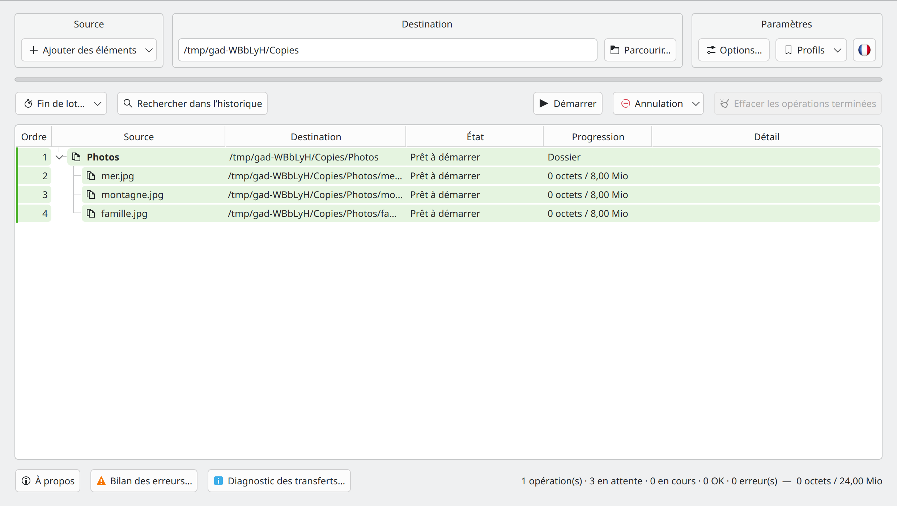
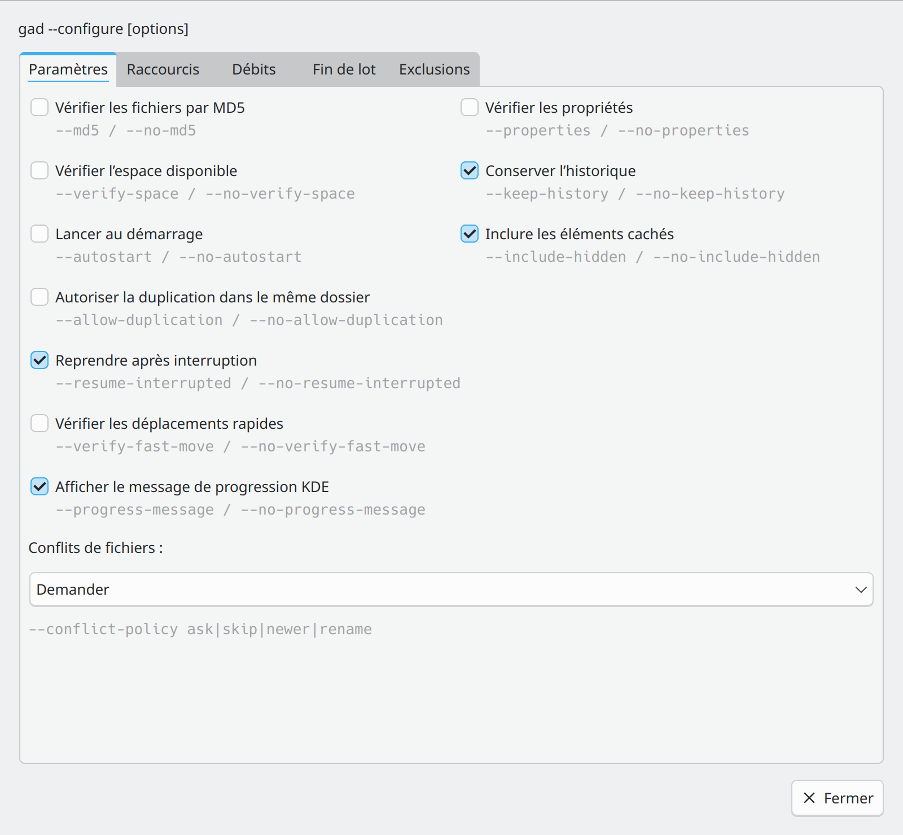
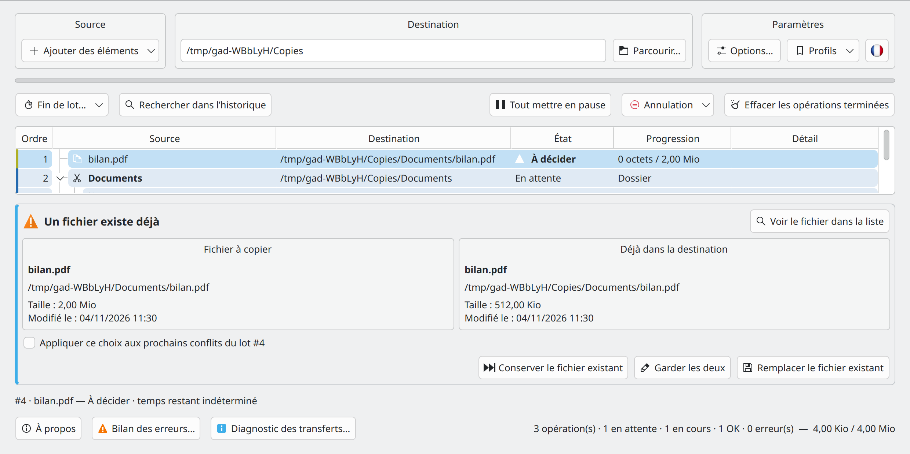

# Gad — Démarrage rapide

**Gad, il copie. · Gestionnaire Avancé de Duplication · Version 0.4.0**

[Guide utilisateur](GUIDE_UTILISATEUR.md) · [Guide développeur](GUIDE_DEVELOPPEUR.md) · [Toutes les langues](README.md)

## Installer Gad

Utilisez le [PPA Gad](https://launchpad.net/~hizo/+archive/ubuntu/gad) pour une série Ubuntu prise en charge. Les [releases GitHub](https://github.com/Hizoka76/gad/releases/latest) proposent aussi un `.deb`, une archive `.tar.gz` contenant les sources et le programme déjà compilé, ainsi que le binaire direct `gad-linux-amd64`.

```sh
sudo add-apt-repository ppa:hizo/gad
sudo apt update
sudo apt install gad
```

Vérifiez sur la page du PPA qu’un paquet est publié pour votre version d’Ubuntu. Si `add-apt-repository` est absent, installez `software-properties-common`.

Les commandes, dépendances et différences entre les formats sont expliquées dans le [guide utilisateur](GUIDE_UTILISATEUR.md#installer-et-demarrer).

## Ouvrir Gad

Lancez **Gad** depuis le menu des applications, ou exécutez :

```sh
gad
```

Si nécessaire, suivez les [instructions d’installation](GUIDE_UTILISATEUR.md#installer-et-demarrer). Fermer la fenêtre laisse normalement Gad dans la zone de notification lorsqu’elle est disponible. Cliquez sur son icône pour le retrouver.

## Faire une première copie



Choisissez la destination et les options, puis ajoutez vos fichiers dans Gad. Lorsque rien n’est en cours, vérifiez la liste et cliquez sur **Démarrer**. Un collage externe depuis le gestionnaire de fichiers démarre automatiquement ; les ajouts pendant un transfert rejoignent sa file. **Ctrl+C** copie, **Ctrl+X** déplace. Le glisser-déposer dans Gad prépare toujours une copie.

## Suivre et piloter les opérations

- **En attente** : attend son tour. **En cours** : transfert actif. **OK** : terminé.
- Développez un dossier pour voir ses fichiers. Les couleurs distinguent les demandes ; **Ordre** indique l’ordre de traitement.
- **Tout mettre en pause** suspend la file. Le même bouton permet de reprendre. Le clic droit propose les commandes individuelles : pause, reprise, réessai et annulation.
- Sélectionnez des lignes en attente pour les **Traiter ensuite**, ou déplacez-les par glisser-déposer lorsque la table affiche l’ordre de la file.
- Annuler arrête l’opération ; **Annuler et remettre comme avant** tente aussi de restaurer ce qui a déjà été traité grâce à l’historique conservé. Lisez la confirmation et le résultat avant de nettoyer l’historique.

## Régler les préférences



*La boîte des options, ouverte depuis le bloc Paramètres.*

Dans **Paramètres → Options… → Exclusions**, saisissez un motif par ligne dans **Dossiers exclus** ou **Fichiers et liens symboliques exclus**. Chaque champ est enregistré dès qu’il perd le focus, sans bouton Appliquer et sans dialogue supplémentaire. Une règle invalide est signalée ; les règles précédentes restent actives et le texte à corriger reste visible. Ces règles concernent les prochains transferts. La case **Inclure les éléments cachés** reste dans l’onglet **Paramètres**.

**Autoriser la duplication dans le même dossier** crée par exemple `photo_copied1.jpg` lorsqu’on recopie un fichier dans son dossier d’origine. Désactivée par défaut, cette option concerne uniquement les copies. Les choix de sélection, vérification et duplication sont figés pour les nouvelles demandes ; les anciennes gardent leurs réglages. Le débit global peut changer pendant les transferts.

## Coller depuis le gestionnaire de fichiers

- **Dolphin** : activez **Ctrl+V avec Gad dans Dolphin** dans les paramètres, puis relancez Dolphin. Le menu contextuel propose aussi **Coller avec Gad**.
- **Konqueror** : utilisez le lanceur **Konqueror avec Gad** et activez sa case dans les paramètres. Les collages de fichiers passent par Gad ; le texte reste natif.
- **Autres gestionnaires** : collez dans Gad, glissez les fichiers ou créez une action avec une destination explicite, par exemple `gad --paste "/home/demo/Documents/Copies"`. Leur Ctrl+V n’est pas automatiquement intercepté.

Un collage lancé depuis le gestionnaire peut travailler en arrière-plan sans ouvrir Gad. La notification de progression Plasma contient un lien **Afficher Gad**.

## Résoudre un conflit ou une erreur



*Comparez la source et le fichier existant avant de décider.*

Lorsqu’un fichier existe déjà, choisissez **Conserver le fichier existant**, **Conserver les deux** ou **Remplacer le fichier existant**. N’appliquez la décision aux conflits suivants que si c’est souhaité.

Le **Bilan des erreurs…** permet de consulter, copier ou exporter les détails et de réessayer uniquement les fichiers en erreur. Si un périphérique disparaît, reconnectez le même au même emplacement et laissez Gad vérifier avant de reprendre.

**Conserver l’historique** garde les informations de remise en état. **Effacer les opérations terminées** retire les informations de restauration correspondantes. Pour la récupération, les adresses distantes, MD5 et les différentes annulations, consultez le [guide utilisateur](GUIDE_UTILISATEUR.md).

## Configuration et pages de manuel {#command-settings}

`gad --configure` enregistre les préférences et met à jour les contrôles de l’instance ouverte. Sans instance, Gad démarre en arrière-plan et la commande rend la main. Les formes `--no-…` désactivent les cases. Les exclusions non fournies sont conservées ; répéter `--exclude-folder` ou `--exclude-file` remplace la liste correspondante. `--clear-exclusions` vide les deux listes. Le débit global est exprimé en Mio/s ; 0 signifie illimité. `--md5` et `--properties` utilisés avec une copie ou un déplacement ne modifient que ce transfert. Les raccourcis Dolphin utilisent `gad --configure --dolphin-ctrl-v` ou `--no-dolphin-ctrl-v`.

```bash
gad --configure --md5 --verify-space --no-include-hidden
gad --configure --exclude-folder "__*" --exclude-file "*.tmp" --language fr_FR --rate-limit 25
```

`man gad` · `make manpages`

## Surveillance automatique de Ctrl+V {#dolphin-watchdog}

Voir le guide utilisateur pour protéger le lanceur Dolphin habituel et charger la surveillance automatique de Ctrl+V.

[Surveillance automatique de Ctrl+V](GUIDE_UTILISATEUR.md#dolphin-watchdog)


## Profils de transfert

Dans **Paramètres → Profils**, enregistrez toutes les options actuelles sous un nom, puis choisissez ce nom pour les appliquer en un clic. **La destination n’est jamais enregistrée ni modifiée.** Les options globales, notamment langue et débit global, prennent effet normalement. **Gérer les profils…** permet de mettre à jour, renommer ou supprimer les définitions. Voir les [profils de transfert](GUIDE_UTILISATEUR.md#transfer-profiles).

En ligne de commande, `gad --profile "Mon profil"` applique le profil sans lancer de transfert. Combinez-le avec une copie : `gad --profile "Mon profil" --copy /chemin/source --to /chemin/destination`, ou avec `--move` / `--paste`. Gad attend la fin de l’application du profil avant de lancer le transfert. La destination vient de la commande ; les options explicites, telles que `--md5`, priment sur le profil. Un nom inconnu renvoie une erreur sans ajouter de fichiers. `--configure --profile "Mon profil"` accepte aussi des réglages supplémentaires, appliqués après le profil.


## Préparer les transferts dans la liste principale

Choisissez la destination et les options, puis ajoutez vos fichiers dans Gad. Lorsque rien n’est en cours, vérifiez la liste et cliquez sur **Démarrer**. Un collage externe depuis le gestionnaire de fichiers démarre automatiquement ; les ajouts pendant un transfert rejoignent sa file. **Ctrl+C** copie, **Ctrl+X** déplace. Le glisser-déposer dans Gad prépare toujours une copie.

## Les options

**Paramètres → Options…** ouvre une fenêtre modale : la fenêtre principale reste bloquée jusqu’à sa fermeture, tandis que les transferts continuent. Les réglages s’appliquent immédiatement ; **Fermer** ou Échap ne les annule pas. Les paramètres de commande apparaissent en gris sous les contrôles. Taille minimale : **800 × 740** ; fenêtre principale, bilan des erreurs et diagnostic : **1100 × 600**.

Les cinq onglets sont **Paramètres**, **Raccourcis**, **Débits**, **Fin de lot** et **Exclusions**. Les paramètres de commande sont indiqués en gris. Le débit des lots existants se modifie via le menu contextuel des lignes ; la limite apparaît dans **Détail**.

## Ajout, raccourcis et exclusions

Le menu **Ajouter des éléments** regroupe **Ajouter des fichiers…** (Ctrl+Maj+O), **Ajouter un dossier…** (Ctrl+O) et **Fichiers du presse-papiers** (Ctrl+V). Ce dernier conserve le mode Copier ou Couper. Au repos, tous les ajouts depuis Gad attendent **Démarrer** ; pendant des transferts déjà lancés, ils rejoignent la file. Seul le collage externe depuis le gestionnaire de fichiers démarre automatiquement.

**Ctrl+F** ouvre la recherche. **Ctrl+Q** demande à quitter Gad et refuse la sortie si des transferts sont actifs. **Ctrl+Alt+W** masque la fenêtre sans arrêter les transferts. Le bouton drapeau, à droite de **Profils**, change immédiatement la langue. Les boutons de la fenêtre principale disposent d’infobulles.
