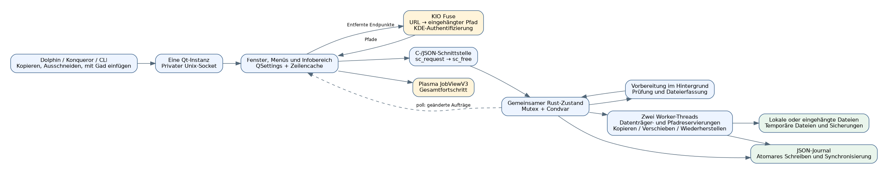
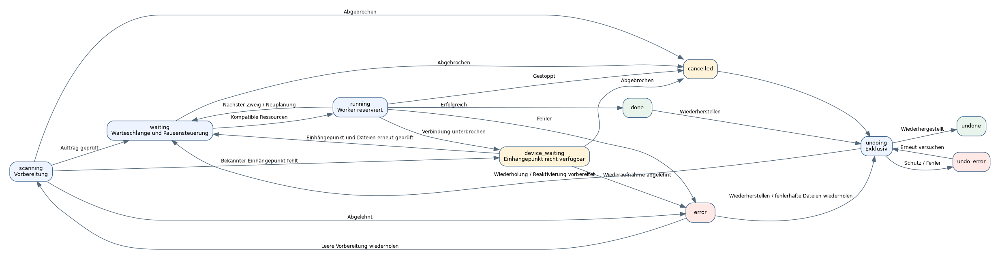

# Gad — Entwicklerhandbuch {#gad-developer-guide}

Dokumentierte Version: **0.4.0**, Protokoll **35**, 12. November 2026.

Gad bedeutet **Gestionnaire Avancé de Duplication**; Sein Slogan lautet **Gad, il copie.**. Dieser Leitfaden beschreibt die Implementierung in diesem Repository. Der Code bleibt maßgeblich für die genauen Felder und Standardeinstellungen.

[Französisch](GUIDE_DEVELOPPEUR.md) · [Benutzerhandbuch](USER_GUIDE.de-DE.md) · [Testen](../TESTING.de-DE.md) · [Dokumentationsindex](README.de-DE.md)

## Inhalt {#contents}

1. [Architektur](#architecture)
2. [Kompilierung](#building)
3. [Start und Einzelinstanzbetrieb](#startup-and-single-instance-routing)
4. [Zwischenablage, Pfade und KIO](#clipboard-paths-and-kio)
5. [Vorbereitung der Aufträge](#preparing-requests)
6. [Ablaufplanung und Parallelität](#scheduling-and-concurrency)
7. [Modell und Zustände](#model-and-states)
8. [Dateikopie und Bereitstellung des Ergebnisses](#file-copy-and-publication)
9. [Geschwindigkeitsbegrenzungen](#bandwidth-limits)
10. [Warten auf die erneute Verbindung](#reconnection-waiting)
11. [Journal und Wiederherstellung nach einem Absturz](#journal-and-crash-recovery)
12. [Wiederherstellung, Abbruch und Reaktivierung](#undo-cancellation-and-reactivation)
13. [Oberfläche, Messwerte und Fehlerberichte](#interface-metrics-and-error-reports)
14. [Protokollreferenz](#protocol-reference)
15. [Installation und Dolphin-Integration](#installation-and-dolphin-integration)
16. [Prüfung und Wartung](#testing-and-maintenance)
17. [Werkzeuge für die Dokumentation](#documentation-tooling)
18. [Bekannte Einschränkungen](#explicit-limitations)

## Architektur {#architecture}

Gad ist eine ausführbare Linux-Datei, die eine Rust-Übertragungs-Engine und eine C++/Qt 6-Widgets-Schnittstelle enthält. Es ist mit den Systembibliotheken Qt/KDE verknüpft. Der erste Prozess besitzt das Fenster, den lokalen Server und die Engine; Nachfolgende Starts senden Befehle an diese Instanz.



Die Hauptgrenzen sind Dolphin/CLI bis Gad, Qt bis Rust und Rust für das Dateisystem. Der erste verwendet Argumente, Daten aus der Zwischenablage und optional den privaten Unix-Socket. Der zweite verwendet synchrone JSON-Aufrufe über `sc_request` und `sc_free`, wobei lange Arbeit an Engine-Aufgaben delegiert wird. Der dritte nutzt temporäre Dateien, Veröffentlichung, Quelllöschung für Verschiebungen, Rückgängigmachen von Sicherungen und ein persistentes Journal.

KIO Fuse macht entfernte Endpunkte als bereitgestellte Pfade verfügbar; Die Rust-Engine überträgt weiterhin ihre Daten. Plasma zeigt eine D-Bus-Fortschrittsansicht an und führt den Kopiervorgang nicht durch.

### Codekarte {#code-map}

| Standort | Verantwortung |
|---|---|
| `src/main.rs` | Einstiegspunkt, Qt-Start, C ABI und verzögerte Engine-Initialisierung. |
| `src/engine.rs` | Gemeinsames Modell, Befehlsweiterleitung, Arbeiterkoordination und Dateiverarbeitung. |
| `src/engine/validation.rs` | Stammvalidierung, Vorbereitung und Aufbewahrung der während der Vorbereitung erhaltenen Kontrollen. |
| `src/engine/duplicates.rs` | Unterdrückung von Duplikaten vor der Veröffentlichung neuer Eintragsindizes. |
| `src/engine/scheduling.rs` | Physische Festplattenressourcen und atomare Worker-Reservierungen. |
| `src/engine/row_queue.rs`, `queue.rs` | Zweigreihenfolge, Prioritäten, Abhängigkeiten und stabile Referenzen. |
| `src/engine/fast_move.rs` | Lokale Umbenennungsberechtigung, Bind-Mount-Routen und Neuplanung. |
| `src/engine/tree_move.rs` | Umbenennen des gesamten Baums, gruppierte Journaleingänge und Rückgängigmachen. |
| `src/engine/controls.rs`, `selection.rs` | Auswahlerweiterung, Pause, Abbruch, Wiederholungsvorbereitung und Zeilenentfernung. |
| `src/engine/errors.rs` | Strukturierte Fehlerberichte und atomare gezielte Wiederholungsvalidierung. |
| `src/engine/rate.rs` | Geteilte Byte-Budgets und Byte-Budgets pro Anfrage. |
| `src/engine/properties.rs` | Offengelegte Besitz-/Modus-/ACL-/xattr-Vergleiche. |
| `src/engine/resume.rs` | Dauerhafte Prüfpunkte und verifizierte Wiederherstellung teilweiser Dateien. |
| `src/engine/reconnect.rs` | Montieren Sie Anker, warten Sie auf erneute Verbindung und steuern Sie die erneute Bindung von Gerätenummern. |
| `src/engine/history.rs`, `undo.rs` | Persistenz, Wiederherstellungsladen, Preflight-Prüfungen und Rückgängigmachen. |
| `src/engine/snapshot.rs` | Flüchtige Revisionen und unterschiedliche Schnappschüsse. |
| `src/engine/protocol.rs`, `native/protocol.def` | Generiertes Drahtvokabular, das von Rust und Qt geteilt wird. |
| `src/engine/tests.rs` | Engine-Regressionstests mit temporären Vorrichtungen. |
| `native/application.*` | Anwendungslebenszyklus, Argumente, Socket und Aktivierung. |
| `native/window.*` | Fensterbau und Koordination. |
| `native/window_commands.cpp` | Auswahlanfragen, Aktionen und KIO-Wiederverbindungsprüfungen. |
| `native/window_rows.cpp`, `row_tree.h`, `transfer_tree.h` | Stabile Widgets, Ordnerbäume, internes Drag-and-Drop und Anforderungsakzente. |
| `native/window_conflicts.cpp` | Quelle-Ziel-Vergleich und Konfliktentscheidungen. |
| `native/window_errors.cpp`, `error_report.h` | Fehlerberichtsdialog, exakte Wiederholungsanforderungen und Atomic Text/JSON-Export. |
| `native/window_open.cpp`, `row_paths.h` | Öffnen von Dateien/Ordnern auf dem Desktop ohne Shell-Interpretation. |
| `native/clipboard.h`, `kio_sources.h`, `paths.h` | Zwischenablageformate, URL-Validierung und KIO-Auflösung. |
| `native/notifications.h` | Aggregierter Plasma JobView-Fortschritt und -Befehle. |
| `native/snapshot.h`, `presentation.h`, `transfer_metrics.h` | Zwischengespeicherte Schnappschüsse, Beschriftungen, Gesamtwerte, Geschwindigkeit und Schätzungen der verbleibenden Zeit. |
| `build.rs` | Native Kompilierung, Ressourcen, generiertes Protokoll und Verknüpfung. |
| `scripts/`, `tests/` | Installation, isolierte Validierung und Dokumentationstools. |

## Kompilierung {#building}

Für eine bereits kompilierte Version verwenden Sie das [Gad-PPA](https://launchpad.net/~hizo/+archive/ubuntu/gad) oder die [GitHub-Releases](https://github.com/Hizoka76/gad/releases/latest): `.deb`-Paket, Archiv mit Quellen und Programm unter `prebuilt/` oder direkte Programmdatei. Siehe [Installationsanleitung](USER_GUIDE.de-DE.md#installation-and-startup). Die folgenden Kompilierschritte betreffen Entwicklung und Installation aus dem Quellcode.

Zu den Anforderungen gehören Rust/Cargo, ein C++17-Compiler, `pkg-config`, Python 3, Qt 6 Widgets/Network/DBus und seine Tools `moc`, `rcc` und `qmake6` sowie KF6 WindowSystem/XmlGui, CMake. Für Qt-Tests sind außerdem Qt-Test und `dbus-run-session` erforderlich. Der Zugriff auf die Wayland-Zwischenablage verwendet `wl-clipboard`; Remote-Endpunkte erfordern die Sicherung KIO. Rust-Abhängigkeiten sind in `Cargo.lock` gesperrt.

```bash
cargo build --locked
cargo build --release --locked
./target/debug/gad --help
```

`build.rs` generiert Rust-Definitionen aus `protocol.def`, kompiliert die nativen Einheiten, führt die Ressourcen- und Metaobjektgenerierung durch und verknüpft das native Archiv. Es fügt die Cargo-Version und das Erstellungsdatum ein. Änderungen an nativen Quellen lösen eine Rekonstruktion aus. Nur Rust-Änderungen sollten nicht alle Widgets neu erstellen. Release-Builds ermöglichen LTO- und Strip-Distribution-Symbole; Verwenden Sie Entwicklungsbinärdateien für das native Debugging.

### C ABI-Vertrag {#c-abi-contract}

`sc_request` akzeptiert UTF-8 JSON und gibt eine Rust-zugeordnete Antwortzeichenfolge zurück. Rufen Sie `sc_free` **genau einmal** für dieses Ergebnis auf; Verwenden Sie nicht C++ `delete` oder `free`. Die Engine wird träge initialisiert und innerhalb des Prozesses gemeinsam genutzt.

Die Grenze fängt Rust-Panikzustände ab, sodass sie nicht über C abgewickelt werden. Vergiftete Sperren oder beschädigte logische Zustände werden nicht repariert. Erwartete Fehler müssen strukturierte Ergebnisse sein. Ungültige UTF-8-Pfade und eingebettete NUL-Werte werden abgelehnt und nicht stillschweigend in einen anderen Dateinamen konvertiert.

## Start und Einzelinstanzbetrieb {#startup-and-single-instance-routing}

Argumente werden zu einem Befehl, bei Bedarf mit Zwischenablage und URL-Verarbeitung. Qt findet den vorhandenen Benutzer-Socket und verwendet eine Sperre, um gleichzeitige Server zu verhindern. Eine vorhandene Instanz empfängt den Befehl und der neue Prozess wird beendet. Andernfalls initialisiert der Prozess das Fenster/den Server und führt die erste Anforderung aus.

Der Socket ist `gad.sock` im Laufzeitverzeichnis des Benutzers. Anfragen werden mit Zeilenumbrüchen beendet (JSON), eine Antwort pro Verbindung, mit einem Limit von 16 MiB für eingehende Anfragen und Zugriff nur für Benutzer. `--status` ohne Instanz muss fehlschlagen, anstatt eine grafische Engine zu starten.

Es werden nur die eigenen Einstellungen und Journalspeicherorte von Gad verwendet. Die aktuelle Protokollversion ist **35**. Fähigkeits-/Versionsprüfungen verhindern, dass eine Verschiebung, ein Remote-Endpunkt oder eine Verifizierungsanforderung stillschweigend an eine ältere Instanz gesendet wird, die diese nicht implementieren kann. Eine neu installierte ausführbare Datei kontaktiert möglicherweise immer noch einen älteren Prozess. Aktualisieren Sie eine inaktive Instanz durch normales Herunterfahren.

```bash
gad
gad --background
gad --status
gad --copy /tmp/demo/source.txt --to /tmp/demo/destination
gad --move /tmp/demo/source.txt --to /tmp/demo/destination
gad --copy /tmp/demo/source.txt --to /tmp/demo/destination --md5
gad --copy /tmp/demo/source.txt --to /tmp/demo/destination --properties
gad --paste /tmp/demo/destination
gad --paste-context /tmp/demo/destination --background
```

`gad://show` aktiviert das Fenster von Plasma. `--smoke-test` und `--export-icons` sind Integrationstools. `_sources_resolved` gibt an, dass die Qt-Vorbereitung bereits stattgefunden hat; Die Engine-Validierung wird dadurch nicht umgangen.

Akzeptanz ist keine Vollendung. `enqueue` kann eine ID zurückgeben und später beim Scannen fehlschlagen. Clients müssen Endzustände beachten.

## Zwischenablage, Pfade und KIO {#clipboard-paths-and-kio}

### Verhalten in der Zwischenablage {#clipboard-behavior}

Datei-URL-Listen und Dateimanagerformate haben Vorrang vor reinem Text. KDE- und GNOME-Schnittmarkierungen wählen den Verschiebemodus; Durch Ziehen und Ablegen wird der Kopiermodus ausgewählt. Zieltextfelder behalten das normale Einfügen von Text bei, während das Einfügen von Dateilisten in die Warteschlange von Gad gelangt.

Auf Wayland ermöglichen begrenzte `wl-paste`-Aufrufe den Zugriff auf die Zwischenablage unabhängig vom Fensterfokus. `QClipboard` ist ein Fallback für die Nichtverfügbarkeit des Tools und keine Möglichkeit, vorhandene, aber fehlerhafte Daten neu zu interpretieren. Die Dateiliste und die Schnittmarkierung werden erneut auf Konsistenz überprüft, die externe Zwischenablage ist jedoch keine atomare Transaktion mit einer anderen Anwendung.

### Pfadvalidierung und Remote-Auflösung {#path-validation-and-remote-resolution}

Klassifizieren Sie die Eingabe vor der Konvertierung. Eine `file:`-URL muss lokal sein, mit einem leeren Host oder `localhost` und ohne Anmeldeinformationen, einen Port, eine Abfrage oder ein Fragment. NUL und ungültige Codierung ablehnen. Ein absoluter POSIX-Pfad, der ein Literal `://` enthält, bleibt ein Pfad.

Unterstützte Remote-Schemata sind `kdeconnect`, `ftp`, `sftp` und `smb`, sowohl für Quellen als auch für Ziele. Überprüfen Sie vor der Bereitstellung host- und schemaspezifische Einschränkungen. Bei beibehaltenen Ursprungs-URLs werden Passwörter weggelassen. `Job.destination` ist ein kanonischer POSIX-Pfad; Mit `destination_url` und `source_urls` können Labels die ursprünglichen Remote-Adressen rekonstruieren. Aktionen zum Öffnen von Dateien verwenden weiterhin tatsächlich bereitgestellte Pfade.

`SourceUrls::Resolver` ruft den D-Bus-Dienst `org.kde.KIOFuse`, Objekt `/org/kde/KIOFuse`, Schnittstelle `org.kde.KIOFuse.VFS`, Methode `mountUrl` auf. KDE besitzt die Authentifizierung. Gad implementiert keinen separaten FTP/SSH/SMB-Anmeldeinformationsspeicher.

Klären Sie beide Seiten innerhalb einer Vorbereitungsfrist von 30 Sekunden, bevor Sie die Anfrage an Rust senden. Bei einem Fehler dürfen nicht nur die ersten behobenen Quellen gemeldet werden. Spätere Einreichungen bewahren die Ordnung, während die Lösung noch aussteht. Eine Stornierung macht verspätete Rückrufe ungültig; Es wird nicht versprochen, interne KIO-Servervorgänge abzubrechen.

`destination_context` behält den ausgewählten Kontext von Dolphin bis zur Auflösung bei. Es wählt den angeklickten Ordner oder das freigegebene übergeordnete Element der ausgewählten Dateien aus und wird dann vor der Engine-Übermittlung entfernt. Entfernte Ziele erfordern Protokoll 12 oder höher.

### Semantik des KIO-Dateisystems {#kio-filesystem-semantics}

Überprüfen Sie offene Deskriptoren über `/proc/self/fdinfo` und `/proc/self/mountinfo`. Nur bewährte `fuse.kio-fuse`-Mounts verwenden die spezielle Verzeichnissynchronisierungssemantik: Dateidaten werden synchronisiert, während nicht unterstütztes Verzeichnis-fsync nicht angefordert wird. Lokale Synchronisationsfehler bleiben Fehler.

Quellberechtigungen und -zeiten werden nicht auf KIO Fuse-Ziele angewendet, wenn der Dienst keine chmod/utime-Semantik bereitstellen kann. Der Dienst ermittelt diese Metadaten. Eine neu und exklusiv erstellte Remote-Temporärdatei wird explizit auf Null gekürzt, um den Cache von KIO zu initialisieren, ohne eine leere FTP-Datei herunterzuladen.

Die dauerhafte Wiederherstellung nach einem Absturz ist für KIO Fuse-Ziele, einschließlich direkt eingegebener Mount-Pfade, deaktiviert. Die normale Sitzungspause und der kontrollierte Wiederverbindungsversuch bleiben weiterhin verfügbar. Ursprüngliche Journalpfade werden nach dem Daemon-Neustart nicht stillschweigend einem neuen KIO Fuse-Mount zugeordnet.

## Vorbereitung der Aufträge {#preparing-requests}

`enqueue` validiert die Anforderungsstruktur, Quellen, Optionen und Ursprungsmetadaten, reserviert eine monotone ID in `scanning`, behält sie bei und startet die Vorbereitung außerhalb des UI-Threads.

Validieren Sie das Ziel und die Roots, lehnen Sie Selbstkopien und ungültige Mount-Aliase ab, scannen Sie Ordner vor ihren untergeordneten Ordnern in deterministischer Reihenfolge und identifizieren Sie Festplattenressourcen. Nicht unterstützte Spezialdateien und Namen außerhalb des UTF-8-Vertrags schlagen explizit fehl. Symbolische Links sind Einträge, keine rekursiv durchlaufenen Quellverzeichnisse.

**Keine Datei in einer Anfrage wird kopiert, bis die erste Validierung und der Scan abgeschlossen sind.** Ein Vorbereitungsfehler führt zu einem Fehler, anstatt eine teilweise analysierte Gruppe zu starten.

Mount-Anker werden erfasst, solange die Endpunkte bekannt sind. Stellen Sie vor dem Festschreiben vorbereiteter Einträge sicher, dass die Anforderung noch vorhanden ist und nicht abgebrochen oder gestoppt wurde. Behalten Sie die nach dem Vorbereitungs-Snapshot empfangenen Pause-/Abbruch-/versteckten Steuerelemente bei. Verspätete Ergebnisse dürfen stornierte Einträge nicht erneut aktivieren.

Eine gültige Hintergrundeinfügung kann eine ältere globale Pause löschen. Eine nach der Übermittlung angeforderte Pause gewinnt durch die Pausengenerierung. Vollständig duplizierte Einreichungen werden ohne Lifting-Pause zurückgegeben.

Transferarbeiter werden beim Herunterfahren hinzugezogen. Vorbereitungsaufgaben verwenden logische Stornierung und Ablehnung verspäteter Ergebnisse. Für ein blockiertes Dateisystem oder einen KIO-Aufruf gibt es keine garantierte sofortige Stornierung.

### Doppelte Unterdrückung {#duplicate-suppression}

`duplicates.rs` kombiniert Quell- und Zielpfade, Geräte-/Inode-Identität, Art und Kopier-/Verschiebemodus. Die übergeordnete Normalisierung erkennt Aliase und Bind-Mounts, ohne dem endgültigen Quelllink zu folgen. Ältere Scans werden vor der Zulassungsentscheidung abgeschlossen, sodass der älteste akzeptierte Antrag gleichzeitige Duplikate erhält.

Eine bei der Übermittlung aktive Anfrage bleibt ein Kandidat, wenn sie während des neuen Scans abgeschlossen wird. Eine bereits vor der Abgabe abgeschlossene Anamnese ist ausgeschlossen, so dass absichtliche Wiederholungskopien möglich sind. Unterschiedliche Ziele und Kopier-versus-Verschiebungsabsichten bleiben unterschiedlich.

Bewahren Sie die erforderlichen Vorfahrenordner für einzelne Kinder auf. Eine neue unveröffentlichte Anfrage kann ihren Eintragsvektor filtern, bevor Indizes sichtbar werden. Behalten Sie bei einer wiederhergestellten, nicht gestarteten Anforderung die veröffentlichten Indizes bei und blenden Sie stattdessen übersprungene Duplikate aus. Verwerfen Sie aufgezeichnete Teilarbeiten nicht. `duplicates_ignored` stellt eine informative UI-Meldung ohne Aktionsaufforderung bereit.

## Ablaufplanung und Parallelität {#scheduling-and-concurrency}

Gemeinsam genutzte Ressourcen verwenden `Arc`, `Mutex`, `Condvar` und ein atomares Stoppflag. Zwei persistente Worker wählen und reservieren Anforderungen atomar unter `state`. Die Dateisystemarbeit wird außerhalb dieser Sperre ausgeführt. Halten Sie niemals `state` gedrückt, während Sie `save` aufrufen: Die Reihenfolge der Journalsperre lautet **Schriftsteller, dann Staat**.

Eine Anfrage verarbeitet ihre Einträge nacheinander, aber Reservierungen werden an Zweiggrenzen zurückgegeben, sodass unabhängige Wurzeln mit anderen Anfragen verschachtelt werden können. Gewöhnliche parallele Kopien benötigen getrennte bekannte physische Festplattenressourcen. Partitionen und Verbundgeräte werden über `/sys/dev/block` verfolgt; Eine ungelöste Topologie macht eine gewöhnliche Kopie exklusiv.

Schnelle lokale Umbenennungsaufträge können Festplatten gemeinsam nutzen, wenn sich normalisierte reservierte Pfade nicht überschneiden. Unbekannte Pfade oder überlappende Quell-/Zielbäume behalten die Serialisierung bei. Eine zuvor blockierte Anfrage behält die Priorität auf den entsprechenden Festplatten. Ein neuer unvollendeter Scan stellt ein Bestellhindernis dar. Ausdrücklich unterbrochene Arbeiten können dazu führen, dass zulässige spätere Arbeiten fortgesetzt werden können.

Das Rückgängigmachen ist exklusiv und verwendet die umgekehrte Funktion **tatsächliche Ausführungsreihenfolge**, wobei auf IDs für ältere Datensätze zurückgegriffen wird. Es wartet auf aktive Übertragungen und kann ausgeführt werden, während das normale Kopieren global angehalten wird. Die Planung ist konservativ; Es verspricht keinen maximalen Durchsatz auf beliebigem RAID- oder Netzwerkspeicher.

### Interne Anfragen und die sichtbare Gesamtstruktur {#internal-requests-and-the-visible-forest}

Ein `Job` besitzt ein Ziel, erfasste Verifizierungsoptionen und Journale. Die Eintrittsindizes bleiben stabil. `jobRows` speichert getrennte Qt-Metadaten, sobald Einträge vorhanden sind. Dateiwurzeln hängen direkt am Baum; Tatsächliche Ordner sorgen für visuelle Elternschaft. Leere Zubereitungen behalten einen Platzhalter.

Persistiertes `row_order` enthält `(job, index)`-Schlüssel mit einem Nullindex für einen Platzhalter. Der zwischengespeicherte `row_queue::Layout` zeichnet Wurzeln, Eltern, Kinder und Vorbestellungen auf, ohne die Eintragsvektoren neu anzuordnen. Quelle **und Ziel** Die Abstammung bestimmt die Elternschaft, einschließlich unabhängig eingereichter verschachtelter Wurzeln und verstorbener Eltern.

`reorder_rows` validiert die gesamte Auswahl, das Ziel, die Aktivität, die übergeordneten Einschränkungen und Abhängigkeiten vor der Mutation. Es unterstützt `before`, `after`, `next`, `up`, `down` und `last`. Ein ausgewählter Ordner umfasst Nachkommen. Durch keine Aktion wird eine Datei neu zugeordnet oder ihr Ziel geändert. Die beim Scannen festgelegte Priorität wird vom Platzhalter zu seinen Wurzeln übertragen.

Die Mitarbeiter befolgen den angeordneten Verzweigungsplan und bemerken Layoutrevisionsänderungen zwischen den Dateien, nicht in der Mitte einer Datei. Angehaltene Warteeinträge halten keine Arbeiter fest. Eine leere Finalisierung darf die Ausführungsreihenfolge nicht vorverlegen, da dies die Rückgängig-Chronologie beschädigen würde.

Rohe und normalisierte Zielabhängigkeiten schützen die Ersetzungsreihenfolge über Anfragen hinweg und wiederholte Namen innerhalb einer Anfrage. Teilweise veröffentlichte abhängige Arbeiten können nicht gefährlich verschachtelt werden. Reservierte zukünftige Namen verhindern auch, dass „Beide behalten“ den beabsichtigten Namen eines anderen Eintrags in der Warteschlange verbraucht. Historische Terminalanfragen verhindern keine gültigen neuen Prioritätsänderungen.

## Modell und Zustände {#model-and-states}

| Objekt | Schlüsselinvariante |
|---|---|
| `State` | Anforderungs-IDs werden nicht wiederverwendet; Die Warteschlangen-/Zeilenreihenfolge ist vom chronologischen Verlauf getrennt. |
| `Job` | Verifizierungsoptionen werden bei der Übermittlung erfasst; Kontrollen und Ratenbegrenzungen können sich durch ihre Befehle ändern. |
| `Entry` | Quelle, Ziel, Art, Identität, Zähler, Fehler und Rückgängig-Referenzen sorgen für einen stabilen Index. |
| `undo::Record` | Beschreiben Sie die Auswirkungen auf das Dateisystem, bevor Sie die für die Wiederherstellung erforderlichen Schritte ausführen. |
| `undo::Stamp` | Geräte-/Inode-, Typ-, Größe-, Zeit- und Verbindungsdaten schützen eigene Ergebnisse. |
| Snapshot-Revision | Volatile Nachverfolgung von UI-Änderungen, keine dauerhaften Eigentumsnachweise. |

| JSON-Status | Bedeutung |
|---|---|
| `scanning` | Validierung/Vorbereitung. |
| `waiting` | Arbeit in der Warteschlange. |
| `device_waiting` | Fehlende bekannte Halterung; Teildaten bleiben erhalten. |
| `running` | Ein Mitarbeiter bearbeitet die Anfrage/Eingabe. |
| `verifying` | Unabhängige MD5-Lesevorgänge. |
| `conflict` | Es ist ein Aktenentscheid erforderlich. |
| `skipped` | Ausgeschlossener Eintritt; Quelle bleibt bestehen. |
| `done` | Vollendet. |
| `error` | Ein dokumentierter Fehler. |
| `cancelled` | Gestoppt, ohne abgeschlossene Ergebnisse automatisch rückgängig zu machen. |
| `undo_waiting` | Geplantes Rückgängigmachen. |
| `undoing` | Exklusive Wiederherstellungsarbeiten. |
| `undone` | Effekte wiederhergestellt. |
| `undo_error` | Das Rückgängigmachen konnte nicht sicher abgeschlossen werden. |

Pause ist ebenfalls eine Präsentations-/Steuerungsüberlagerung und kein neuer serialisierter Übertragungsstatus. Konflikt-/Übersprungen-/Wartestatus auf Dateiebene sind nicht alle Terminal-Jobstatus; Verwenden Sie die gemeinsam genutzten Protokolldefinitionen, anstatt anhand der Anzeigebezeichnungen zu raten.



## Dateikopie und Bereitstellung des Ergebnisses {#file-copy-and-publication}

Überprüfen Sie für eine reguläre Datei erneut die Kontrollen und die Mount-Verfügbarkeit, validieren Sie übergeordnete Zieldateien, lösen Sie Konflikte, reservieren Sie den Zielnamen und weisen Sie eine private `file.ext.part`-Datei im Zielverzeichnis zu. Nutzen Sie exklusive Erstellungs- und restriktive Anfangsberechtigungen. Quellen werden geöffnet, ohne ihrem endgültigen Symlink zu folgen, und mit gescannten Identitäten verglichen.

Der Kopierpuffer ist **64 KiB** und kann bei Ratenbegrenzung in kleineren gewährten Bruchteilen geschrieben werden. Der Fortschritt schreitet um die tatsächlich geschriebenen Bytes voran. Ein inkrementeller MD5-Digest wird auch ohne unabhängige MD5-Überprüfung beibehalten, da beim Rückgängigmachen Inhaltsnachweise verwendet werden.

Kompatible lokale Kopien erstellen dauerhafte Fortsetzungpunkte. Synchronisieren Sie Daten, wenden Sie grundlegende Berechtigungen und Änderungszeiten an, sofern dies unterstützt wird, und führen Sie ausgewählte Inhalts-/Eigenschaftsprüfungen durch. Veröffentlichen Sie **dieselbe verifizierte temporäre Datei** mit Umbenennen. `renameat2(RENAME_NOREPLACE)` schützt ein gleichzeitig angezeigtes Ziel; Beim Ersetzen bleibt das vorherige Ziel privat erhalten, bis die wiederherstellbare Veröffentlichung erfolgreich ist.

Bei einem Verschiebung wird die Quelle erst nach der Veröffentlichung und erforderlichen Synchronisierungen/Prüfungen gelöscht. Überprüfen Sie vor dem Löschen erneut die Identität, Größe, Zeit und Art der Quelle. Übersprungene Quellen bleiben bestehen. Quellverzeichnisse werden nur dann in umgekehrter Reihenfolge entfernt, wenn sie sicher und leer sind; Fehler werden gemeldet, statt Fremdinhalte zu löschen.

Verwaltete gewöhnliche Ausfälle reinigen private Provisorien. Erkannte Verbindungsabbrüche behalten protokollierte Teildaten bei. Ein Fehler nach einem Veröffentlichungsschritt muss genügend Status für die Wiederherstellung bewahren und darf nicht als Erlaubnis zur blinden Wiederholung einer Kopie behandelt werden.

### Schnelle Umbenennung von Dateien und Ordnern {#fast-file-and-folder-renames}

`fast_move.rs` weist einen unterstützten lokalen Mount, dasselbe zugrunde liegende Dateisystem, dieselbe beschreibbare Route und unabhängige Reservierungen nach. Es kann unterschiedliche Bind-Mount-Ansichten über einen gemeinsamen verfügbar gemachten Pfad übersetzen. Eine gemeinsam genutzte physische Festplatte allein ist kein Beweis. Kernel-EXDEV oder andere Routenbeschränkungen geben die Arbeit mit normalen Kopierreservierungen an den Planer zurück, anstatt die Umbenennungsausnahme während des Fallback-Kopierens beizubehalten.

Bei einzelnen Umbenennungen bleibt der ursprüngliche Inode erhalten. Ihr Journal und die Ctime nach der Umbenennung schützen das Rückgängigmachen vor geänderten Inhalten, selbst wenn Größe und Mtime wiederhergestellt werden. Ein Absturz zwischen Umbenennung und ctime-Bestätigung erfordert möglicherweise eher eine manuelle Prüfung als ein optimistisches Rollback.

`tree_move.rs` erfordert außerdem einen intakten vollständigen Teilbaum, keine ausgeschlossenen oder pausierten untergeordneten Elemente, keinen Konflikt und eine genaue Pfad-/Typ-/Identitätsübereinstimmung. Submounts, einschließlich solcher, die in einer allgemeinen Bindungsansicht ausgeblendet sind, verhindern die Verknüpfung. Bei einer erfolgreichen Root-Umbenennung bleiben die Objekte der Nachkommen erhalten und werden gruppierte Wiederherstellungsinformationen aufgezeichnet.

Beim Rückgängigmachen des gesamten Baums werden dieselben Integritätstests verwendet. Eine am Ziel hinzugefügte externe Datei verhindert die Rückgabe/Löschung dieser externen Datei als Teil der Verknüpfung. Teilselektionen nutzen individuelle Restaurierung. Gruppenbestätigungen erkennen einen Absturz vor oder nach der Root-Umbenennung und vermeiden die Ctime-Bestätigungslücke einzelner Dateien für diesen Pfad.

### MD5-Überprüfung {#md5-verification}

Das Kontrollkästchen fügt vor der endgültigen Veröffentlichung unabhängige Neulesungen von Quellen und temporären Dateien hinzu. N Bytes fügen der Kopierarbeit zwei N-Byte-Lesevorgänge hinzu. Der Verifizierungsfortschritt darf nicht allein am Ende des Schreibens den Abschluss verkünden.

Überprüfen Sie nicht eine temporäre Datei und erstellen Sie eine andere zur Veröffentlichung neu. Quelländerungen oder nicht übereinstimmende Digests schlagen vor dem Ersetzen und Löschen der Quelle fehl. MD5 ist ein Konsistenzbeweis für diese Übertragung, keine kollisionsresistente gegnerische Authentifizierung.

### Optionale Immobilienprüfungen {#optional-property-checks}

`verify_properties` wird von Qt gespeichert und auf Anfrage erfasst. `--properties` überschreibt es für eine CLI-Übermittlung. Fehlende Felder werden standardmäßig auf „false“ und `Entry.properties` auf „none“ gesetzt. Für explizite Eigentumsanfragen ist Protokoll 13 oder neuer erforderlich.

`properties.rs` liest UID/GID, Modusbits `07777` und von `llistxattr`/`lgetxattr` verfügbar gemachte Attribute, ohne dem endgültigen Symlink zu folgen. Identitäts-/Zeitprüfungen lehnen inkonsistente Snapshots ab. Das Attributwachstum wird höchstens dreimal wiederholt. Puffer sind auf jeweils 64 KiB begrenzt, mit 8 MiB Gesamtwerten pro Erfassung. POSIX-ACLs verwenden `system.posix_acl_access` und `system.posix_acl_default`.

Werte bleiben im Speicher, nicht JSON. Der gespeicherte Bericht enthält `status` (`ok`, `different` oder `unavailable`), `differences` und `unavailable`. Fehlende Berechtigungen sind nicht gleichbedeutend mit fehlenden Attributen; bekannte Unterschiede und unvollständige Prüfungen können nebeneinander bestehen. Völlig nicht aufgeführte geschützte Attribute können nicht geprüft werden. Die Daten liegen außerhalb dieses Vergleichs.

Kopien können mit Eigenschaftswarnungen fertiggestellt werden. Copy-and-delete bewegt die Quelle auf einer gescheiterten Überprüfung, mit Vor-Publikation und Post-Publikation-Effekte getrennt behandelt. Renames bleiben aktiviert; eine Warnung nach dem Umbenennen behauptet nicht, dass der Quellpfad noch existiert.

### Raumkontrollen {#space-checks}

`space.rs` schätzt die verbleibenden Zuweisungen über die analysierte abgefragte und gepflasterte Arbeit, die ein Volumen teilt. Rund um Zuweisungsblöcke, Vermeidung von numerischem Überlauf und Konto nur für anerkannte temporäre Zuweisungen auf dem erwarteten Volumen.

Bekannte unzureichende Kapazität scheitert vor der Zielerstellung. Unbekannte Kapazität erzeugt eine Warnung und erlaubt die Kopie. Überprüfen Sie die Dateizuordnung vor der Erstellung einer temporären Datei; die Schätzung ist keine Reservierung gegen andere Anwendungen. `verify_space` wird für die Anfrage erfasst und erfordert Protokoll 14, wenn explizit von einer anderen Instanz angefordert.

## Geschwindigkeitsbegrenzungen {#bandwidth-limits}

`rate.rs` bietet einen gemeinsamen globalen Byte-Haushalt und ein Budget pro Anfrage. Zero ist unbegrenzt. Der Limiter verbraucht beide Budgets atomar vor einem Schreiben, behält maximal 100 ms Kredit, und verwendet begrenzte konditionsvariable Wartezeiten anstatt Bytes für einen schlafenden Arbeiter zu behalten.

Sperren Sie `state` vor `Shared::limiter`. Rechecken Sie Pause, Stornierung, Stop und regelmäßige Verfügbarkeit während der Wartezeiten. Ändern eines Preises beginnt ohne akkumulierten Kredit. Es gibt keine gleich-Aktien-Färmlichkeitsgarantie. Kopieren Sie die Gebühren für geschriebene Bytes, nicht MD5 rereads, Metadaten Arbeit, undo oder Umben.

Das Protokoll 18 führte globale `configure.rate_limit` und `set_rate_limit` mit `ids` und `bytes_per_second` ein. Gültige vollständige Auswahl und ganze Werte von 0 bis 1 TiB/s vor Mutation. Persist konfigurierte Grenzen, nicht Timing Credits. Qt zeigt MiB/s als `Mio/s` an und Request erinnert sich nicht an die globalen Einstellungen.

## Warten auf die erneute Verbindung {#reconnection-waiting}

`reconnect.rs` erfasst und hält Befestigungsanker an, während Endpunkte bekannt sind: Pfad, Gerät, Anker-Inode, optionale Sysfs-Block-Knoten, Remote-Klassifikation und ein verfügbares udev-Dateisystem UUID. Sonde außerhalb `state`; auch überprüfen beim Streamen, Bandbreite wartet und Pausen von aktiven Dateien.

`device_waiting` ist unterminal. `park_disconnected` hält das Teiljournal, markiert den Eintrag unterbrochen und gibt den Arbeiter frei. Ein Watcher pro Anforderungsraum Sonden mindestens eine Sekunde und respektiert Stornierung und globale/Request/Eintrittspausen. Halten Sie die Anfrage in `device_waiting` während einer möglicherweise langsamen Validierung, so dass es keine Scanbarriere für unabhängige Arbeiten.

Bei der Rückgabe können `prepare_resume` und der gewöhnliche Vorbereitungspfad wiederverwendet werden. Passende UUIDs können Gerätenummern rebinieren; Inode/Typ/Versionsprüfungen, ctime und Inhaltsverdauungen bleiben unverändert. Veröffentlichen Sie validierte Identitäten und Anker zusammen, bevor Sie die Anforderung ausführbar machen.

`CopyTemp` hält eine Zeitschrift temporär auf erkannte Abschaltung. Lokale Checkpoints stehen auch bei deaktivierter automatischer Absturzwiederherstellung zur Session-Wiederverschaltung zur Verfügung. Ohne einen dauerhaften KIO Zielpunkt kann nach der Quellvalidierung nur eine erkannte nicht veröffentlichte temporäre entfernt werden, um diese Datei neu zu starten.

Qt retries Ursprungs-URL-Auflösung durch KIO maximal alle fünf Sekunden ohne `enqueue` oder eine neue Authentifizierungs-Implementierung. Ein anderer montierter Pfad wird gemeldet, anstatt verwendet, um das Journal neu zu schreiben. Labels, Metriken, Tablettabzeichen und native Fortschritt alle anzeigen warten. Kernel/Remote Anrufe bereits gesperrt bleiben ihren eigenen Verzögerungen unterliegen.

## Journal und Wiederherstellung nach einem Absturz {#journal-and-crash-recovery}

Das dauerhafte Journal besteht aus `$XDG_DATA_HOME/gad/state.json` (Standard: `~/.local/share/gad/state.json`) und `state.json.wal`. `engine/journal.rs` speichert nur geänderte Aufträge, Einstellungen und Auftragskennungen mit Sequenznummer und MD5-Prüfsumme zur Erkennung unbeabsichtigter Beschädigungen. Jeder Eintrag wird vor der zugehörigen Dateioperation synchronisiert. Start, reguläres Beenden und Kompaktierung veröffentlichen zuerst einen atomaren vollständigen Snapshot und setzen danach das WAL zurück. Die Kompaktierung erfolgt beim Speichern nach 64 Einträgen oder 64 MiB. `_gad_journal_seq` verhindert eine doppelte Wiedergabe. Eine unvollständige letzte Zeile wird ignoriert; beschädigte vollständige Einträge oder Sequenzlücken stoppen das Laden und bleiben erhalten. Alte Snapshots bleiben lesbar. Gad vor dem Kopieren beider Journaldateien und der zugehörigen `.gad-undo-*`-Sicherungen beenden. Beim Aufruf von `save` darf `state` nicht gesperrt sein; die Schreibsperre kommt zuerst. `scripts/journal_reader.py` rekonstruiert den dauerhaften Zustand.

Die Wiedergabe bewahrt das exakte JSON geänderter Aufträge, wendet Deltas an und dekodiert die endgültige Fassung in Anwendungstypen. Ein 64-KiB-Puffer vermeidet das Laden des gesamten WAL. Ein unveränderter Zustand löst keine Kompaktierung aus; explizite Snapshots beim Beenden bleiben erhalten. Sperren und Synchronisierung vor Dateioperationen bleiben bestehen. Abschließende symbolische Links und nicht reguläre Dateien werden beim Lesen abgelehnt.

Neue WAL-Einträge verwenden `format: 2`, `jobs: null`, `full_jobs` und `patches`. Ein Delta ersetzt einen UTF-8-Bytebereich im exakten Auftrags-JSON und enthält ID, MD5-Prüfsummen von Basis und Ergebnis, `offset`, `remove` und `insert`. Die Prüfsummen erkennen unbeabsichtigte Beschädigungen, authentifizieren die Daten aber nicht. Basis, UTF-8-Grenzen, JSON und Identität werden geprüft. Vollständige Objekte vor der Delta-Anwendung niemals neu kodieren. Der Cache ist auf 16 MiB JSON-Text insgesamt und 8 MiB je Auftrag begrenzt; größere Aufträge und umfassende Änderungen werden vollständig geschrieben. Aktualisierung erst nach erfolgreichem fsync; Kompaktierung leert den Cache, sodass die nächste Basis vollständig geschrieben wird. Alte WAL-Dateien bleiben lesbar; alte Leser lehnen v2 wegen `jobs: null` ab. Vor einem Downgrade die neue Version regulär beenden, um einen vollständigen Snapshot zu schreiben und das WAL zu leeren.

`undo::Record` erfasst eigene Staging, Ergebnisse, Backups/Originalstempel, Quellentfernung, Restaurierung von Ressourcen und abgeschlossene Wiederherstellungsschritte. Ersetzte Ziele leben in privaten `.gad-undo-*` Verzeichnissen auf ihrem Dateisystem. Halten Sie das Journal vor Auswirkungen, die Wiederherstellung benötigen; behandeln Sie keinen Anzeigepfad als Eigentumsbeweis.

Beim Laden unterbrochener Arbeit klassifiziert der Motor kompatible unfertige Kopien getrennt von mehrdeutigen Veröffentlichung, Umbenennung und und undo-Stufen. Explizit abgebrochene Arbeit nicht neu starten. Retained Recovery-Informationen können die normale Geschichtsrückhaltung überstehen. Normale Geschichtsaufräumung gibt Backups frei, ohne erfolgreiche Endausgänge zu löschen; gescheiterte Aufräumung bleibt ein sichtbarer Fehler.

### Dauerhafte Teildateien {#durable-partial-files}

`resume.rs` speichert eine Quelle `Version` mit Identität/Metadaten/ctime, eine geschützte bestehende Zielversion beim Ersetzen, eine bestätigte Byte-Anzahl und die Präfix-Verdauung. Checkpoints treten nach 64 MiB oder zwei Sekunden des Fortschritts auf. Synchronisieren Sie die temporäre und ihr Verzeichnis, bevor Sie einen neuen bestätigten Punkt in der Zeitschrift veröffentlichen.

`Job.resume_enabled` erfasst automatische Crash-Recovery-Präferenzen; `resume_pending` markiert wiederherstellbare unterbrochene Arbeit. Lokale Session-Reconnection erstellt immer noch Checkpoints, wenn diese Präferenz abgelaufen ist.

Erholung erfordert eine erwartete private `file.ext.part` im richtigen Elternteil, ohne Symlink oder extra harte Links, passend für das gespeicherte Gerät und Inode. Überprüfen Sie auch offene Deskriptoren. Vergleichen Sie Quell- und temporäre Präfixe blockweise, überprüfen Sie die aufgezeichnete Hash und Versionen wieder, und erst dann unbestätigte Nachfolgebytes und Reposition beide Streams. MD5 den Kontext und die Inode der vorübergehenden Zeit behalten.

`resume_checking`, `resume_checked`und `resumed_from` Beschreibung des Validierungs- und Neustartfortschritts. Eine zuvor angewandte Nur-Lesen-Berechtigung wird nur auf einer validierten Eigenzeit angepasst. Entfernen Sie den Wiederaufnahmerekord vor der endgültigen Veröffentlichung und dem Übergang zu gewöhnlichen undo-Journalierungen. MD5 läuft noch, wenn gewünscht.

`resume_interrupted` akzeptiert erholbare Job-IDs. Vorbereitung und Wiederaufschaltung bewahren spätere Pause/cancel/hidden-Kontrollen durch stabilen Index. Eine verweigerte Validierung bewahrt das nicht erkannte Teil statt es optimistisch zu klopfen.

## Wiederherstellung, Abbruch und Reaktivierung {#undo-cancellation-and-reactivation}

Die Stornierung beendet neue Arbeit und lässt abgeschlossene Effekte. Undo nutzt die Zeitschrift, um Gad-geschaffene Kopien zu entfernen, Rückgabe bewegt und ersetzte Ziele wiederherzustellen.

Voraussichtliche Ergebnisse und Backups, einschließlich der Inhaltsverdauung, sofern erforderlich. Eine rekreierte Quelle, geändertes Ziel, fehlendes Backup oder fehlendes Volumen führt zu einer Verweigerung, anstatt Benutzerdaten zu überschreiben.

Prozessanfragen in umgekehrter Ausführungsordnung. Ersatzketten können eine ältere Ausgabe in einem neueren ausgewählten Backup platzieren; Validierung versteht diese Abhängigkeiten. Erhalten Sie erforderliche Quellverzeichnisse, Wiederherstellen von Dateien und vorherigen Zielen, dann entfernen Sie nur leere erstellte Verzeichnisse.

Nach `undo_error` werden abgeschlossene undo-Schritte für die Wiederaufnahme fortbestehen. Teilauswahlen bewahren Nachbarn. Preflight reduziert das Risiko, macht aber kein ganzes Verzeichnis zu einer atomaren Transaktion gegen externe Autoren.

Löschen Sie ausgewählte fertige Zeilen ohne Entfernen der Endergebnisse, storniert aktive Einträge und entfernt anstehende Arbeit. Backspace fordert zusätzlich undo für die fertigen Ergebnisse. Ordnerauswahl erweitert sich durch Quell-/Destinations-Asstry, nicht ein Roh-String-Präfix. Entfernen einer Zeile nicht verschieben aktive Motor-Indices.

Die Reaktivierung von stornierten Einträgen unterscheidet sich vom Setzen von `waiting`. Sie wiederherstellt/reinigt kompatible Reste, behandelt fehlende Eltern und Typänderungen und bewahrt vollendete Nachbarn. Globale Stornierung auch ungültigisiert herausragende Qt URL-Präparation.

## Oberfläche, Messwerte und Fehlerberichte {#interface-metrics-and-error-reports}

### Unterschiedliche Aktualisierungen und Bäume {#differential-updates-and-trees}

`TrackedJob` markiert einen mutierbaren Job-Zugriff mit einer volatilen Revision. Globale Mutationen und Layout-Änderungen fördern auch die Snapshot-Uhr. `poll` akzeptiert `since`; abwesende/unkompatible Tokens fordern einen Reset, unveränderter Zustand gibt eine kleine Antwort, und andere Antworten beinhalten autoritative IDs, Metadaten und geänderte Jobs. `QueueSnapshot` fusioniert sie ohne Zeilen.

Verwenden Sie QTreeWidgetItems, um Auswahl, Hover, Tooltips, Scroll-Position und Erweiterung zu erhalten. Nur aktualisieren Sie Text/Icons/Tooltips, wenn Werte ändern. Erstellen Sie Ordner Elternschaft aus beiden Quellen- und Zielpfaden. Filter halten notwendige Vorfahren sichtbar, und gewöhnliche Fortschritte nicht wieder öffnen manuell zusammengebrochen Zweige.

`TransferTree` verwendet private MIME-Daten mit Ursprung und stabilen Zeilenschlüsseln. Interne Tropfen senden `reorder_rows`; Qt nie direkt reparentiert das Modell. Fremde interne MIME wird abgelehnt, während externe Datei-URL noch normale Datei-Drop-Handling erreichen.

### Geschwindigkeit und Restzeit {#speed-and-remaining-time}

`transfer_metrics.h` caches a `Probe` pro unvollendeter Anfrage und baut es nur für geänderte IDs wieder auf. Jede Erfrischungszange, einschließlich `poll.unchanged`, fördert die eingespritzte monotone Uhr und Abkling-Stockraten ohne erneute Einträge.

Kopieren und MD5-Meter verwenden getrennte fünf Sekunden Aktivitätsfenster und mindestens 500 ms Beobachtung. Ausschließen Intervall-Übergangsphasen. Pausen, Konflikte, Recovery-Checks und Gegen-Regressionen setzen ungeeignete Messungen zurück. Zählen Sie nicht wiederkehrende Präfixe, Verzeichnisse, entfernte/gekürzte Arbeit oder logische Umbenennen Bytes als frischen Kopierverkehr.

Bewerten Sie die verbleibenden Kopierbytes mit Kopiergeschwindigkeit und Rest MD5 liest bei MD5 Geschwindigkeit. Ist eine benötigte Messung nicht bekannt, so; schätzen Sie nur die Kopierphase, wenn MD5 nicht beobachtet wurde. Individuell paused work macht total time unknown. Diese Metriken sind flüchtig und nicht vorhersagen Warteschlange oder ungewollte Dauer.

### Fehlerberichte und Retries {#error-reports-and-retries}

`error_report` ist nur lesbar und von `snapshot::Mutation` ausgeschlossen. Das Format ist `gad-error-report`, Version 1, mit `generated_unix`, Job-origin Metadaten und stabile Fehlerdaten. Inklusive Pfade, Nachrichten, Bytes, Publikation/Recovery Zustand, verfügbare MD5 und Eigenschaftsberichte.

`retry_errors` Akzeptiert `jobs`, `entries`, und optional `exact`. Gültige Förderfähigkeit für die gesamte Auswahl vor Mutation und Ablehnung aktiver Anfragen. Genaue Referenzen aus dem Bericht erweitern nicht implizit einen Ordner; normale Listenauswahlen tun. Route ausgewählte Fehler durch bestehende vorbereitende undo und `prepare_retry`, halten OK/canceled/kipped/removed Nachbars. Verbringen Sie nur ungewählte Einträge, um Umfang zu erhalten.

Eine gescheiterte leere Analyse verwendet die vollständige Wurzelvalidierung und das Scannen. Zurücksetzen Sie strukturelle Vorfahren, deren Fehlerzustand nur von einem Kind kam. Recheck source/target aliases vor dem Retry. Separate uncomplete undo wird nicht in Kopieren umgewandelt; Retry-Preparation Fehler halten Referenzen, so dass sie nach der Reparatur wieder versucht werden können.

`window_errors.cpp` ist ein nicht-modaler, explizit erfrischter Snapshot mit Klartextzellen und `QPlainTextEdit` Details. Filtern und Sortieren ändern keine gespeicherten Zeilenreferenzen. Alle sechs Tasten verwenden Themensymbole mit Standard-Qt Fallbacks. Text/JSON Export verwendet `QSaveFile`; nur ein komplett erfolgreicher Schreib ersetzt den gesamten Bericht.

### Plasma und Fensteraktivierung {#plasma-and-window-activation}

`notifications.h` aggregiert aktuelle Anfragen in einem JobViewV3. Track byte deltas pro Eintrag, unterscheide logische Umbenennungsfortschritte, beinhalten MD5 arbeiten Sie in der Fertigstellung und synchronisieren Sie die Pausenbefehle. Halten Sie nützliche Endgeschwindigkeit, während die Ansicht schließt. Plasma nach einem Dienstausfall, ohne doppelte gewöhnliche Benachrichtigungen zu erstellen.

`gad://show` und Aktivierungs-Tokens wiederherstellen das Hauptfenster. Tray Klicks, um die Sichtbarkeit zu ändern. Ordner/Datei öffnet Verwendung `QDesktopServices` mit Datei-URL, nie eine Shell. Autostart ist ein per-user Desktop-Eintrag; Schließen oder Ausbrechen muss aktive Arbeit ehren.

## Protokollreferenz {#protocol-reference}

`native/protocol.def` ist der geteilte Vokabular; Rust-Strukturen und Validierungser definieren genaue Verträge. Aktuelle Version ist **35**. GUI-spezifische Befehle werden von Qt und Motorbefehlen von Rust geleitet.

| Befehl | Hauptparameter | Verhalten |
|---|---|---|
| `status` | Keine | Voller Zustand. |
| `poll` | Optionales `since` | Voller oder inkrementeller Zustand. |
| `configure` | `keep_history`, Verifikationsoptionen, `resume_interrupted`, `rate_limit` | Vorlieben und Live Global Rate. |
| `set_rate_limit` | `ids`, `bytes_per_second` | Live-Per-Request-Cap. |
| `enqueue` | `sources`, `destination`, `mode`, Optionen/Ursprung-Metadaten, `background` | Reservieren Sie und bereiten Sie eine Anfrage. |
| `pause` | `paused` | Globale Pause. |
| `reorder_queue` | `ids`, `action` | Vollständige Bestellung. |
| `reorder_rows` | `rows`, `action`, optional `target` | Datei-/Backelauftrag. |
| `cancel`, `cancel_many` | `id` oder `ids` | Hört auf. |
| `undo_many` | `ids` | Undo-Anfragen. |
| `resolve` | `id`, `index`, `action`, `all` | Aktuelle Konfliktentscheidung. |
| `cancel_all`, `undo_all` | Keine | Globale Station oder undo. |
| `pause_selection` | `jobs`, `entries`, `paused` | Gezielte Kontrollen. |
| `resume_interrupted` | `ids` | Erneuerbare unterbrochene Arbeit zurückerstatten. |
| `error_report` | Keine | Lesen Sie strukturierte Fehlerdetails. |
| `retry_errors` | `jobs`, `entries`, optional `exact` | Retry nur förderfähige ausgewählte Fehler. |
| `retry_selection` | `jobs`, `entries` | Reaktivieren Sie stornierte Einträge. |
| `delete_selection`, `backspace_selection` | `jobs`, `entries` | Keyboard-Entfernung/und-Semantik. |
| `undo_selection`, `cancel_selection` | `jobs`, `entries` | Gezielte undo oder Stornierung. |
| `clear` | Keine | Klare abgeschlossene Verlauf und ihre Backups. |
| `shutdown` | Keine | Kontrollierte Abschaltung, verweigerte während der aktiven. |
| `show` | Optionales `activation_token` | Das Fenster anzeigen/aktivieren. |
| `background` | Keine | Halten Sie die Instanz versteckt. |
| `paste` | Ziel/Kontext und Hintergrundeinstellungen | Lesen Sie die Zwischenablage und senden Sie die Arbeit. |

```json
{"command":"enqueue","sources":["/tmp/demo/source.txt"],"destination":"/tmp/demo/destination","mode":"copy","verify_md5":true}
```

Der Erfolg bei der Einreichung gibt eine ID zurück, nicht den Beweis, dass die eventuelle Übertragung erfolgreich ist. Verbraucher müssen mit Spätfehlern umgehen und den Betriebszustand von dem einzelnen Eingangszustand unterscheiden.

## Installation und Dolphin-Integration {#installation-and-dolphin-integration}

`scripts/install.py` baut zuerst, ersetzt `~/.local/bin/gad`, installiert die `org.hizoka.gad` Desktop-Vereinbarung, Protokoll-Handler, Icons und Service-Menu-Aktionen in Benutzer-XDG-Standorte und aktualisiert KDE-Caches, wenn verfügbar.

Die Anwendungskennung ist `org.hizoka.gad`; Desktop- und Icon-Vereinbarungen müssen übereinstimmen, so dass die Taskleiste das Software-Icon anstelle eines generischen Kopierbildes verwendet. `gad-boucles-document` Vermögenswerte werden in Desktop-Größen nach exportiert Qt.

`gad --configure --dolphin-ctrl-v` installiert einen reversiblen Dolphin Ctrl+V Verein. `--no-dolphin-ctrl-v` stellt vorab gespeicherte Einstellungen wieder her. Die Integration bewahrt native Textpaste und die standardmäßige Shift+Insert KIO-Alternative. Sie ordnet den aktiven Dolphin-Ordner durch aktuelle Sitzungsinformationen anstelle einer vollpfad-Fenster-Berechtigungsanforderungen ab.

Der optionale `make test-dolphin-paste` verwendet die eigentliche KXMLGUI/KActionCollection auf einem privaten Bus, um die Kurzschlussaktivierung, Textpaste und Restauration zu trainieren, ohne Dateien zu kopieren oder die Dolphin des Benutzers neu zu starten.

Deinstallation lässt Daten für die Wiederherstellung benötigt, anstatt Journals und Backups zu löschen. Wenn andere Kopien von Gad installiert sind, unterscheiden Sie ihre binäre/version und laufende Instanz vor der Diagnose Verhalten.

## Prüfung und Wartung {#testing-and-maintenance}

[Testen von Gad](../TESTING.de-DE.md) bietet vollständige Anforderungen und Szenarienbeschreibungen.

```bash
make doctor
make test-unit
make test-python
make test-qt
make test-integration
make check
make test
```

`scripts/run_tests.py` unterstützt Filterung, Abhängigkeits-Aware-Gruppen, Weiterführung und JSON/JUnit berichtet unter `target/test-results`. JUnit zählt Befehlsstufen, nicht jede Rust/Qt Behauptung.

Rust Python-Tests verwenden die Standardbibliothek und isolierte Geräte; Dokumentation Rendering-Abhängigkeiten werden nur beim Rendern geladen. Qt Tests verwenden private D-Bus/HOME/XDG-Umgebungen, Motor-Doppel, und abgefangene Desktop-Öffnungen. Integrationstests trainieren auch die reale ausführbare und Crash-Recovery. Mocks reproduzieren nicht jeden Server oder Plasma Veröffentlichung.

Die dokumentierte lokale Validierung umfasst **216 Rust-Tests**, **65 Python-Tests**, Qt Suiten einschließlich **83 Zeilen-Aktionsfälle** und Integration, Formatierung und Clippy-Checks. Ein Benchmark wird in Routineläufen bewusst ignoriert. Dies beschreibt lokale Beweise, nicht eine Behauptung, dass der gelieferte GitHub-Workflow remote ausgeführt hat oder dass zukünftige Edits automatisch validiert werden.

### Diagnose von Fehlern {#diagnosing-failures}

Beginnen Sie mit `gad --status`, die Version der laufenden Instanz und vollständige Fehlermeldungen. Distinguish the install ausführbar von `target/debug/gad`.

Für die Remote-Eingabe, separate URL-Validierung, KIO Fuse D-Bus-Verfügbarkeit, KDE Authentifizierung, Montage und tatsächliche Dateizugriff. Für undo, behalten Sie die erforderlichen Volumes und Backups; löschen Sie `.gad-undo-*` nicht, um "reparieren" ein Journal. Fehlerexporte enthalten persönliche Pfade und sollten vor dem Austausch überprüft werden.

### Fügen Sie eine Funktion {#adding-a-feature}

Aktualisieren Sie zuerst den gemeinsamen Vokabular für Protokolländerungen und verwenden Sie konservative Standardeinstellungen für persistente Felder. Journal erholbare Effekte, bevor Sie sie ausführen und Eigentumsnachweise erhalten.

Überprüfen Sie Pause, Stornierung, Mehrfachauswahl, Spätabrufe und Abschaltung. Fügen Sie Regressionstests für ein sinnvolles beobachtbares Verhalten hinzu, führen Sie die betroffenen Gruppen und erforderlichen Kontrollen, aktualisieren Sie dann **beide Sprachausgaben** und relevante Screenshots. Verwenden Sie niemals einen Anzeigestring als Nachweis, dass ein Dateisystemobjekt zu Gad gehört.

## Übersetzung der Anwendung {#application-localization}

`native/i18n.h` verwendet QTranslator und den Standard Qt Sprachkatalog `translations/gad_fr_FR.ts` / `translations/gad_es_ES.ts` / `translations/gad_pt_PT.ts` / `translations/gad_de_DE.ts` / `translations/gad_ja_JP.ts`. US Englisch ist die Programm-Quellensprache; die Kataloge enthalten französische, spanische, portugiesische, deutsche und japanische Übersetzungen. Mark Qt Anzeigenketten mit `GAD_TR("…")` in der `Gad` kontext. Bekannte Motordiagnostik verwenden die `Engine` nur zur Präsentationszeit. Zeitschriften, Dateinamen, JSON Schlüssel, Drahtzustände und JSON Exporte behalten ihre ursprünglichen Werte. Unkatalogierte Diagnostik und externe Servicefehler halten ihre ursprüngliche Sprache; Übersetzung ersetzt nie Fragmente innerhalb von Dateinamen oder Nachrichten.

Die zusammengestellten `.qm` wird eingecheckt und durchgebettet `gad.qrc`; Kompilierung oder Installation Gad braucht kein separates Sprachpaket oder Linguist-Tools. Der Sprachauswahlspeicher speichert QSettings `language` Vorliebe und sofort Anrufe `I18n::initialize` ohne Transfers zu unterbrechen. `GAD_LANGUAGE=fr_FR` oder `GAD_LANGUAGE=en_US` übertreibt es für eine neue Instanz; `system` folgt QLocale::system(). Englische Desktopdialekte verwenden en_US; andere Sprachen fallen zurück zu fr_FR. Befehle, die an eine bestehende Instanz gesendet werden, ändern ihre Sprache nicht.

Für persistente Widgets bindet `I18n::localized(widget, "text", []{return GAD_TR("About");})` oder `I18n::bindProperty` explizit eine Eigenschaft an seinen Quelltext. `I18n::onChange` aktualisiert berechnete Präsentationen wie Header, Listen, Berichte und Transfer Rendering. QPointer überwacht jeden Callback-Besitzer; zerstörte Übersetzer werden entfernt, und wiederholte Bindungen für eine Eigenschaft ersetzen frühere Callbacks.

Der Zeilencache enthält die Sprache: eine unveränderte Umfrage aktualisiert noch Etiketten ohne Ersatz von Baum-Elementen. Fehlerberichte halten ihren geladenen Snapshot, Zeilen und Auswahl. Ein Konflikt hält seine Wahl "an zukünftige Konflikte" wenn nur die Sprache ändert. Termine und Zahlen werden ohne Änderung von numerischen Werten neu beaufsichtigt. Nachrichten, die bereits von Plasma archiviert wurden, behalten ihre ursprüngliche Sprache; aktive Stellenansichten aktualisieren auf der nächsten Aktualisierung.

Nach dem Hinzufügen von Display-Strings laufen `make translations` um Quellen zu synchronisieren, neue Einträge in Qt Linguist, und führen Sie es erneut, um den Katalog zu kompilieren und seine Fingerabdrücke zu aktualisieren. `lrelease6` oder `lrelease`. `make translations-check` Überprüfungen, `%1` Parameter, Links und Fingerabdrücke ohne externe Werkzeuge. Python-Tests führen auch diese Kontrollen durch. Qt tests laden Sie den eigentlichen Embedded-Katalog und überprüfen Sie englische Widgets, Zustände, Berichte, Präferenzen und unveränderte Dateinamen/JSON Ausfuhren.

## Werkzeuge für die Dokumentation {#documentation-tooling}

Die Root-README ist ein kurzer Einstiegspunkt; detaillierte Anleitungen werden hier beibehalten. Die Dokumentation umfasst sechs Sprachen. Jede Ausgabe beinhaltet Quick Start, User Guide, Developer Guide und 15 Screenshots seiner eigenen Schnittstelle im Lichtthema. Architektur und Lifecycle-Diagramme haben lokalisierte Labels.

`doc_catalog.py` identifiziert die Sprache und das Publikum der jeweiligen Quelle. `build_docs.py` generiert sprachkorrigierte Cover, Sprachschalter, relative Links/Fragen und Offline-Einbettbilder. `check_docs.py` validiert alle LEADME/Testing/guide-Links, Erfassungen, Sprachmetadaten und alle 18 HTML-Ausgaben.

```bash
make docs-captures
make docs
make docs-check
```

Capture-Code verknüpft die tatsächlichen Widgets zu einer Demo C-Brücke, verwendet temporäre Dateien und isolierte Sitzungen, und wendet Breeze Light in seiner privaten Konfiguration an, die die Schrifteinstellungen des Desktops bewahrt. Die manifesten Datensätze, Version und Hashes. Es steuert nie den realen Gad-Prozess oder Clipboard. Natives Tablett/Progress Rendering außerhalb der Widget-Erfassung wird nicht als echte Desktop-Screens simuliert.

Dokumentation Python-Tests umfassen lokale Auswahl, Navigation, Papiergröße, relative Links, Beschriftungen, Bildeinbettung, fehlende Überschriften und vollständige Exportberufung ohne Markdown oder in der Routine-Testumgebung. Siehe [Dokumentationsindex](README.de-DE.md) für optionale Exportabhängigkeiten.

## Bekannte Einschränkungen {#explicit-limitations}

Die optionale Ctrl+V-Integration von Dolphin ist Gad-spezifisch. Remote-Endpunkte hängen von KIO Fuse und dessen Service semantics ab. Die dauerhafte Crash-Recovery mit mittleren Dateien ist auf kompatible Ziele beschränkt; KIO-Ziele können während der Session-Reconnect eine aktuelle, unveröffentlichte Datei neu starten.

Eigentümer, ACL, xattr, sparse-file und Hard-Link-Bewahrung haben nicht alle Garantien eines spezialisierten Backup-Tools. Eine Gruppe von Kopien ist nicht weltweit atomar. Filesystem-Synchronisation und gleichzeitige externe Modifikationen bleiben auch bei Identitätsprüfungen, MD5 und Preflight-Validierung relevant.

Diese Grenzen sind in Design-Entscheidungen und Benutzernachrichten sichtbar. Eine erfolgreiche lokale Überprüfung darf nicht zu einem Versprechen der universellen Erholung werden.

## Spaltensortierung und Filter {#header-sorting-and-filters}

`native/table_view.h` speichert Präsentation-only-Einstellungen, gilt wörtliche Spaltenvorgaben, und sortiert Geschwister mit lokalen-aware natürlichen Vergleiche oder numerische Fortschritt Rollen. Queue bricht gleichwertige Bindungen unabhängig von Sortierrichtung. Das gleiche QTreeWidgetItems werden mit Auswahl und Erweiterung erhalten wieder angesetzt. Progress-Updates vermeiden Rücksetzen einer sortierten Ansicht auf Wartereihenfolge vor Sortierung wieder.

`TransferTree` besitzt die Header-Menüs, Display/Filter-Revisionen und Reset-Aktionen. `Window::refresh` behandelt eine Präsentations-Revision als Grund, um auch nach einer unveränderten Umfrage zu machen, kombiniert Spalten Prädikate und bewahrt Vorzeigersicht. Filter-Revisionen sind von Sortier-Revisionen getrennt, so dass Sortieren keine zusammengebrochenen Ordner-Probleme wieder öffnen.

Sortierschlüssel bilden eine geordnete Liste von Spalten/Richtungspaaren. TransferHeader liest Ctrl aus dem eigentlichen Maus-Release; Ctrl+click schneidet oder rückt einen Schlüssel um, während ein gewöhnlicher Klick die Liste ersetzt. Header Marker behalten Schlüsselprioritäten über die Übersetzung. Qt wenn ein Thema ihnen fehlt.

Die Reihenfolge Spalte ist logische Spalte 5 und visuelle Spalte 0; `setTreePosition(0)` hält Zweige in Source. Vorhandene Spaltenrollen und Aktionsreferenzen halten ihre Bedeutung. Zahlen stammen aus `row_order`, mit einem Snapshot-erhaltenen Fallback, wenn kein Layout vorhanden ist.

Tooltip-Satz-Breaks sind explizite Newlines in den englischen Quelltexten und dem französischen Katalog. Kein Laufzeit-Pinsctuation-Ersatz berührt Pfade, URLs oder externe Fehlertexte. Source-Tooltips behalten den Pfad und die Bedienoptionen; die Batch-Identifizierung bleibt in der Spalte Order. Die Live-Sprachregression beinhaltet einen Dateinamen mit einer Periode, einem Raum und HTML-ähnlichen Zeichen.

Verwendung der Quelldekoration `edit-copy`/`edit-cut`, durch Betriebsmodus geätzt in `OperationRole`, mit Qt - Das ist ein Fallback. `KindRole` Die Tooltips behalten nur Pfade und nützliche Optionen, ohne die Operation zu wiederholen. `ResizeToContents` anstatt einer festen Breite.

## Ausschlussregeln für Übertragungen {#transfer-exclusion-rules}

`src/engine/exclusions.rs` validiert Regeln und implementiert Unicode-Dynamik-Programmierung-Glob-Anpassung (`*`, `?`). Protokoll 21 stellt frei `exclusions` durch `configure`, `enqueue`und Snapshots: `include_hidden` (Standard wahr), `directories`und `files` (Standard leere Arrays). Die Validierung erfolgt vor der Mutation, einschließlich anderer Vorlieben in der gleichen Anfrage. Ältere Zeitschriften erhalten diese Voreinstellungen.

`State` speichert Präferenzen; jede `Job` es bleibt seine eigene unwandelbare Kopie. Scannen von Lasten Arbeitsregeln einmal pro root, verwendet `symlink_metadata`, und stürzt Ausgeschlossene Ordner vor der Traversal. Wiederaufnahme und Wiederaufnahme verwenden den gleichen Scanner. Voll ausgeschlossene Anfragen komplett, ohne eine erbärmte Warteschlange wieder einzunehmen. `tree_move::ready` Deaktiviert Vollordner-Umbenennungen, wenn die Filterung aktiv ist. Cleanup entfernt nur leere Ordner und toleriert Ordner mit ausgeschlossenen Gegenständen.

Qt erfasst Regeln vor KIO Auflösung. Dialog bearbeitet nur nach erfolgreichem `configure`. QSettings speichert `includeHidden`, `excludeDirectories` und `excludeFiles`. Tests umfassen Kopien, Bewegungen und und Undo, Links, Unicode, unveränderliche Regeln, Gültigkeit, Retries, U-, Links.

## Eine Sprache hinzufügen {#adding-a-language}

Sprachen werden beim Start von gültigen `gad_<locale>.qm` Katalogen, wie `gad_de_DE.qm`, entdeckt. Qt bietet jede Sprache nativen Displaynamen. US Englisch bleibt als Quellsprache verfügbar. Genaue Lokale nehmen Priorität, gefolgt von einer verfügbaren Variante der gleichen Sprache, dann Französisch oder Englisch.

Um eine Sprache ohne Umbau hinzuzufügen, setzen Sie seine `.qm` in `~/.local/share/gad/translations/` und seine `<locale>.png` Flagge neben ihm, zum Beispiel `de_DE.png`, dann neu starten GadDieses Verzeichnis folgt `$XDG_DATA_HOME` Fahnen können auch in einem `flags/` Unterverzeichnis oder `~/.local/share/gad/flags/`. Fehlende Flaggen verwenden ein generisches Icon. Invalide Kataloge werden ignoriert. Benutzerkataloge überschreiben System und eingebettete Kataloge.

Für die Verteilung mit Gad, stellen Sie die `.qm` in `translations/` und sein PNG in `assets/flags/`. `scripts/resources.py` erzeugt die Qt manifest für Fracht, Qt Tests und Dokumentationserfassungen. Keine C++-Liste oder Source-manifest-Edition ist erforderlich. `.qm` allein ausreicht, wenn `.ts` wird zugeführt, `python3 scripts/translations.py` automatisch entdeckt, validiert und kompiliert.

## Im ursprünglichen Ordner duplizieren {#duplicating-in-the-original-folder}

Aktivieren Sie **Duplizieren im selben Ordner erlauben**, kopieren Sie und fügen Sie in den Ordner des Produkts ein. `photo.jpg` wird `photo_copied1.jpg`; ein `Documents` Ordner wird `Documents_copied1`. Gad wählt die erste verfügbare Zahl aus, die für anstehende Duplikationen gilt.

Diese Option wird standardmäßig deaktiviert, gespeichert und für neue Anfragen erfasst. Bewegt sich auf sich selbst und Kopien von Ordnern in ihre eigenen Nachkommen bleiben zurückgewiesen. Ausschlüsse gelten noch. Undo entfernt die erstellte Kopie und bewahrt das Original.

Protokoll 22 fügt `allow_duplication` zu `configure`, `enqueue`, Zeitschriften und Snapshots hinzu. `src/engine/duplication.rs` ordnet Wurzelziele zu und setzt sie in `Job.duplicate_targets` fort. Scanning verwendet diese Ziele während des Wiedereinlaufs und Wiedereinlaufs.

## Gad mit Konqueror verwenden {#using-gad-with-konqueror}

**Paste mit Gad** ist ein KIO Service-Menü, das mit Dolphin geteilt wird. Neustart Konqueror nach der Installation von Gad, um das Menü zu laden. Kopieren und Schneiden Operationen verwenden die gleiche Transfer-Engine und Warteschlange.

Für **Strg+V**, Start **Konqueror mit Gad** aus dem Anwendungsmenü oder auslaufen `gad-konqueror`. Dieser Launcher lädt ein Plugin nur in Konqueror. Dateipasten gehen zu Gad Verwendung des Ordners der aktiven Ansicht; Einfügen von Text in die Adressleiste und Eingabefelder bleibt natives. **Umschalt+Einfügen** hält das Übliche KIO Paste. Unterstützte Remote-Ziele bleiben verfügbar.

Das Plugin stellt auch den aktiven Ordner frei, **In den offenen Ordner mit Gad einfügen**, ohne sich auf Fenstertitel oder Stallauswahl zu verlassen. Standard Konqueror Die Integration von Ctrl+V wird mit Konqueror 26.08 (Qt 6) Wenn Konqueror wird installiert nachdem Gad, rerun `python3 scripts/install.py` um sein Plugin zu bauen.

`native/konqueror/paste_filter.h` nur Ctrl+V in einer Ansicht mit einer unterstützten URL und einer Datei-Clipboard. Textfelder, HTTP-Seiten, andere Fenster und Shift+Insert bleiben native. `plugin.cpp` Abkömmlinge `KonqParts::Plugin` und stellt das aktive Ziel über D-Bus aus. Das Frontend liest es zweimal vor dem Pasten. `scripts/konqueror_integration.py` baut das Plugin gegen Konqueror Kopfzeilen, Qt6Xml/DBus/Widgets, KF6CoreAddons und KF6XmlGui. Konqueror Header und CoreAddons/XmlGui Entwicklungsbibliotheken sind erforderlich. Der lokale Plugin-Pfad wird ausschließlich an den Prozess übergeben, der von `gad-konqueror`, ohne sich global zu verändern Qt Einstellungen oder Browser-Kürze.

## Einstellungsdialog {#settings-menu}

**Einstellungen → Optionen…** öffnet ein modales Fenster: Das Hauptfenster bleibt bis zum Schließen gesperrt, Übertragungen laufen weiter. Änderungen gelten sofort; **Schließen** oder Escape macht sie nicht rückgängig. Befehlszeilenoptionen stehen grau unter den Bedienelementen. Mindestgröße: **800 × 740**; Hauptfenster, Fehlerbericht und Diagnose: **1100 × 600**.

Die fünf Reiter sind Einstellungen, Tastenkürzel, Geschwindigkeitsbegrenzungen, Stapelabschluss und Ausschlüsse. Befehlszeilenparameter erscheinen grau. Das Limit eines bestehenden Stapels wird im Kontextmenü seiner Zeilen geändert und in der Detailspalte angezeigt.

`QDialog::setWindowModality(Qt::WindowModal)`; `settingsTabs`: `settingsPanel`, `shortcutsPanel`, `ratesPanel`, `completionPanel`, `exclusionsPanel`. `rowRateLimit` → `Window::showRateLimit`.

Dolphin-Befehle und Kontrollkästchen verwenden gemeinsam `Window::configureDolphin`. Die Methode führt die private Komponente `gad/integration/dolphin_shortcut.py` mit Python und QProcess aus, ohne Übertragungen zu blockieren. Der Nachweis bleibt in `gad/dolphin-paste.json`. Nach spätestens acht Sekunden wird abgebrochen; Fehler stellen das Kontrollkästchen wieder her und werden dem Client gemeldet. `Window::handleAsync` antwortet erst nach Abschluss über IPC. Konqueror behält `konquerorCtrlV`, das sein Modul bei jedem Ctrl+V liest. Es wird kein separater öffentlicher Befehl installiert.

### Dokumentation im Über-Dialog {#about-documentation}

`docs/catalog.json` wird von `doc_catalog.runtime_catalog()` erzeugt und mit den Ausgaben durch `scripts/install_docs.py` installiert; Renderwerkzeuge sind bei der Installation nicht erforderlich. `native/documentation.h` sucht in XDG-Datenverzeichnissen nach `gad/docs/catalog.json`, danach in portablen und Entwicklungsverzeichnissen. Die Felder `locale`, `kind`, `title`, `html` und `md` bestimmen die Dateien. Vorrang haben die genaue Sprachvariante, eine Variante derselben Sprache und anschließend Englisch. Pfade werden gegen das kanonische Dokumentverzeichnis geprüft, um Verzeichniswechsel und herausführende symbolische Links abzulehnen. Die Links werden beim Sprachwechsel aktualisiert und über `QDesktopServices` geöffnet.

## Konfiguration und Handbuchseiten {#command-settings}

`native/cli_options.h` prüft die Argumente von `--configure`. Protokoll 24 überträgt GUI-Einstellungen und teilweise Ausschlussänderungen an `Window::handleAsync` / `Window::handle`, das Sprache und Regeln prüft und Übertragungssteuerung, Steuerelemente und QSettings synchronisiert. `scripts/test_cli_settings.py` prüft das Verhalten mit einem temporären Benutzerkonto und einem privaten D-Bus. `make manpages` erzeugt sechs Handbuchseiten in sechs Sprachen; `make manpages-check` prüft ihre Aktualität. Zusätzliche Kataloge liegen in `packaging/manpages/`. Lokale Installation und Debian legen Handbücher unter `man1` und `<Sprache>/man1` ab.

## Überwachung des Dolphin-Tastenkürzels {#dolphin-watchdog}

`native/dolphin/` enthält ein generisches Qt-Plugin mit öffentlichen KXMLGUI-Schnittstellen. Es prüft Nachweis und XML-Eigenschaften, respektiert Benutzeränderungen und verschiebt Korrekturen während modaler Dialoge. Zustand und Zähler werden über D-Bus unter `/GadDolphinWatchdog` bereitgestellt. `scripts/dolphin_integration.py` erstellt und installiert das Modul und schützt den Starter des Benutzerkontos reversibel. Der Nachweis `gad/dolphin-launcher.json` ermöglicht die Wiederherstellung bei der Deinstallation. Unit-Tests und der Test mit echtem Dolphin nutzen private Dateien und einen privaten Bus.

```sh
gad --dolphin --new-window
make test-dolphin-watchdog
make test-dolphin-watchdog-real
```

## Quellstabilität und Wiederherstellungsprüfungen {#file-integrity}

`same_version` berücksichtigt ctime; `verify_source` prüft den Pfad vor der Veröffentlichung und `remove_original` verwendet denselben Vergleich. Lesen über die ursprüngliche Dateigröße hinaus wird abgelehnt. MD5 prüft die Stabilität vor und nach dem Lesen.

`undo::Stamp` prüft Berechtigungen und speichert optionale Eigentümer-/Gruppenangaben. `undo::Record.backup_ctime` wird nach dem Umbenennen der Sicherung erfasst und vor der Veröffentlichung protokolliert. Die Vorprüfung validiert alle ausgewählten Einträge, vorhandene Elternpfade, Sicherungen und bereits wiederhergestellte Quellen. Ein fehlendes verschobenes Ergebnis blockiert den Vorgang vor Änderungen an benachbarten Einträgen. Wiederhergestellte Inhalte werden vor dem Entfernen des Ergebnisses mit dem Journal-Digest verglichen. Neue Felder bleiben für ältere Journale optional.

`src/engine/tests/integrity.rs` deckt Änderungen bei unveränderter Größe/mtime, Pfadersetzung, Kopieren und Verschieben ohne MD5, geänderte Sicherungen, Berechtigungen, unterbrochene Wiederherstellungen und ältere Journale ab. Diese Prüfungen verringern übliche Wettlaufsituationen, isolieren jedoch nicht gegen gleichzeitige Pfadänderungen.

## Übertragungsprofile {#transfer-profiles}

QSettings-Schema `transferProfiles` Version 5 trennt `options`, `gui` und `request_rate_limit` ohne Zielfeld. Version 1 behält ihre Optionen, ergänzt fehlende Werte aus aktuellen Vorgaben und entfernt das Ziel vor dem einmaligen Schreiben von Version 5. Ungültige oder unbekannte Dokumente bleiben erhalten.

`currentTransferProfile` erfasst alle Einstellungen. Die Anwendung prüft die Sprache, bereitet Dolphin-Tastenkürzel asynchron vor, sichert den exakten Autostart-Eintrag und übernimmt die interne Konfiguration. Bei Fehlern werden Konfiguration, Autostart und Tastenkürzel möglichst wiederhergestellt; eine unvollständige Rücknahme wird gemeldet. Gleichzeitige Konfigurationsänderungen und Beenden sind währenddessen gesperrt. Profile starten keine Übertragung. Das Engine-Protokoll ist 32.

Qt-Tests decken Migration, Zielentfernung, sämtliche Optionen, externe und interne Fehler, Autostart-Wiederherstellung, Nebenläufigkeit, fehlende Sprachen und Speicherung ab.

In der Befehlszeile übernimmt `gad --profile "Mein Profil"` die Einstellungen ohne Transfer. Zum Kopieren: `gad --profile "Mein Profil" --copy /pfad/quelle --to /pfad/ziel`; auch mit `--move` / `--paste` verwendbar. Gad wartet auf die vollständige Anwendung des Profils. Das Ziel stammt aus dem Befehl; explizite Optionen wie `--md5` haben Vorrang. Bei unbekanntem Namen werden keine Dateien eingereiht. `--configure --profile "Mein Profil"` erlaubt zusätzliche Einstellungen, die anschließend angewendet werden.

## Konfliktrichtlinien in Profilen

Unter **Optionen → Dateikonflikte** stehen **Nachfragen**, **Vorhandene Dateien überspringen**, **Nur ältere Dateien ersetzen** und **Beide Dateien behalten** zur Auswahl. Speichern oder aktualisieren Sie das Profil. Bestehende Aufträge behalten ihre Richtlinie.

Nur Zieldateien mit strikt früherem Änderungsdatum als die Quelle werden ersetzt; gleich alte oder neuere werden übersprungen. Unlesbare Daten und symbolische Links führen ohne Ersetzung zu einem Fehler: Richtlinie ändern und erneut versuchen. Die Zuverlässigkeit der Zeitangaben hängt vom Dateisystem oder entfernten Dienst ab. Vorhandene Ordner werden zusammengeführt; die Richtlinie gilt für Konflikte darin. Beide behalten verwendet ein nummeriertes Namenssuffix. Übersprungene Dateien bleiben beim Verschieben an der Quelle; Ersetzungen bleiben wiederherstellbar.

Befehl: `gad --configure --conflict-policy newer`. Alte Profile werden auf **Nachfragen** migriert und speichern weiterhin kein Ziel.

`conflict_policy` (Protokoll 27) wird in `Job.policy` erfasst. `src/engine/conflicts.rs` prüft Richtlinien und vergleicht Zeitangaben ohne symbolischen Links zu folgen. Profilschema 3 migriert frühere Versionen zu `ask`.

## Gespeicherten Verlauf durchsuchen

Klicken Sie auf **Verlauf durchsuchen** oder drücken Sie **Strg+F**. Geben Sie einen Dateinamen oder einen Teil des Quell-/Zielpfads ein, auch entfernte URLs. Wörter werden mit UND verbunden, ohne Groß-/Kleinschreibung und ohne reguläre Ausdrücke. Wählen Sie einen Auftragsstatus und aktivieren Sie **Hinzugefügt zwischen**, um das Hinzufügedatum mit einschließlichen lokalen Daten zu begrenzen.

**Nur Verlauf** zeigt abgeschlossene, abgebrochene, wiederhergestellte oder fehlerhafte Aufträge; deaktivieren Sie es für aktive Aufträge. Spaltenfilter gelten zusätzlich. Übergeordnete Ordner bleiben sichtbar. **Suche zurücksetzen** leert die Kriterien ohne Änderung der Spaltenfilter; Schließen oder **Escape** deaktiviert nur diese Suche. Reihenfolge und Prioritäten bleiben unverändert.

Der Tooltip der Reihenfolgenspalte zeigt das Hinzufügedatum. Alte Vorgänge ohne Datum werden als unbekannt markiert und bleiben ohne Datumsfilter durchsuchbar. Der Verlauf muss gespeichert sein: gelöschte Vorgänge lassen sich nicht mehr finden.

`Job.created_at` → Unix UTC, `0` = ?; `HistorySearch::Query` → `TableView::Settings` → `TransferTree::setHistorySearch`; `native/window_history.cpp` → Ctrl+F, Escape, 150 ms.

## Transferdiagnose

Die Schaltfläche **Transferdiagnose…** unten öffnet eine modale Ansicht aktiver und wartender Aufträge. Sie zeigt Status, beobachtete Aktivität oder Wartezeit, globale und auftragsspezifische Grenzen, Geschwindigkeit und Restzeit. Die Nummern blockierender Aufträge beziehen sich auf die Hauptliste.

Die Ursachen unterscheiden Pausen, Quellenanalyse, offene Konflikte, nicht verfügbare Geräte oder entfernte Einbindungen, MD5-Prüfung, Prüfung des Fortsetzungspräfixes, lokale Umbenennung, exklusive Wiederherstellung, zwei belegte Arbeiter, Zeilenpriorität, gemeinsame Festplatten oder überlappende Pfade und vorsichtige serielle Ausführung bei unbekannten Ressourcen.

Eine Wartezeit auf das Geschwindigkeitsbudget wird nur gemeldet, wenn der Begrenzer sie in der letzten Sekunde beobachtet hat. Eine konfigurierte Grenze allein beweist keine Verlangsamung. Nach fünf Sekunden ohne Byte-Fortschritt beim Kopieren oder MD5 außerhalb von Begrenzungswartezeiten meldet Gad diesen Stillstand: Datei-E/A oder Abschlussarbeiten könnten warten, ohne einen konkreten Festplatten- oder Netzwerkengpass nachzuweisen. Die Diagnose ist kein Leistungstest und wird nicht im Verlauf gespeichert. Schließen ändert keine Transfers.

`src/engine/diagnostics.rs` → `status` / `poll` (`diagnostics`, protocol 29); `rate::Limiter::waiting` → 1 s. `QueueSnapshot` → `TransferDiagnostics::Tracker` → `window_diagnostics.cpp`.

## Schnelle Verschiebungen prüfen

Unter **Optionen** aktivieren Sie **Schnelle Verschiebungen prüfen**. Standardmäßig aus, wird die Einstellung in Profilen gespeichert und für neue Aufträge erfasst. Nach einer lokalen Umbenennung prüft Gad Identität (Gerät/Inode), Typ, Größe, Änderungsdatum, Berechtigungen, Eigentümer/Gruppe, Linkziele, den exakten Baum und das Verschwinden des Quellpfads. Zulässige ctime-Änderungen der umbenannten Wurzel werden akzeptiert; Nachfahren müssen ihre ctime behalten.

Bei Erfolg erscheint **Schnelle Verschiebung geprüft**. Die Diagnose unterscheidet diese Phase von MD5. Unterschiede, zusätzliche oder fehlende Elemente, ein neu angelegter Quellpfad oder Lesefehler führen zu einem Fehler mit geprüftem Pfad. Verschobenes Ergebnis und Journal bleiben erhalten; keine automatische Rücknahme überschreibt geänderte Dateien. Pausieren oder Abbrechen löscht das bereits verschobene Ergebnis nicht.

Geprüft werden Metadaten, keine Inhalte; dies ersetzt keinen kryptografischen Vergleich. MD5 bleibt separat und erzwingt Kopieren/Prüfen/Löschen. Normale Kopien erhalten kein falsches Ergebnis einer Schnellprüfung. Alte Profile werden mit deaktivierter Option migriert. Befehl: `gad --configure --verify-fast-move`; deaktivieren: `--no-verify-fast-move`.

`verify_fast_move` (30) → `fast_verify.rs` → `Entry.fast_move_check`; `TransferProfiles` → schema 4.

## Aktionen nach Warteschlangenabschluss

Unter **Optionen → Warteschlangenabschluss** wählen Sie Benachrichtigung, Gad beenden, Bereitschaft oder Ausschalten mit **5 bis 3600 Sekunden** (Standard 30). Profile speichern Vorgaben, aktivieren aber nie eine Aktion. Unter **Nach Abschluss der Warteschlange…** aktiviert die Auswahl eine Aktion einmal; **Gespeicherte Aktion einmal aktivieren** nutzt die Vorgaben. Die Schaltfläche zeigt den aktivierten Zustand. **Nichts tun** oder **Abschlussaktion abbrechen** deaktiviert sie.

Bei leerer Warteschlange wird auf einen neuen Auftrag gewartet; alter Verlauf löst nichts aus. Der Countdown startet erst nach erfolgreichem Abschluss aller Aufträge, entfernter Vorbereitungen und abschließender Speicherungen. Fehler, Abbrüche, Wiederherstellungen oder entfernte Aufträge deaktivieren die Aktion. Neue, auch sehr schnelle Aufträge starten nach ihrem Abschluss den vollständigen Countdown erneut. Eine Pause verhindert den Versand.

Der Dialog zeigt Aktion und Restzeit. **Aktion abbrechen** oder Schließen deaktiviert sie ohne Änderung der Transfers. Eine Benachrichtigung öffnet ein verborgenes Gad. Bei null verhindert ein atomarer Schutz neue Vorgänge während des Versands. Logind wendet Berechtigungs- und Sperrregeln für Bereitschaft und Ausschalten an; Ablehnungen werden ohne erzwungene Ersatzbefehle gemeldet. Nach Ausführung oder Neustart wird nicht erneut aktiviert.

Passive Vorgabe: `gad --configure --completion-action suspend --completion-delay 60`. Separat im grafischen Menü aktivieren.

`Completion::Plan` → `window_completion.cpp`; `queue_guard` → `completion_claim` / `completion_release` (32). `completion.rs`: `Activity`, `Shared.requests`. `org.freedesktop.login1.Manager`: `CanSuspend` / `Suspend(true)`, `CanPowerOff` / `PowerOff(true)`. `TransferProfiles`: schema 5, `gui.completion_action`, `gui.completion_delay`.


## Übertragungen in der Hauptliste vorbereiten {#preparing-transfers}

Das aktuelle Protokoll ist **35**. `Job.start_required` wird gespeichert; `prepare_only` unterscheidet manuelle Vorbereitung von externen Anforderungen. Die Planung überspringt unbestätigte Vorbereitungen. Die einzelne Steuerung sendet `pause` mit `paused=false` zum Starten oder Fortsetzen. `staging.rs` erstellt sichtbare Teildateien; `resume.rs` prüft Identität und Präfix. Schreibgeschützte Simulationsbefehle bleiben intern, ohne eigenes Fenster.


## Temporärer Verzeichnisindex

`engine/directories.rs` verwendet Beziehungen zwischen Verzeichnissen und Nachfahren erneut, solange Pfade, Typen und Positionen gleich bleiben. Zustände werden bei jedem Aufruf neu berechnet. Der Cache ist auf 16.384 Einträge und ungefähr 8 MiB je aktivem Auftrag begrenzt; größere Aufträge verwenden einen temporären Index. Klone und Serialisierung schließen den Cache aus. Beim Freigeben des Workers wird er ohne Änderung der Auftragsrevision gelöscht.


## Cache der Journaleinstellungen

`engine/journal/settings.rs` speichert typisierte dauerhafte Einstellungen und deren exaktes JSON. Jeder Speichervorgang vergleicht die aktuellen Werte einschließlich der vollständigen Zeilenreihenfolge. Fortschrittsänderungen verwenden das JSON erneut. Änderungen an Einstellungen oder Reihenfolge erneuern den Cache, der erst nach erfolgreichem dauerhaftem Schreiben veröffentlicht wird. Jeder WAL-2-Eintrag enthält weiterhin den vollständigen Kopf; Format und fsync-Grenzen bleiben gleich.


## Journal lesen und codieren

`engine/journal/snapshot_reader.rs` decodiert Zustand und `_gad_journal_seq` in einem Durchlauf. Snapshots benötigen weiterhin `jobs`. WAL-Einträge leihen das JSON von Einstellungen und Aufträgen aus der aktuellen Zeile; nur übernommene Aufträge werden kopiert. Jeder geänderte Kopf wird direkt in `State` ohne JSON-Zwischenbaum decodiert. Doppelte Einstellungsschlüssel werden abgewiesen. Der Encoder reserviert den Prüfsummenpräfix und serialisiert in denselben Puffer, der auf den Datenträger geschrieben wird. WAL-Format 2 und Synchronisationsgrenzen bleiben gleich. Bei identischen Bytes wird der zuletzt validierte Kopf wiederverwendet. Dieser Cache ist auf 1 MiB begrenzt, wird durch einen größeren Kopf ungültig und nach dem Laden freigegeben.

## Elemente hinzufügen, Tastenkürzel und Ausschlüsse

Das Menü **Elemente hinzufügen** enthält **Dateien hinzufügen…** (Strg+Umschalt+O), **Ordner hinzufügen…** (Strg+O) und **Zwischenablage-Dateien** (Strg+V). Kopieren oder Ausschneiden bleibt erhalten. Im Leerlauf warten alle Ergänzungen innerhalb von Gad auf **Starten**; bei bereits gestarteten Übertragungen werden sie eingereiht. Nur externes Einfügen aus dem Dateimanager startet automatisch.

**Strg+F** öffnet die Suche. **Strg+Q** fordert das Beenden an; bei aktiven Übertragungen wird es verweigert. **Strg+Alt+W** blendet das Fenster aus, ohne Übertragungen anzuhalten. Die Flagge neben Profile ändert sofort die Sprache. Hauptfenster-Schaltflächen besitzen Kurzinfos.

Unter **Einstellungen → Optionen… → Ausschlüsse** wird je ein Muster pro Zeile für Ordner oder Dateien und symbolische Links eingegeben. Jedes Feld wird beim Fokusverlust gespeichert, ohne Anwenden-Schaltfläche und ohne zusätzlichen Dialog. Ungültige Regeln werden gemeldet; bisherige Regeln bleiben aktiv und der Text bleibt zur Korrektur erhalten. Regeln gelten für neue Übertragungen. Die Option für versteckte Elemente bleibt im Reiter Einstellungen.

`Window::setupExclusions` erstellt zwei von `QPlainTextEdit` abgeleitete `ExclusionEdit`-Widgets in `exclusionsPanel`. `focusOutEvent` validiert nur das geänderte Feld über `Window::handle(configure)`; identische Werte lösen keine Änderung aus. Der Motor validiert vor dem Speichern in QSettings. Bei Ablehnung bleibt der Entwurf erhalten. CLI/Profil-Synchronisierung ersetzt nur geänderte Listen. `manualAdditionWaits` teilt die Vorbereitungsregeln zwischen `enqueue` und `pasteInto(background=false)`; externes Einfügen verwendet `background=true`.
