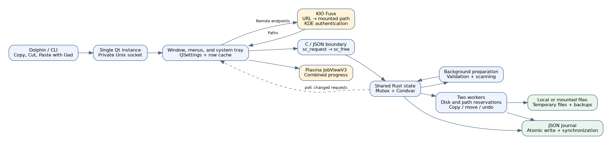
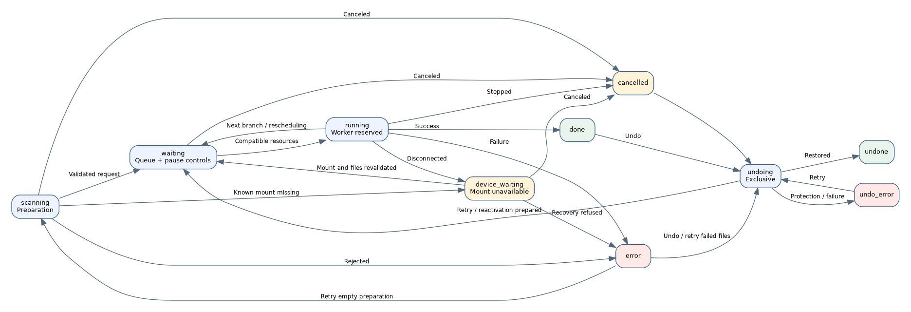

# Gad — Developer Guide

Documented version: **0.1.0**, protocol **22**, November 6, 2026.

Gad means **Gestionnaire Avancé de Duplication**; its slogan is **Gad, il copie.** This guide describes the implementation in this repository. The code remains authoritative for exact fields and defaults.

[Français](GUIDE_DEVELOPPEUR.md) · [User Guide](USER_GUIDE.en-US.md) · [Testing](../TESTING.en-US.md) · [Documentation index](README.en-US.md)

## Contents

1. [Architecture](#architecture)
2. [Building](#building)
3. [Startup and single-instance routing](#startup-and-single-instance-routing)
4. [Clipboard, paths, and KIO](#clipboard-paths-and-kio)
5. [Preparing requests](#preparing-requests)
6. [Scheduling and concurrency](#scheduling-and-concurrency)
7. [Model and states](#model-and-states)
8. [File copy and publication](#file-copy-and-publication)
9. [Bandwidth limits](#bandwidth-limits)
10. [Reconnection waiting](#reconnection-waiting)
11. [Journal and crash recovery](#journal-and-crash-recovery)
12. [Undo, cancellation, and reactivation](#undo-cancellation-and-reactivation)
13. [Interface, metrics, and error reports](#interface-metrics-and-error-reports)
14. [Protocol reference](#protocol-reference)
15. [Installation and Dolphin integration](#installation-and-dolphin-integration)
16. [Testing and maintenance](#testing-and-maintenance)
17. [Documentation tooling](#documentation-tooling)
18. [Explicit limitations](#explicit-limitations)

## Architecture

Gad is a Linux executable containing a Rust transfer engine and a C++/Qt 6 Widgets interface. It links to the system Qt/KDE libraries. The first process owns the window, local server, and engine; subsequent launches send commands to that instance.



The main boundaries are Dolphin/CLI to Gad, Qt to Rust, and Rust to the filesystem. The first uses arguments, clipboard data, and optionally the private Unix socket. The second uses synchronous JSON calls through `sc_request` and `sc_free`, with long work delegated to engine tasks. The third uses temporary files, publication, source deletion for moves, undo backups, and a persistent journal.

KIO Fuse exposes remote endpoints as mounted paths; the Rust engine still transfers their data. Plasma displays a D-Bus progress view and does not perform the copy.

### Code map

| Location | Responsibility |
|---|---|
| `src/main.rs` | Entry point, Qt launch, C ABI, and lazy engine initialization. |
| `src/engine.rs` | Shared model, command routing, worker coordination, and file processing. |
| `src/engine/validation.rs` | Root validation, preparation, and preservation of controls received during preparation. |
| `src/engine/duplicates.rs` | Duplicate suppression before publishing new entry indices. |
| `src/engine/scheduling.rs` | Physical disk resources and atomic worker reservations. |
| `src/engine/row_queue.rs`, `queue.rs` | Branch ordering, priorities, dependencies, and stable references. |
| `src/engine/fast_move.rs` | Local rename eligibility, bind-mount routes, and rescheduling. |
| `src/engine/tree_move.rs` | Whole-tree rename, grouped journal receipts, and undo. |
| `src/engine/controls.rs`, `selection.rs` | Selection expansion, pause, cancellation, retry preparation, and row removal. |
| `src/engine/errors.rs` | Structured error reports and atomic targeted-retry validation. |
| `src/engine/rate.rs` | Shared and per-request byte budgets. |
| `src/engine/properties.rs` | Exposed ownership/mode/ACL/xattr comparisons. |
| `src/engine/resume.rs` | Durable checkpoints and verified partial-file recovery. |
| `src/engine/reconnect.rs` | Mount anchors, reconnection waiting, and controlled device-number rebinding. |
| `src/engine/history.rs`, `undo.rs` | Persistence, recovery loading, preflight checks, and undo. |
| `src/engine/snapshot.rs` | Volatile revisions and differential snapshots. |
| `src/engine/protocol.rs`, `native/protocol.def` | Generated wire vocabulary shared by Rust and Qt. |
| `src/engine/tests.rs` | Engine regression tests with temporary fixtures. |
| `native/application.*` | Application lifecycle, arguments, socket, and activation. |
| `native/window.*` | Window construction and coordination. |
| `native/window_commands.cpp` | Selection requests, actions, and KIO reconnection probes. |
| `native/window_rows.cpp`, `row_tree.h`, `transfer_tree.h` | Stable widgets, folder trees, internal drag-and-drop, and request accents. |
| `native/window_conflicts.cpp` | Source/destination comparison and conflict decisions. |
| `native/window_errors.cpp`, `error_report.h` | Error-report dialog, exact retry requests, and atomic text/JSON export. |
| `native/window_open.cpp`, `row_paths.h` | Desktop file/folder opening without shell interpretation. |
| `native/clipboard.h`, `kio_sources.h`, `paths.h` | Clipboard formats, URL validation, and KIO resolution. |
| `native/notifications.h` | Aggregated Plasma JobView progress and commands. |
| `native/snapshot.h`, `presentation.h`, `transfer_metrics.h` | Cached snapshots, labels, totals, speed, and remaining-time estimates. |
| `build.rs` | Native compilation, resources, generated protocol, and linking. |
| `scripts/`, `tests/` | Installation, isolated validation, and documentation tooling. |

## Building

Requirements include Rust/Cargo, a C++17 compiler, `pkg-config`, Python 3, Qt 6 Widgets/Network/DBus and its `moc`, `rcc`, and `qmake6` tools, plus KF6 WindowSystem. Qt tests also require Qt Test and `dbus-run-session`. Wayland clipboard access uses `wl-clipboard`; remote endpoints require KIO Fuse. Rust dependencies are locked in `Cargo.lock`.

```bash
cargo build --locked
cargo build --release --locked
./target/debug/gad --help
```

`build.rs` generates Rust definitions from `protocol.def`, compiles the native units, runs resource and meta-object generation, and links the native archive. It injects the Cargo version and build date. Native source changes trigger reconstruction; Rust-only edits should not rebuild all widgets. Release builds enable LTO and strip distribution symbols; use development binaries for native debugging.

### C ABI contract

`sc_request` accepts UTF-8 JSON and returns a Rust-allocated response string. Call `sc_free` **exactly once** for that result; do not use C++ `delete` or `free`. The engine is lazily initialized and shared within the process.

The boundary catches Rust panics so they do not unwind through C. It does not repair poisoned locks or corrupted logical state. Expected errors must be structured results. Invalid UTF-8 paths and embedded NUL values are rejected rather than silently converted to another filename.

## Startup and single-instance routing

Arguments become a command, with clipboard and URL processing where required. Qt finds the existing user socket and uses a lock to prevent concurrent servers. An existing instance receives the command and the new process exits. Otherwise, the process initializes the window/server and performs the initial request.

The socket is `gad.sock` under the user runtime directory. Requests are newline-terminated JSON, one reply per connection, with a 16 MiB incoming request limit and user-only access. `--status` without an instance must fail instead of starting a graphical engine.

Only Gad's own settings and journal locations are used. Current protocol version is **22**. Capability/version checks prevent silently sending a move, remote endpoint, or verification request to an older instance that cannot implement it. A newly installed executable may still contact an older process; update an idle instance through normal shutdown.

```bash
gad
gad --background
gad --status
gad --copy /tmp/demo/source.txt --to /tmp/demo/destination
gad --move /tmp/demo/source.txt --to /tmp/demo/destination
gad --copy /tmp/demo/source.txt --to /tmp/demo/destination --md5
gad --copy /tmp/demo/source.txt --to /tmp/demo/destination --properties
gad --paste /tmp/demo/destination
gad --paste-context /tmp/demo/destination --background
```

`gad://show` activates the window from Plasma. `--smoke-test` and `--export-icons` are integration tools. `_sources_resolved` indicates Qt preparation has already occurred; it does not bypass engine validation.

Acceptance is not completion. `enqueue` can return an ID and later fail during scanning; clients must observe final states.

## Clipboard, paths, and KIO

### Clipboard behavior

File URL lists and file-manager formats take precedence over plain text. KDE and GNOME cut markers select move mode; drag-and-drop selects copy mode. Destination text fields keep ordinary text paste while file-list paste enters Gad's queue.

On Wayland, bounded `wl-paste` calls allow clipboard access independent of window focus. `QClipboard` is a fallback for tool unavailability, not a way to reinterpret present but malformed data. The file list and cut marker are rechecked for consistency, but the external clipboard is not an atomic transaction with another application.

### Path validation and remote resolution

Classify input before conversion. A `file:` URL must be local, with an empty host or `localhost`, and without credentials, a port, query, or fragment. Reject NUL and invalid encoding. An absolute POSIX path containing a literal `://` remains a path.

Supported remote schemes are `kdeconnect`, `ftp`, `sftp`, and `smb`, for both sources and destinations. Validate host and scheme-specific constraints before mounting. Retained origin URLs omit passwords. `Job.destination` is a canonical POSIX path; `destination_url` and `source_urls` allow labels to reconstruct the original remote addresses. File-opening actions still use actual mounted paths.

`SourceUrls::Resolver` calls D-Bus service `org.kde.KIOFuse`, object `/org/kde/KIOFuse`, interface `org.kde.KIOFuse.VFS`, method `mountUrl`. KDE owns authentication. Gad does not implement a separate FTP/SSH/SMB credential store.

Resolve both sides before submitting the request to Rust, under a 30-second preparation deadline. A failure must not submit only the first resolved sources. Later submissions preserve order while resolution is pending. Cancellation invalidates late callbacks; it does not promise to cancel internal KIO server operations.

`destination_context` retains Dolphin's selected context until resolution. It chooses the clicked folder or the shared parent of selected files, then is removed before engine submission. Remote destinations require protocol 12 or newer.

### KIO filesystem semantics

Inspect open descriptors through `/proc/self/fdinfo` and `/proc/self/mountinfo`. Only proven `fuse.kio-fuse` mounts use the special directory-synchronization semantics: file data is synchronized, while unsupported directory fsync is not requested. Local synchronization errors remain errors.

Source permissions and times are not applied to KIO Fuse destinations when the service cannot provide chmod/utime semantics. The service determines these metadata. A newly and exclusively created remote temporary file is explicitly truncated to zero to initialize KIO's cache without downloading an empty FTP file.

Durable crash recovery is disabled for KIO Fuse destinations, including directly entered mount paths. Ordinary session pause and controlled reconnect retry remain available. Original journal paths are not silently remapped to a new KIO Fuse mount after daemon restart.

## Preparing requests

`enqueue` validates request structure, sources, options, and origin metadata, reserves a monotonic ID in `scanning`, persists it, and launches preparation outside the UI thread.

Validate the destination and roots, reject self-copies and invalid mount aliases, scan folders before their children in deterministic order, and identify disk resources. Unsupported special files and names outside the UTF-8 contract fail explicitly. Symbolic links are entries, not recursively traversed source directories.

**No file in a request is copied until its initial validation and scan finish.** Preparation failure produces an error rather than starting a partly analyzed group.

Mount anchors are captured while endpoints are known. Before committing prepared entries, verify that the request still exists and has not been canceled or stopped. Preserve pause/cancel/hidden controls received after the preparation snapshot. Late results must not reactivate canceled entries.

A valid background paste can clear an older global pause. A pause requested after submission wins through the pause generation. Fully duplicate submissions return without lifting pause.

Transfer workers are joined on shutdown. Preparation tasks use logical cancellation and late-result rejection; a blocked filesystem or KIO call has no guaranteed immediate cancellation.

### Duplicate suppression

`duplicates.rs` combines source and destination paths, device/inode identity, kind, and copy/move mode. Parent normalization recognizes aliases and bind mounts without following the final source link. Older scans finish before the admission decision, so the oldest accepted request wins simultaneous duplicates.

A request active at submission remains a candidate if it finishes during the new scan. History already completed before submission is excluded, allowing intentional repeat copies. Different destinations and copy-versus-move intentions remain distinct.

Preserve required ancestor folders for unique children. A new unpublished request can filter its entry vector before indices become visible. For a restored unstarted request, keep published indices and hide skipped duplicates instead. Do not discard journaled partial work. `duplicates_ignored` supplies an informational UI message without an action prompt.

## Scheduling and concurrency

Shared resources use `Arc`, `Mutex`, `Condvar`, and an atomic stop flag. Two persistent workers atomically select and reserve requests under `state`. Filesystem work runs outside that lock. Never hold `state` while calling `save`: journal lock order is **writer, then state**.

A request processes its entries sequentially, but reservations are returned at branch boundaries so independent roots can interleave with other requests. Ordinary parallel copies need disjoint known physical disk resources. Partitions and composite devices are traced through `/sys/dev/block`; unresolved topology makes an ordinary copy exclusive.

Fast local rename jobs may share disks when normalized reserved paths do not overlap. Unknown paths or overlapping source/destination trees keep serialization. An earlier blocked request retains priority on its relevant disks; a new unfinished scan is an ordering barrier. Explicitly paused work can let admissible later work proceed.

Undo is exclusive and uses reverse **actual execution order**, falling back to IDs for older records. It waits for active transfers and can run while ordinary copying is globally paused. Scheduling is conservative; it does not promise maximum throughput on arbitrary RAID or network storage.

### Internal requests and the visible forest

A `Job` owns destination, captured verification options, and journals. Entry indices remain stable. `jobRows` stores detached Qt metadata once entries exist. File roots attach directly to the tree; actual folders provide visual parenthood. Empty preparations retain a placeholder.

Persisted `row_order` contains `(job, index)` keys, with a null index for a placeholder. The cached `row_queue::Layout` records roots, parents, children, and preorder without rearranging entry vectors. Source **and destination** ancestry determine parenthood, including independently submitted nested roots and late parents.

`reorder_rows` validates the entire selection, target, activity, parent constraints, and dependencies before mutation. It supports `before`, `after`, `next`, `up`, `down`, and `last`. A selected folder covers descendants. No action reparents a file or changes its destination. Priority set during scanning transfers from the placeholder to its roots.

Workers follow the ordered branch plan and notice layout revision changes between files, not halfway through one. Paused waiting entries do not hold workers. An empty finalization must not advance execution order, since that would corrupt undo chronology.

Raw and normalized destination dependencies protect replacement order across requests and repeated names within a request. Partly published dependent work cannot be dangerously interleaved. Reserved future names also prevent “Keep both” from consuming another queued entry's intended name. Historical terminal requests do not prevent valid new priority changes.

## Model and states

| Object | Key invariant |
|---|---|
| `State` | Request IDs are not reused; queue/row order is separate from chronological history. |
| `Job` | Verification choices are captured at submission; controls and rate limits can change through their commands. |
| `Entry` | Source, destination, kind, identity, counters, errors, and undo references keep a stable index. |
| `undo::Record` | Describe filesystem effects before performing steps needed for recovery. |
| `undo::Stamp` | Device/inode, type, size, time, and link data protect owned results. |
| Snapshot revision | Volatile UI change tracking, not persistent ownership evidence. |

| JSON state | Meaning |
|---|---|
| `scanning` | Validation/preparation. |
| `waiting` | Queued work. |
| `device_waiting` | Missing known mount; partial data retained. |
| `running` | A worker is processing the request/entry. |
| `verifying` | Independent MD5 rereads. |
| `conflict` | A file decision is required. |
| `skipped` | Excluded entry; source remains. |
| `done` | Completed. |
| `error` | A documented failure. |
| `cancelled` | Stopped without automatically undoing completed results. |
| `undo_waiting` | Undo scheduled. |
| `undoing` | Exclusive recovery work. |
| `undone` | Effects restored. |
| `undo_error` | Undo could not finish safely. |

Pause is also a presentation/control overlay and is not a new serialized transfer state. File-level conflict/skipped/waiting states are not all terminal job states; use the shared protocol definitions rather than guessing from display labels.



## File copy and publication

For a regular file, recheck controls and mount availability, validate destination parents, resolve conflicts, reserve the target name, and allocate a private `.gad-…part` file in the destination directory. Use exclusive creation and restrictive initial permissions. Sources are opened without following their final symlink and are checked against scanned identities.

The copy buffer is **64 KiB** and can be written in smaller granted fractions when rate-limited. Progress advances by actual written bytes. An incremental MD5 digest is maintained even without independent MD5 verification because undo uses content evidence.

Compatible local copies create durable resume points. Synchronize data, apply basic permissions and modification time where supported, and perform selected content/property checks. Publish the **same verified temporary file** with rename. `renameat2(RENAME_NOREPLACE)` protects a target that appeared concurrently; replacement retains the previous destination privately until recoverable publication succeeds.

A move deletes its source only after publication and required synchronization/checks. Recheck source identity, size, time, and type before deletion. Skipped sources remain. Source directories are removed in reverse order only when safe and empty; failures are reported instead of deleting outside contents.

Managed ordinary failures clean private temporaries. Recognized disconnections retain journaled partial data. A failure after a publication step must preserve enough state for recovery and must not be treated as permission to repeat a copy blindly.

### Fast file and folder renames

`fast_move.rs` proves a supported local mount, same underlying filesystem, writable route, and independent reservations. It may translate distinct bind-mount views through a common exposed path. A shared physical disk alone is not proof. Kernel EXDEV or other route restrictions return work to the scheduler with ordinary copy reservations rather than retaining the rename exception during fallback copying.

Individual renames retain the original inode. Their journal and post-rename ctime protect undo against changed contents even if size and mtime are restored. A crash between rename and ctime confirmation may require manual examination rather than optimistic rollback.

`tree_move.rs` additionally requires an intact complete subtree, no excluded or paused children, no conflict, and exact path/type/identity matching. Submounts, including ones hidden in a common bind view, prevent the shortcut. A successful root rename preserves descendants' objects and records grouped recovery information.

Whole-tree undo uses the same intactness tests. An outside file added at the destination prevents returning/deleting that outside file as part of the shortcut. Partial selections use individual restoration. Group receipts distinguish a crash before or after the root rename and avoid the individual-file ctime confirmation gap for this path.

### MD5 verification

The checkbox adds independent source and temporary-file rereads before final publication. N bytes add two N-byte reads to the copy work. Verification progress must not announce completion at the end of writing alone.

Do not verify one temporary file and recreate another for publication. Source changes or mismatched digests fail before replacement and source deletion. MD5 is consistency evidence for this transfer, not collision-resistant adversarial authentication.

### Optional property checks

`verify_properties` is remembered by Qt and captured per request; `--properties` overrides it for a CLI submission. Missing fields default to false and `Entry.properties` to none. Explicit property requests require protocol 13 or newer.

`properties.rs` reads UID/GID, mode bits `07777`, and attributes exposed by `llistxattr`/`lgetxattr`, without following the final symlink. Identity/ctime checks reject inconsistent snapshots. Attribute growth is retried at most three times. Buffers are bounded to 64 KiB each, with 8 MiB total values per capture. POSIX ACLs use `system.posix_acl_access` and `system.posix_acl_default`.

Values stay in memory, not JSON. The saved report contains `status` (`ok`, `different`, or `unavailable`), `differences`, and `unavailable`. Missing permissions are not equivalent to absent attributes; known differences and incomplete checks can coexist. Completely unlisted protected attributes cannot be audited. Dates are outside this comparison.

Copies can finish with property warnings. Copy-and-delete moves preserve the source on a failed check, with pre-publication and post-publication effects handled separately. Renames remain enabled; a warning after rename does not claim that the source path still exists. Whole-tree property snapshots fall back to per-entry processing above the bounded 32 MiB estimate.

### Space checks

`space.rs` estimates remaining allocations across analyzed queued and paused work sharing a volume. Round to allocation blocks, avoid numeric overflow, and account only for recognized temporary allocations on the expected volume. Existing destinations/backups are already occupied space, not free credit. Proven renames do not allocate a second data copy.

Known insufficient capacity fails before target creation. Unknown capacity produces a warning and allows the copy. Recheck file allocation before creating a temporary file; the estimate is not a reservation against other applications. `verify_space` is captured for the request and requires protocol 14 when explicitly requested from another instance.

## Bandwidth limits

`rate.rs` provides a shared global byte budget and one budget per request. Zero is unlimited. The limiter consumes both budgets atomically before a write, retains at most 100 ms of credit, and uses bounded condition-variable waits rather than reserving bytes for a sleeping worker.

Lock `state` before `Shared::limiter`. Recheck pause, cancellation, stop, and periodic mount availability during waits. Changing a rate starts without accumulated credit. There is no equal-share fairness guarantee. Copy rates apply to written bytes, not MD5 rereads, metadata work, undo, or renames.

Protocol 18 introduced global `configure.rate_limit` and `set_rate_limit` with `ids` and `bytes_per_second`. Validate complete selections and integer values from 0 through 1 TiB/s before mutation. Persist configured limits, not timing credits. Qt displays MiB/s as `Mio/s` and remembers the global setting. Request dialogs capture IDs when opened so later selection changes cannot retarget them.

## Reconnection waiting

`reconnect.rs` captures and persists mount anchors while endpoints are known: path, device, anchor inode, optional sysfs block node, remote classification, and an available udev filesystem UUID. Probe outside `state`; also check during streaming, bandwidth waits, and pauses of active files.

`device_waiting` is nonterminal. `park_disconnected` retains the partial journal, marks the entry interrupted, and releases the worker. A watcher per request spaces probes by at least one second and respects cancellation and global/request/entry pauses. Keep the request in `device_waiting` during potentially slow validation so it does not create a scanning barrier for independent work.

On return, reuse `prepare_resume` and the ordinary preparation path. Matching UUIDs may rebind device numbers; inode/type/version checks, ctime, and content digests remain unchanged. Publish validated identities and anchors together before making the request executable. A different volume, empty replacement directory, ambiguous identity, or changed source is not sufficient proof to resume.

`CopyTemp` preserves a journaled temporary on recognized disconnection. Local checkpoints remain available for session reconnection even when automatic crash recovery is disabled. Without a durable KIO destination point, only a recognized unpublished temporary can be removed after source validation, to restart that file. Never automatically replay an already engaged publication.

Qt retries origin URL resolution through KIO at most every five seconds without calling `enqueue` or exposing a new authentication implementation. A different mounted path is reported rather than used to rewrite the journal. Labels, metrics, tray badge, and native progress all show waiting. Kernel/remote calls already blocked remain subject to their own delays.

## Journal and crash recovery

The user journal is `$XDG_DATA_HOME/gad/state.json`, defaulting to `~/.local/share/gad/state.json`. `save` serializes writers, writes a temporary state file, replaces it atomically, and synchronizes as required. Do not hold `state` while calling it.

`undo::Record` captures owned staging, results, backups/original stamps, source removal, restored-source preparation, and completed recovery steps. Replaced destinations live in private `.gad-undo-*` directories on their filesystem. Keep the journal before effects that need recovery; do not treat a display path as ownership evidence.

On loading interrupted work, the engine classifies compatible unfinished copies separately from ambiguous publication, rename, and undo stages. Explicitly canceled work does not restart. Retained recovery information can outlive ordinary history retention. Normal history cleanup releases backups without deleting successful final outputs; failed cleanup remains a visible recoverable error.

### Durable partial files

`resume.rs` stores a source `Version` with identity/metadata/ctime, a protected existing target version when replacing, a confirmed byte count, and the prefix digest. Checkpoints occur after 64 MiB or two seconds of progress. Synchronize the temporary and its directory before publishing a new confirmed point to the journal.

`Job.resume_enabled` captures automatic crash-recovery preference; `resume_pending` marks recoverable interrupted work. Local session reconnection still creates checkpoints when that preference is off. Missing old fields default conservatively.

Recovery requires an expected private `.gad-…part` in the correct parent, without a symlink or extra hard links, matching the saved device and inode. Check open descriptors too. Compare source and temporary prefixes block by block, verify the recorded hash and versions again, and only then truncate unconfirmed trailing bytes and reposition both streams. Rebuild the incremental MD5 context and retain the temporary's inode.

`resume_checking`, `resume_checked`, and `resumed_from` describe validation and restart progress. A previously applied read-only permission is adjusted only on a validated owned temporary. Remove the resume record before final publication and transition to ordinary undo journaling. Final independent MD5 still runs when requested.

`resume_interrupted` accepts recoverable job IDs. Preparation and reconnection preserve later pause/cancel/hidden controls by stable index. A refused validation preserves the unrecognized partial instead of truncating it optimistically.

## Undo, cancellation, and reactivation

Cancellation stops new work and leaves completed effects. Undo uses the journal to remove Gad-created copies, return moves, and restore replaced destinations.

Preflight the entire selected scope and required parents before modifications. Validate owned results and backups, including content digests where required. A recreated source, changed destination, missing backup, or absent volume produces a refusal rather than overwriting user data.

Process requests in reverse execution order. Replacement chains may place an older output in a newer selected backup; validation understands those dependencies. Recreate required source directories, restore files and previous destinations, then remove only empty created directories. Cross-filesystem return requires a checked copy, publication, and synchronization before destination removal.

Completed undo steps are persisted for retry after `undo_error`. Partial selections preserve neighbors. Preflight reduces risk but does not make a whole directory an atomic transaction against external writers.

Delete clears selected finished rows without removing final results, cancels active entries, and removes pending work. Backspace additionally requests undo for finished results. Folder selection expands through source/destination ancestry, not a raw string prefix. Removing a row does not shift active engine indices.

Reactivation of canceled entries is distinct from setting `waiting`. It first restores/cleans compatible remnants, handles missing parents and type changes, and preserves completed neighbors. Global cancellation also invalidates outstanding Qt URL preparation.

## Interface, metrics, and error reports

### Differential updates and trees

`TrackedJob` marks mutable job access with a volatile revision. Global mutations and layout changes also advance the snapshot clock. `poll` accepts `since`; absent/incompatible tokens request a reset, unchanged state returns a small response, and other responses include authoritative IDs, metadata, and changed jobs. `QueueSnapshot` merges them without recreating unchanged rows.

Reuse QTreeWidgetItems to preserve selection, hover, tooltips, scroll position, and expansion. Only update text/icons/tooltips when values change. Build folder parenthood from both source and target paths. Filters keep necessary ancestors visible, and ordinary progress does not reopen manually collapsed branches.

`TransferTree` uses private MIME data containing origin and stable row keys. Internal drops send `reorder_rows`; Qt never directly reparents the model. Foreign internal MIME is rejected while external file URLs still reach normal file-drop handling. Edge scrolling and QPointer guards handle an active drag safely.

### Speed and remaining time

`transfer_metrics.h` caches a `Probe` per unfinished request and rebuilds it only for changed IDs. Every refresh tick, including `poll.unchanged`, advances the injected monotonic clock and decays stalled rates without rescanning entries.

Copy and MD5 meters use separate five-second activity windows and at least 500 ms of observation. Exclude intervals crossing phases. Pauses, conflicts, recovery checks, and counter regressions reset unsuitable measurements. Do not count resumed prefixes, directories, removed/canceled/skipped work, or logical rename bytes as fresh copy traffic.

Estimate remaining copy bytes at copy speed plus remaining MD5 reads at MD5 speed. If a needed measurement is unknown, say so; estimate only the copy phase when MD5 has not been observed. Individually paused work makes total time unknown. These metrics are volatile and do not predict queue waiting or undo duration.

### Error reports and retries

`error_report` is read-only and excluded from `snapshot::Mutation`. The format is `gad-error-report`, version 1, with `generated_unix`, job-origin metadata, and stable error records. Include paths, messages, bytes, publication/recovery state, available MD5, and property reports. Aggregate directory failure markers and device waits are not duplicate permanent failures.

`retry_errors` accepts `jobs`, `entries`, and optional `exact`. Validate eligibility for the whole selection before mutation and reject active requests. Exact references from the report do not implicitly expand a folder; normal list selections do. Route selected errors through existing preparatory undo and `prepare_retry`, retaining OK/canceled/skipped/removed neighbors. Suspend merely waiting unselected entries to preserve scope. Preserve the global pause.

A failed empty analysis uses full root validation and scanning. Reset structural ancestors whose Error state came only from a child. Recheck source/target aliases before retry. Separate incomplete undo is not converted into copying; retry-preparation failures keep references so they can be attempted again after repair. Modified outputs remain protected by undo preflight.

`window_errors.cpp` is a nonmodal, explicitly refreshed snapshot with plain-text cells and `QPlainTextEdit` details. Filtering and sorting do not change stored row references. All six buttons use theme icons with standard Qt fallbacks. Text/JSON export uses `QSaveFile`; only a complete successful write replaces the report. Export includes the whole loaded snapshot, whereas retries target displayed or selected failures.

### Plasma and window activation

`notifications.h` aggregates current requests into one JobViewV3. Track byte deltas per entry, distinguish logical rename progress, include MD5 work in completion, and synchronize pause commands. Retain useful final speed while the view closes. Handle reconnecting to Plasma after a service failure without creating duplicate ordinary notifications.

`gad://show` and activation tokens restore the main window. Tray clicks toggle visibility. Folder/file opens use `QDesktopServices` with file URLs, never a shell. Autostart is a per-user desktop entry; closing or quitting must honor active work.

## Protocol reference

`native/protocol.def` is the shared vocabulary; Rust structures and validators define exact contracts. Current version is **22**. GUI-specific commands are routed by Qt and engine commands by Rust.

| Command | Main parameters | Behavior |
|---|---|---|
| `status` | None | Full state. |
| `poll` | Optional `since` | Full or incremental state. |
| `configure` | `keep_history`, verification options, `resume_interrupted`, `rate_limit` | Preferences and live global rate. |
| `set_rate_limit` | `ids`, `bytes_per_second` | Live per-request cap. |
| `enqueue` | `sources`, `destination`, `mode`, options/origin metadata, `background` | Reserve and prepare a request. |
| `pause` | `paused` | Global pause. |
| `reorder_queue` | `ids`, `action` | Whole-request ordering. |
| `reorder_rows` | `rows`, `action`, optional `target` | File/branch ordering. |
| `cancel`, `cancel_many` | `id` or `ids` | Stop requests. |
| `undo_many` | `ids` | Undo requests. |
| `resolve` | `id`, `index`, `action`, `all` | Current conflict decision. |
| `cancel_all`, `undo_all` | None | Global stop or undo. |
| `pause_selection` | `jobs`, `entries`, `paused` | Targeted controls. |
| `resume_interrupted` | `ids` | Revalidate recoverable interrupted work. |
| `error_report` | None | Read structured failure details. |
| `retry_errors` | `jobs`, `entries`, optional `exact` | Retry only eligible selected failures. |
| `retry_selection` | `jobs`, `entries` | Reactivate canceled entries. |
| `delete_selection`, `backspace_selection` | `jobs`, `entries` | Keyboard removal/undo semantics. |
| `undo_selection`, `cancel_selection` | `jobs`, `entries` | Targeted undo or cancellation. |
| `clear` | None | Clear finished history and its backups. |
| `shutdown` | None | Controlled shutdown, refused while active. |
| `show` | Optional `activation_token` | Display/activate the window. |
| `background` | None | Keep the instance hidden. |
| `paste` | Destination/context and background settings | Read the clipboard and submit work. |

```json
{"command":"enqueue","sources":["/tmp/demo/source.txt"],"destination":"/tmp/demo/destination","mode":"copy","verify_md5":true}
```

Success at submission returns an ID, not proof that the eventual transfer succeeded. Consumers must handle late errors and distinguish operation state from individual entry state.

## Installation and Dolphin integration

`scripts/install.py` builds first, atomically replaces `~/.local/bin/gad`, installs the `org.hizoka.gad` desktop association, protocol handler, icons, and service-menu actions in user XDG locations, and refreshes KDE caches when available. An executable already mapped by a running process keeps its previous code.

The application identifier is `org.hizoka.gad`; desktop and icon associations must agree so the taskbar uses the software icon rather than a generic copy image. Embedded `gad-boucles-document` assets are exported at desktop sizes by Qt.

`gad --configure --dolphin-ctrl-v` installs a reversible Dolphin Ctrl+V association. `--no-dolphin-ctrl-v` restores prior saved settings. The integration preserves native text paste and the standard Shift+Insert KIO alternative. It locates the active Dolphin folder through current session information rather than a full-path window-title requirement. Validate changes atomically, reject unrelated/malformed integration records, and preserve unrelated shortcuts.

The optional `make test-dolphin-paste` uses actual KXMLGUI/KActionCollection on a private bus to exercise shortcut activation, text paste, and restoration without copying files or restarting the user's Dolphin.

Uninstallation leaves data needed for recovery rather than deleting journals and backups. If other copies of Gad are installed, distinguish their binary/version and running instance before diagnosing behavior.

## Testing and maintenance

[Testing Gad](../TESTING.en-US.md) provides full requirements and scenario descriptions.

```bash
make doctor
make test-unit
make test-python
make test-qt
make test-integration
make check
make test
```

`scripts/run_tests.py` supports filtering, dependency-aware groups, keep-going execution, and JSON/JUnit reports under `target/test-results`. JUnit counts command stages, not every Rust/Qt assertion.

Rust tests use temporary trees to check observable state and file contents. Python tests use the standard library and isolated fixtures; documentation renderer dependencies are loaded only when rendering. Qt tests use private D-Bus/HOME/XDG environments, engine doubles, and intercepted desktop opens. Integration tests also exercise the real executable and crash recovery. Mocks do not reproduce every server or Plasma release.

The documented local validation comprises **216 Rust tests**, **65 Python tests**, Qt suites including **83 row-action cases**, and integration, formatting, and Clippy checks. One benchmark is intentionally ignored in routine runs. This describes local evidence, not an assertion that the supplied GitHub workflow has run remotely or that future edits are validated automatically.

### Diagnosing failures

Start with `gad --status`, the version of the running instance, and complete error messages. Distinguish the installed executable from `target/debug/gad`.

For remote input, separate URL validation, KIO Fuse D-Bus availability, KDE authentication, mounting, and actual file access. For undo, retain the required volumes and backups; do not delete `.gad-undo-*` to “repair” a journal. Error exports contain personal paths and should be reviewed before sharing.

### Adding a feature

Define file effects, user behavior, and interrupted-state semantics first. Update the shared vocabulary for protocol changes and use conservative defaults for persistent fields. Journal recoverable effects before performing them and preserve ownership evidence.

Check pause, cancellation, multiple selection, late callbacks, and shutdown. Add regression tests for meaningful observable behavior, run the affected groups and required checks, then update **both language editions** and relevant screenshots. Never use a display string as proof that a filesystem object belongs to Gad.

## Application localization

`native/i18n.h` uses QTranslator and the standard Qt Linguist catalog `translations/gad_fr_FR.ts` / `translations/gad_es_ES.ts` / `translations/gad_pt_PT.ts` / `translations/gad_de_DE.ts` / `translations/gad_ja_JP.ts`. US English is the program source language; the catalogs contain French, Spanish, Portuguese, German, and Japanese translations. Mark Qt display strings with `GAD_TR("…")` in the `Gad` context. Known engine diagnostics use the `Engine` context at presentation time only. Journals, filenames, JSON keys, wire states, and JSON exports retain their original values. Uncataloged diagnostics and external service errors keep their original language; translation never replaces fragments inside filenames or messages.

The compiled `.qm` is checked in and embedded through `gad.qrc`; building or installing Gad needs no separate language pack or Linguist tools. The language selector saves the QSettings `language` preference and immediately calls `I18n::initialize` without interrupting transfers. `GAD_LANGUAGE=fr_FR` or `GAD_LANGUAGE=en_US` overrides it for a new instance; `system` follows QLocale::system(). English desktop dialects use en_US; other languages fall back to fr_FR. Commands sent to an existing instance do not change its language.

For persistent widgets, `I18n::localized(widget, "text", []{return GAD_TR("About");})` or `I18n::bindProperty` explicitly binds a property to its source text. `I18n::onChange` updates computed presentations such as headers, lists, reports, and transfer rendering. QPointer guards each callback owner; destroyed owners are removed, and repeated bindings for a property replace previous callbacks. Callbacks run from a snapshot after translators are installed. Displayed strings are never globally searched and replaced.

The row cache includes the language: an unchanged poll still updates labels without replacing tree items. Error reports keep their loaded snapshot, rows, and selection. A conflict keeps its “apply to future conflicts” choice when only the language changes. Dates and numbers are reformatted without changing numeric values. Messages already archived by Plasma retain their original language; active job views update on the next refresh.

After adding display strings, run `make translations` to synchronize sources, translate new entries in Qt Linguist, and run it again to compile the catalog and update its fingerprints. This maintenance command requires `lrelease6` or `lrelease`. `make translations-check` checks coverage, `%1` parameters, links, and fingerprints without external tools. Python tests run these checks too. Qt tests load the actual embedded catalog and verify English widgets, states, reports, preferences, and unchanged filenames/JSON exports.

## Documentation tooling

The root README is a short entry point; detailed guides are maintained here. The documentation covers six languages. Each edition includes Quick Start, User Guide, Developer Guide, and 14 screenshots of its own interface in the light theme. Architecture and lifecycle diagrams have localized labels.

`doc_catalog.py` identifies each source's language and audience. `build_docs.py` generates language-correct covers, same-audience language switches, relative links/fragments, and offline embedded images. English PDFs use US Letter; other PDFs use A4. `check_docs.py` validates all README/testing/guide links, captures, language metadata, and all 36 HTML/PDF exports.

```bash
make docs-captures
make docs
make docs-check
```

Capture code links the actual widgets to a demo C bridge, uses temporary files and isolated sessions, and applies Breeze Light in its private configuration, preserving the desktop’s font settings. The manifest records dimensions, version, and hashes. It never controls the real Gad process or clipboard. Native tray/progress rendering outside the widget capture is not simulated as a real desktop screenshot.

Documentation Python tests cover locale selection, navigation, paper size, relative links, captions, image embedding, missing headings, and complete export invocation without requiring Markdown or WeasyPrint in the routine test environment. See the [documentation index](README.en-US.md) for optional export dependencies.

## Explicit limitations

Gad's optional Ctrl+V integration is Dolphin-specific. Remote endpoints depend on KIO Fuse and its service semantics. Durable mid-file crash recovery is limited to compatible destinations; KIO destinations may restart a current unpublished file during session reconnect instead.

Owner, ACL, xattr, sparse-file, and hard-link preservation do not have all the guarantees of a specialized backup tool. A group of copies is not globally atomic. Filesystem synchronization and concurrent external modifications remain relevant even with identity checks, MD5, and preflight validation.

Keep these boundaries visible in design decisions and user messages. A successful local check must not become a promise of universal recovery.

## Header sorting and filters

`native/table_view.h` stores presentation-only settings, applies literal column predicates, and sorts sibling items using locale-aware natural comparisons or numeric progress roles. Queue ranks break equal-value ties independently of sort direction. The same QTreeWidgetItems are reattached with selection and expansion preserved. Progress updates avoid resetting a sorted view to queue order before sorting again.

`TransferTree` owns the header menus, display/filter revisions, and reset actions. `Window::refresh` treats a presentation revision as a reason to render even after an unchanged poll, combines column predicates, and preserves ancestor visibility. Filter revisions are separate from sort revisions so sorting does not reopen collapsed folders. Restoring queue order calls the existing stable-key ordering path. Internal drag is disabled during visual sorting. None of these settings issue engine mutation commands. Tests cover queue identity, natural and numeric ordering, combined predicates, ancestry, live progress, hot translation, and reset/navigation behavior.

Sort keys form an ordered list of column/direction pairs. TransferHeader reads Ctrl from the actual mouse release event; Ctrl+click appends or reverses a key, while an ordinary click replaces the list. Header markers retain key priorities across translation. Clearing a sort key preserves the rest. The redundant global combo and its predicate were removed. New menu icons have Qt fallbacks when a theme lacks them.

The order column is logical column 5 and visual column 0; `setTreePosition(0)` keeps branches in Source. Existing column roles and action references keep their meaning. Numbers come from `row_order`, with a snapshot-derived fallback when no layout is provided. A layout-only delta forces all rows to refresh, including jobs omitted from that delta. Cell tooltips show immutable batch IDs. Order sorting uses numeric queue ranks, and the sixth column supports filters and Ctrl+click sorting. Request color accents are drawn in the first visual column.

Tooltip sentence breaks are explicit newlines in the English source literals and French catalog. No runtime punctuation replacement touches paths, URLs, or external error text. Source tooltips retain the path and operation options; batch identification remains in the Order column. The live-language regression includes a filename containing a period, a space, and HTML-like characters.

Source decoration uses `edit-copy`/`edit-cut`, cached by operation mode in `OperationRole`, with Qt fallbacks. `KindRole` still records the actual entry type for folder/file actions. Tooltips retain only paths and useful options, without repeating the operation. The Order section uses `ResizeToContents` rather than a fixed width.

## Transfer exclusion rules

`src/engine/exclusions.rs` validates rules and implements Unicode dynamic-programming glob matching (`*`, `?`). Protocol 21 exposes `exclusions` through `configure`, `enqueue`, and snapshots: `include_hidden` (default true), `directories`, and `files` (default empty arrays). Validation happens before mutation, including other preferences in the same request. Older journals receive these defaults.

`State` stores preferences; each `Job` persists its own immutable copy. Scanning loads job rules once per root, uses `symlink_metadata`, and prunes excluded folders before traversal. Resume and retry use the same scanner. Fully excluded requests complete without resuming a paused queue. `tree_move::ready` disables whole-folder renames when filtering is active. Cleanup removes only empty folders and tolerates folders containing excluded items.

Qt captures rules before KIO resolution. Dialog edits commit only after successful `configure`. QSettings stores `includeHidden`, `excludeDirectories`, and `excludeFiles`. Tests cover copies, moves and undo, links, Unicode, immutable rules, persistence, retries, atomic validation, and UI preferences.

## Adding a language

Languages are discovered at startup from valid `gad_<locale>.qm` catalogs, such as `gad_de_DE.qm`. Qt provides each language’s native display name. US English remains available as the source language. Exact locales take priority, followed by an available variant of the same language, then French or English.

To add a language without rebuilding, put its `.qm` in `~/.local/share/gad/translations/` and its `<locale>.png` flag next to it, for example `de_DE.png`, then restart Gad. This directory follows `$XDG_DATA_HOME` when set. Flags may also be in a `flags/` subdirectory or in `~/.local/share/gad/flags/`. Missing flags use a generic icon. Invalid catalogs are ignored. User catalogs override system and embedded catalogs.

For distribution with Gad, place the `.qm` in `translations/` and its PNG in `assets/flags/`. `scripts/resources.py` generates the Qt manifest for Cargo, Qt tests, and documentation captures. No C++ list or source-manifest edit is needed. A compiled `.qm` alone is sufficient; when a `.ts` is supplied, `python3 scripts/translations.py` automatically discovers, validates, and compiles it.

## Duplicating in the original folder

Enable **Allow duplication in the same folder**, then copy and paste into the item’s containing folder. `photo.jpg` becomes `photo_copied1.jpg`; a `Documents` folder becomes `Documents_copied1`. Gad chooses the first available number, accounting for pending duplications. Symbolic links are copied without following their targets.

This option is disabled by default, saved, and captured for new requests. Moves onto themselves and copies of folders into their own descendants remain rejected. Exclusions still apply. Undo removes the created copy and preserves the original.

Protocol 22 adds `allow_duplication` to `configure`, `enqueue`, journals, and snapshots. `src/engine/duplication.rs` assigns root targets and persists them in `Job.duplicate_targets`. Scanning reuses those targets during resume and retry. Naming checks disk outside the state lock and then reserves the candidate under the lock against concurrent plans. Recursion checks remain active; only an identical target is accepted for an explicitly permitted copy.

## Using Gad with Konqueror

**Paste with Gad** is a KIO service menu shared with Dolphin. Restart Konqueror after installing Gad to load the menu. Copy and cut operations use the same transfer engine and queue.

For **Ctrl+V**, launch **Konqueror with Gad** from the application menu or run `gad-konqueror`. This launcher loads a plugin only in Konqueror. File pastes go to Gad using the active view’s folder; pasting text into the address bar and input fields stays native. **Shift+Insert** keeps the usual KIO paste. Supported remote destinations remain available.

The plugin also exposes the active folder to **Paste into the open folder with Gad**, without relying on window titles or stale selections. The standard Konqueror launcher is preserved. Ctrl+V integration is validated with Konqueror 26.08 (Qt 6). If Konqueror is installed after Gad, rerun `python3 scripts/install.py` to build its plugin.

`native/konqueror/paste_filter.h` handles only Ctrl+V in a view with a supported URL and a file clipboard. Text fields, HTTP pages, other windows, and Shift+Insert remain native. `plugin.cpp` derives from `KonqParts::Plugin` and exposes the active destination over D-Bus. The frontend reads it twice before pasting. `scripts/konqueror_integration.py` builds the plugin against Konqueror headers, Qt6Xml/DBus/Widgets, KF6CoreAddons, and KF6XmlGui. Konqueror headers and CoreAddons/XmlGui development libraries are required. The local plugin path is passed exclusively to the process launched by `gad-konqueror`, without changing global Qt settings or browser shortcuts.

## Settings dialog {#settings-menu}

`Window` keeps one nonmodal `QDialog`, named `settingsDialog`, with a `QTabWidget` for settings and shortcuts. The `settingsPanel` remains scrollable; controls, connections, translation bindings, and values survive reopening. Close and Escape hide the dialog. Exclusion and speed subdialogs use it as their parent while it is visible. Minimum sizes are 800 × 740 for settings and 1100 × 600 for the main window and error report. The `settingsRequestRate` button now belongs to the main action bar; its enabled state follows tree selection.

Dolphin commands and its checkbox share `Window::configureDolphin`. It runs the private `gad/integration/dolphin_shortcut.py` component with Python and QProcess without blocking transfers. The receipt remains in `gad/dolphin-paste.json`. An eight-second timeout bounds execution; failures restore the checkbox and return an error to the client. `Window::handleAsync` delays the IPC reply until completion. Konqueror keeps `konquerorCtrlV`, read by its plugin on each Ctrl+V. No separate public command is installed.

### Documentation from About {#about-documentation}

`docs/catalog.json` is generated by `doc_catalog.runtime_catalog()` and installed with exports by `scripts/install_docs.py`, without requiring rendering tools during installation. `native/documentation.h` searches XDG data directories for `gad/docs/catalog.json`, followed by portable/development locations. Fields `locale`, `kind`, `title`, `html`, and `pdf` map each guide to real files. Selection prefers the exact locale, a variant of the same language, then English. Paths are checked against the canonical document root to reject traversal and escaping symlinks. About links are recalculated on language changes and opened through `QDesktopServices`.

## Configuration and manual pages {#command-settings}

`native/cli_options.h` validates `--configure` arguments. Protocol 24 carries GUI settings and partial exclusion updates to `Window::handleAsync` / `Window::handle`, which validates the language, merges rules, and synchronizes the engine, widgets, and QSettings. `scripts/test_cli_settings.py` checks behavior in a temporary account on a private D-Bus session. `make manpages` generates six manuals in six languages; `make manpages-check` checks freshness. Additional catalogs live in `packaging/manpages/`. Both the local installer and Debian install manuals under `man1` and `<language>/man1`.

## Dolphin shortcut watchdog {#dolphin-watchdog}

`native/dolphin/` contains a generic Qt plugin using public KXMLGUI interfaces. Checks validate the receipt and XML properties, preserve user changes, and defer repairs while a modal dialog is open. Status and counters are exposed over D-Bus at `/GadDolphinWatchdog`. `scripts/dolphin_integration.py` builds and installs the module and reversibly protects the current account’s launcher. The `gad/dolphin-launcher.json` receipt supports restoration during uninstall. Unit tests and the real Dolphin test use private files and a private bus.

```sh
gad --dolphin --new-window
make test-dolphin-watchdog
make test-dolphin-watchdog-real
```

## Source stability and restoration checks {#file-integrity}

`same_version` includes ctime; `verify_source` checks the path before publication and `remove_original` uses the same comparison. Reading beyond the initial source size is rejected. MD5 checks stability before and after reading.

`undo::Stamp` checks permissions and stores optional owner/group information. `undo::Record.backup_ctime` is captured after the backup rename and journaled before publication. Restoration preflight validates every selected entry, existing parents, backups and already restored sources. A missing moved file is rejected before changing neighboring entries. Restored source contents are compared with the journal digest before removing the result. New fields remain optional for older journals.

Regression tests in `src/engine/tests/integrity.rs` cover edits preserving size/mtime, path replacement, copies and moves without MD5, altered backups, permissions, interrupted restoration and older journals. These checks reduce ordinary races without isolating against concurrent path manipulation.
