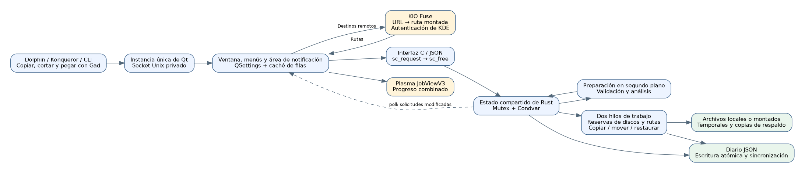
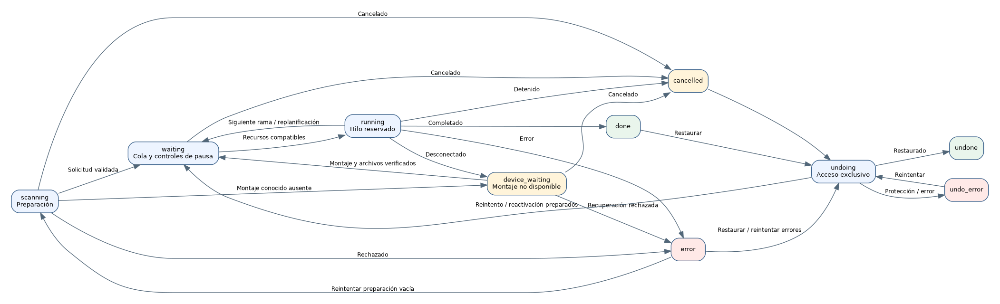

# Gad — Guía de desarrollo {#gad-developer-guide}

Versión documentada: **0.1.0**, protocolo **22**, 6 de noviembre de 2026.

Gad significa **Gestionnaire Avancé de Duplication**; su lema es **Gad, il copie.** Esta guía describe la implementación en este repositorio. El código sigue teniendo autoridad para los campos exactos y los valores predeterminados.

[francés](GUIDE_DEVELOPPEUR.md) · [Guía del usuario](USER_GUIDE.es-ES.md) · [Pruebas](../TESTING.es-ES.md) · [Índice de documentación](README.es-ES.md)

## Contenido {#contents}

1. [Arquitectura](#architecture)
2. [Compilación](#building)
3. [Inicio e instancia única](#startup-and-single-instance-routing)
4. [Portapapeles, rutas y KIO](#clipboard-paths-and-kio)
5. [Preparación de solicitudes](#preparing-requests)
6. [Planificación y concurrencia](#scheduling-and-concurrency)
7. [Modelo y estados](#model-and-states)
8. [Copia de archivos y publicación del resultado](#file-copy-and-publication)
9. [Límites de velocidad](#bandwidth-limits)
10. [Espera de reconexión](#reconnection-waiting)
11. [Diario y recuperación tras un fallo](#journal-and-crash-recovery)
12. [Restauración, cancelación y reactivación](#undo-cancellation-and-reactivation)
13. [Interfaz, métricas e informes de errores](#interface-metrics-and-error-reports)
14. [Referencia del protocolo](#protocol-reference)
15. [Instalación e integración con Dolphin](#installation-and-dolphin-integration)
16. [Pruebas y mantenimiento](#testing-and-maintenance)
17. [Herramientas de documentación](#documentation-tooling)
18. [Limitaciones conocidas](#explicit-limitations)

## Arquitectura {#architecture}

Gad es un ejecutable de Linux que contiene un motor de transferencia Rust y una interfaz de 6 widgets C++/Qt. Se vincula a las bibliotecas del sistema Qt/KDE. El primer proceso posee la ventana, el servidor local y el motor; los lanzamientos posteriores envían comandos a esa instancia.



Los límites principales son Dolphin/CLI a Gad, Qt a Rust y Rust al sistema de archivos. El primero utiliza argumentos, datos del portapapeles y, opcionalmente, el socket privado de Unix. El segundo utiliza llamadas JSON sincrónicas a través de `sc_request` y `sc_free`, con un trabajo prolongado delegado a tareas del motor. El tercero utiliza archivos temporales, publicación, eliminación de fuentes para movimientos, deshacer copias de seguridad y un diario persistente.

KIO Fuse expone puntos finales remotos como rutas montadas; el motor Rust aún transfiere sus datos. Plasma muestra una vista de progreso de D-Bus y no realiza la copia.

### Mapa de código {#code-map}

| Ubicación | Responsabilidad |
|---|---|
| `src/main.rs` | Punto de entrada, lanzamiento de Qt, C ABI e inicialización diferida del motor. |
| `src/engine.rs` | Modelo compartido, enrutamiento de comandos, coordinación de trabajadores y procesamiento de archivos. |
| `src/engine/validation.rs` | Validación de raíz, preparación y preservación de los controles recibidos durante la preparación. |
| `src/engine/duplicates.rs` | Supresión de duplicados antes de publicar nuevos índices de entrada. |
| `src/engine/scheduling.rs` | Recursos de disco físico y reservas de trabajadores atómicos. |
| `src/engine/row_queue.rs`, `queue.rs` | Ordenamiento de sucursales, prioridades, dependencias y referencias estables. |
| `src/engine/fast_move.rs` | Elegibilidad para cambio de nombre local, rutas de montaje vinculado y reprogramación. |
| `src/engine/tree_move.rs` | Cambiar el nombre de todo el árbol, agrupar recibos de diario y deshacer. |
| `src/engine/controls.rs`, `selection.rs` | Ampliación de selección, pausa, cancelación, preparación de reintento y eliminación de filas. |
| `src/engine/errors.rs` | Informes de errores estructurados y validación atómica de reintentos dirigidos. |
| `src/engine/rate.rs` | Presupuestos de bytes compartidos y por solicitud. |
| `src/engine/properties.rs` | Comparaciones expuestas de propiedad/modo/ACL/xattr. |
| `src/engine/resume.rs` | Puntos de control duraderos y recuperación de archivos parciales verificada. |
| `src/engine/reconnect.rs` | Anclajes de montaje, espera de reconexión y vinculación controlada de números de dispositivos. |
| `src/engine/history.rs`, `undo.rs` | Persistencia, carga de recuperación, comprobaciones previas y deshacer. |
| `src/engine/snapshot.rs` | Revisiones volátiles e instantáneas diferenciales. |
| `src/engine/protocol.rs`, `native/protocol.def` | Vocabulario de cables generado compartido por Rust y Qt. |
| `src/engine/tests.rs` | Pruebas de regresión de motores con fijaciones temporales. |
| `native/application.*` | Ciclo de vida de la aplicación, argumentos, socket y activación. |
| `native/window.*` | Construcción y coordinación de ventanas. |
| `native/window_commands.cpp` | Solicitudes de selección, acciones y sondas de reconexión KIO. |
| `native/window_rows.cpp`, `row_tree.h`, `transfer_tree.h` | Widgets estables, árboles de carpetas, arrastrar y soltar internos y acentos de solicitud. |
| `native/window_conflicts.cpp` | Comparación origen/destino y decisiones de conflicto. |
| `native/window_errors.cpp`, `error_report.h` | Cuadro de diálogo de informe de errores, solicitudes de reintento exactas y exportación de texto atómico/JSON. |
| `native/window_open.cpp`, `row_paths.h` | Apertura de archivos/carpetas en el escritorio sin interpretación del shell. |
| `native/clipboard.h`, `kio_sources.h`, `paths.h` | Formatos de portapapeles, validación de URL y resolución KIO. |
| `native/notifications.h` | Progreso y comandos agregados de Plasma JobView. |
| `native/snapshot.h`, `presentation.h`, `transfer_metrics.h` | Instantáneas almacenadas en caché, etiquetas, totales, velocidad y estimaciones de tiempo restante. |
| `build.rs` | Compilación nativa, recursos, protocolo generado y vinculación. |
| `scripts/`, `tests/` | Herramientas de instalación, validación aislada y documentación. |

## Compilación {#building}

Los requisitos incluyen Rust/Cargo, un compilador C++17, `pkg-config`, Python 3, Qt 6 Widgets/Network/DBus y sus herramientas `moc`, `rcc` y `qmake6`, además de KF6 WindowSystem. Las pruebas Qt también requieren la prueba Qt y `dbus-run-session`. El acceso al portapapeles de Wayland utiliza `wl-clipboard`; los puntos finales remotos requieren el fusible KIO. Las dependencias de Rust están bloqueadas en `Cargo.lock`.

```bash
cargo build --locked
cargo build --release --locked
./target/debug/gad --help
```

`build.rs` genera definiciones de Rust a partir de `protocol.def`, compila las unidades nativas, ejecuta la generación de recursos y metaobjetos y vincula el archivo nativo. Inyecta la versión Cargo y la fecha de compilación. Los cambios en las fuentes nativas desencadenan la reconstrucción; Las ediciones exclusivas de Rust no deberían reconstruir todos los widgets. Las versiones de lanzamiento habilitan símbolos de distribución de tiras y LTO; Utilice binarios de desarrollo para la depuración nativa.

### Contrato C ABI {#c-abi-contract}

`sc_request` acepta UTF-8 JSON y devuelve una cadena de respuesta asignada por Rust. Llame a `sc_free` **exactamente una vez** para obtener ese resultado; no utilice C++ `delete` o `free`. El motor se inicializa de forma diferida y se comparte dentro del proceso.

El límite detecta los pánicos Rust para que no se desenrollen a través de C. No repara bloqueos envenenados ni estados lógicos corruptos. Los errores esperados deben ser resultados estructurados. Las rutas UTF-8 no válidas y los valores NUL incrustados se rechazan en lugar de convertirse silenciosamente a otro nombre de archivo.

## Inicio e instancia única {#startup-and-single-instance-routing}

Los argumentos se convierten en un comando, con portapapeles y procesamiento de URL cuando sea necesario. Qt encuentra el socket de usuario existente y utiliza un bloqueo para evitar servidores simultáneos. Una instancia existente recibe el comando y el nuevo proceso sale. De lo contrario, el proceso inicializa la ventana/servidor y realiza la solicitud inicial.

El socket es `gad.sock` en el directorio de ejecución del usuario. Las solicitudes terminan en nueva línea JSON, una respuesta por conexión, con un límite de solicitudes entrantes de 16 MiB y acceso solo para usuarios. `--status` sin una instancia debe fallar en lugar de iniciar un motor gráfico.

Sólo se utilizan la configuración y las ubicaciones del diario propias de Gad. La versión actual del protocolo es **22**. Las comprobaciones de capacidad/versión evitan el envío silencioso de un movimiento, un punto final remoto o una solicitud de verificación a una instancia anterior que no puede implementarlo. Un ejecutable recién instalado aún puede contactar con un proceso más antiguo; actualizar una instancia inactiva mediante el apagado normal.

```bash
gad
gad --background
gad --status
gad --copy /tmp/demo/source.txt --to /tmp/demo/destination
gad --move /tmp/demo/source.txt --to /tmp/demo/destination
gad --copy /tmp/demo/source.txt --to /tmp/demo/destination --md5
gad --copy /tmp/demo/source.txt --to /tmp/demo/destination --properties
gad --paste /tmp/demo/destination
gad --paste-context /tmp/demo/destination --background
```

`gad://show` activa la ventana de Plasma. `--smoke-test` y `--export-icons` son herramientas de integración. `_sources_resolved` indica que ya se realizó la preparación de Qt; no pasa por alto la validación del motor.

La aceptación no es la realización. `enqueue` puede devolver una identificación y luego fallar durante el escaneo; Los clientes deben observar los estados finales.

## Portapapeles, rutas y KIO {#clipboard-paths-and-kio}

### Comportamiento del portapapeles {#clipboard-behavior}

Las listas de URL de archivos y los formatos de administrador de archivos tienen prioridad sobre el texto sin formato. Los marcadores de corte KDE y GNOME seleccionan el modo de movimiento; Arrastrar y soltar selecciona el modo de copia. Los campos de texto de destino mantienen el pegado de texto normal mientras el pegado de la lista de archivos ingresa a la cola de Gad.

En Wayland, las llamadas `wl-paste` limitadas permiten el acceso al portapapeles independientemente del foco de la ventana. `QClipboard` es un recurso alternativo para la falta de disponibilidad de herramientas, no una forma de reinterpretar datos presentes pero con formato incorrecto. Se vuelve a comprobar la coherencia de la lista de archivos y el marcador de corte, pero el portapapeles externo no es una transacción atómica con otra aplicación.

### Validación de ruta y resolución remota. {#path-validation-and-remote-resolution}

Clasificar la entrada antes de la conversión. Una URL `file:` debe ser local, con un host vacío o `localhost` y sin credenciales, puerto, consulta o fragmento. Rechace NUL y codificación no válida. Una ruta POSIX absoluta que contiene un literal `://` sigue siendo una ruta.

Los esquemas remotos admitidos son `kdeconnect`, `ftp`, `sftp` y `smb`, tanto para orígenes como para destinos. Valide las restricciones específicas del esquema y del host antes del montaje. Las URL de origen conservadas omiten las contraseñas. `Job.destination` es una ruta POSIX canónica; `destination_url` y `source_urls` permiten que las etiquetas reconstruyan las direcciones remotas originales. Las acciones de apertura de archivos siguen utilizando rutas montadas reales.

`SourceUrls::Resolver` llama al servicio D-Bus `org.kde.KIOFuse`, objeto `/org/kde/KIOFuse`, interfaz `org.kde.KIOFuse.VFS`, método `mountUrl`. KDE posee la autenticación. Gad no implementa un almacén de credenciales FTP/SSH/SMB independiente.

Resuelva ambas partes antes de enviar la solicitud a Rust, en un plazo de preparación de 30 segundos. A un fallo no se deben presentar únicamente las primeras fuentes resueltas. Los envíos posteriores mantienen el orden mientras la resolución está pendiente. La cancelación invalida las devoluciones de llamadas tardías; no promete cancelar las operaciones internas del servidor KIO.

`destination_context` conserva el contexto seleccionado de Dolphin hasta la resolución. Elige la carpeta en la que se hizo clic o el padre compartido de los archivos seleccionados y luego se elimina antes del envío al motor. Los destinos remotos requieren el protocolo 12 o más reciente.

### Semántica del sistema de archivos KIO {#kio-filesystem-semantics}

Inspeccione los descriptores abiertos a través de `/proc/self/fdinfo` y `/proc/self/mountinfo`. Solo los montajes `fuse.kio-fuse` probados utilizan la semántica especial de sincronización de directorios: los datos del archivo se sincronizan, mientras que no se solicita la sincronización del directorio no compatible. Los errores de sincronización local siguen siendo errores.

Los permisos y horas de origen no se aplican a los destinos KIO Fuse cuando el servicio no puede proporcionar la semántica chmod/utime. El servicio determina estos metadatos. Un archivo temporal remoto creado recientemente y exclusivamente se trunca explícitamente a cero para inicializar el caché de KIO sin descargar un archivo FTP vacío.

La recuperación de fallas duradera está deshabilitada para los destinos de KIO Fuse, incluidas las rutas de montaje ingresadas directamente. La pausa de sesión ordinaria y el reintento de reconexión controlada siguen estando disponibles. Las rutas de diario originales no se reasignan silenciosamente a un nuevo soporte de fusible KIO después del reinicio del demonio.

## Preparación de solicitudes {#preparing-requests}

`enqueue` valida la estructura de la solicitud, las fuentes, las opciones y los metadatos de origen, reserva una ID monótona en `scanning`, la conserva e inicia la preparación fuera del subproceso de la interfaz de usuario.

Valide el destino y las raíces, rechace las autocopias y los alias de montaje no válidos, escanee las carpetas antes que sus hijos en orden determinista e identifique los recursos del disco. Los archivos especiales no compatibles y los nombres fuera del contrato UTF-8 fallan explícitamente. Los enlaces simbólicos son entradas, no directorios de origen atravesados ​​de forma recursiva.

**Ningún archivo en una solicitud se copia hasta que finalice su validación inicial y escaneo.** El error de preparación produce un error en lugar de iniciar un grupo parcialmente analizado.

Los anclajes de montaje se capturan mientras se conocen los puntos finales. Antes de confirmar las entradas preparadas, verifique que la solicitud aún exista y no haya sido cancelada ni detenida. Preservar los controles de pausa/cancelación/ocultos recibidos después de la instantánea de preparación. Los resultados tardíos no deben reactivar las inscripciones canceladas.

Un pegado de fondo válido puede borrar una pausa global anterior. Una pausa solicitada después del envío gana a través de la generación de pausa. Los envíos completamente duplicados regresan sin pausa.

Los trabajadores transferidos se unen al cierre. Las tareas de preparación utilizan la cancelación lógica y el rechazo tardío de los resultados; un sistema de archivos bloqueado o una llamada KIO no tiene una cancelación inmediata garantizada.

### Supresión de duplicados {#duplicate-suppression}

`duplicates.rs` combina rutas de origen y destino, identidad de dispositivo/inodo, tipo y modo copiar/mover. La normalización principal reconoce alias y vincula montajes sin seguir el enlace de origen final. Los escaneos más antiguos finalizan antes de la decisión de admisión, por lo que la solicitud aceptada más antigua gana duplicados simultáneos.

Una solicitud activa en el momento del envío sigue siendo candidata si finaliza durante el nuevo análisis. Se excluye el historial ya completado antes del envío, lo que permite copias repetidas intencionales. Los diferentes destinos y las intenciones de copiar versus mover siguen siendo distintos.

Conserve las carpetas de antepasados ​​requeridas para hijos únicos. Una nueva solicitud no publicada puede filtrar su vector de entrada antes de que los índices se vuelvan visibles. Para una solicitud restaurada no iniciada, mantenga los índices publicados y, en su lugar, oculte los duplicados omitidos. No descarte el trabajo parcial registrado en el diario. `duplicates_ignored` proporciona un mensaje de interfaz de usuario informativo sin un mensaje de acción.

## Planificación y concurrencia {#scheduling-and-concurrency}

Los recursos compartidos utilizan `Arc`, `Mutex`, `Condvar` y una bandera de parada atómica. Dos trabajadores persistentes seleccionan y reservan atómicamente solicitudes bajo `state`. El trabajo del sistema de archivos se ejecuta fuera de ese bloqueo. Nunca mantenga presionado `state` mientras llama a `save`: el orden de bloqueo del diario es **escritor, luego estado**.

Una solicitud procesa sus entradas de forma secuencial, pero las reservas se devuelven en los límites de las sucursales para que las raíces independientes puedan intercalarse con otras solicitudes. Las copias paralelas ordinarias necesitan recursos de disco físicos conocidos y separados. Las particiones y los dispositivos compuestos se rastrean a través de `/sys/dev/block`; La topología no resuelta hace que una copia ordinaria sea exclusiva.

Los trabajos rápidos de cambio de nombre local pueden compartir discos cuando las rutas reservadas normalizadas no se superponen. Las rutas desconocidas o los árboles de origen/destino superpuestos mantienen la serialización. Una solicitud bloqueada anteriormente conserva la prioridad en sus discos relevantes; un nuevo escaneo sin terminar es una barrera para ordenar. El trabajo explícitamente pausado puede permitir que continúe el trabajo posterior admisible.

Deshacer es exclusivo y utiliza **orden de ejecución real** inverso, recurriendo a ID para registros más antiguos. Espera transferencias activas y puede ejecutarse mientras la copia ordinaria está en pausa global. La programación es conservadora; no promete un rendimiento máximo en RAID o almacenamiento en red arbitrarios.

### Solicitudes internas y el bosque visible {#internal-requests-and-the-visible-forest}

Un `Job` posee el destino, las opciones de verificación capturadas y los diarios. Los índices de entrada se mantienen estables. `jobRows` almacena metadatos Qt separados una vez que existen entradas. Las raíces de las limas se adhieren directamente al árbol; Las carpetas reales proporcionan paternidad visual. Los preparados vacíos conservan un marcador de posición.

El `row_order` persistente contiene claves `(job, index)`, con un índice nulo como marcador de posición. El `row_queue::Layout` almacenado en caché registra raíces, padres, hijos y pedidos anticipados sin reorganizar los vectores de entrada. La ascendencia de la fuente **y destino** determina la paternidad, incluidas las raíces anidadas enviadas de forma independiente y los padres tardíos.

`reorder_rows` valida toda la selección, el objetivo, la actividad, las restricciones principales y las dependencias antes de la mutación. Es compatible con `before`, `after`, `next`, `up`, `down` y `last`. Una carpeta seleccionada cubre los descendientes. Ninguna acción repara un archivo ni cambia su destino. Prioridad establecida durante las transferencias de escaneo desde el marcador de posición a sus raíces.

Los trabajadores siguen el plan de sucursal ordenado y notan los cambios de revisión del diseño entre archivos, no a la mitad de uno. Las entradas en espera en pausa no retienen a los trabajadores. Una finalización vacía no debe avanzar en el orden de ejecución, ya que eso corrompería la cronología de deshacer.

Las dependencias de destino sin procesar y normalizadas protegen el orden de reemplazo entre solicitudes y nombres repetidos dentro de una solicitud. Los trabajos dependientes parcialmente publicados no pueden intercalarse peligrosamente. Los nombres futuros reservados también evitan que "Mantener ambos" consuma el nombre previsto de otra entrada en cola. Las solicitudes de terminal históricas no impiden nuevos cambios de prioridad válidos.

## Modelo y estados {#model-and-states}

| Objeto | Invariante clave |
|---|---|
| `State` | Los ID de solicitud no se reutilizan; El orden de cola/fila está separado del historial cronológico. |
| `Job` | Las opciones de verificación se capturan en el momento del envío; Los controles y límites de velocidad pueden cambiar a través de sus comandos. |
| `Entry` | El origen, el destino, el tipo, la identidad, los contadores, los errores y las referencias de deshacer mantienen un índice estable. |
| `undo::Record` | Describa los efectos del sistema de archivos antes de realizar los pasos necesarios para la recuperación. |
| `undo::Stamp` | Los datos de dispositivo/inodo, tipo, tamaño, hora y enlace protegen los resultados propios. |
| Revisión de instantáneas | Seguimiento de cambios de interfaz de usuario volátil, no evidencia de propiedad persistente. |

| Estado JSON | Significado |
|---|---|
| `scanning` | Validación/preparación. |
| `waiting` | Trabajo en cola. |
| `device_waiting` | Falta montura conocida; Se conservan datos parciales. |
| `running` | Un trabajador está procesando la solicitud/entrada. |
| `verifying` | Relecturas independientes de MD5. |
| `conflict` | Se requiere una decisión de expediente. |
| `skipped` | Entrada excluida; la fuente permanece. |
| `done` | Terminado. |
| `error` | Un fracaso documentado. |
| `cancelled` | Se detuvo sin deshacer automáticamente los resultados completados. |
| `undo_waiting` | Deshacer programado. |
| `undoing` | Trabajos exclusivos de recuperación. |
| `undone` | Efectos restaurados. |
| `undo_error` | Deshacer no pudo finalizar de forma segura. |

La pausa también es una superposición de presentación/control y no es un nuevo estado de transferencia serializada. Los estados de conflicto, omitido o en espera a nivel de archivo no son todos estados de trabajo terminal; utilice las definiciones de protocolo compartido en lugar de adivinar a partir de las etiquetas de visualización.



## Copia de archivos y publicación del resultado {#file-copy-and-publication}

Para un archivo normal, vuelva a verificar los controles y la disponibilidad del montaje, valide los padres de destino, resuelva conflictos, reserve el nombre de destino y asigne un archivo `.gad-…part` privado en el directorio de destino. Utilice creación exclusiva y permisos iniciales restrictivos. Las fuentes se abren sin seguir su enlace simbólico final y se comparan con las identidades escaneadas.

El búfer de copia es **64 KiB** y se puede escribir en fracciones concedidas más pequeñas cuando la velocidad es limitada. El progreso avanza en bytes escritos reales. Se mantiene un resumen incremental de MD5 incluso sin verificación independiente de MD5 porque deshacer utiliza evidencia de contenido.

Las copias locales compatibles crean puntos de currículum duraderos. Sincronice datos, aplique permisos básicos y tiempo de modificación cuando sea posible, y realice comprobaciones de contenido/propiedad seleccionadas. Publicar el **mismo archivo temporal verificado** con cambio de nombre. `renameat2(RENAME_NOREPLACE)` protege un objetivo que apareció simultáneamente; El reemplazo conserva el destino anterior de forma privada hasta que la publicación recuperable tenga éxito.

Un movimiento elimina su fuente solo después de su publicación y de las sincronizaciones/verificaciones requeridas. Vuelva a verificar la identidad, el tamaño, la hora y el tipo de la fuente antes de eliminarla. Quedan fuentes omitidas. Los directorios de origen se eliminan en orden inverso sólo cuando son seguros y están vacíos; Los fallos se informan en lugar de eliminar contenidos externos.

Se gestionan averías ordinarias limpias temporales privadas. Las desconexiones reconocidas retienen datos parciales registrados. Un error después de un paso de publicación debe conservar suficiente estado para la recuperación y no debe tratarse como un permiso para repetir una copia a ciegas.

### Cambios rápidos de nombre de archivos y carpetas {#fast-file-and-folder-renames}

`fast_move.rs` demuestra un montaje local compatible, el mismo sistema de archivos subyacente, ruta de escritura y reservas independientes. Puede traducir distintas vistas de montaje enlazado a través de una ruta expuesta común. Un disco físico compartido por sí solo no es una prueba. Kernel EXDEV u otras restricciones de ruta devuelven el trabajo al programador con reservas de copia ordinarias en lugar de conservar la excepción de cambio de nombre durante la copia alternativa.

Los cambios de nombre individuales conservan el inodo original. Su diario y ctime posterior al cambio de nombre protegen la deshacer contra contenidos modificados incluso si se restauran el tamaño y el mtime. Una falla entre el cambio de nombre y la confirmación de la hora puede requerir un examen manual en lugar de una reversión optimista.

`tree_move.rs` requiere además un subárbol completo intacto, sin hijos excluidos o pausados, sin conflictos y con una coincidencia exacta de ruta/tipo/identidad. Los submontajes, incluidos los ocultos en una vista de enlace común, impiden el acceso directo. Un cambio de nombre de raíz exitoso conserva los objetos de los descendientes y registra la información de recuperación agrupada.

La función de deshacer todo el árbol utiliza las mismas pruebas de integridad. Un archivo externo agregado en el destino impide devolver/eliminar ese archivo externo como parte del acceso directo. Las selecciones parciales utilizan restauración individual. Los recibos grupales distinguen una falla antes o después del cambio de nombre de la raíz y evitan la brecha de confirmación de tiempo de archivo individual para esta ruta.

### Verificación MD5 {#md5-verification}

La casilla de verificación agrega relecturas de fuentes independientes y archivos temporales antes de la publicación final. N bytes agregan dos lecturas de N bytes al trabajo de copia. El progreso de la verificación no debe anunciar su finalización únicamente al final de la redacción.

No verifique un archivo temporal y vuelva a crear otro para su publicación. Los cambios de fuente o los resúmenes no coincidentes fallan antes de reemplazar y eliminar la fuente. MD5 es una prueba de coherencia para esta transferencia, no una autenticación adversaria resistente a colisiones.

### Controles de propiedad opcionales {#optional-property-checks}

`verify_properties` es recordado por Qt y capturado por solicitud; `--properties` lo anula para un envío CLI. Los campos faltantes tienen el valor predeterminado falso y `Entry.properties` ninguno. Las solicitudes de propiedad explícitas requieren el protocolo 13 o posterior.

`properties.rs` lee UID/GID, bits de modo `07777` y atributos expuestos por `llistxattr`/`lgetxattr`, sin seguir el enlace simbólico final. Las comprobaciones de identidad/hora rechazan instantáneas inconsistentes. El crecimiento de atributos se vuelve a intentar como máximo tres veces. Los buffers están limitados a 64 KiB cada uno, con valores totales de 8 MiB por captura. Las ACL POSIX utilizan `system.posix_acl_access` y `system.posix_acl_default`.

Los valores permanecen en la memoria, no en JSON. El informe guardado contiene `status` (`ok`, `different` o `unavailable`), `differences` y `unavailable`. Los permisos faltantes no equivalen a atributos ausentes; pueden coexistir diferencias conocidas y comprobaciones incompletas. Los atributos protegidos que no figuran completamente en la lista no se pueden auditar. Las fechas están fuera de esta comparación.

Las copias pueden terminar con advertencias de propiedad. Los movimientos de copiar y eliminar preservan la fuente en caso de una verificación fallida, y los efectos previos y posteriores a la publicación se manejan por separado. Los cambios de nombre permanecen habilitados; una advertencia después de cambiar el nombre no afirma que la ruta de origen todavía exista. Las instantáneas de propiedades de todo el árbol recurren al procesamiento por entrada por encima de la estimación limitada de 32 MiB.

### controles de espacio {#space-checks}

`space.rs` estima las asignaciones restantes en el trabajo analizado en cola y en pausa que comparte un volumen. Redondee a bloques de asignación, evite el desbordamiento numérico y contabilice solo las asignaciones temporales reconocidas en el volumen esperado. Los destinos/copias de seguridad existentes ya son espacio ocupado, no crédito gratuito. Los cambios de nombre probados no asignan una segunda copia de datos.

La capacidad insuficiente conocida falla antes de la creación del destino. Capacidad desconocida produce un aviso y permite la copia. Vuelva a verificar la asignación de archivos antes de crear un archivo temporal; el presupuesto no constituye una reserva frente a otras solicitudes. `verify_space` se captura para la solicitud y requiere el protocolo 14 cuando se solicita explícitamente desde otra instancia.

## Límites de velocidad {#bandwidth-limits}

`rate.rs` proporciona un presupuesto de bytes global compartido y un presupuesto por solicitud. El cero es ilimitado. El limitador consume ambos presupuestos atómicamente antes de una escritura, retiene como máximo 100 ms de crédito y utiliza esperas de variables de condición limitadas en lugar de reservar bytes para un trabajador dormido.

Bloquee `state` antes de `Shared::limiter`. Vuelva a verificar la disponibilidad de pausa, cancelación, parada y montaje periódico durante las esperas. El cambio de tasa comienza sin crédito acumulado. No existe ninguna garantía de equidad en partes iguales. Las tarifas de copia se aplican a bytes escritos, no a relecturas, trabajos de metadatos, deshacer o cambios de nombre de MD5.

El protocolo 18 introdujo `configure.rate_limit` y `set_rate_limit` globales con `ids` y `bytes_per_second`. Valide selecciones completas y valores enteros de 0 a 1 TiB/s antes de la mutación. Persiste los límites configurados, no los créditos de tiempo. Qt muestra MiB/s como `Mio/s` y recuerda la configuración global. Los cuadros de diálogo de solicitud capturan los ID cuando se abren, por lo que los cambios de selección posteriores no pueden reorientarlos.

## Espera de reconexión {#reconnection-waiting}

`reconnect.rs` captura y conserva los anclajes de montaje mientras se conocen los puntos finales: ruta, dispositivo, inodo de anclaje, nodo de bloque sysfs opcional, clasificación remota y un UUID del sistema de archivos udev disponible. Sonda exterior `state`; También verifique durante la transmisión, esperas de ancho de banda y pausas de archivos activos.

`device_waiting` no es terminal. `park_disconnected` retiene el diario parcial, marca la entrada como interrumpida y libera al trabajador. Un observador por solicitud espacia las sondas por al menos un segundo y respeta la cancelación y las pausas globales/solicitud/entrada. Mantenga la solicitud en `device_waiting` durante una validación potencialmente lenta para que no cree una barrera de escaneo para el trabajo independiente.

Al regresar, reutilice `prepare_resume` y la ruta de preparación ordinaria. Los UUID coincidentes pueden volver a vincular los números de dispositivo; Las comprobaciones de inodo/tipo/versión, ctime y resúmenes de contenido permanecen sin cambios. Publique identidades validadas y anclajes juntos antes de que la solicitud sea ejecutable. Un volumen diferente, un directorio de reemplazo vacío, una identidad ambigua o una fuente modificada no son pruebas suficientes para continuar.

`CopyTemp` conserva un registro temporal tras una desconexión reconocida. Los puntos de control locales permanecen disponibles para la reconexión de la sesión incluso cuando la recuperación automática ante fallos está desactivada. Sin un punto de destino KIO duradero, solo se puede eliminar un temporal no publicado reconocido después de la validación del origen para reiniciar ese archivo. Nunca reproduzca automáticamente una publicación que ya esté comprometida.

Qt vuelve a intentar la resolución de la URL de origen a través de KIO como máximo cada cinco segundos sin llamar a `enqueue` ni exponer una nueva implementación de autenticación. Se informa una ruta montada diferente en lugar de usarse para reescribir el diario. Las etiquetas, las métricas, la insignia de la bandeja y el progreso nativo muestran la espera. Las llamadas kernel/remotas ya bloqueadas siguen sujetas a sus propios retrasos.

## Diario y recuperación tras un fallo {#journal-and-crash-recovery}

El diario del usuario es `$XDG_DATA_HOME/gad/state.json`, el valor predeterminado es `~/.local/share/gad/state.json`. `save` serializa escritores, escribe un archivo de estado temporal, lo reemplaza atómicamente y sincroniza según sea necesario. No mantenga presionado `state` mientras lo llama.

`undo::Record` captura la puesta en escena propia, los resultados, las copias de seguridad/sellos originales, la eliminación de la fuente, la preparación de la fuente restaurada y los pasos de recuperación completados. Los destinos reemplazados se encuentran en directorios privados `.gad-undo-*` en su sistema de archivos. Mantenga el diario antes de los efectos que necesitan recuperación; no trate una ruta de visualización como evidencia de propiedad.

Al cargar el trabajo interrumpido, el motor clasifica las copias compatibles sin terminar por separado de las etapas ambiguas de publicación, cambio de nombre y deshacer. El trabajo cancelado explícitamente no se reinicia. La información de recuperación retenida puede sobrevivir a la retención del historial normal. La limpieza normal del historial libera copias de seguridad sin eliminar los resultados finales exitosos; la limpieza fallida sigue siendo un error visible y recuperable.

### Limas parciales duraderas {#durable-partial-files}

`resume.rs` almacena un origen `Version` con identidad/metadatos/ctime, una versión de destino existente protegida al reemplazar, un recuento de bytes confirmado y el resumen del prefijo. Los puntos de control ocurren después de 64 MiB o dos segundos de progreso. Sincronice el temporal y su directorio antes de publicar un nuevo punto confirmado en la revista.

`Job.resume_enabled` captura la preferencia de recuperación automática de fallos; `resume_pending` marca trabajo interrumpido recuperable. La reconexión de la sesión local todavía crea puntos de control cuando esa preferencia está desactivada. Los campos antiguos que faltan están predeterminados de forma conservadora.

La recuperación requiere un `.gad-…part` privado esperado en el padre correcto, sin un enlace simbólico ni enlaces físicos adicionales, que coincida con el dispositivo y el inodo guardados. Consulte también los descriptores abiertos. Compare los prefijos de origen y temporales bloque por bloque, verifique nuevamente el hash y las versiones registradas y solo entonces trunque los bytes finales no confirmados y reposicione ambas secuencias. Reconstruya el contexto incremental MD5 y conserve el inodo temporal.

`resume_checking`, `resume_checked` y `resumed_from` describen el progreso de validación y reinicio. Un permiso de solo lectura aplicado previamente se ajusta solo en un temporal de propiedad validado. Elimine el registro del currículum antes de la publicación final y realice la transición al diario de deshacer ordinario. El MD5 independiente final aún se ejecuta cuando se solicita.

`resume_interrupted` acepta ID de trabajo recuperables. La preparación y la reconexión preservan los controles de pausa/cancelación/ocultos posteriores mediante índice estable. Una validación rechazada preserva el parcial no reconocido en lugar de truncarlo de manera optimista.

## Restauración, cancelación y reactivación {#undo-cancellation-and-reactivation}

La cancelación detiene la obra nueva y deja efectos terminados. Deshacer utiliza el diario para eliminar copias creadas por Gad, devolver movimientos y restaurar destinos reemplazados.

Realice una verificación previa de todo el alcance seleccionado y los padres requeridos antes de realizar modificaciones. Valide los resultados y las copias de seguridad propios, incluidos los resúmenes de contenido cuando sea necesario. Una fuente recreada, un destino modificado, una copia de seguridad faltante o un volumen ausente producen un rechazo en lugar de sobrescribir los datos del usuario.

Procesar solicitudes en orden de ejecución inverso. Las cadenas de reemplazo pueden colocar una salida anterior en una copia de seguridad seleccionada más nueva; la validación comprende esas dependencias. Vuelva a crear los directorios de origen requeridos, restaure archivos y destinos anteriores, luego elimine solo los directorios creados vacíos. La devolución entre sistemas de archivos requiere una copia verificada, publicación y sincronización antes de la eliminación del destino.

Los pasos de deshacer completados se conservan para volver a intentarlo después de `undo_error`. Las selecciones parciales preservan a los vecinos. La verificación previa reduce el riesgo pero no convierte un directorio completo en una transacción atómica contra escritores externos.

Eliminar borra las filas terminadas seleccionadas sin eliminar los resultados finales, cancela las entradas activas y elimina el trabajo pendiente. La tecla de retroceso también solicita deshacer para obtener resultados finales. La selección de carpetas se expande a través de la ascendencia de origen/destino, no de un prefijo de cadena sin formato. Eliminar una fila no cambia los índices activos del motor.

La reactivación de entradas canceladas es distinta de configurar `waiting`. Primero restaura/limpia los restos compatibles, maneja los padres faltantes y los cambios de tipo, y preserva los vecinos completos. La cancelación global también invalida la preparación de URL Qt pendiente.

## Interfaz, métricas e informes de errores {#interface-metrics-and-error-reports}

### Actualizaciones diferenciales y árboles. {#differential-updates-and-trees}

`TrackedJob` marca el acceso al trabajo mutable con una revisión volátil. Las mutaciones globales y los cambios de diseño también hacen avanzar el reloj de las instantáneas. `poll` acepta `since`; los tokens ausentes/incompatibles solicitan un reinicio, el estado sin cambios devuelve una pequeña respuesta y otras respuestas incluyen identificaciones autorizadas, metadatos y trabajos modificados. `QueueSnapshot` los fusiona sin recrear filas sin cambios.

Reutilice QTreeWidgetItems para conservar la selección, el desplazamiento, la información sobre herramientas, la posición de desplazamiento y la expansión. Solo actualice el texto/iconos/información sobre herramientas cuando los valores cambien. Cree carpetas parentales desde las rutas de origen y de destino. Los filtros mantienen visibles los ancestros necesarios y el progreso normal no vuelve a abrir las ramas contraídas manualmente.

`TransferTree` utiliza datos MIME privados que contienen claves de fila estables y de origen. Las caídas internas envían `reorder_rows`; Qt nunca repara directamente el modelo. El MIME interno externo se rechaza mientras que las URL de archivos externos aún alcanzan el manejo normal de caída de archivos. El desplazamiento de borde y los protectores QPointer manejan un arrastre activo de forma segura.

### Velocidad y tiempo restante {#speed-and-remaining-time}

`transfer_metrics.h` almacena en caché un `Probe` por solicitud no finalizada y lo reconstruye solo para los ID modificados. Cada tic de actualización, incluido `poll.unchanged`, avanza el reloj monótono inyectado y disminuye las velocidades estancadas sin volver a escanear las entradas.

Los medidores Copy y MD5 utilizan ventanas de actividad separadas de cinco segundos y al menos 500 ms de observación. Excluye intervalos que cruzan fases. Las pausas, los conflictos, las comprobaciones de recuperación y las contrarregresiones restablecen mediciones inadecuadas. No cuente los prefijos reanudados, directorios, trabajos eliminados/cancelados/omitidos ni bytes de cambio de nombre lógico como tráfico de copia nueva.

Calcule los bytes de copia restantes a la velocidad de copia más las lecturas restantes de MD5 a la velocidad de MD5. Si desconoce una medida necesaria, dígalo; calcule solo la fase de copia cuando no se haya observado MD5. El trabajo pausado individualmente hace que se desconozca el tiempo total. Estas métricas son volátiles y no predicen la espera en la cola ni la duración de la deshacer.

### Informes de errores y reintentos {#error-reports-and-retries}

`error_report` es de solo lectura y está excluido de `snapshot::Mutation`. El formato es `gad-error-report`, versión 1, con `generated_unix`, metadatos de origen del trabajo y registros de errores estables. Incluya rutas, mensajes, bytes, estado de publicación/recuperación, MD5 disponible e informes de propiedades. Los marcadores de fallas de directorio agregados y las esperas de dispositivos no son fallas permanentes duplicadas.

`retry_errors` acepta `jobs`, `entries` y `exact` opcional. Valide la elegibilidad para toda la selección antes de la mutación y rechace las solicitudes activas. Las referencias exactas del informe no expanden implícitamente una carpeta; las selecciones de lista normales lo hacen. Enrute los errores seleccionados a través de la deshacer preparatoria existente y `prepare_retry`, conservando los vecinos correctos/cancelados/omitidos/eliminados. Suspenda simplemente esperar entradas no seleccionadas para preservar el alcance. Preservar la pausa global.

Un análisis vacío fallido utiliza validación y escaneo de raíz completos. Restablecer los ancestros estructurales cuyo estado de error provino solo de un niño. Vuelva a verificar los alias de origen/destino antes de volver a intentarlo. La función de deshacer incompleta por separado no se convierte en copia; Los fallos en la preparación de reintentos mantienen las referencias para que se puedan intentar nuevamente después de la reparación. Las salidas modificadas permanecen protegidas mediante la verificación previa de deshacer.

`window_errors.cpp` es una instantánea no modal, actualizada explícitamente con celdas de texto sin formato y detalles de `QPlainTextEdit`. El filtrado y la clasificación no cambian las referencias de filas almacenadas. Los seis botones utilizan íconos temáticos con respaldos estándar Qt. La exportación de texto/JSON utiliza `QSaveFile`; sólo una escritura completa y exitosa reemplaza el informe. La exportación incluye toda la instantánea cargada, mientras que los reintentos se centran en errores mostrados o seleccionados.

### Plasma y activación de ventana {#plasma-and-window-activation}

`notifications.h` agrega las solicitudes actuales en un JobViewV3. Realice un seguimiento de los deltas de bytes por entrada, distinga el progreso del cambio de nombre lógico, incluya el trabajo MD5 en finalización y sincronice los comandos de pausa. Mantenga la velocidad final útil mientras se cierra la vista. Maneje la reconexión a Plasma después de una falla en el servicio sin crear notificaciones ordinarias duplicadas.

`gad://show` y los tokens de activación restauran la ventana principal. Los clics en la bandeja alternan la visibilidad. Las aperturas de carpetas/archivos utilizan `QDesktopServices` con URL de archivos, nunca un shell. El inicio automático es una entrada de escritorio por usuario; cerrar o renunciar debe honrar el trabajo activo.

## Referencia del protocolo {#protocol-reference}

`native/protocol.def` es el vocabulario compartido; Las estructuras y validadores Rust definen contratos exactos. La versión actual es **22**. Los comandos específicos de la GUI se enrutan mediante Qt y los comandos del motor, mediante Rust.

| Dominio | Parámetros principales | Comportamiento |
|---|---|---|
| `status` | Ninguno | Estado completo. |
| `poll` | Opcional `since` | Estado completo o incremental. |
| `configure` | `keep_history`, opciones de verificación, `resume_interrupted`, `rate_limit` | Preferencias y tarifa global en vivo. |
| `set_rate_limit` | `ids`, `bytes_per_second` | Límite por solicitud en vivo. |
| `enqueue` | `sources`, `destination`, `mode`, opciones/metadatos de origen, `background` | Reserva y prepara una solicitud. |
| `pause` | `paused` | Pausa mundial. |
| `reorder_queue` | `ids`, `action` | Pedido de solicitud completa. |
| `reorder_rows` | `rows`, `action`, opcional `target` | Ordenación de archivos/sucursales. |
| `cancel`, `cancel_many` | `id` o `ids` | Detener solicitudes. |
| `undo_many` | `ids` | Deshacer solicitudes. |
| `resolve` | `id`, `index`, `action`, `all` | Decisión del conflicto actual. |
| `cancel_all`, `undo_all` | Ninguno | Detener o deshacer globalmente. |
| `pause_selection` | `jobs`, `entries`, `paused` | Controles dirigidos. |
| `resume_interrupted` | `ids` | Revalidar el trabajo interrumpido recuperable. |
| `error_report` | Ninguno | Lea los detalles estructurados del fallo. |
| `retry_errors` | `jobs`, `entries`, opcional `exact` | Reintente solo los errores seleccionados elegibles. |
| `retry_selection` | `jobs`, `entries` | Reactivar entradas canceladas. |
| `delete_selection`, `backspace_selection` | `jobs`, `entries` | Quitar/deshacer semántica del teclado. |
| `undo_selection`, `cancel_selection` | `jobs`, `entries` | Deshacer o cancelar de forma específica. |
| `clear` | Ninguno | Borrar el historial finalizado y sus copias de seguridad. |
| `shutdown` | Ninguno | Apagado controlado, rechazado mientras está activo. |
| `show` | Opcional `activation_token` | Mostrar/activar la ventana. |
| `background` | Ninguno | Mantenga la instancia oculta. |
| `paste` | Configuración de destino/contexto y fondo | Lea el portapapeles y envíe el trabajo. |

```json
{"command":"enqueue","sources":["/tmp/demo/source.txt"],"destination":"/tmp/demo/destination","mode":"copy","verify_md5":true}
```

El éxito en el envío devuelve una identificación, no una prueba de que la transferencia final se haya realizado correctamente. Los consumidores deben manejar los errores tardíos y distinguir el estado de operación del estado de entrada individual.

## Instalación e integración con Dolphin {#installation-and-dolphin-integration}

`scripts/install.py` compila primero, reemplaza atómicamente a `~/.local/bin/gad`, instala la asociación de escritorio `org.hizoka.gad`, el controlador de protocolo, los íconos y las acciones del menú de servicio en las ubicaciones XDG del usuario y actualiza las cachés de KDE cuando están disponibles. Un ejecutable ya mapeado por un proceso en ejecución mantiene su código anterior.

El identificador de la aplicación es `org.hizoka.gad`; Las asociaciones de íconos y escritorio deben coincidir para que la barra de tareas use el ícono del software en lugar de una imagen de copia genérica. Los activos `gad-boucles-document` integrados se exportan en tamaños de escritorio mediante Qt.

`gad --configure --dolphin-ctrl-v` instala una asociación reversible Dolphin Ctrl+V. `--no-dolphin-ctrl-v` restaura la configuración guardada anteriormente. La integración conserva el pegado de texto nativo y la alternativa estándar Shift+Insert KIO. Localiza la carpeta Dolphin activa a través de la información de la sesión actual en lugar de un requisito de título de ventana de ruta completa. Valide los cambios de forma atómica, rechace registros de integración no relacionados o con formato incorrecto y conserve los accesos directos no relacionados.

El `make test-dolphin-paste` opcional utiliza KXMLGUI/KActionCollection real en un bus privado para activar accesos directos, pegar texto y restaurar sin copiar archivos ni reiniciar el Dolphin del usuario.

La desinstalación deja los datos necesarios para la recuperación en lugar de eliminar diarios y copias de seguridad. Si hay otras copias de Gad instaladas, distinga su versión binaria y la instancia en ejecución antes de diagnosticar el comportamiento.

## Pruebas y mantenimiento {#testing-and-maintenance}

[Prueba Gad](../TESTING.es-ES.md) proporciona requisitos completos y descripciones de escenarios.

```bash
make doctor
make test-unit
make test-python
make test-qt
make test-integration
make check
make test
```

`scripts/run_tests.py` admite filtrado, grupos con reconocimiento de dependencias, ejecución continua e informes JSON/JUnit en `target/test-results`. JUnit cuenta las etapas del comando, no todas las afirmaciones Rust/Qt.

Las pruebas Rust utilizan árboles temporales para comprobar el estado observable y el contenido del archivo. Las pruebas de Python utilizan la biblioteca estándar y accesorios aislados; Las dependencias del renderizador de documentación se cargan solo durante el renderizado. Las pruebas Qt utilizan entornos privados D-Bus/HOME/XDG, dobles de motor y aperturas de escritorio interceptadas. Las pruebas de integración también ejercitan el ejecutable real y la recuperación ante fallos. Los simulacros no reproducen todos los servidores o versiones de Plasma.

La validación local documentada comprende las suites **216 pruebas Rust**, **65 pruebas de Python**, Qt, incluido **83 casos de acción en fila**, y comprobaciones de integración, formato y Clippy. Un punto de referencia se ignora intencionalmente en ejecuciones de rutina. Esto describe evidencia local, no una afirmación de que el flujo de trabajo de GitHub proporcionado se haya ejecutado de forma remota o que las ediciones futuras se validen automáticamente.

### Diagnóstico de fallas {#diagnosing-failures}

Comience con `gad --status`, la versión de la instancia en ejecución y complete los mensajes de error. Distinga el ejecutable instalado de `target/debug/gad`.

Para entrada remota, validación de URL separada, disponibilidad del fusible D-Bus KIO, autenticación KDE, montaje y acceso a archivos reales. Para deshacer, conserve los volúmenes y las copias de seguridad necesarios; no elimine `.gad-undo-*` para “reparar” un diario. Las exportaciones de errores contienen rutas personales y deben revisarse antes de compartirlas.

### Agregar una característica {#adding-a-feature}

Primero defina los efectos del archivo, el comportamiento del usuario y la semántica del estado interrumpido. Actualice el vocabulario compartido para cambios de protocolo y utilice valores predeterminados conservadores para campos persistentes. Registre los efectos recuperables antes de realizarlos y conserve la evidencia de propiedad.

Verifique pausa, cancelación, selección múltiple, devoluciones de llamada tardías y apagado. Agregue pruebas de regresión para detectar un comportamiento observable significativo, ejecute los grupos afectados y las comprobaciones requeridas, luego actualice **ediciones en ambos idiomas** y las capturas de pantalla relevantes. Nunca utilice una cadena de visualización como prueba de que un objeto del sistema de archivos pertenece a Gad.

## Traducción de la aplicación {#application-localization}

`native/i18n.h` utiliza QTranslator y el catálogo lingüista estándar Qt `translations/gad_fr_FR.ts` / `translations/gad_es_ES.ts` / `translations/gad_pt_PT.ts` / `translations/gad_de_DE.ts` / `translations/gad_ja_JP.ts`. El inglés estadounidense es el idioma fuente del programa; los catálogos contienen traducciones al francés, español, portugués, alemán y japonés. Marque las cadenas de visualización Qt con `GAD_TR("…")` en el contexto `Gad`. Los diagnósticos de motores conocidos utilizan el contexto `Engine` únicamente en el momento de la presentación. Los diarios, los nombres de archivos, las claves JSON, los estados de los cables y las exportaciones de JSON conservan sus valores originales. Los diagnósticos no catalogados y los errores de servicios externos mantienen su idioma original; La traducción nunca reemplaza fragmentos dentro de nombres de archivos o mensajes.

El `.qm` compilado se registra e incrusta a través de `gad.qrc`; Para crear o instalar Gad no es necesario ningún paquete de idioma independiente ni herramientas Linguist. El selector de idioma guarda la preferencia QSettings `language` e inmediatamente llama a `I18n::initialize` sin interrumpir las transferencias. `GAD_LANGUAGE=fr_FR` o `GAD_LANGUAGE=en_US` lo anula para una nueva instancia; `system` sigue QLocale::system(). Los dialectos de escritorio en inglés utilizan en_US; otros idiomas recurren a fr_FR. Los comandos enviados a una instancia existente no cambian su idioma.

Para widgets persistentes, `I18n::localized(widget, "text", []{return GAD_TR("About");})` o `I18n::bindProperty` vincula explícitamente una propiedad a su texto fuente. `I18n::onChange` actualiza presentaciones calculadas como encabezados, listas, informes y renderizado de transferencias. QPointer protege a cada propietario de devolución de llamada; los propietarios destruidos se eliminan y los enlaces repetidos para una propiedad reemplazan las devoluciones de llamada anteriores. Las devoluciones de llamadas se ejecutan desde una instantánea después de instalar los traductores. Las cadenas mostradas nunca se buscan ni reemplazan globalmente.

La caché de filas incluye el idioma: una encuesta sin cambios aún actualiza las etiquetas sin reemplazar los elementos del árbol. Los informes de errores mantienen la instantánea, las filas y la selección cargadas. Un conflicto mantiene su opción de “aplicarse a conflictos futuros” cuando solo cambia el lenguaje. Las fechas y los números se reformatean sin cambiar los valores numéricos. Los mensajes ya archivados por Plasma conservan su idioma original; Las vistas de trabajos activos se actualizan en la siguiente actualización.

Después de agregar cadenas de visualización, ejecute `make translations` para sincronizar fuentes, traduzca nuevas entradas en Qt Linguist y ejecútelo nuevamente para compilar el catálogo y actualizar sus huellas digitales. Este comando de mantenimiento requiere `lrelease6` o `lrelease`. `make translations-check` verifica la cobertura, los parámetros, los enlaces y las huellas digitales de `%1` sin herramientas externas. Las pruebas de Python también ejecutan estas comprobaciones. Las pruebas Qt cargan el catálogo integrado real y verifican los widgets, estados, informes, preferencias y exportaciones de nombres de archivo/JSON sin cambios en inglés.

## Herramientas de documentación {#documentation-tooling}

El archivo README raíz es un punto de entrada breve; Aquí se mantienen guías detalladas. La documentación cubre seis idiomas. Cada edición incluye Inicio rápido, Guía del usuario, Guía del desarrollador y 14 capturas de pantalla de su propia interfaz en el tema ligero. Los diagramas de arquitectura y ciclo de vida tienen etiquetas localizadas.

`doc_catalog.py` identifica el idioma y la audiencia de cada fuente. `build_docs.py` genera portadas con lenguaje correcto, cambios de idioma para la misma audiencia, enlaces/fragmentos relativos e imágenes incrustadas sin conexión. Los PDF en inglés utilizan Carta estadounidense; otros archivos PDF usan A4. `check_docs.py` valida todos los enlaces README/pruebas/guía, capturas, metadatos de idioma y las 36 exportaciones HTML/PDF.

```bash
make docs-captures
make docs
make docs-check
```

El código de captura vincula los widgets reales a un puente C de demostración, utiliza archivos temporales y sesiones aisladas y aplica Breeze Light en su configuración privada, preservando la configuración de fuente del escritorio. El manifiesto registra dimensiones, versión y hashes. Nunca controla el proceso o el portapapeles Gad real. La representación nativa de bandeja/progreso fuera de la captura del widget no se simula como una captura de pantalla de escritorio real.

Las pruebas de documentación de Python cubren la selección de configuración regional, la navegación, el tamaño del papel, los enlaces relativos, los títulos, la incrustación de imágenes, los encabezados faltantes y la invocación completa de la exportación sin necesidad de Markdown o WeasyPrint en el entorno de prueba de rutina. Consulte [índice de documentación](README.es-ES.md) para conocer las dependencias de exportación opcionales.

## Limitaciones conocidas {#explicit-limitations}

La integración opcional Ctrl+V de Gad es específica de Dolphin. Los puntos finales remotos dependen de KIO Fuse y su semántica de servicio. La recuperación duradera de fallos a mitad de archivo está limitada a destinos compatibles; En su lugar, los destinos KIO pueden reiniciar un archivo actual no publicado durante la reconexión de la sesión.

El propietario, ACL, xattr, archivos dispersos y preservación de enlaces duros no tienen todas las garantías de una herramienta de copia de seguridad especializada. Un grupo de copias no es globalmente atómico. La sincronización del sistema de archivos y las modificaciones externas simultáneas siguen siendo relevantes incluso con comprobaciones de identidad, MD5 y validación previa.

Mantenga estos límites visibles en las decisiones de diseño y los mensajes de los usuarios. Un control local exitoso no debe convertirse en una promesa de recuperación universal.

## Ordenación y filtros de columnas {#header-sorting-and-filters}

`native/table_view.h` almacena configuraciones de solo presentación, aplica predicados de columnas literales y clasifica elementos hermanos mediante comparaciones naturales con reconocimiento regional o roles de progreso numérico. Los rangos de cola rompen vínculos de igual valor independientemente de la dirección de clasificación. Los mismos QTreeWidgetItems se vuelven a adjuntar conservando la selección y la expansión. Las actualizaciones de progreso evitan restablecer una vista ordenada al orden de la cola antes de volver a ordenarla.

`TransferTree` posee los menús de encabezado, las revisiones de visualización/filtro y las acciones de restablecimiento. `Window::refresh` trata una revisión de presentación como una razón para renderizar incluso después de una encuesta sin cambios, combina predicados de columna y preserva la visibilidad de los antecesores. Las revisiones de filtro son independientes de las revisiones de clasificación, por lo que la clasificación no vuelve a abrir las carpetas contraídas. La restauración del orden de la cola llama a la ruta de pedido de clave estable existente. El arrastre interno está desactivado durante la clasificación visual. Ninguna de estas configuraciones emite comandos de mutación del motor. Las pruebas cubren la identidad de la cola, el orden natural y numérico, los predicados combinados, la ascendencia, el progreso en vivo, la traducción activa y el comportamiento de reinicio/navegación.

Las claves de clasificación forman una lista ordenada de pares de columna/dirección. TransferHeader lee Ctrl del evento real de liberación del mouse; Ctrl+clic agrega o invierte una clave, mientras que un clic normal reemplaza la lista. Los marcadores de encabezado conservan prioridades clave en toda la traducción. Borrar una clave de clasificación conserva el resto. Se eliminaron el combo global redundante y su predicado. Los nuevos íconos de menú tienen respaldos Qt cuando un tema carece de ellos.

La columna de orden es la columna lógica 5 y la columna visual 0; `setTreePosition(0)` mantiene sucursales en la fuente. Los roles de columna existentes y las referencias de acciones mantienen su significado. Los números provienen de `row_order`, con un respaldo derivado de una instantánea cuando no se proporciona ningún diseño. Un delta de solo diseño obliga a que todas las filas se actualicen, incluidos los trabajos omitidos en ese delta. La información sobre herramientas de las celdas muestra ID de lotes inmutables. La clasificación de pedidos utiliza clasificaciones de cola numéricas y la sexta columna admite filtros y clasificación Ctrl+clic. Los acentos de color solicitados se dibujan en la primera columna visual.

Los saltos de oración de información sobre herramientas son nuevas líneas explícitas en los literales de origen en inglés y en el catálogo en francés. Ningún reemplazo de puntuación en tiempo de ejecución afecta rutas, URL o texto de error externo. La información sobre herramientas de origen conserva la ruta y las opciones de operación; La identificación del lote permanece en la columna Pedido. La regresión del lenguaje en vivo incluye un nombre de archivo que contiene un punto, un espacio y caracteres similares a HTML.

La decoración de origen utiliza `edit-copy`/`edit-cut`, almacenado en caché por modo de operación en `OperationRole`, con respaldos de Qt. `KindRole` todavía registra el tipo de entrada real para acciones de carpeta/archivo. La información sobre herramientas conserva sólo rutas y opciones útiles, sin repetir la operación. La sección Pedido utiliza `ResizeToContents` en lugar de un ancho fijo.

## Reglas de exclusión de transferencias {#transfer-exclusion-rules}

`src/engine/exclusions.rs` valida reglas e implementa la coincidencia global de programación dinámica Unicode (`*`, `?`). El protocolo 21 expone desde `exclusions` hasta `configure`, `enqueue` e instantáneas: `include_hidden` (verdadero por defecto), `directories` y `files` (matrices vacías por defecto). La validación ocurre antes de la mutación, incluidas otras preferencias en la misma solicitud. Las revistas más antiguas reciben estos valores predeterminados.

`State` almacena preferencias; cada `Job` conserva su propia copia inmutable. El escaneo carga las reglas del trabajo una vez por raíz, utiliza `symlink_metadata` y elimina las carpetas excluidas antes del recorrido. Reanudar y volver a intentar utilizar el mismo escáner. Las solicitudes totalmente excluidas se completan sin reanudar una cola en pausa. `tree_move::ready` desactiva los cambios de nombre de carpetas completas cuando el filtrado está activo. La limpieza elimina solo las carpetas vacías y tolera las carpetas que contienen elementos excluidos.

Qt captura reglas antes de la resolución KIO. Las ediciones del cuadro de diálogo se confirman solo después de `configure` exitosa. QSettings almacena `includeHidden`, `excludeDirectories` y `excludeFiles`. Las pruebas cubren copias, movimientos y deshacer, enlaces, Unicode, reglas inmutables, persistencia, reintentos, validación atómica y preferencias de UI.

## Añadir un idioma {#adding-a-language}

Los idiomas se descubren al inicio a partir de catálogos `gad_<locale>.qm` válidos, como `gad_de_DE.qm`. Qt proporciona el nombre para mostrar nativo de cada idioma. El inglés estadounidense sigue estando disponible como idioma de origen. Las configuraciones regionales exactas tienen prioridad, seguidas de una variante disponible del mismo idioma, luego francés o inglés.

Para agregar un idioma sin reconstruir, coloque su `.qm` en `~/.local/share/gad/translations/` y su indicador `<locale>.png` al lado, por ejemplo, `de_DE.png`, luego reinicie Gad. Este directorio sigue a `$XDG_DATA_HOME` cuando se establece. Las banderas también pueden estar en un subdirectorio `flags/` o en `~/.local/share/gad/flags/`. Las banderas que faltan utilizan un icono genérico. Los catálogos no válidos se ignoran. Los catálogos de usuario anulan el sistema y los catálogos integrados.

Para distribución con Gad, coloque el `.qm` en `translations/` y su PNG en `assets/flags/`. `scripts/resources.py` genera el manifiesto Qt para Cargo, pruebas Qt y capturas de documentación. No se necesita ninguna lista de C++ ni edición del manifiesto de origen. Un `.qm` compilado por sí solo es suficiente; cuando se suministra un `.ts`, `python3 scripts/translations.py` lo descubre, valida y compila automáticamente.

## Duplicar en la carpeta de origen {#duplicating-in-the-original-folder}

Habilite **Permitir duplicación en la misma carpeta**, luego copie y pegue en la carpeta que contiene el elemento. `photo.jpg` se convierte en `photo_copied1.jpg`; una carpeta `Documents` se convierte en `Documents_copied1`. Gad elige el primer número disponible, teniendo en cuenta las duplicaciones pendientes. Los enlaces simbólicos se copian sin seguir sus objetivos.

Esta opción está deshabilitada de forma predeterminada, guardada y capturada para nuevas solicitudes. Se trasladan a sí mismos y las copias de carpetas a sus propios descendientes siguen siendo rechazadas. Aún se aplican exclusiones. Deshacer elimina la copia creada y conserva el original.

El protocolo 22 agrega `allow_duplication` a `configure`, `enqueue`, diarios e instantáneas. `src/engine/duplication.rs` asigna objetivos raíz y los conserva en `Job.duplicate_targets`. El escaneo reutiliza esos objetivos durante la reanudación y el reintento. El nombre verifica el disco fuera del bloqueo estatal y luego reserva al candidato bajo el bloqueo contra planes concurrentes. Las comprobaciones de recursividad permanecen activas; sólo se acepta un objetivo idéntico para una copia explícitamente permitida.

## Usar Gad con Konqueror {#using-gad-with-konqueror}

**Pegado con Gad** es un menú de servicio KIO compartido con Dolphin. Reinicie Konqueror después de instalar Gad para cargar el menú. Las operaciones de copiar y cortar utilizan el mismo motor de transferencia y cola.

Para **Ctrl+V**, inicie **Konqueror con Gad** desde el menú de la aplicación o ejecute `gad-konqueror`. Este iniciador carga un complemento solo en Konqueror. Los archivos pegados van a Gad usando la carpeta de la vista activa; pegar texto en la barra de direcciones y los campos de entrada sigue siendo nativo. **Mayús+Insertar** mantiene la pasta habitual de KIO. Los destinos remotos admitidos siguen estando disponibles.

El complemento también expone la carpeta activa a **Pegue en la carpeta abierta con Gad**, sin depender de títulos de ventanas o selecciones obsoletas. Se conserva el lanzador estándar Konqueror. La integración Ctrl+V está validada con Konqueror 26.08 (Qt 6). Si Konqueror se instala después de Gad, vuelva a ejecutar `python3 scripts/install.py` para compilar su complemento.

`native/konqueror/paste_filter.h` solo maneja Ctrl+V en una vista con una URL compatible y un portapapeles de archivos. Los campos de texto, las páginas HTTP, otras ventanas y Shift+Insert siguen siendo nativos. `plugin.cpp` deriva de `KonqParts::Plugin` y expone el destino activo a través de D-Bus. La interfaz lo lee dos veces antes de pegarlo. `scripts/konqueror_integration.py` crea el complemento con encabezados Konqueror, Qt6Xml/DBus/Widgets, KF6CoreAddons y KF6XmlGui. Se requieren encabezados Konqueror y bibliotecas de desarrollo CoreAddons/XmlGui. La ruta del complemento local se pasa exclusivamente al proceso iniciado por `gad-konqueror`, sin cambiar la configuración global de Qt ni los accesos directos del navegador.

## Diálogo de configuración {#settings-menu}

`Window` conserva un único `QDialog` no modal llamado `settingsDialog`, con un `QTabWidget` para configuración y atajos. `settingsPanel` permite desplazamiento; los controles, conexiones, traducciones y valores se conservan al volver a abrirlo. Cerrar y Esc ocultan el diálogo. Los diálogos de exclusiones y velocidad lo usan como padre mientras está visible. Los mínimos son 800 × 740 para opciones y 1100 × 600 para la ventana principal y el informe de errores. `settingsRequestRate` pertenece a la barra de acciones principal y se activa según la selección del árbol.

Los comandos y la casilla de Dolphin comparten `Window::configureDolphin`. Ejecuta el componente privado `gad/integration/dolphin_shortcut.py` con Python y QProcess sin bloquear los traslados. El registro permanece en `gad/dolphin-paste.json`. El plazo máximo es de ocho segundos; un fallo restaura la casilla y devuelve un error al cliente. `Window::handleAsync` espera el resultado antes de responder por IPC. Konqueror conserva `konquerorCtrlV`, que su módulo lee en cada Ctrl+V. No se instala ningún comando público separado.

### Documentación desde Acerca de {#about-documentation}

`docs/catalog.json` se genera mediante `doc_catalog.runtime_catalog()` y se instala con las exportaciones mediante `scripts/install_docs.py`, sin herramientas de renderizado. `native/documentation.h` busca `gad/docs/catalog.json` en los directorios XDG y después en ubicaciones portátiles o de desarrollo. Los campos `locale`, `kind`, `title`, `html` y `pdf` identifican los archivos. Se priorizan la configuración regional exacta, otra variante del mismo idioma y después el inglés. Las rutas se verifican contra la raíz canónica para rechazar recorridos y enlaces simbólicos externos. Los enlaces se actualizan al cambiar de idioma y se abren mediante `QDesktopServices`.

## Configuración y páginas de manual {#command-settings}

`native/cli_options.h` valida los argumentos de `--configure`. El protocolo 24 transmite ajustes gráficos y cambios parciales de exclusiones a `Window::handleAsync` / `Window::handle`, que valida el idioma, combina las reglas y sincroniza el motor, los controles y QSettings. `scripts/test_cli_settings.py` comprueba el comportamiento con una cuenta temporal y un bus D-Bus privado. `make manpages` genera seis manuales en seis idiomas; `make manpages-check` comprueba su actualización. Los catálogos adicionales están en `packaging/manpages/`. Los instaladores local y Debian colocan los manuales en `man1` y `<idioma>/man1`.

## Vigilancia del atajo de Dolphin {#dolphin-watchdog}

`native/dolphin/` contiene un complemento genérico de Qt que utiliza las interfaces públicas KXMLGUI. Verifica el registro y las propiedades XML, respeta los cambios del usuario y aplaza las correcciones durante los diálogos modales. El estado y los contadores se exponen por D-Bus en `/GadDolphinWatchdog`. `scripts/dolphin_integration.py` construye e instala el módulo y protege de forma reversible el lanzador del usuario. El registro `gad/dolphin-launcher.json` permite restaurarlo al desinstalar. Las pruebas unitarias y la prueba con Dolphin real utilizan archivos y un bus privados.

```sh
gad --dolphin --new-window
make test-dolphin-watchdog
make test-dolphin-watchdog-real
```
