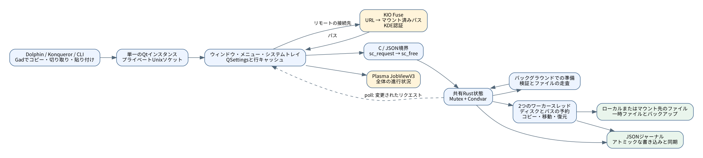
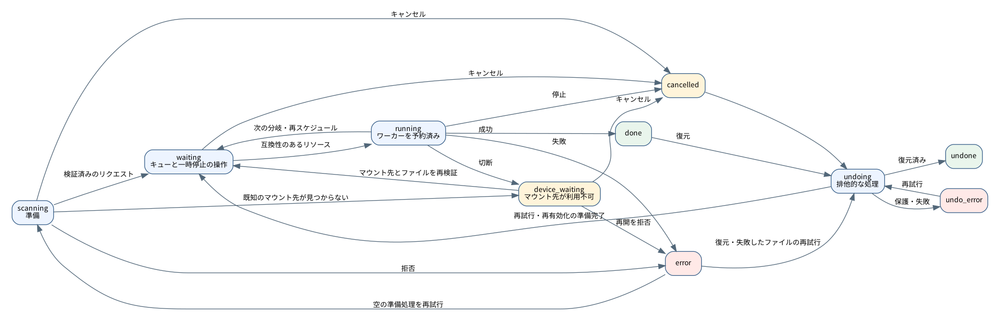

# Gad — 開発者ガイド {#gad-developer-guide}

文書化された版:**0.1.0**、プロトコル**22**、2016年11月6日。

Gad は **Gestionnaire Avancé de Duplication** を意味します。そのスローガンは **Gad, il copie.** このガイドでは、このリポジトリの実装を説明しています。コードは、正確なフィールドとデフォルトに対して権威があります。

[フランセ](GUIDE_DEVELOPPEUR.md) · [ユーザーガイド](USER_GUIDE.ja-JP.md) · [テスト](../TESTING.ja-JP.md) · [ドキュメントインデックス](README.ja-JP.md)

## 目次 {#contents}

1. [アーキテクチャ](#architecture)
2. [ビルド](#building)
3. [起動と単一インスタンスの処理](#startup-and-single-instance-routing)
4. [クリップボード、パス、KIO](#clipboard-paths-and-kio)
5. [リクエストの準備](#preparing-requests)
6. [スケジューリングと並行処理](#scheduling-and-concurrency)
7. [モデルと状態](#model-and-states)
8. [ファイルのコピーと結果の確定](#file-copy-and-publication)
9. [転送速度の制限](#bandwidth-limits)
10. [再接続の待機](#reconnection-waiting)
11. [ジャーナルとクラッシュ後の復旧](#journal-and-crash-recovery)
12. [復元、キャンセル、再有効化](#undo-cancellation-and-reactivation)
13. [インターフェース、計測値、エラーレポート](#interface-metrics-and-error-reports)
14. [プロトコルリファレンス](#protocol-reference)
15. [インストールとDolphin連携](#installation-and-dolphin-integration)
16. [テストとメンテナンス](#testing-and-maintenance)
17. [ドキュメント用ツール](#documentation-tooling)
18. [既知の制限事項](#explicit-limitations)

## アーキテクチャ {#architecture}

Gadは、Rust転送エンジンとC++/Qt 6ウィジェットインターフェイスを含むLinux実行ファイルである。システムQt/KDEにリンクする。最初のプロセスはウィンドウ、ローカルサーバ、エンジンを所有し、その後そのインスタンスにコマンドを送信する。



主な境界は Dolphin/CLI へ Gad, Qt です Rustそして Rust 最初に引数、クリップボードデータ、オプションでプライベートUnixソケットを使う。 JSON 電話を `sc_request` そして `sc_free`3つ目は一時的なファイル、公開、移動のソース削除、バックアップ解除、永続的なジャーナルである。

KIO Fuseはリモートエンドポイントをマウントパスとして公開する。 Rust エンジンは今でもデータを転送します Plasma D-Busの進捗状況表示を表示し、コピーを実行しません。

### コードマップ {#code-map}

| 所在地 | 責任 |
|---|---|
| `src/main.rs` | エントリーポイント、Qt 起動、C ABI、遅延エンジンの初期化。 |
| `src/engine.rs` | 共有モデル、コマンドルーティング、ワーカー調整、ファイル処理。 |
| `src/engine/validation.rs` | 準備中に受け取った制御のルート検証、準備、および保存。 |
| `src/engine/duplicates.rs` | 新しいエントリインデックスを公開する前に抑制を複製します。 |
| `src/engine/scheduling.rs` | 物理ディスクリソースとアトミックワーカー予約。 |
| `src/engine/row_queue.rs`, `queue.rs` | ブランチの順序付け、優先順位付け、依存関係、安定した参照。 |
| `src/engine/fast_move.rs` | ローカルな名前変更の適格性、バインドマウントルート、リスケジューリング。 |
| `src/engine/tree_move.rs` | 全木の名前変更、グループ化されたジャーナルレシート、および削除。 |
| `src/engine/controls.rs`, `selection.rs` | 選択拡張、一時停止、キャンセル、再試行準備、行の削除。 |
| `src/engine/errors.rs` | 構造化エラーレポートとアトミックターゲット再試行検証。 |
| `src/engine/rate.rs` | 共有およびリクエストごとのバイト予算。 |
| `src/engine/properties.rs` | 所有権/モード/ACL/xattrの比較を公開。 |
| `src/engine/resume.rs` | 耐久性のあるチェックポイントと検証済み部分ファイル復旧。 |
| `src/engine/reconnect.rs` | マウントアンカー、再接続待ち、デバイス番号のリバインド制御。 |
| `src/engine/history.rs`, `undo.rs` | 永続化、リカバリロード、プリフライトチェック、アンド。 |
| `src/engine/snapshot.rs` | 揮発性リビジョンと差分スナップショット。 |
| `src/engine/protocol.rs`, `native/protocol.def` | RustとQtで共有されるワイヤー語彙。 |
| `src/engine/tests.rs` | 一時的なフィクスチャによるエンジン回帰テスト。 |
| `native/application.*` | アプリケーションライフサイクル、引数、ソケット、アクティベーション。 |
| `native/window.*` | ウィンドウの構築と調整。 |
| `native/window_commands.cpp` | 選択要求、アクション、およびKIO再接続プローブ。 |
| `native/window_rows.cpp`, `row_tree.h`, `transfer_tree.h` | 安定したウィジェット、フォルダツリー、内部のドラッグ&ドロップ、アクセント要求。 |
| `native/window_conflicts.cpp` | ソース/デスティネーションの比較とコンフリクト決定。 |
| `native/window_errors.cpp`, `error_report.h` | エラーレポートダイアログ、正確な再試行リクエスト、およびアトミックテキスト/ JSONエクスポート。 |
| `native/window_open.cpp`, `row_paths.h` | シェル解釈なしでデスクトップファイル/フォルダを開く。 |
| `native/clipboard.h`, `kio_sources.h`, `paths.h` | クリップボード形式、URL検証、KIO解像度。 |
| `native/notifications.h` | 集約 Plasma JobViewの進捗状況とコマンド。 |
| `native/snapshot.h`, `presentation.h`, `transfer_metrics.h` | キャッシュされたスナップショット、ラベル、合計、速度、残り時間の見積もり。 |
| `build.rs` | ネイティブコンパイル、リソース、生成されたプロトコル、リンク。 |
| `scripts/`, `tests/` | インストール、独立した検証、ドキュメントツール。 |

## ビルド {#building}

要件 RustC++17コンパイラであるCargo `pkg-config`Python 3 Qt 6 ウィジェット/ネットワーク/D Bus とその機能 `moc`, `rcc`そして `qmake6` ツール、プラスKF6ウィンドウシステム。 Qt テストも必要です Qt テストと `dbus-run-session`ウェイランドのクリップボードアクセス `wl-clipboard`; リモートエンドポイントは、 KIO ヒューズ。 Rust 依存関係はロックされ `Cargo.lock`.

```bash
cargo build --locked
cargo build --release --locked
./target/debug/gad --help
```

`build.rs` 生成します Rust 定義は `protocol.def`ネイティブなユニットをコンパイルし、リソースとメタオブジェクト生成を実行し、ネイティブなアーカイブをリンクする。Cargoバージョンとビルド日を挿入する。ネイティブなソース変更は再構築をトリガーする。 Rust-only edits はウィジェットをリビルドするべきではなく、リリースビルドは LTO とストリップ配布シンボルを有効化する。

### CABI契約 {#c-abi-contract}

`sc_request` UTF-8 を受け入れます。 JSON 戻ります Rust- 応答文字列を割り当てます。 `sc_free` **まさに一度だけ** C++ は使用しないでください。 `delete` それとも `free`エンジンは遅延的に初期化され、プロセス内で共有される。

境界線はRustパニックをキャッチして、C言語でリラックスしないようにします。毒入りロックや破損した論理状態を修復しません。期待されるエラーは構造化された結果でなければなりません。無効なUTF-8パスと埋め込みNUL値は、別のファイル名に静かに変換されるのではなく、拒否されます。

## 起動と単一インスタンスの処理 {#startup-and-single-instance-routing}

必要な場合は、クリップボードとURL処理によって引数がコマンドになる。Qtは、既存のユーザーソケットを見つけ、ロックを使って並列サーバーを防止している。既存のインスタンスがコマンドを受け取り、新しいプロセスが終了する。そうでなければ、プロセスはウィンドウ/サーバーを初期化し、最初のリクエストを実行する。

ソケットはユーザランタイムディレクトリの下で`gad.sock`である。リクエストは、接続ごとに1つのレスポンスであるnewline-terminatedJSONであり、16MiBの着信リクエスト制限とユーザのみのアクセスがある。インスタンスなしの`--status`は、グラフィカルエンジンを起動する代わりに失敗しなければならない。

のみ Gad現在のプロトコルでは、独自の設定とジャーナルの場所を使用します。 **22**機能/バージョンチェックは、実装できない古いインスタンスに移動、リモートエンドポイント、検証要求を黙って送信するのを防ぐ。新しくインストールされた実行ファイルは、通常のシャットダウンによってアイドルインスタンスを更新する。

```bash
gad
gad --background
gad --status
gad --copy /tmp/demo/source.txt --to /tmp/demo/destination
gad --move /tmp/demo/source.txt --to /tmp/demo/destination
gad --copy /tmp/demo/source.txt --to /tmp/demo/destination --md5
gad --copy /tmp/demo/source.txt --to /tmp/demo/destination --properties
gad --paste /tmp/demo/destination
gad --paste-context /tmp/demo/destination --background
```

`gad://show` ウィンドウをアクティブにします。 Plasma. `--smoke-test` そして `--export-icons` 統合ツールです `_sources_resolved` という Qt 準備は既に行われており、エンジンの検証をバイパスしません。

`enqueue`はIDを返すことができ、その後スキャン中にフェールします。

## クリップボード、パス、KIO {#clipboard-paths-and-kio}

### クリップボードの挙動 {#clipboard-behavior}

ファイルURLリストとファイルマネージャ形式はプレーンテキストよりも優先される。KDEとGNOMEカットマーカーは移動モードを選択する。ドラッグ&ドロップはコピーモードを選択する。宛先テキストフィールドは通常のテキストペーストを維持し、ファイルリストペーストはGadのキューに入る。

Waylandでは、有界な`wl-paste`コールによって、ウィンドウフォーカスに依存しないクリップボードアクセスが可能になる。`QClipboard`は、ツールの可用性のフォールバックであり、現在だが不正なデータを再解釈する方法ではない。ファイルリストとカットマーカーは一貫性のために再チェックされるが、外部クリップボードは他のアプリケーションとのアトミックトランザクションではない。

### パス検証とリモート解像度 {#path-validation-and-remote-resolution}

変換の前に入力を分類する。`file:` URLはローカルで、空のホストまたは`localhost`で、認証情報、ポート、クエリ、フラグメントがない。NULと無効なエンコーディングを拒否する。リテラルな`://`を含む絶対POSIXパスはパスである。

サポートされているリモートスキーム `kdeconnect`, `ftp`, `sftp`そして `smb`ソースとデスティネーションの両方に対して、マウント前のホストとスキーマ固有の制約を検証する。 `Job.destination` 正準的なPOSIX経路です `destination_url` そして `source_urls` ラベルが元のリモートアドレスを再構築できるようにします. ファイルを開くアクションは、まだ実際のマウントパスを使用します。

`SourceUrls::Resolver` Dバス `org.kde.KIOFuse`オブジェクト `/org/kde/KIOFuse`インターフェース `org.kde.KIOFuse.VFS`、メソッド `mountUrl`. KDE 認証を Gad FTP/SSH/SMB のクレデンシャルストアは別々に実装されません。

リクエストをRustに送信する前に、30秒の準備期限の下で解決します。障害は最初の解決されたソースのみを送信しないでください。後で送信すると、解決が保留されている間は命令を保存します。キャンセルは遅延コールバックを無効にします。内部のKIOサーバー操作をキャンセルするとは約束しません。

`destination_context` は、Dolphin の選択したコンテキストを解像度まで保持します。

### KIO ファイルシステムの意味論 {#kio-filesystem-semantics}

`/proc/self/fdinfo`と`/proc/self/mountinfo`を介してオープンディスクリプタを検査する。証明済みの`fuse.kio-fuse`マウントだけが、特別なディレクトリ同期セマンティクスを使用している。ファイルデータは同期されるが、サポートされていないディレクトリfsyncは要求されない。ローカル同期エラーはエラーのままである。

ソース権限と時間は、サービスがchmod/utimeセマンティクスを提供できない場合は、KIO Fuse宛先には適用されない。サービスは、これらのメタデータを決定する。新しく排他的に作成されたリモート一時ファイルは、空のFTPファイルをダウンロードせずに、KIOのキャッシュを初期化するために、明示的にゼロに切り捨てられる。

直接入力されたマウントパスを含む、KIOヒューズ宛先に対して、耐久クラッシュリカバリを無効にする。通常のセッション停止と制御された再接続再試行は継続できる。デーモン再起動後に、元のジャーナルパスを静かに新しいKIOヒューズマウントにリマップすることはない。

## リクエストの準備 {#preparing-requests}

`enqueue`は、リクエスト構造、ソース、オプション、およびオリジンメタデータを検証し、`scanning`にモノトニックIDを予約し、それを永続化し、UIスレッドの外の準備を開始します。

宛先とルートの検証、自己コピーと無効なマウントエイリアスを拒否、決定論的順序で子供の前にフォルダをスキャン、ディスクリソースを識別する。UTF-8契約外のサポートされていない特別なファイルと名前が明示的に失敗する。シンボリックリンクはエントリであり、再帰的にトラバースされたソースディレクトリではない。

**リクエスト内のファイルは、最初の検証とスキャンが完了するまでコピーされません。**準備失敗は、部分的に分析されたグループを開始するのではなくエラーを発生します。

マウントアンカーは、エンドポイントが知られている間にキャプチャされる。準備されたエントリをコミットする前に、リクエストがまだ存在し、キャンセルまたは停止されていないことを確認する。準備スナップショット後に受信した一時停止/キャンセル/非表示のコントロールを保存する。レイト結果は、キャンセルされたエントリを再アクティベートしてはならない。

有効な背景ペーストは、古いグローバルポーズをクリアできる。ポーズ生成によって送信後に要求されたポーズは、完全に重複した送信は、一時停止を解除せずに返される。

転送ワーカーはシャットダウン時に結合される。準備タスクは論理的なキャンセルと遅延結果の拒否を使用する。ブロックされたファイルシステムまたはKIOコールは即時キャンセルを保証するものではない。

### 重複抑制 {#duplicate-suppression}

`duplicates.rs`は、ソースパスとデスティネーションパス、デバイス/イノードID、型、コピー/移動モードを組み合わせたものだ。親の正規化は、最終的なソースリンクに従わずにエイリアスとバインドマウントを認識する。古いスキャンは入学決定の前に終了するため、最も古い承認された要求が同時重複を獲得する。

送信時にアクティブなリクエストは、新しいスキャン中に終了した場合は、候補のままである。送信前にすでに完了した履歴は、意図的に繰り返しコピーできる。宛先とコピーと移動の意図は、異なるままである。

固有の子に必須の祖先フォルダを保存する。新しい未公開リクエストはインデックスが表示される前にエントリベクトルをフィルターできる。再起動されていないリクエストは、公開インデックスを維持し、代わりに重複を隠す。ジャーナルされた部分的な作業を破棄しないでください。`duplicates_ignored`はアクションプロンプトなしで情報UIメッセージを提供する。

## スケジューリングと並行処理 {#scheduling-and-concurrency}

共有リソースの使用 `Arc`, `Mutex`, `Condvar`と、アトミックストップフラグ。2人の永続的な労働者がアトミックに要求を選択し、予約する `state`ファイルシステムはロックの外で動作する。決して保持しない `state` 電話しながら `save`: ジャーナルロック順序です。 **作家 そして州**.

リクエストはそのエントリを順次処理するが、予約はブランチ境界で返されるので、独立したルートは他のリクエストとインターリーブできる。通常の並列コピーは、既知の物理ディスクリソースを分離する必要がある。パーティションと複合デバイスは、追跡される `/sys/dev/block`; 未解決トポロジーは通常のコピーを排他的にします。

高速なローカルリネームジョブは、正規化された予約パスが重複しない場合、ディスクを共有する可能性がある。未知パスや重複するソース/デスティネーションツリーは、シリアライズを継続する。以前にブロックされたリクエストは、関連するディスクの優先順位を保持する。新しい未完了スキャンは、順序付けバリアである。明示的に一時停止された作業は、後で作業を進めることができる。

Undoは排他的であり、逆**実際の執行命令**を使用し、古いレコードのIDにフォールバックする。アクティブ転送を待機し、通常のコピーがグローバルに一時停止されている間実行できる。スケジューリングは保守的であり、任意のRAIDまたはネットワークストレージで最大スループットを約束しない。

### 内部要求と見える森 {#internal-requests-and-the-visible-forest}

A `Job` 宛先、キャプチャされた検証オプション、およびジャーナルを所有し、エントリインデックスは安定しています。 `jobRows` 店舗は分離 Qt エントリが存在すると、ファイルルートがツリーに直接アタッチされ、実際のフォルダが視覚的な親子を提供する。空の準備はプレースホルダを保持する。

Persisted `row_order`は、プレースホルダ用のnullインデックス付きの`(job, index)`キーを含んでいる。キャッシュされた`row_queue::Layout`は、エントリベクトルをリレンジすることなく、ルート、親、子、および予約を記録する。ソース**目的地**は、独立して送信されたネストしたルートと後期親を含む親性を決定する。

`reorder_rows`は、変異前の選択、ターゲット、アクティビティ、親の制約、依存関係全体を検証する。`before`、`after`、`next`、`up`、`down`、`last`をサポートする。選択されたフォルダは、子孫をカバーする。アクションは、ファイルを再親したり、宛先を変更することはない。プレースホルダーからルートへの転送をスキャンする際に設定される優先順位。

ワーカは順序付けられたブランチ計画に従い、ファイル間のレイアウトリビジョンの変更に気付かれる。

生および正規化された宛先依存は、リクエストとリクエスト内の繰り返し名前間の置換順序を保護する。部分的に公開された依存する作業は、危険なままインターリーブできない。予約された将来の名前によって、"両方をキープ"して、別のキューされたエントリの意図した名前を消費することも防止できる。履歴的なターミナルリクエストは、有効な新しい優先順位の変更を妨げない。

## モデルと状態 {#model-and-states}

| 対象 | キー不変量 |
|---|---|
| `State` | リクエストIDは再利用されません。キュー/行の順序は時系列履歴とは別です。 |
| `Job` | 検証選択は送信時にキャプチャされる。コントロールとレート制限はコマンドを通じて変更できる。 |
| `Entry` | ソース、宛先、種類、ID、カウンタ、エラー、およびアンド参照は安定したインデックスを保持します。 |
| `undo::Record` | 回復に必要なステップを実行する前にファイルシステムの効果を説明します。 |
| `undo::Stamp` | デバイス/イノード、タイプ、サイズ、時間、リンクデータによって、所有する結果を保護します。 |
| スナップショットリビジョン | 永続的な所有権証拠ではなく、揮発的なUI変更追跡。 |

| JSON 状態 | 意味 |
|---|---|
| `scanning` | 検証/準備。 |
| `waiting` | キュー作業。 |
| `device_waiting` | 既知のマウントを欠いている。 |
| `running` | ワーカーがリクエスト/エントリを処理しています。 |
| `verifying` | 独立 MD5 読み直して |
| `conflict` | ファイルの決定が必要です。 |
| `skipped` | 項目は除外、ソースは残っています。 |
| `done` | 完成。 |
| `error` | 文書化された失敗。 |
| `cancelled` | 完了した結果を自動的に取り消さず停止。 |
| `undo_waiting` | 終了予定。 |
| `undoing` | 排他的回復作業。 |
| `undone` | 効果が回復した。 |
| `undo_error` | Undoは無事に終了できなかった。 |

Pauseはプレゼンテーション/コントロールオーバーレイで、新しいシリアル化された転送状態ではない。ファイルレベルのコンフリクト/スキップ/待機状態は、すべてのターミナルジョブ状態ではない。表示ラベルから推測するのではなく、共有プロトコル定義を使用する。



## ファイルのコピーと結果の確定 {#file-copy-and-publication}

通常のファイルの場合、コントロールの再チェックと可用性のマウント、宛先親の検証、競合の解決、対象名の予約、宛先ディレクトリへのプライベートな`.gad-…part`ファイルの割り当て。排他的な作成と制限付きの初期権限を使用して、最終的なsymlinkに従わずにソースが開かれ、スキャンされたIDに対してチェックされる。

コピーバッファは **64 <unk>** レート制限の場合には、より小さい分数で書くことができます。実際の書き方によって進歩します。 MD5 消化は 独立した状態でも維持される MD5 Undoはコンテンツ証拠を使っているため検証します

互換性のあるローカルコピーは、永続的な再開データポイントを作成し、データを同期し、サポートする基本権限と変更時間を適用し、選択したコンテンツ/プロパティチェックを実行します。 **同じ検証済み一時ファイル** 名前を変えて `renameat2(RENAME_NOREPLACE)` リカバリ可能な出版物が成功するまで、リカバリは以前の宛先をプライベートに保持する。

移動は、公開後にのみソースを削除し、必要な同期/チェックを行う。削除前のソースID、サイズ、時間、タイプを再チェックする。スキップされたソースは、残ります。ソースディレクトリは、安全で空いている場合にのみ、逆順に削除される。外部コンテンツを削除する代わりに、障害が報告される。

マネージドな通常の障害はプライベートな一時的なものをきれいにする。認識された切断はジャーナル化された部分的なデータを保持する。公開ステップ後の障害は、回復のために十分な状態を維持し、コピーを盲目的に繰り返す許可として扱うべきではない。

### ファイル名とフォルダ名の変更が速い。 {#fast-file-and-folder-renames}

`fast_move.rs`は、サポートされているローカルマウント、同じファイルシステム、書き込み可能なルート、独立予約を証明する。これは、共通の公開パスを通じて、異なるバインドマウントビューを変換することができる。共有物理ディスクだけでは証明されない。Kernel EXDEVや他のルート制限は、フォールバックコピー中にリネーム例外を保持するのではなく、通常のコピー予約でスケジューラに作業を返す。

個々のリネームは元のinodeを保持する。ジャーナルとポストリネームctimeは、サイズとmtimeが復元されたとしても、変更されたコンテンツに対してアンドを保護する。リネームとctimeの確認の間のクラッシュは、楽観的なロールバックではなく手動検査を必要とする可能性がある。

`tree_move.rs`はさらに、完全なサブツリー、除外または一時停止した子、競合なし、正確なパス/タイプ/IDマッチングを必要とします。共通のバインドビューに隠されているものを含むサブマウントは、ショートカットを防ぎます。成功したルート名称は、子孫のオブジェクトとレコードのグループリカバリ情報を保持します。

ツリー全体のアンドは、同じ無傷テストを使う。宛先で追加された外部ファイルは、ショートカットの一部としてその外部ファイルを戻り/削除するのを防止する。部分的な選択は、個々の復元を使用する。グループレシートは、ルートリネームの前または後のクラッシュを区別し、このパスの個々のファイルのctime確認ギャップを避ける。

### MD5 検証 {#md5-verification}

チェックボックスは、最終公開前に、独立したソースと一時ファイルのリリードを追加します。Nバイトは、コピー作業に2つのNバイトの読み込みを追加します。検証の進捗状況は、書き込みの終わりに完了を発表してはいけません。

ある一時ファイルを検証して、他のファイルを再作成しないでください。ソースの変更やミスマッチしたダイジェストは、交換やソース削除の前に失敗します。MD5は、衝突に強い逆認証ではなく、この転送の一貫性の証拠です。

### オプションのプロパティチェック {#optional-property-checks}

`verify_properties` 記憶されています Qt 要求ごとに捕らえられます `--properties` CLI の送信に上書きします。 Missing フィールドはデフォルトで false で、 `Entry.properties` 明示的なプロパティ要求にはプロトコル1以上が必要です。

`properties.rs`は、UID/GID、モードビット`07777`、および`llistxattr`/`lgetxattr`によって、最終的なシンボリックリンクに従わずに公開される属性を読み込む。アイデンティティ/ctimeチェックは、一貫性のないスナップショットを拒否する。属性の伸びは最大3回再試行される。バッファは、各64KBに制限され、キャプチャあたりの合計値は8MiBである。POSIX ACLは、`system.posix_acl_access`と`system.posix_acl_default`を使用している。

値は記憶にとどまり JSON保存された報告書には、 `status` (`ok`, `different`または `unavailable`), `differences`そして `unavailable`. 権限の欠如は欠落属性と同等ではない。既知の相違点と不完全なチェックは共存できる。完全にリストされていない保護属性は監査できない。日付はこの比較対象外である。

コピーは、プロパティ警告で終わることができる。コピー・アンド・削除の動きは、エラーのチェックでソースを保存し、事前公開とポストパブリッシングの効果は別々に処理される。名前の変更は有効のままだ。リネーム後の警告は、ソースパスが存在することを主張しない。ツリー全体のプロパティスナップショットは、境界32MiB推定よりもエントリ毎の処理にフォールバックする。

### スペースチェック {#space-checks}

`space.rs`は、解析されたキューと一時停止した作業間で、残りのアロケーションを推定している。アロケーションブロックへのラウンド、数値オーバーフローの回避、および想定されるボリュームの認識された一時的なアロケーションのみを考慮に入れている。既存の宛先/バックアップは、すでに空きスペースを占めており、無料クレジットではない。証明されたリネームは、2番目のデータコピーを割り当てていない。

既知の容量不足は、ターゲット作成の前に失敗する。未知容量は、警告を生成し、一時ファイルを作成する前にファイルの割り当てを再チェックする。見積もりは、他のアプリケーションに対する予約ではない。 `verify_space` 他のインスタンスから明示的に要求された場合、プロトコル14が必要となる。

## 転送速度の制限 {#bandwidth-limits}

`rate.rs`は、共有グローバルバイト予算とリクエストあたり1つの予算を提供する。Zeroは無制限である。リミッターは書き込み前に両方の予算をアトミックに消費し、最大100ミリ秒のクレジットを保持し、睡眠中のワーカーにバイトを予約するのではなく、境界付き条件変数の待機を使用する。

鍵 `state` 前に `Shared::limiter`一時停止、キャンセル、停止、および待機中の定期的なマウントの可用性を再チェックする。レートの変更は、蓄積されたクレジットなしで始まります。公平性保証はありません。コピーレートは、書面で書かれたバイトに適用されません。 MD5 rereads、metadata work、undo、renameなどです。

プロトコル18がグローバルに導入 `configure.rate_limit` そして `set_rate_limit` 一緒に `ids` そして `bytes_per_second`変更前の完全選択と整数値を0から1TiB/sまで検証する。タイミングクレジットではなく、設定された制限を永続化する。 Qt MiB/s を表示します。 `Mio/s` そして、グローバル設定を記憶し、リクエストダイアログは開いているときにIDをキャプチャするので、後で選択の変更はそれらを再ターゲットできません。

## 再接続の待機 {#reconnection-waiting}

`reconnect.rs` パス、デバイス、アンカー inode、オプションの sysfs ブロックノード、リモート分類、利用可能な udev ファイルシステム UUID など、エンドポイントが知られている間、マウントアンカーをキャプチャして持続します。 `state`ストリーミング中、帯域幅待機中、アクティブなファイルの一時停止中もチェックします。

`device_waiting`は非端末である。`park_disconnected`は部分的なジャーナルを保持し、エントリを中断し、ワーカーを解放する。リクエストごとのウォッチャーは少なくとも1秒間プローブし、キャンセルとグローバル/リクエスト/エントリの一時停止を尊重する。`device_waiting`でリクエストを遅くする可能性があるため、独立した作業のためのスキャンバリアを作成できない。

戻りには、`prepare_resume`と通常の準備パスを再利用しよう。マッチするUUIDはデバイス番号をリバインドする可能性がある。inode/type/versionchecks、ctime、およびコンテンツダイジェストは変更されない。リクエストを実行する前に検証済みのIDとアンカーを一緒に公開する。別のボリューム、空の置換ディレクトリ、曖昧なID、変更されたソースは再開するのに十分な証拠ではない。

`CopyTemp`は、認識された切断時にジャーナルされた一時的保存を行う。自動クラッシュリカバリを無効にしても、ローカルチェックポイントはセッション再接続のために利用可能である。耐久性のあるKIO宛先ポイントがなければ、ソース検証後に認識された未公開の一時的のみを削除して、そのファイルを再起動できる。すでに関与している出版物を自動再生しないでください。

Qt 元の URL 解像度をリトライします。 KIO 5秒ごとに `enqueue` あるいは、新しい認証実装を公開する。ジャーナルを書き直すのではなく、別のマウントパスがレポートされる。ラベル、メトリクス、トレイバッジ、ネイティブ進捗はすべて待機している。カーネル/リモートコールはすでにブロックされているが、それ自体が遅延している。

## ジャーナルとクラッシュ後の復旧 {#journal-and-crash-recovery}

ユーザジャーナルは `$XDG_DATA_HOME/gad/state.json`のデフォルト `~/.local/share/gad/state.json`. `save` 書き込みをシリアライズし、一時状態ファイルを書き込み、アトミックに置き換え、必要に応じて同期する。 `state` 呼びながら

`undo::Record`は、所有するステージング、結果、バックアップ/オリジナルスタンプ、ソース除去、復元ソース準備、および完了した復旧手順をキャプチャします。交換先はファイルシステム上のプライベート`.gad-undo-*`ディレクトリにあります。回復が必要な効果の前にジャーナルを保管してください。

ロード中断作業では、エンジンは、不明瞭な発行、リネーム、アンドの各ステージとは別に、互換性のある未完成コピーを分類する。明示的にキャンセルされた作業は再起動しない。保持されたリカバリ情報は、通常の履歴保持を上回ることができる。正常履歴クリーンアップは、最終的な出力を正常に削除せずにバックアップをリリースする。失敗したクリーンアップは、目に見えるリカバリ可能なエラーである。

### 永続部分ファイル {#durable-partial-files}

`resume.rs`は、ソース`Version`にID/メタデータ/ctime、置換時の保護済みの既存のターゲットバージョン、確認されたバイト数、プレフィックスダイジェストを格納する。チェックポイントは64MiBまたは2秒経過後に発生する。ジャーナルに新しい確認されたポイントを公開する前に、一時的なディレクトリとディレクトリを同期する。

`Job.resume_enabled`は、自動クラッシュリカバリ設定をキャプチャする。`resume_pending`は、リカバリ可能な割り込み作業をマークする。ローカルセッション再接続は、その設定がオフの時に、依然としてチェックポイントを生成する。古いフィールドの欠落は、デフォルトで保守的である。

回復には期待されるプライベートが必要です。 `.gad-…part` シンボリックリンクや余分なハードリンクのない正しい親で、保存したデバイスとinode.checkオープンディスクリプタを照合して、ソースと一時プレフィックスをブロックでブロックし、記録されたハッシュとバージョンを再度検証し、未確認の追跡バイトを切り捨て、両方のストリームを配置する。 MD5 一時のinodeを保持する。

`resume_checking`, `resume_checked`そして `resumed_from` 検証と再起動の進捗状況を説明する。以前に適用した読み取り専用権限は、検証済み所有の一時的場合にのみ調整される。最終発行前の履歴を削除し、通常の非実行ジャーナリングに移行する。最終独立 MD5 要求された時も 走り続ける

`resume_interrupted`は回復可能なジョブIDを受け入れます。準備と再接続は、後の一時停止/キャンセル/非表示コントロールを安定インデックスで保存します。拒否された検証は、楽観的に切り捨てるのではなく、認識されていない部分を保持します。

## 復元、キャンセル、再有効化 {#undo-cancellation-and-reactivation}

Undoはジャーナルを使ってGadで作成されたコピーを削除し、移動を戻し、交換した宛先を復元します。

選択したスコープ全体と、変更の前に必要な親をすべてプリフライトする。必要に応じてコンテンツダイジェストを含む、所有する結果とバックアップを検証する。再作成されたソース、変更された宛先、バックアップの欠如、またはボリュームの欠如は、ユーザーデータを上書きするのではなく拒否を生成する。

プロセスリクエストを逆実行順に処理する。置換チェーンは、古い出力を新しい選択バックアップに置く。バリデーションは、これらの依存関係を理解している。必要なソースディレクトリを再生し、ファイルを復元し、以前の宛先を前回から復元し、空に作成されたディレクトリだけを削除する。クロスファイルシステムの戻りには、宛先削除の前にチェックされたコピー、公開、同期が必要である。

完了したアンドステップは`undo_error`の後の再試行のために持続する。部分的な選択は隣人を保持する。プリフライトはリスクを軽減したが、ディレクトリ全体を外部ライターに対するアトミックトランザクションにしない。

選択された終了行を削除して、最終的な結果を削除し、アクティブなエントリをキャンセルし、保留中の作業を削除します。バックスペースはさらに、終了結果に対してアンドを要求します。フォルダ選択は、生文字列プレフィックスではなく、ソース/デスティネーションの先祖を通じて拡大します。行の削除は、アクティブなエンジンインデックスをシフトしません。

キャンセルされたエントリの再アクティベーションは、`waiting` の設定とは別物です。まず、互換性のあるレムナントを復元/洗浄し、欠落した親と型の変更を処理し、完了した隣人を保存します。グローバルキャンセルは、優れた Qt URL の準備を無効化します。

## インターフェース、計測値、エラーレポート {#interface-metrics-and-error-reports}

### 差分更新と木 {#differential-updates-and-trees}

`TrackedJob` 変更可能なジョブアクセスを揮発的なリビジョンでマークする。グローバル変更とレイアウト変更もスナップショットクロックを前進させる。 `poll` 受け入れる `since`欠落/非互換トークンはリセットを要求し、状態が変更されていないと小さな応答が返され、他の応答には権限ID、メタデータ、変更されたジョブが含まれる。 `QueueSnapshot` 変更されていない行を再現せずにマージします。

選択、ホバー、ツールチップ、スクロール位置、拡張を保存するためにQTreeWidgetItemsを再利用する。値が変更されたときにのみ、テキスト/アイコン/ツールチップを更新する。ソースパスとターゲットパスの両方からフォルダ親子をビルドする。フィルタは必要な先祖を見えるように保ち、通常の進捗は手動で折りたたんだブランチを再開しない。

`TransferTree`は、オリジンと安定した行キーを含むプライベートMIMEデータを使用する。内部ドロップは、`reorder_rows`を送信する。Qtは、モデルを直接再親することはない。外部ファイルURLが通常のファイルドロップ処理に達している間、外部内部MIMEは拒否される。エッジスクロールとQPointerガードは、アクティブなドラッグを安全に処理する。

### 速度と残時間 {#speed-and-remaining-time}

`transfer_metrics.h` キャッシュ `Probe` リフレッシュティック(リフレッシュティック)は、未完了のリクエストに対して、変更されたIDに対してのみリビルドします。 `poll.unchanged`は、注入された単調時計を前進させ、エントリを再スキャンすることなく停止率を低下させる。

コピーとMD5メーターは、別々の5秒間のアクティビティウィンドウと少なくとも500ミリ秒の観察を使用する。フェーズを横断する間隔を除く。一時停止、競合、回復チェック、およびカウンター回帰は、不適切な測定をリセットする。再開されたプレフィックス、ディレクトリ、削除/キャンセル/スキップされた作業、または論理リネームバイトを、新鮮なコピートラフィックとしてカウントしない。

コピー速度で残りのコピーバイトと、残りのMD5がMD5速度で読み込まれることを推定します。必要な測定が不明であれば、例えば、MD5が観察されていないコピーフェーズのみを推定します。個々の一時停止した作業は、合計時間を不明にします。これらのメトリクスは揮発性があり、待ちキューやアンド期間を予測しません。

### エラーレポートとリトライ {#error-reports-and-retries}

`error_report` 読み取り専用で `snapshot::Mutation`形式は `gad-error-report`、バージョン1 `generated_unix`パス、メッセージ、バイト、公開/復旧状態など、ジョブのメタデータと安定したエラーレコードが利用可能です。 MD5アグリゲートディレクトリ障害マーカーとデバイス待機は、永続的な障害の重複ではない。

`retry_errors` 受け入れる `jobs`, `entries`オプション `exact`変更前の選択全体の適格性を検証し、アクティブな要求を拒否する。レポートからの正確な参照は、暗黙的にフォルダを拡張するものではない。通常のリスト選択は、既存の準備のアンドを通じて選択したエラーをルーティングする。 `prepare_retry`は、OK/cancel/skipped/remove 隣人を保持する. は、スコープを保存するために選択されていないエントリをただ待つ。

失敗した空の分析では、完全なルートバリデーションとスキャニングが使用されている。エラー状態が子からのみ発生した構造的祖先をリセットする。再試行前のソース/ターゲットのエイリアスを再確認する。不完全なアンドをコピーすることはできない。再試行準備の失敗は参照を保持するため、修復後に再び試みることができる。変更された出力は、アンドプリフライトによって保護される。

`window_errors.cpp`は、プレーンテキストセルと`QPlainTextEdit`の詳細を持つ非モーダルで明示的に更新されたスナップショットである。フィルタリングとソートは、保存された行参照を変更しない。6つのボタンはすべて、標準のQtフォールバックを持つテーマアイコンを使用する。Text/JSONエクスポートは`QSaveFile`を使用し、完全に成功した書き込みだけがレポートを置き換える。エクスポートには、ロードされたスナップショット全体が含まれるが、リトライの対象は表示または選択された障害である。

### Plasmaとウィンドウの起動 {#plasma-and-window-activation}

`notifications.h`は、現在のリクエストを1つのJobViewV3に集約する。エントリあたりのバイト差分を追跡し、論理的な名前変更の進捗を区別し、完了中のMD5作業を含み、同期ポーズコマンドを含む。ビューが閉じている間、有用な最終速度を維持する。通常の通知を重複することなく、サービス障害後にPlasmaに再接続する。

`gad://show`とアクティベーショントークンはメインウィンドウを復元する。トレイクリックで可視性を切り替える。フォルダ/ファイルを開くと、`QDesktopServices`がファイルURLで開く。シェルではない。Autostartはユーザー毎のデスクトップエントリである。閉じるか終了するかは、アクティブな作業に敬意を払う必要がある。

## プロトコルリファレンス {#protocol-reference}

`native/protocol.def` 共通する語彙です Rust 構造体とバリデータは正確なコントラクトを定義します。 **22**GUI 固有のコマンドはルートされる Qt エンジンコマンドを Rust.

| コマンド | 主なパラメータ | 振る舞い |
|---|---|---|
| `status` | なし | 完全な状態。 |
| `poll` | オプションで `since` | フルまたはインクリメンタル状態。 |
| `configure` | `keep_history`検証オプション `resume_interrupted`, `rate_limit` | 選好とライブグローバルレート。 |
| `set_rate_limit` | `ids`, `bytes_per_second` | リクエストごとのライブキャップ。 |
| `enqueue` | `sources`, `destination`, `mode`オプション/原産地メタデータ `background` | リクエストを予約して準備します。 |
| `pause` | `paused` | 世界的な一時停止。 |
| `reorder_queue` | `ids`, `action` | 全リクエスト注文。 |
| `reorder_rows` | `rows`, `action`オプション `target` | ファイル/ブランチの順序付け。 |
| `cancel`, `cancel_many` | `id` または `ids` | リクエストを停止します。 |
| `undo_many` | `ids` | リクエストを解除します。 |
| `resolve` | `id`, `index`, `action`, `all` | 現在の競合決定。 |
| `cancel_all`, `undo_all` | なし | グローバルストップまたはアンド。 |
| `pause_selection` | `jobs`, `entries`, `paused` | ターゲットコントロール。 |
| `resume_interrupted` | `ids` | リカバリ可能な中断作業を再検証する。 |
| `error_report` | なし | 構造化された障害の詳細を読む。 |
| `retry_errors` | `jobs`, `entries`オプション `exact` | 選択された障害のみをリトライします。 |
| `retry_selection` | `jobs`, `entries` | キャンセルされたエントリを有効化します。 |
| `delete_selection`, `backspace_selection` | `jobs`, `entries` | キーボードの削除/アンドセマンティクス。 |
| `undo_selection`, `cancel_selection` | `jobs`, `entries` | 解凍または解凍を目標にします。 |
| `clear` | なし | クリアな終了履歴とそのバックアップ。 |
| `shutdown` | なし | シャットダウンを制御、アクティブ中に拒否。 |
| `show` | オプションで `activation_token` | ウィンドウの表示/有効化。 |
| `background` | なし | インスタンスを隠してください。 |
| `paste` | 宛先/コンテキストと背景設定 | クリップボードを読み、仕事を提出します。 |

```json
{"command":"enqueue","sources":["/tmp/demo/source.txt"],"destination":"/tmp/demo/destination","mode":"copy","verify_md5":true}
```

送信時に成功するとIDが返され、結果の転送が成功したという証拠はなく、コンシューマは遅延エラーを処理し、操作状態と個々のエントリ状態を区別しなければならない。

## インストールとDolphin連携 {#installation-and-dolphin-integration}

`scripts/install.py`は最初にビルドし、`~/.local/bin/gad`をアトミックに置き換え、`org.hizoka.gad`デスクトップアソシエーション、プロトコルハンドラ、アイコン、サービスメニューアクションをユーザXDGロケーションにインストールし、利用可能であればKDEキャッシュをリフレッシュする。実行プロセスによってすでにマッピングされた実行ファイルは、以前のコードを保持する。

アプリケーション識別子は `org.hizoka.gad`デスクトップとアイコンの関連付けは、一般的なコピーイメージではなく、ソフトウェアアイコンを使用するように同意する必要があります。 `gad-boucles-document` 資産はデスクトップサイズでエクスポートされます。 Qt.

`gad-dolphin-paste --enable`は、可逆的なDolphin Ctrl+Vアソシエーションをインストールする。`--disable`は、保存された設定を復元する。統合は、ネイティブテキストペーストと標準のShift+Insert KIOの代替である。フルパスウィンドウタイトル要件ではなく、現在のセッション情報を通じて、アクティブなDolphinフォルダを見つける。変更をアトミックに拒否し、非関連/不正な統合レコードを破棄し、無関係なショートカットを保存する。

オプションの `make test-dolphin-paste` は、プライベートバスで実際の KXMLGUI/KActionCollection を使用して、ファイルのコピーやユーザーの Dolphin を再起動することなく、ショートカットのアクティベーション、テキストペースト、復元を行います。

アンインストールすると、ジャーナルやバックアップを削除するのではなく、リカバリに必要なデータが残される。Gadの他のコピーがインストールされている場合は、バイナリ/バージョンを区別し、動作を診断する。

## テストとメンテナンス {#testing-and-maintenance}

[テスト Gad](../TESTING.ja-JP.md)は、完全な要件とシナリオの説明を提供します。

```bash
make doctor
make test-unit
make test-python
make test-qt
make test-integration
make check
make test
```

`scripts/run_tests.py` フィルタリング、依存関係認識グループ、継続実行、および JSON/JUnitレポート `target/test-results`JUnitはコマンドステージをカウントする。 Rust/Qt アサーション

Rustテストは、一時的なツリーを使用して、オブザーバブルな状態とファイル内容をチェックする。Pythonテストは、標準ライブラリと分離されたフィクスチャを使用する。ドキュメントレンダラの依存関係は、レンダリング時にのみロードされる。Qtテストは、プライベートD-Bus/HOME/XDG環境、エンジン倍率、およびインターセプトされたデスクトップオープンを使用する。統合テストはまた、実際の実行可能およびクラッシュリカバリを実行する。モックは、すべてのサーバまたはPlasmaリリースを再現するものではない。

文書化された局所検証は、 **216 Rust テスト**, **Python 50テスト**, Qt スイートを含む **81例**あるベンチマークは、日常的な実行では意図的に無視されている。これは、提供されたGitHubワークフローがリモートで実行されていることや、将来の編集が自動的に検証されているという主張ではなく、ローカルな証拠を説明するものだ。

### 障害の診断 {#diagnosing-failures}

始めましょう `gad --status`実行中のインスタンスのバージョン、エラーメッセージの完了など、インストールされている実行ファイルを区別します。 `target/debug/gad`.

リモート入力の場合、別の URL バリデーション。 KIO D-Bus を融合します。 KDE 認証、マウント、および実際のファイルアクセス. アンドするには、必要なボリュームとバックアップを保持します。 `.gad-undo-*` ジャーナルを「修復」する. エラーのエクスポートは個人的なパスを含み、共有する前にレビューする必要があります。

### 機能を追加する {#adding-a-feature}

ファイル効果、ユーザの振る舞い、および中断状態の意味論を最初に定義する。プロトコル変更のための共有語彙を更新し、永続フィールドに保守的なデフォルトを使用する。ジャーナルの回復可能なエフェクトを実行し、所有権証拠を保存する。

一時停止、キャンセル、複数選択、遅延コールバック、シャットダウンのチェック。意味のある観察可能な動作のための回帰テストを追加し、影響のあるグループを実行して、必要なチェックを実行してから、更新する。 **両方の言語版** ファイルシステムオブジェクトが属する証拠として display 文字列を使用しないこと。 Gad.

## アプリケーションの多言語化 {#application-localization}

`native/i18n.h` QTranslator と標準を使用します。 Qt 言語カタログ `translations/gad_fr_FR.ts` / `translations/gad_es_ES.ts` / `translations/gad_pt_PT.ts` / `translations/gad_de_DE.ts` / `translations/gad_ja_JP.ts`米国の英語は、プログラムソース言語です。カタログには、フランス語、スペイン語、ポルトガル語、ドイツ語、日本語の翻訳が含まれています。 Qt 文字列を表示する `GAD_TR("…")` 中には `Gad` context. 既知のエンジン診断は `Engine` 発表時間のみの状況です JSON 鍵 電線状態 そして JSON エクスポートは元の値を保持する。未カタログ診断と外部サービスエラーは元の言語を保持する。翻訳はファイル名やメッセージ内のフラグメントを置き換えることはない。

編 `.qm` チェックインして埋め込みます `gad.qrc`; アーキテクチャまたは設置 Gad 言語セレクタは、言語パックや言語ツールを別に必要としません。 QSettings `language` 好みとすぐに `I18n::initialize` 転送を中断せずに。 `GAD_LANGUAGE=fr_FR` それとも `GAD_LANGUAGE=en_US` 新しいインスタンスに上書きします。 `system` 他の言語はfr_FRにフォールバックする。既存のインスタンスに送信されるコマンドは、言語を変更しない。

永続ウィジェットでは、`I18n::localized(widget, "text", []{return GAD_TR("About");})`または`I18n::bindProperty`は、プロパティをソーステキストに明示的にバインドする。`I18n::onChange`は、ヘッダ、リスト、レポート、転送レンダリングなどの計算されたプレゼンテーションを更新した。QPointerは、各コールバック所有者をガードする。破棄された所有者は削除され、プロパティの繰り返しバインドは、以前のコールバックを置き換える。変換がインストールされた後にスナップショットからコールバックが実行される。表示される文字列は、グローバルに検索および置き換えされることは決してない。

行キャッシュには言語が含まれている: 変更されていないポーリングは、ツリーアイテムを置き換えることなくラベルを更新している。エラーレポートは、ロードされたスナップショット、行、選択を保持する。コンフリクトは、言語が変更されたときだけ「将来のコンフリクトに適用」選択される。日付と数値は、数値を変更せずに再フォーマットされる。Plasmaですでにアーカイブされているメッセージは、元の言語を保持する。次のリフレッシュでは、アクティブなジョブビューが更新される。

表示文字列を追加した後、実行します。 `make translations` ソースを同期させ 新しいエントリを翻訳し Qt カタログをコンパイルして指紋を更新します。 `lrelease6` それとも `lrelease`. `make translations-check` カバレッジをチェックし `%1` 外部ツールのないパラメータ、リンク、指紋.Pythonテストもこれらのチェックを実行する。 Qt テストは、実際の埋め込みカタログをロードし、英語ウィジェット、状態、レポート、設定、および変更されていないファイル名を検証する。JSON 輸出

## ドキュメント用ツール {#documentation-tooling}

ルートREADMEは短いエントリポイントで、詳細なガイドはここで維持されている。ドキュメントは6つの言語をカバーする。各エディションには、クイックスタート、ユーザーガイド、開発者ガイド、およびライトテーマにおける独自のインターフェイスの13のスクリーンショットが含まれる。アーキテクチャとライフサイクル図にはローカライズされたラベルがある。

`doc_catalog.py` 各情報源の言語と視聴者を特定します。 `build_docs.py` 言語補正カバー、同一オーディエンス言語スイッチ、相対リンク/フラグメント、オフライン埋め込み画像を生成する。英語PDFはUS Letterを使用し、他のPDFはA4を使用する。 `check_docs.py` すべてのREADME/テスト/ガイドリンク、キャプチャ、言語メタデータ、およびすべての36のHTML/PDFエクスポートを検証します。

```bash
make docs-captures
make docs
make docs-check
```

キャプチャコードは実際のウィジェットをデモCブリッジにリンクし、一時ファイルと分離セッションを使用し、Breeze Lightをそのプライベート構成で適用し、デスクトップのフォント設定を保存します。マニフェストは、寸法、バージョン、ハッシュを記録します。実際のGadプロセスやクリップボードを制御しません。ウィジェットキャプチャの外側のネイティブトレイ/プログレスレンダリングは、実際のデスクトップスクリーンショットとしてシミュレートされません。

ドキュメントPythonテストは、ロケール選択、ナビゲーション、紙のサイズ、相対リンク、キャプション、画像埋め込み、見出しの欠如、および通常のテスト環境でMarkdownまたはWeasyPrintを必要とせずに、完全なエクスポート呼び出しをカバーする。オプションのエクスポート依存関係については、[ドキュメントインデックス](README.ja-JP.md)を参照してください。

## 既知の制限事項 {#explicit-limitations}

GadのオプションCtrl+V統合は、Dolphin固有である。リモートエンドポイントは、KIO Fuseとそのサービスセマンティクスに依存する。耐久性のある中間ファイルのクラッシュリカバリは、互換性のある宛先に限定される。KIO宛先は、セッション再接続中に現在の未公開ファイルを再起動できる。

所有者、ACL、xattr、スパースファイル、ハードリンク保存は、特別なバックアップツールのすべての保証を持っていない。コピーのグループは、グローバルにアトミックではない。ファイルシステムの同期と並行した外部変更は、IDチェック、MD5、飛行前の検証であっても関連性がある。

これらの境界線を設計上の決定とユーザメッセージで見えるようにし、ローカルチェックを成功させることは、普遍的な回復の約束にならないでください。

## 列の並べ替えとフィルター {#header-sorting-and-filters}

`native/table_view.h`は、プレゼンテーション専用の設定を格納し、リテラルカラム述語を適用し、ロケール対応の自然比較や数値進捗ロールを使用して兄弟アイテムをソートする。キューランクは、ソート方向とは独立して等値の結び目を破る。同じQTreeWidgetItemsは、選択と拡張保存で再添付される。プログレス更新では、ソートされたビューを、ソート前にキューの順序にリセットするのを避ける。

`TransferTree`はヘッダーメニュー、表示/フィルターリビジョン、リセットアクションを所有している。`Window::refresh`は、変更されていないポーリングの後でもレンダリングする理由としてプレゼンテーションリビジョンを扱い、カラム述語を組み合わせて、祖先の視認性を維持する。フィルタリビジョンはソートリビジョンから分離されているため、ソートされたフォルダをソートしない。キューリビジョンを復元すると、既存の安定キー順序パスが呼び出される。視覚的ソート中に内部ドラッグは無効になる。これらの設定のどれも、エンジンの突然変異コマンドを発行しない。テストは、キューのアイデンティティ、自然と数値の順序付け、組み合わせた述、先祖、生の進捗、ホット翻訳、リセット/ナビゲーションの動作をカバーする。

ソートキーは、列/方向ペアの順序リストを形成する。TransferHeaderは、実際のマウスリリースイベントからCtrlを読み込む。Ctrl+クリックは、キーを追加または反転し、通常のクリックは、リストを置き換える。ヘッダーマーカーは、翻訳全体でキーの優先順位を保持する。ソートキーをクリアすると、残りの部分が保存される。冗長なグローバルコンボとその述語は削除される。新しいメニューアイコンには、テーマが不足した場合にQtフォールバックがある。

順序列は論理列5と視覚的列0です。 `setTreePosition(0)` keeps ブランチをSourceに格納する。既存のカラムロールとアクション参照は、その意味を保っている。数字は、その意味から来ている。 `row_order`レイアウトが指定されていない場合、スナップショットによるフォールバックがある。レイアウトのみのデルタでは、デルタから省略されたジョブを含むすべての行をリフレッシュしなければならない。セルツールチップでは、不変なバッチIDが表示される。順序ソートは数値キューランクを使用し、第6カラムでは、フィルタとCtrl+クリックソートをサポートする。リクエストカラーアクセントは最初のビジュアルカラムに描画される。

ツールチップの文切れは、英語のソースリテラルとフランス語のカタログにある明示的な新行である。ランタイム句読点の置換はパス、URL、または外部エラーテキストに触れない。ソースツールチップはパスと操作オプションを保持する。バッチ識別はOrderカラムに残る。ライブ言語回帰には、周期、スペース、HTMLライクな文字を含むファイル名が含まれる。

ソース装飾 `edit-copy`/`edit-cut`は、動作モードでキャッシュされます。 `OperationRole`で Qt フォールバック `KindRole` フォルダ/ファイルアクションの実際のエントリタイプをまだ記録します. ツールチップは、操作を繰り返すことなく、パスと便利なオプションのみを保持します. オーダーセクションは使用します。 `ResizeToContents` 固定した幅ではなく

## 転送の除外ルール {#transfer-exclusion-rules}

`src/engine/exclusions.rs` ルールを検証し、Unicode動的プログラミンググローバルマッチングを実装する。`*`, `?`)プロトコル21が公開 `exclusions` 通る `configure`, `enqueue`スナップショット: `include_hidden` (デフォルトは true) `directories`そして `files` (デフォルトの空の配列) 変更の前にバリデーションが起こり、同じリクエスト内の他の設定を含む。古いジャーナルはこれらのデフォルトを受け取る。

`State` それぞれ好みを記憶する `Job` Scanningはジョブルールをルートごとに一度ロードし、使用する。 `symlink_metadata`削除されたリクエストは、一時停止したキューを再開せずに完了します。 `tree_move::ready` フィルターがアクティブになっている場合、フォルダ全体のリネームを無効にします。

Qtは、KIO解像度の前にルールをキャプチャする。Dialogは、成功した`configure`の後だけコミットを編集する。QSettingsは、`includeHidden`、`excludeDirectories`、`excludeFiles`をストアする。テストは、コピー、移動、解凍、リンク、Unicode、不変ルール、永続性、再試行、原子検証、UI設定をカバーする。

## 言語の追加 {#adding-a-language}

`gad_de_DE.qm`のような有効な`gad_<locale>.qm`カタログから言語が起動すると、Qtは、各言語のネイティブ表示名を提供する。米国の英語は、ソース言語として引き続き利用可能である。正確なロケールが優先され、同じ言語の利用可能な変種が続いており、フランス語または英語である。

言語を再構築せずに追加するには、言語を追加します。 `.qm` で `~/.local/share/gad/translations/` それと `<locale>.png` 例えばその隣に旗を掲げ `de_DE.png`再起動して Gadこのディレクトリは以下の通り `$XDG_DATA_HOME` フラグがセットされると `flags/` サブディレクトリか `~/.local/share/gad/flags/`.. 欠落フラグはジェネリックアイコンを使用する。無効なカタログは無視される。ユーザカタログはシステムと埋め込みカタログを上書きする。

配布のため Gad置いて `.qm` で `translations/` PNGを `assets/flags/`. `scripts/resources.py` 生成します Qt カーゴに現れ Qt テストとドキュメントのキャプチャ。C++リストやソースマニフェスト編集は必要ない。コンパイル済み `.qm` 一人で十分です。 `.ts` 供給され `python3 scripts/translations.py` 自動的に発見し、検証し、コンパイルします。

## 元のフォルダー内での複製 {#duplicating-in-the-original-folder}

有効化 **同じフォルダー内での複製を許可**次に、アイテムを含むフォルダにコピーして貼り付けます。 `photo.jpg` です `photo_copied1.jpg`; a `Documents` フォルダは `Documents_copied1`. Gad シンボルリンクは、対象に従わずにコピーされます。

このオプションは、デフォルトで無効になり、保存され、新しいリクエストに対してキャプチャされる。自身とフォルダのコピーを自身の子孫に移動しても拒否される。例外が適用される。Undoは作成したコピーを削除し、元のコピーを保存する。

Protocol 22 が追加 `allow_duplication` です `configure`, `enqueue`日記やスナップショットなどです `src/engine/duplication.rs` ルートターゲットを割り当て、永続化する `Job.duplicate_targets`. スキャンは、再開と再試行中に、これらのターゲットを再利用する。 ネーミングは、ステートロックの外側にあるディスクをチェックし、それから、並行したプランに対して、ロックの下で候補を予約する。再帰チェックは、アクティブのままである。明示的に許可されたコピーに対して、同じターゲットだけが受け入れられる。

## KonquerorとGadの連携 {#using-gad-with-konqueror}

**Gadで貼り付けます。** ということです KIO サービスメニューを共有。 Dolphin再起動 Konqueror 設置後は Gad コピーとカット操作は同じ転送エンジンとキューを使用します。

訳語 **Ctrl+V**打ち上げ **Konqueror 一緒に Gad** アプリケーションメニューまたは実行から `gad-konqueror`. このランチャーはプラグインをロードします。 Konquerorファイルペーストが行きます Gad アドレスバーにテキストを貼り付け、入力フィールドはネイティブのままです。 **Shift + Insert** いつもどおりに KIO サポートされているリモートデスティネーションは引き続き利用可能である。

このプラグインは、ウィンドウタイトルや古い選択に頼らずに、アクティブなフォルダを**Gad で開いているフォルダに貼り付けます。**に公開する。標準のKonquerorランチャーは保存されている。Ctrl+Vの統合は、Konqueror 26.08 (Qt 6)で検証される。Gadの後、Konquerorがインストールされた場合、`python3 scripts/install.py`を再起動してプラグインを構築する。

`native/konqueror/paste_filter.h` テキストフィールド、HTTPページ、その他のウィンドウ、Shift+Insertは、サポートされているURLとファイルクリップボードを備えたビューでCtrl+Vのみを処理します。 `plugin.cpp` 由来は `KonqParts::Plugin` D-Bus 上でアクティブデスティネーションを公開し、フロントエンドはペースト前に2回読みます。 `scripts/konqueror_integration.py` プラグインをビルドします Konqueror ヘッダ、Qt6Xml/DBus/Widgets、KF6CoreAddon、KF6XmlGui。 Konqueror ヘッダとCoreAddons/XmlGui開発ライブラリが必要で、ローカルプラグインパスは、起動されたプロセスにのみ渡される。 `gad-konqueror`世界を変えることなく Qt 設定またはブラウザショートカット。

## 設定メニュー {#settings-menu}

`Window` 既存のコントロールを `QWidgetAction` パネル内部 `QScrollArea`オブジェクト名は安定している。 `destinationInput` 対象フィールドをスピンボックスエディタと区別する。ライブ翻訳バインディングとエンジン接続は維持される。チェックボックスクリックはメニューを開いたままにする。除外とレートダイアログは最初に閉じる。高さは画面によって制限される。

Dolphin 設定 読み込み `gad/dolphin-paste.json` そして `gad-dolphin-paste` 修正された引数で非同期に. 変更が失敗したとチェックボックスが復元される。 Konqueror 使用します `konquerorCtrlV` 設定; そのプラグインは読み取ります `QSettings("Gad", "Gad")` 他のキープレスはネイティブのままです

### 「Gadについて」からドキュメントを開く {#about-documentation}

`docs/catalog.json`は`doc_catalog.runtime_catalog()`から生成し、`scripts/install_docs.py`で書き出し済みファイルとともにインストールします。インストール時にレンダリング用ツールは不要です。`native/documentation.h`はXDGデータディレクトリの`gad/docs/catalog.json`、続いてポータブル版や開発用の場所を検索します。`locale`、`kind`、`title`、`html`、`pdf`で実際のファイルを指定します。完全に一致する地域設定、同じ言語の別の地域設定、英語の順で選びます。パスは正規化されたドキュメントのルートと比較し、外部への移動やシンボリックリンクを拒否します。言語の変更時にリンクを再計算し、`QDesktopServices`で開きます。
