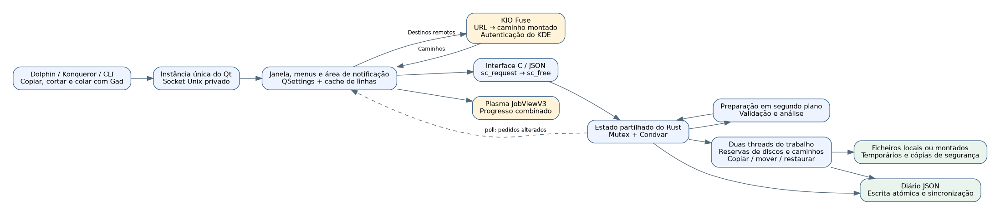
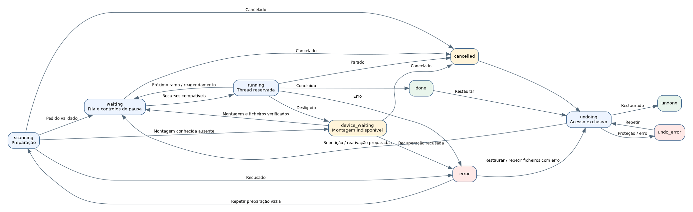

# Gad — Guia de desenvolvimento {#gad-developer-guide}

Versão documentada: **0.2.0**, protocolo **33**, 8 de novembro de 2026.

Gad significa **Gestionnaire Avancé de Duplication**; o seu slogan é **Gad, il copie.** Este guia descreve a implementação neste repositório. O código permanece oficial para os campos exatos e padrões.

[Francês](GUIDE_DEVELOPPEUR.md) · [Guia do utilizador](USER_GUIDE.pt-PT.md) · [Teste](../TESTING.pt-PT.md) · [Índice de documentação](README.pt-PT.md)

## Conteúdo {#contents}

1. [Arquitetura](#architecture)
2. [Compilação](#building)
3. [Arranque e instância única](#startup-and-single-instance-routing)
4. [Área de transferência, caminhos e KIO](#clipboard-paths-and-kio)
5. [Preparação dos pedidos](#preparing-requests)
6. [Agendamento e concorrência](#scheduling-and-concurrency)
7. [Modelo e estados](#model-and-states)
8. [Cópia de ficheiros e publicação do resultado](#file-copy-and-publication)
9. [Limites de velocidade](#bandwidth-limits)
10. [Espera pela reconexão](#reconnection-waiting)
11. [Diário e recuperação após uma falha](#journal-and-crash-recovery)
12. [Restauro, cancelamento e reativação](#undo-cancellation-and-reactivation)
13. [Interface, métricas e relatórios de erros](#interface-metrics-and-error-reports)
14. [Referência do protocolo](#protocol-reference)
15. [Instalação e integração com o Dolphin](#installation-and-dolphin-integration)
16. [Teste e manutenção](#testing-and-maintenance)
17. [Ferramentas da documentação](#documentation-tooling)
18. [Limitações conhecidas](#explicit-limitations)

## Arquitetura {#architecture}

Gad é um executável Linux que contém um mecanismo de transferência Rust e uma interface C++/Qt 6 Widgets. Liga-se às bibliotecas do sistema Qt/KDE. O primeiro processo possui a janela, o servidor local e o motor; as inicializações subsequentes enviam comandos para essa instância.



Os limites principais são Dolphin/CLI para Gad, Qt para Rust e Rust para o sistema de ficheiros. O primeiro utiliza argumentos, dados da área de transferência e, opcionalmente, o socket Unix privado. O segundo utiliza chamadas JSON síncronas através de `sc_request` e `sc_free`, com um longo trabalho delegado às tarefas do motor. O terceiro utiliza ficheiros temporários, publicação, eliminação de fontes para movimentações, desfazer backups e um diário persistente.

KIO Fuse expõe os endpoints remotos como caminhos montados; o motor Rust ainda transfere os seus dados. Plasma apresenta uma pré-visualização do progresso do D-Bus e não executa a cópia.

### Mapa de código {#code-map}

| Localização | Responsabilidade |
|---|---|
| `src/main.rs` | Ponto de entrada, inicialização do Qt, C ABI e inicialização lenta do motor. |
| `src/engine.rs` | Modelo partilhado, encaminhamento de comandos, coordenação de trabalhadores e processamento de ficheiros. |
| `src/engine/validation.rs` | Validação da raiz, preparação e preservação dos controlos recebidos durante a preparação. |
| `src/engine/duplicates.rs` | Supressão de duplicados antes de publicar novos índices de entrada. |
| `src/engine/scheduling.rs` | Recursos de disco físico e reservas de trabalhadores atómicos. |
| `src/engine/row_queue.rs`, `queue.rs` | Ordenação de filiais, prioridades, dependências e referências estáveis. |
| `src/engine/fast_move.rs` | Elegibilidade para renomeação local, rotas de montagem ligada e reprogramação. |
| `src/engine/tree_move.rs` | Renomeação de árvore inteira, recebimentos de diário agrupados e desfazer. |
| `src/engine/controls.rs`, `selection.rs` | Expansão da seleção, pausa, cancelamento, preparação para novas tentativas e remoção de linha. |
| `src/engine/errors.rs` | Relatórios de erros estruturados e validação atómica de novas tentativas direcionadas. |
| `src/engine/rate.rs` | Orçamentos de bytes partilhados e por pedido. |
| `src/engine/properties.rs` | Comparações expostas de propriedade/modo/ACL/xattr. |
| `src/engine/resume.rs` | Pontos de verificação duráveis ​​e recuperação parcial de ficheiros verificada. |
| `src/engine/reconnect.rs` | Monte âncoras, espera de reconexão e religação controlada de números de dispositivos. |
| `src/engine/history.rs`, `undo.rs` | Persistência, carregamento de recuperação, verificações de comprovação e desfazer. |
| `src/engine/snapshot.rs` | Revisões voláteis e instantâneos diferenciais. |
| `src/engine/protocol.rs`, `native/protocol.def` | Vocabulário de fios gerado partilhado por Rust e Qt. |
| `src/engine/tests.rs` | Testes de regressão do motor com acessórios temporários. |
| `native/application.*` | Ciclo de vida da aplicação, argumentos, socket e ativação. |
| `native/window.*` | Construção e coordenação de janelas. |
| `native/window_commands.cpp` | Pedidos de seleção, ações e sondagens de reconexão KIO. |
| `native/window_rows.cpp`, `row_tree.h`, `transfer_tree.h` | Widgets estáveis, árvores de pastas, arrastar e largar internos e detalhes de pedidos. |
| `native/window_conflicts.cpp` | Comparação origem/destino e decisões de conflitos. |
| `native/window_errors.cpp`, `error_report.h` | Caixa de diálogo de relatório de erros, pedidos de repetição exatos e exportação de texto atómico/JSON. |
| `native/window_open.cpp`, `row_paths.h` | Abertura de ficheiros/pastas da área de trabalho sem interpretação de shell. |
| `native/clipboard.h`, `kio_sources.h`, `paths.h` | Formatos da área de transferência, validação de URL e resolução KIO. |
| `native/notifications.h` | Progresso e comandos agregados do JobView do Plasma. |
| `native/snapshot.h`, `presentation.h`, `transfer_metrics.h` | Instantâneos armazenados em cache, etiquetas, totais, velocidade e estimativas de tempo restante. |
| `build.rs` | Compilação nativa, recursos, protocolo gerado e ligação. |
| `scripts/`, `tests/` | Ferramentas de instalação, validação isolada e documentação. |

## Compilação {#building}

Para instalar uma versão compilada, utilize o [PPA do Gad](https://launchpad.net/~hizo/+archive/ubuntu/gad) ou as [versões do GitHub](https://github.com/Hizoka76/gad/releases/latest): pacote `.deb`, arquivo com fontes e binário em `prebuilt/`, ou executável direto. Consulte as [instruções de instalação](USER_GUIDE.pt-PT.md#installation-and-startup). Os passos de compilação seguintes destinam-se ao desenvolvimento e à instalação a partir das fontes.

Os requisitos incluem o Rust/Cargo, um compilador C++ 17, `pkg-config`, Python 3, Qt 6 Widgets/Network/DBus e as suas ferramentas `moc`, `rcc` e `qmake6`, bem como o KF6 WindowSystem/XmlGui, CMake. Os testes Qt também requerem o teste Qt e `dbus-run-session`. O acesso à área de transferência do Wayland utiliza o `wl-clipboard`; endpoints remotos requerem fusível KIO. As dependências Rust estão bloqueadas em `Cargo.lock`.

```bash
cargo build --locked
cargo build --release --locked
./target/debug/gad --help
```

`build.rs` gera definições Rust a partir de `protocol.def`, compila as unidades nativas, executa a geração de características e meta-objectos e liga o ficheiro nativo. Injeta a versão Cargo e a data de construção. Alterações na fonte nativa desencadeiam a reconstrução; As edições exclusivas do Rust não devem reconstruir todos os widgets. As compilações de lançamento permitem símbolos de distribuição LTO e strip; utilizar binários de desenvolvimento para depuração nativa.

### Contrato C ABI {#c-abi-contract}

`sc_request` aceita UTF-8 JSON e devolve uma string de resposta alocada a Rust. Chame `sc_free` **exatamente uma vez** para este resultado; não utilize C++ `delete` ou `free`. O motor é inicializado lentamente e partilhado dentro do processo.

O limite captura os pânicos Rust para que não sejam desenrolados através de C. Não repara bloqueios envenenados ou estado lógico corrompido. Os erros esperados devem ser resultados estruturados. Os caminhos UTF-8 inválidos e os valores NUL incorporados são rejeitados em vez de serem convertidos silenciosamente para outro nome de ficheiro.

## Arranque e instância única {#startup-and-single-instance-routing}

Os argumentos tornam-se um comando, com área de transferência e processamento de URL quando necessário. Qt encontra o socket de utilizador existente e utiliza um bloqueio para evitar servidores simultâneos. Uma instância existente recebe o comando e o novo processo é terminado. Caso contrário, o processo inicializa a janela/servidor e executa o pedido inicial.

O socket é `gad.sock` no diretório de tempo de execução do utilizador. Os pedidos são JSON terminados em nova linha, uma resposta por ligação, com um limite de pedidos de entrada de 16 MiB e acesso apenas do utilizador. `--status` sem instância deve falhar em vez de iniciar um motor gráfico.

Apenas as próprias definições e localizações do diário do Gad são utilizadas. A versão atual do protocolo é **33**. As verificações de capacidade/versão evitam o envio silencioso de um pedido de movimentação, endpoint remoto ou verificação para uma instância mais antiga que não o consegue implementar. Um executável recém-instalado pode ainda entrar em contacto com um processo mais antigo; atualizar uma instância ociosa através do encerramento normal.

```bash
gad
gad --background
gad --status
gad --copy /tmp/demo/source.txt --to /tmp/demo/destination
gad --move /tmp/demo/source.txt --to /tmp/demo/destination
gad --copy /tmp/demo/source.txt --to /tmp/demo/destination --md5
gad --copy /tmp/demo/source.txt --to /tmp/demo/destination --properties
gad --paste /tmp/demo/destination
gad --paste-context /tmp/demo/destination --background
```

`gad://show` activa a janela de Plasma. `--smoke-test` e `--export-icons` são ferramentas de integração. `_sources_resolved` indica que a preparação do Qt já ocorreu; não ignora a validação do mecanismo.

A aceitação não é uma conclusão. `enqueue` pode devolver um ID e posteriormente falhar durante a digitalização; os clientes devem observar os estados finais.

## Área de transferência, caminhos e KIO {#clipboard-paths-and-kio}

### Comportamento da área de transferência {#clipboard-behavior}

As listas de URLs de ficheiros e os formatos do gestor de ficheiros têm precedência sobre o texto simples. Os marcadores de corte KDE e GNOME selecionam o modo de movimento; arrastar e largar seleciona o modo de cópia. Os campos de texto de destino mantêm a colagem de texto comum enquanto a colagem da lista de ficheiros entra na fila do Gad.

No Wayland, as chamadas `wl-paste` limitadas permitem o acesso à área de transferência independente do foco da janela. O `QClipboard` é um substituto para a indisponibilidade da ferramenta, não uma forma de reinterpretar dados presentes, mas mal formados. A lista de ficheiros e o marcador de corte são novamente verificados quanto à sua consistência, mas a área de transferência externa não é uma transação atómica com outra aplicação.

### Validação de caminho e resolução remota {#path-validation-and-remote-resolution}

Classifique a entrada antes da conversão. Um URL `file:` deve ser local, com um host vazio ou `localhost` e sem credenciais, porta, consulta ou fragmento. Rejeite NUL e codificação inválida. Um caminho POSIX absoluto contendo um `://` literal permanece um caminho.

Os esquemas remotos suportados são `kdeconnect`, `ftp`, `sftp` e `smb`, para origens e destinos. Valide as restrições específicas do host e do esquema antes da montagem. Os URLs de origem retidos omitem as palavras-passe. `Job.destination` é um caminho POSIX canónico; `destination_url` e `source_urls` permitem que os rótulos reconstruam os endereços remotos originais. As ações de abertura de ficheiros ainda utilizam caminhos montados reais.

`SourceUrls::Resolver` chama o serviço D-Bus `org.kde.KIOFuse`, objeto `/org/kde/KIOFuse`, interface `org.kde.KIOFuse.VFS`, método `mountUrl`. KDE possui autenticação. O Gad não implementa um armazenamento de credenciais FTP/SSH/SMB separado.

Resolva ambas as partes antes de enviar o pedido para o Rust, no prazo de preparação de 30 segundos. Uma falha não deve submeter apenas as primeiras fontes resolvidas. Os envios posteriores preservam a ordem enquanto a resolução estiver pendente. O cancelamento invalida as chamadas de retorno atrasadas; não promete cancelar as operações internas do servidor KIO.

`destination_context` retém o contexto selecionado de Dolphin até à resolução. Escolhe a pasta clicada ou o pai partilhado dos ficheiros selecionados e é removido antes do envio para o motor. Os destinos remotos requerem o protocolo 12 ou mais recente.

### Semântica do sistema de ficheiros KIO {#kio-filesystem-semantics}

Inspecione os descritores abertos através de `/proc/self/fdinfo` e `/proc/self/mountinfo`. Apenas as montagens `fuse.kio-fuse` comprovadas utilizam a semântica especial de sincronização de diretórios: os dados do ficheiro são sincronizados, enquanto o fsync de diretório não suportado não é solicitado. Os erros de sincronização local permanecem erros.

As permissões e os tempos de origem não são aplicados aos destinos KIO Fuse quando o serviço não consegue fornecer semântica chmod/utime. O serviço determina estes metadados. Um ficheiro temporário remoto criado recentemente e de forma única é explicitamente truncado para zero para inicializar a cache do KIO sem descarregar um ficheiro FTP vazio.

A recuperação durável de falhas está desativada para destinos KIO Fuse, incluindo caminhos de montagem inseridos diretamente. A pausa normal da sessão e a nova tentativa de religação controlada continuam disponíveis. Os caminhos do diário original não são remapeados silenciosamente para uma nova montagem KIO Fuse após a reinicialização do daemon.

## Preparação dos pedidos {#preparing-requests}

`enqueue` valida a estrutura do pedido, fontes, opções e metadados de origem, reserva um ID monotónico em `scanning`, persiste e inicia a preparação fora do thread da UI.

Valide o destino e as raízes, rejeite autocópias e aliases de montagem inválidos, verifique as pastas antes dos seus filhos por ordem determinística e identifique os recursos do disco. Os ficheiros e nomes especiais não suportados fora do contrato UTF-8 falham explicitamente. Os links simbólicos são entradas, não diretórios de origem percorridos recursivamente.

**Nenhum ficheiro numa solicitação é copiado até que a sua validação inicial e verificação sejam concluídas.** A falha na preparação produz um erro em vez de iniciar um grupo parcialmente analisado.

As âncoras de montagem são capturadas enquanto os pontos finais são conhecidos. Antes de confirmar as entradas preparadas, verifique se o pedido ainda existe e não foi cancelado ou interrompido. Preservar os controlos de pausa/cancelamento/ocultos recebidos após o instantâneo de preparação. Os resultados tardios não devem reativar as entradas canceladas.

Uma colagem em segundo plano válida pode limpar uma pausa global mais antiga. Uma pausa solicitada após o envio vence a geração de pausa. Os envios totalmente duplicados retornam sem pausa.

Os trabalhadores transferidos são unidos no despedimento. As tarefas de preparação utilizam o cancelamento lógico e a rejeição tardia dos resultados; um sistema de ficheiros bloqueado ou uma chamada KIO não tem cancelamento imediato garantido.

### Supressão duplicada {#duplicate-suppression}

`duplicates.rs` combina caminhos de origem e destino, identidade de dispositivo/inode, tipo e modo de copiar/mover. A normalização pai reconhece aliases e montagens ligadas sem seguir a ligação de origem final. As varreduras mais antigas terminam antes da decisão de admissão, pelo que o pedido aceite mais antigo ganha duplicados simultâneos.

Uma solicitação ativa no momento do envio permanece candidata se for concluída durante a nova verificação. O histórico já preenchido antes do envio é eliminado, permitindo a repetição intencional de cópias. Diferentes destinos e intenções de copiar versus mover permanecem distintos.

Preservar as pastas ancestrais necessárias para os filhos únicos. Uma nova solicitação não publicada pode filtrar o seu vetor de entrada antes que os índices se tornem visíveis. Para um pedido restaurado não iniciado, mantenha os índices publicados e oculte os duplicados ignorados. Não descarte o trabalho parcial registado no diário. `duplicates_ignored` fornece uma mensagem de UI informativa sem um pedido de ação.

## Agendamento e concorrência {#scheduling-and-concurrency}

Os recursos partilhados utilizam `Arc`, `Mutex`, `Condvar` e um sinalizador de paragem atómica. Dois trabalhadores persistentes selecionam e reservam pedidos atomicamente em `state`. O trabalho do sistema de ficheiros é executado fora deste bloqueio. Nunca segure `state` enquanto chama `save`: a ordem de bloqueio do diário é **escritor, então declare**.

Uma solicitação processa as suas entradas sequencialmente, mas as reservas são devolvidas nos limites das filiais para que as raízes independentes possam intercalar-se com outras solicitações. As cópias paralelas comuns necessitam de recursos de disco físico conhecidos e disjuntos. As partições e dispositivos compostos são rastreados através do `/sys/dev/block`; a topologia não resolvida torna uma cópia comum exclusiva.

As tarefas de renomeação local rápida podem partilhar discos quando os caminhos reservados normalizados não se sobrepõem. Caminhos desconhecidos ou árvores de origem/destino sobrepostas mantêm a serialização. Um pedido bloqueado anteriormente mantém a prioridade nos discos relevantes; uma nova digitalização inacabada é uma barreira de ordem. O trabalho explicitamente pausado pode permitir que trabalhos posteriores admissíveis prossigam.

O Desfazer é exclusivo e utiliza **ordem de execução real** reverso, recorrendo a IDs de registos mais antigos. Aguarda transferências ativas e pode ser executado enquanto a cópia comum está em pausa globalmente. O agendamento é conservador; não promete rendimento máximo em RAID arbitrário ou armazenamento de rede.

### Solicitações internas e a floresta visível {#internal-requests-and-the-visible-forest}

Um `Job` tem destino, opções de verificação capturadas e diários. Os índices de entrada mantêm-se estáveis. `jobRows` armazena metadados Qt desanexados quando existem entradas. As raízes das limas estão fixas diretamente na árvore; pastas reais proporcionam uma paternidade visual. As preparações vazias mantêm um espaço reservado.

`row_order` persistente contém chaves `(job, index)`, com um índice nulo para um espaço reservado. O `row_queue::Layout` armazenado em cache regista raízes, pais, filhos e pré-encomenda sem reorganizar os vetores de entrada. A ancestralidade da fonte **e destino** determina a paternidade, incluindo raízes aninhadas submetidas independentemente e progenitores tardios.

`reorder_rows` valida toda a seleção, destino, atividade, restrições pai e dependências antes da mutação. Suporta `before`, `after`, `next`, `up`, `down` e `last`. Uma pasta selecionada abrange descendentes. Nenhuma ação repara um ficheiro ou altera o seu destino. A prioridade definida durante a digitalização é transferida do espaço reservado para as suas raízes.

Os trabalhadores seguem o plano ordenado da filial e notam alterações de revisão de layout entre ficheiros, e não a meio de um deles. As entradas de espera pausadas não retêm trabalhadores. Uma finalização vazia não deve avançar a ordem de execução, pois isso corromperia a cronologia de anulação.

As dependências de destino brutas e normalizadas protegem a ordem de substituição entre pedidos e nomes repetidos num pedido. Os trabalhos dependentes parcialmente publicados não podem ser perigosamente intercalados. Os nomes futuros reservados também evitam que “Manter ambos” consuma o nome pretendido de outra entrada na fila. Os pedidos históricos do terminal não impedem novas alterações de prioridade válidas.

## Modelo e estados {#model-and-states}

| Objeto | Invariante de chave |
|---|---|
| `State` | Os IDs de pedido não são reutilizados; a ordem da fila/linha é separada do histórico cronológico. |
| `Job` | As opções de verificação são capturadas no envio; os controlos e os limites de taxa podem mudar através dos seus comandos. |
| `Entry` | A fonte, o destino, o tipo, a identidade, os contadores, os erros e as referências de anulação mantêm um índice estável. |
| `undo::Record` | Descreva os efeitos do sistema de ficheiros antes de executar os passos necessários para a recuperação. |
| `undo::Stamp` | Dispositivo/inode, tipo, tamanho, hora e dados de ligação protegem os resultados próprios. |
| Revisão de instantâneo | Rastreio de alterações voláteis da IU, não evidência de propriedade persistente. |

| Estado JSON | Significado |
|---|---|
| `scanning` | Validação/preparação. |
| `waiting` | Trabalho em fila de espera. |
| `device_waiting` | Montaria conhecida ausente; dados parciais retidos. |
| `running` | Um trabalhador está a processar o pedido/entrada. |
| `verifying` | Relé MD5 independente. |
| `conflict` | É necessária uma decisão de ficheiro. |
| `skipped` | Entrada excluída; a fonte permanece. |
| `done` | Concluído. |
| `error` | Uma falha documentada. |
| `cancelled` | Parado sem anular automaticamente os resultados concluídos. |
| `undo_waiting` | Desfazer agendado. |
| `undoing` | Trabalho de recuperação exclusivo. |
| `undone` | Efeitos restaurados. |
| `undo_error` | Desfazer não pôde ser concluído em segurança. |

A pausa é também uma sobreposição de apresentação/controlo e não é um novo estado de transferência serializada. Os estados de conflito/ignorado/espera ao nível do ficheiro não são todos estados de trabalho terminal; utilize as definições de protocolo partilhadas em vez de adivinhar os rótulos de visualização.



## Cópia de ficheiros e publicação do resultado {#file-copy-and-publication}

Para um ficheiro normal, verifique novamente os controlos e a disponibilidade de montagem, valide os pais de destino, resolva conflitos, reserve o nome de destino e aloque um ficheiro `file.ext.part` privado no diretório de destino. Utilize a criação exclusiva e permissões iniciais restritivas. As fontes são abertas sem seguir o seu link simbólico final e são verificadas em relação às identidades digitalizadas.

O buffer de cópia é **64 KiB** e pode ser escrito em frações concedidas mais pequenas quando a taxa é limitada. O progresso avança em bytes escritos reais. Um resumo MD5 incremental é mantido mesmo sem a verificação MD5 independente porque o desfazer utiliza evidência de conteúdo.

As cópias locais compatíveis criam pontos de retoma duráveis. Sincronize dados, aplique permissões básicas e horário de modificação quando existe suporte e execute verificações de conteúdo/propriedade selecionadas. Publique o **mesmo ficheiro temporário verificado** com renomeação. `renameat2(RENAME_NOREPLACE)` protege um alvo que apareceu em simultâneo; a substituição retém o destino anterior de forma privada até que a publicação recuperável seja bem-sucedida.

Uma movimentação elimina a sua origem apenas após a publicação e a sincronização/verificações necessárias. Verifique novamente a identidade, o tamanho, a hora e o tipo da origem antes da eliminação. As fontes ignoradas mantêm-se. Os diretórios de origem são removidos pela ordem inversa apenas quando estão seguros e vazios; falhas são reportadas em vez de excluir conteúdos externos.

Falhas comuns geridas limpam temporários privados. As desconexões reconhecidas retêm dados parciais registados em diário. Uma falha após um passo de publicação deve preservar estado suficiente para a recuperação e não deve ser tratada como uma permissão para repetir cegamente uma cópia.

### Renomeações rápidas de ficheiros e pastas {#fast-file-and-folder-renames}

`fast_move.rs` prova uma montagem local suportada, mesmo sistema de ficheiros subjacente, rota gravável e reservas independentes. Pode traduzir visualizações distintas de montagem ligada através de um caminho exposto comum. Um disco físico partilhado por si só não é prova. O kernel EXDEV ou outras restrições de rota devolvem o trabalho ao agendador com reservas de cópia comuns, em vez de reter a exceção de renomeação durante a cópia de fallback.

Os renomeados individuais retêm o inode original. O seu diário e o ctime pós- renome protegem o desfeito contra conteúdos alterados, mesmo que o tamanho e o mtime sejam restaurados. Uma falha entre a renomeação e a confirmação do ctime poderá requerer um exame manual em vez de uma recuperação optimista.

Além disso, o `tree_move.rs` requer uma sub- árvore completa intacta, nenhuma criança excluída ou pausada, nenhum conflito e correspondência exata de caminho/tipo/identidade. Submontagens, incluindo as escondidas em uma visão de ligação comum, impedem o atalho. Uma mudança de nome de raiz bem- sucedida preserva os objetos dos descendentes e registra informações agrupadas de recuperação.

O desfazer da árvore inteira usa os mesmos testes de integridade. Um ficheiro externo adicionado no destino impede o retorno/ remoção do ficheiro externo como parte do atalho. Seleções parciais usam a restauração individual. Os recibos do grupo distinguem uma falha antes ou depois da mudança de nome da raiz e evitam o intervalo de confirmação do ctime do ficheiro individual para este caminho.

### Verificação MD5 {#md5-verification}

A caixa de seleção adiciona fonte independente e ficheiro temporário releituras antes da publicação final. N bytes adicionar dois N-byte leituras para o trabalho de cópia. O progresso de verificação não deve anunciar a conclusão no final da escrita sozinho.

Não verifique um ficheiro temporário e recrie outro para publicação. As alterações de código-fonte ou digestões desiguais falham antes da substituição e exclusão de código-fonte. MD5 é evidência de consistência para esta transferência, não autenticação adversarial resistente a colisões.

### Verificação facultativa das propriedades {#optional-property-checks}

`verify_properties` é lembrado por Qt e capturado por solicitação; `--properties` substitui-o para uma submissão CLI. Campos ausentes padrão para false e `Entry.properties` para nenhum. Solicitações de propriedade explícitas requerem protocolo 13 ou mais recente.

O `properties.rs` lê UID/GID, bits de modo `07777` e atributos expostos pelo `llistxattr`/`lgetxattr`, sem seguir o link simbólico final. Verificações de identidade/tempo rejeitam instantâneos inconsistentes. O crescimento dos atributos é repetido no máximo três vezes. Os buffers são limitados a 64 KiB cada, com valores totais de 8 MiB por captura. Os ACLs do POSIX usam `system.posix_acl_access` e `system.posix_acl_default`.

Os valores permanecem na memória, não JSON. O relatório salvo contém `status` (`ok`, `different`, ou `unavailable`), `differences` e `unavailable`. As permissões ausentes não são equivalentes a atributos ausentes; diferenças conhecidas e verificações incompletas podem coexistir. Atributos protegidos completamente não listados não podem ser auditados. As datas estão fora desta comparação.

As cópias podem terminar com os avisos de propriedades. As jogadas de cópia e remoção preservam a fonte numa verificação mal- sucedida, com os efeitos de pré- publicação e pós- publicação tratados separadamente. As renomeações permanecem habilitadas; um aviso após a mudança de nome não afirma que a localização da fonte ainda exista. Os instantâneos da propriedade da árvore inteira voltam para o processamento por entrada acima da estimativa limitada de 32 MiB.

### Verificação de espaço {#space-checks}

O `space.rs` estima as alocações restantes em filas de espera analisadas e o trabalho pausado que partilha um volume. Redonda para blocos de alocações, evite o transbordamento numérico, e a conta apenas para alocações temporárias reconhecidas no volume esperado. Os destinos/backups existentes já estão ocupados, não são de crédito livre. Renomeações comprovadas não alocam uma segunda cópia de dados.

A capacidade insuficiente conhecida falha antes da criação do alvo. A capacidade desconhecida produz um aviso e permite a cópia. Verifique novamente a alocação de ficheiros antes de criar um ficheiro temporário; a estimativa não é uma reserva contra outras aplicações. `verify_space` é capturada para a solicitação e requer o protocolo 14 quando explicitamente solicitado de outra instância.

## Limites de velocidade {#bandwidth-limits}

`rate.rs` fornece um orçamento global compartilhado e um orçamento por solicitação. Zero é ilimitado. O limitador consome ambos os orçamentos atomicamente antes de uma escrita, mantém no máximo 100 ms de crédito, e usa condições limitadas-variáveis esperas em vez de reservar bytes para um trabalhador adormecido.

Bloquear `state` antes de `Shared::limiter`. Verificar novamente a disponibilidade de pausa, cancelamento, parada e montagem periódica durante as esperas. Mudar uma taxa começa sem crédito acumulado. Não há garantia de equidade igual. As taxas de cópia aplicam- se a bytes escritos, não a releituras MD5, trabalho de metadados, desfazer ou renomear.

O Protocolo 18 introduziu `configure.rate_limit` e `set_rate_limit` globais com `ids` e `bytes_per_second`. Validar seleções completas e valores inteiros de 0 a 1 TiB/s antes da mutação. Persistir limites configurados, não cronometrar créditos. O Qt mostra MiB/s como `Mio/s` e recorda a configuração global. Solicitar diálogos capturam IDs quando abertos, para que as alterações de seleção posteriores não possam reorientá- los.

## Espera pela reconexão {#reconnection-waiting}

`reconnect.rs` captura e persiste monta âncoras enquanto endpoints são conhecidos: caminho, dispositivo, inode âncora, nó de bloco de sysfs opcional, classificação remota, e um sistema de ficheiros udev disponível UUID. Sonda fora `state`; também verifique durante streaming, esperas de largura de banda e pausas de ficheiros ativos.

`device_waiting` não é terminal. `park_disconnected` mantém o diário parcial, marca a entrada interrompida e libera o trabalhador. Um observador por solicitação sonda espaços em pelo menos um segundo e respeita cancelamento e pausas globais / pedido / entrada. Mantenha o pedido em `device_waiting` durante a validação potencialmente lenta para que ele não crie uma barreira de digitalização para trabalho independente.

Ao retornar, reutilizar o `prepare_resume` e o caminho de preparação normal. A correspondência de UUIDs pode religar números de dispositivos; as verificações de inodo/tipo/versão, ctime e conteúdo digerem-se permanecem inalteradas. Publicar identidades validadas e âncoras juntas antes de tornar o executável da solicitação. Um volume diferente, diretório de substituição vazio, identidade ambígua ou fonte alterada não é prova suficiente para retomar.

O `CopyTemp` preserva um diário temporário na desconexão reconhecida. Os pontos de verificação locais permanecem disponíveis para a reconexão da sessão, mesmo quando a recuperação automática do estoiro está desactivada. Sem um ponto de destino KIO durável, apenas um temporário reconhecido não publicado pode ser removido após a validação do código-fonte, para reiniciar esse ficheiro. Nunca reproduza automaticamente uma publicação já engajada.

O Qt repete a resolução de URL de origem através do KIO no máximo a cada cinco segundos sem chamar o `enqueue` ou expor uma nova implementação de autenticação. Um caminho diferente é relatado em vez de usado para reescrever o diário. Etiquetas, métricas, crachá de bandeja e progresso nativo mostram todas as chamadas de Kernel/remote já bloqueadas permanecem sujeitas aos seus próprios atrasos.

## Diário e recuperação após uma falha {#journal-and-crash-recovery}

O diário do utilizador é `$XDG_DATA_HOME/gad/state.json`, padrão para `~/.local/share/gad/state.json`. `save` serializa escritores, escreve um ficheiro de estado temporário, substitui-o atomicamente, e sincroniza conforme necessário. Não segure `state` enquanto o chama.

`undo::Record` captura estadiamento próprio, resultados, backups / selos originais, remoção de origem, preparação de fonte restaurada e etapas de recuperação completas. Destinos substituídos ao vivo em diretórios privados `.gad-undo-*` em seu sistema de ficheiros. Mantenha o diário antes de efeitos que precisam de recuperação; não trate um caminho de exibição como evidência de propriedade.

Ao carregar o trabalho interrompido, o motor classifica cópias não concluídas compatíveis separadamente das etapas de publicação, renomeação e desfazer ambíguas. O trabalho explicitamente cancelado não reinicia. A informação de recuperação mantida pode sobreviver à retenção de histórico normal. A limpeza do histórico normal libera backups sem excluir saídas finais bem sucedidas; a limpeza falhada continua a ser um erro visível recuperável.

### ficheiros parciais duráveis {#durable-partial-files}

`resume.rs` armazena uma fonte `Version` com identidade/metadata/ctime, uma versão de destino existente protegida ao substituir, uma contagem de bytes confirmada e a digest do prefixo. Os pontos de verificação ocorrem após 64 MiB ou dois segundos de progresso. Sincronize o temporário e seu diretório antes de publicar um novo ponto confirmado para a revista.

`Job.resume_enabled` captura a preferência automática de recuperação de falhas; `resume_pending` marca trabalho interrompido recuperável. A reconexão local de sessão ainda cria pontos de verificação quando essa preferência está desligada. Faltam campos antigos de forma conservadora.

A recuperação requer um `file.ext.part` privado esperado no pai correto, sem um link simbólico ou links rígidos extras, combinando o dispositivo salvo e o inode. Verifique também descritores abertos. Compare os prefixos fonte e temporário bloco por bloco, verifique o hash gravado e as versões novamente, e só então truncar bytes de rastreamento não confirmados e reposicionar ambos os fluxos. Reconstrua o contexto incremental MD5 e mantenha o inode temporário.

`resume_checking`, `resume_checked` e `resumed_from` descrevem a validação e o progresso do reinício. Uma permissão de leitura previamente aplicada só é ajustada apenas em um temporário validado. Remova o registro do currículo antes da publicação final e da transição para o diário de desfazer comum. O MD5 independente final ainda é executado quando solicitado.

O `resume_interrupted` aceita IDs de trabalho recuperáveis. A preparação e a reconexão preservam os controles posteriores de pausa/cancela/escondimento por índice estável. Uma validação recusada preserva a parcial não reconhecida em vez de truncá-la optimicamente.

## Restauro, cancelamento e reativação {#undo-cancellation-and-reactivation}

O cancelamento impede o novo trabalho e deixa os efeitos completados. O Desfazer usa a revista para remover cópias criadas pelo Gad, devolver movimentos e restaurar destinos substituídos.

Pré-voo de todo o escopo selecionado e os pais necessários antes das modificações. Validar os resultados e backups próprios, incluindo digestões de conteúdo quando necessário. Uma fonte recriada, destino alterado, backup ausente ou volume ausente produz uma recusa em vez de sobrescrever dados do utilizador.

As solicitações de processo em ordem de execução reversa. As cadeias de substituição podem colocar uma saída mais antiga em uma cópia de segurança selecionada mais recente; a validação compreende essas dependências. Recriar diretórios de origem necessários, restaurar ficheiros e destinos anteriores, então remover apenas diretórios criados vazios. O retorno do sistema de ficheiros cruzados requer uma cópia, publicação e sincronização verificadas antes da remoção do destino.

Os passos de desfazer completados são persistidos para tentar novamente após o `undo_error`. Seleções parciais preservam vizinhos. Pré-voo reduz o risco, mas não faz de um diretório inteiro uma transação atômica contra escritores externos.

Apagar as linhas terminadas seleccionadas sem remover os resultados finais, cancela os itens activos e remove os trabalhos pendentes. O Backspace também solicita que se desfaça os resultados finais. A selecção da pasta expande- se através da ancestralidade do código- fonte/destino, não de um prefixo de texto em bruto. A remoção de uma linha não altera os índices activos do motor.

A reativação de entradas canceladas é distinta da configuração `waiting`. Primeiro restaura/limpa os restos compatíveis, manipula as alterações de tipos e os pais ausentes e preserva os vizinhos completados. O cancelamento global também invalida a preparação de URL Qt.

## Interface, métricas e relatórios de erros {#interface-metrics-and-error-reports}

### Atualizações diferenciais e árvores {#differential-updates-and-trees}

O `TrackedJob` marca o acesso ao trabalho mutável com uma revisão volátil. Mutações globais e alterações de layout também avançam o relógio instantâneo. O `poll` aceita o `since`; tokens ausentes/incompatíveis solicitam uma redefinição, o estado inalterado retorna uma pequena resposta, e outras respostas incluem IDs autoritários, metadados e trabalhos alterados. O `QueueSnapshot` mescla- os sem recriar linhas inalteradas.

Reutilizar o QTreeWidgetItems para preservar a selecção, o hover, as dicas, a posição de rolagem e a expansão. Só actualiza o texto/ícones/tooltips quando os valores mudam. Compila a paternidade da pasta a partir dos caminhos de origem e destino. Os filtros mantêm visíveis os antepassados necessários e o progresso normal não reabre os ramos colapsados manualmente.

O `TransferTree` usa dados MIME privados que contêm chaves de origem e de linha estáveis. As gotas internas enviam `reorder_rows`; Qt nunca repare diretamente o modelo. O MIME externo interno é rejeitado enquanto URLs de ficheiros externos ainda atingem o manuseio normal de gotas de ficheiro. Os protetores de rolagem de borda e QPointer lidam com um arrasto ativo com segurança.

### Velocidade e tempo restante {#speed-and-remaining-time}

`transfer_metrics.h` caches um `Probe` por pedido inacabado e reconstrui-o apenas para IDs alterados. Cada tique de atualização, incluindo `poll.unchanged`, avança o relógio monotônico injetado e decai taxas paradas sem reescanejar entradas.

Copiar e medidores MD5 usam janelas de atividade separadas de cinco segundos e pelo menos 500 ms de observação. Excluir as fases de cruzamento de intervalos. Pausas, conflitos, verificações de recuperação e regressões de contra- regressões reiniciam medições inadequadas. Não conte prefixos, pastas, trabalhos removidos/cancelados/esquecidos, ou renomear bytes lógicos como tráfego de cópia recente.

Estimar os bytes de cópia restantes na velocidade de cópia mais os restantes MD5 lê na velocidade MD5. Se uma medição necessária for desconhecida, diga- o; estimar apenas a fase de cópia quando o MD5 não foi observado. O trabalho pausado individualmente torna o tempo total desconhecido. Estas métricas são voláteis e não prevêem a espera de fila ou a duração de desfazer.

### Relatórios de erros e novas tentativas {#error-reports-and-retries}

`error_report` é somente leitura e excluído do `snapshot::Mutation`. O formato é `gad-error-report`, versão 1, com `generated_unix`, metadados de origem de trabalho e registros de erros estáveis. Inclua caminhos, mensagens, bytes, estado de publicação/recuperação, MD5 disponíveis e relatórios de propriedades. Marcadores de falhas de diretório agregados e esperas de dispositivos não são falhas permanentes duplicadas.

`retry_errors` aceita `jobs`, `entries`, e `exact` opcional. Validar a elegibilidade para toda a seleção antes da mutação e rejeitar as solicitações ativas. As referências exatas do relatório não implicitamente expandem uma pasta; as seleções de listas normais fazem. Rotar os erros selecionados através do desfazer preparatório existente e `prepare_retry`, mantendo os vizinhos OK/cancelado/escapado/removido. Suspender apenas esperando entradas não selecionadas para preservar o escopo. Preservar a pausa global.

Uma análise em branco falha com a validação completa da raiz e a digitalização. Reinicie os antepassados estruturais cujo estado de erro veio apenas de uma criança. Verifique novamente os nomes de código/alvo antes de tentar novamente. Separar a desfazer incompleta não é convertido em cópia; as falhas de preparação da repetição mantêm as referências para que possam ser tentadas novamente após a reparação. As saídas modificadas permanecem protegidas por desfazer o pré- voo.

O `window_errors.cpp` é um instantâneo não- modal, explicitamente atualizado, com células de texto simples e detalhes do `QPlainTextEdit`. Filtrar e ordenar não altera as referências das linhas armazenadas. Todos os seis botões usam ícones de tema com fallbacks padrão do Qt. A exportação do Text/JSON usa o `QSaveFile`; apenas uma gravação completa e bem- sucedida substitui o relatório. A exportação inclui o instantâneo carregado inteiro, enquanto o alvo de retries exibido ou as falhas selecionadas.

### Plasma e ativação da janela {#plasma-and-window-activation}

`notifications.h` agrega solicitações atuais em um JobViewV3. Rastreie os deltas byte por entrada, distinga o progresso lógico do renome, inclua o trabalho MD5 em conclusão e sincronize os comandos de pausa. Mantenha a velocidade final útil enquanto a visualização fecha. Lidere a reconectar com o Plasma após uma falha de serviço sem criar notificações ordinárias duplicadas.

`gad://show` e tokens de ativação restauram a janela principal. A bandeja clica para alternar a visibilidade. A pasta/ficheiro abre para usar o `QDesktopServices` com URLs de ficheiros, nunca uma shell. O Autostart é uma entrada de desktop por utilizador; fechar ou sair deve honrar o trabalho ativo.

## Referência do protocolo {#protocol-reference}

`native/protocol.def` é o vocabulário compartilhado; estruturas e validadores Rust definem contratos exatos. A versão atual é **33**. Os comandos específicos da GUI são roteados por Qt e os comandos do motor por Rust.

| Comando | Parâmetros principais | Comportamento |
|---|---|---|
| `status` | Nenhum | Estado total. |
| `poll` | `since` opcional | Estado completo ou incremental. |
| `configure` | `keep_history`, opções de verificação, `resume_interrupted`, `rate_limit` | Preferências e taxa global viva. |
| `set_rate_limit` | `ids`, `bytes_per_second` | Capa viva por pedido. |
| `enqueue` | `sources`, `destination`, `mode`, opções/metadados de origem, `background` | Reserve e prepare um pedido. |
| `pause` | `paused` | Pausa global. |
| `reorder_queue` | `ids`, `action` | Pedido de pedido completo. |
| `reorder_rows` | `rows`, `action`, opcional `target` | Pedido de ficheiro/ramo. |
| `cancel`, `cancel_many` | `id` ou `ids` | Pare os pedidos. |
| `undo_many` | `ids` | Desfazer pedidos. |
| `resolve` | `id`, `index`, `action`, `all` | Decisão de conflito actual. |
| `cancel_all`, `undo_all` | Nenhum | Parada global ou desfazer. |
| `pause_selection` | `jobs`, `entries`, `paused` | Controlos direccionados. |
| `resume_interrupted` | `ids` | Revalidate trabalho interrompido recuperável. |
| `error_report` | Nenhum | Leia os detalhes de falha estruturados. |
| `retry_errors` | `jobs`, `entries`, opcional `exact` | Tente novamente apenas falhas selecionadas elegíveis. |
| `retry_selection` | `jobs`, `entries` | Reactivar os itens cancelados. |
| `delete_selection`, `backspace_selection` | `jobs`, `entries` | Remoção de teclado/semanticidade de mundo. |
| `undo_selection`, `cancel_selection` | `jobs`, `entries` | Desfaça ou cancele o alvo. |
| `clear` | Nenhum | Limpar o histórico terminado e os seus backups. |
| `shutdown` | Nenhum | Desligamento controlado, recusado enquanto ativo. |
| `show` | `activation_token` opcional | Exibir/ativar a janela. |
| `background` | Nenhum | Mantenha a instância escondida. |
| `paste` | Configuração do destino/contexto e do plano de fundo | Leia a área de transferência e envie um trabalho. |

```json
{"command":"enqueue","sources":["/tmp/demo/source.txt"],"destination":"/tmp/demo/destination","mode":"copy","verify_md5":true}
```

O sucesso na submissão devolve um ID, não prova de que a transferência foi bem sucedida. Os consumidores devem lidar com erros tardios e distinguir o estado de operação do estado de entrada individual.

## Instalação e integração com o Dolphin {#installation-and-dolphin-integration}

`scripts/install.py` constrói primeiro, substitui atomicamente `~/.local/bin/gad`, instala a associação de desktop `org.hizoka.gad`, manipulador de protocolo, ícones e ações de menu de serviço em locais XDG do utilizador, e atualiza caches KDE quando disponível. Um executável já mapeado por um processo em execução mantém seu código anterior.

O identificador do aplicativo é `org.hizoka.gad`; as associações de desktop e ícones devem concordar para que a barra de tarefas use o ícone do software em vez de uma imagem de cópia genérica. Os ativos `gad-boucles-document` incorporados são exportados em tamanhos de desktop por Qt.

O `gad --configure --dolphin-ctrl-v` instala uma associação reversível de Dolphin Ctrl+V. O `--no-dolphin-ctrl-v` restaura as configurações salvas anteriormente. A integração preserva a pasta de texto nativa e a alternativa padrão Shift+Inserir KIO. Ele localiza a pasta Dolphin ativa através da informação da sessão atual, em vez de uma necessidade de título de janela de caminho completo. Valide as alterações atômicas, rejeite registros de integração não relacionados/malformados e preserve atalhos não relacionados.

O `make test-dolphin-paste` opcional usa KXMLGUI/KActionCollection real em um barramento privado para exercer ativação de atalhos, pasta de texto e restauração sem copiar ficheiros ou reiniciar Dolphin do utilizador.

Desinstalação deixa os dados necessários para a recuperação em vez de excluir periódicos e backups. Se outras cópias de Gad estão instaladas, distinguir seu binário / versão e execução instância antes de diagnosticar o comportamento.

## Teste e manutenção {#testing-and-maintenance}

[Testando Gad](../TESTING.pt-PT.md) fornece requisitos completos e descrições de cenários.

```bash
make doctor
make test-unit
make test-python
make test-qt
make test-integration
make check
make test
```

`scripts/run_tests.py` suporta filtragem, grupos conscientes de dependência, execução contínua e relatórios JSON/JUnit sob `target/test-results`. JUnit conta as etapas de comando, não todas as asserções Rust/Qt.

Os testes Rust usam árvores temporárias para verificar o estado observável e o conteúdo do ficheiro. Os testes em Python usam a biblioteca padrão e as fixações isoladas; as dependências do renderizador de documentação são carregadas somente quando são renderizadas. Os testes Qt usam ambientes privados D- Bus/HOME/XDG, dobradores de motores e aberturas de desktop interceptadas. Os testes de integração também exercem o executável real e a recuperação de falhas. Os Mocks não reproduzem cada servidor ou versão Plasma.

A validação local documentada inclui as suítes **216 testes Rust**, **65 testes em Python**, Qt, incluindo as suítes **83 processos de acção em linha**, e as verificações de integração, formatação e Clippy. Um benchmark é intencionalmente ignorado em execução de rotina. Isto descreve evidências locais, não uma afirmação de que o fluxo de trabalho fornecido do GitHub foi executado remotamente ou que as edições futuras são validadas automaticamente.

### Falhas no diagnóstico {#diagnosing-failures}

Comece com o `gad --status`, a versão da instância em execução e as mensagens de erro completas. Distingue o executável instalado do `target/debug/gad`.

Para entrada remota, validação de URL separada, KIO disponibilidade de fuse D-Bus, KDE autenticação, montagem e acesso real ao ficheiro. Para desfazer, retenha os volumes e backups necessários; não exclua `.gad-undo-*` para “reparar” um diário. As exportações de erros contêm caminhos pessoais e devem ser revisadas antes de compartilhar.

### Adicionando uma funcionalidade {#adding-a-feature}

Defina primeiro os efeitos dos ficheiros, o comportamento do utilizador e a semântica do estado interrompido. Atualize o vocabulário compartilhado para alterações de protocolo e use padrões conservadores para campos persistentes.

Verificar pausa, cancelamento, seleção múltipla, retornos de chamadas tardios e desligamento. Adicione testes de regressão para um comportamento observável significativo, execute os grupos afetados e as verificações necessárias, então atualize **ambas as edições linguísticas** e capturas de ecrã relevantes. Nunca use uma string de exibição como prova de que um objeto do sistema de ficheiros pertence ao Gad.

## Tradução da aplicação {#application-localization}

`native/i18n.h` usa o QTranslator e o Qt Linguist catalog `translations/gad_fr_FR.ts` / `translations/gad_es_ES.ts` / `translations/gad_pt_PT.ts` / `translations/gad_de_DE.ts` / `translations/gad_ja_JP.ts`. O inglês é a língua fonte do programa; os catálogos contêm traduções em francês, espanhol, português, alemão e japonês. Mark Qt exibe strings com `GAD_TR("…")` no contexto `Gad`. Diagnósticos de motores conhecidos usam o contexto `Engine` apenas no momento da apresentação. Revistas, nomes de ficheiros, chaves JSON, estados de arame e exportações JSON mantêm seus valores originais. Diagnósticos não catalogados e erros de serviço externos mantêm sua língua original; tradução nunca substitui fragmentos dentro de ficheiros ou mensagens.

O `.qm` compilado é verificado e incorporado através do `gad.qrc`; a construção ou instalação do Gad não necessita de pacotes de idiomas separados ou ferramentas lingüísticas. O seletor de idiomas salva a preferência QSettings `language` e imediatamente chama o `I18n::initialize` sem interromper as transferências. O `GAD_LANGUAGE=fr_FR` ou o `GAD_LANGUAGE=en_US` substitui- o por uma nova instância; o `system` segue o QLocale:system(). Os dialetos de desktop em Inglês usam o en_US; outros idiomas retornam ao fr_ FR. Os comandos enviados para uma instância existente não alteram a sua língua.

Para widgets persistentes, `I18n::localized(widget, "text", []{return GAD_TR("About");})` ou `I18n::bindProperty` vincula explicitamente uma propriedade ao seu texto de origem. `I18n::onChange` atualiza apresentações computadas, tais como cabeçalhos, listas, relatórios e renderização de transferências. O QPointer protege cada proprietário de callback; proprietários destruídos são removidos e ligações repetidas para uma propriedade substituem callbacks anteriores. As chamadas são executadas a partir de um instantâneo após a instalação dos tradutores. As strings exibidas nunca são globalmente pesquisadas e substituídas.

A cache da linha inclui o idioma: uma pesquisa inalterada ainda atualiza os rótulos sem substituir os itens da árvore. Relatórios de erros mantêm seu instantâneo carregado, linhas e seleção. Um conflito mantém sua escolha de “aplicar aos conflitos futuros” quando apenas as alterações da linguagem. Datas e números são reformatados sem alterar os valores numéricos. Mensagens já arquivadas pelo Plasma mantêm sua língua original; as visualizações de trabalho ativas atualizam na próxima atualização.

Depois de adicionar strings de exibição, execute `make translations` para sincronizar fontes, traduza novas entradas no Linguista Qt, e execute-o novamente para compilar o catálogo e atualizar suas impressões digitais. Este comando de manutenção requer `lrelease6` ou `lrelease`. `make translations-check` verifica a cobertura, os parâmetros `%1`, links e impressões digitais sem ferramentas externas. Testes em Python também executam essas verificações. Testes em Qt carregam o catálogo incorporado atual e verificam widgets em inglês, estados, relatórios, preferências e nomes de ficheiros inalterados/JSON exportações.

## Ferramentas da documentação {#documentation-tooling}

A raiz do README é um ponto de entrada curto; guias detalhados são mantidos aqui. A documentação abrange seis idiomas. Cada edição inclui Início Rápido, Guia do utilizador, Guia do Desenvolvedor e 20 capturas de ecrã de sua própria interface no tema de luz. Os diagramas de arquitetura e ciclo de vida têm etiquetas localizadas.

O `doc_catalog.py` identifica a língua e o público de cada fonte. O `build_docs.py` gera capas corretas para o idioma, switches de linguagem de mesma audiência, links/fragmentos relativos e imagens incorporadas offline. O inglês PDFs usa a Carta dos EUA; outros PDFs usam o A4. O `check_docs.py` valida todos os links README/testing/guide, captura, metadados de linguagem e todas as 36 exportações HTML/PDF.

```bash
make docs-captures
make docs
make docs-check
```

O código de captura liga os widgets reais a uma ponte C de demonstração, usa ficheiros temporários e sessões isoladas, e aplica o Breeze Light na sua configuração privada, preservando as configurações de fonte do ambiente de trabalho. O manifesto grava dimensões, versão e hashes. Ele nunca controla o verdadeiro processo ou área de transferência Gad. A renderização nativa da bandeja/progresso fora da captura de widgets não é simulada como uma imagem real do desktop.

Documentação Os testes em Python cobrem a seleção local, navegação, tamanho do papel, links relativos, legendas, incorporação de imagens, cabeçalhos em falta e invocação completa de exportação, sem necessidade de Markdown ou WosyPrint no ambiente de teste de rotina. Veja o [índice de documentação](README.pt-PT.md) para dependências de exportação opcionais.

## Limitações conhecidas {#explicit-limitations}

A integração opcional do Gad Ctrl+V é específica do Dolphin. Os endpoints remotos dependem do KIO Fuse e da sua semântica de serviço. A recuperação de falhas de ficheiros médios durável é limitada a destinos compatíveis; os destinos KIO podem reiniciar um ficheiro atual não publicado durante a reconexão da sessão.

Proprietário, ACL, xattr, ficheiro esparso e preservação de links rígidos não têm todas as garantias de uma ferramenta de backup especializada. Um grupo de cópias não é globalmente atômico. Sincronização do sistema de ficheiros e modificações externas concomitantes permanecem relevantes, mesmo com verificações de identidade, MD5 e validação pré-voo.

Mantenha estes limites visíveis nas decisões de design e mensagens do utilizador. Um cheque local bem sucedido não deve se tornar uma promessa de recuperação universal.

## Ordenação e filtros das colunas {#header-sorting-and-filters}

O `native/table_view.h` armazena as configurações de apresentação, aplica os predicados de colunas literais e ordena os itens de irmãos usando comparações naturais ou funções de progresso numérico com conhecimento local. As filas quebram laços de valor igual, independentemente da direção de ordenação. Os mesmos itens QTreeWidget são religados com a seleção e expansão preservadas. As atualizações de progresso evitam a redefinição de uma visualização ordenada para a ordem de filas antes de serem ordenadas novamente.

O `TransferTree` possui os menus de cabeçalho, as revisões de exibição/filtro e as ações de reset. O `Window::refresh` trata uma revisão de apresentação como uma razão para renderizar mesmo após uma pesquisa inalterada, combina predicações de coluna e preserva visibilidade de ancestral. As revisões de filtro são separadas das revisões de ordenação, de modo que a ordenação não reabre pastas colapsadas. A ordem de restauração da fila chama o caminho de ordenação existente da chave estável. O arrastar interno está desativado durante a ordenação visual. Nenhuma destas configurações causa comandos de mutação do motor. Os testes cobrem a identidade da fila, ordenação natural e numérica, predicados combinados, ancestralidade, progresso ao vivo, tradução quente e comportamento de reset/navigação.

Ordenar as teclas forma uma lista ordenada de pares de colunas/direções. O Cabeçalho de Transferência lê Ctrl do evento real de lançamento do mouse; Ctrl+clique em anexar ou reverter uma tecla, enquanto um clique normal substitui a lista. Os marcadores de cabeçalho mantêm as prioridades- chaves entre as traduções. Limpar uma chave de ordenação preserva o resto. A combinação global redundante e o seu predicado foram removidos. Novos ícones de menus têm as falhas do Qt quando um tema não as possui.

A coluna de ordem é a coluna lógica 5 e a coluna visual 0; `setTreePosition(0)` mantém os branches no Source. As funções existentes nas colunas e as referências de ação mantêm o seu significado. Os números vêm do `row_order`, com um backback derivado de instantâneos quando não é fornecida nenhuma disposição. Um delta apenas de layout força todas as linhas a atualizar, incluindo as tarefas omitidas desse delta. As dicas das células mostram IDs de lote imutáveis. A ordenação de pedidos usa filas numéricas, e a sexta coluna suporta filtros e a ordenação com Ctrl+clique. Os acentos de cores da solicitação são desenhados na primeira coluna visual.

As quebras de sentenças de dicas são novas linhas explícitas nos literais de origem em Inglês e catálogo francês. Nenhuma substituição de pontuação de execução toca caminhos, URLs ou texto de erro externo. As dicas de fonte mantêm as opções de localização e operação; a identificação de lote permanece na coluna Ordem. A regressão em live- language inclui um nome de ficheiro contendo um período, um espaço e caracteres HTML.

A decoração de origem usa `edit-copy`/`edit-cut`, em cache pelo modo de operação em `OperationRole`, com recuos Qt. `KindRole` ainda grava o tipo de entrada real para ações de pasta/ficheiro. As dicas retêm apenas caminhos e opções úteis, sem repetir a operação. A seção Ordem usa `ResizeToContents` em vez de uma largura fixa.

## Regras de exclusão das transferências {#transfer-exclusion-rules}

O `src/engine/exclusions.rs` valida as regras e implementa o Unicode dynamic- programming glob matching (`*`, `?`). O Protocolo 21 expõe o `exclusions` através do `configure`, `enqueue` e instantâneos: `include_hidden` (padrão true), `directories` e `files` (padrão arrays vazios). A validação acontece antes da mutação, incluindo outras preferências na mesma solicitação. Os periódicos mais velhos recebem estes padrões.

O `State` armazena preferências; cada `Job` persiste na sua própria cópia imutável. A digitalização das regras de trabalho de cargas uma vez por raiz, usa as pastas `symlink_metadata` e as ameixas excluídas antes da travessia. Retomar e tentar novamente usar o mesmo scanner. As solicitações completamente excluídas são completadas sem retomar uma fila pausada. O `tree_move::ready` desativa a mudança de nome da pasta inteira quando a filtragem estiver ativa. A limpeza remove apenas pastas vazias e tolera pastas que contenham itens excluídos.

Qt captura regras antes da resolução KIO. A janela edita commit somente após o sucesso do `configure`. QSettings armazena `includeHidden`, `excludeDirectories` e `excludeFiles`. Testes cobrem cópias, movimentos e desfazer links, Unicode, regras imutáveis, persistência, repetições, validação atômica e preferências de interface.

## Adicionar um idioma {#adding-a-language}

Línguas são descobertas na inicialização de catálogos válidos `gad_<locale>.qm`, como `gad_de_DE.qm`. Qt fornece o nome de exibição nativo de cada idioma. Inglês americano permanece disponível como o idioma de origem. Locais exatos têm prioridade, seguido por uma variante disponível do mesmo idioma, então francês ou inglês.

Para adicionar uma linguagem sem reconstruir, coloque o seu `.qm` no `~/.local/share/gad/translations/` e a sua bandeira `<locale>.png` ao lado dele, por exemplo `de_DE.png`, e reinicie o Gad. Este diretório segue o `$XDG_DATA_HOME` quando definido. As bandeiras também podem estar em um subdiretório `flags/` ou em `~/.local/share/gad/flags/`. As bandeiras que faltam usam um ícone genérico. Catálogos inválidos são ignorados. Os catálogos do utilizador sobrepõem-se ao sistema e catálogos incorporados.

Para distribuição com Gad, coloque o `.qm` em `translations/` e seu PNG em `assets/flags/`. `scripts/resources.py` gera o manifesto Qt para os testes de Carga, Qt e captura de documentação. Não é necessária nenhuma lista C++ ou edição de manual de código-fonte. Só um `.qm` compilado é suficiente; quando um `.ts` é fornecido, `python3 scripts/translations.py` automaticamente descobre, valida e compila-o.

## Duplicar na pasta de origem {#duplicating-in-the-original-folder}

Activar **Permitir duplicação na mesma pasta**, em seguida, copie e cole na pasta contendo o item. `photo.jpg` torna- se `photo_copied1.jpg`; a `Documents` pasta torna-se `Documents_copied1`. Gad escolhe o primeiro número disponível, contabilizando duplicações pendentes. Os links simbólicos são copiados sem seguir seus alvos.

Esta opção está desactivada por omissão, salva e capturada para novas solicitações. Move- se para si própria e as cópias das pastas para os seus próprios descendentes permanecem rejeitadas. As exclusões ainda se aplicam. Desfazer remove a cópia criada e preserva o original.

O protocolo 22 adiciona `allow_duplication` ao `configure`, `enqueue`, periódicos e instantâneos. `src/engine/duplication.rs` atribui alvos de raiz e persiste em `Job.duplicate_targets`. A digitalização reutiliza esses alvos durante o currículo e a repetição. A nomeação verifica o disco fora do bloqueio de estado e, em seguida, reserva o candidato sob o bloqueio contra planos concorrentes. As verificações de recorrência permanecem ativas; apenas um alvo idêntico é aceito para uma cópia explicitamente permitida.

## Utilizar o Gad com o Konqueror {#using-gad-with-konqueror}

**Colar com Gad** é um KIO menu de serviço compartilhado com Dolphin. Reinicie Konqueror após instalar Gad para carregar o menu. Copiar e cortar operações usar o mesmo motor de transferência e fila.

Para **Ctrl+V**, inicie **Konqueror com Gad** do menu de aplicação ou execute `gad-konqueror`. Este lançador carrega um plugin apenas em Konqueror. Pastas de ficheiros vão para Gad usando a pasta de visualização ativa; colar texto na barra de endereço e campos de entrada permanece nativo. **Shift + Inserir** mantém a pasta KIO habitual. Destinos remotos suportados permanecem disponíveis.

O plugin também expõe a pasta ativa ao **Colar na pasta aberta com Gad**, sem depender de títulos de janelas ou seleções antigas. O lançador padrão Konqueror é preservado. A integração Ctrl+V é validada com Konqueror 26.08 (Qt 6). Se o Konqueror for instalado após o Gad, reexecute o `python3 scripts/install.py` para construir o seu plugin.

O `native/konqueror/paste_filter.h` lida apenas com Ctrl+V numa vista com uma URL suportada e uma área de transferência de ficheiros. Os campos de texto, páginas HTTP, outras janelas e Shift+Inserção permanecem nativas. O `plugin.cpp` deriva do `KonqParts::Plugin` e expõe o destino activo sobre o D- Bus. O frontend lê- o duas vezes antes de colar. O `scripts/konqueror_integration.py` constrói o plugin contra os cabeçalhos do Konqueror, o Qt6Xml/DBus/Widgets, o KF6CoreAddons e o KF6XmlGui. O Konqueror e as bibliotecas de desenvolvimento do CoreAddons/XmlGui são necessárias. O caminho do plugin local é passado exclusivamente para o processo lançado pelo `gad-konqueror`, sem alterar as configurações globais do Qt ou os atalhos do navegador.

## Diálogo de definições {#settings-menu}

**Definições → Opções…** abre uma janela modal que bloqueia a janela principal enquanto as transferências continuam. As alterações aplicam-se imediatamente; **Fechar** ou Esc não as anula. Os parâmetros de comando aparecem a cinzento. Tamanho mínimo: **800 × 740**; janela principal, relatório de erros e diagnóstico: **1100 × 600**.

Os quatro separadores são **Definições**, **Atalhos**, **Limites de velocidade** e **Fim do lote**. Os limites incluem o global e o predefinido para novos pedidos. Para alterar um pedido existente, selecione as linhas e utilize **botão direito → Limitar a velocidade da solicitação…**. O limite aparece em **Detalhe**, incluindo nas pastas; sem limite não é acrescentado texto.

`QDialog::setWindowModality(Qt::WindowModal)`; `settingsTabs`: `settingsPanel`, `shortcutsPanel`, `ratesPanel`, `completionPanel`. `rowRateLimit` → `Window::showRateLimit`.

Os comandos e a caixa do Dolphin partilham `Window::configureDolphin`. Executa o componente privado `gad/integration/dolphin_shortcut.py` com Python e QProcess sem bloquear transferências. O registo permanece em `gad/dolphin-paste.json`. O prazo máximo é de oito segundos; uma falha repõe a caixa e devolve um erro ao cliente. `Window::handleAsync` aguarda o resultado antes de responder por IPC. O Konqueror mantém `konquerorCtrlV`, lido pelo módulo em cada Ctrl+V. Não é instalado nenhum comando público separado.

### Documentação na caixa Sobre {#about-documentation}

`docs/catalog.json` é gerado por `doc_catalog.runtime_catalog()` e instalado com as exportações por `scripts/install_docs.py`, sem ferramentas de renderização. `native/documentation.h` procura `gad/docs/catalog.json` nos diretórios XDG e depois em localizações portáteis ou de desenvolvimento. Os campos `locale`, `kind`, `title`, `html` e `pdf` identificam os ficheiros. A seleção privilegia a variante regional exata, outra variante do mesmo idioma e depois o inglês. Os caminhos são verificados em relação à raiz canónica para rejeitar travessias e ligações simbólicas externas. As ligações são atualizadas quando o idioma muda e abertas através de `QDesktopServices`.

## Configuração e páginas de manual {#command-settings}

`native/cli_options.h` valida os argumentos de `--configure`. O protocolo 24 transporta definições gráficas e alterações parciais de exclusões para `Window::handleAsync` / `Window::handle`, que valida o idioma, combina as regras e sincroniza o motor, os controlos e QSettings. `scripts/test_cli_settings.py` verifica o comportamento numa conta temporária com um bus D-Bus privado. `make manpages` gera seis manuais em seis idiomas; `make manpages-check` verifica a sua atualização. Os catálogos adicionais estão em `packaging/manpages/`. Os instaladores local e Debian colocam os manuais em `man1` e `<idioma>/man1`.

## Vigilância do atalho do Dolphin {#dolphin-watchdog}

`native/dolphin/` contém um módulo genérico Qt com interfaces públicas KXMLGUI. Verifica o registo e as propriedades XML, respeita alterações do utilizador e adia correções durante diálogos modais. O estado e os contadores são disponibilizados por D-Bus em `/GadDolphinWatchdog`. `scripts/dolphin_integration.py` compila e instala o módulo e protege de forma reversível o lançador do utilizador. O registo `gad/dolphin-launcher.json` permite restaurá-lo na desinstalação. Os testes unitários e o teste com Dolphin real utilizam ficheiros e um bus privados.

```sh
gad --dolphin --new-window
make test-dolphin-watchdog
make test-dolphin-watchdog-real
```

## Estabilidade da origem e verificações de restauro {#file-integrity}

`same_version` inclui ctime; `verify_source` verifica o caminho antes da publicação e `remove_original` usa a mesma comparação. Leituras superiores ao tamanho inicial são recusadas. O MD5 verifica a estabilidade antes e depois da leitura.

`undo::Stamp` verifica permissões e guarda proprietário/grupo opcionais. `undo::Record.backup_ctime` é capturado após renomear a cópia de segurança e registado antes da publicação. A verificação prévia valida todas as entradas selecionadas, os ascendentes existentes, as cópias de segurança e as origens já restauradas. Um resultado movido ausente bloqueia a operação antes de modificar os restantes. O conteúdo restaurado é comparado com o digest registado antes de eliminar o resultado. Os novos campos são opcionais para registos antigos.

`src/engine/tests/integrity.rs` cobre alterações com tamanho/mtime preservados, substituição de caminhos, cópias e movimentos sem MD5, cópias de segurança alteradas, permissões, restauros interrompidos e registos antigos. Estas verificações reduzem as condições de corrida habituais sem isolar modificações simultâneas dos caminhos.

## Perfis de transferência {#transfer-profiles}

O esquema QSettings `transferProfiles` versão 5 separa `options`, `gui` e `request_rate_limit`, sem destino. Ao carregar a versão 1, preserva as opções existentes, completa as ausentes com as preferências atuais e remove o destino antes de guardar a versão 5. Documentos inválidos ou desconhecidos mantêm-se intactos.

`currentTransferProfile` captura todos os controlos. A aplicação valida o idioma, prepara o atalho Dolphin de forma assíncrona, guarda a entrada exata de arranque e aplica a configuração interna. Se falhar, tenta repor configuração, arranque e atalhos; comunica uma reposição incompleta. Alterações concorrentes de configuração e a saída são bloqueadas durante a operação. Os perfis nunca iniciam transferências. O protocolo do motor mantém-se em 32.

Os testes Qt cobrem migração, remoção do destino, todas as opções, falhas externas e do motor, reposição do arranque, concorrência, idiomas ausentes e persistência.

Na linha de comandos, `gad --profile "Meu perfil"` aplica as definições sem iniciar uma transferência. Para copiar: `gad --profile "Meu perfil" --copy /caminho/origem --to /caminho/destino`; também funciona com `--move` / `--paste`. Gad aguarda a aplicação do perfil. O destino vem do comando e as opções explícitas, como `--md5`, têm prioridade. Um nome desconhecido devolve um erro sem colocar ficheiros em fila. `--configure --profile "Meu perfil"` aceita definições adicionais, aplicadas após o perfil.

## Políticas de conflitos nos perfis

Em **Opções → Conflitos de ficheiros**, escolha **Perguntar**, **Ignorar ficheiros existentes**, **Substituir apenas ficheiros mais antigos** ou **Manter ambos os ficheiros**. Guarde ou atualize o perfil. Os pedidos existentes mantêm a sua política.

Só são substituídos destinos com data de modificação estritamente anterior à da origem; datas iguais ou posteriores são ignoradas. Datas ilegíveis e ligações simbólicas causam um erro sem substituição: altere a política e tente novamente. A fiabilidade das datas depende do sistema de ficheiros ou serviço remoto. As pastas existentes são unidas e a política aplica-se aos conflitos interiores. Manter ambos acrescenta um sufixo numerado. Os ficheiros ignorados ficam na origem ao mover; as substituições permitem restauração.

Comando: `gad --configure --conflict-policy newer`. Os perfis antigos são migrados para **Perguntar**, sem destino.

`conflict_policy` (protocolo 27) é capturado em `Job.policy`. `src/engine/conflicts.rs` valida as políticas e compara datas sem seguir ligações simbólicas. O esquema 3 de perfis migra versões anteriores para `ask`.

## Pesquisar no histórico guardado

Clique em **Pesquisar no histórico** ou prima **Ctrl+F**. Introduza um nome ou parte do caminho de origem/destino, incluindo URL remotos. As palavras combinam-se com E, sem distinguir maiúsculas e sem expressões regulares. Escolha um estado do lote e ative **Adicionado entre** para filtrar a data de adição, com datas locais inclusivas.

**Apenas histórico** mostra lotes concluídos, cancelados, restaurados ou com erro; desmarque para incluir pedidos ativos. Os filtros de colunas combinam-se com a pesquisa. As pastas ascendentes dos resultados continuam visíveis. **Repor pesquisa** limpa os seus critérios sem alterar os filtros de colunas; fechar a barra ou premir **Escape** desativa apenas esta pesquisa. A fila e as prioridades não mudam.

A dica da coluna de ordem mostra a data de adição. Operações antigas sem data são identificadas e continuam pesquisáveis sem filtro de data. É necessário manter o histórico: operações apagadas já não podem ser encontradas.

`Job.created_at` → Unix UTC, `0` = ?; `HistorySearch::Query` → `TableView::Settings` → `TransferTree::setHistorySearch`; `native/window_history.cpp` → Ctrl+F, Escape, 150 ms.

## Diagnóstico de transferências

O botão **Diagnóstico de transferências…**, no rodapé, abre uma vista não modal dos pedidos ativos e em espera. Mostra o estado, a atividade ou espera observada, os limites globais e por pedido, a velocidade e o tempo restante. Os números dos lotes bloqueadores correspondem à lista principal.

As causas distinguem pausas, análise da origem, conflitos pendentes, dispositivos ou montagens remotas indisponíveis, verificação MD5, verificação do prefixo de retoma, mudança de nome local, restauração exclusiva, dois trabalhadores ocupados, prioridade de linhas, discos partilhados ou caminhos sobrepostos e execução em série quando os recursos são desconhecidos.

Uma espera de orçamento de velocidade só é indicada se o limitador a observou no último segundo. Um limite configurado não prova uma lentidão. Após cinco segundos sem progresso de bytes durante uma cópia ou MD5, fora das esperas pelo limite, o Gad informa dessa ausência de progresso: as operações de ficheiros ou a finalização podem estar em espera, mas não permitem identificar um limite concreto do disco ou da rede. Não são testes de desempenho e não são guardados no histórico. Fechar a janela não altera as transferências.

`src/engine/diagnostics.rs` → `status` / `poll` (`diagnostics`, protocol 29); `rate::Limiter::waiting` → 1 s. `QueueSnapshot` → `TransferDiagnostics::Tracker` → `window_diagnostics.cpp`.

## Verificar movimentos rápidos

Em **Opções**, marque **Verificar movimentos rápidos**. Está desativado por predefinição, é guardado nos perfis e capturado por novo pedido. Após uma mudança de nome local, o Gad verifica identidade (dispositivo/inode), tipo, tamanho, data de modificação, permissões, proprietário/grupo, destinos de ligações e árvore exata, além do desaparecimento do caminho original. Aceita alterações legítimas de ctime da raiz renomeada; os descendentes devem conservá-lo.

O detalhe indica **Movimento rápido verificado** no fim. O diagnóstico distingue esta fase de MD5. Diferenças, elementos adicionados ou em falta, um caminho original recriado ou erros de leitura fazem falhar o lote e identificam o caminho verificado. O resultado movido e o diário são mantidos, sem restauração automática que substitua ficheiros modificados. Pausar ou cancelar não elimina o resultado já movido.

Verifica metadados, não o conteúdo; não substitui uma comparação criptográfica. MD5 continua separado e obriga a copiar/verificar/eliminar. Cópias normais não recebem um falso resultado de verificação rápida. Perfis antigos migram com a opção desativada. Comando: `gad --configure --verify-fast-move`; desativar: `--no-verify-fast-move`.

`verify_fast_move` (30) → `fast_verify.rs` → `Entry.fast_move_check`; `TransferProfiles` → schema 4.

## Ações de fim de fila

Em **Opções → Fim de fila**, escolha notificar, fechar o Gad, suspender ou desligar, com **5 a 3600 segundos** (30 por predefinição). Os perfis guardam as preferências mas nunca ativam a ação. Abra **Quando a fila terminar…**: escolher uma ação ativa-a para uma única fila; **Ativar uma vez a ação guardada** usa as definições atuais. O botão indica que está ativa. **Não fazer nada** ou **Cancelar ação de fim de fila** desativa-a.

Com a fila vazia, aguarda um novo pedido; o histórico não desencadeia a ação. A contagem começa após o êxito de todos os pedidos, preparações remotas e gravações finais. Erros, cancelamentos, restaurações ou pedidos removidos desativam a ação. Novos pedidos, mesmo muito rápidos, reiniciam o prazo completo após terminar. Uma pausa impede o envio.

O diálogo mostra a ação e o tempo restante. **Cancelar ação** ou fechar o diálogo desativa sem alterar transferências. Uma notificação reabre o Gad se estiver oculto. A zero, uma proteção atómica impede novas operações durante o envio. O logind aplica as regras de autorização e inibição para suspender ou desligar; uma recusa é apresentada sem comandos alternativos forçados. Não é reativada após executar ou reiniciar.

Preferência passiva: `gad --configure --completion-action suspend --completion-delay 60`. Ative-a separadamente no menu gráfico.

`Completion::Plan` → `window_completion.cpp`; `queue_guard` → `completion_claim` / `completion_release` (32). `completion.rs`: `Activity`, `Shared.requests`. `org.freedesktop.login1.Manager`: `CanSuspend` / `Suspend(true)`, `CanPowerOff` / `PowerOff(true)`. `TransferProfiles`: schema 5, `gui.completion_action`, `gui.completion_delay`.


## Preparar transferências na lista principal {#preparing-transfers}

O protocolo atual é **33**. `Job.start_required` é persistido; `prepare_only` distingue a preparação manual dos pedidos externos. O escalonador ignora preparações não validadas. O controlo único envia `pause` com `paused=false` para iniciar ou retomar. `staging.rs` cria temporários visíveis; `resume.rs` verifica identidade e prefixo. Os comandos de simulação só de leitura permanecem internos, sem janela própria.
