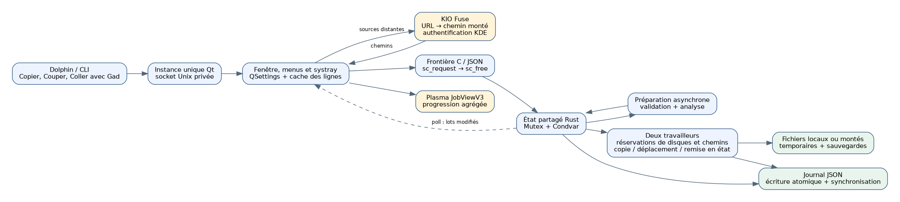
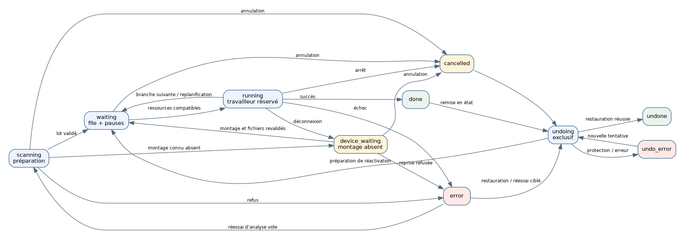

# Gad — Guide développeur

Version documentée : **0.1.0**, protocole **22**, 6 novembre 2026.

Ce guide décrit le fonctionnement présent dans le dépôt. Il complète le [guide utilisateur](GUIDE_UTILISATEUR.md), le [guide de tests](../TESTING.md) et les instructions de compilation du [README](../README.md). Gad signifie **Gestionnaire Avancé de Duplication** ; son slogan est « Gad, il copie. »

## Sommaire

1. [Architecture](#architecture)
2. [Compilation](#compilation)
3. [Demarrage et instance unique](#demarrage-et-instance-unique)
4. [Sources, presse-papiers et KIO](#sources-presse-papiers-et-kio)
5. [Preparation des operations](#preparation-des-operations)
6. [Ordonnancement et concurrence](#ordonnancement-et-concurrence)
7. [Modele et etats](#modele-et-etats)
8. [Cycle de copie](#cycle-de-copie)
9. [Journal et recuperation](#journal-et-recuperation)
10. [Remise en etat](#remise-en-etat)
11. [Interface et rafraichissement](#interface-et-rafraichissement)
12. [Reference du protocole](#reference-du-protocole)
13. [Installation et donnees du bureau](#installation-et-donnees-du-bureau)
14. [Tests et maintenance](#tests-et-maintenance)
15. [Limites a garder explicites](#limites-a-garder-explicites)

## Architecture

Gad est une application Linux à moteur Rust et interface C++/Qt 6 Widgets. Le binaire final contient les deux parties ; il dépend des bibliothèques Qt/KDE du système. Le processus principal possède la fenêtre, le serveur local et le moteur. Les lancements suivants transmettent une commande au premier processus.



Les trois frontières à distinguer sont :

- **Dolphin → Gad** : arguments de lancement et presse-papiers, puis éventuellement socket local entre instances.
- **Qt → Rust** : fonctions C `sc_request` et `sc_free`, messages JSON synchrones. Les traitements longs sont délégués aux tâches du moteur.
- **Rust → disque** : fichiers temporaires, publication, suppression des sources en déplacement, journal et sauvegardes de restauration.

KIO Fuse ne remplace pas le moteur : il expose une source distante sous un chemin local. La copie de ce chemin appartient ensuite au moteur Rust. Plasma affiche la progression via D-Bus ; il ne réalise pas la copie.

### Carte du code

| Emplacement | Responsabilité |
|---|---|
| `src/main.rs` | Point d’entrée, arguments et passage à Qt, pont C et initialisation du moteur |
| `src/engine.rs` | Modèle partagé, moteur, traitements de fichiers et coordination |
| `src/engine/validation.rs` | Validation des chemins, analyse des sources et garde-fous |
| `src/engine/scheduling.rs` | Ressources disque, réservations de chemins et choix des opérations exécutables |
| `src/engine/fast_move.rs` | Éligibilité, renommages locaux, replanification et protection des résultats rapides |
| `src/engine/tree_move.rs` | Renommage de dossiers complets, journal groupé et restauration en bloc |
| `src/engine/errors.rs` | Rapport structuré et validation atomique des réessais ciblés |
| `src/engine/duplicates.rs` | Élimination des opérations déjà prévues avant publication des indices |
| `src/engine/row_queue.rs`, `queue.rs` | Ordre des branches, priorités et dépendances |
| `src/engine/rate.rs`, `reconnect.rs` | Budgets de débit et attente de reconnexion contrôlée |
| `src/engine/controls.rs` | Pause, annulation et commandes de contrôle |
| `src/engine/selection.rs` | Expansion des sélections et actions ciblées |
| `src/engine/properties.rs` | Capture et comparaison des propriétés visibles, rapports sans valeurs privées |
| `src/engine/resume.rs` | Points durables et reprise des fichiers interrompus |
| `src/engine/history.rs` | Persistance, chargement et nettoyage du journal |
| `src/engine/undo.rs` | Précontrôles et remise en état |
| `src/engine/snapshot.rs` | Révisions et instantanés différentiels |
| `src/engine/protocol.rs` | Types générés du vocabulaire partagé ; routage dans `engine.rs` |
| `src/engine/tests.rs` | Tests Rust avec répertoires temporaires |
| `native/application.*` | Application Qt, instance unique, socket, arguments et activation |
| `native/window.*` | Construction de la fenêtre et coordination de son état |
| `native/window_commands.cpp` | Commandes de fenêtre, sélection et actions |
| `native/window_rows.cpp` | Création et actualisation des lignes |
| `native/window_conflicts.cpp` | Présentation et résolution des conflits |
| `native/window_errors.cpp`, `error_report.h` | Bilan filtrable, navigation, réessai et export atomique |
| `native/window_open.cpp`, `row_paths.h` | Ouverture des fichiers et dossiers |
| `native/clipboard.h` | Formats du presse-papiers, lecture Wayland |
| `native/kio_sources.h`, `paths.h` | URL, résolution KIO des sources et destinations |
| `native/notifications.h` | JobView Plasma, progression et activation |
| `native/snapshot.h`, `presentation.h`, `transfer_metrics.h` | Cache Qt, totaux, libellés, débits et estimations |
| `native/protocol.def`, `protocol.h` | Vocabulaire partagé des commandes et états |
| `build.rs` | Génération du protocole, compilation et liaison C++/Qt |
| `assets/` | Icônes, ressources Qt et intégration du bureau |
| `scripts/` | Installation, tests et génération de documentation |
| `tests/` | Tests Qt, Python et scénarios d’intégration |

Les fonctions détaillées et leurs invariants sont commentés dans les fichiers. Ce guide explique les liens entre ces composants ; le code demeure la référence exacte des structures et valeurs par défaut.

## Compilation

Les dépendances principales sont Rust/Cargo, un compilateur C++17, `pkg-config`, Python 3, Qt 6 Widgets/Network/DBus avec `moc`, `rcc`, `qmake6`, et KF6 WindowSystem. `wl-clipboard` est utilisé à l’exécution sous Wayland ; KIO Fuse est nécessaire aux sources distantes. Les dépendances Rust sont verrouillées par `Cargo.lock`.

```bash
cargo build
cargo build --release
./target/debug/gad --help
```

`build.rs` transforme `protocol.def` en définitions Rust, compile les unités C++ avec les options adaptées à Qt, génère les ressources avec `rcc` et le métacode avec `moc`, puis lie l’archive native au programme Rust. Il injecte la version Cargo et la date de compilation dans l’interface. Les changements de sources natives déclenchent leur reconstruction ; une modification purement Rust ne doit pas imposer de reconstruire tous les widgets.

Le profil release active LTO et retire les symboles du binaire distribué. Pour diagnostiquer un problème natif, privilégier un binaire de développement et conserver ses symboles.

### Contrat du pont C

Qt transmet un JSON UTF-8 à `sc_request`. La réponse est une chaîne allouée côté Rust, qui doit être libérée **exactement une fois** avec `sc_free`. Ne pas utiliser `delete` ou `free` côté appelant. Le moteur est initialisé paresseusement et partagé dans le processus.

La frontière intercepte les paniques Rust pour éviter leur propagation à travers l’ABI C. Cela ne répare pas un état logique corrompu ou un mutex empoisonné. Les erreurs attendues doivent donc être des résultats structurés, jamais des paniques. Les chemins/arguments qui ne sont pas représentables dans le contrat UTF-8 sont refusés explicitement.

Le module `engine/duplicates.rs` filtre les nouvelles préparations avant de publier leurs indices. La clé combine source, destination, identité (périphérique/inode), nature et mode copie/déplacement. Les parents sont normalisés hors verrou pour reconnaître leurs alias et montages, sans suivre le dernier lien symbolique. Les analyses antérieures se terminent avant la décision ; une demande active à la soumission reste candidate si elle termine pendant la nouvelle analyse. Les demandes historiques déjà terminées à la soumission sont exclues.

Les dossiers requis par un enfant unique sont conservés. À la reprise d’une demande jamais exécutée, les indices persistés sont maintenus : seules les lignes dupliquées sont masquées et ignorées. Une opération ayant déjà un journal ou ayant été exécutée conserve ses entrées. Un ajout entièrement dupliqué est retiré et ne lève pas la pause globale. Le compteur `duplicates_ignored`, exposé dans `status` et les métadonnées `poll` du protocole 17, permet au widget d’afficher un message temporaire sans boîte modale. Les fichiers sur disque ne sont pas supprimés par ce filtrage.

Le module `engine/rate.rs` fournit un budget global et un budget par demande, en octets/s (`rate_limit`, zéro = illimité). Les crédits volatils vivent dans `Shared::limiter`, hors du journal, et ne dépassent pas 100 ms de débit. Le moteur verrouille toujours `state` avant `limiter`. Les crédits des deux budgets sont consommés atomiquement avant écriture. Les attentes de 50 ms au maximum utilisent la condition de réveil du moteur et revérifient pause, annulation et arrêt. Les changements de plafond repartent sans crédit accumulé. Il n’y a pas de garantie de partage équitable entre travailleurs.

Le protocole 18 ajoute `configure` avec `rate_limit` pour le plafond global, et `set_rate_limit` avec `ids` et `bytes_per_second` pour les demandes. La validation complète des identifiants et des entiers (0 à 1 Tio/s) précède toute mutation. `status`, `poll` et le journal exposent les plafonds. Les anciens journaux utilisent zéro. Le champ global Qt mémorise aussi sa valeur dans `QSettings/rateLimit` ; le dialogue par demande capture ses identifiants à l’ouverture. Le tampon de copie de 64 Kio est écrit par fractions accordées par le limiteur ; le suivi des octets avance à chaque fraction. Renommage, MD5 et restauration ne consomment pas ces budgets.

## Demarrage et instance unique

1. Les arguments sont validés et convertis en commande ; les demandes liées au presse-papiers peuvent nécessiter la préparation Qt.
2. Gad recherche l’instance existante par son socket utilisateur. Le verrou empêche deux serveurs concurrents.
3. Une instance existante reçoit la commande et répond ; le nouveau processus termine.
4. Sans instance, le processus initialise la fenêtre et son serveur, puis traite la commande initiale.

Le journal et les préférences sont lus exclusivement depuis les emplacements Gad ; aucun autre nom d’application n’est importé. Le socket principal est `gad.sock` dans le répertoire d’exécution utilisateur. Le serveur impose l’accès utilisateur et limite une requête entrante à **16 Mio**. Le transport est un JSON terminé par un saut de ligne, avec une réponse par connexion. Un `--status` sans instance ne doit pas créer une application graphique.

La vérification de version/capacités évite d’envoyer silencieusement une demande à une ancienne instance incapable de la traiter : déplacement, MD5, sources distantes et interrogation différentielle ont été ajoutés progressivement. Le protocole courant vaut 22.

Exemples de commandes, avec des chemins fictifs à adapter :

```bash
gad
gad --background
gad --status
gad --copy /tmp/demo/source.txt --to /tmp/demo/destination
gad --move /tmp/demo/source.txt --to /tmp/demo/destination
gad --copy /tmp/demo/source.txt --to /tmp/demo/destination --md5
gad --paste /tmp/demo/destination
gad --paste-context /tmp/demo/destination --background
```

`gad://show` sert à l’activation depuis Plasma. `--smoke-test` et `--export-icons` sont des outils de validation/intégration, pas des actions de transfert utilisateur. Le drapeau interne `_sources_resolved` indique une préparation Qt déjà réalisée ; il ne doit pas devenir une manière de contourner la validation Rust.

L’acceptation d’une demande n’est pas sa réussite : une commande peut recevoir un identifiant puis échouer pendant l’analyse. Un appelant doit consulter les états pour connaître le résultat final.

## Sources, presse-papiers et KIO

### Presse-papiers

Les listes d’URL et formats de gestionnaires de fichiers sont interprétés avant le texte ordinaire. Gad reconnaît les URI, les données KDE et les listes GNOME de fichiers copiés/coupés. Le marqueur de coupe crée un déplacement ; un glisser-déposer crée une copie.

Sous Wayland, `wl-paste` permet une lecture indépendante du focus. Les appels externes ont des délais bornés (démarrage, lecture, arrêt). Le secours `QClipboard` concerne l’indisponibilité de l’outil ; une réponse présente mais invalide ne doit pas être transformée en une autre demande. La cohérence entre liste et marqueur de coupe est revérifiée ; le presse-papiers ne constitue néanmoins pas une transaction atomique avec un autre programme.

Dans le champ Destination, une liste de fichiers déclenche le collage Gad ; un texte ordinaire garde le comportement d’un champ texte.

### Chemins et URL

Le type d’entrée est décidé avant la conversion. Une URL `file:` doit désigner la machine locale (`localhost` ou hôte vide), sans authentification, port, requête ou fragment. Les NUL et conversions invalides sont refusés. Un chemin local absolu contenant littéralement `://` reste un chemin, pas automatiquement une URL distante.

Sources distantes admises : `kdeconnect://`, `ftp://`, `sftp://`, `smb://`. Les URL doivent avoir un hôte et respecter les contraintes de leur schéma. Les libellés conservés ne doivent pas divulguer un mot de passe. Les mêmes schémas sont acceptés en destination. `LocalPaths::destination` normalise les chemins et URL locales, conserve les URL distantes, puis `SourceUrls::Resolver` résout les deux côtés du lot avant soumission. Les destinations distantes exigent le protocole 12 de l’instance existante. Les requêtes invalides sont refusées avant tout montage. `destination_context` conserve les éléments Dolphin jusqu’à la résolution, puis choisit le dossier lui-même ou le parent des fichiers sélectionnés. Le contexte est retiré avant la soumission Rust.

`Job.destination` reste un chemin POSIX canonique ; `destination_url`, facultatif et compatible avec les anciens journaux, contient l’adresse sans mot de passe. `destinationLabel` reconstruit les libellés du lot, de ses descendants et des conflits. Les commandes d’ouverture continuent à utiliser le chemin réellement monté. La file de préparation et son invalidation couvrent aussi les destinations.

Un descripteur ouvert est associé à son montage par `/proc/self/fdinfo` et `/proc/self/mountinfo`. Seul `fuse.kio-fuse` utilise la sémantique distante de synchronisation : les fichiers sont synchronisés normalement, mais `sync_directory` ne demande pas le `fsyncdir` absent de KIO Fuse. Les erreurs de synchronisation locales ne sont jamais ignorées. Les droits et dates source ne sont pas appliqués aux destinations KIO Fuse, car les services n’implémentent pas tous chmod/utime ; les règles du service définissent ces métadonnées. Un temporaire nouvellement créé est explicitement tronqué à zéro sur KIO Fuse pour initialiser son cache sans téléchargement d’un fichier FTP vide.

Les lots à destination d’une URL distante capturent `resume_enabled=false`. La préparation vérifie aussi le type du montage hors verrou et désactive cette option si un chemin KIO Fuse a été saisi directement. La reprise durable ne peut donc pas promettre une garantie POSIX absente du montage. Les mouvements retirent toujours la source après synchronisation du contenu et confirmation de la publication. Les anciens chemins de récupération ne sont pas remappés automatiquement vers de nouveaux inodes après une reconnexion ; leur validation reste conservatrice.

### Résolution distante

Qt appelle de manière asynchrone le service D-Bus `org.kde.KIOFuse`, objet `/org/kde/KIOFuse`, interface `org.kde.KIOFuse.VFS`, méthode `mountUrl`. KDE conserve la responsabilité de l’authentification. Gad ne possède pas de gestionnaire de mots de passe FTP/SSH/SMB.

La préparation attend la résolution du groupe de sources avec une échéance de 30 secondes. Une erreur empêche l’ajout de ce groupe ; il ne faut pas démarrer discrètement seulement les premières sources. Les demandes suivantes gardent leur ordre pendant cette préparation. Une annulation invalide les rappels tardifs côté client ; elle ne garantit pas l’interruption de l’opération interne du serveur KIO.

Deux chemins restent distincts : le **libellé d’origine**, utile à l’utilisateur, et le **chemin monté réel**, nécessaire aux accès disque et aux actions d’ouverture.

## Preparation des operations

`enqueue` valide d’abord la structure de la demande : sources non vides, options et métadonnées cohérentes. Il crée un identifiant monotone et une opération `scanning`, persiste cet état, puis lance la préparation en arrière-plan.

La préparation vérifie la destination existante, normalise les chemins, refuse une copie dans elle-même et les cas interdits, analyse les arbres et identifie les ressources disque. Les répertoires précèdent leurs enfants ; l’ordre des enfants est déterministe. Les types spéciaux non pris en charge et les noms incompatibles avec le contrat UTF-8 produisent une erreur explicite. Un lien symbolique est décrit comme lien ; son contenu cible n’est pas parcouru comme un répertoire source.

**Aucun fichier du lot n’est copié avant la fin de sa validation/analyse.** Une erreur fait passer l’opération en erreur au lieu de laisser un groupe partiellement analysé démarrer.

Le passage final à `waiting` vérifie encore que l’opération est présente, non annulée et que l’arrêt n’a pas été demandé. Une réponse tardive ne peut donc pas réactiver un lot annulé. Une demande de collage en arrière-plan peut lever une pause globale, mais une pause explicite donnée ensuite par l’utilisateur reste prioritaire grâce à une génération de pause.

Les deux travailleurs de transfert sont joints à la fermeture. Les tâches de préparation ne sont pas toutes jointes de la même façon : leur annulation est logique et leurs résultats tardifs sont invalidés. Une opération système bloquée ne possède pas de garantie d’interruption immédiate.

## Ordonnancement et concurrence

Le moteur partage son état avec `Arc`, `Mutex`, une variable de condition et un indicateur d’arrêt atomique. Deux travailleurs persistants demandent la prochaine opération exécutable. La sélection et la réservation de ses ressources sont atomiques sous le verrou d’état : deux travailleurs ne doivent pas choisir le même lot.

Un lot traite ses fichiers séquentiellement. Deux copies classiques peuvent fonctionner en parallèle si leurs ressources disque ne se recouvrent pas. Un lot de renommages locaux peut partager ces ressources si ses chemins sont indépendants. Le moteur remonte de `/sys/dev/block` des partitions vers les supports physiques et explore les dépendances de périphériques composés, avec une profondeur bornée. Il considère sources et destination ; une destination future utilise ses parents existants pour identifier le support.

Une identification de disque incertaine rend une copie classique exclusive vis-à-vis des autres copies. L’exception de renommage repose sur une preuve distincte du montage local et des chemins réservés. Un lot antérieur bloqué réserve sa priorité sur les supports concernés ; une analyse antérieure non terminée constitue une barrière. Un lot explicitement mis en pause peut laisser passer les suivants compatibles. Cette politique privilégie un ordre compréhensible ; elle ne promet pas le débit maximal de tout système de stockage réseau ou RAID.

Les restaurations sont exclusives et suivent l’ordre réel de lancement en sens inverse, avec repli sur l’identifiant pour les journaux sans numéro de lancement. Elles attendent l’arrêt effectif des copies concernées. La pause globale de copie n’interdit pas une remise en état demandée explicitement.

### Demandes internes, forêt visible et ordre des branches

`Job` reste l’unité de destination, d’options et de journalisation ; ses entrées gardent leurs indices immuables. Qt conserve ses métadonnées dans `jobRows`, détachées de l’arbre dès que les fichiers sont connus. Les fichiers racines sont attachés directement au widget ; seuls les dossiers créent une parenté visuelle. Une demande sans entrée conserve une ligne provisoire d’analyse ou d’erreur.

`row_queue.rs` construit une forêt à partir des ascendants source **et** destination. Il prend en charge les dossiers ajoutés tardivement, les racines choisies séparément et les préfixes voisins. Son cache est invalidé après analyse, retrait, changement de priorité ou changement de destination consécutif à un conflit. `State.row_order` mémorise le préordre personnalisé des références `{job, index}` ; `index=null` désigne une demande sans fichiers connus.

`status` expose le préordre complet. `poll` transmet `row_order` seulement quand la structure ou l’ordre a changé, grâce à une révision distincte. `QueueSnapshot` garde la dernière valeur lorsque le champ est omis : une simple progression ne retransmet pas tous les indices. Les identifiants de demandes restent chronologiques dans `jobs`, indépendamment de leur position visible.

La commande `reorder_rows` du protocole 16 reçoit `rows`, `action` et, pour un dépôt, `target`. Les actions sont `before`, `after`, `next`, `up`, `down`, `last`. Toute la sélection est validée avant mutation ; les références périmées, branches actives, changements de parent, inversions de destinations répétées et entrelacements de demandes dépendantes sont refusés. Un dossier sélectionné couvre ses descendants. `next` promeut aussi ses ancêtres encore en attente. Les anciennes commandes de priorité par demande restent disponibles et regroupent ses racines en conservant l’ordre de ses enfants.

Les travailleurs rendent leur réservation entre les racines d’une demande. Un changement d’ordre pendant une copie prend effet à une frontière de fichier ; les fichiers terminés sont ignorés lors de la nouvelle réservation. Les intervalles de dossiers déplacés en bloc remplacent l’ancien seuil scalaire, qui ne fonctionnerait pas avec un préordre personnalisé. Les nettoyages de dossiers source attendent la fin de la demande. Les pauses de lignes avant démarrage laissent celles-ci en attente et permettent de traiter d’autres racines admissibles.

Les dépendances indexent les cibles identiques et les dossiers contenant une autre cible. Les clés de destination sont normalisées par les montages pendant la préparation, hors du verrou moteur, en réutilisant les parents pour reconnaître les alias bind. Dans une demande, les racines visant les mêmes destinations gardent également leurs prédécesseurs de journal, même si une ligne antérieure est en pause. Une demande ayant déjà publié des résultats et gardant du travail retient ses dépendantes, même pendant une pause. Cela évite de créer des chaînes de restauration impossibles à inverser par demande. Chaque véritable réservation d’écriture reçoit `Job.execution_order` depuis `State.next_execution_order` ; une simple finalisation sans écriture ne change pas cette chronologie. Les restaurations suivent cet ordre réel en sens inverse.

La recherche de suffixe « copie N » évite aussi les noms déjà prévus par les entrées en attente, y compris leurs clés de montage normalisées. Un fichier déplacé plus tôt dans la file ne peut donc pas prendre le nom futur d’une entrée antérieure et inverser sa chaîne de restauration.

`TransferTree` transporte uniquement des références stables, avec un jeton propre au widget. Les dépôts externes ne sont pas interprétés comme des priorités. Qt ne déplace pas lui-même les données du modèle : le dépôt est validé par le moteur, puis le préordre reçu replace les frères existants. Sélection, branches ouvertes, fichier courant et défilement sont conservés. `RequestDelegate` ajoute un repère ; des fonds légers dérivés de la palette distinguent les demandes, sans remplacer le survol ni la sélection du thème. `Sélectionner toute la demande` agit par identifiant métier.

### Discipline des verrous

Ne pas appeler l’enregistrement complet en gardant le verrou d’état. Le verrou du rédacteur de journal précède la prise d’état nécessaire à sa sérialisation. Le verrou de maintenance sérialise notamment nettoyage et restauration. Les accès disque longs doivent rester hors du verrou d’état autant que possible ; la sérialisation de l’instantané impose tout de même une période sous verrou.

Une modification de cette discipline peut provoquer un blocage de l’interface malgré une copie exécutée en arrière-plan. Les tests doivent couvrir les commandes simultanées, pas seulement la copie nominale.

## Modele et etats

| Objet | Informations principales | Invariant |
|---|---|---|
| État global | Lots, prochain identifiant, pause, préférences, génération | Une identité de lot n’est pas réutilisée |
| Lot (`Job`) | Sources, destination, mode, MD5, état, entrées, pause et annulation | Options de copie figées à l’ajout |
| Entrée (`Entry`) | Chemins réels, type, état, taille, octets copiés/vérifiés, erreur | Indice stable pendant le traitement |
| Journal de remise en état | Destination publiée, sauvegarde, original retiré, étapes restaurées | Décrire les effets avant de les rendre irréversibles |
| Empreinte d’identité (`Stamp`) | Périphérique/inode, type, taille, date, lien selon le cas | Refuser la suppression d’un objet extérieur modifié |
| Révision | Compteur global et par lot | Non persistante ; sert uniquement au rafraîchissement |

La définition complète des champs sérialisés est dans les structures Rust. Ne pas utiliser un champ d’affichage comme preuve de propriété d’un fichier.

| État JSON | Portée habituelle | Sens |
|---|---|---|
| `scanning` | Lot | Validation et analyse |
| `waiting` | Lot ou entrée | En attente |
| `device_waiting` | Lot ou entrée | Montage attendu, données conservées avant vérification et reprise |
| `running` | Lot ou entrée | Traitement en cours |
| `verifying` | Entrée | Relecture MD5 |
| `conflict` | Entrée | Décision nécessaire |
| `skipped` | Entrée | Fichier ignoré ; la source reste présente |
| `done` | Lot ou entrée | Traitement terminé |
| `error` | Lot ou entrée | Échec documenté |
| `cancelled` | Lot ou entrée | Annulation sans remise en état automatique |
| `undo_waiting` | Lot | Restauration planifiée |
| `undoing` | Lot ou entrée | Remise en état en cours |
| `undone` | Lot ou entrée | Remise en état terminée |
| `undo_error` | Lot | Remise en état incomplète |

La pause est un attribut, **pas un nouvel état JSON**. Le libellé « En pause » est calculé pour les entrées concernées. `skipped` ne fait pas partie du même ensemble d’états terminaux que les lots : ne pas réutiliser aveuglément un prédicat global pour compter les fichiers.



Ce schéma simplifie la planification de restauration : le code distingue aussi `undo_waiting` et une demande d’annulation/restauration pendant un traitement actif. Les états `conflict` et `verifying` décrivent les entrées.

## Cycle de copie

### Fichier ordinaire

1. Vérifier les parents de destination et les identités attendues ; refuser les traversées de liens détectées.
2. Ouvrir la source avec les précautions de type et d’identité ; créer dans la destination un temporaire privé `.gad-….part` avec création exclusive et permissions restrictives.
3. Copier avec un tampon de **64 Kio**, éventuellement écrit par fractions selon le débit autorisé, publier la progression, calculer l’empreinte du flux et vérifier les points de pause/annulation.
4. Contrôler les changements de source, appliquer les permissions et la date, synchroniser les données.
5. Si demandé, relire source et temporaire pour comparer leurs MD5 et vérifier leur stabilité.
6. Journaliser les informations nécessaires, sauvegarder l’ancienne destination si remplacement et publier le temporaire.
7. Synchroniser les répertoires concernés. En déplacement, retirer l’original seulement après les validations de destination et un nouveau contrôle de l’original.

La publication sans remplacement utilise `renameat2(RENAME_NOREPLACE)` : une cible créée entre vérification et publication n’est pas écrasée. Les temporaires ont des gardes de nettoyage pour les sorties d’erreur normales.

Une source peut avoir changé depuis son analyse : les contrôles au moment de l’ouverture et après lecture sont indispensables. La taille affichée pendant l’attente ne constitue pas une preuve de stabilité.

### Remplacement et déplacement

L’ancienne destination est préservée dans un répertoire privé `.gad-undo-*`, puis remplacée par publication. Si une étape échoue, la récupération essaie de remettre la sauvegarde sans écraser une modification extérieure. Les étapes sont journalisées pour rendre un état interrompu interprétable.

Un déplacement non éligible au parcours rapide utilise la copie puis suppression. Si la suppression de l’original échoue, le résultat peut exister des deux côtés et l’erreur est conservée.

Les répertoires sources sont retirés en ordre inverse, seulement s’ils sont vides et toujours reconnus. Le moteur ne supprime pas un dossier contenant des fichiers ignorés ou ajoutés extérieurement.

### Renommage local et exception de parallélisme

`fast_move.rs` vérifie les identifiants de montage dans `/proc/self/fdinfo` avec des descripteurs `O_PATH | O_NOFOLLOW`, puis les types de systèmes de fichiers dans `/proc/self/mountinfo`. Une liste de systèmes locaux connus autorise l’optimisation ; réseau, FUSE, overlay, parents source symboliques, information manquante et MD5 activé la désactivent. Chaque entrée source/cible doit partager un montage, directement ou après traduction via une vue commune de deux bind mounts du même système de fichiers. Les cibles existantes, les destinations homonymes dans le même lot et les fichiers ordinaires ayant plusieurs liens physiques imposent le parcours classique. Ce dernier cas évite qu’un renommage d’un alias ne change le ctime d’un autre résultat suivi.

`rename_route_using` résout les emplacements internes à partir du périphérique, de la racine et du point de montage. Pour deux identifiants de montage distincts, `route_candidates` cherche un montage local commun couvrant les deux sous-arbres, en privilégiant la racine la plus précise. Il ne suffit pas de partager un disque physique : le périphérique doit correspondre au même système de fichiers. Les identifiants de montage des chemins proposés sont revérifiés, ainsi que leurs couples périphérique/inode/type. Pour une destination future, la comparaison remonte jusqu’aux parents existants en vérifiant les suffixes manquants. Une vue masquée par un sous-montage ou incohérente n’est pas utilisée. Les montages d’origine et la vue commune doivent être accessibles en écriture.

`rename_local` réévalue ce trajet juste avant la publication. Le journal et l’interface conservent les chemins utilisateur ; la restauration recalcule elle aussi le trajet commun à partir de ces chemins. Si ce trajet n’est plus disponible, elle conserve le résultat et signale l’impossibilité du retour. La validation initiale refuse aussi une copie sur soi-même ou dans soi-même à travers deux alias de montage, en comparant leurs clés internes.

Le lot possède `fast_move` et une réservation volatile `paths` : éléments source et destination réellement concernés, normalisés sans suivre leur dernier lien. Le dossier de destination commun n’est pas réservé à lui seul : des fichiers distincts peuvent être traités en parallèle vers ce dossier. Les chemins sont traduits en clés internes périphérique/racine du montage/chemin relatif ; les bind mounts d’un même emplacement partagent donc leur réservation. Les sous-montages de chaque racine sont réservés séparément et les chemins redondants sont compactés. Ces chemins sont calculés hors du verrou d’état lors de la préparation et de la réactivation. Un nom supplémentaire choisi après conflit est réservé atomiquement avant l’écriture ; s’il est déjà utilisé par un voisin actif, la copie attend sa libération. Si ce voisin publie le nom entre-temps, un nouveau suffixe libre est choisi. Un couple de lots dont l’un est rapide est compatible seulement si ses chemins réservés sont connus et sans relation d’ascendance. L’exception ne crée pas de travailleur supplémentaire ; la limite reste deux. Les restaurations restent exclusives.

Un dossier complet peut utiliser le parcours groupé décrit ci-dessous ; les autres dossiers utilisent le traitement journalisé habituel. Les fichiers et liens traités séparément sont renommés par `renameat2(RENAME_NOREPLACE)`. Le journal enregistre avant l’appel `rename_move`, `source_removed`, l’identité source et le résultat prévu. Les parents source et destination sont synchronisés, puis `rename_ctime` enregistre le ctime observé après renommage. Le fichier conserve son inode et les métadonnées de son contenu. Il n’est pas relu pour calculer un digest.

Une impossibilité de renommage (`EXDEV` ou opération non prise en charge) renvoie `EntryOutcome::Requeue`. Le lot désactive `fast_move`, remet l’entrée en attente et libère sa réservation avant de repasser par l’ordonnanceur classique. Une destination apparue après analyse impose également cette replanification. Aucune copie de secours ne commence pendant que le lot bénéficie de l’exception rapide. Une autre erreur est conservée sans écraser la cible.

La restauration rapide renomme le résultat vers la source avec publication sans écrasement. Le contrôle du ctime détecte une modification même si taille et mtime ont été rétablies. Si une copie classique ultérieure doit sauvegarder ce résultat avant remplacement, `protect_fast_result` vérifie sa version et calcule son MD5 avant de déplacer la sauvegarde : les chaînes de remplacements restent vérifiables malgré les changements de ctime dus aux renommages internes. Cette lecture n’est pas effectuée dans le parcours rapide.

Pour un fichier renommé individuellement, un arrêt entre le renommage effectif et la confirmation persistante de son ctime conserve un résultat dont le contenu ne peut pas être attesté automatiquement. La récupération refuse alors de le manipuler et explique que le résultat est conservé ; un retour manuel peut être nécessaire. Le système ne fabrique pas une empreinte de référence à partir du seul contenu retrouvé après l’incident.

### Répertoires et liens

Les dossiers existants sont fusionnés. Un objet incompatible à leur place produit une erreur explicite. Les dossiers créés sont journalisés et ne pourront être retirés à la restauration que s’ils sont encore reconnus et vides.

Un lien symbolique est recréé comme lien, y compris s’il est cassé. La vérification MD5 de contenu ne s’applique ni aux liens ni aux répertoires.

### Renommage d’un dossier complet

`tree_move.rs` vérifie un sous-arbre contigu dans la liste du lot. Il exige un dossier sans conflit, dont les entrées sont encore vierges de journal et sans pause, annulation ou retrait ciblé. `exact_tree` compare les chemins, types et identités de toutes les entrées réelles sans lire leur contenu ; un élément ajouté, absent ou remplacé provoque le retour au traitement détaillé. Les montages et sous-montages sont exclus dans la vue d’origine et dans la vue commune résolue.

Le moteur capture les stamps de tous les éléments, puis persiste leurs journaux dans une seule sauvegarde. `directory_move` marque la racine ; les fichiers et liens conservent `rename_move`, les dossiers `source_dir_removed`, et chaque entrée garde son indice stable. Les ctimes des fichiers sont connus avant l’effet : renommer leur dossier parent ne les change pas. Le moteur revérifie les versions et les commandes ciblées, renomme uniquement la racine, synchronise les parents et marque toutes les entrées terminées dans une seconde sauvegarde. `EntryOutcome::TreeComplete` fait sauter les descendants déjà traités au travailleur, sans répéter leurs contrôles et sauvegardes. Une annulation peut empêcher le début ; un renommage commencé reste une opération atomique.

Une erreur après le renommage physique ne doit pas faire rejouer les descendants : ils conservent leurs journaux et passent en erreur ou annulation avec la racine. Aucun temporaire de copie ne doit alors remplacer leurs informations de récupération. Une impossibilité de renommage entre volumes replanifie le lot avant toute copie de secours.

Lors d’une remise en état complète, après les précontrôles ordinaires, `restore_trees` peut rendre le dossier en une opération si toutes ses entrées sont sélectionnées, non restaurées et toujours présentes avec les bonnes identités, si la source est absente et si son parent existe. Les arbres sont traités en ordre inverse. La source retrouve son inode d’origine. Une sélection partielle, une restauration déjà commencée ou des fichiers extérieurs ajoutés au résultat impose le traitement par entrée ; les fichiers extérieurs ne sont pas ramenés ou supprimés par le raccourci du dossier.

Les journaux préalables suffisent à reconnaître un arrêt avant ou après le renommage de la racine. Si aucune publication n’a eu lieu, les sources encore reconnues sont simplement marquées restaurées, même si les parents cible n’ont jamais existé. Si le dossier a été publié, ses descendants gardent les identités et ctimes attendus. Cela évite, pour ce parcours en bloc, la fenêtre de ctime non confirmé propre au renommage individuel d’un fichier.

### MD5 et progression

Dans le parcours de copie classique, même sans la case de vérification, une empreinte de flux contribue aux contrôles ultérieurs de remise en état. La case **Vérifier les fichiers par MD5** ajoute une relecture indépendante de la source et du temporaire. Pour un fichier de taille N, cela ajoute deux lectures de N aux travaux de copie ; le pourcentage ne doit pas annoncer la fin alors que ces vérifications restent en cours.

Le temporaire vérifié est celui publié ensuite : ne pas vérifier un fichier puis en recréer un autre pour le résultat. Un MD5 concordant vérifie ce parcours de contenu ; ce n’est pas une preuve cryptographique contre un attaquant construisant des collisions.

### Contrôle facultatif des propriétés

`verify_properties` est un réglage global et une option capturée dans `Job`. L’interface la mémorise avec `QSettings`, la transmet avant résolution distante et accepte une surcharge par requête ; `--properties` l’active pour un envoi CLI. Le protocole 13 est exigé si l’option est explicitement demandée à une instance existante. Les champs absents des anciens journaux valent `false` et `Entry.properties` vaut `None`.

`properties.rs` capture les UID/GID, le mode `07777` et les attributs exposés par `llistxattr`/`lgetxattr`. Ces variantes examinent le chemin lui-même sans suivre le dernier lien symbolique. Une comparaison d’identité/ctime avant et après lecture refuse une vue incohérente. Une croissance d’attribut entre mesure et lecture permet trois essais au maximum ; chaque tampon est limité à 64 Kio, l’ensemble des valeurs à 8 Mio par capture. Les valeurs restent en mémoire, jamais dans le JSON. Les ACL POSIX sont comparées dans leurs attributs `system.posix_acl_access` et `system.posix_acl_default`.

`Entry.properties` contient `status` (`ok`, `different`, `unavailable`), `differences` et `unavailable`. Une différence connue et un contrôle incomplet peuvent coexister ; `ok` exige l’absence des deux. Les attributs inaccessibles ne sont pas assimilés à des attributs absents. Le compte ne peut toutefois pas vérifier ceux que le système omet complètement de la liste. Les dates sont exclues du périmètre.

La copie classique capture la source, vérifie le temporaire après application des propriétés ordinaires, puis le résultat publié. Les différences n’invalident pas une copie réussie. Pour un déplacement classique, un écart avant publication conserve le temporaire seulement jusqu’au nettoyage RAII, sans remplacer l’ancienne destination ni retirer la source. Un écart après publication conserve l’original et laisse un journal de remise en état pour la copie créée. Les dossiers sont contrôlés après création ou réutilisation ; leur échec conserve les dossiers source lors du traitement final.

Les renommages rapides restent actifs. Le fichier individuel est contrôlé après renommage. Pour un arbre entier, les captures des descendants précèdent le renommage et chaque résultat est contrôlé ensuite. Au-delà de 32 Mio estimés de captures, le moteur revient au parcours par entrée pour borner la mémoire ; l’option désactivée n’alloue pas ces captures. Une anomalie après un renommage déjà effectué donne un avertissement, sans prétendre que le chemin source existe encore.

Qt affiche un résumé sur l’entrée et un compteur d’avertissements sur le lot. L’infobulle détaillée est convertie depuis le texte brut pour éviter l’interprétation des noms d’attributs en HTML. Texte, infobulle et icônes ne sont modifiés qu’en cas de changement afin de préserver le survol. Le contrôle audite les propriétés exposées par le montage ; il ne constitue ni un moteur de préservation ACL/xattr ni un audit distant avec privilèges.

### Conflits

Les actions sont `skip`, `rename`, `replace`, ou attente de décision. « Appliquer aux suivants » modifie la politique du lot concerné. La résolution vérifie l’indice du conflit courant ; une réponse tardive à un ancien conflit ne doit pas changer la politique du suivant.

Le renommage cherche un nom disponible et traite explicitement les erreurs de longueur ou de création. Ignorer préserve la source, y compris pour un déplacement. Un seul conflit est actif par lot puisque ses entrées sont traitées séquentiellement.

Le module `engine/reconnect.rs` capture `Job.connections` après analyse : points de montage, périphérique, inode d’ancrage, nœud bloc sysfs éventuel, nature distante et UUID udev disponible. Ces données sont persistées. Les sondes sont effectuées hors verrou et périodiquement pendant le flux, les limites de débit et une pause d’un fichier actif. Les erreurs réseau/FUSE transitoires sont distinguées des erreurs d’espace ou de permission.

`device_waiting`, ajouté au protocole 19, est non terminal. `park_disconnected` conserve le journal et le temporaire, marque l’entrée interrompue puis rend le travailleur. Un surveillant par demande attend hors des réservations de disques ; ses sondes sont espacées d’au moins une seconde et il relit les indicateurs de pause/annulation avant validation. Les annulations sous pause sont finalisées par l’ordonnanceur. La demande reste `device_waiting` pendant les sondes afin qu’un appel distant lent ne crée pas de barrière d’analyse pour les autres demandes. Lors de la publication du résultat préparé, les indicateurs actuels pause/annulation/masquage sont conservés par indice stable ; l’instantané ne peut pas réactiver une ligne annulée.

Au retour, `prepare_reconnect` réutilise `prepare_resume` puis le chemin normal de préparation. Une correspondance d’UUID autorise seulement la réattribution du numéro de périphérique : les autres champs des `Stamp`, le ctime des `Version` et les empreintes de contenu restent inchangés. Les identités et ancrages revalidés sont publiés ensemble avant de rendre la demande exécutable. Sans preuve suffisante, le montage reste attendu ou la reprise est refusée. Une publication déjà engagée n’est jamais rejouée automatiquement.

`CopyTemp` conserve le temporaire uniquement en cas de déconnexion reconnue ; le garde ordinaire nettoie les erreurs habituelles. Les copies vers une destination locale créent leurs points de reprise même si `resume_enabled` est faux ; ce réglage garde son rôle de reprise après crash. Sans point durable sur KIO Fuse, seul un temporaire non publié et reconnu peut être retiré après validation de la version source, pour recommencer ce fichier. Les opérations déjà terminées sont préservées.

Qt résout de nouveau les URL KIO au plus toutes les cinq secondes, sans repasser par `enqueue` et sans modalité propre à Gad. Un changement de chemin est signalé mais ne réécrit pas le journal. Les lignes, le récapitulatif, le badge et le suivi natif présentent l’attente. Les appels de fichiers déjà bloqués dans le noyau restent soumis à ses délais.

## Journal et recuperation

Le journal est `$XDG_DATA_HOME/gad/state.json`, ou `~/.local/share/gad/state.json` par défaut. Un répertoire XDG doit être absolu. Les dossiers privés utilisent des permissions restrictives et le fichier de journal est créé en mode privé.

L’écriture produit un temporaire sans suivre de lien, écrit l’état complet, synchronise le fichier, le renomme et synchronise son dossier. Ce n’est pas un journal de deltas : chaque sauvegarde sérialise un état cohérent. Le verrou de rédaction empêche qu’une sauvegarde ancienne écrase une plus récente.

Les indicateurs d’étapes prévues sont enregistrés **avant** les modifications correspondantes. Ils permettent au chargement de distinguer une opération interrompue d’une opération terminée. Après un arrêt brutal, les lots non terminés deviennent des erreurs de récupération. Les lots munis de points de reprise peuvent être revalidés et remis en file automatiquement selon la préférence globale.

L’option d’historique désactivée retire les lots terminés et sauvegardes lors de la fermeture normale, mais ne doit pas masquer une récupération nécessaire après incident. Un historique ancien sans journal de remise en état peut être consulté, pas restauré rétroactivement.

Les sauvegardes résident sur les disques concernés ; le JSON ne contient pas les contenus des fichiers. Déplacer le seul `state.json` n’est donc pas une sauvegarde complète. La désinstallation conserve journal et sauvegardes.

### Reprise au milieu d’un fichier

`src/engine/resume.rs` gère les points durables, la validation des préfixes et la préparation des lots interrompus. `Job.resume_enabled` capture la préférence à l’ajout ; `resume_pending` distingue un incident récupérable d’une annulation. Ces champs valent `false` dans les anciens journaux. La préférence globale `resume_interrupted` est transmise par Qt, dont la case est activée par défaut.

`Record.resume` contient un `Point` : version source, version de la destination dont le remplacement a été accepté, nombre d’octets durables et MD5 du préfixe. Les versions combinent identité, type, taille, mtime et ctime. Le temporaire reste identifié par le journal existant. Tous les 64 Mio ou deux secondes de progression, le moteur synchronise le temporaire et son dossier **avant** de persister le point. Les compteurs en mémoire peuvent donc dépasser le préfixe garanti.

Au chargement, seuls les lots non annulés dont les étapes restent compatibles avec la copie sont proposés à la reprise. Les publications, renommages et restaurations ambigus restent dans le parcours de récupération existant. Les sources encore attendues sont revalidées ; les fichiers déjà terminés restent intacts. L’ordonnancement habituel recalcule les disques et réservations de chemins avant de traiter le lot. Les pauses persistent. Une erreur de préparation conserve la possibilité de retenter après remontage d’un volume ; la commande `resume_interrupted` accepte une liste `ids` de lots récupérables.

Le moteur exige un temporaire privé `.gad-…part` dans le parent attendu, sans lien symbolique ni liens physiques multiples, avec le même périphérique et inode que le journal. Les descripteurs ouverts sont contrôlés eux aussi. Il relit simultanément les préfixes source et temporaire, compare chaque bloc et l’empreinte enregistrée, puis recontrôle les versions. Toute divergence échoue avant troncature ou écriture. Ensuite seulement il tronque les octets non confirmés, replace les curseurs au point validé et reconstruit le contexte MD5. Le résultat conserve l’inode du temporaire. Une permission source déjà appliquée en lecture seule est adaptée sur le descripteur validé avant réouverture en écriture.

`Entry.resume_checking` et `resume_checked` décrivent la vérification à l’interface ; `resumed_from` indique le point repris. L’état de transfert reste `running`, avec les contrôles de pause ordinaires. Le journal de reprise est retiré avant la publication finale ; le journal habituel de remise en état prend alors le relais. La case MD5 continue d’imposer sa relecture indépendante finale. Un déplacement ne retire sa source qu’après la publication validée.

Les annulations explicites retirent `resume_pending`, y compris **Tout annuler** sur un lot déjà en erreur de récupération. Une réactivation après annulation reste une commande distincte. Cette fonctionnalité ne transforme pas un ensemble de copies en transaction atomique, et ne garantit pas la reprise d’un système de fichiers qui ne respecte pas les synchronisations demandées.

## Remise en etat

**Annuler** demande l’arrêt et laisse les résultats déjà produits. **Remettre en état** utilise le journal pour retirer les copies créées, ramener les déplacements et restaurer les destinations remplacées.

La restauration commence par un précontrôle de la sélection et de ses parents. Les fichiers à retirer sont comparés aux identités, tailles, dates et empreintes attendues. Une source recréée, une destination modifiée, une sauvegarde manquante ou un volume absent doit provoquer un refus explicite, pas une suppression optimiste.

Pour plusieurs lots, l’ordre est inverse de la copie. Une chaîne de remplacements peut protéger un résultat ancien dans la sauvegarde d’un lot plus récent ; la validation prend en compte ces dépendances sélectionnées. Les répertoires sources sont recréés dans le bon ordre, les fichiers restaurés, les anciennes destinations rétablies, puis les dossiers créés devenus vides sont retirés.

Un retour entre systèmes de fichiers exige une copie contrôlée, une publication et une synchronisation avant de retirer l’exemplaire de destination. Les étapes déjà restaurées sont enregistrées pour autoriser une nouvelle tentative après `undo_error`.

La restauration d’une sélection ne doit pas toucher les voisins non sélectionnés. Les précontrôles diminuent les risques, mais ne transforment pas tout un arbre en transaction atomique : un tiers peut encore modifier le système de fichiers entre deux appels. Les garanties de durabilité dépendent aussi du stockage et de son respect des synchronisations.

### Sélections, suppression et réactivation

Une sélection de dossier est étendue à ses descendants par comparaison de chemins, pas par simple préfixe de chaîne. Groupe et enfants sélectionnés ne doivent pas être exécutés deux fois. Les indices d’entrée restent stables pendant les traitements ; retirer graphiquement une ligne n’autorise pas à décaler les indices du moteur actif.

- **Suppr** : nettoyer les résultats terminés sélectionnés, annuler les entrées actives et enlever les entrées à venir selon leur état.
- **Retour arrière** : remettre en état les résultats terminés ; arrêter/retirer les autres entrées concernées.
- **Réactiver** : réservé à une annulation compatible, après arrêt effectif. Les effets déjà produits sont pris en compte avant de remettre les entrées en attente.

Réactiver n’est pas simplement affecter `waiting` : il faut gérer les fichiers propres à Gad déjà publiés, les parents supprimés, les changements de type et les entrées manquantes. Les commandes globales doivent aussi annuler une préparation Qt distante encore en attente, pas uniquement les lots déjà connus de Rust.

## Interface et rafraichissement

Le récapitulatif `requestMetrics` utilise `native/transfer_metrics.h`. `Tracker` conserve un `Probe` par demande non terminée, recalculé uniquement pour les identifiants modifiés. Tous les ticks, même `poll.unchanged`, avancent les compteurs de temps via `QElapsedTimer` ; les lignes et leurs infobulles ne sont pas réécrites pour afficher les mesures. Seules les demandes actives sont présentées dans ce récapitulatif.

Chaque `Sample` sépare copie et relecture MD5. Les `Meter` calculent un débit sur cinq secondes d’activité de leur phase, avec au moins 500 ms de recul. Les intervalles chevauchant un changement de phase sont exclus. Une pause, un conflit, un contrôle de reprise ou une régression de compteur réinitialise la mesure. Le préfixe `resumed_from`, les lignes masquées/annulées/ignorées, les dossiers et les octets logiques de `rename_move` sont exclus du trafic de copie.

L’estimation additionne le travail de copie restant divisé par son débit et le travail MD5 restant (deux tailles par fichier) divisé par son propre débit. Si une mesure manque, le libellé l’indique ; seule la copie est estimée si MD5 est encore inconnu. Les fichiers individuellement suspendus rendent le temps total indéterminé. Ces données restent volatiles, ne modifient pas le protocole 18 et ne prédisent ni l’attente en file ni la durée de restauration. L’horloge injectée rend les tests déterministes, sans copier de gros fichiers ni attendre réellement une estimation.


### Instantanés différentiels

Les révisions sont des compteurs en mémoire. Un lot suivi est marqué modifié lorsqu’il est muté ; la révision globale couvre également les réglages et actions transversales.

`poll` reçoit éventuellement `since`. Un jeton absent ou incompatible impose une remise à plat ; un état inchangé produit une réponse réduite. Sinon, la réponse contient les lots modifiés, la liste autoritaire des identifiants et les valeurs globales nécessaires. Qt fusionne ces données dans `QueueSnapshot` et réutilise ses totaux.

Les éléments du `QTreeWidget` sont réutilisés. Une actualisation de progression ne doit pas détruire une ligne, sa sélection, son survol ou son infobulle. Les données d’item portent notamment l’identité du lot, la clé stable, les états précédents/courants, le chemin réel d’ouverture et le type dossier. Le repli automatique se produit au passage terminé, pas à chaque rafraîchissement.

Un filtre modifie la vue, pas les opérations. La pause globale modifie les libellés concernés même lorsque le contenu du lot n’a pas changé. L’activation des actions du menu est recalculée après actualisation.

### Arborescence des lignes

Le JSON du moteur conserve une liste d’indices stables, initialement préordonnée mais susceptible d’être complétée en fin de liste lors d’une réactivation. `entryRows[job][index]` fournit un accès direct à chaque item, indépendamment de son parent Qt. Tous les dossiers sont indexés avant le rattachement des lignes, puis imbriqués à partir de leurs chemins source **et** destination : une racine sélectionnée séparément ne doit pas être absorbée dans une autre lorsque leurs destinations diffèrent. Les préfixes de noms sans séparateur ne constituent pas une parenté. Les fichiers non inclus dans un dossier du lot restent directement sous son en-tête.

`row_tree.h` centralise la remontée vers l’en-tête de lot, le réattachement d’items et les parcours de descendants. Le rôle `EntryIndexRole` (`UserRole+7`) porte l’indice moteur ; aucune commande ne le déduit du rang dans les enfants Qt. L’ouverture, les annulations, la réactivation, la récupération et la navigation vers un conflit utilisent cet indice. Une sélection comprenant un dossier et sa descendance est dédupliquée avant envoi.

Le rafraîchissement conserve les items et ne les réattache que si leur parent change. Une réanalyse raccourcie détache d’abord les survivants pour éviter qu’une suppression de dossier ne détruise une ligne encore indexée. Les filtres remontent la visibilité des feuilles vers leurs dossiers, sans modifier les compteurs moteur. Les branches pertinentes s’ouvrent au changement de filtre ; elles ne sont pas rouvertes à chaque progression. Dossiers et lots se replient uniquement au passage à `done`, avec remontée de la sélection masquée. Une réouverture manuelle reste respectée.

### Ouverture de fichiers et dossiers

Une entrée `done` privilégie sa destination ; les autres états utilisent la source pertinente. Les chemins proviennent des données du moteur et non du texte visible, qui peut être une URL d’origine. L’action « ouvrir le dossier » déduplique les dossiers de la sélection ; « lancer le fichier » exige un fichier unique compatible.

Le traitement capture l’identité de la sélection avant de rafraîchir les données, pour éviter d’ouvrir un autre objet après une remise en état. `QDesktopServices::openUrl` reçoit une URL de fichier ; aucune commande shell construite à partir d’un nom n’est exécutée. Les tests interceptent cette ouverture pour ne pas lancer de programme réel.

### Zone de notification et Plasma

L’icône embarquée est `gad-boucles-document`. Le badge compte les opérations non terminées ; la couleur distingue activité, pause et conflit. Le clic affiche/masque la fenêtre. Les préférences de conservation et MD5 sont mémorisées avec `QSettings` ; le lancement automatique possède une entrée XDG séparée.

Une progression native unique agrège les transferts suivis via JobView V3. Les octets de vérification participent au travail présenté. Les octets logiques déplacés par renommage font avancer la progression mais sont exclus du débit de copie. Le débit vient des variations effectives, pas de la division d’un total historique par une durée incluant toutes les pauses. Un dernier débit utile peut rester disponible dans les détails de fin.

Le lien `gad://show` réactive Gad via l’intégration du bureau. Les jetons d’activation Wayland sont transmis lorsque disponibles. Les rappels D-Bus sont associés à une génération : une réponse ou commande d’un ancien JobView ne doit pas viser une nouvelle série de copies. Les reconnexions au service sont bornées et surveillées. En mode Qt hors écran/minimal, les notifications du bureau sont désactivées.

### Fermeture

Avec une zone de notification, fermer la fenêtre la masque. Quitter réellement refuse les opérations actives ou une restauration en cours. Une fermeture normale sauvegarde ou nettoie selon la préférence d’historique, demande l’arrêt des travailleurs et attend leur fin. Ne pas contourner ce parcours par un arrêt brutal pour effectuer une mise à jour.

### Contrôle d’espace disponible

`verify_space` est une option globale, mémorisée par Qt et capturée dans chaque lot, avec une surcharge JSON possible à la soumission. Sa valeur par défaut est fausse. Le protocole 14 expose cette option et le champ persistant `Job.space_warning` ; les journaux sans ces champs restent lisibles.

`space.rs` capture les lots actifs/en attente hors annulation et restauration, puis calcule leur besoin par périphérique (`st_dev`). Les renommages rapides prouvés et entrées terminées, ignorées, annulées ou masquées sont exclus. Le calcul arrondit les fichiers aux blocs du volume et additionne en `u128`. Les blocs déjà alloués à un temporaire ne sont déduits que si son empreinte lui appartient encore et s’il est sur le volume de destination. Les anciennes destinations ne sont jamais soustraites : leurs blocs et ceux des sauvegardes sont déjà exclus de l’espace libre.

`native/storage.cpp` appelle `statvfs` et utilise `f_bavail`, avec contrôle du produit, sans reproduire son ABI en Rust. La recherche utilise le premier parent existant et ignore le lien final. Les consultations sont mutualisées par dossier pendant l’estimation et les accès disque restent hors du verrou moteur. Le travailleur contrôle la file avant toute création, puis recontrôle le fichier après résolution du conflit et juste avant allocation.

Une insuffisance connue produit une erreur sans démarrage du lot. Une capacité inconnue produit uniquement `space_warning` : le transfert continue et Qt affiche l’avertissement dans le détail du lot. Les capacités KIO Fuse ne sont pas assimilées à celles du cache local. Une inconnue sur un volume n’empêche pas de détecter une insuffisance certaine sur un autre. Le calcul est une estimation, sans réservation atomique, gestion universelle des quotas ni prédiction exacte des métadonnées ou volumes compressés.

Le bilan d’erreurs utilise `engine/errors.rs`. `error_report` est une commande en lecture seule, exclue de `snapshot::Mutation`. Elle expose `format="gad-error-report"`, `version=1`, `generated_unix`, les métadonnées des demandes et les lignes d’erreur avec références stables, chemins, messages, tailles, états de publication/reprise, MD5 et propriétés disponibles. Les erreurs de dossier sans message propre sont agrégées et ne sont pas dupliquées. Les attentes de périphériques ne sont pas des erreurs définitives.

`retry_errors` reçoit `jobs` et `entries`, comme les autres commandes de sélection. `exact=true` conserve uniquement les indices explicitement fournis par le bilan ; sans ce paramètre, un dossier de la liste principale couvre ses descendants. L’éligibilité de toutes les demandes est vérifiée avant mutation. Les demandes actives sont refusées. Les seules erreurs sélectionnées sont confiées au mécanisme de restauration préparatoire existant (`retry_entries`, `undo_entries`), puis à `prepare_retry`. Une analyse vide est relancée via `validate_roots` et `spawn_preparation`. Les fichiers OK, annulés ou ignorés ne sont pas sélectionnés ; les autres lignes encore en attente sont suspendues pour conserver le périmètre du réessai. Les parents dont l’état Error provient uniquement de leurs enfants sont réactivés comme structure nécessaire. Les alias source/destination sont recontrôlés avant réessai.

Une erreur d’une restauration distincte (`undo_error` sans plan de réessai) ne devient pas une copie. Un échec du nettoyage ou de la préparation d’un réessai garde ses références afin de pouvoir retenter après réparation. Les précontrôles de restauration refusent de supprimer un résultat modifié. La pause globale reste inchangée.

Les six boutons du bilan utilisent une icône du thème avec repli sur une icône standard Qt ; le test couvre un thème absent.

`window_errors.cpp` présente un instantané non modal, actualisé explicitement. Les références de lignes sont indépendantes du tri et du filtre ; les cellules restent en texte brut et le détail complet utilise `QPlainTextEdit`. `error_report.h` produit texte UTF-8 ou JSON et écrit avec `QSaveFile`, sans remplacement du rapport avant validation d’une écriture complète. L’export porte sur tout l’instantané, tandis que le réessai porte sur les erreurs affichées ou sélectionnées. Les chemins distants sont présentés avec les mappings d’URL conservés par demande.

## Reference du protocole

Le manifeste partagé est `native/protocol.def`. Les paramètres ci-dessous décrivent les commandes courantes ; les structures et validations du routeur dans `engine.rs` font autorité. Les commandes graphiques sont routées par Qt, les commandes de moteur par Rust.

| Commande | Paramètres utiles | Effet |
|---|---|---|
| `status` | Aucun | État complet |
| `poll` | `since` optionnel | État complet ou différentiel |
| `configure` | `keep_history`, `verify_md5`, `verify_properties`, `verify_space`, `resume_interrupted`, `rate_limit` | Préférences et plafond global à chaud |
| `set_rate_limit` | `ids`, `bytes_per_second` | Plafond à chaud pour les demandes sélectionnées |
| `enqueue` | `sources`, `destination`, `mode`, `verify_md5`, `source_urls`, `background` | Ajout et analyse d’un lot |
| `pause` | `paused` | Pause globale |
| `reorder_queue` | `ids`, `action` | Priorité des demandes entières |
| `reorder_rows` | `rows`, `action`, `target` selon l’action | Ordre des fichiers et branches |
| `cancel`, `cancel_many` | `id` ou `ids` selon la forme | Annulation de lots |
| `undo_many` | `ids` | Remise en état de lots |
| `resolve` | `id`, `index`, `action`, `all` | Résolution du conflit courant |
| `cancel_all` | Aucun | Annulation globale |
| `undo_all` | Aucun | Remise en état globale des lots compatibles |
| `pause_selection` | `jobs`, `entries`, `paused` | Pause ciblée |
| `resume_interrupted` | `ids` | Revalider et remettre en file des lots interrompus |
| `error_report` | Aucun | Lire le bilan structuré sans modifier la file |
| `retry_errors` | `jobs`, `entries`, `exact` optionnel | Réessayer uniquement les erreurs éligibles sélectionnées |
| `retry_selection` | `jobs`, `entries` | Réactivation ciblée |
| `delete_selection` | `jobs`, `entries` | Sémantique Suppr |
| `backspace_selection` | `jobs`, `entries` | Sémantique Retour arrière |
| `undo_selection` | `jobs`, `entries` | Remise en état ciblée |
| `cancel_selection` | `jobs`, `entries` | Annulation ciblée |
| `clear` | Aucun | Nettoyage des opérations terminées et sauvegardes associées |
| `shutdown` | Aucun | Fermeture contrôlée, refusée si travail actif |
| `show` | `activation_token` optionnel | Afficher/activer la fenêtre |
| `background` | Aucun | Maintenir l’instance sans afficher |
| `paste` | Destination et option de fond | Lire le presse-papiers et ajouter |

Exemple de requête moteur :

```json
{"command":"enqueue","sources":["/tmp/demo/source.txt"],"destination":"/tmp/demo/destination","mode":"copy","verify_md5":true}
```

Exemple de sélection d’un lot et d’une entrée :

```json
{"command":"pause_selection","jobs":[12],"entries":[{"job":13,"index":2}],"paused":true}
```

Une réponse d’erreur contient un champ `error` avec une explication ; le pont Rust ne garantit pas la présence de `ok: false`. Une acceptation moteur peut fournir `id` ; la préparation graphique distante peut répondre `preparing: true` avant la création du lot Rust. `undo_all` peut signaler des lots historiques ignorés faute de journal. Les clients doivent lire ces informations et ne pas déduire une réussite de copie du seul `ok: true`.

Ce protocole est local et versionné avec l’application. Ce n’est pas une API réseau publique ni un format promis immuable à des clients tiers.

## Installation et donnees du bureau

Le script `scripts/install.py` construit/installe le binaire utilisateur et son intégration. Le lanceur canonique est `org.hizoka.gad.desktop`. Le lanceur reçoit une URL avec `%u`, notamment pour `gad://show`.

L’action Dolphin annonce `file`, `ftp`, `sftp`, `smb` et `kdeconnect`, et utilise `%U` pour conserver les URL de destination. Les raccourcis Dolphin sont gérés dans les configurations kxmlgui des versions prises en charge ; l’installateur préserve les valeurs personnalisées lors des migrations lorsque nécessaire. Il faut rouvrir Dolphin après modification de ses actions.

Les icônes sont installées dans plusieurs tailles, de 16 à 512 pixels. Les caches MIME, services et icônes sont actualisés selon les outils disponibles. Le chemin d’icône du lanceur est cohérent avec l’icône embarquée pour éviter l’ancienne icône générique dans la barre des applications.

L’option de démarrage écrit une entrée dans le répertoire d’autostart XDG avec le chemin absolu de l’exécutable et `--background`. L’écriture est atomique et les arguments sont correctement cités. La désinstallation retire l’intégration et l’autostart mais conserve les données de récupération.

### Association réversible de Ctrl+V dans Dolphin

`scripts/dolphin_shortcut.py --enable` associe l’action `servicemenu_gad-paste-current.desktop::GadPasteCurrent` à `Ctrl+V`, et `edit_paste` à `Shift+Ins`. Les groupes `ActionProperties` du schéma Default des fichiers kxmlgui5/kxmlgui6 existants sont traités ; les autres schémas restent inchangés. Les conflits personnalisés sont vérifiés sur tous les fichiers avant écriture, y compris les préfixes de raccourcis composés et les ordres de modificateurs équivalents.

Le reçu `$XDG_DATA_HOME/gad/dolphin-paste.json` mémorise uniquement la présence et la valeur antérieures des propriétés `shortcut`, avec des chemins strictement limités aux deux configurations Dolphin attendues. Il est écrit en mode 0600. La restauration ne modifie une propriété que si sa valeur est encore celle installée par Gad ; les choix ultérieurs de l’utilisateur ne sont pas écrasés. Elle ne restaure pas une ancienne copie intégrale du XML. Une sauvegarde `.gad-paste.bak` conserve l’état initial et ses permissions. Les changements passent par des remplacements atomiques, avec retour arrière des XML déjà écrits en cas d’erreur. Pendant une désactivation interrompue, le reçu est conservé jusqu’à restauration de tous les fichiers.

L’installateur place le gestionnaire et `xdg_paths.py` dans `gad/integration` et utilise la commande unique `gad --configure --dolphin-ctrl-v`. Une réinstallation ne réinitialise pas l’association activée. La désinstallation restaure les touches **avant** de retirer l’action et l’outil, afin qu’une erreur de reçu n’abandonne pas un raccourci dirigé vers une action supprimée.


La notification de progression délègue ses commandes à `Window::controlDesktopTransfers`. Pause et reprise utilisent la commande globale `pause`, avec `paused=true` ou `false`, puis rafraîchissent l’instantané partagé par le bouton et le systray. L’annulation utilise toujours `cancel_selection` sur les seuls lots actifs. Les pauses individuelles ne sont pas effacées par une reprise globale.

Il s’agit d’une association d’action Dolphin, sans KGlobalAccel ni script KWin. Les widgets de texte gardent leur traitement prioritaire du collage. L’action de raccourci lance `--paste-dolphin %U`, mais ignore explicitement ces arguments de contexte. Le champ `%U` évite l’ajout implicite de `%f` et les téléchargements KIO inutiles ; la sélection de service-menu peut être périmée après navigation et ne constitue pas une destination fiable. `dolphin_destination.h` interroge les fenêtres Dolphin par D-Bus, déduplique leurs propriétaires, exige une seule fenêtre active, lit son titre complet, vérifie `isUrlOpen`, puis relit titre et état actif. Le titre complet doit être exposé par Dolphin (`ShowFullPathInTitlebar`) ; le fichier KConfig n’est pas lu avec QSettings, dont le groupe réservé `[General]` aurait une autre signification. un titre court, une URL non prise en charge, un changement de fenêtre ou une erreur provoque un refus avant lecture du presse-papiers ou soumission. Le budget D-Bus est de trois secondes, avec cinq cents millisecondes au plus par appel. L’action de menu contextuel historique conserve `--paste-context %U`. Le reçu de raccourcis v1 est restauré puis migré en v2 pour déplacer les touches vers la nouvelle action et retirer celles de l’ancienne. Un presse-papiers sans liste de fichiers reste traité par le collage KIO de secours lorsqu’on est dans la vue des fichiers. Le remplacement dans Plasma ou dans toutes les applications KIO demanderait une intégration distincte.

`make test-dolphin-paste` vérifie la lecture réelle du XML par KXMLGUI, le déclenchement des actions, le collage QLineEdit et la restauration sur un bus et un environnement isolés. Ce test n’exécute aucun transfert ni instance Dolphin de la session utilisateur.

## Tests et maintenance

Les instructions détaillées, dépendances et scénarios sont dans [TESTING.md](../TESTING.md).

```bash
make doctor
make test-unit
make test-python
make test-qt
make test-integration
make check
make test
```

Le lanceur `scripts/run_tests.py` propose filtres, sélection de groupes, poursuite après échec et rapports JSON/JUnit dans `target/test-results`. Un rapport compte des étapes de commande : ne pas le confondre avec le nombre d’assertions de tous les frameworks.

Les tests Rust couvrent validation, concurrence, publication, annulation, historique et restauration avec des répertoires temporaires. Les tests Python couvrent les chemins XDG, l’intégration et le lanceur. Les tests Qt emploient une session D-Bus et un environnement isolés, des doubles de moteur et des interceptions d’ouverture ; les tests d’intégration utilisent aussi le vrai binaire. Les serveurs réseau réels et toutes les versions de Plasma ne sont pas reproduits par ces doubles.

La validation complète de cette version a réussi : 216 tests Rust, 65 tests Python, suites Qt dont les 83 cas des actions de lignes, intégration, Clippy et formatage. Les 31 cas spécifiques au déplacement rapide couvrent aussi les alias et changements de montage, la replanification, les races de publication et les récupérations incomplètes. Un benchmark Rust est ignoré dans la suite habituelle. Cela constitue une observation à cette date, pas une garantie pour des modifications futures. Le workflow CI est fourni ; son exécution distante n’est pas attestée ici.

### Diagnostic

Commencer par `gad --status`, la version du binaire réellement lancé et les messages d’erreur. Distinguer le programme installé de `target/debug/gad` : une instance ancienne peut recevoir la commande du nouveau binaire. Une mise à jour doit passer par la fermeture normale lorsque les transferts sont au repos.

Pour un problème de source distante, distinguer validation de l’URL, disponibilité D-Bus de KIO Fuse, authentification KDE, montage puis accès fichier. Pour une restauration, vérifier la présence du volume et des sauvegardes ; ne pas effacer manuellement les répertoires `.gad-undo-*` pour « réparer » le journal.

Les états et journaux contiennent des chemins personnels. Réduire et anonymiser un exemple avant de le partager. Les erreurs sont affichées comme texte ; une erreur distante ne doit pas devenir du HTML interprété.

### Ajouter une fonctionnalité

1. Définir son comportement utilisateur, ses effets sur les fichiers et sa sémantique après interruption.
2. Modifier le manifeste commun si le protocole change ; maintenir les deux couches compatibles.
3. Ajouter des valeurs par défaut adaptées aux champs persistés et tester les anciens journaux.
4. Journaliser avant les effets nécessitant une remise en état ; conserver les contrôles d’identité.
5. Vérifier pause, annulation, sélection multiple, réponse tardive et fermeture.
6. Ajouter un test de régression pertinent, puis exécuter les groupes concernés et les vérifications requises.
7. Actualiser les deux guides et les captures si l’interface change.

### Traductions de l’interface

`native/i18n.h` utilise QTranslator et le catalogue Qt Linguist `translations/gad_fr_FR.ts` / `translations/gad_es_ES.ts` / `translations/gad_pt_PT.ts` / `translations/gad_de_DE.ts` / `translations/gad_ja_JP.ts`. L’anglais américain est la langue source du programme ; les catalogues contiennent les traductions françaises, espagnoles, portugaises, allemandes et japonaises. Les textes Qt sont marqués `GAD_TR("…")` dans le contexte `Gad` ; les diagnostics connus du moteur utilisent le contexte `Engine`, uniquement à leur affichage. Le journal, les chemins, clés JSON, états et exports JSON gardent leurs valeurs originales. Les diagnostics non catalogués et les erreurs externes restent dans leur langue d’origine. Aucun remplacement de fragments n’est effectué dans les chemins ou messages.

Le `.qm` compilé est versionné et embarqué par `gad.qrc` : aucune installation de traductions séparée, ni Linguist requis pour compiler Gad. Le sélecteur enregistre `language` dans QSettings et appelle immédiatement `I18n::initialize`, sans interrompre le moteur. `GAD_LANGUAGE=fr_FR` ou `GAD_LANGUAGE=en_US` surcharge ce choix pour une nouvelle instance ; `system` suit QLocale::system(). Tout dialecte anglais utilise en_US, les autres langues retombent sur fr_FR. Une commande adressée à une instance existante ne change pas sa langue.

Pour les widgets persistants, `I18n::localized(widget, "text", []{return GAD_TR("About");})` ou `I18n::bindProperty` lie explicitement une propriété au texte source. `I18n::onChange` prend en charge les présentations calculées : en-têtes, listes, rapports et rafraîchissement des transferts. Le registre utilise QPointer, supprime les liaisons des objets détruits et remplace les liaisons d’une même propriété. Les rappels sont parcourus sur un instantané après l’installation des traducteurs. Aucun remplacement global de chaînes affichées n’est effectué.

Le cache des lignes inclut la langue : même une réponse `poll` inchangée réactualise les textes sans reconstruire les items. Le bilan conserve son instantané chargé, ses lignes et sa sélection. Le conflit conserve son choix « appliquer aux prochains » quand seule la langue change. Les dates et nombres sont reformattés, les valeurs numériques restent identiques. Les messages déjà archivés par Plasma gardent leur langue d’origine ; le suivi encore actif est actualisé au prochain rafraîchissement.

Après ajout de textes, lancer `make translations` pour synchroniser le catalogue, traduire les nouvelles entrées dans Qt Linguist, puis relancer cette commande pour produire le `.qm` et son empreinte. `lrelease6` (ou `lrelease`) est requis pour cette opération. `make translations-check` vérifie les textes manquants, paramètres `%1`, liens et empreintes sans outils externes. Les tests Python effectuent aussi ces contrôles ; les tests Qt chargent le vrai catalogue embarqué et vérifient que les chemins et exports JSON restent intacts.

## Documentation reproductible

Les images sont produites par `docs/tools/capture.cpp`, qui lie les vrais widgets à un pont C de démonstration. Les chemins sont temporaires, les états simulés, et les environnements HOME/XDG privés. Les paramètres de police KDE sont conservés et le thème Breeze Light est appliqué uniquement à la session de capture privée. La capture est réalisée en double résolution pour conserver la netteté. Aucun moteur réel, presse-papiers utilisateur ou transfert n’est utilisé. La capture ne prétend pas reproduire le rendu externe d’une notification Plasma.

```bash
python3 scripts/capture_docs.py
python3 scripts/build_docs.py
python3 scripts/check_docs.py
```

Les guides sont disponibles en français, anglais américain, espagnol, portugais, allemand et japonais. Les éditions anglaises : [utilisateur](USER_GUIDE.en-US.md) et [développeur](DEVELOPER_GUIDE.en-US.md). Le README racine est volontairement court et renvoie vers ces références. `scripts/doc_catalog.py` associe explicitement source, langue, public et sorties ; les couvertures et la navigation ne dépendent pas d’un nom français de fichier. Les PDF français restent en A4, ceux en-US utilisent US Letter. Les liens et fragments, les 84 captures réparties dans six langues et les 36 exports sont contrôlés. Les schémas ont des versions traduites.

Les tests Python sans dépendance de rendu couvrent langue, navigation, papier, liens, titres, légendes, images embarquées et lancement des exports. Les éditions comprennent un démarrage rapide et les guides utilisateur/développeur dans six langues, avec 14 captures claires par langue. Le rendu réel demande séparément Markdown, Graphviz et WeasyPrint. Mettre à jour les six langues lors d’un changement fonctionnel.

Le manifeste `docs/images/captures.json` décrit tailles, version et empreintes des captures. Les sources Graphviz de l’architecture et du cycle se trouvent dans `docs/tools/`. Le [sommaire documentaire](README.md) donne les dépendances d’export.

## Limites a garder explicites

L’intégration optionnelle associe Ctrl+V à Gad dans Dolphin ; le bureau Plasma et les autres applications gardent leur collage natif. Les destinations distantes passent par KIO Fuse. La reprise au milieu d’un fichier est disponible sur les destinations compatibles avec les points durables ; elle est désactivée vers KIO Fuse. Les propriétaires, ACL et attributs étendus ne bénéficient pas de toutes les garanties d’un outil de sauvegarde spécialisé. Les copies d’un lot ne forment pas une transaction atomique globale et les vérifications ne constituent pas une isolation contre tous les changements concurrents du système de fichiers.

Ces limites doivent rester visibles dans les décisions d’architecture et les messages d’interface ; ne pas transformer un contrôle local réussi en promesse de récupération universelle.

## Tri et filtres des en-têtes

`native/table_view.h` conserve des réglages de présentation, applique des prédicats littéraux par colonne et trie les frères par comparaison naturelle locale ou progression numérique. Le rang de file départage les égalités dans les deux sens de tri. Les mêmes QTreeWidgetItems sont réattachés en conservant sélection et développement. Une actualisation ne défait pas le tri pour le refaire ensuite.

`TransferTree` possède les menus d’en-tête, révisions de vue/filtre et remises à zéro. `Window::refresh` réévalue la présentation même après un poll inchangé, combine les filtres de colonnes et conserve les ancêtres nécessaires. Les révisions de filtre sont distinctes du tri pour ne pas rouvrir les dossiers repliés lors d’un tri. Le retour à l’ordre de file utilise les clés stables existantes. Le glisser interne est désactivé pendant un tri visuel. Aucun de ces réglages n’envoie de commande moteur d’écriture. Les tests couvrent identités, tris naturel/numérique, filtres combinés, arborescence, progression, traduction à chaud et navigation/remise à zéro.

Les clés de tri forment une liste ordonnée de couples colonne/sens. TransferHeader lit Ctrl dans le véritable événement de relâchement ; Ctrl+clic ajoute ou inverse une clé, un clic simple remplace la liste. Les marqueurs d’en-tête conservent les priorités à travers les traductions. Retirer une clé conserve les autres. La combobox globale et son prédicat redondant ont été retirés. Les nouvelles icônes de menus disposent de replis Qt si le thème ne les fournit pas.

La colonne Ordre est la colonne logique 5 déplacée à la position visuelle 0 ; `setTreePosition(0)` garde les branches dans Source sans décaler les rôles ni les références des actions existantes. Les numéros proviennent de `row_order`, avec un repli construit depuis l’instantané lorsque la disposition n’est pas fournie. Un delta de disposition seul force l’actualisation de toutes les lignes, y compris les demandes absentes de ce delta. Les infobulles utilisent les identifiants immuables de lot. Le tri Ordre compare les rangs numériquement ; la sixième colonne accepte filtres et tris Ctrl+clic. Le repère coloré est dessiné sur la première colonne visuelle.

Les retours entre phrases des infobulles explicatives sont explicites dans les littéraux anglais et le catalogue français. Aucun remplacement de ponctuation à l’exécution ne modifie les chemins, URL ou erreurs externes. Source garde le chemin et les options du transfert ; l’identification du lot reste dans Ordre. La régression de langue à chaud utilise un nom contenant un point, une espace et des caractères semblables à du HTML.

La décoration Source utilise `edit-copy`/`edit-cut`, mise en cache par mode dans `OperationRole`, avec replis Qt. `KindRole` conserve le véritable type d’entrée pour les actions dossier/fichier. Les infobulles gardent seulement le chemin et les options utiles, sans répéter le mode. La section Ordre utilise `ResizeToContents` au lieu d’une largeur fixe.

## Règles d’exclusion des transferts

`src/engine/exclusions.rs` valide les règles et effectue la correspondance Unicode par programmation dynamique (`*`, `?`). Le protocole 22 expose `exclusions` dans `configure`, `enqueue` et les snapshots : `include_hidden` (vrai par défaut), `directories` et `files` (listes vides par défaut). La validation précède toute mutation ; une configuration invalide ne modifie pas les autres préférences. Les anciens journaux héritent de ces valeurs par défaut.

`State` contient les préférences et chaque `Job` en conserve une copie persistée. Le scanner charge les règles du lot une fois par racine et écarte les dossiers avant leur parcours, en utilisant `symlink_metadata`. Les reprises et réessais passent par ce même scanner. Une sélection entièrement exclue devient terminée sans reprendre une file en pause. `tree_move::ready` interdit le renommage de dossier entier lorsque les règles sont actives ; le nettoyage ne supprime que les dossiers vides et tolère les dossiers contenant les éléments exclus.

Qt capture les règles avant la résolution KIO. La boîte de dialogue ne valide les modifications qu’après succès de `configure`. QSettings conserve `includeHidden`, `excludeDirectories` et `excludeFiles`. Les tests couvrent copie, déplacement et restauration, liens, Unicode, règles immuables, persistance, réessais, validation atomique et préférences de l’interface.

## Ajouter une langue

Les langues disponibles sont découvertes au lancement à partir des catalogues `gad_<locale>.qm`, par exemple `gad_de_DE.qm`. Le nom affiché est fourni par Qt dans la langue concernée. L’anglais américain reste disponible comme langue source. Les variantes exactes sont prioritaires ; sinon Gad cherche une variante disponible de la même langue, puis revient au français ou à l’anglais.

Pour ajouter une langue sans recompiler, placer le `.qm` dans `~/.local/share/gad/translations/` et son drapeau `<locale>.png` à côté, par exemple `de_DE.png`, puis relancer Gad. Ce chemin suit `$XDG_DATA_HOME` si cette variable est définie. Le drapeau peut aussi être dans le sous-dossier `flags/` ou dans `~/.local/share/gad/flags/`. Un drapeau absent est remplacé par une icône générique. Les catalogues invalides sont ignorés. Les fichiers utilisateur sont prioritaires sur les catalogues système et embarqués.

Pour distribuer la langue avec le logiciel, ajouter le `.qm` dans `translations/` et le PNG dans `assets/flags/`. Le manifeste Qt est généré par `scripts/resources.py`, utilisé par Cargo, les tests Qt et les captures de documentation. Aucun ajout à une liste C++ ou au manifeste source n’est nécessaire. Un `.qm` seul suffit ; si le `.ts` est aussi fourni, `python3 scripts/translations.py` le découvre, vérifie et compile automatiquement.

## Dupliquer dans le dossier d’origine

Cocher **Autoriser la duplication dans le même dossier**, puis copier et coller dans le dossier contenant l’élément. Un fichier `photo.jpg` devient `photo_copied1.jpg` ; un dossier `Documents` devient `Documents_copied1`. Gad choisit le premier numéro libre et réserve les noms des duplications déjà en attente. Les liens symboliques sont copiés sans suivre leur cible.

L’option est désactivée par défaut, mémorisée et capturée pour les nouvelles demandes. Les déplacements sur place et les copies d’un dossier dans ses propres descendants restent refusés. Les exclusions s’appliquent normalement. La restauration supprime la copie créée et préserve l’original.

Le protocole 22 ajoute `allow_duplication` à `configure`, `enqueue`, au journal et aux snapshots. `src/engine/duplication.rs` attribue les destinations racines et les conserve dans `Job.duplicate_targets`. Le scanner réutilise ces destinations aux reprises et réactivations. La sélection des noms contrôle le disque hors verrou puis réserve le candidat sous verrou face aux plans concurrents. Le contrôle de récursion reste actif ; seul un chemin cible identique est accepté pour une copie autorisée.

## Utiliser Gad avec Konqueror

Le menu contextuel **Coller avec Gad** est un service KIO partagé avec Dolphin. Après installation de Gad, relancer Konqueror pour charger le menu. Les copies et les coupes utilisent le même moteur et la même file d’attente.

Pour utiliser **Ctrl+V**, ouvrir **Konqueror avec Gad** depuis le menu des applications, ou exécuter `gad-konqueror`. Ce lanceur charge un module uniquement dans Konqueror. Les fichiers sont envoyés à Gad dans le dossier de la vue active ; le collage de texte dans la barre d’adresse et les champs de saisie reste natif. **Maj+Inser** garde le collage KIO habituel. Les destinations distantes prises en charge restent utilisables.

Le module expose aussi le dossier actif au menu **Coller dans le dossier ouvert avec Gad**. Il ne se base ni sur le titre de fenêtre ni sur une ancienne sélection. Le lanceur Konqueror habituel n’est pas remplacé. L’intégration Ctrl+V est validée avec Konqueror 26.08 (Qt 6). Si Konqueror est installé après Gad, relancer `python3 scripts/install.py` pour construire son module.

`native/konqueror/paste_filter.h` filtre uniquement Ctrl+V dans une vue avec une URL prise en charge et un presse-papiers de fichiers. Les zones d’édition, les pages HTTP, les autres fenêtres et Maj+Inser ne sont pas interceptés. `plugin.cpp` s’appuie sur `KonqParts::Plugin` et expose une destination active via D-Bus. Le frontal vérifie cette destination deux fois avant collage. `scripts/konqueror_integration.py` compile le module avec les en-têtes Konqueror, Qt6Xml/DBus/Widgets, KF6CoreAddons et KF6XmlGui. Les en-têtes Konqueror et les bibliothèques de développement de CoreAddons/XmlGui sont nécessaires à sa compilation. Le chemin local de plugins est transmis exclusivement au processus lancé par `gad-konqueror`. Aucun réglage global Qt ou raccourci du navigateur n’est modifié.

## Boîte des paramètres {#menu-parametres}

`Window` conserve une seule `QDialog` non modale, nommée `settingsDialog`, et un `QTabWidget` contenant les réglages et les raccourcis. Le panneau `settingsPanel` reste défilant ; les widgets, connexions, liaisons de traduction et valeurs sont conservés entre deux ouvertures. Le bouton Fermer et Échap masquent la boîte. Les sous-dialogues d’exclusions et de débit ont cette boîte comme parent lorsqu’elle est visible. Le minimum est de 800 × 740 pour les options et de 1100 × 600 pour la fenêtre principale et le bilan des erreurs. Le bouton `settingsRequestRate` appartient désormais à la barre d’actions principale ; son activation suit la sélection de l’arbre.

Les commandes et la case Dolphin partagent `Window::configureDolphin`. Cette méthode exécute le composant privé `gad/integration/dolphin_shortcut.py` avec Python et QProcess, sans bloquer les transferts. Le reçu reste dans `gad/dolphin-paste.json`. Le délai maximal est de huit secondes ; un échec restaure la case et renvoie une erreur au client. `Window::handleAsync` diffère la réponse IPC jusqu’au résultat. Konqueror conserve `konquerorCtrlV`, lu par son module à chaque Ctrl+V. Aucune commande publique séparée n’est installée.

### Documentation depuis À propos {#about-documentation}

Le catalogue `docs/catalog.json` est généré depuis `doc_catalog.runtime_catalog()` et installé avec les exports par `scripts/install_docs.py`, sans outil de rendu requis lors de l’installation. `native/documentation.h` recherche `gad/docs/catalog.json` dans les dossiers de données XDG, puis dans les emplacements portables/de développement. Les champs `locale`, `kind`, `title`, `html` et `pdf` relient les trois guides à leurs fichiers réels. La sélection privilégie la locale exacte, une variante de la même langue puis l’anglais. Les chemins sont contrôlés par rapport à la racine canonique pour refuser les traversées et les liens symboliques sortants. Les liens d’À propos sont recalculés à chaque changement de langue et ouverts avec `QDesktopServices`.

## Configuration et pages de manuel {#command-settings}

`native/cli_options.h` valide les paramètres de `--configure`. Le protocole 24 transporte les réglages GUI et les modifications partielles des exclusions vers `Window::handleAsync` / `Window::handle`, qui valide la langue, fusionne les règles et synchronise moteur, widgets et QSettings. `scripts/test_cli_settings.py` vérifie le comportement dans un compte temporaire sous un bus D-Bus privé. `make manpages` génère les six manuels dans les six langues ; `make manpages-check` contrôle leur fraîcheur. Les catalogues supplémentaires sont dans `packaging/manpages/`. Les manuels sont installés sous `man1` et `<langue>/man1` par l’installateur local et Debian.

## Surveillance du raccourci Dolphin {#dolphin-watchdog}

`native/dolphin/` contient un plugin générique Qt utilisant les interfaces publiques KXMLGUI. Le contrôle vérifie le reçu et les propriétés XML, respecte les changements utilisateur et diffère les corrections pendant un dialogue modal. L’état et les compteurs sont exposés sur `/GadDolphinWatchdog` via D-Bus. `scripts/dolphin_integration.py` construit et installe le module et protège de façon réversible le lanceur du compte courant. Le reçu `gad/dolphin-launcher.json` permet sa restauration à la désinstallation. Les tests unitaires et l’essai Dolphin réel utilisent des fichiers et un bus privés.

```sh
gad --dolphin --new-window
make test-dolphin-watchdog
make test-dolphin-watchdog-real
```

## Contrôles de stabilité et de restauration {#file-integrity}

`same_version` inclut ctime ; `verify_source` recontrôle le chemin avant publication et `remove_original` utilise la même comparaison. La lecture refuse aussi de dépasser la taille source initiale. Le MD5 vérifie la stabilité avant et après ses lectures.

`undo::Stamp` contrôle les permissions et conserve un propriétaire/groupe optionnel. `undo::Record.backup_ctime` est capturé après le renommage de la sauvegarde et journalisé avant publication. Le précontrôle de restauration valide tous les éléments sélectionnés, les parents existants, les sauvegardes et les sources déjà remises en place. Il refuse aussi un fichier déplacé absent avant de modifier ses voisins. Le contenu d’une source restaurée est comparé au digest journalisé avant le retrait du résultat. Les champs ajoutés restent optionnels pour relire les anciens journaux.

Les régressions sont dans `src/engine/tests/integrity.rs` : sources éditées à taille/mtime constantes, chemin remplacé, copie et déplacement sans MD5, sauvegardes altérées, permissions, retour interrompu et anciens journaux. Ces contrôles limitent les courses ordinaires sans fournir une isolation contre un programme modifiant les chemins simultanément.
