# Gad — Guide utilisateur

**Gestionnaire Avancé de Duplication · Version 0.1.0**  
**Gad, il copie.**  
Documentation de l’interface actuelle, mise à jour le 6 novembre 2026.

[Démarrage rapide](DEMARRAGE_RAPIDE.md)

## Sommaire

[Autres gestionnaires de fichiers](#utiliser-gad-avec-un-autre-gestionnaire-de-fichiers)

[Exclure des éléments du transfert](#exclure-des-elements-du-transfert)

1. [À quoi sert Gad ?](#a-quoi-sert-gad)
2. [Installer et démarrer](#installer-et-demarrer)
3. [Comprendre la fenêtre](#comprendre-la-fenetre)
4. [Utiliser Ctrl+V dans Dolphin](#utiliser-ctrlv-dans-dolphin)
5. [Faire une copie ou un déplacement](#faire-une-copie-ou-un-deplacement)
6. [Lire la liste et la progression](#lire-la-liste-et-la-progression)
7. [Organiser les fichiers dans la file](#organiser-les-fichiers-dans-la-file)
8. [Mettre en pause et reprendre](#mettre-en-pause-et-reprendre)
9. [Limiter le débit](#limiter-le-debit)
10. [Résoudre les conflits](#resoudre-les-conflits)
11. [Annuler ou remettre comme avant](#annuler-ou-remettre-comme-avant)
12. [Utiliser le clic droit](#utiliser-le-clic-droit)
13. [Consulter et réessayer les erreurs](#consulter-et-reessayer-les-erreurs)
14. [Vérifier les fichiers avec MD5](#verifier-les-fichiers-avec-md5)
15. [Vérifier les propriétés](#verifier-les-proprietes)
16. [Vérifier l’espace disponible](#verifier-lespace-disponible)
17. [Attendre la reconnexion d’un périphérique](#attendre-la-reconnexion-dun-peripherique)
18. [Reprendre après un arrêt brutal](#reprendre-apres-un-arret-brutal)
19. [Historique et nettoyage](#historique-et-nettoyage)
20. [Zone de notification et démarrage automatique](#zone-de-notification-et-demarrage-automatique)
21. [Téléphone, FTP, SFTP et SMB](#telephone-ftp-sftp-et-smb)
22. [Raccourcis](#raccourcis)
23. [Problèmes fréquents](#problemes-frequents)
24. [Limites et bonnes habitudes](#limites-et-bonnes-habitudes)

## À quoi sert Gad ?

Gad regroupe les copies et déplacements de fichiers dans une même fenêtre. Chaque nouvelle demande ajoute ses fichiers à la file, sans remplacer les demandes précédentes. Les lignes d’une même demande partagent une teinte de fond et un repère coloré. Vous voyez les fichiers en attente, ceux en cours, les fichiers terminés et les erreurs.

Un lot correspond à une action : par exemple, coller trois fichiers ensemble crée un lot contenant ces trois fichiers. Un dossier ajoute aussi les fichiers et sous-dossiers qu’il contient.

Deux lots peuvent avancer simultanément si leurs disques source et destination sont indépendants. Un fichier en cours finit son étape avant de laisser passer la branche suivante de la file. Lorsque Gad ne peut pas déterminer les disques avec certitude, les copies classiques concernées passent seules. Un déplacement rapide local peut partager le disque d’une copie si leurs chemins ne se recouvrent pas.

Gad s’intègre à Dolphin par **Coller avec Gad**. **Ctrl+V** peut être associé à Gad ; sans cette association, il garde le collage habituel de Dolphin.

### Langue de l’interface

Le sélecteur dans **Paramètres → Options…** propose **Système**, **Français**, **English (US)**, **Español**, **Português**, **Deutsch** et **日本語**, accompagnés d’une icône d’ordinateur ou du drapeau correspondant. Le choix s’applique immédiatement, sans relancer Gad ni interrompre les transferts. Les menus, états, unités, infobulles et dialogues déjà ouverts sont actualisés ; la sélection, les dossiers développés et les valeurs saisies sont conservés. Les notifications de transfert en cours utilisent aussi la nouvelle langue. En mode Système, un bureau anglophone utilise l’anglais américain, un bureau hispanophone utilise l’espagnol, un bureau lusophone utilise le portugais du Portugal, un bureau germanophone utilise l’allemand, un bureau japonais utilise le japonais et les autres langues utilisent le français. Les diagnostics techniques non encore catalogués et ceux des services externes conservent leur langue d’origine.

### À propos des captures

Les captures suivantes proviennent des **vrais widgets de Gad**, avec des fichiers et des états de démonstration. Les chemins `/tmp/gad-…` et les chiffres sont illustratifs. Aucun fichier personnel, bureau réel ou transfert utilisateur n’a été photographié. Elles reprennent le thème KDE de la machine lors de leur génération : style et icônes Breeze, police Noto Sans et palette courante. Les décorations de fenêtre du gestionnaire de fenêtres ne font pas partie des captures de widgets.

## Installer et démarrer

### Première installation depuis les sources

Depuis le dossier du projet :

```bash
python3 scripts/install.py
```

Cette commande compile Gad et installe le programme, ses icônes, son lanceur et l’action Dolphin dans votre compte utilisateur. Les dépendances nécessaires sont détaillées dans [TESTING.md](../TESTING.md#prerequis) et le [guide développeur](GUIDE_DEVELOPPEUR.md).

Après une première installation ou une modification de l’intégration, fermez puis rouvrez Dolphin pour qu’il recharge **Coller avec Gad** et son raccourci.

### Ouvrir Gad

Cherchez **Gad** dans le menu des applications. Vous pouvez aussi lancer :

```bash
gad
```

Une nouvelle demande rejoint l’instance déjà ouverte. Vous n’avez pas à ouvrir une nouvelle fenêtre pour chaque copie.

### Fermer la fenêtre ou quitter le programme

Avec une zone de notification disponible, fermer la fenêtre la masque : Gad continue de fonctionner. Pour arrêter réellement l’application, utilisez **Quitter Gad** dans le menu de son icône.

Gad refuse de quitter tant que des opérations ou des préparations sont encore actives. Terminez-les ou annulez-les avant de quitter. Une simple mise en pause ne termine pas les opérations.

## Comprendre la fenêtre

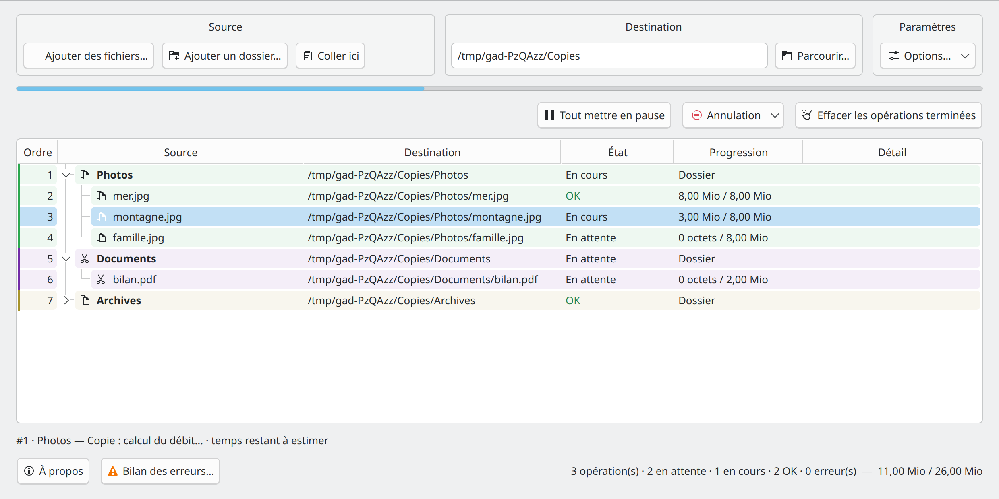

*Figure 1 — Un dossier en copie, une demande de déplacement en attente et un dossier terminé replié.*

La fenêtre se lit de haut en bas :

| Partie | Utilité |
| --- | --- |
| **Source** | Ajouter des fichiers, ajouter un dossier ou coller une sélection. |
| **Destination** | Indiquer le dossier qui recevra les éléments. |
| **Paramètres → Options…** | Vérifications, exclusions, duplication, historique, démarrage, langues, limites de débit et raccourcis. |
| **Barre de progression** | Voir l’avancement global des octets affichés dans la liste. |
| **Filtre et commandes** | Filtrer les lignes, mettre la file en pause, annuler ou nettoyer l’historique. |
| **Liste des fichiers** | Consulter source, destination, état, progression et détails. |
| **À propos** | Afficher le nom, l’acronyme, le slogan, l’icône, la version et la date de compilation. |
| **Résumé en bas à droite** | Lire les nombres d’opérations et de fichiers, ainsi que les volumes d’octets. |

### Source, destination et options

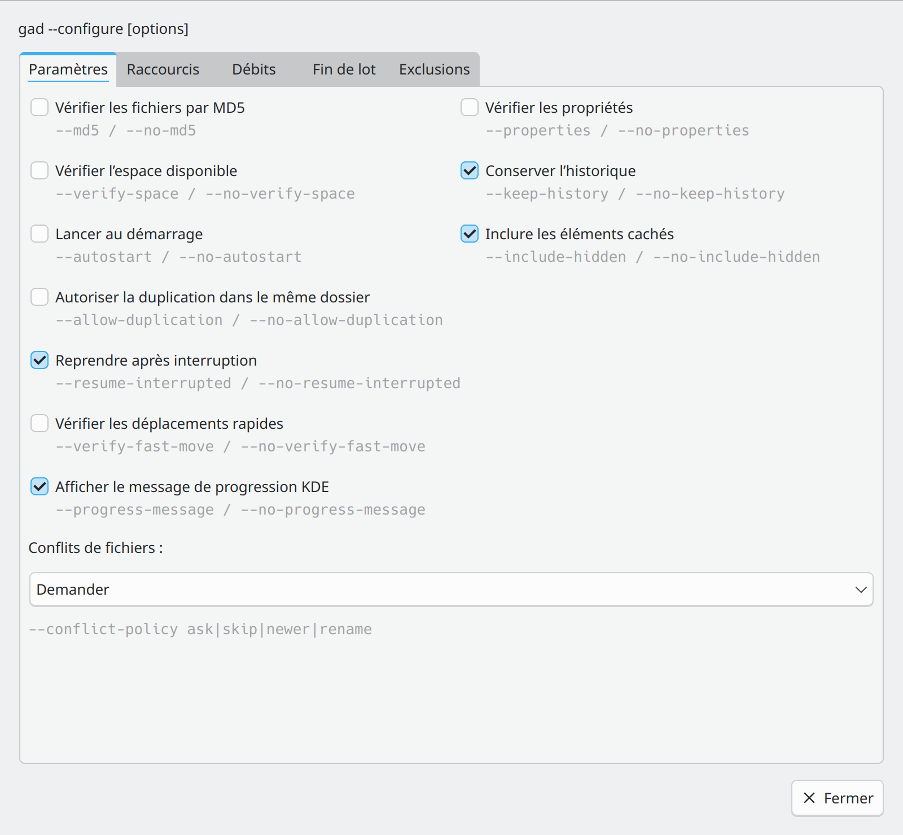

*La boîte des options, ouverte depuis le bloc Paramètres.*

Le bouton **Paramètres → Options…** ouvre une boîte de dialogue redimensionnable, avec les onglets **Paramètres** et **Raccourcis**. Les réglages s’appliquent immédiatement ; **Fermer** ou Échap ferme la boîte sans annuler les changements. Elle peut rester ouverte pendant les transferts. Les noms des paramètres de commande apparaissent en gris sous les contrôles. Sa taille minimale est **800 × 740** ; la fenêtre principale et le bilan des erreurs ont un minimum de **1100 × 600**. Le bouton **Limiter le débit de la demande…** se trouve à gauche de la barre d’actions principale, sur la même ligne que pause/reprise et annulation. Il reste grisé sans sélection et règle le débit des lots sélectionnés, indépendamment du plafond global.

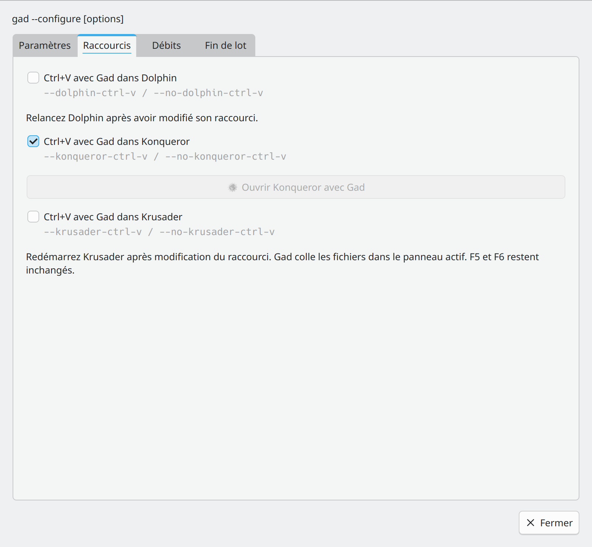

*L’onglet Raccourcis et les intégrations des gestionnaires de fichiers.*

La section **Raccourcis** permet d’activer ou désactiver Ctrl+V avec Gad dans Dolphin et Konqueror. Une modification pour Dolphin utilise le gestionnaire réversible de Gad et nécessite de relancer Dolphin ; en cas d’échec, la case est rétablie et une erreur apparaît. Le choix Konqueror est pris en compte à la prochaine frappe dans **Konqueror avec Gad**. Le bouton d’ouverture de Konqueror est disponible lorsque le navigateur et le lanceur sont installés. Le collage de texte reste natif.

- **Ajouter des fichiers…** ouvre un sélecteur de fichiers. Plusieurs fichiers peuvent être choisis.
- **Ajouter un dossier…** ajoute un dossier et son contenu.
- **Coller ici** utilise les fichiers présents dans le presse-papiers et la destination affichée.
- **Parcourir…** permet de choisir un dossier de destination existant.
- Le champ de destination accepte un chemin local, un chemin de montage ou une adresse `sftp://`, `ftp://`, `smb://` ou `kdeconnect://` vers un dossier existant.

Choisissez la destination **avant** d’ajouter ou coller les éléments. L’ajout soumet le lot immédiatement : il n’existe pas de bouton « Démarrer » à valider ensuite. Mettre toute la file en pause permet de préparer plusieurs lots sans les transférer immédiatement, sous réserve du comportement particulier du collage externe décrit plus bas.

Gad ignore automatiquement une opération déjà prévue dans une demande encore active, y compris en pause : même fichier source, même destination et même type (copie ou déplacement). Cela couvre un double collage, les ajouts simultanés et les fichiers déjà inclus dans un dossier. Les fichiers nouveaux restent dans la file ; un message temporaire indique le nombre d’éléments ignorés. Un collage entièrement composé de doublons ne lève pas la pause.

Une autre destination ou un autre type d’opération reste accepté. Deux fichiers source distincts portant le même nom restent soumis au traitement des conflits. Une copie volontaire répétée après la fin de la demande précédente reste possible. Le premier ajout conserve ses options de vérification.

Modifier la destination après l’ajout n’envoie pas les anciens lots ailleurs. Chaque lot garde la destination qu’il a reçue au moment de sa création.

## Utiliser Ctrl+V dans Dolphin

Après installation, activez l’association avec :

```bash
gad --configure --dolphin-ctrl-v
```

Fermez puis rouvrez Dolphin pour charger les nouveaux raccourcis. Dans la vue de fichiers, **Ctrl+V** lance alors **Coller avec Gad**. Le collage habituel de Dolphin reste accessible avec **Maj+Inser** (Majuscule + Insertion), un raccourci standard de KDE. Dans la barre d’adresse, la recherche et les champs de texte, Ctrl+V reste un collage de texte normal.

Lorsque cette association est activée, le raccourci **Ctrl+V vise toujours le dossier ouvert dans la fenêtre Dolphin active**, même si un autre dossier est sélectionné. Gad vérifie le chemin fourni par la fenêtre au moment du collage, sans réutiliser une ancienne sélection. Activez l’affichage du chemin complet dans la barre de titre de Dolphin pour rendre ce contrôle possible. Si la fenêtre ou son dossier change pendant la lecture, le collage est refusé sans démarrer de copie.

Au clic droit, **Coller avec Gad** conserve sa destination de contexte ; **Coller dans le dossier ouvert avec Gad** utilise le dossier de la fenêtre active.

L’association vise les listes de fichiers copiés/coupés. Pour créer un fichier à partir de texte ou d’une image du presse-papiers dans la vue de fichiers, gardez le collage KIO de secours.

Pour revenir aux raccourcis précédents :

```bash
gad --configure --no-dolphin-ctrl-v
```

Rouvrez ensuite Dolphin. Les raccourcis personnels modifiés après activation sont conservés ; Gad ne les réinitialise pas. La réinstallation conserve le mode activé et la désinstallation restaure les propriétés de raccourci encore installées par Gad. Un conflit avec une autre action personnalisée est signalé sans modifier la configuration.

Cette intégration utilise le schéma Default de **Dolphin**. Elle ne remplace pas les collages du bureau Plasma ou des autres applications KDE et n’ajoute aucun raccourci clavier global.

**Ctrl+V** est le raccourci Gad lorsque l’intégration est activée ; **Maj+Inser** permet le collage KIO. Fermez puis rouvrez Dolphin après une modification des raccourcis.

## Utiliser Gad avec un autre gestionnaire de fichiers

Gad peut recevoir des fichiers depuis un autre gestionnaire, par exemple Nautilus, Nemo ou Thunar. L’intégration du menu contextuel et des raccourcis dépend toutefois du gestionnaire utilisé : Gad n’intercepte pas automatiquement son **Ctrl+V** et ne devine pas son dossier actif.

### Copier ou couper, puis coller dans Gad

1. Dans votre gestionnaire, sélectionnez les fichiers et utilisez **Ctrl+C**, ou **Ctrl+X** pour demander un déplacement.
2. Ouvrez Gad et indiquez le dossier cible dans **Destination**.
3. Cliquez sur **Coller ici**, ou utilisez **Ctrl+V dans la fenêtre de Gad**.
4. Vérifiez dans la liste la destination et le type d’opération retenus.

Le gestionnaire doit publier une liste de fichiers dans un format de presse-papiers compris par Gad. Copier uniquement un chemin sous forme de texte ne suffit pas. Le mode déplacement nécessite un marqueur Couper reconnu ; si ce marqueur n’est pas disponible, utilisez la commande explicite `--move` ci-dessous.

### Glisser les fichiers dans Gad

Choisissez d’abord la **Destination**, puis glissez les fichiers ou dossiers depuis votre gestionnaire dans la liste de Gad. **Le glisser-déposer crée toujours une copie**, même si les fichiers ont été coupés auparavant. Pour déplacer les fichiers, passez par le collage avec un marqueur Couper reconnu ou par `--move`.

### Créer une action ou un bouton personnalisé

Si votre gestionnaire permet de lancer une commande, une action de menu ou un bouton, utilisez les commandes ci-dessous. Les chemins sont des exemples à remplacer ; la destination doit être un dossier existant.

Pour coller le presse-papiers vers une destination explicite, en arrière-plan :

```sh
gad --paste "/home/demo/Documents/Copies"
```

Pour copier des sources sans passer par le presse-papiers :

```sh
gad --copy "/home/demo/Images/photo.jpg" "/home/demo/Images/album" --to "/home/demo/Documents/Copies"
```

Pour déplacer des sources explicitement :

```sh
gad --move "/home/demo/Images/photo.jpg" --to "/home/demo/Documents/Copies"
```

Dans une action personnalisée, le gestionnaire doit transmettre **le dossier cible** à `--paste`. Pour `--copy` et `--move`, il doit transmettre **les fichiers sélectionnés** avant `--to`, puis le dossier cible. Les variables de substitution et leur échappement dépendent du gestionnaire : ne supposez pas qu’un argument de sélection représente le dossier ouvert et ne recopiez pas les marqueurs d’un autre logiciel. Si `gad` n’est pas trouvé, utilisez le chemin complet `~/.local/bin/gad`, avec le répertoire personnel développé.

Les services KIO **Coller avec Gad** peuvent être proposés par d’autres gestionnaires qui prennent en charge ces menus de services. Leur présence n’est pas garantie dans tous les gestionnaires. Les options Dolphin et Konqueror du menu **Paramètres → Options…** concernent uniquement ces deux intégrations ; `--paste-current` ne détecte pas le dossier actif des autres logiciels.

## Faire une copie ou un déplacement

### Copier depuis Dolphin

1. Sélectionnez les fichiers ou dossiers dans Dolphin.
2. Faites **Ctrl+C**.
3. Placez-vous dans le dossier de destination, ou faites un clic droit sur le dossier cible.
4. Choisissez **Coller avec Gad**, ou utilisez **Ctrl+V** (si associé à Gad) dans Dolphin.
5. Le lot est préparé puis transféré par Gad.

Cette action ne force pas l’ouverture de la fenêtre de Gad. Si elle est masquée, le suivi apparaît dans les transferts de Plasma. Un nouveau collage externe valide lève la pause globale existante pour lancer la copie ; une pause que vous demandez **après** la soumission, pendant l’analyse, reste prioritaire.

### Déplacer depuis Dolphin

Utilisez **Ctrl+X**, puis **Coller avec Gad** ou **Ctrl+V** (si associé à Gad) dans le dossier cible. Le lot est identifié comme **Déplacement**.

Gad utilise un renommage local lorsque les conditions ci-dessous le permettent ; sinon il copie chaque fichier, valide son résultat, puis retire sa source. Un déplacement interrompu peut donc laisser certains fichiers déjà déplacés et d’autres encore à la source. Utilisez la remise en état si vous voulez revenir à la situation initiale.

Un fichier ignoré lors d’un conflit reste à sa source, même en mode déplacement.

### Déplacement rapide sur le même système de fichiers

Avec **Vérifier les fichiers par MD5 décoché**, Gad peut déplacer des fichiers et liens sans recopier leur contenu. Le détail affiche **Déplacement rapide · renommage local** pour le lot et **Déplacement rapide · sans recopie** pour les fichiers terminés.

Ce déplacement peut passer pendant une copie utilisant le même disque, si les éléments source et destination des deux opérations ne se recouvrent pas. Deux fichiers différents peuvent donc être copiés et déplacés en parallèle vers le même dossier. Les alias de montage sont reconnus : un fichier utilisé par une copie à travers un autre chemin reste protégé. La limite reste de deux opérations simultanées. Lorsque le dossier complet est intact, libre de conflit et sans fichier mis en pause ou exclu, Gad peut renommer tout l’arbre d’un seul coup. Le détail affiche alors **dossier renommé en bloc** ; le dossier et ses descendants gardent leurs inodes. Si ces conditions ne sont pas remplies, les entrées restent traitées séparément.

Cette optimisation concerne les montages locaux reconnus, avec source et destination sur un même montage ou dans deux bind mounts de la même partition ayant une vue commune accessible, des destinations libres et sans fichiers partageant un inode avec d’autres liens physiques. Une fusion, un fichier déjà présent, MD5 activé ou une source réseau/FUSE conserve le traitement classique. Un renommage refusé entre volumes remet le lot dans la file avant de commencer une copie.

Par exemple, si `/home/demo/Musiques` et `/home/demo/Autres` exposent respectivement `/media/Disque/Musiques` et `/media/Disque/Autres`, Gad peut effectuer le renommage à travers `/media/Disque`. Il vérifie que les fichiers et les dossiers parents correspondent réellement. Les chemins visibles dans la liste restent ceux que vous avez choisis. Sans vue commune accessible, le traitement classique reste utilisé.

La remise en état du déplacement rapide ramène les fichiers par renommage. Pour un dossier resté intact, une remise en état complète utilise également un seul renommage. Une restauration partielle agit seulement sur les fichiers sélectionnés. Un fichier extérieur ajouté dans le dossier empêche le retour en bloc : Gad le garde à destination et restaure les éléments qu’il connaît, en signalant si un dossier ne peut pas être nettoyé. Elle refuse un résultat modifié, notamment lorsque la taille et la date affichée ont été rétablies après modification. Pour un fichier renommé séparément, après un arrêt au moment exact du renommage, une validation de journal incomplète peut imposer un retour manuel ; Gad garde alors le résultat au lieu de le supprimer.

### Choix de destination avec le menu « Coller avec Gad »

| Contexte dans Dolphin | Destination retenue |
| --- | --- |
| Aucun élément sélectionné | Le dossier ouvert. |
| Un seul dossier sélectionné | Ce dossier. |
| Un ou plusieurs fichiers sélectionnés | Leur dossier parent commun. |
| Plusieurs éléments ayant le même dossier parent | Ce dossier parent. |
| Éléments provenant de dossiers parents différents | La demande est refusée. |

### Copier depuis la fenêtre Gad

Indiquez une destination puis utilisez les boutons d’ajout, **Coller ici**, **Ctrl+V**, ou déposez les éléments dans la fenêtre.

Le presse-papiers conserve l’intention Copier/Couper : **Ctrl+V** dans Gad peut donc créer un déplacement si les fichiers ont été coupés dans Dolphin. Le **glisser-déposer dans Gad crée toujours une copie**.

Si le champ Destination a le focus, un collage de fichiers rejoint la file. Un collage de texte ordinaire reste une édition normale de ce champ.

### Ajouter plusieurs demandes

Refaites une sélection et un collage : le nouveau lot rejoint la file. Vous pouvez mélanger copies et déplacements, ainsi que des destinations différentes.

Une analyse peut prendre du temps, notamment sur un téléphone ou un partage réseau. Gad conserve l’ordre des demandes pendant cette préparation. Il ne commence pas une partie d’un lot dont toutes les sources n’ont pas été validées.

## Exclure des éléments du transfert

Le bouton **Exclusions…** permet de saisir un motif par ligne, séparément pour les dossiers et pour les fichiers ou liens symboliques. La case **Inclure les éléments cachés** est également accessible dans **Paramètres → Options…**. Elle est cochée par défaut ; aucun motif n’est activé initialement.

| Type | Exemple | Effet |
| --- | --- | --- |
| Dossiers | `__*` | Ignore tous les dossiers dont le nom commence par deux tirets bas, dont `__pycache__`. |
| Fichiers | `*.tmp` | Ignore les fichiers portant cette extension. |
| Fichiers | `*.swp` ou `*~` | Ignore certains fichiers temporaires et de sauvegarde des éditeurs. Saisir chaque motif sur une ligne distincte. |

`*` représente zéro ou plusieurs caractères et `?` un caractère. Les motifs sont sensibles à la casse et portent sur le nom seul, à toutes les profondeurs, y compris les éléments directement sélectionnés. Un dossier exclu n’est pas parcouru. Les liens symboliques utilisent les motifs de fichiers et ne sont pas suivis. Décocher la case des éléments cachés ignore les noms commençant par un point, fichiers comme dossiers.

Les lignes vides sont ignorées ; les espaces font partie des motifs. Les chemins complets, les expressions régulières et les classes entre crochets ne sont pas interprétés. Limites : 128 motifs par type et 256 octets UTF-8 par motif, sans barre oblique ni saut de ligne.

Les réglages sont mémorisés et capturés pour chaque nouvelle demande, avant la préparation des accès distants. Les lots déjà présents, leurs reprises et leurs réessais conservent leurs règles initiales. Lors d’un déplacement, les éléments exclus restent à la source ; le dossier source peut donc rester présent. Le renommage rapide d’un dossier entier est désactivé lorsqu’un filtrage est actif, mais les fichiers admissibles peuvent toujours être déplacés rapidement.

## Lire la liste et la progression

La liste affiche directement les fichiers et dossiers : il n’y a plus d’en-tête de lot à déplier. Chaque dossier contient ses fichiers et ses sous-dossiers. Les éléments d’une même demande gardent une teinte commune, adaptée au thème clair ou sombre, et un repère coloré sur leur gauche.

La colonne **Ordre**, tout à gauche, ajuste automatiquement sa largeur au minimum nécessaire pour son titre, sa flèche et ses numéros. Elle suit l’ordre des lignes fourni par le moteur, dossiers et demandes en préparation compris. Les lignes conservées dans l’historique gardent leur place dans cette numérotation. Un filtre masque des lignes sans renuméroter celles qui restent : des écarts entre numéros sont donc normaux. Une modification de priorité réactualise les positions. Le survol d’un numéro indique **Lot #…**. Deux transferts compatibles peuvent avancer simultanément : le numéro n’annonce pas leur ordre de fin.

L’icône **Copier** devant le nom indique une copie ; l’icône **Couper** indique un déplacement, y compris pour les dossiers et les demandes en préparation. Les dossiers restent en gras et conservent leur arborescence. Le survol de Source donne le chemin complet et les éventuelles options MD5 ou de débit, sans répéter le mode ni le lot ; le numéro de lot reste dans l’infobulle **Ordre**. Les aides longues sont présentées avec un saut de ligne entre les phrases. Le menu **Sélectionner toute la demande** retrouve tous les éléments de cette demande, même si vous avez changé leur ordre ou si plusieurs demandes ont des couleurs proches. Une ligne d’analyse ou d’erreur reste visible lorsqu’aucun fichier n’a encore été énuméré.

| Colonne | Contenu |
| --- | --- |
| **Ordre** | Position dans la file du moteur, indépendante du tri d’affichage ; le survol donne le numéro de lot. |
| **Source** | Le nom du fichier ou du dossier ; l’icône indique Copier/Couper et le survol donne le chemin complet. |
| **Destination** | Le chemin cible, avec le nouveau nom si « Garder les deux » a été choisi. |
| **État** | En attente, En cours, OK, Annulé, etc. |
| **Progression** | Octets copiés / taille ; une indication MD5 apparaît pendant la vérification. |
| **Détail** | Une erreur, une information de remise en état, un déplacement rapide ou une empreinte MD5 validée. |

La sélection d’un dossier concerne aussi ses descendants. Sélectionner à la fois un dossier et un de ses fichiers ne duplique pas l’action. Le survol affiche aussi le texte complet des cellules. Les lignes sont conservées entre deux mises à jour pour garder la sélection et les infobulles.

### Les états utiles

| Affichage | Signification |
| --- | --- |
| **Analyse…** | Gad vérifie les sources et prépare la liste. Aucun transfert de ce lot ne commence avant la fin de l’analyse. |
| **En attente** | Le lot ou le fichier attend son tour, un disque disponible ou une reprise. |
| **En attente du périphérique** | Le montage manque ; le temporaire est conservé et sera vérifié avant reprise. |
| **En cours** | Un transfert avance. |
| **À décider** | Un fichier existe déjà dans la destination : un choix est nécessaire. |
| **Vérification MD5…** | Gad relit les contenus pour les comparer. |
| **En pause** | La pause globale ou une pause ciblée s’applique à cette ligne. |
| **OK** en vert | Le transfert de la ligne est terminé. |
| **Ignoré** | Le fichier existant a été conservé ; la source n’a pas été transférée à sa place. |
| **Annulé** | L’opération a été arrêtée ; les fichiers déjà terminés peuvent être encore présents. |
| **Erreur** | Une étape a échoué. Lire Détail avant de décider de la suite. |
| **Remise en état en attente / Remise en état…** | Gad prépare ou exécute le retour à la situation antérieure. |
| **Remis en état** | Les effets journalisés de la sélection ont été défaits. |
| **Restauration incomplète** | Le retour a été interrompu ou protégé contre une modification externe. |

Un dossier ne devient OK qu’après ses descendants, passe en vert et se replie une fois terminé. Si vous rouvrez un dossier terminé, les mises à jour ne le referment pas sans nouveau changement d’état.

### Filtrer sans modifier les transferts

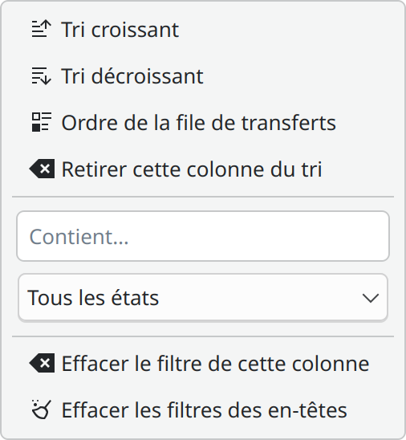

*Figure 3 — Le filtre change seulement les lignes visibles.*

Les dossiers parents restent visibles lorsqu’un de leurs fichiers correspond au filtre, afin de conserver son emplacement dans l’arborescence. Le changement de filtre ouvre les branches concernées. Un simple rafraîchissement de progression ne rouvre pas un dossier que vous avez replié.

Les filtres sont accessibles au clic droit sur les en-têtes. L’ancienne combobox au-dessus de la table a été supprimée. Filtrer n’arrête pas une copie et ne supprime aucune ligne de l’historique.

### Trier et filtrer depuis les en-têtes

Cliquez sur un titre de colonne pour alterner le tri croissant et décroissant. **Ctrl+clic** ajoute une colonne au tri existant ; répétez Ctrl+clic sur une colonne déjà présente pour inverser son sens sans changer sa priorité. Les en-têtes indiquent les priorités avec **(1)**, **(2)**, etc., et chaque colonne triée affiche sa flèche habituelle à droite. Un clic sans Ctrl rétablit un tri sur une seule colonne. Le tri des noms est naturel : `fichier2` précède `fichier10`. La progression se trie par pourcentage numérique, indépendamment de la taille des fichiers et des unités affichées. Les lignes sont triées parmi leurs frères : un dossier garde toujours ses descendants.

Un **clic droit sur un en-tête** ouvre son menu :

- **Tri croissant** et **Tri décroissant** règlent le tri d’affichage.
- **Ordre de la file de transferts** rétablit l’ordre réel des opérations.
- **Retirer cette colonne du tri** enlève un critère sans effacer les autres.
- **Contient…** filtre la colonne sans tenir compte des majuscules. Dans Source, le chemin complet est aussi recherché.
- Dans **État**, le sélecteur permet de choisir un état précis.
- Dans **Progression**, les deux pourcentages bornent la plage à afficher.
- Les actions d’effacement retirent le filtre de la colonne ou tous les filtres d’en-tête.

Les filtres de colonnes se combinent entre eux. Un dossier reste visible pour situer un enfant correspondant. Les filtres actifs restent consultables dans les menus des colonnes. Les compteurs globaux restent ceux de l’ensemble des transferts, pas seulement des lignes affichées. La recherche d’un fichier depuis un conflit ou le bilan des erreurs retire les filtres qui le masqueraient.

Le tri ne change **ni la priorité ni l’ordre d’exécution**. Pour déplacer les lignes par glisser-déposer, rétablissez d’abord **Ordre de la file de transferts**. Les valeurs, tris et filtres restent en place lors d’une actualisation ou d’un changement de langue.

### Comprendre les compteurs

La barre globale et le résumé de la fenêtre portent sur les octets traités ; pour un renommage rapide, il s’agit de la taille logique déplacée, sans recopie physique. Un fichier entièrement écrit peut encore être en vérification MD5. Les fichiers masqués par un retrait de ligne ne sont plus comptés dans le résumé visible.

Les dossiers ne consomment pas un nombre d’octets de fichier dans ces compteurs. Le débit global reste disponible dans les détails du suivi natif de Plasma.

Sous la liste des fichiers, un récapitulatif affiche une ligne par demande active : son numéro, ses sources, son **débit** et son **temps restant estimé**. Vous pouvez ainsi distinguer deux transferts simultanés sans ajouter d’en-têtes à la liste. Les mesures utilisent les cinq dernières secondes d’activité ; au démarrage ou après une reprise, **calcul du débit…** apparaît tant que la mesure est insuffisante.

Le temps concerne les fichiers restant à traiter dans cette demande. La copie et les deux relectures MD5 sont mesurées séparément. Si le débit MD5 n’a pas encore été mesuré, Gad indique seulement **copie restante ≈ … · MD5 à estimer**, puis propose un temps total lorsque les mesures nécessaires sont disponibles. Ce temps dépend des disques, du réseau, des tailles de fichiers et des plafonds choisis ; il reste approximatif et ne prédit pas la durée d’attente des demandes en file.

Une pause suspend l’estimation ; un conflit indique **À décider**. Si certains fichiers de la demande sont en pause pendant que les autres avancent, le débit reste affiché mais le temps total est indéterminé. Les renommages rapides n’affichent pas de faux débit disque. Les octets déjà reconnus à la reprise ne sont pas comptés comme nouvellement transférés. En l’absence de progression, un ancien débit décroît puis laisse place à une estimation indisponible.

## Organiser les fichiers dans la file

Faites glisser une ou plusieurs lignes **en attente** avant ou après une autre ligne. Le trait de dépôt indique la nouvelle position et la liste défile quand vous restez près de son bord. Les fichiers placés directement à la racine peuvent s’intercaler entre ceux de demandes différentes.

Un dossier se déplace avec toute sa branche. Les fichiers à l’intérieur d’un dossier se réordonnent entre frères : ils restent rattachés à leur dossier réel. Pour changer la place d’une branche parmi les autres dossiers, déplacez le dossier lui-même. Un dépôt ne change jamais la destination de copie.

Le clic droit propose aussi :

| Action | Effet |
| --- | --- |
| **Traiter ensuite** | Avance les lignes choisies et leurs ancêtres encore en attente. |
| **Déplacer dans la file → Monter d’un rang** | Avance la sélection parmi les lignes de même parent. |
| **Déplacer dans la file → Descendre d’un rang** | Recule la sélection parmi ses frères. |
| **Déplacer dans la file → Placer en fin de file** | Place la sélection après les autres lignes de même parent. |
| **Sélectionner toute la demande** | Sélectionne les fichiers et dossiers associés au même collage ou ajout. |

La sélection multiple conserve son ordre relatif. Une branche contenant un transfert actif ne se déplace pas ; ses fichiers encore en attente peuvent être réordonnés séparément. Les lignes terminées ne se déplacent pas.

L’ordre est enregistré. **Traiter ensuite n’interrompt pas un fichier en cours et ne lève pas une pause.** Les contraintes de disques et la limite de parallélisme restent applicables. Deux branches indépendantes peuvent avancer en même temps. Les demandes qui remplacent les mêmes destinations restent regroupées entre elles pour garantir leur remise en état : un entrelacement dangereux est refusé avec une explication. Une demande partiellement publiée peut donc retenir une demande dépendante pendant une pause.

## Mettre en pause et reprendre

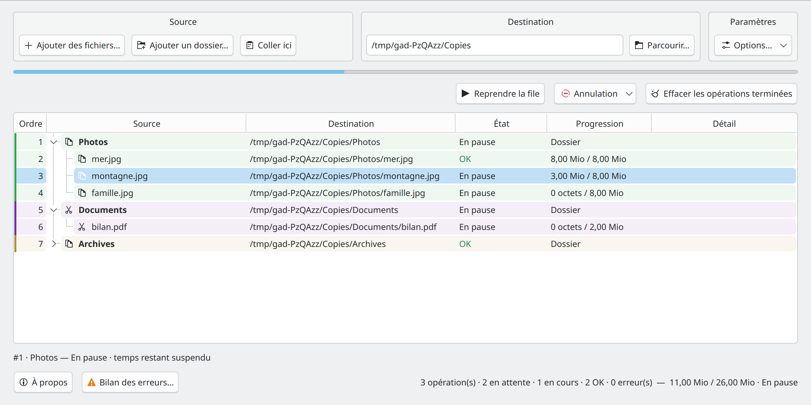

*Figure 4 — Les lignes non terminées indiquent la pause ; les lignes OK gardent leur résultat.*

**Tout mettre en pause** suspend la file et les transferts. Le bouton devient **Reprendre la file**. Les fichiers déjà terminés restent OK.

Pour agir sur une partie seulement, sélectionnez les lignes et utilisez **Mettre en pause** ou **Reprendre** au clic droit. Mettre un lot en pause permet aux autres lots de continuer lorsqu’ils sont admissibles.

La pause prend effet à un point de contrôle : elle ne coupe pas brutalement une lecture ou une écriture déjà engagée. La reprise ciblée retire aussi la pause globale pour permettre à la sélection d’avancer. Une pause propre à un autre lot reste applicable.

Une annulation peut être demandée même pendant une pause. La remise en état peut aussi se dérouler lorsque la file est globalement en pause.

### Pause depuis le message de progression

Le bouton de pause du message KDE agit sur toute la file, comme le bouton de la fenêtre et le menu de l’icône. La fenêtre affiche alors **Reprendre la file**. Vous pouvez reprendre depuis chacun de ces trois accès ; leurs états se synchronisent. Les pauses individuelles demandées dans le menu d’une ligne restent indépendantes.

## Limiter le débit

Le champ **Débit global** dans **Paramètres → Options…** limite la somme des copies simultanées, en **Mio/s** (1 Mio = 1 048 576 octets). **Illimité**, soit la valeur zéro, désactive ce plafond. Le réglage est mémorisé et agit immédiatement sur les transferts en cours ainsi que sur les suivants.

Le **Débit global** dans **Paramètres → Options…** limite la somme des transferts qui copient des données. Le changement s’applique immédiatement. 0 signifie illimité ; les déplacements rapides par renommage ne sont pas ralentis.

Les deux plafonds se cumulent comme contraintes : une demande à 10 Mio/s reste limitée à 10 Mio/s même si le plafond global vaut 50 Mio/s. Deux demandes sans plafond individuel se partagent au total les 50 Mio/s disponibles. Gad ne garantit pas un partage égal entre elles.

La limitation porte sur les octets copiés, y compris vers ou depuis un montage distant. Les tampons du système et du réseau peuvent produire de courtes variations. Elle ne plafonne pas les relectures MD5, les vérifications de propriétés ni les remises en état. Un déplacement rapide par renommage reste immédiat. La pause, la reprise et l’annulation restent utilisables à faible débit.

## Résoudre les conflits

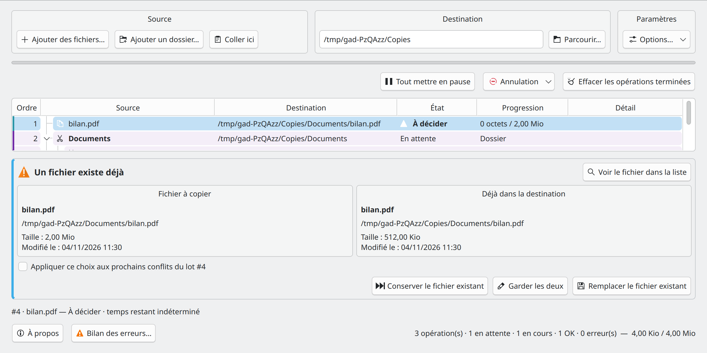

*Figure 5 — La source et le fichier déjà présent sont comparés sous la liste.*

Lorsqu’un fichier porte déjà le même nom dans la destination, Gad affiche un panneau comprenant :

- Le numéro de lot et le fichier concerné.
- Le nom et le chemin de la source.
- Le nom et le chemin du fichier déjà présent.
- Leur taille et leur date de modification lorsque ces informations sont accessibles.
- Les trois choix ci-dessous.

| Choix | Résultat |
| --- | --- |
| **Conserver le fichier existant** | Ignore la copie de ce fichier. Le fichier destination reste inchangé et la source est conservée. |
| **Garder les deux** | Copie sous un nom libre, par exemple `photo (copie 1).jpg`. |
| **Remplacer le fichier existant** | La source devient le nouveau fichier cible ; l’ancienne destination est gardée dans une sauvegarde de remise en état. |

La case **Appliquer ce choix aux prochains conflits du lot #…** concerne ce lot seulement. Elle se décoche lorsque vous passez à un autre conflit affiché.

Si plusieurs conflits attendent, le sélecteur permet de choisir celui à examiner. **Voir le fichier dans la liste** retrouve sa ligne, même si le filtre la masquait. L’arrivée d’un autre conflit ne change pas automatiquement le fichier sur lequel vous êtes en train de décider.

Un fichier qui occupe la place d’un dossier, ou un lien symbolique dans un chemin cible de dossier, peut provoquer une erreur explicite plutôt qu’un remplacement automatique de dossier.

## Annuler ou remettre comme avant

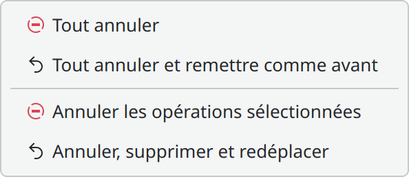

*Figure 6 — Les actions globales restent disponibles sans sélection.*

### Annuler simplement

**Tout annuler** arrête les opérations actives et en attente, y compris les demandes encore en préparation. Cela ne supprime pas les fichiers déjà transférés.

**Annuler les opérations sélectionnées** limite cet arrêt à la sélection. Les commandes sur un dossier concernent aussi ses descendants ; **Sélectionner toute la demande** permet d’agir sur ses différentes racines.

### Remettre comme avant

**Tout annuler et remettre comme avant** arrête les opérations et défait les effets restaurables encore présents dans l’historique, des plus récents aux plus anciens.

**Annuler, supprimer et redéplacer** applique cette remise en état à la sélection :

| Transfert initial | Remise en état |
| --- | --- |
| Copie vers un nouveau fichier | Retire la copie créée. |
| Remplacement d’un fichier existant | Retire le résultat et restaure l’ancienne destination sauvegardée. |
| Déplacement | Remet le fichier à sa source, puis retire son résultat destination. |
| Dossier créé par Gad | Le retire seulement s’il peut être supprimé sans perdre d’autres fichiers. |

La remise en état attend que les travailleurs actifs libèrent leurs transferts. Elle peut prendre du temps, notamment lorsqu’elle doit recopier un fichier déplacé vers son disque d’origine.

### Quand le retour peut être refusé

Gad vérifie les résultats et sauvegardes avant de les modifier. Si un fichier a été modifié, remplacé, recréé à la source ou si son volume est absent, le retour peut être refusé ou rester incomplet. Le détail indique alors ce qui a été conservé.

Les opérations importées d’une ancienne version sans journal sont consultables mais ne peuvent pas être remises automatiquement en état.

**Effacer l’historique supprime la possibilité de remettre ses opérations en état.** La remise en état n’est pas une sauvegarde indépendante des données et des disques utilisés.

### Retirer une ligne ou utiliser le clavier

| Ligne sélectionnée | **Suppr** | **Retour arrière** |
| --- | --- | --- |
| Terminée | Retire la ligne de l’historique, sans supprimer son résultat. | Demande la remise en état du fichier ou de la branche. |
| En cours | Demande l’arrêt. | Demande l’arrêt. |
| À venir | Retire la ligne de la file. | Retire la ligne de la file. |

La sélection d’un dossier étend l’action à son contenu. Une sélection de fichiers permet d’agir sur eux sans restaurer automatiquement leurs voisins.

## Utiliser le clic droit

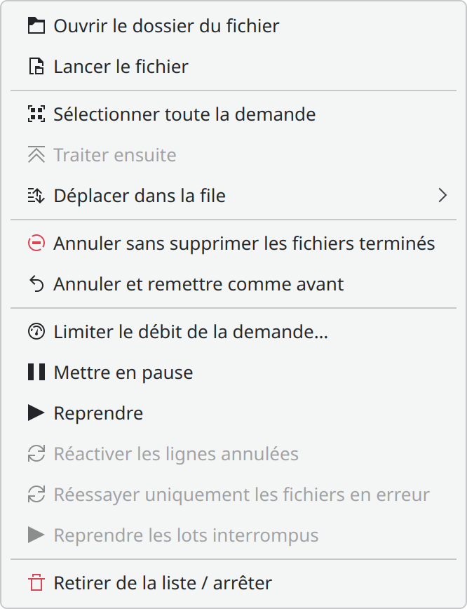

*Figure 7 — Le menu s’adapte aux états de la sélection.*

| Action | Utilisation |
| --- | --- |
| **Ouvrir le dossier du fichier** | Ouvre le dossier contenant un fichier. Pour une ligne de dossier, ouvre ce dossier ; les fichiers ne sont plus surmontés d’une ligne de groupe. |
| **Lancer le fichier** | Ouvre un seul fichier avec l’application associée par le bureau. |
| **Annuler sans supprimer les fichiers terminés** | Arrête la sélection et conserve ses résultats déjà terminés. |
| **Annuler et remettre comme avant** | Arrête et restaure la sélection lorsque son journal le permet. |
| **Traiter ensuite / Déplacer dans la file** | Modifie la priorité des fichiers ou branches en attente sélectionnés. |
| **Sélectionner toute la demande** | Sélectionne les éléments d’un même ajout ou collage. |
| **Mettre en pause / Reprendre** | Contrôle les lignes ou lots sélectionnés. |
| **Reprendre les lots interrompus** | Retente la reprise du lot après un arrêt brutal, par exemple après reconnexion d’un disque. |
| **Réessayer uniquement les fichiers en erreur** | Remet en file les échecs éligibles, sans recopier les fichiers OK. |
| **Limiter le débit de la demande…** | Applique un plafond à la demande propriétaire des lignes. |
| **Réactiver les lignes annulées** | Prépare leur reprise après nettoyage ou restauration des éventuels restes. |
| **Retirer de la liste / arrêter** | Applique la logique de la touche Suppr. |

Pour une ligne **OK**, l’ouverture vise la destination. Pour une ligne en attente, en cours, ignorée, annulée ou remise en état, elle vise la source. Gad actualise l’état au moment du clic pour tenir compte d’une restauration récente.

Avec plusieurs fichiers sélectionnés, les dossiers identiques ne sont ouverts qu’une fois. **Lancer le fichier** reste réservé à une seule ligne de fichier ; il n’est pas proposé comme lancement global d’un lot ou d’un dossier.

Une réactivation attend l’arrêt du lot. Les fichiers voisins déjà terminés restent conservés. Si le type de la source a changé depuis l’analyse, réajoutez-la comme nouvelle opération au lieu de réutiliser une ancienne ligne.

## Consulter et réessayer les erreurs

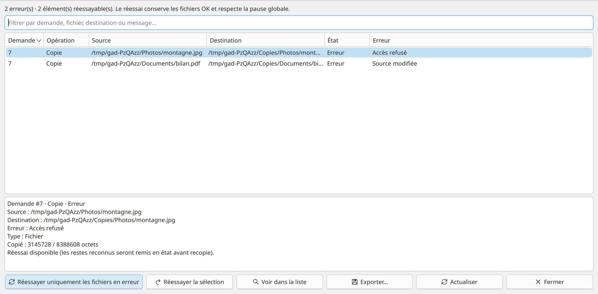

Les six boutons du bilan disposent d’icônes, avec un repli standard si le thème ne les fournit pas.

Le bouton **Bilan des erreurs…**, à côté d’**À propos**, regroupe les échecs conservés dans l’historique. Il indique la demande, le type d’opération, les chemins source et destination, l’état et le message complet. Les erreurs propres à un dossier sont présentes ; un dossier qui reflète seulement l’échec d’un enfant n’ajoute pas un doublon.

Le champ de recherche filtre les lignes par demande, fichier, destination ou message. Sélectionnez une ligne pour lire son détail complet dans le volet inférieur : progression, fichier partiel, données reprenables et résultats MD5 ou de propriétés lorsqu’ils sont disponibles. **Voir dans la liste** retrouve le fichier dans la fenêtre principale. **Actualiser** recharge l’état courant ; le bilan reste un instantané pendant les transferts.

**Réessayer uniquement les fichiers en erreur** traite les erreurs réessayables actuellement affichées. **Réessayer la sélection** limite l’action aux lignes choisies. Dans ce bilan, choisir une erreur de dossier n’ajoute pas implicitement ses enfants masqués par le filtre. Le menu clic droit de la liste principale propose aussi le réessai ; comme les autres commandes de cette liste, un dossier sélectionné y couvre ses descendants en erreur.

Gad attend que la demande soit arrêtée, contrôle ses éventuels résultats ou fichiers partiels, remet en état les seuls restes reconnus, puis replace les éléments en erreur dans la file. Le fichier en erreur est recopié depuis le début après ce nettoyage contrôlé. Les fichiers OK ne sont pas recopiés ; les lignes annulées, ignorées ou retirées ne sont pas réactivées. Les lignes qui étaient simplement en attente dans une demande arrêtée restent en pause si elles ne font pas partie du réessai. La pause globale reste applicable : si elle est active, utilisez ensuite **Reprendre la file**.

Une analyse ayant échoué avant l’apparition de fichiers peut être relancée : les racines sont alors entièrement revalidées et analysées. Si la préparation d’un réessai échoue, corrigez sa cause puis actualisez le bilan pour le retenter. Une restauration incomplète demandée séparément reste à traiter avec **Annuler et remettre comme avant**. Un résultat modifié par un autre programme est conservé et peut faire refuser le réessai.

**Exporter…** est désactivé si le bilan chargé ne contient aucune erreur. Masquer toutes les lignes par le filtre ne désactive pas l’export, qui porte toujours sur l’instantané complet. Il enregistre le bilan complet chargé, y compris les lignes masquées par son filtre, au format **texte UTF-8** ou **JSON**. Le texte est destiné à la lecture et au partage ; le JSON conserve les références de demandes et de fichiers, les chemins, messages et métadonnées utiles au diagnostic. L’export n’effectue aucun transfert. Les erreurs volontairement retirées de la liste ne sont pas réintroduites dans le bilan.

## Vérifier les fichiers avec MD5

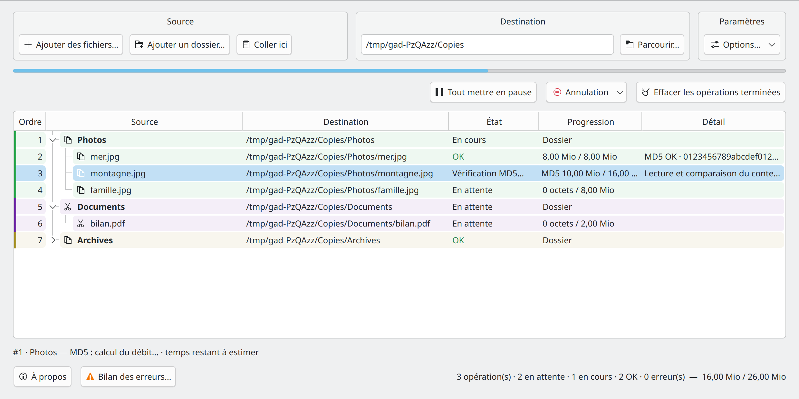

*Figure 8 — La copie écrite est relue avant d’être validée.*

Cochez **Vérifier les fichiers par MD5** avant d’ajouter de nouveaux lots. Gad relit la source et la copie temporaire, compare leurs empreintes, puis publie le fichier validé.

Pendant cette étape, l’état devient **Vérification MD5…** et la progression de relecture est indiquée dans la ligne. Après validation, Détail peut afficher **MD5 OK** avec l’empreinte.

L’option concerne les fichiers ordinaires. Les dossiers et liens symboliques ne sont pas comparés comme des contenus de fichiers. Cette vérification ajoute des lectures disque et du temps de calcul.

Le réglage est mémorisé pour les prochains lots, y compris ceux envoyés depuis Dolphin. Un lot déjà ajouté conserve son choix initial. Une modification de source pendant la copie ou la vérification peut provoquer une erreur plutôt qu’une validation d’un contenu instable.

## Vérifier les propriétés

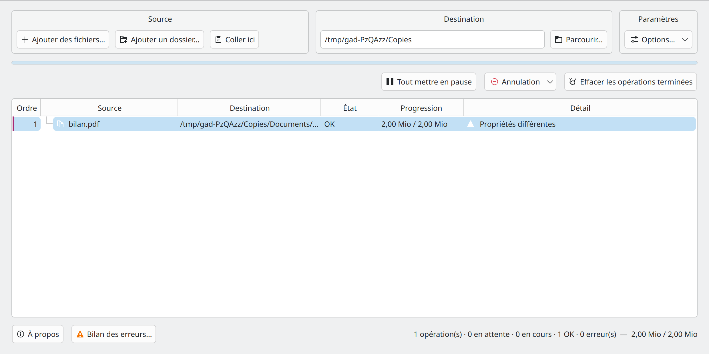

*Le contrôle signale les différences sans confondre un contenu copié avec des propriétés reproduites.*

Cochez **Vérifier les propriétés** avant d’ajouter les lots à contrôler. La case est désactivée par défaut et son choix est mémorisé. Chaque lot conserve le réglage reçu à sa création, même après une interruption. En ligne de commande, ajoutez `--properties` à `--copy` ou `--move`.

Gad compare le propriétaire (UID), le groupe (GID), les permissions, les ACL POSIX d’accès et par défaut, ainsi que les noms et valeurs des attributs étendus accessibles. Le contrôle concerne aussi les dossiers et les liens symboliques ; pour un lien, il examine le lien lui-même.

| Résultat dans Détail | Signification |
| --- | --- |
| **Propriétés visibles identiques** | Les propriétés accessibles et contrôlées concordent. |
| **Propriétés différentes** | Un propriétaire, groupe, mode, ACL ou attribut est différent, manquant ou supplémentaire. |
| **Contrôle des propriétés incomplet** | Le système de fichiers refuse ou ne permet pas une partie du contrôle. |

Survolez le détail pour lire les écarts précis. Une icône d’avertissement reste visible sur le fichier et un compteur apparaît sur ses dossiers parents, même repliés. Le rapport est conservé dans l’historique ; les valeurs des attributs n’y sont pas enregistrées.

En copie, le résultat reste **OK** avec avertissement si son contenu a été copié mais ses propriétés diffèrent. En déplacement classique, une différence ou un contrôle incomplet arrête l’opération avant publication : l’original et une éventuelle ancienne destination restent conservés. Si l’anomalie apparaît au contrôle après publication, la copie créée reste visible et l’original n’est pas supprimé. Les déplacements rapides continuent à renommer les fichiers ou dossiers, avec un contrôle de leurs propriétés après le renommage.

Cette option **contrôle sans reproduire les propriétés manquantes**. Elle n’examine pas les dates et ne surveille pas les fichiers après le transfert. Certains attributs peuvent être masqués au compte courant ; les identités exposées par un montage réseau peuvent aussi être adaptées par le montage. Il ne s’agit donc pas d’une certification de toutes les métadonnées du serveur distant. Si KIO Fuse ne fournit pas les ACL/attributs, le contrôle est annoncé incomplet. Désactivez la case pour effectuer un déplacement sans cette exigence.

## Vérifier l’espace disponible

Cochez **Vérifier l’espace disponible** avant d’ajouter les transferts à contrôler. L’option est désactivée par défaut et son choix est mémorisé. Chaque lot conserve son réglage de création.

Avant de démarrer un lot, Gad additionne les fichiers restant à écrire dans les lots déjà analysés, y compris ceux en attente ou en pause sur le même volume. Les volumes distincts sont calculés séparément. Les sauvegardes et anciennes destinations occupent déjà le disque : leur place n’est jamais considérée comme libérée pendant un remplacement. Les blocs des temporaires de reprise reconnus ne sont pas comptés une seconde fois. Un déplacement rapide par renommage ne nécessite pas une seconde copie de son contenu.

Si la place est **confirmée insuffisante**, le lot passe en erreur avant de commencer. Le détail indique les octets nécessaires et disponibles. Libérez de la place ou réduisez la file, puis utilisez **Réactiver l’opération** dans le menu de la ligne.

Si la capacité est **inconnue**, notamment pour une destination distante KIO Fuse, le transfert continue. Gad affiche **Espace non vérifiable** dans le détail des lignes de la demande, avec une icône d’avertissement. Ce message reste consultable après la fin.

Un second contrôle précède l’écriture de chaque fichier. L’estimation ne réserve pas réellement le disque : d’autres applications, les quotas, la compression et les métadonnées peuvent modifier la place disponible. Les lots encore en analyse ne peuvent pas être intégralement estimés.

## Attendre la reconnexion d’un périphérique

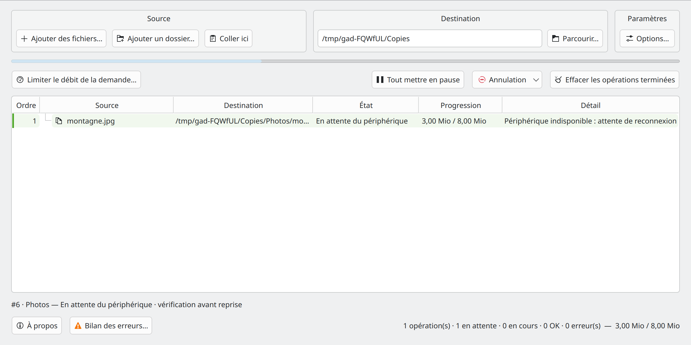

Lorsqu’un disque ou un montage connu disparaît pendant un transfert, Gad affiche **En attente du périphérique**. La demande reste présente et son temporaire est conservé. Le travailleur est libéré pour permettre aux demandes indépendantes d’avancer. Le suivi Plasma indique l’attente de reconnexion.

Reconnectez le périphérique et remontez-le **au même emplacement**. Gad vérifie le montage attendu, l’identité et la version de la source, puis relit le préfixe source/temporaire avant de reprendre au dernier point durable. Les octets écrits après ce point peuvent être recopiés. Un dossier vide au point de montage ou un autre volume ne suffit pas. Lorsqu’un UUID de système de fichiers est disponible, le même disque peut être reconnu malgré un nouveau numéro de périphérique Linux.

Les pauses globales ou ciblées restent applicables : reconnecter le disque ne lance pas une demande que vous avez mise en pause. Une demande annulée ne repart pas. Si une source, une destination ou le temporaire a été remplacé ou modifié, la reprise est refusée et les données sont conservées. Une interruption pendant la publication impose une récupération plutôt qu’une seconde copie automatique.

Pour KDE Connect, FTP, SFTP et SMB, Gad relance la résolution KIO en arrière-plan, sans ouvrir sa fenêtre ni ajouter une nouvelle demande. L’authentification reste gérée par KDE. Le montage doit retrouver son chemin et ses identités ; si KIO Fuse fournit un nouveau chemin après son redémarrage, Gad le signale et garde les journaux d’origine. Il faut alors rétablir le montage initial ou réajouter les fichiers après examen de la demande interrompue.

Vers une destination KIO Fuse sans point durable, Gad peut redémarrer **le fichier courant depuis le début**, après vérification de sa source et retrait de son seul temporaire privé reconnu. Les fichiers déjà terminés restent conservés. Les points locaux utilisés pour la reconnexion sont créés pendant la session même si la reprise automatique après crash est décochée ; cette case continue de contrôler le redémarrage après arrêt brutal.

La détection se fait aux points de contrôle du transfert et sur les erreurs de connexion. Un appel système déjà bloqué par le noyau ou le service distant peut retarder cette détection. Un fichier supprimé sur un volume toujours disponible, un manque de place ou un refus de permission restent des erreurs ordinaires.

## Reprendre après un arrêt brutal

Cochez **Reprendre après interruption** avant d’ajouter de nouveaux lots. Cette préférence est activée par défaut et mémorisée. Chaque lot conserve son choix initial ; les anciens transferts sans points de reprise ne deviennent pas récupérables rétroactivement.

Gad sauvegarde l’avancement des fichiers ordinaires tous les **64 Mio**, ou après **deux secondes** de progression. Après un plantage ou un redémarrage, il vérifie la source, la destination et toute la partie déjà enregistrée, puis poursuit dans le même fichier temporaire. Les octets écrits après le dernier point durable sont recopiés. Les fichiers déjà terminés ne sont pas recopiés.

La ligne affiche **Contrôle de reprise…** pendant la relecture, puis indique le volume à partir duquel le transfert a repris. Cette vérification peut prendre du temps pour un gros fichier. La vérification MD5 finale reste effectuée si elle était choisie pour le lot.

Les pauses globales ou ciblées sont conservées. Un lot annulé volontairement ne redémarre jamais automatiquement. Si l’option globale est décochée au redémarrage, les lots déjà préparés attendent une demande explicite au clic droit : **Reprendre les lots interrompus**. Cette action concerne le lot entier, même en sélectionnant un seul de ses fichiers.

Si un disque ou une source manque, reconnectez-le puis utilisez cette même commande. Gad refuse la reprise si la source, la destination remplacée ou le temporaire a changé. Il ne supprime pas ces fichiers pour forcer une reprise. Les interruptions pendant une publication, un renommage rapide ou une remise en état restent soumises à la récupération par journal ; examinez le détail et utilisez la remise en état lorsqu’elle est disponible.

## Historique et nettoyage

**Conserver l’historique** permet de retrouver les opérations terminées après redémarrage, ainsi que les informations nécessaires à leur remise en état. L’option est activée par défaut.

Décochée, elle garde les informations pour la session, puis nettoie l’historique normal à la fermeture. Une opération interrompue nécessitant une récupération peut rester visible même si l’historique ordinaire est désactivé.

**Effacer les opérations terminées** enlève l’historique terminé et libère ses sauvegardes, sans supprimer les copies finales. Vous ne pourrez ensuite plus annuler ces opérations avec remise en état.

Les fichiers remplacés et les temporaires peuvent occuper de l’espace sur les disques. Utilisez les commandes de Gad pour les nettoyer ; ne supprimez pas au hasard les dossiers cachés de sauvegarde.

## Zone de notification et démarrage automatique

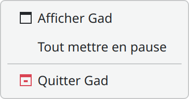

*Figure 9 — Le menu reste accessible quand la fenêtre est masquée.*

Un clic sur l’icône de Gad masque une fenêtre affichée, ou réaffiche une fenêtre masquée/réduite. Son menu propose **Afficher Gad**, la pause/reprise globale et **Quitter Gad**.

Le badge de l’icône représente le nombre de lots restants. Il devient orange pendant la pause et rouge lorsqu’un conflit attend un choix. Au-delà de 99, il affiche `99+`. L’infobulle donne davantage de détails.

### Suivi des transferts dans Plasma

Quand une copie débute avec la fenêtre masquée, Gad utilise le suivi natif de transfert de KDE. Il présente les lots et fichiers, une barre de progression et les commandes de pause, reprise et annulation.

Le lien **Afficher Gad** relève sa fenêtre. Tous les messages du suivi conservent le lien **Afficher Gad**, pendant le transfert comme à sa fin : réussite, annulation ou erreur. Les **détails** du suivi donnent le débit. Un seul suivi agrégé représente la session de transferts ; les nouveaux lots le rejoignent. Le rendu exact de ce message dépend de la version et du thème de Plasma, et ne figure pas dans les captures hors écran de ce guide.

### Lancer au démarrage

Cochez **Lancer au démarrage** pour démarrer Gad dans la zone de notification lors de l’ouverture de session, sans afficher la fenêtre principale. Décochez l’option pour retirer ce lancement automatique.

### À propos

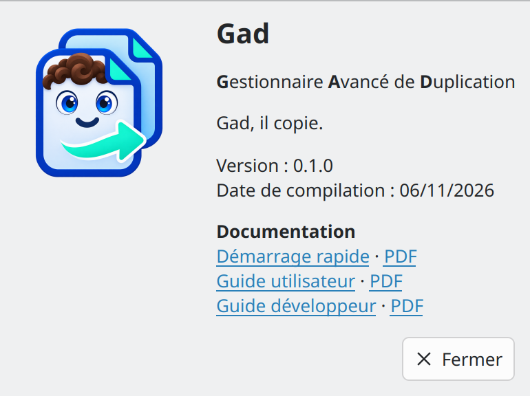

*Figure 10 — Les informations à transmettre pour identifier votre version.*

Le bouton **À propos** se trouve en bas à gauche. Il affiche le nom, **Gestionnaire Avancé de Duplication**, le slogan, l’icône, la version et la date de compilation.

## Téléphone, FTP, SFTP et SMB

Gad accepte comme sources les adresses :

| Type | Exemple fictif |
| --- | --- |
| KDE Connect | `kdeconnect://identifiant/android/DCIM/Camera/photo.jpg` |
| FTP | `ftp://serveur.exemple/dossier/fichier.txt` |
| SFTP | `sftp://utilisateur@serveur.exemple/dossier/fichier.txt` |
| SMB | `smb://serveur/partage/dossier/fichier.txt` |

Copiez ces fichiers depuis Dolphin ou déposez-les dans Gad. KDE fournit un accès monté au moyen de **KIO Fuse**, puis le moteur de Gad effectue le transfert. Le paquet `kio-fuse` doit être disponible et la source accessible dans KDE.

L’authentification reste gérée par KDE/KIO. Gad ne fournit pas de formulaire d’identifiants. Les mots de passe éventuellement présents dans les URL ne sont pas conservés dans les libellés de l’historique.

La **destination peut aussi être une adresse distante** : saisissez par exemple `sftp://alice@serveur/home/alice/Documents` ou `smb://serveur/partage/Dossier` dans le champ Destination. Le dossier doit déjà exister et être accessible en écriture. La ligne de commande et le collage depuis Dolphin acceptent aussi ces adresses. Le montage est demandé à KIO Fuse ; KDE gère la connexion et l’authentification. Les mots de passe inclus dans une adresse ne sont pas conservés dans l’historique.

Le lot attend la résolution de ses sources et de sa destination avant de démarrer. **Tout annuler** arrête aussi les lots encore en préparation réseau. Une erreur de connexion est affichée sans lancer une partie de la sélection.

Les droits et dates de la copie sont définis par le service distant. La vérification MD5 reste utilisable, mais les liens symboliques et autres opérations peuvent être refusés par certains protocoles. La pause pendant la session reste possible. La **reprise automatique après crash est désactivée vers KIO Fuse** et cette limite apparaît dans le détail des lignes de la demande ; les points durables restent disponibles pour les destinations locales compatibles.

Pour remettre en état un transfert vers un téléphone ou un partage, le montage d’origine doit encore être disponible au bon emplacement, avec les identités enregistrées. Gad refuse une récupération si une reconnexion les a changées. Il ne réassocie pas automatiquement les anciens journaux à un nouveau montage.

## Raccourcis

| Raccourci | Où ? | Action |
| --- | --- | --- |
| **Ctrl+C** | Dolphin | Préparer une copie dans le presse-papiers. |
| **Ctrl+X** | Dolphin | Préparer un déplacement. |
| **Ctrl+V** | Gad | Coller les fichiers dans la destination affichée. |
| **Ctrl** ou **Maj** + sélection | Liste Gad | Sélectionner plusieurs lignes. |
| **Suppr** | Liste Gad ayant le focus | Retirer/annuler selon l’état. |
| **Retour arrière** | Liste Gad ayant le focus | Remettre les lignes terminées en état ; sinon retirer/annuler. |

## Problèmes fréquents

| Problème | Vérifications et suite à donner |
| --- | --- |
| « Le presse-papiers ne contient pas de liste de fichiers » | Copier les fichiers dans Dolphin, et non seulement le texte de leur chemin. Sous Wayland, vérifier la présence de `wl-paste`/`wl-clipboard`. |
| « Le presse-papiers a changé pendant sa lecture » | Refaire Copier ou Couper, puis recommencer le collage. Aucune partie de cette demande incohérente ne doit être transférée. |
| Ctrl+V ne lance pas Gad dans Dolphin | Fermer puis rouvrir Dolphin après installation ; vérifier l’action Coller avec Gad. Activer l’association avec `gad --configure --dolphin-ctrl-v`. |
| Les transferts semblent rester en pause | Vérifier le bouton global et les pauses ciblées au clic droit. Une reprise ciblée peut être nécessaire. |
| Un lot reste en attente alors qu’un autre avance | Les lots peuvent partager un disque, ou un volume peut être inconnu de Gad. Une analyse précédente peut aussi garder l’ordre de la file. |
| Une copie apparaît remplie mais n’est pas encore OK | La vérification MD5 peut être encore en cours. Lire l’état et la progression de relecture. |
| Un téléphone ou partage n’est pas accessible | Vérifier son accès dans Dolphin, sa connexion, l’authentification KDE et KIO Fuse. |
| L’analyse échoue | Lire le détail de la demande : source manquante, destination non existante, droits, type de fichier non pris en charge ou copie sur soi-même. |
| La remise en état échoue | Lire ce qui a été conservé. Remonter les volumes nécessaires ou résoudre le conflit externe, puis retenter la remise en état si cela convient. Ne pas modifier le journal pour forcer une suppression. |
| Après un arrêt brutal, un lot est en erreur de récupération | Vérifier la pause et les volumes disponibles, puis utiliser **Reprendre les lots interrompus** si proposé. Une source modifiée ou une publication interrompue peut exiger une remise en état. |
| Quitter est refusé | Une copie, une analyse ou une restauration n’est pas terminée. L’arrêter ou attendre. |
| « Une ancienne version est encore ouverte » | Laisser finir ses transferts, quitter Gad puis le relancer pour charger la version installée. |
| Lancer un fichier échoue | Vérifier le chemin correspondant à l’état de la ligne et l’application associée dans le bureau. Un fichier déplacé ou supprimé par une autre application peut ne plus être disponible. |

## Limites et bonnes habitudes

- Les noms de fichiers doivent être en UTF-8. Un nom non pris en charge est refusé plutôt que converti vers un autre nom.
- Les fichiers spéciaux ne sont pas copiés comme des fichiers ordinaires.
- Les permissions et la date des fichiers ordinaires sont conservées dans les limites prises en charge. Propriétaires, ACL, attributs étendus et métadonnées des dossiers ne sont pas reproduits intégralement.
- Les liens symboliques sont reproduits comme liens ; leur contenu cible n’est pas recopié à leur place. Les liens physiques et fichiers creux ne sont pas préservés comme tels.
- Les lots ne forment pas une transaction unique : une erreur ou une annulation peut laisser une partie terminée. Examiner les lignes avant de choisir entre annulation simple et remise en état.
- Garder de l’espace disponible pour la copie temporaire et les fichiers remplacés conservés pour restauration.

Pour expliquer un problème, relevez la version dans **À propos**, le type d’action (copie ou déplacement), l’état et le détail de la demande, et le caractère local, monté ou distant des chemins. Le [guide développeur](GUIDE_DEVELOPPEUR.md) décrit le journal et les tests pour une analyse technique.

## Ajouter une langue

Les langues disponibles sont découvertes au lancement à partir des catalogues `gad_<locale>.qm`, par exemple `gad_de_DE.qm`. Le nom affiché est fourni par Qt dans la langue concernée. L’anglais américain reste disponible comme langue source. Les variantes exactes sont prioritaires ; sinon Gad cherche une variante disponible de la même langue, puis revient au français ou à l’anglais.

Pour ajouter une langue sans recompiler, placer le `.qm` dans `~/.local/share/gad/translations/` et son drapeau `<locale>.png` à côté, par exemple `de_DE.png`, puis relancer Gad. Ce chemin suit `$XDG_DATA_HOME` si cette variable est définie. Le drapeau peut aussi être dans le sous-dossier `flags/` ou dans `~/.local/share/gad/flags/`. Un drapeau absent est remplacé par une icône générique. Les catalogues invalides sont ignorés. Les fichiers utilisateur sont prioritaires sur les catalogues système et embarqués.

Pour distribuer la langue avec le logiciel, ajouter le `.qm` dans `translations/` et le PNG dans `assets/flags/`. Le manifeste Qt est généré par `scripts/resources.py`, utilisé par Cargo, les tests Qt et les captures de documentation. Aucun ajout à une liste C++ ou au manifeste source n’est nécessaire. Un `.qm` seul suffit ; si le `.ts` est aussi fourni, `python3 scripts/translations.py` le découvre, vérifie et compile automatiquement.

## Dupliquer dans le dossier d’origine

Cocher **Autoriser la duplication dans le même dossier**, puis copier et coller dans le dossier contenant l’élément. Un fichier `photo.jpg` devient `photo_copied1.jpg` ; un dossier `Documents` devient `Documents_copied1`. Gad choisit le premier numéro libre et réserve les noms des duplications déjà en attente. Les liens symboliques sont copiés sans suivre leur cible.

L’option est désactivée par défaut, mémorisée et capturée pour les nouvelles demandes. Les déplacements sur place et les copies d’un dossier dans ses propres descendants restent refusés. Les exclusions s’appliquent normalement. La restauration supprime la copie créée et préserve l’original.

## Utiliser Gad avec Konqueror

Le menu contextuel **Coller avec Gad** est un service KIO partagé avec Dolphin. Après installation de Gad, relancer Konqueror pour charger le menu. Les copies et les coupes utilisent le même moteur et la même file d’attente.

Pour utiliser **Ctrl+V**, ouvrir **Konqueror avec Gad** depuis le menu des applications, ou exécuter `gad-konqueror`. Ce lanceur charge un module uniquement dans Konqueror. Les fichiers sont envoyés à Gad dans le dossier de la vue active ; le collage de texte dans la barre d’adresse et les champs de saisie reste natif. **Maj+Inser** garde le collage KIO habituel. Les destinations distantes prises en charge restent utilisables.

Le module expose aussi le dossier actif au menu **Coller dans le dossier ouvert avec Gad**. Il ne se base ni sur le titre de fenêtre ni sur une ancienne sélection. Le lanceur Konqueror habituel n’est pas remplacé. L’intégration Ctrl+V est validée avec Konqueror 26.08 (Qt 6). Si Konqueror est installé après Gad, relancer `python3 scripts/install.py` pour construire son module.

### Documentation depuis À propos {#about-documentation}

La boîte **À propos** contient des liens vers le **Démarrage rapide**, le **Guide utilisateur** et le **Guide développeur**, avec un accès HTML et PDF. Les liens suivent la langue choisie dans Gad, même si la boîte reste ouverte pendant le changement. Les documents sont installés localement et restent accessibles sans le dossier du projet. Si une édition est absente, Gad propose l’édition anglaise disponible ; un document indisponible ne produit pas de lien mort.

## Configuration et pages de manuel {#command-settings}

`gad --configure` enregistre les préférences et met à jour les contrôles de l’instance ouverte. Sans instance, Gad démarre en arrière-plan et la commande rend la main. Les formes `--no-…` désactivent les cases. Les exclusions non fournies sont conservées ; répéter `--exclude-folder` ou `--exclude-file` remplace la liste correspondante. `--clear-exclusions` vide les deux listes. Le débit global est exprimé en Mio/s ; 0 signifie illimité. `--md5` et `--properties` utilisés avec une copie ou un déplacement ne modifient que ce transfert. Les raccourcis Dolphin utilisent `gad --configure --dolphin-ctrl-v` ou `--no-dolphin-ctrl-v`.

```bash
gad --configure --md5 --verify-space --no-include-hidden
gad --configure --exclude-folder "__*" --exclude-file "*.tmp" --language fr_FR --rate-limit 25
```

`man gad` · `make manpages`

## Surveillance du raccourci Dolphin {#dolphin-watchdog}

Le lanceur habituel de Dolphin peut être protégé par Gad. Le module chargé au démarrage contrôle chaque seconde les raccourcis réels et répare leur perte après un rafraîchissement des menus. Le collage est transmis directement à Gad ; les champs de texte restent natifs. Désactiver Ctrl+V avec Gad restaure le collage natif et arrête les corrections. Les fenêtres déjà ouvertes doivent être relancées une fois pour charger le module.


Pour protéger le lanceur Dolphin habituel contre la perte du raccourci, installez le module de surveillance avec la commande ci-dessous, puis fermez et rouvrez les anciennes fenêtres une fois.

```sh
python3 scripts/dolphin_integration.py --install --protect-launcher "$HOME/.local/bin/gad"
```

```sh
gad --dolphin --new-window
```
