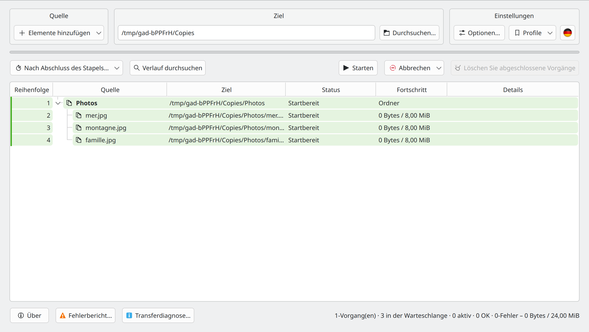
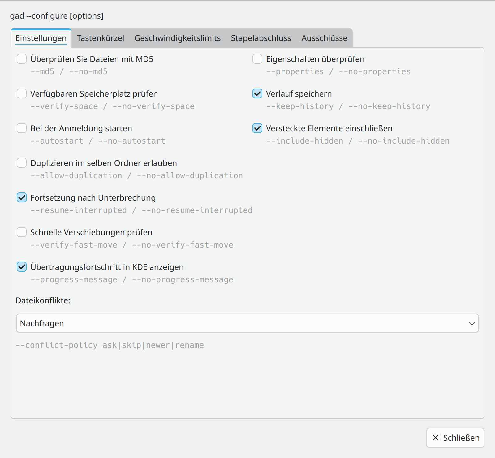
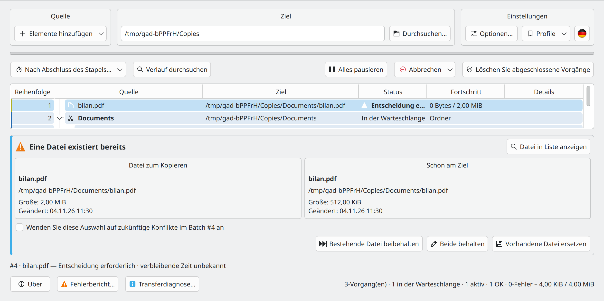

# Gad — Schnellstart {#gad-quick-start}

**Gad, il copie. · Erweiterter Duplizierungsmanager · Version 0.4.0**

[Benutzerhandbuch](USER_GUIDE.de-DE.md) · [Entwicklerhandbuch](DEVELOPER_GUIDE.de-DE.md) · [Alle Sprachen](README.de-DE.md)

## Gad installieren

Verwenden Sie das [Gad-PPA](https://launchpad.net/~hizo/+archive/ubuntu/gad) für eine unterstützte Ubuntu-Version. Die [GitHub-Releases](https://github.com/Hizoka76/gad/releases/latest) bieten außerdem ein `.deb`, ein `.tar.gz`-Archiv mit Quellen und kompiliertem Programm sowie die direkte Programmdatei `gad-linux-amd64`.

```sh
sudo add-apt-repository ppa:hizo/gad
sudo apt update
sudo apt install gad
```

Prüfen Sie auf der PPA-Seite, ob für Ihre Ubuntu-Version ein Paket veröffentlicht wurde. Falls `add-apt-repository` fehlt, installieren Sie `software-properties-common`.

Befehle, Abhängigkeiten und Unterschiede zwischen den Formaten stehen im [Benutzerhandbuch](USER_GUIDE.de-DE.md#installation-and-startup).

## Gad starten {#start-gad}

Öffnen Sie **Gad** über Ihr Anwendungsmenü oder führen Sie Folgendes aus:

```sh
gad
```

Wenn es noch nicht installiert ist, befolgen Sie die Anweisungen [Installationsanweisungen](USER_GUIDE.de-DE.md#installation-and-startup). Beim Schließen des Fensters verbleibt Gad normalerweise in der Taskleiste, wenn eine Taskleiste verfügbar ist. Klicken Sie auf das entsprechende Symbol, um das Fenster erneut anzuzeigen.

## Die erste Kopie erstellen {#make-your-first-copy}



Wählen Sie Ziel und Optionen und fügen Sie Dateien in Gad hinzu. Wenn nichts läuft, prüfen Sie die Liste und klicken Sie auf **Starten**. Externes Einfügen aus dem Dateimanager startet automatisch; während einer Übertragung werden neue Aufträge eingereiht. **Strg+C** kopiert, **Strg+X** verschiebt. Ziehen und Ablegen bereitet immer eine Kopie vor.

## Übertragungen verfolgen und steuern {#read-and-control-transfers}

- **In der Warteschlange**: wartet darauf, dass es an die Reihe kommt. **Läuft**: wird derzeit übertragen. **OK**: fertig.
- Erweitern Sie einen Ordner, um seine Dateien anzuzeigen. Anforderungsfarben helfen dabei, separate Einreichungen zu identifizieren. **Reihenfolge** zeigt die Verarbeitungsreihenfolge an.
- **Alles pausieren** pausiert die Warteschlange. Setzen Sie es mit derselben Taste fort. Klicken Sie mit der rechten Maustaste auf Zeilen, um einzelne Aktionen zum Anhalten, Fortsetzen, Wiederholen und Abbrechen durchzuführen.
- Wählen Sie wartende Zeilen aus und verwenden Sie **Als nächstes verarbeiten** oder ziehen Sie sie an die richtige Position, während in der Tabelle die Warteschlangenreihenfolge angezeigt wird.
- Durch Abbrechen wird der Vorgang gestoppt; **Abbrechen und wiederherstellen** versucht auch, abgeschlossene Arbeiten mithilfe des beibehaltenen Verlaufs rückgängig zu machen. Lesen Sie die Bestätigung und das detaillierte Ergebnis, bevor Sie den Verlauf löschen.

## Einstellungen anpassen {#set-your-preferences}



*Der Optionsdialog wird über den Bereich Einstellungen geöffnet.*

Unter **Einstellungen → Optionen… → Ausschlüsse** wird je ein Muster pro Zeile für Ordner oder Dateien und symbolische Links eingegeben. Jedes Feld wird beim Fokusverlust gespeichert, ohne Anwenden-Schaltfläche und ohne zusätzlichen Dialog. Ungültige Regeln werden gemeldet; bisherige Regeln bleiben aktiv und der Text bleibt zur Korrektur erhalten. Regeln gelten für neue Übertragungen. Die Option für versteckte Elemente bleibt im Reiter Einstellungen.

**Duplizieren im selben Ordner erlauben** erstellt beim Zurückkopieren in den ursprünglichen Ordner Namen wie `photo_copied1.jpg`. Sie ist standardmäßig deaktiviert und gilt nur für Kopien. Auswahl-, Verifizierungs- und Duplizierungsoptionen werden für neue Anfragen erfasst; Bestehende Anfragen behalten ihre Einstellungen. Die globale Geschwindigkeitsbegrenzung kann sich während des Transfers ändern.

## Direkt aus dem Dateimanager einfügen {#paste-directly-from-your-file-manager}

- **Dolphin:** aktivieren Sie **Strg+V mit Gad in Dolphin** in den Einstellungen und starten Sie Dolphin neu. Sie können **Paste mit Gad** auch über das Kontextmenü verwenden.
- **Konqueror:** starten Sie **Konqueror mit Gad** und aktivieren Sie das entsprechende Kontrollkästchen in den Einstellungen. Dateieinfügungen gehen zu Gad; Texteinfügungen bleiben nativ.
- Fügen Sie **Andere Manager:** in Gad ein, ziehen Sie Dateien hinein oder konfigurieren Sie eine benutzerdefinierte Aktion mit einem expliziten Ziel, zum Beispiel `gad --paste "/home/demo/Documents/Copies"`. Ihre native Strg+V-Taste wird nicht automatisch abgefangen.

Ein von einem Dateimanager gestartetes Einfügen kann im Hintergrund ausgeführt werden, ohne Gad zu öffnen. Plasma-Fortschrittsbenachrichtigungen enthalten einen **Gad anzeigen**-Link.

## Einen Konflikt oder Fehler beheben {#resolve-a-conflict-or-an-error}



*Vergleichen Sie die Quelle und das vorhandene Ziel, bevor Sie eine Aktion auswählen.*

Wählen Sie für eine vorhandene Datei **Bestehende Datei beibehalten**, **Beide behalten** oder **Vorhandene Datei ersetzen**. Wenden Sie die Wahl nur dann auf spätere Konflikte an, wenn Sie dies beabsichtigen.

Öffnen Sie **Fehlerbericht…** für fehlgeschlagene Übertragungen, kopieren oder exportieren Sie die Details und versuchen Sie es nur bei fehlgeschlagenen Dateien erneut. Wenn ein Gerät verschwindet, schließen Sie dasselbe Gerät am selben Standort erneut an und lassen Sie Gad dies überprüfen, bevor Sie fortfahren.

**Verlauf speichern** behält Rückgängig-Informationen bei. **Löschen Sie abgeschlossene Vorgänge** entfernt die entsprechenden Wiederherstellungsinformationen. Fahren Sie für Wiederherstellung, Remote-Adressen, MD5-Prüfungen und alle Stornierungsoptionen mit [Benutzerhandbuch](USER_GUIDE.de-DE.md) fort.

## Konfiguration und Handbuchseiten {#command-settings}

`gad --configure` speichert Einstellungen und aktualisiert die laufende Oberfläche. Läuft noch keine Instanz, startet Gad im Hintergrund und der Befehl kehrt zurück. Die Formen `--no-…` deaktivieren Kontrollkästchen. Nicht angegebene Ausschlusslisten bleiben erhalten; wiederholtes `--exclude-folder` oder `--exclude-file` ersetzt die entsprechende Liste. `--clear-exclusions` leert beide Listen. Das globale Limit wird in MiB/s angegeben; 0 bedeutet unbegrenzt. `--md5` und `--properties` bei einer Kopie oder Verschiebung gelten nur für diese Übertragung. Dolphin-Tastenkürzel werden mit `gad --configure --dolphin-ctrl-v` oder `--no-dolphin-ctrl-v` verwaltet.

```bash
gad --configure --md5 --verify-space --no-include-hidden
gad --configure --exclude-folder "__*" --exclude-file "*.tmp" --language fr_FR --rate-limit 25
```

`man gad` · `make manpages`

## Automatische Ctrl+V-Überwachung {#dolphin-watchdog}

Das Benutzerhandbuch beschreibt den Schutz des normalen Dolphin-Starters und das Laden der automatischen Ctrl+V-Überwachung.

[Automatische Ctrl+V-Überwachung](USER_GUIDE.de-DE.md#dolphin-watchdog)


## Übertragungsprofile

Speichern Sie unter **Einstellungen → Profile** alle Optionen unter einem Namen und wenden Sie sie später mit einem Klick an. **Das Ziel wird niemals gespeichert oder geändert.** Sprache und globales Limit wirken wie üblich. **Profile verwalten…** bietet Aktualisieren, Umbenennen und Löschen. Siehe [Übertragungsprofile](USER_GUIDE.de-DE.md#transfer-profiles).

In der Befehlszeile übernimmt `gad --profile "Mein Profil"` die Einstellungen ohne Transfer. Zum Kopieren: `gad --profile "Mein Profil" --copy /pfad/quelle --to /pfad/ziel`; auch mit `--move` / `--paste` verwendbar. Gad wartet auf die vollständige Anwendung des Profils. Das Ziel stammt aus dem Befehl; explizite Optionen wie `--md5` haben Vorrang. Bei unbekanntem Namen werden keine Dateien eingereiht. `--configure --profile "Mein Profil"` erlaubt zusätzliche Einstellungen, die anschließend angewendet werden.


## Übertragungen in der Hauptliste vorbereiten

Wählen Sie Ziel und Optionen und fügen Sie Dateien in Gad hinzu. Wenn nichts läuft, prüfen Sie die Liste und klicken Sie auf **Starten**. Externes Einfügen aus dem Dateimanager startet automatisch; während einer Übertragung werden neue Aufträge eingereiht. **Strg+C** kopiert, **Strg+X** verschiebt. Ziehen und Ablegen bereitet immer eine Kopie vor.

## Optionen

**Einstellungen → Optionen…** öffnet ein modales Fenster: Das Hauptfenster bleibt bis zum Schließen gesperrt, Übertragungen laufen weiter. Änderungen gelten sofort; **Schließen** oder Escape macht sie nicht rückgängig. Befehlszeilenoptionen stehen grau unter den Bedienelementen. Mindestgröße: **800 × 740**; Hauptfenster, Fehlerbericht und Diagnose: **1100 × 600**.

Die fünf Reiter sind Einstellungen, Tastenkürzel, Geschwindigkeitsbegrenzungen, Stapelabschluss und Ausschlüsse. Befehlszeilenparameter erscheinen grau. Das Limit eines bestehenden Stapels wird im Kontextmenü seiner Zeilen geändert und in der Detailspalte angezeigt.

## Elemente hinzufügen, Tastenkürzel und Ausschlüsse

Das Menü **Elemente hinzufügen** enthält **Dateien hinzufügen…** (Strg+Umschalt+O), **Ordner hinzufügen…** (Strg+O) und **Zwischenablage-Dateien** (Strg+V). Kopieren oder Ausschneiden bleibt erhalten. Im Leerlauf warten alle Ergänzungen innerhalb von Gad auf **Starten**; bei bereits gestarteten Übertragungen werden sie eingereiht. Nur externes Einfügen aus dem Dateimanager startet automatisch.

**Strg+F** öffnet die Suche. **Strg+Q** fordert das Beenden an; bei aktiven Übertragungen wird es verweigert. **Strg+Alt+W** blendet das Fenster aus, ohne Übertragungen anzuhalten. Die Flagge neben Profile ändert sofort die Sprache. Hauptfenster-Schaltflächen besitzen Kurzinfos.
