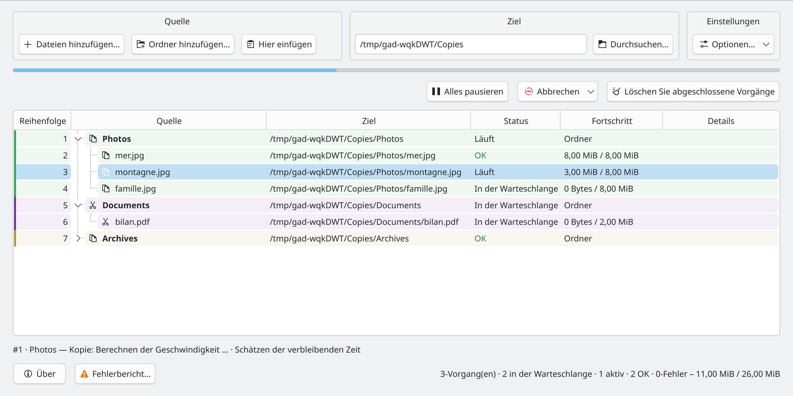
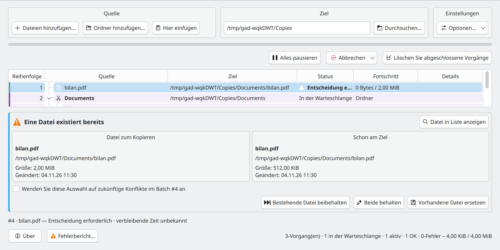

# Gad — Schnellstart {#gad-quick-start}

**Gad, il copie. · Erweiterter Duplizierungsmanager · Version 0.1.0**

[Benutzerhandbuch](USER_GUIDE.de-DE.md) · [Entwicklerhandbuch](DEVELOPER_GUIDE.de-DE.md) · [Alle Sprachen](README.de-DE.md)

## Gad starten {#start-gad}

Öffnen Sie **Gad** über Ihr Anwendungsmenü oder führen Sie Folgendes aus:

```sh
gad
```

Wenn es noch nicht installiert ist, befolgen Sie die Anweisungen [Installationsanweisungen](USER_GUIDE.de-DE.md#installation-and-startup). Beim Schließen des Fensters verbleibt Gad normalerweise in der Taskleiste, wenn eine Taskleiste verfügbar ist. Klicken Sie auf das entsprechende Symbol, um das Fenster erneut anzuzeigen.

## Die erste Kopie erstellen {#make-your-first-copy}



*Quelle, Ziel und Einstellungen sind oberhalb der Übertragungsliste gruppiert.*

1. Wählen Sie in Ihrem Dateimanager die Dateien oder Ordner aus und drücken Sie **Strg+C**.
2. Legen Sie in Gad **Ziel** auf den vorhandenen Ordner fest, der sie empfangen soll.
3. Klicken Sie auf **Hier einfügen** oder drücken Sie **Ctrl+V in Gad**.
4. Überprüfen Sie das Ziel in der Liste. Die Übertragungsarbeit beginnt automatisch, es sei denn, die Warteschlange wird angehalten.

Sie können auch **Dateien hinzufügen…**, **Ordner hinzufügen…** verwenden oder Dateien nach dem Festlegen des Ziels in Gad ziehen. **Drag-and-Drop kopiert immer.** Zum Verschieben von Dateien verwenden Sie **Strg+X** und fügen anschließend ein, sofern der Dateimanager eine erkannte Schnittmarkierung veröffentlicht. Überprüfen Sie den in der Liste angezeigten Vorgang. Sehen Sie sich bei Bedarf [Anweisungen anderer Manager](USER_GUIDE.de-DE.md#using-gad-with-other-file-managers) an.

Erneut einfügen, um eine weitere Anfrage hinzuzufügen. Gad stellt die Arbeit in die Warteschlange und führt möglicherweise zwei kompatible Übertragungen gleichzeitig aus. Doppelte ausstehende Vorgänge werden ignoriert.

## Übertragungen verfolgen und steuern {#read-and-control-transfers}

- **In der Warteschlange**: wartet darauf, dass es an die Reihe kommt. **Läuft**: wird derzeit übertragen. **OK**: fertig.
- Erweitern Sie einen Ordner, um seine Dateien anzuzeigen. Anforderungsfarben helfen dabei, separate Einreichungen zu identifizieren. **Reihenfolge** zeigt die Verarbeitungsreihenfolge an.
- **Alles pausieren** pausiert die Warteschlange. Setzen Sie es mit derselben Taste fort. Klicken Sie mit der rechten Maustaste auf Zeilen, um einzelne Aktionen zum Anhalten, Fortsetzen, Wiederholen und Abbrechen durchzuführen.
- Wählen Sie wartende Zeilen aus und verwenden Sie **Als nächstes verarbeiten** oder ziehen Sie sie an die richtige Position, während in der Tabelle die Warteschlangenreihenfolge angezeigt wird.
- Durch Abbrechen wird der Vorgang gestoppt; **Abbrechen und wiederherstellen** versucht auch, abgeschlossene Arbeiten mithilfe des beibehaltenen Verlaufs rückgängig zu machen. Lesen Sie die Bestätigung und das detaillierte Ergebnis, bevor Sie den Verlauf löschen.

## Einstellungen anpassen {#set-your-preferences}


*Öffnen Sie „Optionen“ in den Einstellungen rechts neben „Ziel“.*

Wählen Sie in **Einstellungen → Optionen…** Ihre Sprache, die Handhabung versteckter Elemente, Verifizierungsoptionen, Verlauf, Start und Bandbreitenbeschränkungen. Kontrollkästchen gelten sofort und lassen das Menü geöffnet. Verwenden Sie **Ausschlüsse…** für Ordnermuster wie `__*` und Dateimuster wie `*.tmp` oder `*~`.

**Duplizieren im selben Ordner erlauben** erstellt beim Zurückkopieren in den ursprünglichen Ordner Namen wie `photo_copied1.jpg`. Sie ist standardmäßig deaktiviert und gilt nur für Kopien. Auswahl-, Verifizierungs- und Duplizierungsoptionen werden für neue Anfragen erfasst; Bestehende Anfragen behalten ihre Einstellungen. Die globale Geschwindigkeitsbegrenzung kann sich während des Transfers ändern.

## Direkt aus dem Dateimanager einfügen {#paste-directly-from-your-file-manager}

- **Dolphin:** aktivieren Sie **Strg+V mit Gad in Dolphin** in den Einstellungen und starten Sie Dolphin neu. Sie können **Paste mit Gad** auch über das Kontextmenü verwenden.
- **Konqueror:** starten Sie **Konqueror mit Gad** und aktivieren Sie das entsprechende Kontrollkästchen in den Einstellungen. Dateieinfügungen gehen zu Gad; Texteinfügungen bleiben nativ.
- Fügen Sie **Andere Manager:** in Gad ein, ziehen Sie Dateien hinein oder konfigurieren Sie eine benutzerdefinierte Aktion mit einem expliziten Ziel, zum Beispiel `gad --paste "/home/demo/Documents/Copies"`. Ihre native Strg+V-Taste wird nicht automatisch abgefangen.

Ein von einem Dateimanager gestartetes Einfügen kann im Hintergrund ausgeführt werden, ohne Gad zu öffnen. Plasma-Fortschrittsbenachrichtigungen enthalten einen **Gad anzeigen**-Link.

## Einen Konflikt oder Fehler beheben {#resolve-a-conflict-or-an-error}



*Vergleichen Sie die Quelle und das vorhandene Ziel, bevor Sie eine Aktion auswählen.*

Wählen Sie für eine vorhandene Datei **Bestehende Datei beibehalten**, **Beide behalten** oder **Vorhandene Datei ersetzen**. Wenden Sie die Wahl nur dann auf spätere Konflikte an, wenn Sie dies beabsichtigen.

Öffnen Sie **Fehlerbericht…** für fehlgeschlagene Übertragungen, kopieren oder exportieren Sie die Details und versuchen Sie es nur bei fehlgeschlagenen Dateien erneut. Wenn ein Gerät verschwindet, schließen Sie dasselbe Gerät am selben Standort erneut an und lassen Sie Gad dies überprüfen, bevor Sie fortfahren.

**Verlauf speichern** behält Rückgängig-Informationen bei. **Löschen Sie abgeschlossene Vorgänge** entfernt die entsprechenden Wiederherstellungsinformationen. Fahren Sie für Wiederherstellung, Remote-Adressen, MD5-Prüfungen und alle Stornierungsoptionen mit [Benutzerhandbuch](USER_GUIDE.de-DE.md) fort.
