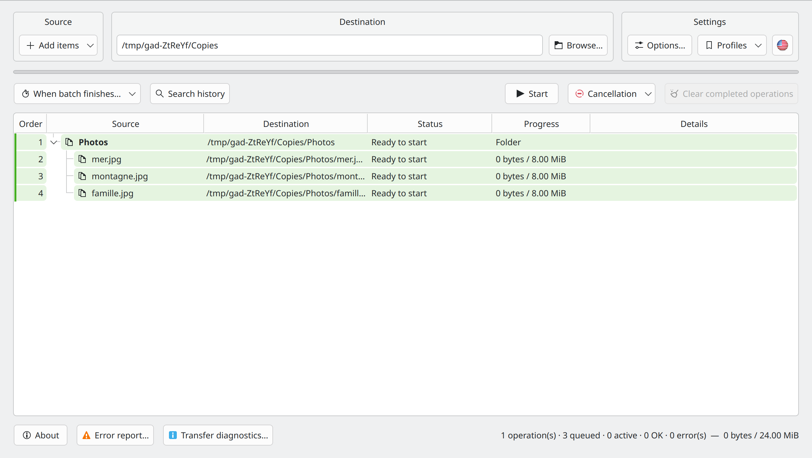
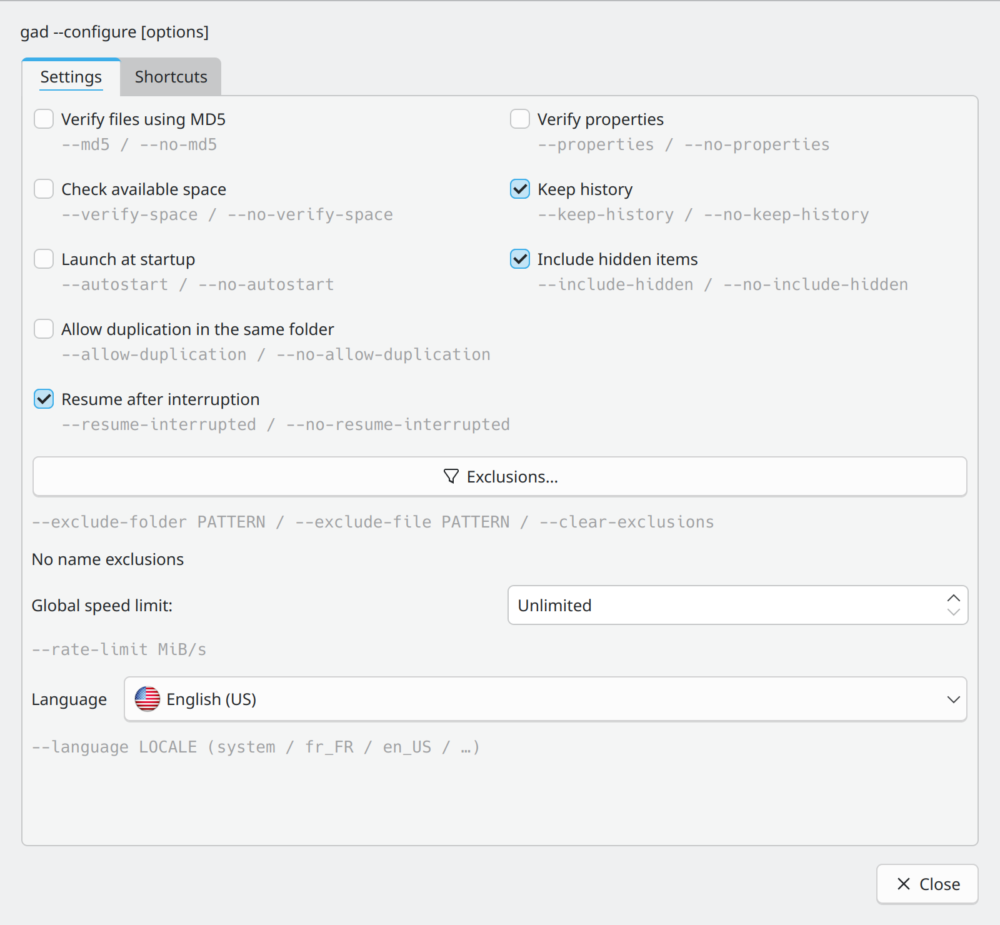
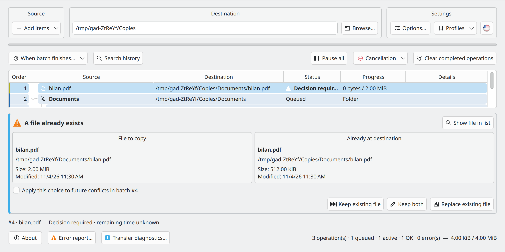

# Gad — Quick Start

**Gad, il copie. · Advanced Duplication Manager · Version 0.4.0**

[User Guide](USER_GUIDE.en-US.md) · [Developer Guide](DEVELOPER_GUIDE.en-US.md) · [All languages](README.en-US.md)

## Install Gad

Use the [Gad PPA](https://launchpad.net/~hizo/+archive/ubuntu/gad) for a supported Ubuntu release. [GitHub releases](https://github.com/Hizoka76/gad/releases/latest) also provide a `.deb`, a `.tar.gz` archive containing sources and the compiled program, and the direct `gad-linux-amd64` binary.

```sh
sudo add-apt-repository ppa:hizo/gad
sudo apt update
sudo apt install gad
```

Check the PPA page for a published package matching your Ubuntu release. If `add-apt-repository` is missing, install `software-properties-common`.

Commands, dependencies and format differences are covered in the [user guide](USER_GUIDE.en-US.md#installation-and-startup).

## Start Gad

Open **Gad** from your application menu, or run:

```sh
gad
```

If it is not installed yet, follow the [installation instructions](USER_GUIDE.en-US.md#installation-and-startup). Closing the window normally leaves Gad in the system tray when a tray is available. Click its icon to show the window again.

## Make your first copy



Choose the destination and options, then add files in Gad. When idle, review the list and click **Start**. External paste from the file manager starts automatically; additions during a transfer join the queue. **Ctrl+C** copies and **Ctrl+X** moves. Drag and drop into Gad always prepares a copy.

## Read and control transfers

- **Queued**: waiting for its turn. **Running**: currently transferring. **OK**: finished.
- Expand a folder to see its files. Request colors help identify separate submissions; **Order** shows processing order.
- **Pause all** pauses the queue. Resume it with the same button. Right-click rows for individual pause, resume, retry, and cancellation actions.
- Select waiting rows and use **Process next**, or drag them into position while the table shows queue order.
- Canceling stops the operation; **Cancel and restore** also tries to undo completed work using retained history. Read the confirmation and detailed result before clearing history.

## Set your preferences



*The settings dialog opens from the Settings block.*

In **Settings → Options… → Exclusions**, enter one pattern per line for folders or files and symbolic links. Each field saves when it loses focus, without an Apply button or a separate dialog. Invalid rules are reported; previously accepted rules remain active and the rejected text stays available for correction. Rules apply to new transfers. **Include hidden items** remains on the **Settings** tab.

**Allow duplication in the same folder** creates names such as `photo_copied1.jpg` when copying back into the original folder. It is off by default and applies only to copies. Selection, verification, and duplication choices are captured for new requests; existing requests keep their settings. The global speed limit can change during transfers.

## Paste directly from your file manager

- **Dolphin:** enable **Ctrl+V with Gad in Dolphin** in Settings and restart Dolphin. You can also use **Paste with Gad** from the context menu.
- **Konqueror:** launch **Konqueror with Gad** and enable its checkbox in Settings. File pastes go to Gad; text pastes stay native.
- **Other managers:** paste inside Gad, drag files into it, or configure a custom action using an explicit destination, for example `gad --paste "/home/demo/Documents/Copies"`. Their native Ctrl+V is not automatically intercepted.

A paste started from a file manager can run in the background without opening Gad. Plasma progress notifications provide a **Show Gad** link.

## Resolve a conflict or an error



*Compare the source and the existing destination before choosing an action.*

For an existing file, choose **Keep existing file**, **Keep both**, or **Replace existing file**. Apply the choice to later conflicts only when that is what you intend.

Open **Error report…** for failed transfers, copy or export the details, and retry only failed files. If a device disappears, reconnect the same device at the same location and let Gad verify before resuming.

**Keep history** retains undo information. **Clear finished operations** removes the corresponding restoration information. For recovery, remote addresses, MD5 checks, and all cancellation choices, continue with the [User Guide](USER_GUIDE.en-US.md).

## Configuration and manual pages {#command-settings}

`gad --configure` saves preferences and updates controls in the running instance. If none is running, Gad starts in the background and the command returns. The `--no-…` forms disable checkboxes. Unspecified exclusion lists remain unchanged; repeated `--exclude-folder` or `--exclude-file` options replace the corresponding list. `--clear-exclusions` empties both lists. The global limit uses MiB/s; 0 means unlimited. `--md5` and `--properties` used with a copy or move affect only that transfer. Dolphin shortcuts use `gad --configure --dolphin-ctrl-v` or `--no-dolphin-ctrl-v`.

```bash
gad --configure --md5 --verify-space --no-include-hidden
gad --configure --exclude-folder "__*" --exclude-file "*.tmp" --language fr_FR --rate-limit 25
```

`man gad` · `make manpages`

## Automatic Ctrl+V watchdog {#dolphin-watchdog}

See the User Guide to protect the regular Dolphin launcher and load the automatic Ctrl+V watchdog.

[Automatic Ctrl+V watchdog](USER_GUIDE.en-US.md#dolphin-watchdog)


## Transfer profiles

In **Settings → Profiles**, save all current options under a name, then choose it to apply them in one click. **The destination is never saved or changed.** Global settings, including language and the global speed limit, take their normal effect. **Manage profiles…** supports updating, renaming and deletion. See [transfer profiles](USER_GUIDE.en-US.md#transfer-profiles).

From the command line, `gad --profile "My profile"` applies settings without starting a transfer. Combine it with a copy: `gad --profile "My profile" --copy /path/source --to /path/destination`, or with `--move` / `--paste`. Gad waits for profile application before starting the transfer. The destination comes from the command; explicit options such as `--md5` override the profile. An unknown name returns an error without queuing files. `--configure --profile "My profile"` also accepts additional settings, applied after the profile.


## Prepare transfers in the main list

Choose the destination and options, then add files in Gad. When idle, review the list and click **Start**. External paste from the file manager starts automatically; additions during a transfer join the queue. **Ctrl+C** copies and **Ctrl+X** moves. Drag and drop into Gad always prepares a copy.

## Options

**Settings → Options…** opens a modal window: the main window is blocked until it closes, while transfers continue. Settings apply immediately; **Close** or Escape does not undo them. Command-line options appear in gray below each control. Minimum size: **800 × 740**; main window, error report and diagnostics: **1100 × 600**.

The five tabs are **Settings**, **Shortcuts**, **Speed limits**, **Batch completion** and **Exclusions**. Command-line options appear in gray. Change existing batch speed limits from the row context menu; the limit appears in **Detail**.

## Adding items, shortcuts and exclusions

The **Add items** menu contains **Add files…** (Ctrl+Shift+O), **Add folder…** (Ctrl+O) and **Clipboard files** (Ctrl+V). Clipboard files preserve Copy or Cut mode. When Gad is idle, all additions inside Gad wait for **Start**; during previously started transfers, they join the queue. Only external paste from the file manager starts automatically.

**Ctrl+F** opens search. **Ctrl+Q** requests exit and refuses to quit while transfers are active. **Ctrl+Alt+W** hides the window without stopping transfers. The flag button to the right of **Profiles** changes the language immediately. Main-window buttons have tooltips.
