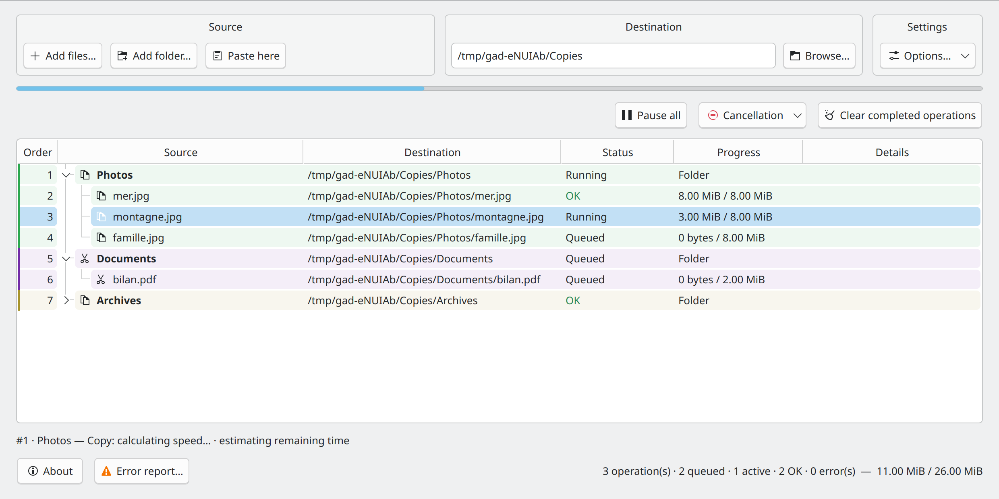
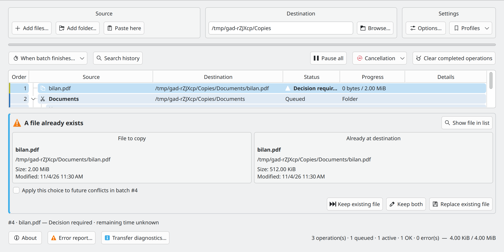

# Gad — Quick Start

**Gad, il copie. · Advanced Duplication Manager · Version 0.1.0**

[User Guide](USER_GUIDE.en-US.md) · [Developer Guide](DEVELOPER_GUIDE.en-US.md) · [All languages](README.en-US.md)

## Start Gad

Open **Gad** from your application menu, or run:

```sh
gad
```

If it is not installed yet, follow the [installation instructions](USER_GUIDE.en-US.md#installation-and-startup). Closing the window normally leaves Gad in the system tray when a tray is available. Click its icon to show the window again.

## Make your first copy



*Source, Destination, and Settings are grouped above the transfer list.*

1. In your file manager, select the files or folders and press **Ctrl+C**.
2. In Gad, set **Destination** to the existing folder that should receive them.
3. Click **Paste here**, or press **Ctrl+V inside Gad**.
4. Check the destination in the list. Transfer work starts automatically unless the queue is paused.

You can also use **Add files…**, **Add folder…**, or drag files into Gad after setting the destination. **Drag-and-drop always copies.** To move files, use **Ctrl+X** followed by pasting, provided the file manager publishes a recognized cut marker. Check the operation shown in the list; see the [other-manager instructions](USER_GUIDE.en-US.md#using-gad-with-other-file-managers) if needed.

Paste again to add another request. Gad queues the work and may run two compatible transfers at once. Duplicate pending operations are ignored.

## Read and control transfers

- **Queued**: waiting for its turn. **Running**: currently transferring. **OK**: finished.
- Expand a folder to see its files. Request colors help identify separate submissions; **Order** shows processing order.
- **Pause all** pauses the queue. Resume it with the same button. Right-click rows for individual pause, resume, retry, and cancellation actions.
- Select waiting rows and use **Process next**, or drag them into position while the table shows queue order.
- Canceling stops the operation; **Cancel and restore** also tries to undo completed work using retained history. Read the confirmation and detailed result before clearing history.

## Set your preferences


*The settings dialog opens from the Settings block.*

In **Settings → Options…**, the **Settings** and **Shortcuts** tabs group preferences and integrations. Changes apply immediately; **Close** or Escape closes the dialog. Command-line parameters appear in gray. **Exclusions…** accepts folder patterns such as `__*` and file patterns such as `*.tmp` or `*~`. The speed button for selected requests is on the left of the main action bar.

**Allow duplication in the same folder** creates names such as `photo_copied1.jpg` when copying back into the original folder. It is off by default and applies only to copies. Selection, verification, and duplication choices are captured for new requests; existing requests keep their settings. The global speed limit can change during transfers.

## Paste directly from your file manager

- **Dolphin:** enable **Ctrl+V with Gad in Dolphin** in Settings and restart Dolphin. You can also use **Paste with Gad** from the context menu.
- **Konqueror:** launch **Konqueror with Gad** and enable its checkbox in Settings. File pastes go to Gad; text pastes stay native.
- **Other managers:** paste inside Gad, drag files into it, or configure a custom action using an explicit destination, for example `gad --paste "/home/demo/Documents/Copies"`. Their native Ctrl+V is not automatically intercepted.

A paste started from a file manager can run in the background without opening Gad. Plasma progress notifications provide a **Show Gad** link.

## Resolve a conflict or an error



*Compare the source and the existing destination before choosing an action.*

For an existing file, choose **Keep existing file**, **Keep both**, or **Replace existing file**. Apply the choice to later conflicts only when that is what you intend.

Open **Error report…** for failed transfers, copy or export the details, and retry only failed files. If a device disappears, reconnect the same device at the same location and let Gad verify before resuming.

**Keep history** retains undo information. **Clear finished operations** removes the corresponding restoration information. For recovery, remote addresses, MD5 checks, and all cancellation choices, continue with the [User Guide](USER_GUIDE.en-US.md).

## Configuration and manual pages {#command-settings}

`gad --configure` saves preferences and updates controls in the running instance. If none is running, Gad starts in the background and the command returns. The `--no-…` forms disable checkboxes. Unspecified exclusion lists remain unchanged; repeated `--exclude-folder` or `--exclude-file` options replace the corresponding list. `--clear-exclusions` empties both lists. The global limit uses MiB/s; 0 means unlimited. `--md5` and `--properties` used with a copy or move affect only that transfer. Dolphin shortcuts use `gad --configure --dolphin-ctrl-v` or `--no-dolphin-ctrl-v`.

```bash
gad --configure --md5 --verify-space --no-include-hidden
gad --configure --exclude-folder "__*" --exclude-file "*.tmp" --language fr_FR --rate-limit 25
```

`man gad` · `make manpages`

## Automatic Ctrl+V watchdog {#dolphin-watchdog}

See the User Guide to protect the regular Dolphin launcher and load the automatic Ctrl+V watchdog.

[Automatic Ctrl+V watchdog](USER_GUIDE.en-US.md#dolphin-watchdog)
