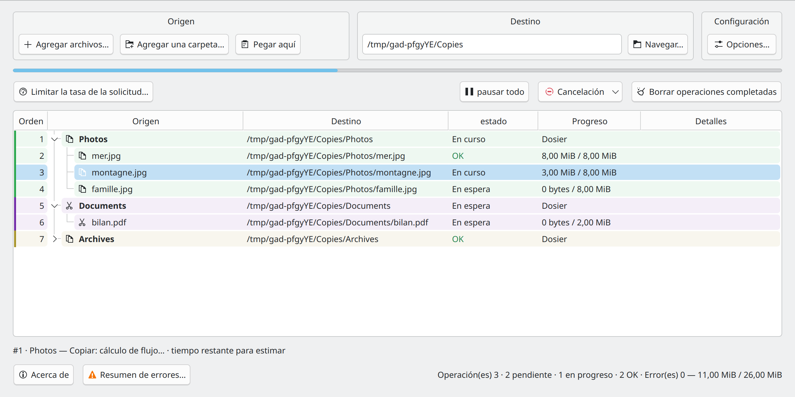
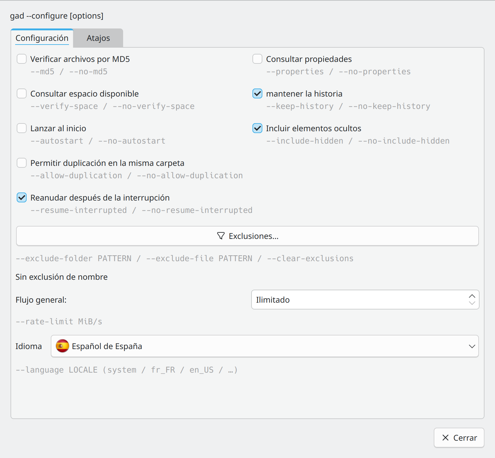
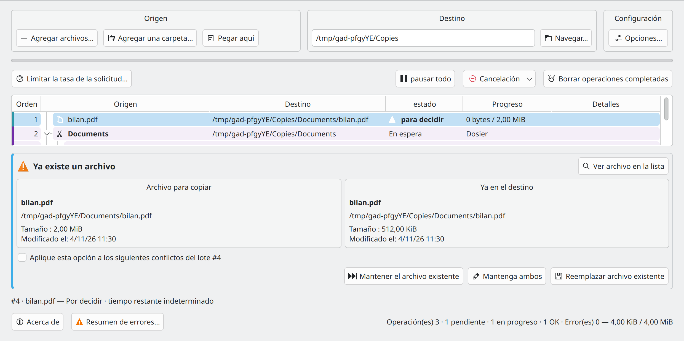

# Gad — Inicio rápido {#gad-quick-start}

**Gad, il copie. · Gestor avanzado de duplicación · Versión 0.1.0**

[Guía del usuario](USER_GUIDE.es-ES.md) · [Guía para desarrolladores](DEVELOPER_GUIDE.es-ES.md) · [Todos los idiomas](README.es-ES.md)

## Iniciar Gad {#start-gad}

Abra **Gad** desde el menú de su aplicación o ejecute:

```sh
gad
```

Si aún no está instalado, siga las instrucciones [instrucciones de instalación](USER_GUIDE.es-ES.md#installation-and-startup). Cerrar la ventana normalmente deja Gad en la bandeja del sistema cuando hay una bandeja disponible. Haga clic en su icono para mostrar la ventana nuevamente.

## Hacer la primera copia {#make-your-first-copy}



*Origen, Destino y Configuración se agrupan encima de la lista de transferencias.*

1. En su administrador de archivos, seleccione los archivos o carpetas y presione **Ctrl+C**.
2. En Gad, configure **Destino** en la carpeta existente que debería recibirlos.
3. Haga clic en **Pegar aquí** o presione **Ctrl+V dentro de Gad**.
4. Consulta el destino en la lista. El trabajo de transferencia comienza automáticamente a menos que la cola esté en pausa.

También puede usar **Agregar archivos…**, **Agregar una carpeta…** o arrastrar archivos a Gad después de configurar el destino. **Arrastrar y soltar siempre copia.** Para mover archivos, utilice **Ctrl+X** y luego pegue, siempre que el administrador de archivos publique un marcador de corte reconocido. Verifique la operación que se muestra en la lista; consulte el [instrucciones de otro administrador](USER_GUIDE.es-ES.md#using-gad-with-other-file-managers) si es necesario.

Pegue nuevamente para agregar otra solicitud. Gad pone el trabajo en cola y puede ejecutar dos transferencias compatibles a la vez. Se ignoran las operaciones pendientes duplicadas.

## Seguir y controlar las transferencias {#read-and-control-transfers}

- **En espera**: esperando su turno. **En curso**: actualmente transfiriéndose. **DE ACUERDO**: terminado.
- Expanda una carpeta para ver sus archivos. Los colores de solicitud ayudan a identificar envíos separados; **Orden** muestra el orden de procesamiento.
- **pausar todo** pausa la cola. Reanúdalo con el mismo botón. Haga clic con el botón derecho en las filas para realizar acciones individuales de pausa, reanudación, reintento y cancelación.
- Seleccione las filas de espera y use **Proceso siguiente**, o arrástrelas a su posición mientras la tabla muestra el orden de la cola.
- La cancelación detiene la operación; **Deshacer y rehacer** también intenta deshacer el trabajo completado utilizando el historial retenido. Lea la confirmación y el resultado detallado antes de borrar el historial.

## Configurar las preferencias {#set-your-preferences}



*El diálogo de opciones se abre desde el bloque Configuración.*

En **Configuración → Opciones…**, las pestañas **Configuración** y **Atajos** agrupan las preferencias y las integraciones. Los cambios se aplican inmediatamente; **Cerrar** o Esc cierra el diálogo. Los parámetros de comando aparecen en gris. **Exclusiones…** acepta patrones de carpetas como `__*` y de archivos como `*.tmp` o `*~`. El botón de velocidad de los lotes seleccionados está a la izquierda de la barra de acciones principal.

**Permitir duplicación en la misma carpeta** crea nombres como `photo_copied1.jpg` al volver a copiar a la carpeta original. Está desactivado de forma predeterminada y se aplica sólo a las copias. Las opciones de selección, verificación y duplicación se capturan para nuevas solicitudes; Las solicitudes existentes mantienen su configuración. El límite de velocidad global puede cambiar durante los traslados.

## Pegar desde el gestor de archivos {#paste-directly-from-your-file-manager}

- **Dolphin:** habilite **Ctrl+V con Gad en Dolphin** en Configuración y reinicie Dolphin. También puede utilizar **Pegado con Gad** desde el menú contextual.
- **Konqueror:** inicie **Konqueror con Gad** y habilite su casilla de verificación en Configuración. Los archivos pegados van a Gad; Los pegados de texto siguen siendo nativos.
- **Otros directivos:** pegue dentro de Gad, arrastre archivos a él o configure una acción personalizada usando un destino explícito, por ejemplo `gad --paste "/home/demo/Documents/Copies"`. Su Ctrl+V nativo no se intercepta automáticamente.

Un pegado iniciado desde un administrador de archivos se puede ejecutar en segundo plano sin abrir Gad. Las notificaciones de progreso Plasma proporcionan un enlace **mostrar gad**.

## Resolver un conflicto o un error {#resolve-a-conflict-or-an-error}



*Compare el origen y el destino existente antes de elegir una acción.*

Para un archivo existente, elija **Mantener el archivo existente**, **Mantenga ambos** o **Reemplazar archivo existente**. Aplique la elección a conflictos posteriores sólo cuando eso sea lo que pretende.

Abra **Resumen de errores...** para transferencias fallidas, copie o exporte los detalles y vuelva a intentar solo los archivos fallidos. Si un dispositivo desaparece, vuelva a conectar el mismo dispositivo en la misma ubicación y deje que Gad lo verifique antes de continuar.

**mantener la historia** conserva información de deshacer. **Borrar operaciones terminadas** elimina la información de restauración correspondiente. Para recuperación, direcciones remotas, comprobaciones de MD5 y todas las opciones de cancelación, continúe con [Guía del usuario](USER_GUIDE.es-ES.md).

## Configuración y páginas de manual {#command-settings}

`gad --configure` guarda las preferencias y actualiza los controles de la instancia abierta. Si no hay ninguna, inicia Gad en segundo plano y devuelve el control al terminal. Las formas `--no-…` desactivan las casillas. Las listas de exclusión no indicadas se conservan; repetir `--exclude-folder` o `--exclude-file` sustituye la lista correspondiente. `--clear-exclusions` vacía ambas listas. El límite global se expresa en MiB/s; 0 significa sin límite. `--md5` y `--properties` con una copia o movimiento afectan solo a ese traslado. Los atajos de Dolphin usan `gad --configure --dolphin-ctrl-v` o `--no-dolphin-ctrl-v`.

```bash
gad --configure --md5 --verify-space --no-include-hidden
gad --configure --exclude-folder "__*" --exclude-file "*.tmp" --language fr_FR --rate-limit 25
```

`man gad` · `make manpages`
