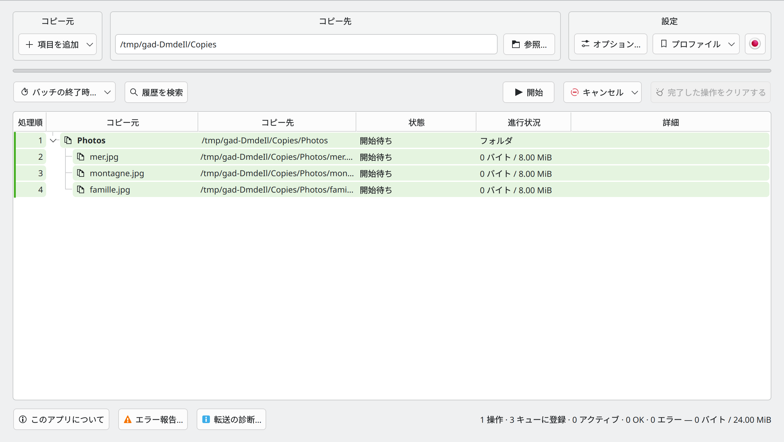
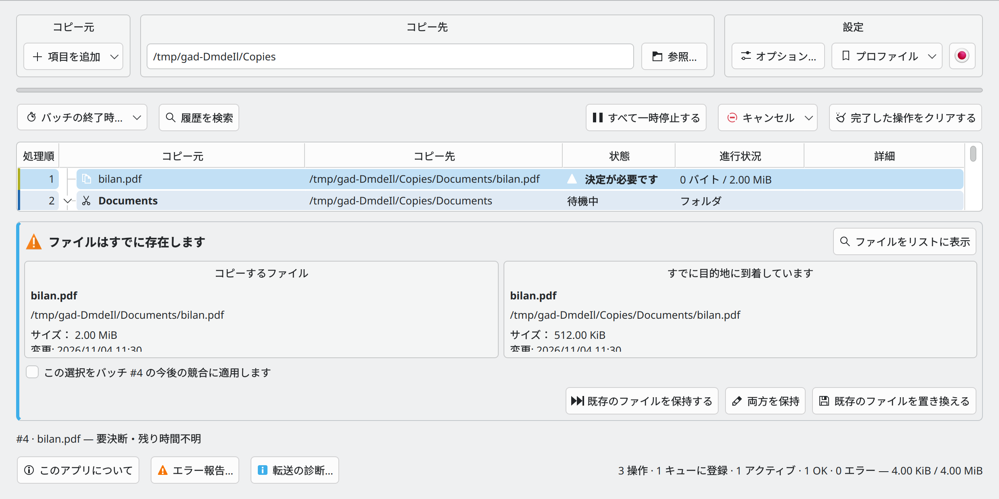

# Gad — クイックスタート {#gad-quick-start}

**Gad, il copie. · 高機能ファイル複製マネージャー · バージョン 0.4.0**

[ユーザーガイド](USER_GUIDE.ja-JP.md) · [開発者ガイド](DEVELOPER_GUIDE.ja-JP.md) · [すべての言語](README.ja-JP.md)

## Gadをインストールする

対応するUbuntuでは[Gad PPA](https://launchpad.net/~hizo/+archive/ubuntu/gad)を利用できます。[GitHubのリリース](https://github.com/Hizoka76/gad/releases/latest)では、`.deb`、ソースとコンパイル済みプログラムを含む`.tar.gz`、実行ファイル単体の`gad-linux-amd64`も提供しています。

```sh
sudo add-apt-repository ppa:hizo/gad
sudo apt update
sudo apt install gad
```

PPAのページで、お使いのUbuntuのバージョン向けにパッケージが公開されているか確認してください。`add-apt-repository`がない場合は`software-properties-common`をインストールしてください。

コマンド、依存関係、形式ごとの違いは[ユーザーガイド](USER_GUIDE.ja-JP.md#installation-and-startup)を参照してください。

## Gadを起動する {#start-gad}

アプリケーション メニューから **Gad** を開くか、次のコマンドを実行します。

```sh
gad
```

まだインストールされていない場合は、[インストール手順](USER_GUIDE.ja-JP.md#installation-and-startup) に従ってください。トレイが使用可能な場合、ウィンドウを閉じると、通常、システム トレイに Gad が残ります。そのアイコンをクリックすると、ウィンドウが再度表示されます。

## 最初のコピー {#make-your-first-copy}



コピー先とオプションを選び、Gad にファイルを追加します。転送中でなければリストを確認して **開始** を押します。通常の貼り付けは自動開始し、転送中の追加はキューに入ります。**Ctrl+C** はコピー、**Ctrl+X** は移動です。ドラッグ＆ドロップは常にコピーを準備します。

## 転送の確認と操作 {#read-and-control-transfers}

- **待機中**: 順番を待ちます。 **転送中**:現在転送中です。 **吉田**終わった。
- フォルダを展開してファイルを見る. リクエストの色は、別々のサブミットを識別するのに役立ちます。 **処理順** 処理順序を示します。
- **すべて一時停止する**はキューを一時停止します。同じボタンで再開します。個々の一時停止、再開、再試行、およびキャンセルアクションの行を右クリックします。
- 待ち行列を選択して**次の工程**を使用し、テーブルにキュー順序が表示されている間、それらを位置にドラッグします。
- **キャンセルして復元する**は、履歴を保持することで、完了した作業の取り消しを試みます。

## 設定を調整する {#set-your-preferences}


*「設定」領域から開くオプションのダイアログ。*

**設定 → オプション…** の **設定** タブと **ショートカット** タブで各種設定と連携を管理します。変更は直ちに反映され、**閉じる** または Escape で閉じられます。コマンドライン引数は灰色で表示されます。**除外…** では `__*` などのフォルダーパターンや `*.tmp`、`*~` などのファイルパターンを指定できます。選択した転送の速度を設定するボタンは、メイン操作バーの左側にあります。

**同じフォルダー内での複製を許可**は、元のフォルダにコピーバックする際に、`photo_copied1.jpg`などの名前を作成します。デフォルトではオフになっており、コピーにのみ適用されます。選択、検証、複製の選択は新しいリクエストのためにキャプチャされます。既存の設定は維持されます。転送中に、グローバル速度制限が変更されることがあります。

## ファイルマネージャーから直接貼り付ける {#paste-directly-from-your-file-manager}

- **Dolphin:** 有効にする **Dolphin で Ctrl+V を Gad に割り当てる** 設定で再起動します。 Dolphin利用できます **Gadで貼り付けます。** コンテキストメニューから。
- **Konqueror:** 発射 **Konqueror 一緒に Gad** 設定でチェックボックスを有効にします。 Gadテキストペーストはネイティブのままです。
- **その他のマネージャ** 内側に貼り付ける Gadまたは、明示的な宛先を使用してカスタムアクションを設定できます。 `gad --paste "/home/demo/Documents/Copies"`. ネイティブのCtrl+Vは自動的にインターセプトされない。

ファイルマネージャから開始したペーストは、開くことなくバックグラウンドで実行できます。 Gad. Plasma 進捗通知は **Gad を表示** リンク

## 競合やエラーの解決 {#resolve-a-conflict-or-an-error}



*アクションを選択する前に、ソースと既存の宛先を比較します。*

既存のファイルについては、**既存のファイルを保持する**、**両方を保持**、または**既存のファイルを置き換える**を選択します。

開館 **エラー報告…** デバイスが消えた場合は、同じデバイスを同じ場所に再接続し、そのデバイスを同じ場所に再接続します。 Gad 再開前に確認してください。

**履歴を保存** 情報を保持するのです **クリア終了。** 対応する復旧情報を削除します。 MD5 チェック、およびすべてのキャンセル選択は、継続します。 [ユーザーガイド](USER_GUIDE.ja-JP.md).

## コマンドによる設定とマニュアル {#command-settings}

`gad --configure` は設定を保存し、実行中の画面にも反映します。未起動の場合は Gad をバックグラウンドで起動し、コマンドは終了します。`--no-…` 形式で各項目を無効にします。指定しない除外一覧は保持され、`--exclude-folder` または `--exclude-file` を繰り返すと対応する一覧を置き換えます。`--clear-exclusions` は両方を空にします。全体の速度上限は MiB/s 単位で、0 は無制限です。コピーや移動と共に指定する `--md5` と `--properties` は、その転送だけに適用されます。Dolphin のショートカットには `gad --configure --dolphin-ctrl-v` または `--no-dolphin-ctrl-v` を使います。

```bash
gad --configure --md5 --verify-space --no-include-hidden
gad --configure --exclude-folder "__*" --exclude-file "*.tmp" --language fr_FR --rate-limit 25
```

`man gad` · `make manpages`

## Ctrl+V の自動監視 {#dolphin-watchdog}

通常の Dolphin ランチャーの保護と Ctrl+V の自動監視については、ユーザーガイドを参照してください。

[Ctrl+V の自動監視](USER_GUIDE.ja-JP.md#dolphin-watchdog)


## 転送プロファイル

**設定 → プロファイル**で、すべてのオプションを名前付きで保存し、ワンクリックで適用できます。**コピー先は保存も変更もしません。**言語と全体の速度制限は通常どおり反映します。**プロファイルを管理…**から更新、名前変更、削除ができます。[転送プロファイル](USER_GUIDE.ja-JP.md#transfer-profiles)を参照してください。

コマンドラインでは `gad --profile "マイプロファイル"` で転送を開始せずに設定を適用します。コピー例: `gad --profile "マイプロファイル" --copy /path/source --to /path/destination`。`--move` / `--paste` とも組み合わせられます。Gad は全設定の適用を待ってから転送を開始します。宛先はコマンドで指定し、`--md5` などの明示的なオプションが優先されます。不明な名前ではファイルを追加せずにエラーを返します。`--configure --profile "マイプロファイル"` に追加した設定は、プロファイルの後に適用されます。


## メインリストで転送を準備する

コピー先とオプションを選び、Gad にファイルを追加します。転送中でなければリストを確認して **開始** を押します。通常の貼り付けは自動開始し、転送中の追加はキューに入ります。**Ctrl+C** はコピー、**Ctrl+X** は移動です。ドラッグ＆ドロップは常にコピーを準備します。

## オプション

**設定 → オプション…** はモーダルウィンドウです。閉じるまでメインウィンドウは操作できませんが、転送は続きます。設定は直ちに反映され、**閉じる** や Escape では取り消されません。各項目の下にはコマンドライン引数が灰色で表示されます。最小サイズは **800 × 740**、メインウィンドウ・エラー報告・診断は **1100 × 600** です。

タブは **設定**、**ショートカット**、**転送速度**、**バッチ完了時**、**除外** の5つです。速度には全体の上限と新規要求の既定値があります。既存の要求は行を選択し、右クリックの速度制限で変更します。上限はフォルダーを含む **詳細** セルに表示され、無制限の場合は追加表示されません。

## 項目の追加、ショートカット、除外

**項目を追加**メニューには、ファイルの追加（Ctrl+Shift+O）、フォルダーの追加（Ctrl+O）、**クリップボードのファイル**（Ctrl+V）があります。コピーまたは切り取りの指定を保持します。Gadが待機中の場合、Gad内で追加した項目は開始ボタンを押すまで待機します。開始済みの転送がある場合はキューに追加されます。ファイルマネージャーからの外部貼り付けだけが自動的に開始します。

**Ctrl+F**で検索を開きます。**Ctrl+Q**で終了を要求しますが、転送中は終了しません。**Ctrl+Alt+W**は転送を止めずにウィンドウを非表示にします。プロファイルの右側にある国旗ボタンで言語を即座に変更できます。メイン画面のボタンにはツールチップがあります。

設定、ショートカット、速度制限、バッチ完了、除外の5つのタブがあります。コマンドライン引数は灰色で表示します。既存バッチの速度制限は行の右クリックメニューから変更し、詳細列で確認できます。

設定のオプションにある**除外**タブで、フォルダー用とファイル・シンボリックリンク用のパターンを1行に1つ入力します。各入力欄はフォーカスを失うと保存され、適用ボタンや別のダイアログはありません。無効なルールはエラーを表示し、以前のルールと修正用の入力内容を保持します。新しい転送に適用されます。隠し項目の設定は設定タブに残ります。
