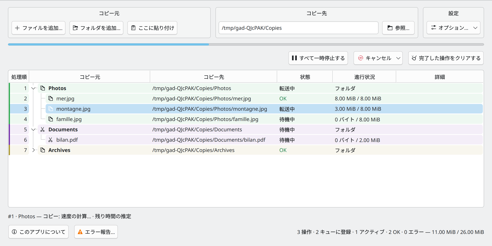
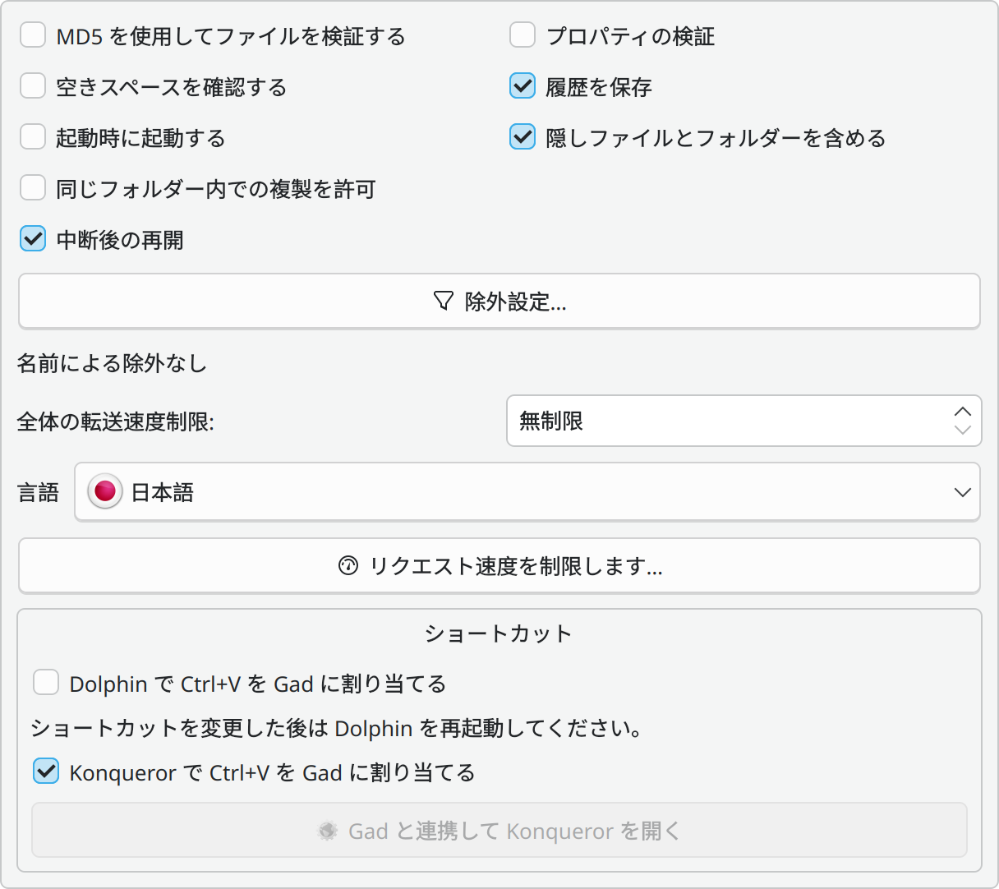
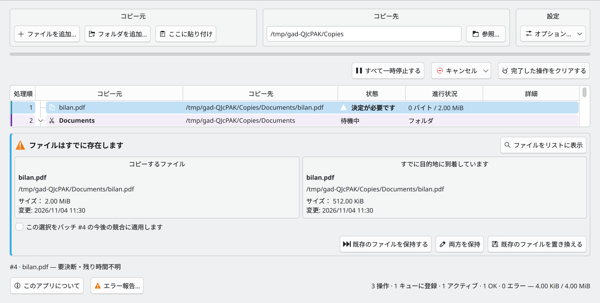

# Gad — クイックスタート {#gad-quick-start}

**Gad, il copie. · 高機能ファイル複製マネージャー · バージョン 0.1.0**

[ユーザーガイド](USER_GUIDE.ja-JP.md) · [開発者ガイド](DEVELOPER_GUIDE.ja-JP.md) · [すべての言語](README.ja-JP.md)

## Gadを起動する {#start-gad}

アプリケーション メニューから **Gad** を開くか、次のコマンドを実行します。

```sh
gad
```

まだインストールされていない場合は、[インストール手順](USER_GUIDE.ja-JP.md#installation-and-startup) に従ってください。トレイが使用可能な場合、ウィンドウを閉じると、通常、システム トレイに Gad が残ります。そのアイコンをクリックすると、ウィンドウが再度表示されます。

## 最初のコピー {#make-your-first-copy}



*送信元、宛先、設定は転送リストの上にグループ化されています。*

1. ファイル マネージャーでファイルまたはフォルダーを選択し、**Ctrl+C** を押します。
2. Gad で、**コピー先** を受信する既存のフォルダーに設定します。
3. 「**ここに貼り付け**」をクリックするか、「**Ctrl+V 内部 Gad**」を押します。
4. リストから目的地を確認してください。キューが一時停止されない限り、転送作業は自動的に開始されます。

利用できます。 **ファイルを追加…**, **フォルダを追加…**またはファイルをドラッグします。 Gad 目的地を設定した後。 **ドラッグ アンド ドロップでは常にコピーされます。** ファイルを移動します。 **Ctrl+X** ファイルマネージャが認識されたカットマーカーを公開し、そのリストに示されている操作を確認します。 [他のマネージャーの指示](USER_GUIDE.ja-JP.md#using-gad-with-other-file-managers) 必要なら

もう一度貼り付けて、別のリクエストを追加してください。Gadは作業をキューし、一度に2つの互換性のある転送を実行することができます。保留中の操作は無視されます。

## 転送の確認と操作 {#read-and-control-transfers}

- **待機中**: 順番を待ちます。 **転送中**:現在転送中です。 **吉田**終わった。
- フォルダを展開してファイルを見る. リクエストの色は、別々のサブミットを識別するのに役立ちます。 **処理順** 処理順序を示します。
- **すべて一時停止する**はキューを一時停止します。同じボタンで再開します。個々の一時停止、再開、再試行、およびキャンセルアクションの行を右クリックします。
- 待ち行列を選択して**次の工程**を使用し、テーブルにキュー順序が表示されている間、それらを位置にドラッグします。
- **キャンセルして復元する**は、履歴を保持することで、完了した作業の取り消しを試みます。

## 設定を調整する {#set-your-preferences}



*設定から、目的地の右側にオプションを開きます。*

陰 **設定 → オプション。**言語、非表示項目の取り扱い、検証オプション、履歴、起動、帯域幅の制限を選択. チェックボックスがすぐに適用され、メニューを開いたままにします。 **除外設定…** フォルダパターンなど。 `__*` ファイルパターンなど `*.tmp` それとも `*~`.

**同じフォルダー内での複製を許可**は、元のフォルダにコピーバックする際に、`photo_copied1.jpg`などの名前を作成します。デフォルトではオフになっており、コピーにのみ適用されます。選択、検証、複製の選択は新しいリクエストのためにキャプチャされます。既存の設定は維持されます。転送中に、グローバル速度制限が変更されることがあります。

## ファイルマネージャーから直接貼り付ける {#paste-directly-from-your-file-manager}

- **Dolphin:** 有効にする **Dolphin で Ctrl+V を Gad に割り当てる** 設定で再起動します。 Dolphin利用できます **Gadで貼り付けます。** コンテキストメニューから。
- **Konqueror:** 発射 **Konqueror 一緒に Gad** 設定でチェックボックスを有効にします。 Gadテキストペーストはネイティブのままです。
- **その他のマネージャ** 内側に貼り付ける Gadまたは、明示的な宛先を使用してカスタムアクションを設定できます。 `gad --paste "/home/demo/Documents/Copies"`. ネイティブのCtrl+Vは自動的にインターセプトされない。

ファイルマネージャから開始したペーストは、開くことなくバックグラウンドで実行できます。 Gad. Plasma 進捗通知は **Gad を表示** リンク

## 競合やエラーの解決 {#resolve-a-conflict-or-an-error}



*アクションを選択する前に、ソースと既存の宛先を比較します。*

既存のファイルについては、**既存のファイルを保持する**、**両方を保持**、または**既存のファイルを置き換える**を選択します。

開館 **エラー報告…** デバイスが消えた場合は、同じデバイスを同じ場所に再接続し、そのデバイスを同じ場所に再接続します。 Gad 再開前に確認してください。

**履歴を保存** 情報を保持するのです **クリア終了。** 対応する復旧情報を削除します。 MD5 チェック、およびすべてのキャンセル選択は、継続します。 [ユーザーガイド](USER_GUIDE.ja-JP.md).
