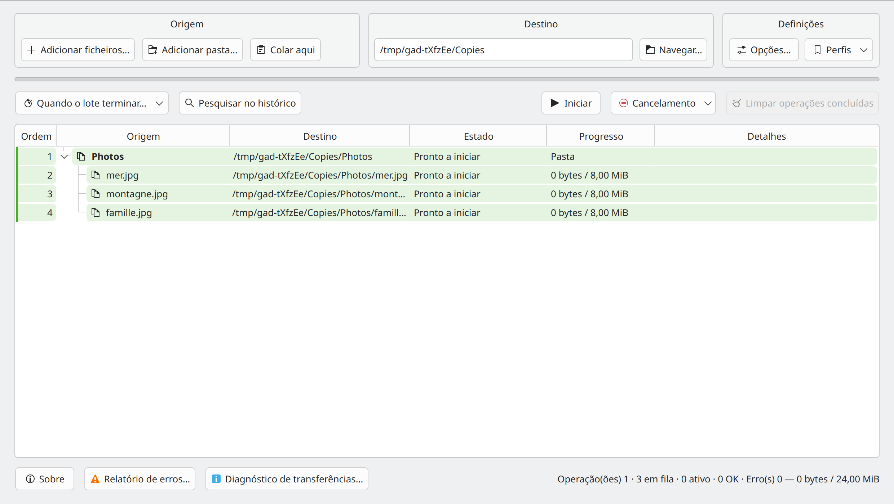
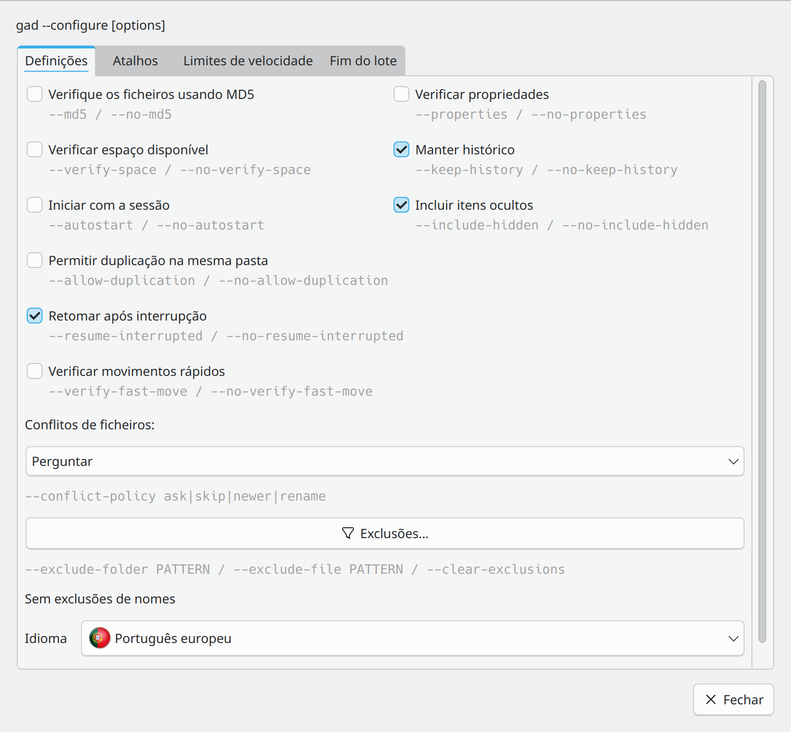
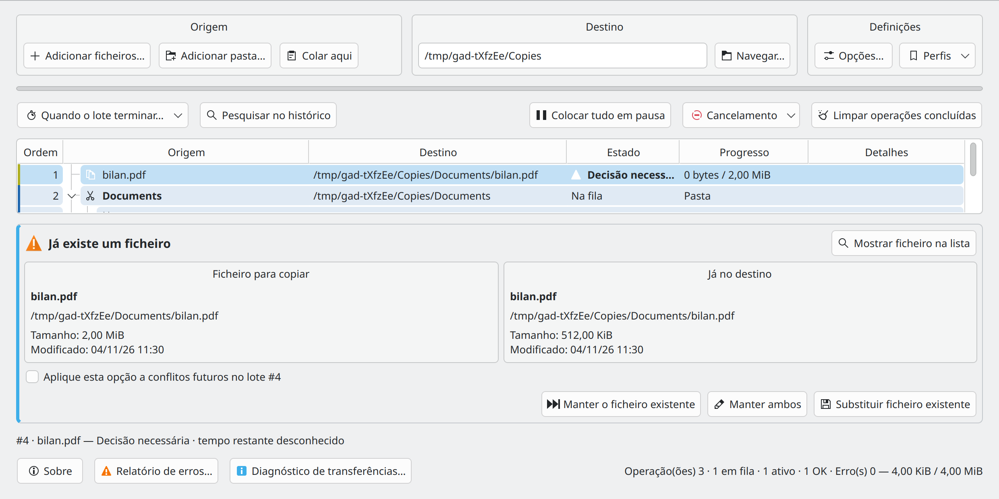

# Gad — Início rápido {#gad-quick-start}

**Gad, il copie. · Gestor avançado de duplicação · Versão 0.2.0**

[Guia do utilizador](USER_GUIDE.pt-PT.md) · [Guia do desenvolvedor](DEVELOPER_GUIDE.pt-PT.md) · [Todos os idiomas](README.pt-PT.md)

## Instalar o Gad

Utilize o [PPA do Gad](https://launchpad.net/~hizo/+archive/ubuntu/gad) numa versão Ubuntu suportada. As [versões do GitHub](https://github.com/Hizoka76/gad/releases/latest) também fornecem um `.deb`, um arquivo `.tar.gz` com as fontes e o programa compilado, e o binário direto `gad-linux-amd64`.

```sh
sudo add-apt-repository ppa:hizo/gad
sudo apt update
sudo apt install gad
```

Verifique na página do PPA se existe um pacote publicado para a sua versão do Ubuntu. Se faltar `add-apt-repository`, instale `software-properties-common`.

Os comandos, dependências e diferenças entre formatos estão descritos no [guia do utilizador](USER_GUIDE.pt-PT.md#installation-and-startup).

## Iniciar o Gad {#start-gad}

Abra **Gad** no menu da aplicação ou execute:

```sh
gad
```

Caso ainda não esteja instalado, siga o [instruções de instalação](USER_GUIDE.pt-PT.md#installation-and-startup). Fechar a janela deixa normalmente o Gad na bandeja do sistema quando uma bandeja está disponível. Clique no ícone para mostrar novamente a janela.

## Fazer a primeira cópia {#make-your-first-copy}



Escolha destino e opções e adicione os ficheiros no Gad. Sem trabalho ativo, reveja a lista e clique em **Iniciar**. A colagem habitual inicia automaticamente; novos elementos durante uma transferência entram na fila. **Ctrl+C** copia e **Ctrl+X** move. Arrastar e largar prepara sempre uma cópia.

## Acompanhar e controlar as transferências {#read-and-control-transfers}

- **Na fila**: aguardando a sua vez. **Em curso**: atualmente em transferência. **OK**: concluído.
- Expanda uma pasta para ver os seus ficheiros. As cores do pedido ajudam a identificar envios separados; **Ordem** mostra a ordem de processamento.
- **Colocar tudo em pausa** pausa a fila. Retome com o mesmo botão. Clique com o botão direito do rato nas linhas para as ações individuais de pausa, retoma, nova tentativa e cancelamento.
- Selecione as linhas em espera e utilize **Tratar a seguir** ou arraste-as para a posição enquanto a tabela mostra a ordem da fila.
- O cancelamento interrompe a operação; **Cancelar e restaurar** também tenta desfazer o trabalho concluído utilizando o histórico retido. Leia a confirmação e o resultado detalhado antes de limpar o histórico.

## Definir as preferências {#set-your-preferences}



*O diálogo de opções abre-se a partir do bloco Definições.*

Em **Definições → Opções…**, os separadores **Definições** e **Atalhos** agrupam preferências e integrações. As alterações aplicam-se imediatamente; **Fechar** ou Esc fecha o diálogo. Os parâmetros de comando aparecem a cinzento. **Exclusões…** aceita padrões de pastas como `__*` e de ficheiros como `*.tmp` ou `*~`. O botão de velocidade dos pedidos selecionados está à esquerda da barra de ações principal.

**Permitir duplicação na mesma pasta** cria nomes como `photo_copied1.jpg` ao copiar de volta para a pasta original. Está desativado por defeito e aplica-se apenas a cópias. As opções de seleção, verificação e duplicação são capturadas para novos pedidos; as solicitações existentes mantêm as suas definições. O limite global de velocidade pode mudar durante as transferências.

## Colar a partir do gestor de ficheiros {#paste-directly-from-your-file-manager}

- **Dolphin:** ative **Ctrl+V com Gad no Dolphin** em Definições e reinicie Dolphin. Também pode utilizar **Colar com Gad** no menu de contexto.
- **Konqueror:** inicia **Konqueror com Gad** e ativa a sua caixa de seleção em Definições. As pastas de ficheiro vão para Gad; as pastas de texto permanecem nativas.
- **Outros gestores:** cole dentro de Gad, arraste ficheiros para o mesmo ou configure uma ação personalizada utilizando um destino explícito, por exemplo `gad --paste "/home/demo/Documents/Copies"`. O seu Ctrl+V nativo não é intercetado automaticamente.

Uma colagem iniciada a partir de um gestor de ficheiros pode ser executada em segundo plano sem abrir o Gad. As notificações de progresso Plasma fornecem uma ligação **Mostrar Gad**.

## Resolver um conflito ou um erro {#resolve-a-conflict-or-an-error}



*Compare a origem e o destino existente antes de escolher uma ação.*

Para um ficheiro existente, escolha **Manter o ficheiro existente**, **Manter ambos** ou **Substituir ficheiro existente**. Aplique a escolha a conflitos posteriores apenas quando for isso que pretende.

Abra o **Relatório de erros…** para transferências com falha, copie ou exporte os detalhes e tente novamente apenas os ficheiros com falha. Se um dispositivo desaparecer, volte a ligar o mesmo dispositivo no mesmo local e deixe o Gad verificar antes de retomar.

**Manter histórico** retém informação de anulação. **Limpar operações concluídas** remove as informações de restauro correspondentes. Para recuperação, endereços remotos, verificações MD5 e todas as opções de cancelamento, continue com [Guia do utilizador](USER_GUIDE.pt-PT.md).

## Configuração e páginas de manual {#command-settings}

`gad --configure` guarda as preferências e atualiza os controlos da instância aberta. Se não existir nenhuma, inicia o Gad em segundo plano e devolve o controlo ao terminal. As formas `--no-…` desativam as caixas. As listas de exclusão não indicadas são conservadas; repetir `--exclude-folder` ou `--exclude-file` substitui a lista correspondente. `--clear-exclusions` limpa ambas. O limite global utiliza MiB/s; 0 significa sem limite. `--md5` e `--properties` numa cópia ou movimento afetam apenas essa transferência. Os atalhos do Dolphin utilizam `gad --configure --dolphin-ctrl-v` ou `--no-dolphin-ctrl-v`.

```bash
gad --configure --md5 --verify-space --no-include-hidden
gad --configure --exclude-folder "__*" --exclude-file "*.tmp" --language fr_FR --rate-limit 25
```

`man gad` · `make manpages`

## Vigilância automática de Ctrl+V {#dolphin-watchdog}

Consulte o guia do utilizador para proteger o lançador habitual do Dolphin e carregar a vigilância automática de Ctrl+V.

[Vigilância automática de Ctrl+V](USER_GUIDE.pt-PT.md#dolphin-watchdog)


## Perfis de transferência

Em **Definições → Perfis**, guarde todas as opções com um nome e selecione-o para as aplicar com um clique. **O destino nunca é guardado nem alterado.** O idioma e o limite global têm o seu efeito habitual. **Gerir perfis…** permite atualizar, mudar o nome e eliminar. Consulte os [perfis de transferência](USER_GUIDE.pt-PT.md#transfer-profiles).

Na linha de comandos, `gad --profile "Meu perfil"` aplica as definições sem iniciar uma transferência. Para copiar: `gad --profile "Meu perfil" --copy /caminho/origem --to /caminho/destino`; também funciona com `--move` / `--paste`. Gad aguarda a aplicação do perfil. O destino vem do comando e as opções explícitas, como `--md5`, têm prioridade. Um nome desconhecido devolve um erro sem colocar ficheiros em fila. `--configure --profile "Meu perfil"` aceita definições adicionais, aplicadas após o perfil.


## Preparar transferências na lista principal

Escolha destino e opções e adicione os ficheiros no Gad. Sem trabalho ativo, reveja a lista e clique em **Iniciar**. A colagem habitual inicia automaticamente; novos elementos durante uma transferência entram na fila. **Ctrl+C** copia e **Ctrl+X** move. Arrastar e largar prepara sempre uma cópia.

## Opções

**Definições → Opções…** abre uma janela modal que bloqueia a janela principal enquanto as transferências continuam. As alterações aplicam-se imediatamente; **Fechar** ou Esc não as anula. Os parâmetros de comando aparecem a cinzento. Tamanho mínimo: **800 × 740**; janela principal, relatório de erros e diagnóstico: **1100 × 600**.

Os quatro separadores são **Definições**, **Atalhos**, **Limites de velocidade** e **Fim do lote**. Os limites incluem o global e o predefinido para novos pedidos. Para alterar um pedido existente, selecione as linhas e utilize **botão direito → Limitar a velocidade da solicitação…**. O limite aparece em **Detalhe**, incluindo nas pastas; sem limite não é acrescentado texto.
