# Gad — Benutzerhandbuch {#gad-user-guide}

**Gestionnaire Avancé de Duplication · Version 0.4.0**

**Gad, il copie.**

Deutsche Ausgabe, aktualisiert am 8. November 2026.

[Schnellstart](QUICK_START.de-DE.md) · [Französisch](GUIDE_UTILISATEUR.md) · [Alle Ausgaben](README.de-DE.md)

## Inhalt {#contents}

[Gad mit anderen Dateimanagern verwenden](#using-gad-with-other-file-managers)

[Elemente von Übertragungen ausschließen](#excluding-items-from-transfers)

1. [Was Gad bietet](#what-gad-does)
2. [Installation und Start](#installation-and-startup)
3. [Das Fenster kennenlernen](#understanding-the-window)
4. [Strg+V in Dolphin verwenden](#using-ctrlv-in-dolphin)
5. [Kopieren oder Verschieben starten](#starting-a-copy-or-move)
6. [Schnelle lokale Verschiebungen](#fast-local-moves)
7. [Status und Fortschritt verstehen](#reading-states-and-progress)
8. [Die Warteschlange organisieren](#organizing-the-queue)
9. [Pausieren und fortsetzen](#pausing-and-resuming)
10. [Die Geschwindigkeit begrenzen](#limiting-bandwidth)
11. [Konflikte lösen](#resolving-conflicts)
12. [Übertragungen abbrechen oder rückgängig machen](#canceling-or-undoing-transfers)
13. [Das Kontextmenü verwenden](#using-the-context-menu)
14. [Fehlerbericht und gezielte Wiederholungsversuche](#error-reporting-and-targeted-retries)
15. [Dateiinhalte mit MD5 prüfen](#checking-file-contents-with-md5)
16. [Dateieigenschaften prüfen](#checking-file-properties)
17. [Verfügbaren Speicherplatz prüfen](#checking-available-space)
18. [Auf die erneute Verbindung eines Geräts warten](#waiting-for-a-device-to-reconnect)
19. [Nach einem Absturz fortsetzen](#resuming-after-a-crash)
20. [Verlauf und Bereinigung](#history-and-cleanup)
21. [Infobereich und Sitzungsstart](#system-tray-and-session-startup)
22. [Telefone, FTP, SFTP und SMB](#phones-ftp-sftp-and-smb)
23. [Tastenkürzel](#keyboard-reference)
24. [Fehlerbehebung](#troubleshooting)
25. [Grenzen und bewährte Verfahren](#limits-and-good-practices)


## Was Gad bietet {#what-gad-does}

Gad verwaltet Dateikopien und -verschiebungen in einem KDE Plasma-Fenster. Jede neue Anfrage fügt der Warteschlange Arbeit hinzu. Die Liste zeigt Ordner und ihre untergeordneten Ordner, wartende Dateien, aktive Übertragungen, abgeschlossene Ergebnisse und Fehler. Zeilen, die zur gleichen Anfrage gehören, haben eine dezente Hintergrundfarbe und eine Akzentmarkierung.

Ein **Auftrag**, auch Batch genannt, entspricht einer Übermittlung: Durch das Einfügen von drei Dateien wird eine Anfrage erstellt, die diese Dateien enthält. Die Auswahl eines Ordners umfasst auch seine Unterordner und Dateien. Die Gruppierung bleibt für Zieleinstellungen, Fortschritt und Rückgängigmachen nützlich, auch wenn über den Dateizeilen keine Stapelkopfzeilen vorhanden sind.

Bis zu zwei Übertragungen können gleichzeitig ausgeführt werden, wenn ihre Quell- und Zielfestplatten unabhängig sind. Eine bewährte lokale Umbenennung kann auch parallel zu einer Kopie auf einer gemeinsam genutzten Festplatte ausgeführt werden, wenn sich deren Pfade nicht überschneiden. Unbekannte Festplattenbeziehungen führen dazu, dass normale Kopien alleine ausgeführt werden.

Gad lässt sich über **Mit Gad einfügen** und das optionale Strg+V in Dolphin einbinden. Die Konqueror-Integration verwendet **Konqueror mit Gad**. Andere Dateimanager können Dateien über das Gad-Fenster oder einen benutzerdefinierten Befehl übergeben; ihr natives Strg+V wird nicht automatisch abgefangen.


### Die Bildschirmaufnahmen lesen {#reading-the-screenshots}

Die 23 Aufnahmen zeigen die echten Gad-Widgets, Beispieldateien und simulierte Übertragungszustände. Sie verwenden das helle Design und die Oberflächensprache dieser Ausgabe. Persönliche Dateien und der echte Desktop werden nicht aufgenommen. Externe Plasma-Benachrichtigungen werden in diesen Aufnahmen nicht nachgebildet.

Gad bietet Französisch, US-Englisch, Spanisch, Portugiesisch, Deutsch und Japanisch. Wählen Sie die Sprache im Flaggenmenü rechts von **Profile**: Die Änderung gilt sofort, ohne Gad neu zu starten oder Übertragungen zu unterbrechen. Geöffnete Dialoge und aktive Benachrichtigungen werden aktualisiert; Auswahl und Eingaben bleiben erhalten. **System** wählt eine verfügbare Variante der Desktop-Sprache und verwendet andernfalls Französisch oder Englisch. Nicht erfasste technische Diagnosen und Meldungen externer Dienste können in ihrer ursprünglichen Sprache bleiben.

## Installation und Start {#installation-and-startup}

### Ubuntu-PPA

Das [Gad-PPA](https://launchpad.net/~hizo/+archive/ubuntu/gad) ermöglicht die Installation und Aktualisierung von Gad über APT:

```sh
sudo add-apt-repository ppa:hizo/gad
sudo apt update
sudo apt install gad
```

Prüfen Sie auf der PPA-Seite, ob für Ihre Ubuntu-Version ein Paket veröffentlicht wurde. Falls `add-apt-repository` fehlt, installieren Sie `software-properties-common`.

### Vorkompilierte Downloads

Die [GitHub-Releases](https://github.com/Hizoka76/gad/releases/latest) bieten mehrere Formate. Ersetzen Sie die Beispieldateinamen unten durch die Namen Ihrer heruntergeladenen Dateien.

#### Debian-Paket `.deb`

Laden Sie das Paket für Ihre Architektur herunter und installieren Sie es mit APT, um verfügbare Abhängigkeiten aus Ihren Paketquellen aufzulösen:

```sh
sudo apt install ./gad_VERSION_amd64.deb
```

#### `.tar.gz`-Archiv: Quellen und kompiliertes Programm

Das Archiv `gad-VERSION-linux-amd64.tar.gz` enthält den Quellcode, eingebundene Rust-Abhängigkeiten, Dokumentation und das kompilierte Programm unter `prebuilt/`. Zum Starten ist keine Kompilierung erforderlich:

```sh
tar -xzf gad-VERSION-linux-amd64.tar.gz
cd gad-VERSION
./prebuilt/usr/bin/gad
```

#### Direkte Programmdatei

Auch `gad-linux-amd64` ist eine bereits kompilierte Programmdatei:

```sh
chmod +x gad-linux-amd64
./gad-linux-amd64
```

Linux-amd64-Downloads sind für x86-64-Prozessoren bestimmt. Die direkte Programmdatei installiert weder einen Starter noch das Dolphin-Modul; das `.deb` und das Archiv enthalten die Integrationsdateien der jeweiligen Version. Die Programme benötigen Qt/KF6 in den in den Release-Hinweisen angegebenen Versionen. Ein Release entspricht seinem Tag und kann älter als der aktuelle Repository-Code sein.

### Aus dem Quellcode

Installieren Sie die in [Entwicklerhandbuch](DEVELOPER_GUIDE.de-DE.md#building) und [Testanleitung](../TESTING.de-DE.md#requirements) beschriebenen Linux-Build-Abhängigkeiten. Aus dem Projektverzeichnis:

```bash
python3 scripts/install.py
gad
```

Das Installationsprogramm erstellt die ausführbare Versionsdatei und installiert den Launcher, die Symbole und die Dolphin-Aktionen in Ihrem Konto. Es sind keine Administratorrechte erforderlich. Schließen Sie Dolphin nach der Installation oder Änderungen an seinen Aktionen und öffnen Sie es erneut.

Sie können Gad über den Anwendungsstarter oder mit `gad` starten. `gad --background` startet es in der Taskleiste. Bei einem zweiten Start wird die vorhandene Instanz kontaktiert, anstatt eine separate Warteschlange zu öffnen.

Wenn das Fach verfügbar ist, wird es beim Schließen des Hauptfensters ausgeblendet und die Übertragungen werden fortgesetzt. Zum Beenden verwenden Sie **Gad beenden** im Taskleistenmenü. Gad weigert sich zu beenden, während Übertragungen oder Vorbereitungsaufgaben aktiv sind; Eine Pause allein macht sie nicht fertig. Ohne Fach führt das Fenster vor dem Verlassen die gleiche Prüfung durch.

Beenden oder brechen Sie bei einem Update die aktive Arbeit ab und beenden Sie Gad normal, bevor Sie es erneut öffnen. Eine bereits laufende ausführbare Datei verwendet weiterhin ihren alten Code, nachdem eine neue Binärdatei installiert wurde.

## Das Fenster kennenlernen {#understanding-the-window}

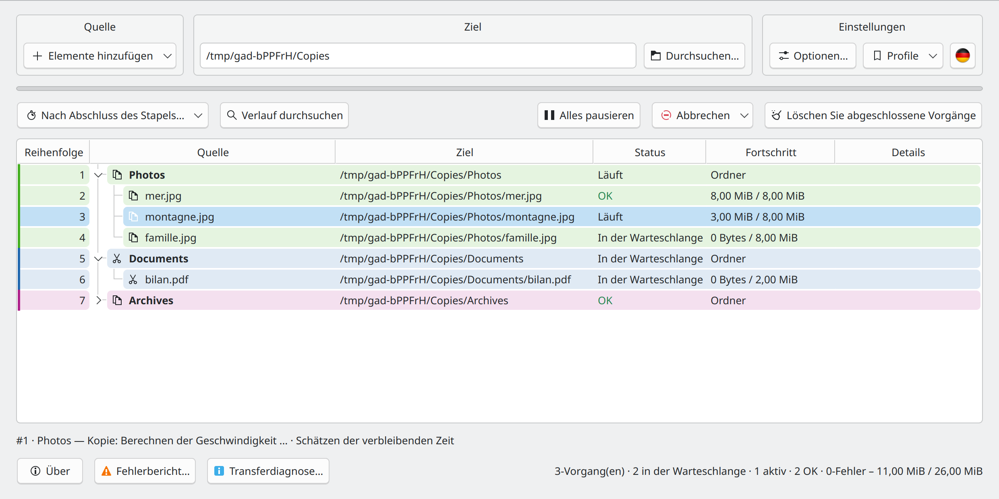

*Die Liste zeigt Dateien direkt an, wobei echte Ordner den Baum bilden. Wunschfarben sorgen dafür, dass einzelne Einreichungen erkennbar bleiben.*

| Bereich | Zweck |
|---|---|
| **Quelle** | Fügen Sie Dateien hinzu, fügen Sie einen Ordner hinzu oder fügen Sie sie in das ausgewählte Ziel ein. |
| **Ziel** | Geben Sie einen lokalen Pfad oder eine unterstützte Remote-URL ein oder suchen Sie nach einem Ordner. |
| **Einstellungen → Optionen…** | Überprüfung, Ausschlüsse, Duplizierung, Verlauf, Start, Geschwindigkeitsbegrenzungen und Verknüpfungen. |
| Fortschrittsbalken | Kombinierter Fortschritt für die aufgeführten Transferarbeiten. |
| Filter und Kontrollen | Filtern Sie Zeilen, pausieren Sie die Warteschlange, brechen Sie ab, machen Sie rückgängig oder löschen Sie den abgeschlossenen Verlauf. |
| Dateiliste | Quelle, Ziel, Status, Fortschritt und detaillierte Nachrichten. |
| Unten die Liste | Konfliktentscheidungen und Informationen zur Geschwindigkeit/verbleibenden Zeit pro Anfrage. |
| Fußzeile | **Über**, **Fehlerbericht…** und die kombinierte Zusammenfassung. |

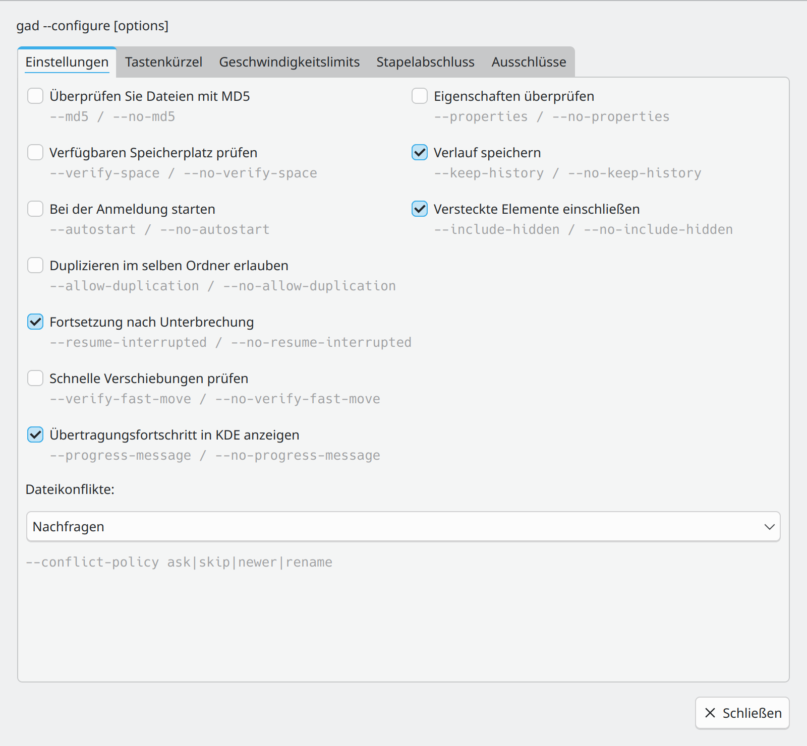

*Der Optionsdialog wird über den Bereich Einstellungen geöffnet.*

**Einstellungen → Optionen…** öffnet ein modales Fenster: Das Hauptfenster bleibt bis zum Schließen gesperrt, Übertragungen laufen weiter. Änderungen gelten sofort; **Schließen** oder Escape macht sie nicht rückgängig. Befehlszeilenoptionen stehen grau unter den Bedienelementen. Mindestgröße: **800 × 740**; Hauptfenster, Fehlerbericht und Diagnose: **1100 × 600**.

Die fünf Reiter sind Einstellungen, Tastenkürzel, Geschwindigkeitsbegrenzungen, Stapelabschluss und Ausschlüsse. Befehlszeilenparameter erscheinen grau. Das Limit eines bestehenden Stapels wird im Kontextmenü seiner Zeilen geändert und in der Detailspalte angezeigt.

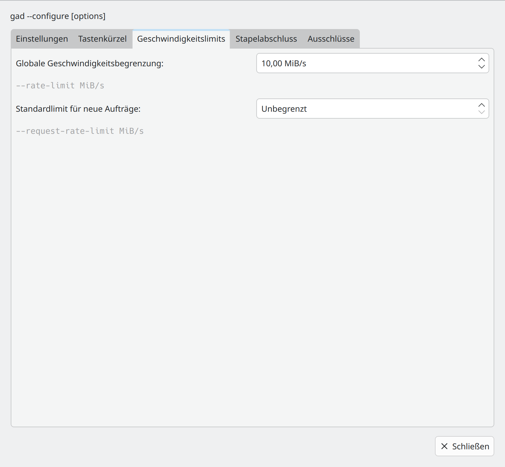

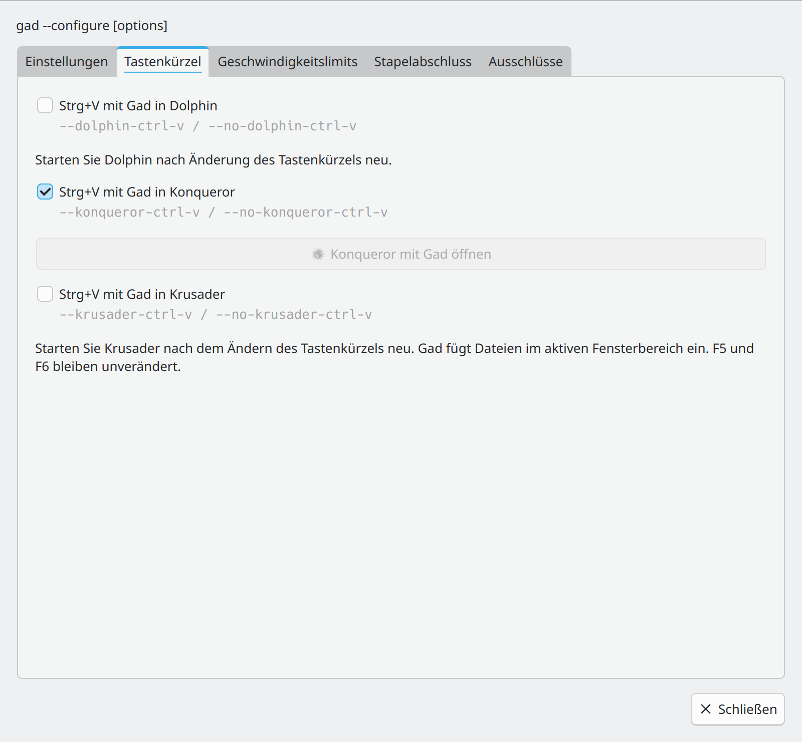

*Der Reiter Tastenkürzel steuert die Dateiverwaltungsintegration.*

**Tastenkürzel** aktiviert oder deaktiviert Strg+V mit Gad für Dolphin und Konqueror. Dolphin-Änderungen verwenden den reversiblen Shortcut-Helper von Gad und erfordern einen Neustart von Dolphin; Eine abgelehnte Änderung stellt das Kontrollkästchen wieder her und zeigt einen Fehler an. Konqueror übernimmt Änderungen beim nächsten Tastendruck in **Konqueror mit Gad**. Die Startschaltfläche ist verfügbar, wenn sowohl der Browser als auch der Launcher installiert sind. Texteinfügungen bleiben nativ.

**Über** zeigt den Anwendungsnamen, Akronym, Slogan, Icon, Version und Build-Datum an. Das Software-Icon ist das Curly-haired-Dokument-Bild, das vom Fenster, Launcher, Über Dialog und Tablet verwendet wird.

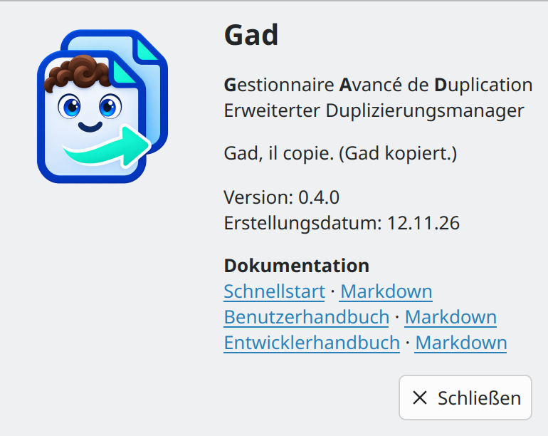

*About identifiziert den aktuell ausgeführten Build.*

## Strg+V in Dolphin verwenden {#using-ctrlv-in-dolphin}

Die Rechtsklick-Aktion **Paste mit Gad** funktioniert, ohne die native Einfügeverknüpfung von Dolphin zu ersetzen. Es erhält den Zielkontext, auf den Sie geklickt haben.

So verknüpfen Sie Strg+V mit Gad in Dolphin:

```bash
gad --configure --dolphin-ctrl-v
```

Schließen Sie Dolphin und öffnen Sie es erneut. Strg+V zielt dann auf den aktuell geöffneten Ordner Dolphin. Die Integration löst diesen Ordner anhand der Sitzungsinformationen von Dolphin auf; es ist kein vollständiger Pfad im Fenstertitel erforderlich. In einem Textfeld bleibt Strg+V eine Texteinfügung.

**Umschalt+Einfügen** bleibt die Standard-Pastenalternative KDE/Dolphin KIO. Es handelt sich nicht um eine neue Gad-Verknüpfung. So stellen Sie die vorherige Dolphin-Verknüpfungskonfiguration wieder her:

```bash
gad --configure --no-dolphin-ctrl-v
```

Die Änderung gilt für Dolphin, nicht für jede Anwendung in Plasma. Vorhandene Verknüpfungen und Aktionen werden über die gespeicherte Konfiguration der Integration wiederhergestellt, anstatt nicht verwandte Benutzereinstellungen zurückzusetzen.

## Gad mit anderen Dateimanagern verwenden {#using-gad-with-other-file-managers}

Gad kann Dateien von einem anderen Manager empfangen, z. B. Nautilus, Nemo oder Thunar. Die Kontextmenü- und Verknüpfungsintegration hängt vom Manager ab: Gad fängt seinen **Strg+V** nicht automatisch ab oder leitet nicht automatisch seinen aktiven Ordner ab.

### Kopieren oder ausschneiden und dann Gad einfügen {#copy-or-cut-then-paste-in-gad}

1. Wählen Sie Dateien in Ihrem Manager aus und verwenden Sie **Strg+C** oder **Strg+X**, um eine Verschiebung anzufordern.
2. Öffnen Sie Gad und legen Sie den Zielordner in **Ziel** fest.
3. Klicken Sie auf **Zwischenablage-Dateien** oder drücken Sie **Ctrl+V in Gad**.
4. Überprüfen Sie das in der Liste angezeigte Ziel und den Vorgangstyp.

Der Manager muss eine Dateiliste in einem Zwischenablageformat veröffentlichen, das Gad versteht. Es reicht nicht aus, einen Pfad als Klartext zu kopieren. Für den Verschiebung ist ein anerkannter Schnittmarker erforderlich; Wenn es nicht verfügbar ist, verwenden Sie den unten aufgeführten expliziten Befehl `--move`.

### Ziehen Sie Dateien in Gad {#drag-files-into-gad}

Legen Sie zuerst **Ziel** fest und ziehen Sie dann Dateien oder Ordner aus Ihrem Manager in die Liste von Gad. **Durch Drag-and-Drop wird immer eine Kopie erstellt**, auch wenn Sie diese Dateien zuvor ausgeschnitten haben. Um Dateien zu verschieben, fügen Sie sie mit einem anerkannten Schnittmarker ein oder verwenden Sie `--move`.

### Erstellen Sie eine benutzerdefinierte Aktion oder Schaltfläche {#create-a-custom-action-or-button}

Wenn Ihr Manager einen Befehl, eine Menüaktion oder eine Symbolleistenschaltfläche starten kann, verwenden Sie die folgenden Befehle. Ersetzen Sie diese Beispielpfade. Das Ziel muss ein vorhandener Ordner sein.

So fügen Sie die Zwischenablage im Hintergrund an einem expliziten Ziel ein:

```sh
gad --paste "/home/demo/Documents/Copies"
```

So kopieren Sie Quellen, ohne die Zwischenablage zu verwenden:

```sh
gad --copy "/home/demo/Images/photo.jpg" "/home/demo/Images/album" --to "/home/demo/Documents/Copies"
```

So verschieben Sie Quellen explizit:

```sh
gad --move "/home/demo/Images/photo.jpg" --to "/home/demo/Documents/Copies"
```

Eine benutzerdefinierte Aktion muss **der Zielordner** an `--paste` übergeben. Übergeben Sie für `--copy` und `--move` **die ausgewählten Quelldateien** vor `--to`, gefolgt vom Zielordner. Ersetzungsvariablen und Anführungszeichen hängen vom Manager ab: Gehen Sie nicht davon aus, dass ein Auswahlargument den geöffneten Ordner identifiziert, und verwenden Sie die Platzhalter eines anderen Managers nicht wieder. Wenn `gad` nicht gefunden wird, verwenden Sie den vollständigen Pfad `~/.local/bin/gad` mit erweitertem Home-Verzeichnis.

Andere Manager, die KIO-Servicemenüs unterstützen, bieten möglicherweise auch **Paste mit Gad** an. Die Verfügbarkeit ist nicht in jedem Manager gewährleistet. Die Optionen Dolphin und Konqueror unter **Einstellungen → Optionen…** steuern nur diese Integrationen; `--paste-current` erkennt die aktiven Ordner anderer Anwendungen nicht.

## Kopieren oder Verschieben starten {#starting-a-copy-or-move}


Wählen Sie Ziel und Optionen und fügen Sie Dateien in Gad hinzu. Wenn nichts läuft, prüfen Sie die Liste und klicken Sie auf **Starten**. Externes Einfügen aus dem Dateimanager startet automatisch; während einer Übertragung werden neue Aufträge eingereiht. **Strg+C** kopiert, **Strg+X** verschiebt. Ziehen und Ablegen bereitet immer eine Kopie vor.

### Von Dolphin {#from-dolphin}

1. Verwenden Sie **Strg+C** zum Kopieren oder **Strg+X** zum Verschieben.
2. Öffnen Sie den gewünschten Zielordner oder klicken Sie mit der rechten Maustaste darauf.
3. Wählen Sie **Paste mit Gad** oder verwenden Sie Strg+V, wenn die Gad-Integration aktiviert ist.
4. Wiederholen Sie diesen Vorgang, um weitere Arbeit zur gleichen Warteschlange hinzuzufügen.

Ein externes Einfügen startet im Hintergrund und erzwingt nicht das Öffnen des Hauptfensters. Wenn es ausgeblendet ist, zeigt Plasma die native Fortschrittsansicht an. Durch ein gültiges externes Einfügen kann eine bestehende globale Pause gelöscht werden, um die Übertragung zu starten. Eine explizit gewünschte Pause nach der Abgabe hat Vorrang, auch während der Vorbereitung im Hintergrund. Durch ein vollständig dupliziertes Einfügen wird keine Pause gelöscht.

### Von Gad {#from-gad}

Das Menü **Elemente hinzufügen** enthält **Dateien hinzufügen…** (Strg+Umschalt+O), **Ordner hinzufügen…** (Strg+O) und **Zwischenablage-Dateien** (Strg+V). Kopieren oder Ausschneiden bleibt erhalten. Im Leerlauf warten alle Ergänzungen innerhalb von Gad auf **Starten**; bei bereits gestarteten Übertragungen werden sie eingereiht. Nur externes Einfügen aus dem Dateimanager startet automatisch.

Durch das Ablegen von Dateien auf Gad wird immer ein **Kopie: ** erstellt. Eine Dateiliste, die eingefügt wird, während das Zielfeld den Fokus hat, wird weiterhin in die Übertragungswarteschlange aufgenommen. Gewöhnlicher Text behält das normale Verhalten beim Einfügen von Textfeldern bei.

### Doppelte Anfragen {#duplicate-requests}

Gad ignoriert einen Vorgang, der bereits von einer aktiven Anforderung abgedeckt wird, einschließlich eines Vorgangs in Pause: dieselbe Quelle, dasselbe Ziel und denselben Vorgangstyp. Die Prüfung umfasst wiederholte Einfügungen, gleichzeitige Hinzufügungen, wiederholte Auswahlen und Dateien, die bereits in einem anderen übermittelten Ordner enthalten sind.

Neue Dateien bleiben zusammen mit allen benötigten Ordnern erhalten. Eine kurze Informationsmeldung informiert darüber, wie viele Einträge nicht hinzugefügt wurden. Es gibt keine Option zum Überschreiben. Die erste Anfrage behält ihre Verifizierungsoptionen.

Ein anderes Ziel oder eine Copy-versus-Move-Änderung bleibt eine separate Anfrage. Verschiedene Quelldateien mit demselben Namen verwenden weiterhin die Konfliktbehandlung. Sie können eine Datei absichtlich erneut kopieren, nachdem die frühere Anforderung abgeschlossen ist.

### Vorbereitung {#preparation}

Gad validiert alle Roots und scannt die Anfrage, bevor eine ihrer Dateien kopiert wird. Die Vorbereitung auf einer Telefon- oder Netzwerkfreigabe kann einige Zeit dauern. Es wird ein Fehler gemeldet, anstatt stillschweigend nur den Teil zu starten, der erfolgreich gescannt wurde.

Spezielle Dateien und Pfade außerhalb des unterstützten UTF-8-Vertrags werden abgelehnt. Ein symbolischer Quelllink wird als Link kopiert, einschließlich eines defekten Links. Gad durchläuft ihn nicht als Quellordner.

## Elemente von Übertragungen ausschließen {#excluding-items-from-transfers}

Unter **Einstellungen → Optionen… → Ausschlüsse** wird je ein Muster pro Zeile für Ordner oder Dateien und symbolische Links eingegeben. Jedes Feld wird beim Fokusverlust gespeichert, ohne Anwenden-Schaltfläche und ohne zusätzlichen Dialog. Ungültige Regeln werden gemeldet; bisherige Regeln bleiben aktiv und der Text bleibt zur Korrektur erhalten. Regeln gelten für neue Übertragungen. Die Option für versteckte Elemente bleibt im Reiter Einstellungen.

| Typ | Beispiel | Wirkung |
| --- | --- | --- |
| Ordner | `__*` | Überspringt Ordner, deren Namen mit zwei Unterstrichen beginnen, einschließlich `__pycache__`. |
| Dateien | `*.tmp` | Überspringt Dateien mit dieser Erweiterung. |
| Dateien | `*.swp` oder `*~` | Überspringt einige temporäre Editor- und Sicherungsdateien. Geben Sie jedes Muster in einer eigenen Zeile ein. |

`*` entspricht null oder mehr Zeichen und `?` entspricht einem Zeichen. Der Abgleich berücksichtigt die Groß-/Kleinschreibung und gilt für Basisnamen in jeder Tiefe, einschließlich explizit ausgewählter Elemente. Ausgeschlossene Ordner werden nie durchlaufen. Symbolische Links verwenden Dateimuster und werden nicht befolgt. Wenn Sie die Option „hidden-items“ deaktivieren, werden Namen, die mit einem Punkt beginnen, sowohl für Dateien als auch für Ordner ausgeschlossen.

Leerzeilen werden ignoriert; Zwischenräume bleiben Teil von Mustern. Vollständige Pfade, reguläre Ausdrücke und Klammerzeichenklassen werden nicht interpretiert. Die Grenzwerte liegen bei 128 Mustern pro Typ und 256 UTF-8-Bytes pro Muster, ohne Schrägstriche oder Zeilenumbrüche.

Die Einstellungen werden für jede neue Anfrage vor der Vorbereitung des Fernzugriffs gespeichert und erfasst. Vorhandene Stapel, Fortsetzungen und Wiederholungsversuche behalten ihre ursprünglichen Regeln. Während des Verschiebens bleiben ausgeschlossene Elemente an der Quelle, sodass Quellordner möglicherweise bestehen bleiben. Die schnelle Umbenennung ganzer Ordner ist deaktiviert, wenn die Filterung aktiv ist, berechtigte einzelne Dateien können jedoch weiterhin schnell verschoben werden.

## Schnelle lokale Verschiebungen {#fast-local-moves}

Für eine geeignete lokale Verschiebung verwendet Gad eine Umbenennung, anstatt den Inhalt zu kopieren und die Quelle zu löschen. Dadurch bleibt der Inode der Datei erhalten und die Übertragung ihrer Daten wird vermieden. Es kann neben einer Kopie ausgeführt werden, die dieselbe Festplatte verwendet, wenn ihre Pfade unabhängig sind.

Verschiedene Bind-Mount-Pfade können weiterhin auf ein zugrunde liegendes Dateisystem verweisen. Zum Beispiel:

```text
/media/library/Music  → /home/you/Music
/media/library/Other  → /home/you/Other
```

Gad kann diese Ansichten umbenennen, wenn ein sicherer gemeinsamer Pfad und übereinstimmende Identitäten nachgewiesen werden. Die gleiche physische Festplatte allein reicht nicht aus: Unterschiedliche Partitionen, Subvolumes, schreibgeschützte Zuordnungen oder Kernel-Umbenennungsbeschränkungen können stattdessen ein Kopieren und Löschen erfordern. Eine abgelehnte Umbenennung wird mit normalen Kopierreservierungen nachgeholt.

Für einen vollständigen, unveränderten Ordnerbaum ohne Konflikte oder pausierte/ausgeschlossene Einträge kann Gad den gesamten Baum auf einmal umbenennen. Die Detailberichte **Dossier en bloc umbenannt**. Ansonsten verarbeitet es die Einträge einzeln. Externe Dateien, die einem verschobenen Baum hinzugefügt werden, werden beim Rückgängigmachen geschützt und nicht stillschweigend verschoben oder gelöscht.

Durch die Aktivierung von MD5 wird der normale Kopierpfad anstelle der Verknüpfung zum schnellen Umbenennen verwendet. Das Parallelitätslimit beträgt weiterhin zwei Vorgänge.

## Status und Fortschritt verstehen {#reading-states-and-progress}

Lange erklärende Tooltips verwenden einen Zeilenumbruch zwischen den Sätzen. Dateinamen und Pfade behalten ihre ursprüngliche Zeichensetzung und Abstände.

Quellzeilen verwenden Kopiersymbole für Kopien und Ausschneidesymbole für Verschiebungen, einschließlich vorbereiteter Ordner und Anforderungen. Ordner bleiben fett und behalten ihre Nachkommen.

Die Spalte **Reihenfolge** wird zuerst angezeigt und passt sich automatisch der Mindestbreite an, die für Titel, Sortierpfeil und Zahlen erforderlich ist. Es folgt der Engine-Warteschlange, einschließlich Ordnern, Scan-Anfragen und gespeichertem Verlauf. Beim Sortieren und Filtern der Anzeige werden die verbleibenden Zeilen nie neu nummeriert, daher sind Lücken in einer gefilterten Ansicht normal. Bei Änderungen der Warteschlangenpriorität werden die Positionen aktualisiert. Bewegen Sie den Mauszeiger über eine Zahl für **Charge #…**. Parallele Übertragungen können in einer anderen Reihenfolge abgeschlossen werden.

| Spalte | Bedeutung |
|---|---|
| **Reihenfolge** | Position der Motorwarteschlange, unabhängig von der Sortierung der Anzeige; Bewegen Sie den Mauszeiger über die Aufträgenummer. |
| **Quelle** | Datei- oder Ordnername; Das Symbol „Kopieren/Ausschneiden“ zeigt den Vorgang an und der Tooltip bietet den vollständigen Pfad und optionale MD5/Rate-Einstellungen. Aufträgenummern bleiben in den Bestell-Tooltips erhalten. |
| **Ziel** | Zielpfad oder die zur Anzeige rekonstruierte ursprüngliche Remote-URL. |
| **Status** | Aktueller Status, einschließlich Pause, Konflikte, Prüfungen und wartendes Gerät. |
| **Fortschritt** | Kopierte Bytes und Dateigröße oder der MD5/Recovery-Check-Fortschritt. |
| **Details** | Fehler, MD5-Ergebnisse, Schnellbewegungsinformationen und Überprüfungswarnungen. |

| Staat | Bedeutung |
|---|---|
| **Dateien werden erfasst…** | Roots validieren und Anfrage scannen. |
| **In der Warteschlange** | Warten auf seinen Zug, Ressourcen oder eine Fortsetzungsaktion. |
| **Läuft** | Übermittlung der Daten bzw. Bearbeitung der Eingabe. |
| **Pausiert** | Es gilt eine globale Pause, eine Anfragepause oder eine Eingabepause. |
| **Warten auf Gerät** | Eine bekannte Halterung ist nicht verfügbar. Teildaten bleiben erhalten. |
| **Fortsetzungsdaten werden geprüft…** | Überprüfen Sie die Quelle und das gespeicherte Teilpräfix, bevor Sie erneut schreiben. |
| **MD5 wird überprüft…** | Unabhängiges erneutes Lesen von Quelle und temporärem Ziel. |
| **Entscheidung erforderlich** | Ein Dateikonflikt erfordert Ihre Entscheidung. |
| **OK** | Fertig; grün angezeigt. |
| **Fehler** | Ein Schritt ist fehlgeschlagen; Lesen Sie die Details oder öffnen Sie den Fehlerbericht. |
| **Übersprungen** | Übersprungen; Die Quelle bleibt. |
| **Abgebrochen** | Abgebrochen, ohne abgeschlossene Ergebnisse automatisch rückgängig zu machen. |
| **Wiederherstellung…** | Rückgängig wird ausgeführt. |
| **Wiederhergestellt** | Die ausgewählten Effekte wurden rückgängig gemacht. |
| **Restaurierung unvollständig** | Das Rückgängigmachen konnte nicht sicher abgeschlossen werden. |

Ein Ordner wird erst dann in Ordnung, wenn die entsprechenden untergeordneten Ordner fertig sind. Bei diesem Übergang bricht es zusammen. Durch erneutes manuelles Öffnen bleibt es auch bei späteren Fortschrittsaktualisierungen geöffnet. Auswahl, Hover und Tooltips bleiben erhalten, während sich die Zähler ändern.

### Filter {#filters}

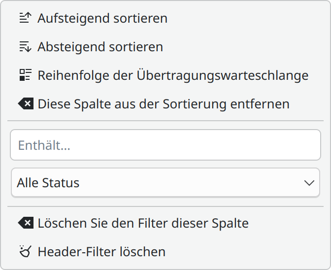

*Durch das Filtern ändert sich die Sichtbarkeit, nicht das Übertragungsverhalten.*

Filter sind verfügbar, indem Sie mit der rechten Maustaste auf die Spaltenüberschriften klicken. Die bisherige globale Filterkombination über der Tabelle wurde entfernt. Vorfahrenordner bleiben bei Bedarf sichtbar, um ein passendes Kind anzuzeigen. Durch Auswahl eines Filters werden relevante Zweige geöffnet. Bei normalen Fortschrittsaktualisierungen werden Zweige, die Sie ausgeblendet haben, nicht erneut geöffnet.

### Sortieren und Filtern nach Kopfzeilen {#sorting-and-filtering-from-headers}

Klicken Sie auf einen Spaltentitel, um zwischen aufsteigender und absteigender Anzeigereihenfolge umzuschalten. **Strg+Klick** fügt der vorhandenen Sortierung eine Spalte hinzu; Durch wiederholtes Klicken bei gedrückter Strg-Taste wird die Richtung dieser Spalte umgekehrt, ohne dass sich ihre Priorität ändert. In den Kopfzeilen werden Prioritäten als **(1)**, **(2)** usw. angezeigt, mit dem üblichen Sortierpfeil rechts neben jeder sortierten Spalte. Ein Klick ohne Strg stellt die einspaltige Sortierung wieder her. Namen verwenden eine natürliche Sortierung (`file2` vor `file10`). Der Fortschritt wird nach numerischem Prozentsatz sortiert, unabhängig von der Dateigröße und den angezeigten Einheiten. Die Sortierung erfolgt unter Geschwistern: Ordner behalten ihre Nachkommen.

Klicken Sie mit der rechten Maustaste auf eine Überschrift, um das zugehörige Menü zu öffnen. Es bietet eine aufsteigende/absteigende Sortierung, **Reihenfolge der Übertragungswarteschlange**, und einen Filter **Enthält…**, bei dem die Groß-/Kleinschreibung nicht berücksichtigt wird, für diese Spalte. Bei der Quellensuche werden auch vollständige Pfade berücksichtigt. Status fügt einen genauen Statusselektor hinzu; Progress fügt Mindest- und Höchstprozentsätze hinzu. **Diese Spalte aus der Sortierung entfernen** entfernt einen Sortierschlüssel, während die anderen beibehalten werden. Löschaktionen entfernen einen Spaltenfilter oder alle Kopffilter.

Spaltenfilter werden miteinander kombiniert. Übereinstimmende Kinder behalten sichtbare Vorfahrenordner bei; Aktive Filter bleiben in den Spaltenmenüs verfügbar. Globale Schalter decken weiterhin alle Überweisungen ab. Durch das Auffinden einer Datei in einem Konflikt- oder Fehlerbericht werden Filter gelöscht, die sie möglicherweise verbergen.

Beim Sortieren ändert sich nur die Anzeige, niemals die Ausführungspriorität. Stellen Sie **Reihenfolge der Übertragungswarteschlange** wieder her, bevor Sie Zeilen ziehen, um die Arbeit neu anzuordnen. Die Anzeigeeinstellungen überdauern Fortschrittsaktualisierungen und Sprachänderungen.

### Zähler und Schätzungen {#counters-and-estimates}

Die kombinierte Zusammenfassung zählt Transfer-Arbeit. Ein Umbenennen bringt logische Bytes ohne Darstellung kopierter Datenträger-Verkehr voran. Eine voll geschriebene Datei kann noch unter MD5-Verifikation erfolgen. Versteckte/entfernte Zeilen sind von der sichtbaren Zusammenfassung ausgeschlossen. Verzeichnisse tragen keine Datei-Content Bytes bei.

Unterhalb der Liste hat jede aktive Anfrage einen eigenen Quellnamen, eine Geschwindigkeit und eine geschätzte Zeit, die übrig bleibt. Messungen verwenden die letzten fünf Sekunden der Aktivität. Eine kurze Aufwärmanzeige **- Was? - Ja.** bis genug Zeit ist abgelaufen.

Kopieren und MD5-Rereads haben separate Messungen. Ist die MD5-Geschwindigkeit noch unbekannt, deckt die Schätzung explizit nur die Kopie ab und sagt **MD5 à estimer**. Wenn beide Messungen verfügbar sind, enthält die Schätzung die übrigen Kopier- und Verifikations-Lesse. Es ist ungefähr und nicht vorhersagen Wartezeit Wartezeiten Wartezeiten.

Eine Pause suspendiert Schätzungen; ein Konflikt zeigt **Entscheidung erforderlich**. Individuell gepflasterte Dateien machen die gesamte Restzeit der Anfrage auch während andere Dateien voran nicht unbekannt. Umbenannte zeigen keine künstlichen Disk-Copy-Geschwindigkeiten, und ein erkanntes wiederhergestelltes Präfix erzeugt keine Geschwindigkeitsspitze. Ohne Fortschritt fällt die alte Geschwindigkeit auf Null und die Schätzung wird nicht verfügbar.

## Die Warteschlange organisieren {#organizing-the-queue}

Ziehen Sie eine oder mehrere **warten.** Zeilen vor oder nach einer anderen Zeile. Der Insertionsmarker zeigt die gewünschte Position; Hovering in der Nähe der Kante scrollt die Liste. Top-Level-Dateiwurzeln können über Anfragen abgeflacht werden.

Ein Ordner bewegt sich mit seinem Zweig. Dateien innerhalb eines Ordners reorder unter Geschwistern; sie halten ihren eigentlichen Elternteil und Ziel. Verschieben Sie den Elternordner, um den gesamten Zweig neu zu positionieren. Dragging ändert nie das Ziel.

Das Kontextmenü bietet **Als nächstes verarbeiten** (Process next) und **Warteschlange neu anordnen** (Move in queue). Strg und Shift unterstützen mehrere Selektion. **Gesamten Stapel auswählen** wählt die anderen Wurzeln der gleichen Vorlage aus.

Die Verarbeitung unterbricht die aktuelle Datei nicht oder entfernt eine Pause. Disk-Kompatibilität und Uno-Abhängigkeiten gelten noch. Unsicheres Interleaving von Anträgen, die dieselben Ausgänge ersetzen, wird mit einem Grund abgelehnt. Eine teilweise veröffentlichte Anfrage kann daher die abhängige Arbeit während einer Pause warten lassen.


## Pausieren und fortsetzen {#pausing-and-resuming}

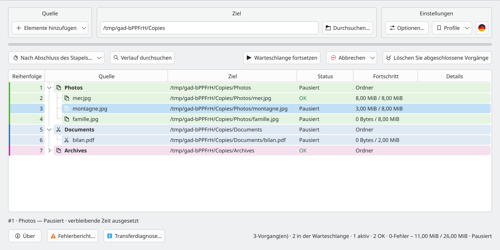

*Unvollendete Zeilen zeigen ihre Pause; abgeschlossene Ergebnisse bleiben OK.*

**Alles pausieren** hält die Warteschlange und die Änderungen an **Warteschlange fortsetzen** (Resume queue) ein. Vollständige Dateien halten ihren Status. Das Kontextmenü kann ausgewählte Anfragen oder Einträge einhalten oder wieder aufnehmen.

Eine Pause wirkt an einem Checkpoint, anstatt einen aktiven Systemaufruf evtl. zu unterbrechen. Ein ausgewählter Fortsetzung entfernt die globale Pause, so dass die Auswahl erfolgen kann; Pausen, die zu anderen Anfragen gehören, bleiben in Kraft.

Die Stornierung ist während einer Pause möglich. Ein explizit angefordertes undo kann auch laufen, während das gewöhnliche Kopieren global gepflastert ist. Die Pausensteuerung in Plasma und das Tablett-Menü bleiben synchron mit dem Hauptfenster.

## Die Geschwindigkeit begrenzen {#limiting-bandwidth}

Das **globale Geschwindigkeitslimit** unter **Einstellungen → Optionen…** begrenzt den gesamten Datenkopierdurchsatz. Änderungen gelten sofort. 0 bedeutet unbegrenzt; schnelle Verschiebungen durch Umbenennen werden nicht gedrosselt.

Zeilen auswählen und links in der Hauptaktionsleiste auf **Geschwindigkeit des Auftrags begrenzen…** klicken oder das Kontextmenü verwenden. Das Limit gilt für jeden ausgewählten Auftrag; alle teilen weiterhin das globale Limit. 0 entfernt nur die individuellen Grenzen.

Beide Zwänge gelten: Eine auf 10 MiB/s begrenzte Anforderung bleibt auf 10 begrenzt, auch wenn die globale Grenze 50 beträgt. Zwei Anträge ohne individuelle Grenzen können maximal 50 MiB/s kombiniert verwenden.

Die Kappe gilt für kopierte Bytes, einschließlich montierte Remote-Endpunkte. OS und Netzwerkpufferung können kurze Variationen erzeugen. MD5 rereads, Immobilienchecks und und undo sind außerhalb dieser Kappe. Schnelle Umbenennungen bleiben umgehend. Pause und Stornierung bleiben bei niedrigen Raten zur Verfügung.

## Konflikte lösen {#resolving-conflicts}

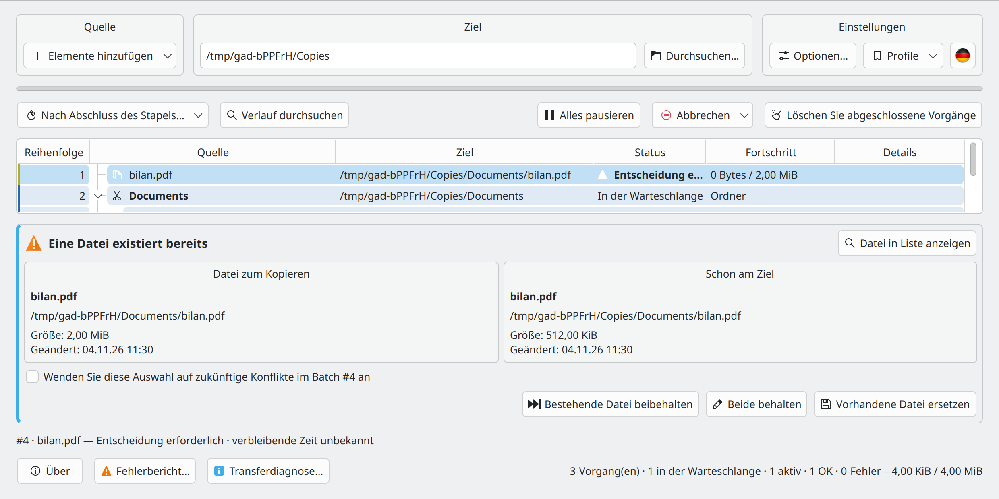

*Die Quelle und das bestehende Ziel werden nebeneinander unter der Dateiliste angezeigt.*

Ein Konfliktpanel zeigt den Dateinamen, den auswählbaren Pfad, die Größe und die Änderungszeit für beide Seiten.

| Knopfdruck | Ergebnis |
|---|---|
| **Bestehende Datei beibehalten** | Halten Sie das bestehende Ziel und überspringen Sie diese Quelle. Eine Bewegung löscht keine übersprungene Quelle. |
| **Beide behalten** | Halten Sie die vorhandene Datei und wählen Sie einen verfügbaren Kopiernamen für das neue Ergebnis. |
| **Vorhandene Datei ersetzen** | Ersetzen Sie es, halten Sie das alte Ziel privat für undo. |

Das Kontrollkästchen wendet die Entscheidung auf spätere Konflikte **in dieser Anfrage** an. Es setzt sich zurück, wenn Sie den angezeigten Konflikt ändern. Bei mehreren Konflikten verwenden Sie den Auswahlschalter, um zu entscheiden, welche zu inspizieren ist.

**Datei in Liste anzeigen** ordnet die blockierte Zeile, einschließlich wenn ein Filter es versteckt. Eine Datei, die einen gewünschten Ordnerpfad einnimmt, oder eine unsichere Symbol-Link in diesem Pfad, kann einen Fehler anstelle eines automatischen Ordnerwechsels erzeugen.

## Übertragungen abbrechen oder rückgängig machen {#canceling-or-undoing-transfers}

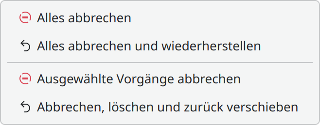

*Globale Aktionen bleiben ohne Auswahl verfügbar.*

### Stoppen Sie ohne undo {#stop-without-undo}

**Alles abbrechen** (Cancel all) stoppt aktive und abgeschreckte Arbeit, einschließlich hervorragender Vorbereitung. Es lässt abgeschlossene Transfers statt. **Ausgewählte Vorgänge abbrechen** Grenzen, die an die Auswahl zu stoppen.

### Ohne abgeschlossene Effekte {#undo-completed-effects}

**Alles abbrechen und wiederherstellen** storniert Arbeit und rückgewinnbare Verlauf, neueste Ausführung zuerst. **Abbrechen, löschen und zurück verschieben** gilt für die ausgewählten Einträge oder Zweige undo.

| Original-Betrieb | Und das Verhalten |
|---|---|
| Kopieren in eine neue Datei | Entfernen Sie die Kopie, die von Gad erstellt wurde. |
| Ersetzen einer vorhandenen Datei | Entfernen Sie das neue Ergebnis und wiederherstellen Sie das gespeicherte Ziel. |
| Los. | Bringen Sie die Datei in ihre Quelle zurück und entfernen Sie ihr Zielergebnis. |
| Erstellen eines Ordners | Entfernen Sie es nur, wenn das getan werden kann, ohne andere Dateien zu verlieren. |

Undo wartet darauf, dass aktive Transferreservierungen freigegeben werden. Ein Verschiebung über Dateisysteme kann verlangen, dass die Inhalte zurück kopiert werden. Eine ungelöste Transaktion muss bereits im Gange sein sicheres Wiederherstellen beenden.

Gad überprüft Identitäten, Metadaten und aufgezeichnete Inhalte vor der Änderung der Ergebnisse. Eine rekreierte Quelle, geändertes Ziel, fehlendes Backup oder fehlendes Volumen kann eine Ablehnung oder ein unvollständiges undo verursachen. Das Detail erklärt, was beibehalten wurde. Eine abgeschlossene Kopie ist kein unabhängiges Backup, und Clearinghistorie entfernt seine Unfähigkeit.

### Löschen und Zurückspace {#delete-and-backspace}

| Ausgewählte Zeile | Löschen | Zurück zur Übersicht |
|---|---|---|
| Fertig | Entfernen Sie die Zeile / Verlauf Referenz; halten Sie die resultierende Datei. | Undo diese Datei oder Zweig, wenn ihr Journal es erlaubt. |
| Aktiv | Stornierung anfordern. | Stornierung anfordern. |
| Ausgaben | Entfernen Sie es von der Warteschlange. | Entfernen Sie es von der Warteschlange. |

Eine Ordnerauswahl erstreckt sich auf ihren Inhalt. Die Auswahl einzelner Dateien wird nicht automatisch ihre Nachbarn abgeschaltet.

## Das Kontextmenü verwenden {#using-the-context-menu}

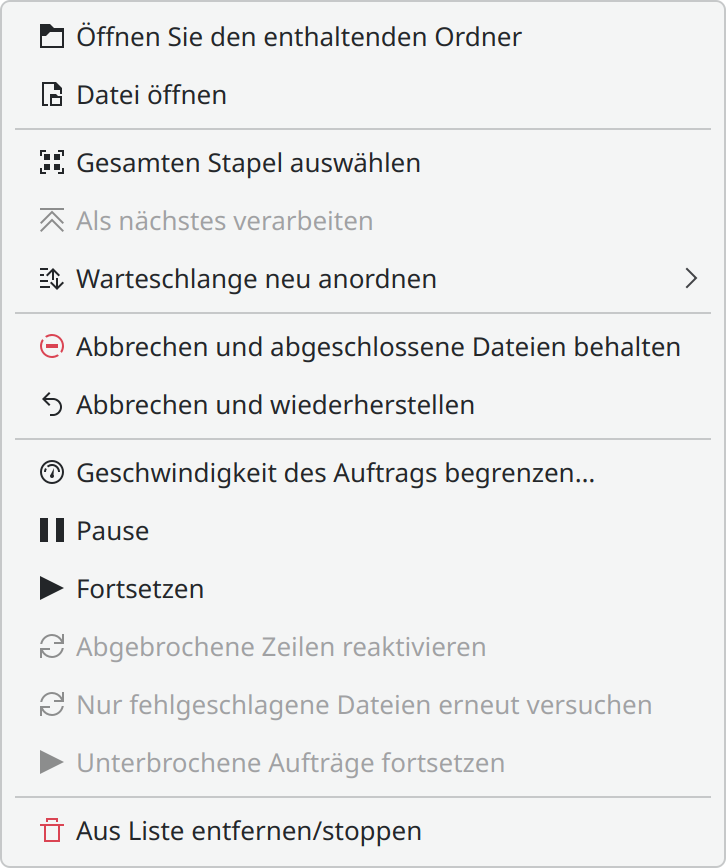

*Aktionen passen sich an die Auswahl und ihre aktuellen Zustände an.*

| Aktion | Zweck |
|---|---|
| **Öffnen Sie den enthaltenden Ordner** | Öffnen Sie den Stammordner einer Datei oder öffnen Sie den ausgewählten Ordner selbst. |
| **Datei öffnen** | Öffnen Sie eine Datei mit ihrer Desktop-assoziierten Anwendung. |
| **Gesamten Stapel auswählen** | Wählen Sie die anderen Einträge aus der gleichen Vorlage aus. |
| **Traiter ensuite / Déplacer dans la file** | Priorisieren Sie Warteeinträge oder -zweige. |
| **Abbrechen und abgeschlossene Dateien behalten** | Stoppen Sie ausgewählte Arbeit und behalten Sie die abgeschlossenen Ausgänge. |
| **Abbrechen und wiederherstellen** | Undo die Auswahl, wenn seine Zeitschrift es erlaubt. |
| **Geschwindigkeit des Auftrags begrenzen** | Tragen Sie eine Bandbreitengrenze auf die eigenen Anforderungen an. |
| **Mettre en Pause / Reprendre** | Pause oder wieder ausgewählte Arbeit. |
| **Nur fehlgeschlagene Dateien erneut versuchen** | Retry berechtigte Fehler, ohne OK-Dateien neu zu kopieren. |
| **Unterbrochene Aufträge fortsetzen** | Gültig und wiederholbare Arbeit nach einer Unterbrechung. |
| **Abgebrochene Zeilen reaktivieren** | Bereiten Sie die Einträge für einen neuen Versuch nach kontrollierter Reinigung ab. |
| **Aus Liste entfernen/stoppen** | Löschen Sie Semantik. |

Für anstehende, aktive, übersprungene, abgebrochene oder ungelöste Zeilen richtet es sich an die Quelle. Der aktuelle Zustand wird überprüft, wenn die Aktion läuft. Duplikate Ordner in einer Mehrfachauswahl öffnen sich nur einmal. Das Starten ist auf eine einzelne Datei beschränkt, nicht auf eine ganze Anfrage oder einen Ordner.

Reaktivierung wartet auf die Anforderung, vollendete Nachbarn zu stoppen und zu bewahren. Wenn der Quelltyp geändert wird, fügen Sie es als eine neue Anfrage hinzu, anstatt die alte Zeile wieder zu verwenden.

## Fehlerbericht und gezielte Wiederholungsversuche {#error-reporting-and-targeted-retries}

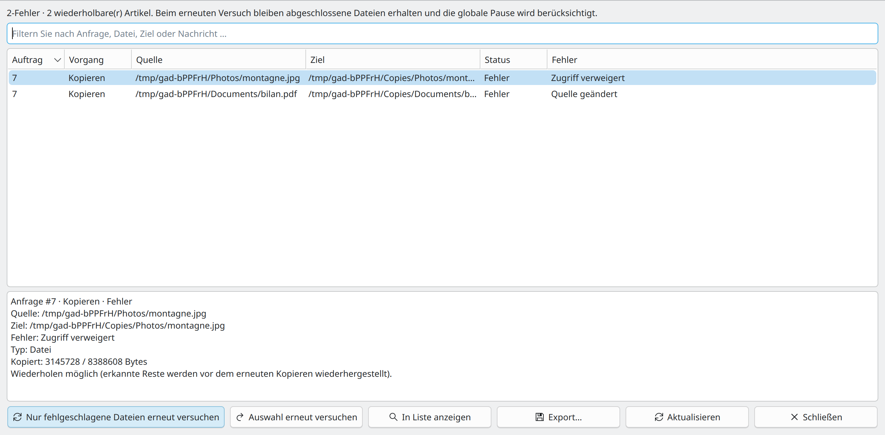

*Alle sechs Buttons haben Icons: Retry angezeigte Fehler, retry die Auswahl, lokalisieren, exportieren, erfrischen und schließen.*

Öffne **Fehlerbericht…** neben Über. Es Gruppen gespeicherte Fehler durch Anfrage, Betrieb, Quelle, Ziel, Zustand und Nachricht. Ein Ordner, der lediglich einen Fehler eines Kindes widerspiegelt, fügt keinen doppelten Datensatz hinzu; ein Ordner ist noch vorhanden.

Suchfilter nach Anfrage, Pfad oder Fehlermeldung. Die Auswahl einer Zeile zeigt das vollständige Detail unten: Fortschritt, partieller Standort, wiederherstellbare Bytes und verfügbare MD5 oder Eigenschaftsinformationen. **In Liste anzeigen** ordnet den Eintrag im Hauptfenster an. **Aktualisieren** erfrischt den Snapshot explizit; der Bericht wird nicht ständig neu gemischt, während Sie es inspizieren.

**Nur fehlgeschlagene Dateien erneut versuchen** rettet erstattungsfähige Fehler derzeit angezeigt. **Auswahl erneut versuchen** Ziele nur ausgewählte Zeilen. In diesem Bericht enthält die Auswahl eines Verzeichnisfehlers nicht stillschweigend ausgefilterte Kinder. Die Ordnerkontextaktion der Hauptliste behält ihr normales Nachkommen-Auswahlverhalten bei.

Die Anforderung muss gestoppt werden. Gad validiert etwaige teilweise oder veröffentlichte Effekte, stellt nur erkannte Reste wieder her und queuet die gescheiterten Elemente wieder. Die gescheiterte Datei wird von Anfang an nach dieser Reinigung wieder neu kopiert. OK Dateien werden nicht recopied; storniert, übersprungen oder entfernte Einträge werden nicht reaktiviert. Andere Einträge, die nur in einer gestoppten Anfrage gewartet wurden, bleiben pauselt, wenn sie außerhalb der respektiert.

Ein Vorbereitungsversagen ohne börsennotierte Dateien kann durch eine vollständige Wurzelvalidierung und einen neuen Scan abrufen. Wenn die Retry-Präparation ausfällt, die Ursache reparieren und den Bericht erneut aktualisieren. Ein separates unvollständiges undo bleibt eine undo/Recovery-Task. Ein geändertes veröffentlichtes Ergebnis bleibt erhalten und kann eine Retry sicher ausfallen lassen.

**Export…** (Export...) wird deaktiviert, wenn der geladene Bericht leer ist. Die Filterung aller Zeilen aus deaktiviert nicht den Export, weil er noch den vollständigen Snapshot abdeckt. Es schreibt den gesamten geladenen Bericht, einschließlich Zeilen, die durch seinen Suchfilter verdeckt sind, wie **UTF-8 Text** oder **JSON**. Text ist zum Lesen und Teilen bestimmt; JSON-Export-Fehler behalten stabile Anfrage/Datei.

## Dateiinhalte mit MD5 prüfen {#checking-file-contents-with-md5}

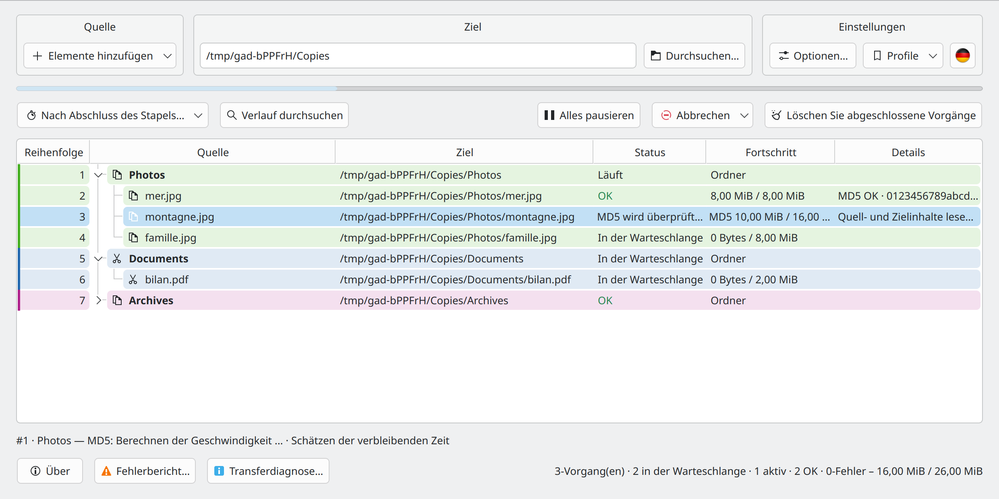

Aktivieren Sie **Überprüfen Sie Dateien mit MD5** für neue Einreichungen. Jede reguläre Datei wird kopiert und synchronisiert, dann wird ihr Quell- und temporäres Ziel neu gelesen und verglichen. Gad veröffentlicht die gleiche verifizierte temporäre Datei unter ihrem letzten Namen nur nach erfolgreichen Überprüfungen.

Die Zeile zeigt **MD5 wird überprüft…** während des Neulesens an und kann später **MD5 OK** und den Verdauungstrakt anzeigen. Für eine N-Byte-Datei fügt die Verifikation zwei N-Byte-les hinzu. Verzeichnisse und symbolische Links werden nicht als Dateiinhalte überprüft.

Lesen Sie Fehler, Stornierungen während der Überprüfung, Quelländerungen oder eine Degest-Mausblendung verhindern die Veröffentlichung und bewahren Sie die Quelle und jedes vorherige Ziel. Eine Bewegung löscht ihre Quelle erst nach erfolgreicher Veröffentlichung und den erforderlichen Kontrollen. Die Einstellung wird für zukünftige Anfragen erinnert; bestehende Anfragen behalten ihre gefangene Wahl.

MD5 überprüft die Konsistenz dieses Transferpfades. Es ist keine kryptographische Garantie gegen bewusst konstruierte Kollisionen.

## Dateieigenschaften prüfen {#checking-file-properties}

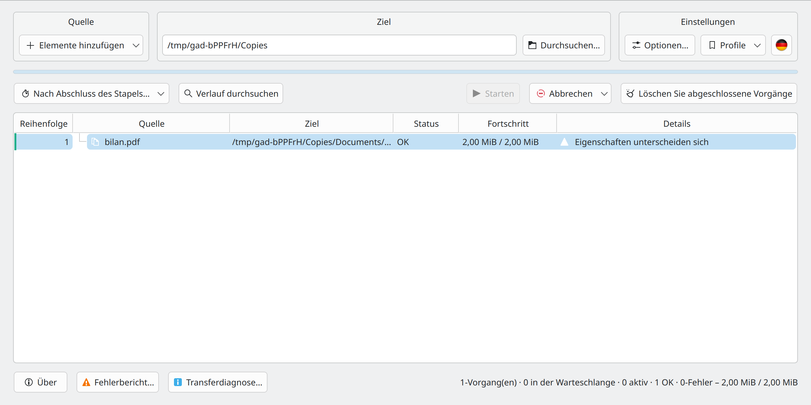

**Eigenschaften überprüfen** vergleicht exponierte Eigentümer, Gruppe, Berechtigungsbits, POSIX ACLs und erweiterte Attribute. Es unterscheidet bekannte Unterschiede von nicht verfügbaren Kontrollen. Attributwerte sind nicht in gespeicherten Berichten enthalten; die Reportlisten Unterschiede und nicht verfügbare Überprüfungen.

Ordinäre Kopien erhalten grundlegende Berechtigungen und Änderung Zeit, wo unterstützt; sie gewinnen nicht Backup-Klasse Besitzer, ACL, oder xattr Erhaltung einfach, weil diese Box aktiviert ist.

Für eine Kopie kann eine Eigenschaftsfehlanpassung das erfolgreich kopierte Ergebnis mit einer Warnung verlassen. Für eine Kopie-und-löschen Bewegung, eine gescheiterte Überprüfung vor der Veröffentlichung bewahrt das Original und das vorherige Ziel; eine gescheiterte Nach-Veröffentlichungsprüfung hält das Original und ein Journal für das erstellte Ergebnis. Ein schneller Umname hat das Objekt bereits verschoben, so dass eine spätere Warnung nicht behauptet, dass die Quelle noch existiert.

Die Option wird per neue Anfrage erinnert und erfasst. Berichte sind in den Detail- und Ordner-Warnsummen verfügbar. Remote-Dienste können nur einen Teil dieser Eigenschaften aussetzen.

## Verfügbaren Speicherplatz prüfen {#checking-available-space}

**Verfügbaren Speicherplatz prüfen** schätzt den Restspeicher, der durch analysierte Anfragen benötigt wird, einschließlich gelöschter und pauseder Kopien, die ein Volumen teilen.

Alte Ziele und Uno-Backups belegen bereits Platz und werden nicht als freie Kapazität während des Austauschs behandelt. Erkannt zugewiesene Wiederaufnahme-Zeiträume werden nicht zweimal gezählt. Block-Zuordnungsrundung wird berücksichtigt. Ein bewährter schneller Umname benötigt keine zweite vollständige Kopie der Daten.

**Wenn die Kapazität nicht geschätzt werden kann, warnt Gad und fährt fort** statt unbestimmt zu blockieren. Die Warnung kann nach Erfolg sichtbar bleiben. Dies ist eine Schätzung, nicht eine Speicherplatzreservierung: ein anderes Programm kann nachher Platz verbrauchen, und spätere Ergänzungen müssen separat berücksichtigt werden.

Die Option wird für neue Anfragen gemerkt; bestehende behalten ihre gefangene Wahl.

## Auf die erneute Verbindung eines Geräts warten {#waiting-for-a-device-to-reconnect}

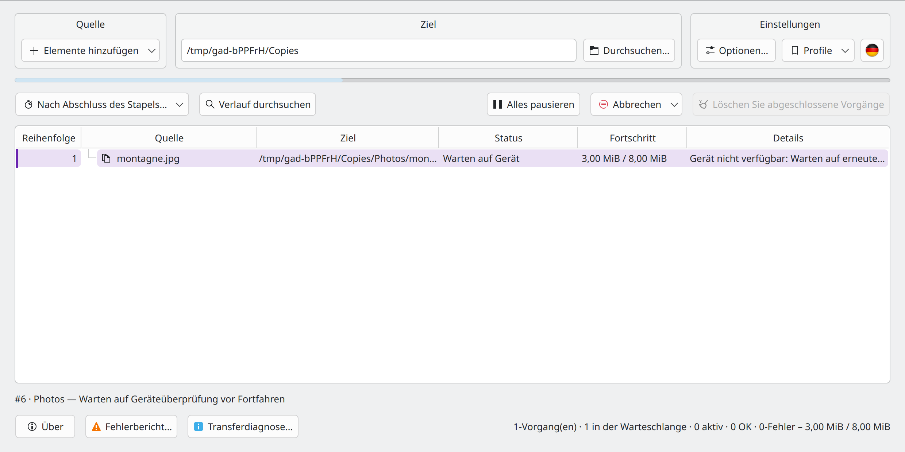

Wenn während einer Übertragung eine bekannte Festplatte oder ein Mount verschwindet, zeigt Gad ZX **Warten auf Gerät**, behält ihre Teildatei und gibt den Arbeiter frei, so dass unabhängige Anfragen ablaufen können. Plasma beschreibt auch das Warten.

Wiedervernetzen und Montieren des Geräts **an der gleichen Stelle**. Gad Über diesen Punkt hinaus kann Bytes neu kopiert werden. Ein leerer Ordner am Mount Point oder ein anderes dort montiertes Volumen ist nicht ausreichend. Ein Dateisystem UUID kann das gleiche Volumen erkennen, nachdem Linux eine andere Gerätenummer zugewiesen hat.

Globale und gezielte Pausen bleiben in Kraft; die Wiederverschaltung überwiegt sie nicht. Eine abgebrochene Anfrage startet nicht. Eine ersetzte Quelle, Ziel oder Teildatei kann die Wiederherstellung nicht überschreiben. Eine unterbrochene Veröffentlichung erfordert Erholung anstatt eine automatische zweite Kopie.

Für KDE Verbinden, FTP, SFTP und SMB, Gad Retten KIO Auflösung im Hintergrund, ohne das Fenster zu öffnen oder eine weitere Charge hinzuzufügen. KDE Die Authentisierung wird immer noch durchgeführt. Der montierte Pfad und die Identitäten müssen erkennbar bleiben. KIO Fuse startet mit einem anderen Pfad neu, Gad meldet es und behält das Original-Journal; wiederherstellen Sie das Original-Mont oder inspizieren und die unterbrochenen Dateien erneut einreichen.

Für KIO Fuse Ziele ohne dauerhafte teilweise Wiederherstellung, Gad kann wieder starten **nur die aktuelle Datei von Anfang an**, nach der Validierung seiner Quelle und Entfernen seiner erkannten nicht veröffentlichten temporären Datei. Vervollständigte Nachbarn bleiben intakt. Lokale Wiederverbindung Checkpoints werden während der Sitzung erstellt, auch wenn automatische Crash-Recovery ist nicht überprüft; diese Präferenz regelt immer noch Neustart nach einem Crash.

Die Erkennung erfolgt an Transfer-Checkpoints und Verbindungsfehlern. Ein im Kernel oder Remote-Service blockierter Systemruf kann die Erkennung verzögern. Eine gelöschte Datei auf einem sonst verfügbaren Volumen, unzureichendem Raum oder Berechtigungsdenial bleibt ein gewöhnlicher Fehler.

## Nach einem Absturz fortsetzen {#resuming-after-a-crash}

**Fortsetzung nach Unterbrechung** ist standardmäßig für neue Anfragen aktiviert. Kompatible lokale Ziele verwenden einen dauerhaften Checkpoint alle 64 MiB oder nach zwei Sekunden des Fortschritts. Nach einem abrupten Stopp kann Gad die Quelle, das Ziel und die Teilinhalte überprüfen und dann wieder in der gleichen temporären Datei.

Vollständige Dateien bleiben abgeschlossen. Globale und Einreisepausen werden beibehalten. Eine explizit abgebrochene Anfrage wird nie automatisch wieder aufgenommen. Wenn die globale Präferenz beim Neustart deaktiviert ist, warten erstattungsfähige unterbrochene Anfragen auf **Unterbrochene Aufträge fortsetzen** im Kontextmenü. Diese Aktion betrifft die eigene Anfrage, auch wenn Sie eine Datei auswählen.

Gad vergleicht sowohl Präfixe als auch den aufgezeichneten Verdauungstrakt, verworfen dann nur Bytes über den bestätigten Punkt hinaus. Eine geänderte Quelle oder Teildatei verursacht eine Ablehnung. Die Zeile zeigt **Fortsetzungsdaten werden geprüft…** und dann die wieder aufgenommene Byte-Zone. Die abschließende MD5-Verifikation läuft noch, wenn aktiviert.

Diese Erholung ist nicht für jeden Zwischenzustand verfügbar: mehrdeutige Veröffentlichung, Umbenennung oder Undo-Stufen erfordern eine Veröffentlichung auf Journal-Basis. Dauerhafte Crash-Recovery ist deaktiviert für KIO Fuse Ziele. Journale und Backups, die für die Erholung gespeichert werden, werden nicht durch Deinstallation von Gad entfernt.

## Verlauf und Bereinigung {#history-and-cleanup}

**Verlauf speichern** hält Anfragen, Verifikationsergebnisse und und Informationen zwischen normalen Sitzungen. Ohne diese bleiben aktuelle Sitzungsprotokolle sichtbar, aber normale Abschaltung veröffentlicht ihre Verlauf und Backups.

**Löschen Sie abgeschlossene Vorgänge** entfernt die fertige Verlauf und gespeicherte ersetzte Ziele. **nicht** entfernt die erfolgreichen Abschlusskopien, entfernt aber ihre Unfähigkeit. Undo setzt auf die Original-Bände und gespeicherte Informationen; es ist kein unabhängiges Backup.

Das Journal befindet sich normalerweise bei `$XDG_DATA_HOME/gad/state.json`, das auf `~/.local/share/gad/state.json` Standard ist. Ersetzte Dateien werden in privaten `.gad-undo-*` Verzeichnissen auf ihrem Zielvolumen gespeichert. Diese verwenden Speicherplatz, bis die zugehörige Wiederherstellungshistorie gelöscht wird.

Löschen Sie diese privaten Verzeichnisse nicht manuell, während Sie immer noch ungültig sind. Ein ungültiges Journal oder nicht erkanntes Ergebnis wird mit einem Fehler gehalten, anstatt optimistisch verworfen.

## Infobereich und Sitzungsstart {#system-tray-and-session-startup}

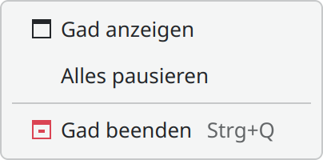

Klicken Sie auf das Symbol, um ein sichtbares Fenster zu verstecken oder eine versteckte/minimierte wiederherzustellen. Sein Abzeichen zählt unvollendete Anfragen, einschließlich Analyse und Wartearbeit. Über 99, es zeigt `99+`; der Tooltip hält die genaue Zählung.

Das Badge ist grün während der Aktivität, orange für Pause oder Gerät wartet ohne aktiven Transfer, und rot, wenn ein Konflikt eine Entscheidung erfordert. Der Tooltip fasst Lauf-, Warte- und Scanarbeiten zusammen. Das Tablett-Menü bietet Show, Pause/Resume und beenden Aktionen.

Wenn das Fenster versteckt oder minimiert ist, eine kombiniert Plasma job view zeigt Anfragen, Dateien, Bytes, Fortschritt, Pause und Geschwindigkeit an. **Gad anzeigen** öffnet das Hauptfenster. Jede Transfer-Benachrichtigung hält die **Gad anzeigen** Link, einschließlich Abschluss, Stornierung und Fehlermeldungen. Neue Anfragen schließen sich der gleichen Ansicht an; es gibt keine zweite gewöhnliche Benachrichtigung für die gleiche Übertragung. Der native Details Bereich umfasst Geschwindigkeit. Exact externe Rendering hängt von der installierten Plasma Version und Thema.

Ermöglichen **Bei der Anmeldung starten** zu beginnen Gad im Tablett, wenn die Desktop-Session beginnt. Dies ist per-user autostart, nicht ein System-Service. Gad's eigenen Start-up-Eintrag.

## Telefone, FTP, SFTP und SMB {#phones-ftp-sftp-and-smb}

Lokale Pfade und bereits montierte Ordner werden direkt unterstützt. Raw Remote-Adressen verwenden KIO Fuse auf beiden Quell- und Zielseiten.

| Dienstleistungen | Beispiel |
|---|---|
| KDE Connect | `kdeconnect://device-id/android/DCIM/Camera/photo.jpg` |
| FTP | `ftp://files.example/folder/file.txt` |
| SFTP | `sftp://user@files.example/folder/file.txt` |
| SMB | `smb://server/share/folder/file.txt` |

KDE besitzt die Authentifizierung und den Session-Handling. Gad bietet keinen separaten FTP/SSH/SMB-Passwort-Manager. Ununterstützte Systeme, fehlerhafte URLs und mehrdeutige Abfrage/Fragment-Komponenten werden abgelehnt.

Beide Seiten werden vor der Eingabe der Kopiermaschine aufgelöst. Nach Eingaben behalten Sie ihre Bestellung. Ein Verbindungsfehler reicht nicht stilllich nur einen Teil der Quellgruppe ein. Die ursprüngliche Adresse wird zur Anzeige verwendet; der montierte Pfad ist ein Implementierungsdetail, das für den Dateizugriff und die Desktop-Öffnung verwendet wird.

KIO Fuse-Ziele verwenden servicedefinierte Metadaten, in denen chmod/utime nicht verfügbar sind. Pause bleibt verfügbar, aber dauerhafte mid-file Crash-Recovery ist für diese Ziele deaktiviert. Undo erfordert die erwarteten Routen und Identitäten; geänderte Mappings werden nicht still angenommen.

## Tastenkürzel {#keyboard-reference}

| Schlüssel | Gad Verhalten |
|---|---|
| **Ctrl+C / Ctrl+X** im Dateimanager | Markieren Sie Dateien zum Kopieren oder Bewegen. |
| **Strg+V** in Gad | In das angezeigte Ziel einfügen. |
| **Strg+V** in Dolphin mit Integration aktiviert | Senden Sie eine Hintergrundpaste in den aktiven Ordner. |
| **Strg / Shift + Auswahl** | Wählen Sie mehrere Zeilen aus. |
| **Löschen** | Entfernen Sie die fertigen Zeilen, stoppen Sie aktive Einträge, oder entfernen Sie anhängige. |
| **Zurück zur Übersicht** | Nicht abgeschlossene Ergebnisse; sonst stoppen / entfernen Sie die Auswahl. |
| **Umschalt+Einfügen** in Dolphin | Die Standard native KIO Paste Alternative. |

Diese Tasten bedeuten nicht, dass Gad ersetzt Paste während KDE.

## Fehlerbehebung {#troubleshooting}

| Symptom | Was zu überprüfen |
|---|---|
| Clipboard-Dateien erscheinen im Clipboard-Manager, aber Gad können sie nicht lesen | Überprüfen Sie auf Wayland die `wl-paste`-Verfügbarkeit; stellen Sie sicher, dass die Zwischenablage eine Dateiliste enthält, anstatt nur Pfadtext. |
| Eine Bewegung wird zu einer Kopie | Überprüfen Sie, ob MD5 aktiviert ist, teilen die Endpunkte wirklich ein unterstütztes lokales Dateisystem und der Kernel erlaubt einen sicheren Umnamen. |
| Eine weitere Anfrage wartet trotz zweier Arbeitnehmer | Überprüfen Sie freigegebene Festplatten, unbekannte Disk Topologie, Konflikte, Pausen und Abhängigkeiten von teilweise veröffentlichten Ergebnissen. |
| Eine wiederholte Paste fügt nichts hinzu | Eine aktive Anfrage kann bereits dieselbe Quelle/Destination/Typ abdecken; lesen Sie die kurze doppelte Nachricht. |
| Freier Raum kann nicht gemessen werden | Gad warnt und fährt fort; Überprüfen Sie die Kapazität durch den zugrunde liegenden Dienst, wenn erforderlich. |
| Ein Gerät wartet nicht beendet | Wiederherstellen der gleichen Mount/Pfad und Inspektion Identität oder KIO Mapping Warnungen. Eine geänderte Datei wird nicht automatisch akzeptiert. |
| Retry ist nicht verfügbar | Warten Sie auf die Anfrage zu stoppen, wählen Sie einen tatsächlichen Ausfall, oder verwenden Sie die dedizierte Wiederherstellung Aktion für ein unvollständiges undo. |
| Ctrl+V verwendet eine alte Zielmethode | Aktualisieren Sie die installierte Integration, schließen und öffnen Sie Dolphin und starten Sie eine idle Gad Instanz neu. |
| Undo wird abgelehnt | Lesen Sie das Detail für geänderte Dateien, fehlende Backups, rekreierte Quellen oder abwesende Volumes. Halten Sie gespeicherte Daten bis zum Beheben. |
| Tray-Icon/Fenster-Verhalten unterscheidet sich | Prüfen Sie die Verfügbarkeit des Tabletts und die Version des bereits laufenden Gad-Prozesses. |

Für Diagnosen, protokollieren Sie die Über-Version, kopieren Sie gegen Bewegung, Vollfehlertext und ob Endpunkte lokal, montiert oder entfernt sind. Der Fehler-Bericht Export ist nützlich, um diese Informationen zu teilen; überprüfen Sie persönliche Pfade, bevor Sie es teilen.

## Grenzen und bewährte Verfahren {#limits-and-good-practices}

Gad verwaltet Transfers und Journal-basiertes undo; es stellt nicht das komplette Eigentum eines Backup-Systems, ACL, xattr, Hard-Link oder Sparse-Datei Garantien zur Verfügung. Ordinäre Kopien bewahren keine Hard-Link-Beziehungen oder Sparse-Zuweisung. Ein bewährter Umname behält das bestehende Objekt statt.

MD5 fügt unabhängige Content-Checks hinzu, ist jedoch nicht Schutz vor bewusst aufgebauten Kollisionen. Eine Gruppe von Dateikopien ist keine Atomtransaktion. Gleichzeitige Modifikationen durch andere Programme und das Synchronisationsverhalten von Dateisystemen sind noch wichtig.

Halten Sie genug Platz für temporäre Kopien und gespeicherte ersetzte Dateien. Beenden Sie die Wiederherstellung vor dem Löschen von Zeitschriften oder privaten Backups. Testen Sie einen unbekannten Remote-Service mit unkritischen Sample-Daten zuerst.

Für Implementierungsdetails und Protokollverhalten siehe [Entwicklerhandbuch](DEVELOPER_GUIDE.de-DE.md). Für reproduzierbare Validierung siehe [Testen von Gad](../TESTING.de-DE.md).

## Eine Sprache hinzufügen {#adding-a-language}

Sprachen werden beim Start von gültigen `gad_<locale>.qm` Katalogen, wie `gad_de_DE.qm`, entdeckt. Qt bietet jede Sprache nativen Displaynamen. US Englisch bleibt als Quellsprache verfügbar. Genaue Lokale nehmen Priorität, gefolgt von einer verfügbaren Variante der gleichen Sprache, dann Französisch oder Englisch.

Um eine Sprache ohne Umbau hinzuzufügen, setzen Sie seine `.qm` in `~/.local/share/gad/translations/` und seine `<locale>.png` Flagge neben ihm, zum Beispiel `de_DE.png`, dann neu starten GadDieses Verzeichnis folgt `$XDG_DATA_HOME` Fahnen können auch in einem `flags/` Unterverzeichnis oder `~/.local/share/gad/flags/`. Fehlende Flaggen verwenden ein generisches Icon. Invalide Kataloge werden ignoriert. Benutzerkataloge überschreiben System und eingebettete Kataloge.

Für die Verteilung mit Gad, stellen Sie die `.qm` in `translations/` und sein PNG in `assets/flags/`. `scripts/resources.py` erzeugt die Qt manifest für Fracht, Qt Tests und Dokumentationserfassungen. Keine C++-Liste oder Source-manifest-Edition ist erforderlich. `.qm` allein ausreicht, wenn `.ts` wird zugeführt, `python3 scripts/translations.py` automatisch entdeckt, validiert und kompiliert.

## Im ursprünglichen Ordner duplizieren {#duplicating-in-the-original-folder}

Aktivieren Sie **Duplizieren im selben Ordner erlauben**, kopieren Sie und fügen Sie in den Ordner des Produkts ein. `photo.jpg` wird `photo_copied1.jpg`; ein `Documents` Ordner wird `Documents_copied1`. Gad wählt die erste verfügbare Zahl aus, die für anstehende Duplikationen gilt.

Diese Option wird standardmäßig deaktiviert, gespeichert und für neue Anfragen erfasst. Bewegt sich auf sich selbst und Kopien von Ordnern in ihre eigenen Nachkommen bleiben zurückgewiesen. Ausschlüsse gelten noch. Undo entfernt die erstellte Kopie und bewahrt das Original.

## Gad mit Konqueror verwenden {#using-gad-with-konqueror}

**Paste mit Gad** ist ein KIO Service-Menü, das mit Dolphin geteilt wird. Neustart Konqueror nach der Installation von Gad, um das Menü zu laden. Kopieren und Schneiden Operationen verwenden die gleiche Transfer-Engine und Warteschlange.

Für **Strg+V**, Start **Konqueror mit Gad** aus dem Anwendungsmenü oder auslaufen `gad-konqueror`. Dieser Launcher lädt ein Plugin nur in Konqueror. Dateipasten gehen zu Gad Verwendung des Ordners der aktiven Ansicht; Einfügen von Text in die Adressleiste und Eingabefelder bleibt natives. **Umschalt+Einfügen** hält das Übliche KIO Paste. Unterstützte Remote-Ziele bleiben verfügbar.

Das Plugin stellt auch den aktiven Ordner frei, **In den offenen Ordner mit Gad einfügen**, ohne sich auf Fenstertitel oder Stallauswahl zu verlassen. Standard Konqueror Die Integration von Ctrl+V wird mit Konqueror 26.08 (Qt 6) Wenn Konqueror wird installiert nachdem Gad, rerun `python3 scripts/install.py` um sein Plugin zu bauen.

### Dokumentation im Über-Dialog {#about-documentation}

**Über Gad** enthält Links zu **Schnellstart**, **Benutzerhandbuch** und **Entwicklerhandbuch**, jeweils als HTML und Markdown. Die Links folgen der gewählten Sprache, auch wenn sie bei geöffnetem Dialog geändert wird. Die Dokumente werden lokal installiert und benötigen den Projektordner nicht. Fehlt eine Ausgabe, bietet Gad die verfügbare englische Ausgabe an; fehlende Dokumente erzeugen keine ungültigen Links.

## Konfiguration und Handbuchseiten {#command-settings}

`gad --configure` speichert Einstellungen und aktualisiert die laufende Oberfläche. Läuft noch keine Instanz, startet Gad im Hintergrund und der Befehl kehrt zurück. Die Formen `--no-…` deaktivieren Kontrollkästchen. Nicht angegebene Ausschlusslisten bleiben erhalten; wiederholtes `--exclude-folder` oder `--exclude-file` ersetzt die entsprechende Liste. `--clear-exclusions` leert beide Listen. Das globale Limit wird in MiB/s angegeben; 0 bedeutet unbegrenzt. `--md5` und `--properties` bei einer Kopie oder Verschiebung gelten nur für diese Übertragung. Dolphin-Tastenkürzel werden mit `gad --configure --dolphin-ctrl-v` oder `--no-dolphin-ctrl-v` verwaltet.

```bash
gad --configure --md5 --verify-space --no-include-hidden
gad --configure --exclude-folder "__*" --exclude-file "*.tmp" --language fr_FR --rate-limit 25
```

`man gad` · `make manpages`

## Überwachung des Dolphin-Tastenkürzels {#dolphin-watchdog}

Gad kann den normalen Dolphin-Starter schützen. Ein beim Start geladenes Modul prüft die tatsächlichen Tastenkürzel jede Sekunde und stellt sie nach Menüaktualisierungen wieder her. Einfügen wird direkt an Gad weitergeleitet; Textfelder behalten ihr natives Verhalten. Das Deaktivieren von Ctrl+V mit Gad stellt natives Einfügen wieder her und beendet die Korrekturen. Bereits geöffnete Fenster müssen einmal neu geöffnet werden, um das Modul zu laden.


Zum Schutz des normalen Dolphin-Starters vor verlorenen Tastenkürzeln das Modul mit dem folgenden Befehl installieren und bereits geöffnete Fenster einmal schließen und erneut öffnen.

```sh
python3 scripts/dolphin_integration.py --install --protect-launcher "$HOME/.local/bin/gad"
```

```sh
gad --dolphin --new-window
```

## Geänderte Quellen und sichere Wiederherstellung {#file-integrity}

Diese Schutzmaßnahmen arbeiten automatisch, auch ohne MD5. Gad vergleicht Identität, Typ, Größe sowie mtime/ctime der geöffneten Datei und ihres Quellpfads. Erkannte Änderungen während des Kopierens verhindern die Veröffentlichung; späte Änderungen beim Verschieben erhalten das Original und erzeugen einen Fehler. Während der Wartezeit bearbeitete Quellen können in ihrer neuen Version kopiert werden.

Vor der Wiederherstellung prüft Gad ausgewählte Dateien, Sicherungen, übergeordnete Pfade und benötigte Datenträger. Geänderte Sicherungen, Dateiberechtigungen oder Eigentümer, fehlende verschobene Ergebnisse und nachträglich bearbeitete wiederhergestellte Quellen können den Vorgang blockieren. Vor dem Löschen eines Ergebnisses werden die Prüfungen wiederholt. Betroffene Dateien bleiben erhalten; vor einem erneuten Versuch die Fehlerdetails prüfen.

Zeitstempelprüfungen hängen von der Genauigkeit des Dateisystems und den Angaben entfernter Dienste ab. Sie erzeugen keinen Schnappschuss einer anderweitig geöffneten Datei. Optionales MD5 ergänzt einen Inhaltsvergleich vor der Veröffentlichung; ältere Journale verwenden ihre vorhandenen Informationen.

## Übertragungsprofile {#transfer-profiles}

Die Schaltfläche **Profile** unter **Einstellungen** speichert und übernimmt **alle Optionen des Einstellungsdialogs**, aber **niemals das Ziel**: MD5-/Eigenschafts-/Speicherprüfungen, Ausschlüsse und versteckte Elemente, Duplizierung, Verlauf, Wiederaufnahme, globales und Standardlimit, Sprache, Autostart sowie Dolphin-/Konqueror-Tastenkürzel.

1. Stellen Sie die Optionen unter **Optionen…** ein.
2. Wählen Sie **Profile → Aktuelle Einstellungen speichern…** und vergeben Sie einen eindeutigen Namen.
3. Wählen Sie den Namen aus, um alle Optionen anzuwenden. Das Ziel bleibt unverändert, auch wenn es leer ist. Keine Übertragung wird gestartet.

**Profile verwalten…** bietet Anwenden, Umbenennen, Löschen und **Mit aktuellen Einstellungen aktualisieren**. Die Zusammenfassung zeigt alle gespeicherten Werte. Löschen entfernt die Definition, ohne angewendete Einstellungen zurückzusetzen. Bis zu 64 Profile bleiben zwischen Sitzungen erhalten.

Sprache, globales Limit und andere globale Einstellungen wirken wie üblich sofort. Prüfungen, Ausschlüsse und Standardlimits werden für neue Aufträge erfasst; bestehende Aufträge behalten ihre Optionen. Dolphin-Tastenkürzel werden asynchron eingerichtet. Bei einem Fehler versucht Gad, vorherige Werte wiederherzustellen, und meldet eine unvollständige Rücknahme.

Alte Profile werden automatisch migriert: Das Ziel wird entfernt, und bisher fehlende Optionen werden einmalig mit aktuellen Einstellungen ergänzt. Nutzen Sie danach **Mit aktuellen Einstellungen aktualisieren** für Anpassungen. Quellpfade, Ziele und Passwörter werden nicht gespeichert.

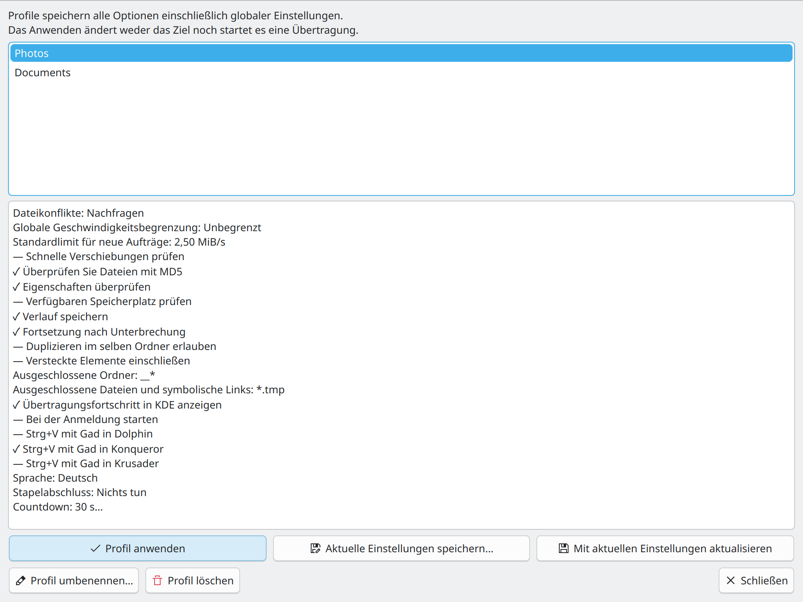

In der Befehlszeile übernimmt `gad --profile "Mein Profil"` die Einstellungen ohne Transfer. Zum Kopieren: `gad --profile "Mein Profil" --copy /pfad/quelle --to /pfad/ziel`; auch mit `--move` / `--paste` verwendbar. Gad wartet auf die vollständige Anwendung des Profils. Das Ziel stammt aus dem Befehl; explizite Optionen wie `--md5` haben Vorrang. Bei unbekanntem Namen werden keine Dateien eingereiht. `--configure --profile "Mein Profil"` erlaubt zusätzliche Einstellungen, die anschließend angewendet werden.

## Konfliktrichtlinien in Profilen

Unter **Optionen → Dateikonflikte** stehen **Nachfragen**, **Vorhandene Dateien überspringen**, **Nur ältere Dateien ersetzen** und **Beide Dateien behalten** zur Auswahl. Speichern oder aktualisieren Sie das Profil. Bestehende Aufträge behalten ihre Richtlinie.

Nur Zieldateien mit strikt früherem Änderungsdatum als die Quelle werden ersetzt; gleich alte oder neuere werden übersprungen. Unlesbare Daten und symbolische Links führen ohne Ersetzung zu einem Fehler: Richtlinie ändern und erneut versuchen. Die Zuverlässigkeit der Zeitangaben hängt vom Dateisystem oder entfernten Dienst ab. Vorhandene Ordner werden zusammengeführt; die Richtlinie gilt für Konflikte darin. Beide behalten verwendet ein nummeriertes Namenssuffix. Übersprungene Dateien bleiben beim Verschieben an der Quelle; Ersetzungen bleiben wiederherstellbar.

Befehl: `gad --configure --conflict-policy newer`. Profile der Formate 1 und 2 werden auf **Nachfragen** migriert und speichern weiterhin kein Ziel.

## Gespeicherten Verlauf durchsuchen {#history-search}

Klicken Sie auf **Verlauf durchsuchen** oder drücken Sie **Strg+F**. Geben Sie einen Dateinamen oder einen Teil des Quell-/Zielpfads ein, auch entfernte URLs. Wörter werden mit UND verbunden, ohne Groß-/Kleinschreibung und ohne reguläre Ausdrücke. Wählen Sie einen Auftragsstatus und aktivieren Sie **Hinzugefügt zwischen**, um das Hinzufügedatum mit einschließlichen lokalen Daten zu begrenzen.

**Nur Verlauf** zeigt abgeschlossene, abgebrochene, wiederhergestellte oder fehlerhafte Aufträge; deaktivieren Sie es für aktive Aufträge. Spaltenfilter gelten zusätzlich. Übergeordnete Ordner bleiben sichtbar. **Suche zurücksetzen** leert die Kriterien ohne Änderung der Spaltenfilter; Schließen oder **Escape** deaktiviert nur diese Suche. Reihenfolge und Prioritäten bleiben unverändert.

Der Tooltip der Reihenfolgenspalte zeigt das Hinzufügedatum. Alte Vorgänge ohne Datum werden als unbekannt markiert und bleiben ohne Datumsfilter durchsuchbar. Der Verlauf muss gespeichert sein: gelöschte Vorgänge lassen sich nicht mehr finden.

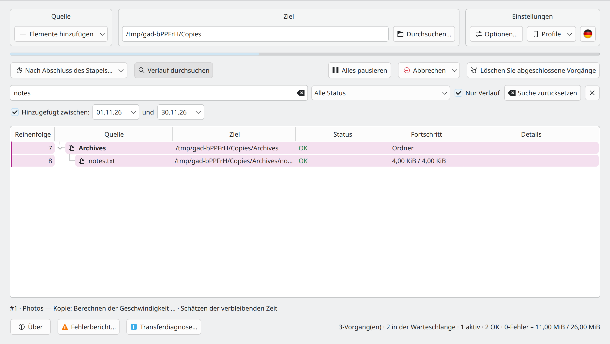

## Transferdiagnose {#transfer-diagnostics}

Die Schaltfläche **Transferdiagnose…** unten öffnet eine nichtmodale Ansicht aktiver und wartender Aufträge. Sie zeigt Status, beobachtete Aktivität oder Wartezeit, globale und auftragsspezifische Grenzen, Geschwindigkeit und Restzeit. Die Nummern blockierender Aufträge beziehen sich auf die Hauptliste.

Die Ursachen unterscheiden Pausen, Quellenanalyse, offene Konflikte, nicht verfügbare Geräte oder entfernte Einbindungen, MD5-Prüfung, Prüfung des Fortsetzungspräfixes, lokale Umbenennung, exklusive Wiederherstellung, zwei belegte Arbeiter, Zeilenpriorität, gemeinsame Festplatten oder überlappende Pfade und vorsichtige serielle Ausführung bei unbekannten Ressourcen.

Eine Wartezeit auf das Geschwindigkeitsbudget wird nur gemeldet, wenn der Begrenzer sie in der letzten Sekunde beobachtet hat. Eine konfigurierte Grenze allein beweist keine Verlangsamung. Nach fünf Sekunden ohne Byte-Fortschritt beim Kopieren oder MD5 außerhalb von Begrenzungswartezeiten meldet Gad diesen Stillstand: Datei-E/A oder Abschlussarbeiten könnten warten, ohne einen konkreten Festplatten- oder Netzwerkengpass nachzuweisen. Die Diagnose ist kein Leistungstest und wird nicht im Verlauf gespeichert. Schließen ändert keine Transfers.

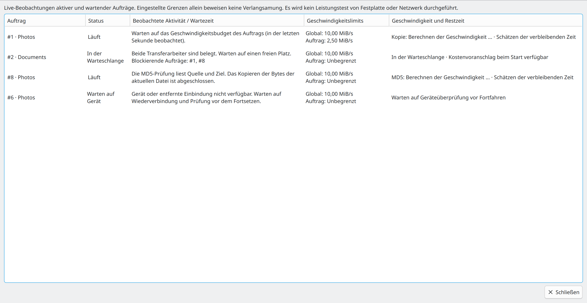

Geschwindigkeitsgrenzen gelten für kopierte Bytes; MD5-Lesevorgänge und lokale Umbenennungen sind eigene Phasen.

## Schnelle Verschiebungen prüfen {#verify-fast-moves}

Unter **Optionen** aktivieren Sie **Schnelle Verschiebungen prüfen**. Standardmäßig aus, wird die Einstellung in Profilen gespeichert und für neue Aufträge erfasst. Nach einer lokalen Umbenennung prüft Gad Identität (Gerät/Inode), Typ, Größe, Änderungsdatum, Berechtigungen, Eigentümer/Gruppe, Linkziele, den exakten Baum und das Verschwinden des Quellpfads. Zulässige ctime-Änderungen der umbenannten Wurzel werden akzeptiert; Nachfahren müssen ihre ctime behalten.

Bei Erfolg erscheint **Schnelle Verschiebung geprüft**. Die Diagnose unterscheidet diese Phase von MD5. Unterschiede, zusätzliche oder fehlende Elemente, ein neu angelegter Quellpfad oder Lesefehler führen zu einem Fehler mit geprüftem Pfad. Verschobenes Ergebnis und Journal bleiben erhalten; keine automatische Rücknahme überschreibt geänderte Dateien. Pausieren oder Abbrechen löscht das bereits verschobene Ergebnis nicht.

Geprüft werden Metadaten, keine Inhalte; dies ersetzt keinen kryptografischen Vergleich. MD5 bleibt separat und erzwingt Kopieren/Prüfen/Löschen. Normale Kopien erhalten kein falsches Ergebnis einer Schnellprüfung. Alte Profile werden mit deaktivierter Option migriert. Befehl: `gad --configure --verify-fast-move`; deaktivieren: `--no-verify-fast-move`.

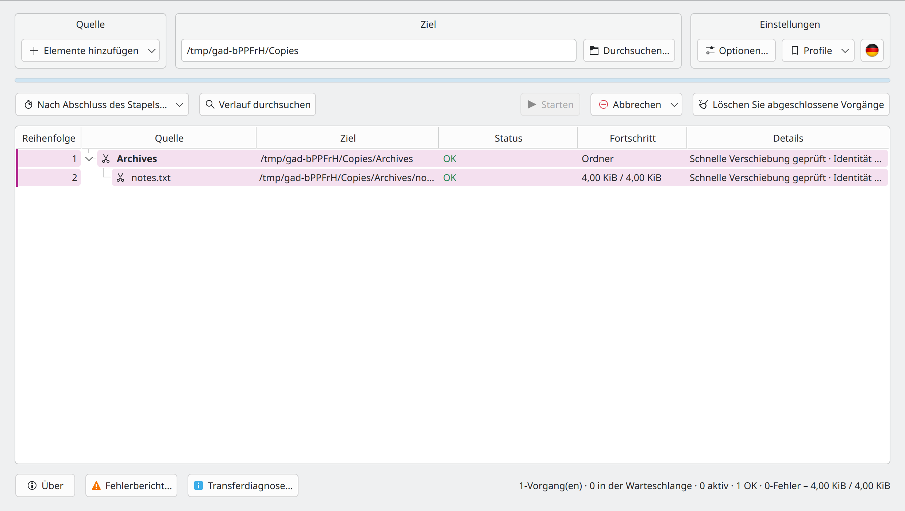

## Aktionen beim Stapelabschluss {#queue-completion}

Wählen Sie unter **Optionen → Stapelabschluss** Benachrichtigen, Gad beenden, Bereitschaft oder Ausschalten. Stellen Sie **5 bis 3600 Sekunden** zum Abbrechen ein (Standard 30) und klicken Sie auf **Für diesen Stapel aktivieren**. Der Status zeigt die Aktivierung an. Die Auswahl einer Aktion oder das Laden eines Profils speichert nur Einstellungen. Änderungen der Abschlusseinstellungen deaktivieren eine frühere Aktivierung.

Der Countdown beginnt nach erfolgreichem Abschluss aller erfassten Übertragungen einschließlich entfernter Vorbereitung und letzter Speicherung. Sie können weiterhin abbrechen. Neue Übertragungen verschieben die Aktion und starten danach den vollständigen Countdown neu. Fehler, Abbruch, Wiederherstellung oder entfernte Aufträge deaktivieren die Aktion. Pausieren verhindert die Ausführung.

Deaktivieren oder Schließen des Countdowns bricht keine Übertragungen ab. Die Aktivierung gilt einmal und wird beim Neustart nicht wiederhergestellt. Das Abschlussmenü bietet dieselben Aktionen und öffnet den passenden Reiter. „Stapel“ bezeichnet hier alle erfassten Übertragungen, nicht nur eine ausgewählte Zeile.

Bereitschaft und Ausschalten verwenden logind und beachten Berechtigungen und Inhibitoren. Eine Benachrichtigung öffnet das ausgeblendete Gad. `gad --configure --completion-action suspend --completion-delay 60` speichert nur Vorgaben; aktivieren Sie die Aktion anschließend in Gad.

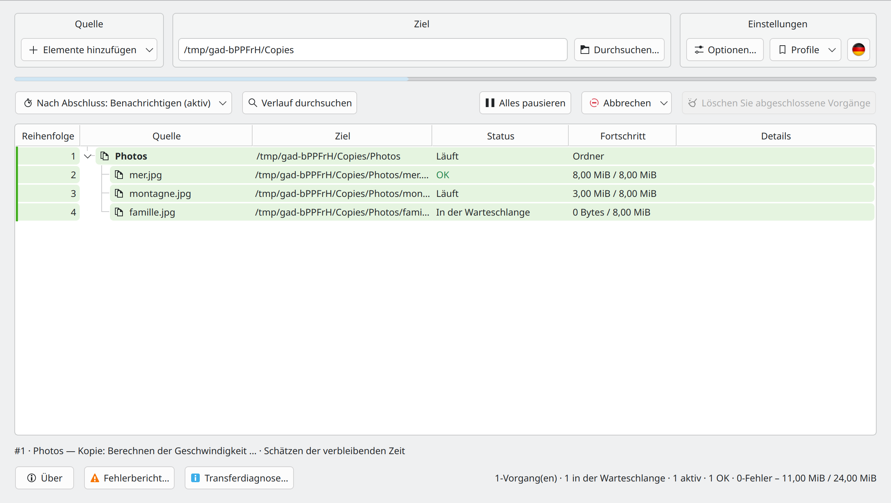

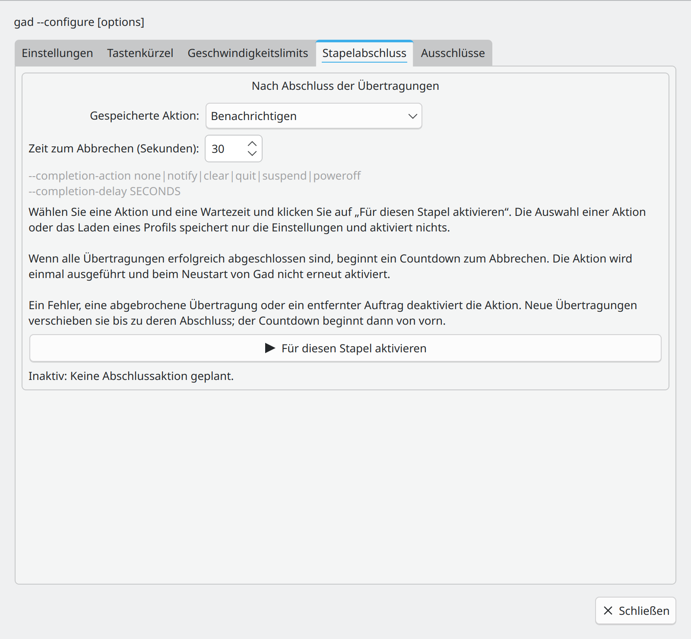


## Übertragungen in der Hauptliste vorbereiten {#preparing-transfers}

Wenn keine Arbeit läuft, werden über das Fenster hinzugefügte Dateien (**Dateien hinzufügen…**, **Ordner hinzufügen…** oder Ziehen und Ablegen) analysiert und angezeigt, ohne die Übertragung zu starten. Wählen Sie zuerst Ziel und Optionen, prüfen Sie den Baum und klicken Sie auf **Starten**. Ein separates Simulationsfenster gibt es nicht mehr.

Dieselbe Schaltfläche wechselt zu Alles pausieren und anschließend Warteschlange fortsetzen. Sind bereits Übertragungen freigegeben, werden neue Aufträge automatisch eingereiht. Normales Einfügen und externe Befehle starten automatisch ohne das Hauptfenster zu öffnen; eine abgelehnte externe Anforderung startet keine Vorbereitungen. Bereits wartende Duplikate werden mit einem Hinweis ignoriert.

Während des Kopierens erscheint die Teildatei als `datei.ext.part` am Ziel und erhält nach Erfolg den endgültigen Namen. Bei belegtem Namen wählt Gad einen eindeutigen Zusatz. Unterbrochene Übertragungen können nach Prüfung dieselbe Teildatei fortsetzen. Das Löschen des Verlaufs entfernt die Möglichkeit, fertige Übertragungen wiederherzustellen.

Fehlerbericht und Übertragungsdiagnose sperren ebenfalls das Hauptfenster. **In Liste anzeigen** schließt den Bericht und deaktiviert Suchvorgänge, die die Zielzeile ausblenden. Der Berichtsfilter folgt der gewählten Sprache.

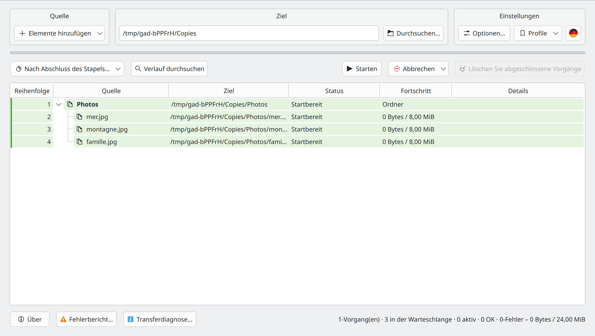


## Sprache und Sitzungsfortschritt

Die Schaltfläche rechts von **Profile** zeigt nur die Flagge der aktuellen Sprache. Ein Klick öffnet die Sprachauswahl. Dieses Menü ersetzt die Auswahl in den Einstellungen. Der globale Balken beginnt beim Öffnen von Gad bei null und zeigt die seitdem verarbeiteten Bytes. Einzelne Zeilen behalten ihren tatsächlichen Fortschritt, auch bei unterbrochenen Übertragungen.

## Elemente hinzufügen, Tastenkürzel und Ausschlüsse

**Strg+F** öffnet die Suche. **Strg+Q** fordert das Beenden an; bei aktiven Übertragungen wird es verweigert. **Strg+Alt+W** blendet das Fenster aus, ohne Übertragungen anzuhalten. Die Flagge neben Profile ändert sofort die Sprache. Hauptfenster-Schaltflächen besitzen Kurzinfos.

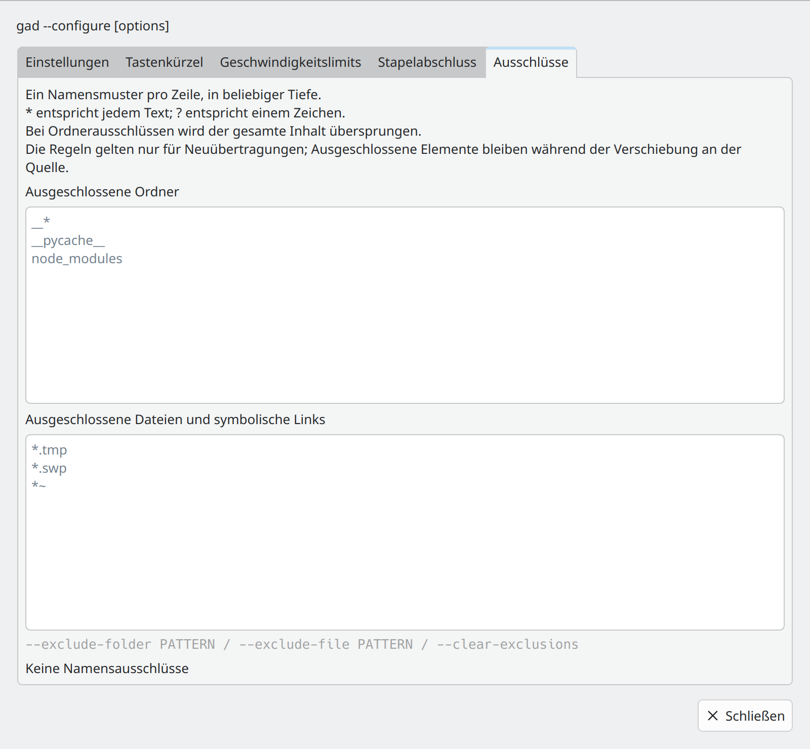
