# Gad — User Guide

**Gestionnaire Avancé de Duplication · Version 0.4.0**

**Gad, il copie.**

US English edition, updated November 8, 2026.

[Quick Start](QUICK_START.en-US.md) · [Français](GUIDE_UTILISATEUR.md) · [All editions](README.en-US.md)

## Contents

[Other file managers](#using-gad-with-other-file-managers)

[Excluding items from transfers](#excluding-items-from-transfers)

1. [What Gad does](#what-gad-does)
2. [Installation and startup](#installation-and-startup)
3. [Understanding the window](#understanding-the-window)
4. [Using Ctrl+V in Dolphin](#using-ctrlv-in-dolphin)
5. [Starting a copy or move](#starting-a-copy-or-move)
6. [Fast local moves](#fast-local-moves)
7. [Reading states and progress](#reading-states-and-progress)
8. [Organizing the queue](#organizing-the-queue)
9. [Pausing and resuming](#pausing-and-resuming)
10. [Limiting bandwidth](#limiting-bandwidth)
11. [Resolving conflicts](#resolving-conflicts)
12. [Canceling or undoing transfers](#canceling-or-undoing-transfers)
13. [Using the context menu](#using-the-context-menu)
14. [Error reporting and targeted retries](#error-reporting-and-targeted-retries)
15. [Checking file contents with MD5](#checking-file-contents-with-md5)
16. [Checking file properties](#checking-file-properties)
17. [Checking available space](#checking-available-space)
18. [Waiting for a device to reconnect](#waiting-for-a-device-to-reconnect)
19. [Resuming after a crash](#resuming-after-a-crash)
20. [History and cleanup](#history-and-cleanup)
21. [System tray and session startup](#system-tray-and-session-startup)
22. [Phones, FTP, SFTP, and SMB](#phones-ftp-sftp-and-smb)
23. [Keyboard reference](#keyboard-reference)
24. [Troubleshooting](#troubleshooting)
25. [Limits and good practices](#limits-and-good-practices)


## What Gad does

Gad manages file copies and moves in one KDE Plasma window. Each new request adds work to the queue. The list shows folders and their children, waiting files, active transfers, completed results, and failures. Rows belonging to the same request share a subtle background color and an accent marker.

A **request**, also called a batch, corresponds to one submission: pasting three files creates one request containing those files. Selecting a folder also includes its subfolders and files. The grouping remains useful for destination settings, progress, and undo, even though there are no batch headers above the file rows.

Up to two transfers can run simultaneously when their source and destination disks are independent. A proven local rename can also run alongside a copy on a shared disk when their paths do not overlap. Unknown disk relationships make ordinary copies run alone.

Gad integrates with Dolphin through **Paste with Gad** and its optional Ctrl+V setting. Konqueror integration uses **Konqueror with Gad**. Other managers can send files through Gad’s window or a custom command; their native Ctrl+V is not intercepted automatically.


### Reading the screenshots {#reading-the-screenshots}

The 23 screenshots show real Gad widgets, sample files, and simulated transfer states. They use the light theme and the interface language of this edition. Personal files and the real desktop are never photographed. External Plasma notifications are not reproduced by these offscreen captures.

Gad provides French, US English, Spanish, Portuguese, German, and Japanese. Choose a language from the flag menu to the right of **Profiles**: it applies immediately without restarting Gad or interrupting transfers. Open dialogs and active notifications update while selection and entered values are preserved. **System** chooses an available variant of the desktop language, falling back to French or English. Uncataloged technical diagnostics and external-service messages may retain their original language.

## Installation and startup

### Ubuntu PPA

The [Gad PPA](https://launchpad.net/~hizo/+archive/ubuntu/gad) installs Gad and provides updates through APT:

```sh
sudo add-apt-repository ppa:hizo/gad
sudo apt update
sudo apt install gad
```

Check the PPA page for a published package matching your Ubuntu release. If `add-apt-repository` is missing, install `software-properties-common`.

### Precompiled downloads

[GitHub releases](https://github.com/Hizoka76/gad/releases/latest) offer several formats. Replace the example filenames below with the names of the files you downloaded.

#### Debian package `.deb`

Download the package for your architecture, then install it with APT to resolve dependencies available in your repositories:

```sh
sudo apt install ./gad_VERSION_amd64.deb
```

#### `.tar.gz` archive: sources and compiled binary

The `gad-VERSION-linux-amd64.tar.gz` archive contains source code, vendored Rust dependencies, documentation and the compiled program under `prebuilt/`. No compilation is needed to run it:

```sh
tar -xzf gad-VERSION-linux-amd64.tar.gz
cd gad-VERSION
./prebuilt/usr/bin/gad
```

#### Direct executable

The `gad-linux-amd64` file is also a ready-compiled binary:

```sh
chmod +x gad-linux-amd64
./gad-linux-amd64
```

Linux amd64 downloads target x86-64 processors. The direct binary does not install a launcher or Dolphin plugin; the `.deb` and archive contain the integration files shipped with that version. These binaries are not self-contained: Qt/KF6 are required at the versions listed in the release notes. A release matches its tag and may be older than the current repository code.

### From source

Install the Linux build dependencies described in the [developer guide](DEVELOPER_GUIDE.en-US.md#building) and [testing guide](../TESTING.en-US.md#requirements). From the project directory:

```bash
python3 scripts/install.py
gad
```

The installer builds the release executable and installs the launcher, icons, and Dolphin actions in your account. It does not require administrator privileges. Close and reopen Dolphin after installation or changes to its actions.

You can start Gad from the application launcher or with `gad`. `gad --background` starts it in the system tray. A second launch contacts the existing instance instead of opening a separate queue.

If the tray is available, closing the main window hides it and leaves transfers running. To quit, use **Quit Gad** in the tray menu. Gad refuses to quit while transfers or preparation tasks are active; a pause alone does not finish them. Without a tray, the window performs the same check before exiting.

For an update, finish or cancel active work and quit Gad normally before reopening it. An already running executable continues to use its old code after a new binary is installed.

## Understanding the window

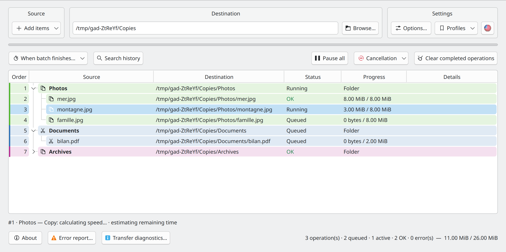

*The list shows files directly, with real folders forming the tree. Request colors keep separate submissions recognizable.*

| Area | Purpose |
|---|---|
| **Source** | Add files, add a folder, or paste into the selected destination. |
| **Destination** | Enter a local path or a supported remote URL, or browse for a folder. |
| **Settings → Options…** | Verification, exclusions, duplication, history, startup, speed limits, and shortcuts. |
| Progress bar | Combined progress for the listed transfer work. |
| Filter and controls | Filter rows, pause the queue, cancel, undo, or clear finished history. |
| File list | Source, destination, state, progress, and detailed messages. |
| Below the list | Conflict decisions and per-request speed/remaining-time information. |
| Footer | **About**, **Error report…**, and the combined summary. |

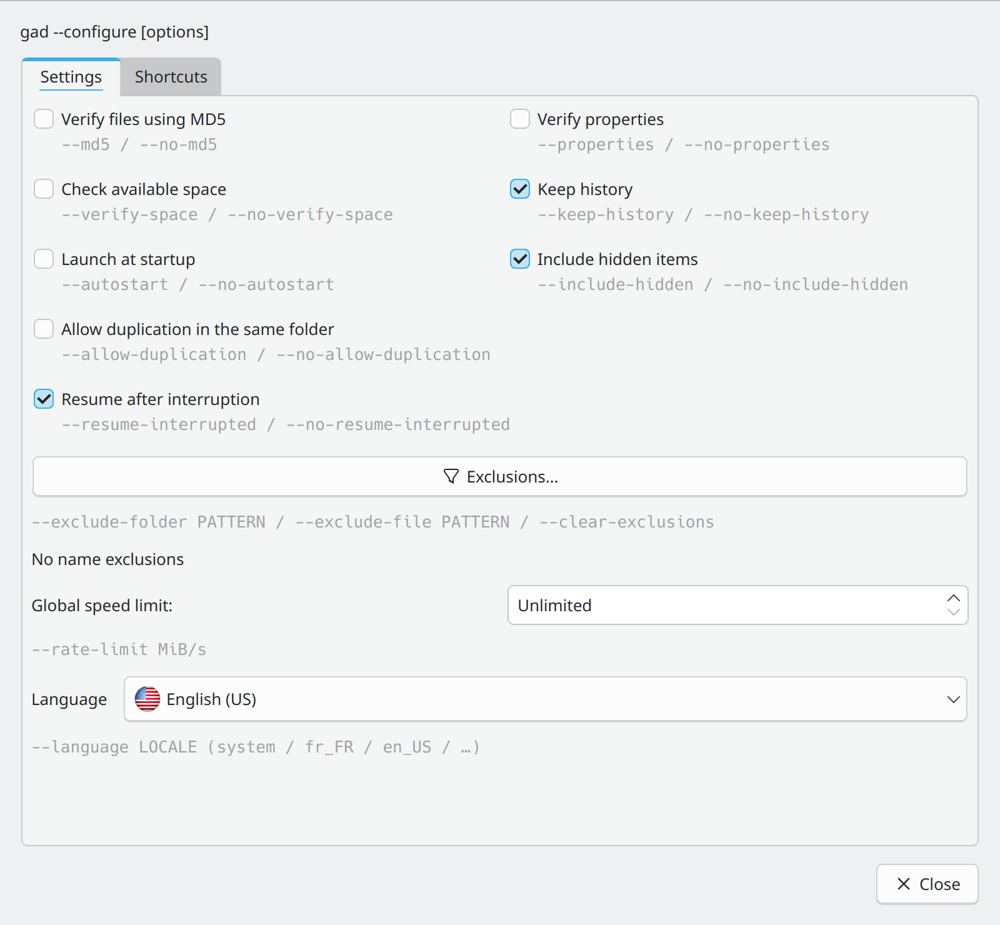

*The settings dialog opens from the Settings block.*

**Settings → Options…** opens a modal window: the main window is blocked until it closes, while transfers continue. Settings apply immediately; **Close** or Escape does not undo them. Command-line options appear in gray below each control. Minimum size: **800 × 740**; main window, error report and diagnostics: **1100 × 600**.

The five tabs are **Settings**, **Shortcuts**, **Speed limits**, **Batch completion** and **Exclusions**. Command-line options appear in gray. Change existing batch speed limits from the row context menu; the limit appears in **Detail**.

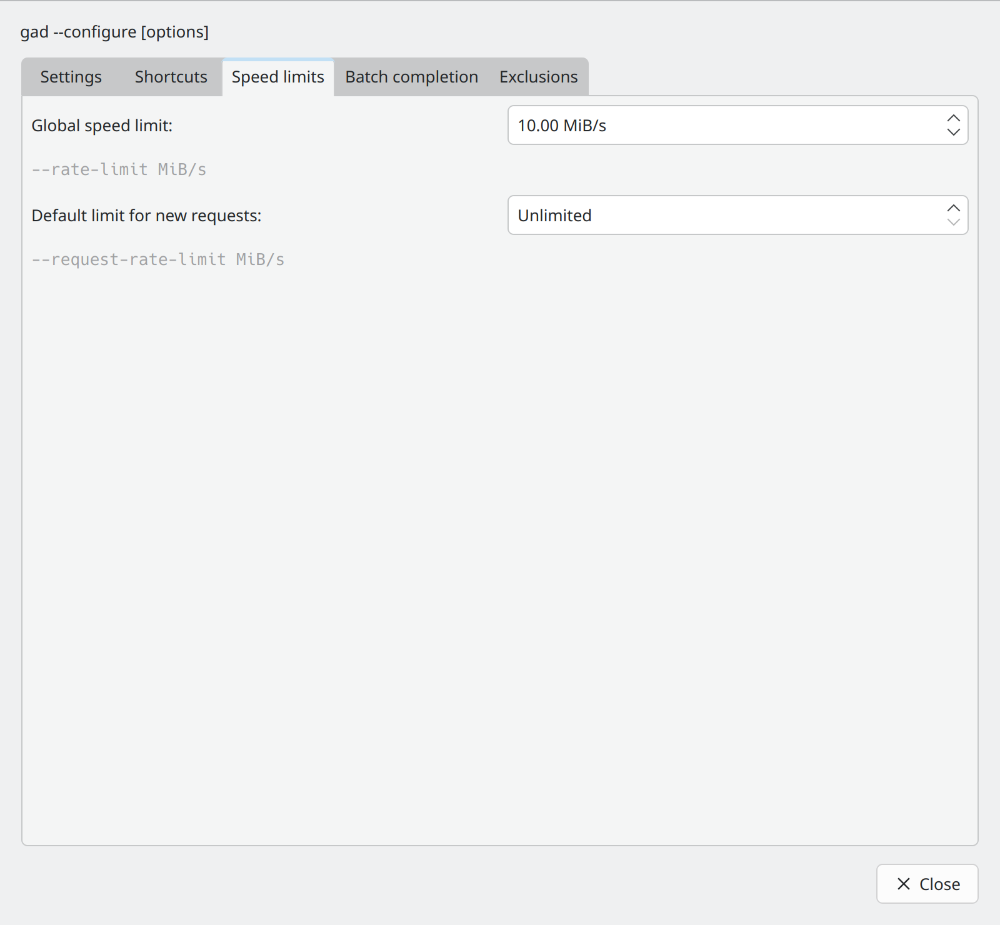

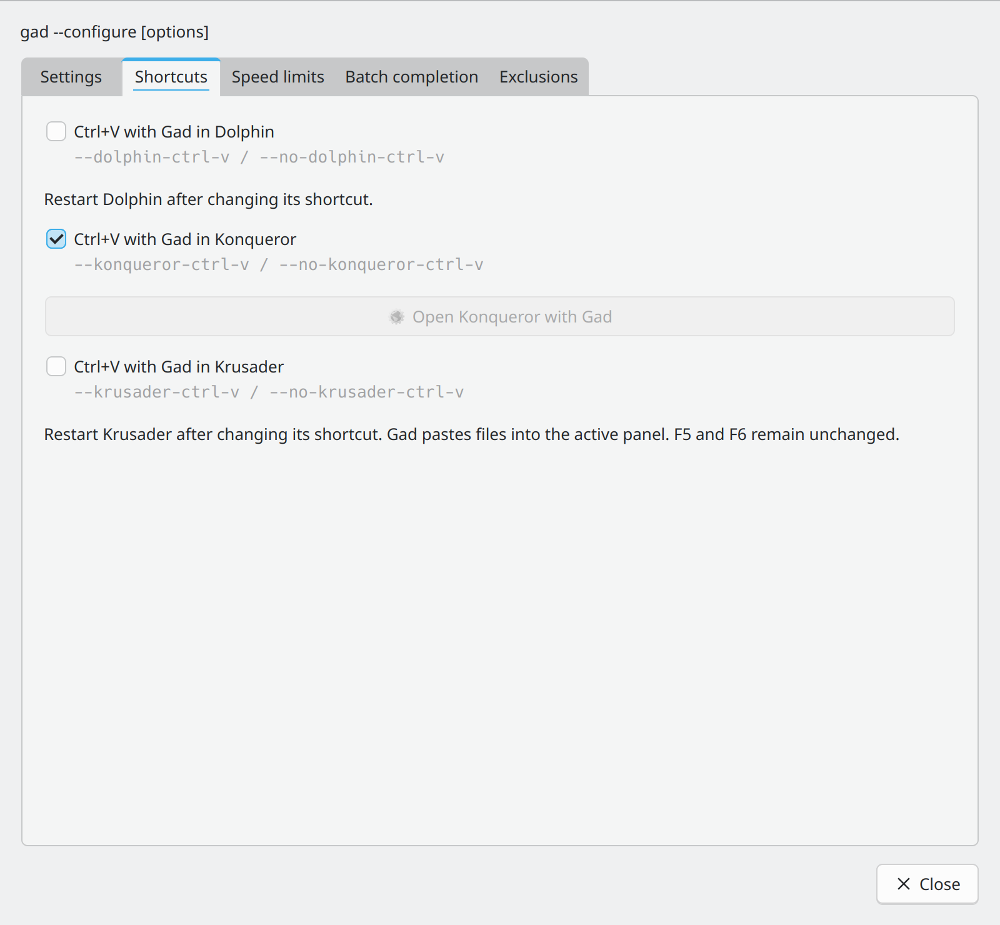

*The Shortcuts tab controls file manager integrations.*

**Shortcuts** enables or disables Ctrl+V with Gad for Dolphin and Konqueror. Dolphin changes use Gad’s reversible shortcut helper and require restarting Dolphin; a rejected change restores the checkbox and displays an error. Konqueror picks up changes on the next keypress in **Konqueror with Gad**. Its launch button is available when both the browser and launcher are installed. Text pastes stay native.

**About** displays the application name, acronym, slogan, icon, version, and build date. The software icon is the curly-haired document image used by the window, launcher, About dialog, and tray.

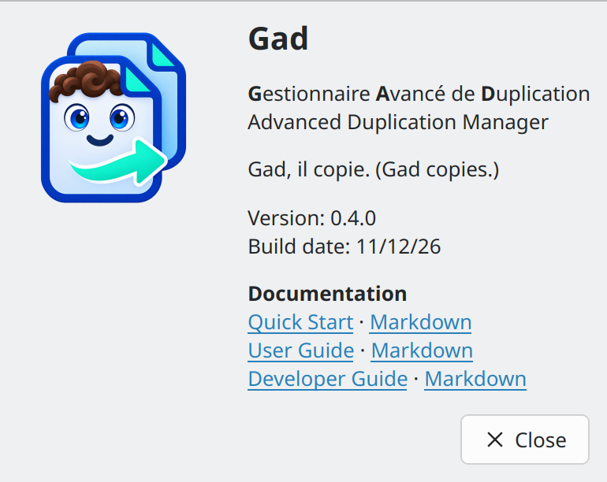

*About identifies the build currently running.*

## Using Ctrl+V in Dolphin

The right-click **Paste with Gad** action works without replacing Dolphin's native paste shortcut. It receives the destination context you clicked.

To associate Ctrl+V with Gad in Dolphin:

```bash
gad --configure --dolphin-ctrl-v
```

Close and reopen Dolphin. Ctrl+V then targets the currently open Dolphin folder. The integration resolves that folder through Dolphin's session information; it does not require a full path in the window title. In a text field, Ctrl+V remains a text paste.

**Shift+Insert** remains the standard KDE/Dolphin KIO paste alternative. It is not a new Gad shortcut. To restore the previous Dolphin shortcut configuration:

```bash
gad --configure --no-dolphin-ctrl-v
```

The change applies to Dolphin, not to every application in Plasma. Existing shortcuts and actions are restored through the integration's saved configuration rather than by resetting unrelated user preferences.

## Using Gad with other file managers

Gad can receive files from another manager, such as Nautilus, Nemo, or Thunar. Context-menu and shortcut integration depends on the manager: Gad does not automatically intercept its **Ctrl+V** or infer its active folder.

### Copy or cut, then paste in Gad

1. Select files in your manager and use **Ctrl+C**, or **Ctrl+X** to request a move.
2. Open Gad and set the target folder in **Destination**.
3. Click **Clipboard files**, or press **Ctrl+V inside Gad**.
4. Check the destination and operation type shown in the list.

The manager must publish a file list in a clipboard format understood by Gad. Copying a path as plain text is insufficient. Moving requires a recognized cut marker; if it is unavailable, use the explicit `--move` command below.

### Drag files into Gad

Set **Destination** first, then drag files or folders from your manager into Gad’s list. **Drag-and-drop always creates a copy**, even if you previously cut those files. To move files, paste with a recognized cut marker or use `--move`.

### Create a custom action or button

If your manager can launch a command, menu action, or toolbar button, use the commands below. Replace these example paths; the destination must be an existing folder.

To paste the clipboard into an explicit destination in the background:

```sh
gad --paste "/home/demo/Documents/Copies"
```

To copy sources without using the clipboard:

```sh
gad --copy "/home/demo/Images/photo.jpg" "/home/demo/Images/album" --to "/home/demo/Documents/Copies"
```

To explicitly move sources:

```sh
gad --move "/home/demo/Images/photo.jpg" --to "/home/demo/Documents/Copies"
```

A custom action must pass **the target folder** to `--paste`. For `--copy` and `--move`, pass **the selected source files** before `--to`, followed by the target folder. Substitution variables and quoting depend on the manager: do not assume that a selection argument identifies the open folder or reuse another manager’s placeholders. If `gad` is not found, use the full path `~/.local/bin/gad` with your home directory expanded.

Other managers that support KIO service menus may also offer **Paste with Gad**. Its availability is not guaranteed in every manager. The Dolphin and Konqueror options under **Settings → Options…** control only those integrations; `--paste-current` does not discover other applications’ active folders.

## Starting a copy or move


Choose the destination and options, then add files in Gad. When idle, review the list and click **Start**. External paste from the file manager starts automatically; additions during a transfer join the queue. **Ctrl+C** copies and **Ctrl+X** moves. Drag and drop into Gad always prepares a copy.

### From Dolphin

1. Use **Ctrl+C** to copy, or **Ctrl+X** to move.
2. Open or right-click the intended destination folder.
3. Choose **Paste with Gad**, or use Ctrl+V if its Gad integration is enabled.
4. Repeat to add more work to the same queue.

An external paste starts in the background and does not force the main window open. If it is hidden, Plasma displays the native progress view. A valid external paste can clear an existing global pause to start the transfer. A pause explicitly requested after submission takes precedence, including during background preparation. A completely duplicate paste does not clear a pause.

### From Gad

The **Add items** menu contains **Add files…** (Ctrl+Shift+O), **Add folder…** (Ctrl+O) and **Clipboard files** (Ctrl+V). Clipboard files preserve Copy or Cut mode. When Gad is idle, all additions inside Gad wait for **Start**; during previously started transfers, they join the queue. Only external paste from the file manager starts automatically.

Dropping files onto Gad always creates a **copy**. A file list pasted while the Destination field has focus still enters the transfer queue. Ordinary text keeps the normal text-field paste behavior.

### Duplicate requests

Gad ignores an operation already covered by an active request, including one in pause: the same source, destination, and operation type. The check covers repeated pastes, simultaneous additions, repeated selections, and files already included in another submitted folder.

New files are retained, together with any folders they need. A brief information message reports how many entries were not added. It does not offer an overwrite choice. The first request keeps its verification options.

A different destination or a copy-versus-move change remains a separate request. Different source files sharing a name still use conflict handling. You may intentionally copy a file again after the earlier request finishes.

### Preparation

Gad validates all roots and scans the request before copying any of its files. Preparation can take time on a phone or network share. A failure is reported instead of silently starting only the portion that happened to scan successfully.

Special files and paths outside the supported UTF-8 contract are rejected. A source symbolic link is copied as a link, including a broken link; Gad does not traverse it as a source folder.

## Excluding items from transfers

In **Settings → Options… → Exclusions**, enter one pattern per line for folders or files and symbolic links. Each field saves when it loses focus, without an Apply button or a separate dialog. Invalid rules are reported; previously accepted rules remain active and the rejected text stays available for correction. Rules apply to new transfers. **Include hidden items** remains on the **Settings** tab.

| Type | Example | Effect |
| --- | --- | --- |
| Folders | `__*` | Skips folders whose names start with two underscores, including `__pycache__`. |
| Files | `*.tmp` | Skips files with this extension. |
| Files | `*.swp` or `*~` | Skips some editor temporary and backup files. Enter each pattern on its own line. |

`*` matches zero or more characters and `?` matches one character. Matching is case-sensitive and applies to basenames at every depth, including explicitly selected items. Excluded folders are never traversed. Symbolic links use file patterns and are not followed. Unchecking the hidden-items option excludes names starting with a dot, for both files and folders.

Empty lines are ignored; spaces remain part of patterns. Full paths, regular expressions, and bracket character classes are not interpreted. Limits are 128 patterns per type and 256 UTF-8 bytes per pattern, without slashes or line breaks.

Settings are saved and captured for each new request before remote-access preparation. Existing batches, resumes, and retries keep their original rules. During moves, excluded items remain at the source, so source folders may remain. Whole-folder fast renames are disabled when filtering is active, but eligible individual files can still move quickly.

## Fast local moves

For an eligible local move, Gad uses a rename instead of copying the contents and deleting the source. This preserves the file's inode and avoids transferring its data. It can run alongside a copy using the same disk if their paths are independent.

Different bind-mount paths can still refer to one underlying filesystem. For example:

```text
/media/library/Music  → /home/you/Music
/media/library/Other  → /home/you/Other
```

Gad can rename between those views when it proves a safe common path and matching identities. The same physical disk alone is insufficient: different partitions, subvolumes, read-only mappings, or kernel rename restrictions can require copy-and-delete instead. A rejected rename is rescheduled with ordinary copy reservations.

For a complete, unchanged folder tree without conflicts or paused/excluded entries, Gad may rename the whole tree at once. The detail reports **dossier renommé en bloc**. Otherwise it processes entries individually. Outside files added to a moved tree are protected during undo rather than silently moved or deleted.

Enabling MD5 uses the ordinary copy path rather than the fast rename shortcut. The concurrency limit remains two operations.

## Reading states and progress

Long explanatory tooltips use a line break between sentences. Filenames and paths retain their original punctuation and spacing.

Source rows use Copy icons for copies and Cut icons for moves, including folders and requests being prepared. Folders remain bold and keep their descendants.

The **Order** column is displayed first and automatically fits the minimum width needed by its title, sort arrow, and numbers. It follows the engine queue, including folders, scanning requests, and retained history. Display sorting and filtering never renumber remaining rows, so gaps in a filtered view are normal. Queue priority changes update positions. Hover a number for **Batch #…**. Parallel transfers may finish in a different order.

| Column | Meaning |
|---|---|
| **Order** | Engine queue position, independent of display sorting; hover for the batch number. |
| **Source** | File or folder name; the Copy/Cut icon indicates the operation, and the tooltip provides the full path and optional MD5/rate settings; batch numbers remain in Order tooltips. |
| **Destination** | Target path, or the original remote URL reconstructed for display. |
| **Status** | Current state, including pause, conflicts, checks, and device waiting. |
| **Progress** | Copied bytes and file size, or the MD5/recovery-check progress. |
| **Details** | Errors, MD5 results, fast-move information, and verification warnings. |

| State | Meaning |
|---|---|
| **Scanning…** | Validating roots and scanning the request. |
| **Queued** | Waiting for its turn, resources, or a resume action. |
| **Running** | Transferring data or processing the entry. |
| **Paused** | A global, request, or entry pause applies. |
| **Waiting for device** | A known mount is unavailable; partial data is retained. |
| **Checking resume data…** | Checking the source and saved partial prefix before writing again. |
| **Verifying MD5…** | Independently rereading source and temporary destination. |
| **Decision required** | A file conflict needs your decision. |
| **OK** | Finished; displayed in green. |
| **Error** | A step failed; read the detail or open the error report. |
| **Skipped** | Skipped; the source remains. |
| **Canceled** | Canceled without automatically undoing completed results. |
| **Restoring…** | Undo is running. |
| **Restored** | The selected effects were undone. |
| **Restoration incomplete** | Undo could not finish safely. |

A folder becomes OK only after its relevant children finish. It collapses on that transition. Reopening it manually keeps it open through later progress updates. Selection, hover, and tooltips are preserved while counters change.

### Filters

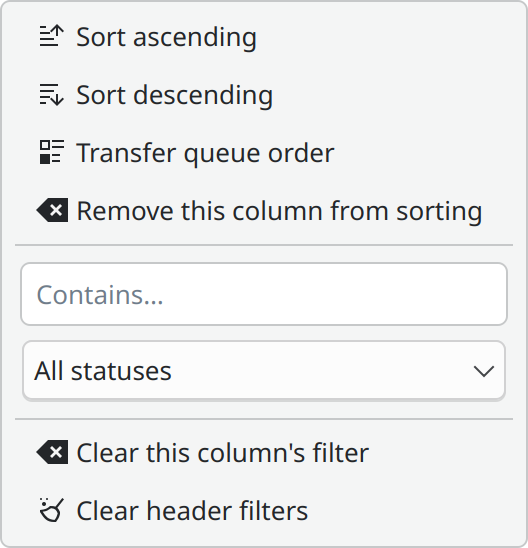

*Filtering changes visibility, not transfer behavior.*

Filters are available by right-clicking column headers. The former global filter combo above the table has been removed. Ancestor folders remain visible when needed to show a matching child. Selecting a filter opens relevant branches; ordinary progress updates do not reopen branches you collapsed.

### Sorting and filtering from headers

Click a column title to toggle ascending and descending display order. **Ctrl+click** adds a column to the existing sort; repeating Ctrl+click reverses that column’s direction without changing its priority. Headers show priorities as **(1)**, **(2)**, and so on, with the usual sort arrow on the right of each sorted column. A click without Ctrl restores single-column sorting. Names use natural sorting (`file2` before `file10`). Progress sorts by numeric percentage, independently of file size and displayed units. Sorting is among siblings: folders retain their descendants.

Right-click a header to open its menu. It provides ascending/descending sorting, **Transfer queue order**, and a case-insensitive **Contains…** filter for that column. Source searches also include full paths. Status adds an exact-state selector; Progress adds minimum and maximum percentages. **Remove this column from sorting** removes one sort key while keeping the others. Clear actions remove one column filter or all header filters.

Column filters combine with each other. Matching children retain visible ancestor folders; active filters remain available in column menus. Global counters continue to cover all transfers. Locating a file from a conflict or error report clears filters that could hide it.

Sorting changes only the display, never execution priority. Restore **Transfer queue order** before dragging rows to reorder work. Display settings survive progress updates and language changes.

### Counters and estimates

The combined summary counts transfer work. A rename advances logical bytes without representing copied disk traffic. A fully written file can still be undergoing MD5 verification. Hidden/removed rows are excluded from the visible summary. Directories do not contribute file-content bytes.

Below the list, each active request has its own source name, speed, and estimated time remaining. Measurements use the last five seconds of activity. A short warm-up displays **calcul du débit…** until enough time has elapsed.

Copying and MD5 rereads have separate measurements. If MD5 speed is still unknown, the estimate explicitly covers only the copy and says **MD5 à estimer**. When both measurements are available, the estimate includes the remaining copy work and verification reads. It is approximate and does not predict queue waiting time.

A pause suspends estimates; a conflict displays **Decision required**. Individually paused files make the request's total remaining time unknown even while other files advance. Renames do not show artificial disk-copy speeds, and a recognized resumed prefix does not create a speed spike. Without progress, the old speed falls to zero and the estimate becomes unavailable.

## Organizing the queue

Drag one or more **waiting** rows before or after another row. The insertion marker shows the intended position; hovering near the edge scrolls the list. Top-level file roots may be interleaved across requests.

A folder moves with its branch. Files within a folder reorder among siblings; they keep their actual parent and destination. Move the parent folder to reposition the whole branch. Dragging never changes the destination.

The context menu provides **Process next** (Process next) and **Reorder queue** (Move in queue). Ctrl and Shift support multiple selection. **Select entire batch** selects the other roots belonging to the same submission.

Priorities are saved. Processing next does not interrupt the current file or remove a pause. Disk compatibility and undo dependencies still apply. Unsafe interleaving of requests that replace the same outputs is refused with a reason. A partly published request can therefore keep dependent work waiting during a pause.


## Pausing and resuming

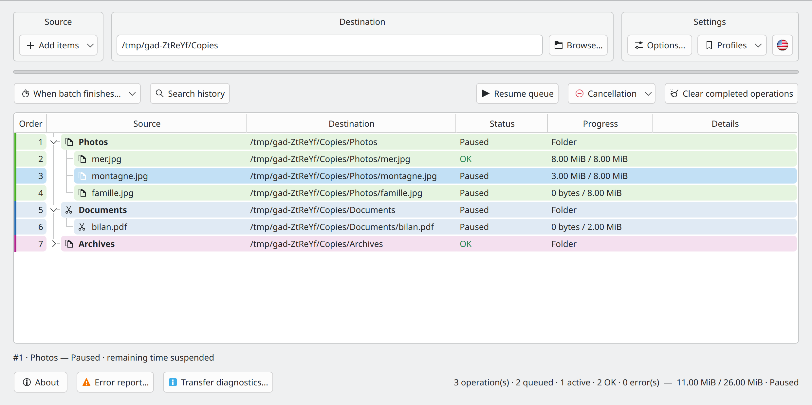

*Unfinished rows show their pause; completed results remain OK.*

**Pause all** pauses the queue and changes to **Resume queue** (Resume queue). Completed files keep their status. The context menu can pause or resume selected requests or entries. Pausing one request lets other admissible requests advance.

A pause takes effect at a checkpoint rather than forcibly interrupting an active system call. A selected resume removes the global pause so the selection can proceed; pauses belonging to other requests remain in force.

Cancellation is available during a pause. An explicitly requested undo can also run while ordinary copying is globally paused. The pause control in Plasma and the tray menu stays synchronized with the main window.

## Limiting bandwidth

The **Global speed limit** in **Settings → Options…** limits the combined data-copying throughput. Changes apply immediately. Zero means unlimited; fast rename moves are not throttled.

Select rows and click **Limit request speed…** on the left of the main action bar, or use the context menu. The limit applies to each selected request; all still share the global budget. Zero removes only their individual limits.

Both constraints apply: a request limited to 10 MiB/s remains capped at 10 even if the global limit is 50. Two requests without individual limits can use at most 50 MiB/s combined. Equal sharing is not guaranteed.

The cap applies to copied bytes, including mounted remote endpoints. OS and network buffering can produce short variations. MD5 rereads, property checks, and undo are outside this cap. Fast renames remain immediate. Pause and cancellation stay available at low rates.

## Resolving conflicts

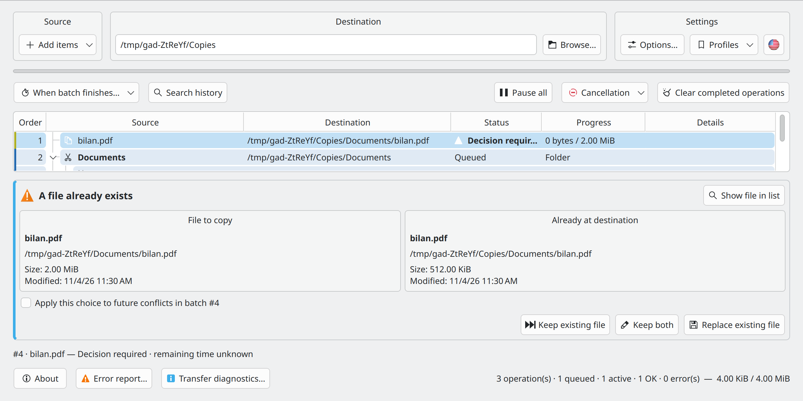

*The source and existing destination are shown side by side beneath the file list.*

A conflict panel shows the filename, selectable path, size, and modification time for both sides.

| Button | Result |
|---|---|
| **Keep existing file** | Keep the existing destination and skip this source. A move does not delete a skipped source. |
| **Keep both** | Keep the existing file and choose an available copy name for the new result. |
| **Replace existing file** | Replace it, retaining the old destination privately for undo. |

The checkbox applies the decision to later conflicts **in that request**. It resets when you change the displayed conflict. With several conflicts, use the selector to choose which one to inspect. A new conflict does not silently switch the item you are deciding about.

**Show file in list** locates the blocked row, including when a filter hid it. A file occupying a required folder path, or an unsafe symbolic link in that path, can produce an error instead of an automatic folder replacement.

## Canceling or undoing transfers

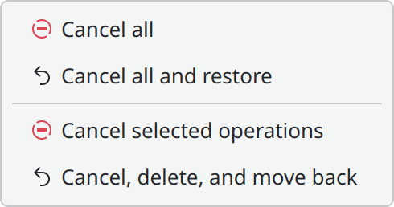

*Global actions remain available without a selection.*

### Stop without undo

**Cancel all** (Cancel all) stops active and queued work, including outstanding preparation. It leaves completed transfers in place. **Cancel selected operations** limits that stop to the selection. Folder selections include descendants.

### Undo completed effects

**Cancel all and restore** cancels work and undoes recoverable history, newest execution first. **Cancel, delete, and move back** applies undo to the selected entries or branches.

| Original operation | Undo behavior |
|---|---|
| Copy to a new file | Remove the copy created by Gad. |
| Replace an existing file | Remove the new result and restore the saved destination. |
| Move | Return the file to its source and remove its destination result. |
| Create a folder | Remove it only when that can be done without losing other files. |

Undo waits for active transfer reservations to be released. Returning a move across filesystems can require copying the contents back. An undo transaction already in progress must finish its safe restoration steps.

Gad checks identities, metadata, and recorded content before altering results. A recreated source, modified destination, missing backup, or absent volume can cause a refusal or an incomplete undo. The detail explains what was retained. A completed copy is not an independent backup, and clearing history removes its undo capability.

### Delete and Backspace

| Selected row | Delete | Backspace |
|---|---|---|
| Finished | Remove the row/history reference; keep the resulting file. | Undo that file or branch when its journal permits it. |
| Active | Request cancellation. | Request cancellation. |
| Pending | Remove it from the queue. | Remove it from the queue. |

A folder selection extends to its contents. Selecting individual files does not automatically undo their neighbors. Keep history you may need before clearing it.

## Using the context menu

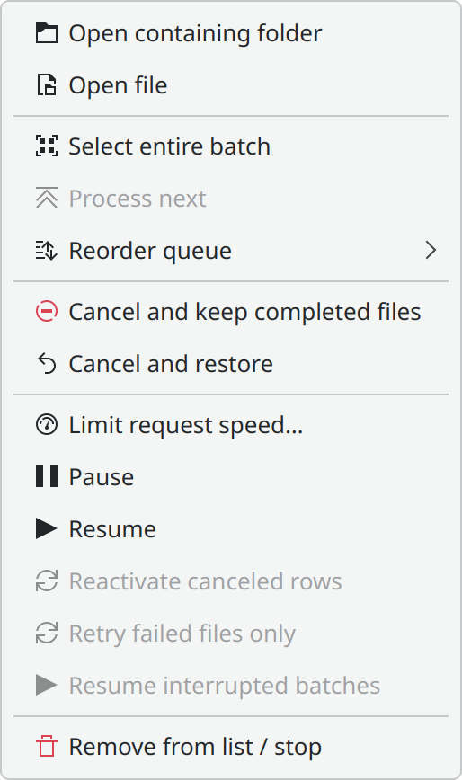

*Actions adapt to the selection and its current states.*

| Action | Purpose |
|---|---|
| **Open containing folder** | Open a file's parent folder, or open the selected folder itself. |
| **Open file** | Open one file with its desktop-associated application. |
| **Select entire batch** | Select the other entries from the same submission. |
| **Traiter ensuite / Déplacer dans la file** | Prioritize waiting entries or branches. |
| **Cancel and keep completed files** | Stop selected work and retain completed outputs. |
| **Cancel and restore** | Undo the selection when its journal permits it. |
| **Limit request speed…** | Apply a bandwidth limit to the owning requests. |
| **Mettre en pause / Reprendre** | Pause or resume selected work. |
| **Retry failed files only** | Retry eligible failures without recopying OK files. |
| **Resume interrupted batches** | Validate and resume recoverable work after an interruption. |
| **Reactivate canceled rows** | Prepare canceled entries for a new attempt after controlled cleanup. |
| **Remove from list / stop** | Apply Delete semantics. |

Opening an OK row targets the destination. For pending, active, skipped, canceled, or undone rows, it targets the source. The current state is checked when the action runs. Duplicate folders in a multiple selection open only once. Launching is limited to a single file, not a whole request or a folder.

Reactivation waits for the request to stop and preserves completed neighbors. If the source type changed, add it as a new request rather than reusing the old row.

## Error reporting and targeted retries

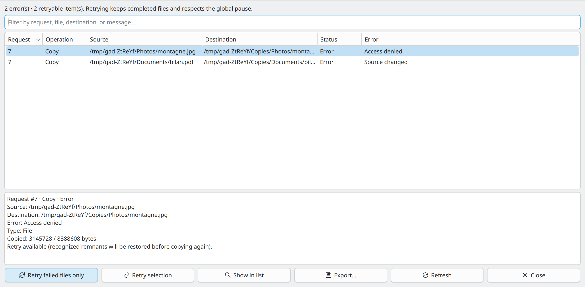

*All six buttons have icons: retry displayed errors, retry the selection, locate, export, refresh, and close.*

Open **Error report…** beside About. It groups retained failures by request, operation, source, destination, state, and message. A folder that merely reflects a child's error does not add a duplicate record; a folder's own failure is still shown.

Search filters by request, path, or error message. Selecting a row shows the full detail below it: progress, partial-file location, recoverable bytes, and available MD5 or property information. **Show in list** locates the entry in the main window. **Refresh** refreshes the snapshot explicitly; the report does not continually reshuffle while you inspect it.

**Retry failed files only** retries eligible errors currently displayed. **Retry selection** targets only selected rows. In this report, selecting a directory error does not silently include filtered-out children. The main list's folder context action retains its normal descendant-selection behavior.

The request must be stopped. Gad validates any partial or published effects, restores only recognized remnants, and queues the failed elements again. The failed file is recopied from the beginning after that cleanup. OK files are not recopied; canceled, skipped, or removed entries are not reactivated. Other entries that were merely waiting in a stopped request remain paused if they were outside the retry. The global pause is respected.

A preparation failure with no listed files can be retried through full root validation and a new scan. If retry preparation fails, repair the cause and refresh the report to try again. A separate incomplete undo remains an undo/recovery task. A modified published result is retained and can make a retry fail safely.

**Export…** (Export…) is disabled when the loaded report is empty. Filtering all rows out does not disable export because it still covers the complete snapshot. It writes the entire loaded report, including rows hidden by its search filter, as **UTF-8 text** or **JSON**. Text is intended for reading and sharing; JSON retains stable request/file references and diagnostic metadata. Exporting performs no transfer. Errors deliberately removed from history are not reintroduced.

## Checking file contents with MD5

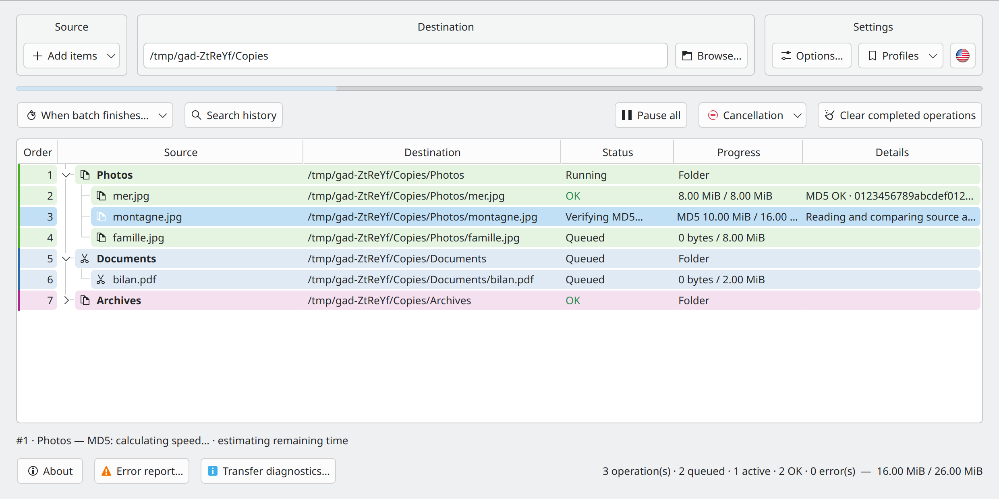

Enable **Verify files using MD5** for new submissions. Each regular file is copied and synchronized, then its source and temporary destination are reread and compared. Gad publishes the same verified temporary file under its final name only after successful checks.

The row displays **Verifying MD5…** during rereading and may later show **MD5 OK** and the digest. For an N-byte file, verification adds two N-byte reads. Directories and symbolic links are not checked as file contents.

Read failures, cancellation during verification, source changes, or a digest mismatch prevent publication and preserve the source and any prior destination. A move deletes its source only after successful publication and the required checks. The setting is remembered for future requests; existing requests keep their captured choice.

MD5 verifies consistency of this transfer path. It is not a cryptographic guarantee against deliberately constructed collisions.

## Checking file properties

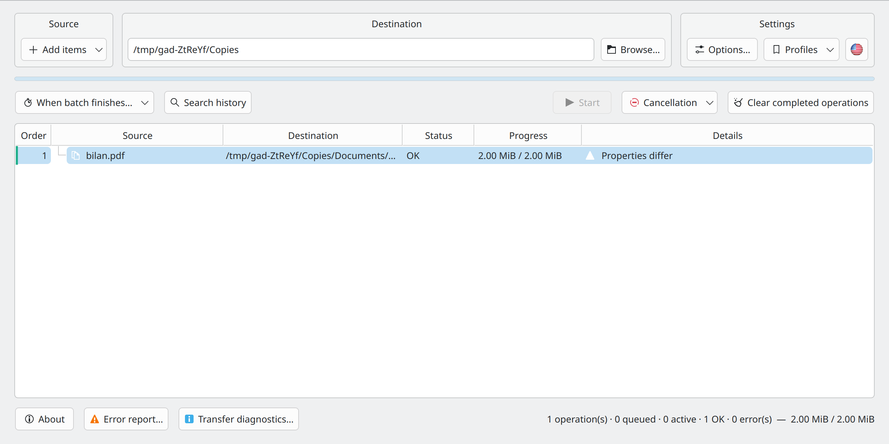

**Verify properties** compares exposed owner, group, permission bits, POSIX ACLs, and extended attributes. It distinguishes known differences from unavailable checks. Attribute values are not included in saved reports; the report lists differences and unavailable checks. Modification dates are outside this comparison.

Ordinary copies preserve basic permissions and modification time where supported; they do not gain backup-grade owner, ACL, or xattr preservation simply because this box is enabled.

For a copy, a property mismatch can leave the successfully copied result with a warning. For a copy-and-delete move, a failed check before publication preserves the original and prior destination; a failed post-publication check keeps the original and a journal for the created result. A fast rename has already moved the object, so a later warning does not claim the source still exists.

The option is remembered and captured per new request. Reports are available in the detail and folder warning summaries. Remote services can expose only part of these properties.

## Checking available space

**Check available space** estimates the remaining storage required by analyzed requests, including queued and paused copies sharing a volume. Separate volumes are calculated independently.

Old destinations and undo backups already occupy space and are not treated as free capacity during replacement. Recognized allocated resume temporaries are not counted twice. Block allocation rounding is considered. A proven fast rename does not require a second full copy of the data.

Known insufficient space prevents that request from starting. **If capacity cannot be estimated, Gad warns and continues** instead of blocking indefinitely. The warning can remain visible after success. This is an estimate, not a disk-space reservation: another program can consume space afterward, and later additions must be considered separately.

The option is remembered for new requests; existing ones retain their captured choice.

## Waiting for a device to reconnect

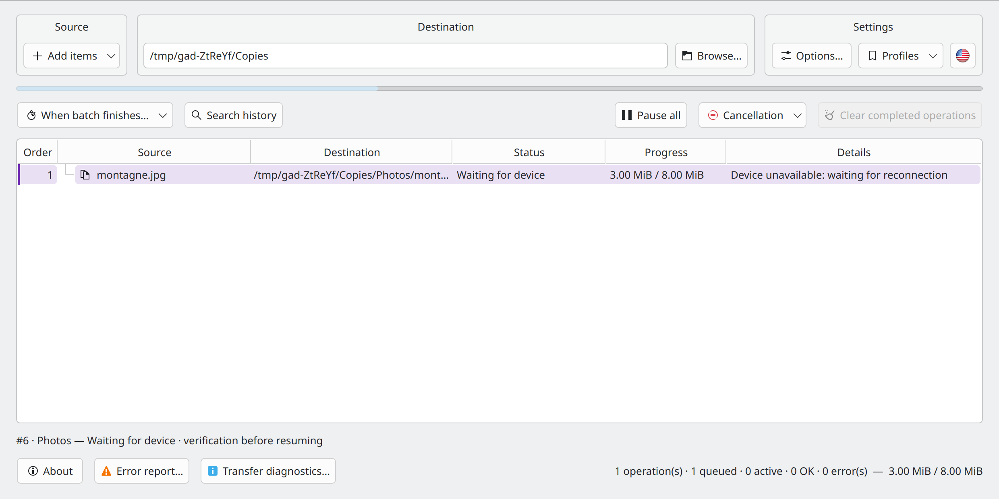

If a known disk or mount disappears during a transfer, Gad displays **Waiting for device**, retains its partial file, and releases the worker so independent requests can proceed. Plasma also describes the wait.

Reconnect and mount the device **at the same location**. Gad checks the expected mount, source identity/version, and saved prefix before continuing from the last valid durable point. Bytes beyond that point may be recopied. An empty folder left at the mount point, or another volume mounted there, is not sufficient proof. A filesystem UUID can recognize the same volume after Linux assigns a different device number.

Global and targeted pauses remain in force; reconnecting does not override them. A canceled request does not restart. A replaced source, destination, or partial file can make recovery fail rather than overwrite unrelated data. An interrupted publication requires recovery rather than an automatic second copy.

For KDE Connect, FTP, SFTP, and SMB, Gad retries KIO resolution in the background without opening its window or adding another batch. KDE still handles authentication. The mounted path and identities must remain recognizable. If KIO Fuse restarts with a different path, Gad reports it and retains the original journal; restore the original mount or inspect and resubmit the interrupted files.

For KIO Fuse destinations without durable partial recovery, Gad can restart **only the current file from the beginning**, after validating its source and removing its recognized unpublished temporary file. Completed neighbors stay intact. Local reconnect checkpoints are created during the session even if automatic crash recovery is unchecked; that preference still governs restart after a crash.

Detection occurs at transfer checkpoints and connection errors. A system call blocked in the kernel or remote service can delay detection. A deleted file on an otherwise available volume, insufficient space, or permission denial remains an ordinary error.

## Resuming after a crash

**Resume after interruption** is enabled by default for new requests. Compatible local destinations use a durable checkpoint every 64 MiB or after two seconds of progress. After an abrupt stop, Gad can check the source, destination, and partial contents, then resume in the same temporary file.

Completed files stay completed. Global and entry pauses are retained. An explicitly canceled request never resumes automatically. If the global preference is disabled at restart, eligible interrupted requests wait for **Resume interrupted batches** in the context menu. That action concerns the owning request, even if you select one file.

The saved source version and temporary ownership are checked before truncation or writing. Gad compares both prefixes and the recorded digest, then discards only bytes beyond the confirmed point. A changed source or partial file causes a refusal. The row shows **Checking resume data…** and then the resumed byte count. Final MD5 verification still runs if enabled.

This recovery is not available for every intermediate state: ambiguous publication, rename, or undo stages require journal-based recovery. Durable crash recovery is disabled for KIO Fuse destinations. Journals and backups retained for recovery are not removed by uninstalling Gad.

## History and cleanup

**Keep history** retains requests, verification results, and undo information between normal sessions. Without it, current-session records remain visible, but normal shutdown releases their history and backups. Recovery information required after an interruption can remain available even when ordinary history retention is off.

**Clear completed operations** removes finished history and saved replaced destinations. It does **not** remove the successful final copies, but it removes their undo capability. Undo relies on the original volumes and retained information; it is not an independent backup.

The journal normally resides at `$XDG_DATA_HOME/gad/state.json`, defaulting to `~/.local/share/gad/state.json`. Replaced files are retained in private `.gad-undo-*` directories on their destination volume. These use disk space until the associated recovery history is cleared.

Do not manually delete those private directories while you still need undo. An invalid journal or unrecognized result is retained with an error rather than optimistically discarded.

## System tray and session startup

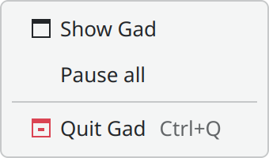

Click the icon to hide a visible window or restore a hidden/minimized one. Its badge counts unfinished requests, including analysis and waiting work. Above 99, it displays `99+`; the tooltip keeps the exact count.

The badge is green during activity, orange for pause or device waiting without an active transfer, and red when a conflict requires a decision. The tooltip summarizes running, waiting, and scanning work. The tray menu provides show, pause/resume, and quit actions.

When the window is hidden or minimized, one combined Plasma job view displays requests, files, bytes, progress, pause, and speed. **Show Gad** opens the main window. Every transfer notification keeps the **Show Gad** link, including completion, cancellation, and error messages. New requests join the same view; there is no second ordinary notification for the same transfer. The native Details area includes speed. Exact external rendering depends on the installed Plasma version and theme.

Enable **Launch at startup** to start Gad in the tray when the desktop session begins. This is per-user autostart, not a system service. Turning it off removes Gad's own startup entry.

## Phones, FTP, SFTP, and SMB

Local paths and already mounted folders are supported directly. Raw remote addresses use KIO Fuse on both source and destination sides.

| Service | Example |
|---|---|
| KDE Connect | `kdeconnect://device-id/android/DCIM/Camera/photo.jpg` |
| FTP | `ftp://files.example/folder/file.txt` |
| SFTP | `sftp://user@files.example/folder/file.txt` |
| SMB | `smb://server/share/folder/file.txt` |

KDE owns authentication and session handling. Gad does not provide a separate FTP/SSH/SMB password manager. Unsupported schemes, malformed URLs, and ambiguous query/fragment components are rejected.

Both sides are resolved before the request enters the copy engine. Following submissions keep their order. A connection error does not silently submit only part of the source group. The original address is used for display; the mounted path is an implementation detail used for file access and desktop opening.

Permissions, ownership, dates, and server operations vary by service. KIO Fuse destinations use service-defined metadata where chmod/utime are unavailable. Pause remains available, but durable mid-file crash recovery is disabled for these destinations. Undo requires the expected mounted paths and identities; changed mappings are not silently adopted.

## Keyboard reference

| Key | Gad behavior |
|---|---|
| **Ctrl+C / Ctrl+X** in the file manager | Mark files for copying or moving. |
| **Ctrl+V** in Gad | Paste into the displayed destination. |
| **Ctrl+V** in Dolphin with integration enabled | Submit a background paste to the active folder. |
| **Ctrl / Shift + selection** | Select several rows. |
| **Delete** | Remove finished rows, stop active entries, or remove pending ones. |
| **Backspace** | Undo completed results; otherwise stop/remove the selection. |
| **Shift+Insert** in Dolphin | The standard native KIO paste alternative. |

These keys do not imply that Gad replaces paste throughout KDE.

## Troubleshooting

| Symptom | What to check |
|---|---|
| Clipboard files appear in the clipboard manager but Gad cannot read them | On Wayland, check `wl-paste` availability; ensure the clipboard contains a file list rather than only path text. |
| A move becomes a copy | Check whether MD5 is enabled, the endpoints really share a supported local filesystem, and the kernel allows a safe rename. |
| Another request waits despite two workers | Check shared disks, unknown disk topology, conflicts, pauses, and dependencies on partially published results. |
| A repeated paste adds nothing | An active request may already cover the same source/destination/type; read the brief duplicate message. |
| Free space cannot be measured | Gad warns and continues; verify capacity through the underlying service if needed. |
| A device wait does not end | Restore the same mount/path and inspect identity or KIO mapping warnings. A changed file is not automatically accepted. |
| Retry is unavailable | Wait for the request to stop, select an actual failure, or use the dedicated recovery action for an incomplete undo. |
| Ctrl+V uses an old destination method | Update the installed integration, close and reopen Dolphin, and restart an idle Gad instance. |
| Undo is refused | Read the detail for changed files, missing backups, recreated sources, or absent volumes. Keep retained data until resolved. |
| Tray icon/window behavior differs | Check tray availability and the version of the already running Gad process. |

For diagnostics, record the About version, copy versus move, full error text, and whether endpoints are local, mounted, or remote. The error-report export is useful for sharing that information; review personal paths before sharing it.

## Limits and good practices

Gad manages transfers and journal-based undo; it does not provide a backup system's complete ownership, ACL, xattr, hard-link, or sparse-file guarantees. Ordinary copies do not preserve hard-link relationships or sparse allocation. A proven rename retains the existing object instead.

MD5 adds independent content checks but is not protection against deliberately constructed collisions. A group of file copies is not an atomic transaction. Concurrent modifications by other programs and filesystem synchronization behavior still matter.

Keep enough space for temporary copies and retained replaced files. Finish recovery before deleting journals or private backups. Test an unfamiliar remote service with noncritical sample data first.

For implementation details and protocol behavior, see the [developer guide](DEVELOPER_GUIDE.en-US.md). For reproducible validation, see [Testing Gad](../TESTING.en-US.md).

## Adding a language

Languages are discovered at startup from valid `gad_<locale>.qm` catalogs, such as `gad_de_DE.qm`. Qt provides each language’s native display name. US English remains available as the source language. Exact locales take priority, followed by an available variant of the same language, then French or English.

To add a language without rebuilding, put its `.qm` in `~/.local/share/gad/translations/` and its `<locale>.png` flag next to it, for example `de_DE.png`, then restart Gad. This directory follows `$XDG_DATA_HOME` when set. Flags may also be in a `flags/` subdirectory or in `~/.local/share/gad/flags/`. Missing flags use a generic icon. Invalid catalogs are ignored. User catalogs override system and embedded catalogs.

For distribution with Gad, place the `.qm` in `translations/` and its PNG in `assets/flags/`. `scripts/resources.py` generates the Qt manifest for Cargo, Qt tests, and documentation captures. No C++ list or source-manifest edit is needed. A compiled `.qm` alone is sufficient; when a `.ts` is supplied, `python3 scripts/translations.py` automatically discovers, validates, and compiles it.

## Duplicating in the original folder

Enable **Allow duplication in the same folder**, then copy and paste into the item’s containing folder. `photo.jpg` becomes `photo_copied1.jpg`; a `Documents` folder becomes `Documents_copied1`. Gad chooses the first available number, accounting for pending duplications. Symbolic links are copied without following their targets.

This option is disabled by default, saved, and captured for new requests. Moves onto themselves and copies of folders into their own descendants remain rejected. Exclusions still apply. Undo removes the created copy and preserves the original.

## Using Gad with Konqueror

**Paste with Gad** is a KIO service menu shared with Dolphin. Restart Konqueror after installing Gad to load the menu. Copy and cut operations use the same transfer engine and queue.

For **Ctrl+V**, launch **Konqueror with Gad** from the application menu or run `gad-konqueror`. This launcher loads a plugin only in Konqueror. File pastes go to Gad using the active view’s folder; pasting text into the address bar and input fields stays native. **Shift+Insert** keeps the usual KIO paste. Supported remote destinations remain available.

The plugin also exposes the active folder to **Paste into the open folder with Gad**, without relying on window titles or stale selections. The standard Konqueror launcher is preserved. Ctrl+V integration is validated with Konqueror 26.08 (Qt 6). If Konqueror is installed after Gad, rerun `python3 scripts/install.py` to build its plugin.

### Documentation from About {#about-documentation}

**About** links to the **Quick Start**, **User Guide**, and **Developer Guide**, with HTML and Markdown access. Links follow the selected Gad language, including when it changes while the dialog is open. Documents are installed locally and remain available without the project folder. If an edition is missing, Gad offers the available English edition; missing documents do not create broken links.

## Configuration and manual pages {#command-settings}

`gad --configure` saves preferences and updates controls in the running instance. If none is running, Gad starts in the background and the command returns. The `--no-…` forms disable checkboxes. Unspecified exclusion lists remain unchanged; repeated `--exclude-folder` or `--exclude-file` options replace the corresponding list. `--clear-exclusions` empties both lists. The global limit uses MiB/s; 0 means unlimited. `--md5` and `--properties` used with a copy or move affect only that transfer. Dolphin shortcuts use `gad --configure --dolphin-ctrl-v` or `--no-dolphin-ctrl-v`.

```bash
gad --configure --md5 --verify-space --no-include-hidden
gad --configure --exclude-folder "__*" --exclude-file "*.tmp" --language fr_FR --rate-limit 25
```

`man gad` · `make manpages`

## Dolphin shortcut watchdog {#dolphin-watchdog}

The regular Dolphin launcher can be protected by Gad. A startup module checks actual shortcuts every second and repairs losses after menu refreshes. Pasting is forwarded directly to Gad; text fields keep native behavior. Disabling Ctrl+V with Gad restores native pasting and stops repairs. Existing windows must be reopened once to load the module.


To protect the regular Dolphin launcher against lost shortcuts, install the watchdog with the command below, then close and reopen existing windows once.

```sh
python3 scripts/dolphin_integration.py --install --protect-launcher "$HOME/.local/bin/gad"
```

```sh
gad --dolphin --new-window
```

## Modified sources and cautious restoration {#file-integrity}

These protections run automatically, even without MD5. Gad compares identity, type, size and mtime/ctime of the open file and source path. A detected change during copying prevents publication; a late change during a move keeps the original and reports an error. A source edited while queued may be copied in its updated version.

Before restoration, Gad checks the selected files, backups, parent paths and required volumes. Changed backups, file permissions or ownership, missing moved results, and previously restored sources edited afterwards can block restoration. Checks run again before deleting a result. Conflicting files are kept; inspect the error details before retrying.

Timestamp checks depend on filesystem precision and information supplied by remote services. They do not provide a snapshot of a file another application is writing. Optional MD5 adds content comparison before publication; older journals use the information available in them.

## Transfer profiles {#transfer-profiles}

The **Profiles** button in **Settings** saves and applies **every option in the settings dialog**, but **never the destination**: MD5/properties/space checks, exclusions and hidden items, duplication, history, interrupted-transfer recovery, global and default request limits, language, startup and Dolphin/Konqueror shortcuts.

1. Choose the desired options under **Options…**.
2. Select **Profiles → Save current settings…** and enter a unique name.
3. Click that name in **Profiles** to restore all options. The displayed destination stays unchanged, even when empty. No transfer starts.

**Manage profiles…** lets you apply, rename, delete or **update from current settings**. The summary displays every saved value. Deletion removes the definition without undoing applied settings. Up to 64 profiles persist between sessions.

Language, the global speed limit and other global settings take their usual immediate effect. Verification, exclusions and default limits remain captured for new requests; existing batches keep their own options. Dolphin shortcut application is asynchronous. If a step fails, Gad attempts to restore previous settings and explicitly reports any rollback failure.

Older profiles migrate automatically: the destination is removed and previously missing options are initialized from current settings once. Use **Update from current settings** to adjust each profile afterwards. No source path, destination or password is saved.

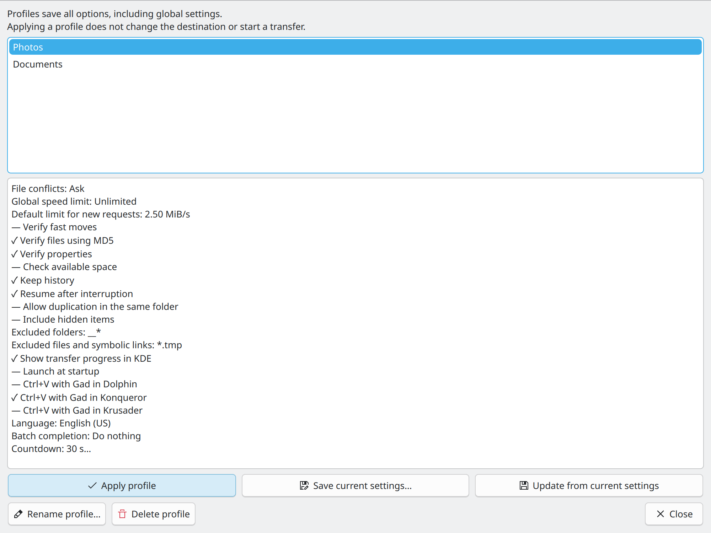

From the command line, `gad --profile "My profile"` applies settings without starting a transfer. Combine it with a copy: `gad --profile "My profile" --copy /path/source --to /path/destination`, or with `--move` / `--paste`. Gad waits for profile application before starting the transfer. The destination comes from the command; explicit options such as `--md5` override the profile. An unknown name returns an error without queuing files. `--configure --profile "My profile"` also accepts additional settings, applied after the profile.

## Conflict policies in profiles

In **Options → File conflicts**, choose **Ask**, **Skip existing files**, **Replace older files only**, or **Keep both files**. Save or update a profile to preserve this choice. Existing requests retain their captured policy.

Replacement compares destination and source modification times: only strictly older destination files are replaced; equal or newer files are skipped. Unreadable dates and symbolic links cause an error without automatic replacement; choose another policy and retry. Timestamp reliability depends on the filesystem or remote service. Existing folders are merged; the policy applies to file and link conflicts inside them. Keeping both uses the usual numbered rename suffix. Skipped files remain at the source when moving, and replacements retain restoration support.

Command: `gad --configure --conflict-policy newer`. Profiles in formats 1 and 2 migrate to **Ask** and never gain a destination.

## Search retained history {#history-search}

Click **Search history** or press **Ctrl+F**. Enter a file name or part of a source/destination path, including remote URLs. Words are combined with AND, case-insensitively, without regular expressions. Optionally choose a batch status and enable **Added between** to filter by the date the request was added, with inclusive local dates.

**History only** shows completed, canceled, restored or failed batches; clear it to include active requests. Column filters combine with this search. Matching files retain their parent folders. **Reset search** clears its criteria without changing column filters; closing the bar or pressing **Escape** disables only history search. Queue order and priorities remain unchanged.

The queue-order tooltip shows the date added. Older operations without a recorded date are marked unknown and remain searchable while the date filter is off. History must be retained: cleared or removed operations can no longer be found.

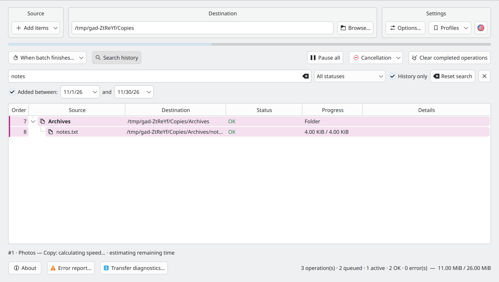

## Transfer diagnostics {#transfer-diagnostics}

The **Transfer diagnostics…** button at the bottom opens a nonmodal view of active and queued requests. It shows status, observed activity or waiting, global and request speed limits, speed, and remaining time. Blocking batch numbers refer to the main list.

Causes distinguish pauses, source scanning, conflicts awaiting a decision, unavailable devices or remote mounts, MD5 verification, resume-prefix checks, local renames, exclusive restoration, both workers occupied, row priority, shared disks or overlapping paths, and conservative serialization when resources are unknown.

A speed-budget wait is reported only when the limiter actually observed one within the last second. A configured limit alone is not proof of a slowdown. After five seconds without byte progress during copying or MD5, outside rate-limit waiting, Gad reports the lack of progress: file I/O or finalization may be waiting, but this cannot precisely identify a disk or network bottleneck. Diagnostics are not performance benchmarks and are not recorded in history. Closing this window changes no transfer.

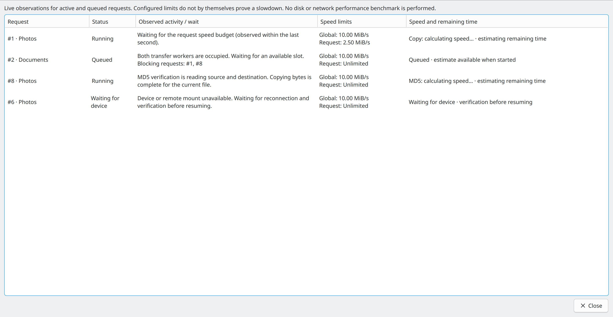

Speed limits apply to copied bytes; MD5 rereads and local renames are separate phases.

## Verify fast moves {#verify-fast-moves}

In **Options**, select **Verify fast moves**. Disabled by default, this setting is stored in profiles and captured for each new request. After a local rename, Gad checks identity (device/inode), type, size, modification time, permissions, owner and group, link targets, and the exact tree. It also checks that the source path disappeared. Legitimate ctime changes on the renamed root are accepted; descendants must retain their ctime.

Details show **Fast move verified** on success. Diagnostics distinguish this phase from MD5. A mismatch, added or missing item, recreated source path, or read error fails the batch and identifies the checked path; Gad preserves the moved result and its journal. No automatic rollback overwrites modified files. Pausing or canceling verification does not delete the result already moved.

This checks metadata rather than file contents: it preserves rename speed but does not replace a cryptographic comparison. Existing MD5 remains separate and forces copy/verify/delete. Ordinary copies do not receive a false fast-move verification result. Older profiles migrate with the option off. Command: `gad --configure --verify-fast-move`; disable with `--no-verify-fast-move`.

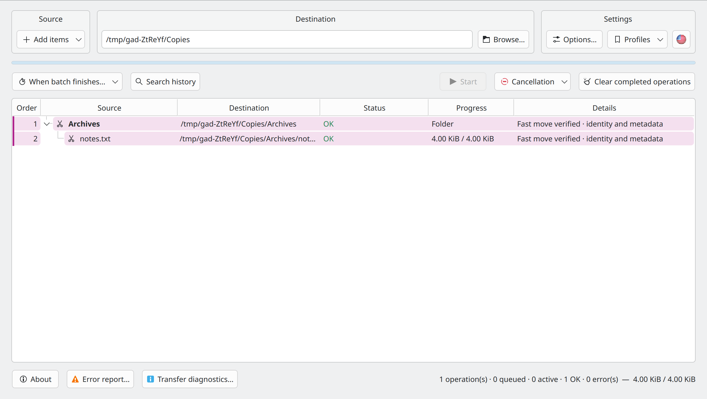

## Batch-completion actions {#queue-completion}

In **Options → Batch completion**, choose notification, quitting Gad, suspend or power off. Set the cancellation delay from **5 to 3600 seconds** (default 30), then click **Activate for this batch**. The status explicitly shows whether the action is active. Choosing an action, changing a setting or loading a profile does not activate it; changing completion settings disables an earlier activation.

The action waits until all tracked transfers succeed, remote preparation ends and final saves complete. The countdown still allows cancellation. New transfers postpone the action and restart a full countdown afterward. An error, cancellation, restoration or removed request disables the action. Pausing prevents execution.

**Deactivate completion action**, **Cancel action** or closing the countdown does not cancel transfers. Activation is used once and is not restored after restarting Gad. **When batch finishes…** provides the same actions and opens the dedicated tab directly. Here “batch” means all tracked transfers, not only one selected row.

Suspend and power off use logind and respect its authorization and inhibitors. A notification reopens hidden Gad. `gad --configure --completion-action suspend --completion-delay 60` only saves preferences; activate the action separately in Gad.

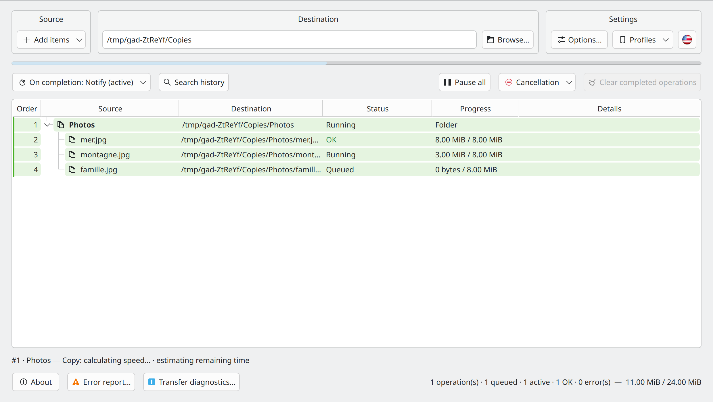

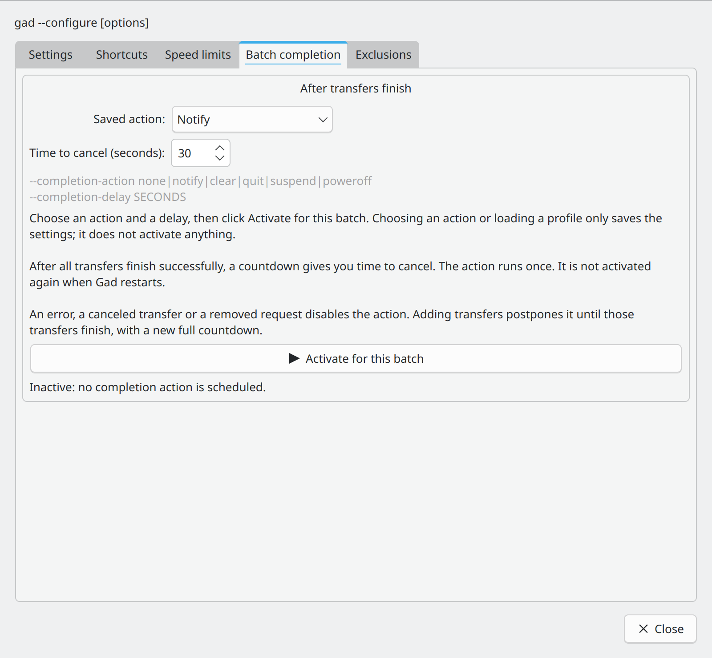


## Prepare transfers in the main list {#preparing-transfers}

When no work is running, files added through the window (**Add files…**, **Add folder…** or drag and drop) are scanned and displayed without starting the transfer. Choose the destination and options before adding, review the tree, then click **Start**. There is no separate simulation window.

The same button becomes **Pause all**, then **Resume queue**. If transfers are already authorized, new additions automatically join the queue. External paste from the file manager and external commands start automatically without opening the main window; a rejected external request does not start prepared work. Already queued duplicates are ignored with a message.

During copying, the partial file is visible at the destination as `file.ext.part` and receives its final name after success. Existing names are never overwritten for staging: Gad chooses a unique suffix. Interrupted transfers can resume the same partial file after verification. Clearing history removes the ability to restore completed transfers.

The error report and transfer diagnostics also block interaction with the main window. **Show in list** closes the report and disables searches that could hide the row. Report filtering follows the selected language.

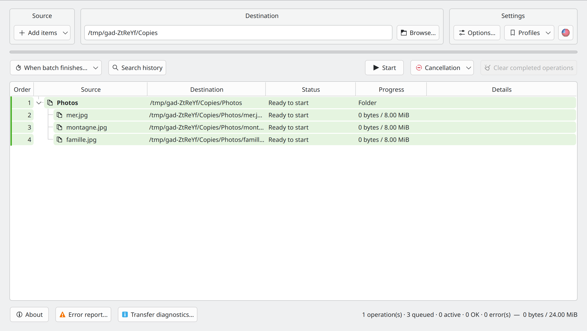


## Language and session progress

The button to the right of **Profiles** shows only the current language flag. Click it to choose a language. This menu replaces the selector in settings. The global bar starts at zero whenever Gad opens and tracks bytes processed since then. Individual rows retain their actual progress, including interrupted transfers.

## Adding items, shortcuts and exclusions

**Ctrl+F** opens search. **Ctrl+Q** requests exit and refuses to quit while transfers are active. **Ctrl+Alt+W** hides the window without stopping transfers. The flag button to the right of **Profiles** changes the language immediately. Main-window buttons have tooltips.

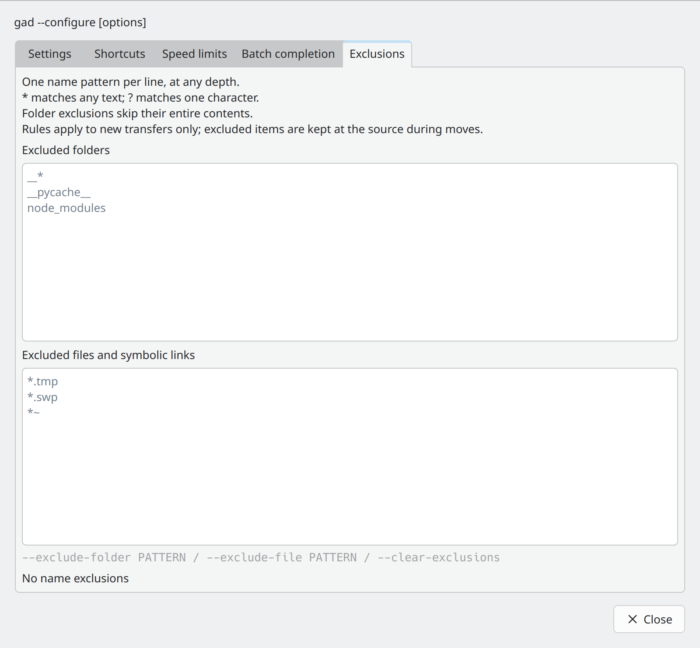
