# Gad — Guía de usuario {#gad-user-guide}

**Gestionnaire Avancé de Duplication · Versión 0.3.0**

**Gad, il copie.**

Edición en español, actualizada el 8 de noviembre de 2026.

[Inicio rápido](QUICK_START.es-ES.md) · [francés](GUIDE_UTILISATEUR.md) · [Todas las ediciones](README.es-ES.md)

## Contenido {#contents}

[Usar Gad con otros gestores de archivos](#using-gad-with-other-file-managers)

[Excluir elementos de las transferencias](#excluding-items-from-transfers)

1. [Qué hace Gad](#what-gad-does)
2. [Instalación y arranque](#installation-and-startup)
3. [Comprender la ventana](#understanding-the-window)
4. [Usar Ctrl+V en Dolphin](#using-ctrlv-in-dolphin)
5. [Iniciar una copia o un movimiento](#starting-a-copy-or-move)
6. [Movimientos locales rápidos](#fast-local-moves)
7. [Interpretar los estados y el progreso](#reading-states-and-progress)
8. [Organizar la cola](#organizing-the-queue)
9. [Pausar y reanudar](#pausing-and-resuming)
10. [Limitar la velocidad](#limiting-bandwidth)
11. [Resolver conflictos](#resolving-conflicts)
12. [Cancelar o restaurar transferencias](#canceling-or-undoing-transfers)
13. [Usar el menú contextual](#using-the-context-menu)
14. [Informe de errores y reintentos selectivos](#error-reporting-and-targeted-retries)
15. [Verificar el contenido con MD5](#checking-file-contents-with-md5)
16. [Verificar las propiedades de los archivos](#checking-file-properties)
17. [Verificar el espacio disponible](#checking-available-space)
18. [Esperar la reconexión de un dispositivo](#waiting-for-a-device-to-reconnect)
19. [Reanudar tras un fallo](#resuming-after-a-crash)
20. [Historial y limpieza](#history-and-cleanup)
21. [Área de notificación e inicio de sesión](#system-tray-and-session-startup)
22. [Teléfonos, FTP, SFTP y SMB](#phones-ftp-sftp-and-smb)
23. [Atajos de teclado](#keyboard-reference)
24. [Solución de problemas](#troubleshooting)
25. [Límites y buenas prácticas](#limits-and-good-practices)


## Qué hace Gad {#what-gad-does}

Gad gestiona copias y movimientos de archivos en una ventana KDE Plasma. Cada nueva solicitud agrega trabajo a la cola. La lista muestra carpetas y sus hijos, archivos en espera, transferencias activas, resultados completados y fallas. Las filas que pertenecen a la misma solicitud comparten un color de fondo sutil y un marcador de acento.

Un **Pedido**, también llamado lote, corresponde a un envío: al pegar tres archivos se crea una solicitud que contiene esos archivos. La selección de una carpeta también incluye sus subcarpetas y archivos. La agrupación sigue siendo útil para la configuración de destino, el progreso y deshacer, aunque no hay encabezados de lote encima de las filas del archivo.

Se pueden ejecutar hasta dos transferencias simultáneamente cuando sus discos de origen y destino son independientes. Un cambio de nombre local comprobado también se puede ejecutar junto con una copia en un disco compartido cuando sus rutas no se superponen. Las relaciones de disco desconocidas hacen que las copias ordinarias se ejecuten solas.

Gad se integra con Dolphin mediante **Pegar con Gad** y su opción de Ctrl+V. La integración con Konqueror utiliza **Konqueror con Gad**. Otros gestores pueden enviar archivos mediante la ventana de Gad o una acción personalizada; su Ctrl+V nativo no se intercepta automáticamente.


### Interpretar las capturas {#reading-the-screenshots}

Las 23 capturas muestran los widgets reales de Gad, archivos de ejemplo y estados de transferencia simulados. Utilizan el tema claro y el idioma de esta edición. No se fotografían archivos personales ni el escritorio real. Las notificaciones externas de Plasma no se reproducen en estas capturas.

Gad ofrece francés, inglés estadounidense, español, portugués, alemán y japonés. Elija un idioma en el menú de la bandera a la derecha de **Perfiles**: se aplica inmediatamente sin reiniciar Gad ni interrumpir las transferencias. Los diálogos y las notificaciones activas se actualizan conservando la selección y los valores introducidos. **Sistema** elige una variante disponible del idioma del escritorio y, si no existe, utiliza francés o inglés. Los diagnósticos técnicos no catalogados y los mensajes de servicios externos pueden conservar su idioma original.

## Instalación y arranque {#installation-and-startup}

### PPA de Ubuntu

El [PPA de Gad](https://launchpad.net/~hizo/+archive/ubuntu/gad) permite instalar Gad y recibir actualizaciones mediante APT:

```sh
sudo add-apt-repository ppa:hizo/gad
sudo apt update
sudo apt install gad
```

Compruebe en la página del PPA que existe un paquete publicado para su versión de Ubuntu. Si falta `add-apt-repository`, instale `software-properties-common`.

### Descargas precompiladas

Las [versiones de GitHub](https://github.com/Hizoka76/gad/releases/latest) ofrecen varios formatos. Sustituya los nombres de ejemplo por los de los archivos descargados.

#### Paquete Debian `.deb`

Descargue el paquete de su arquitectura e instálelo con APT para resolver las dependencias disponibles en sus repositorios:

```sh
sudo apt install ./gad_VERSION_amd64.deb
```

#### Archivo `.tar.gz`: fuentes y binario compilado

El archivo `gad-VERSION-linux-amd64.tar.gz` contiene el código fuente, las dependencias Rust incluidas, la documentación y el programa compilado en `prebuilt/`. No necesita compilarlo para ejecutarlo:

```sh
tar -xzf gad-VERSION-linux-amd64.tar.gz
cd gad-VERSION
./prebuilt/usr/bin/gad
```

#### Ejecutable directo

El archivo `gad-linux-amd64` también es un binario ya compilado:

```sh
chmod +x gad-linux-amd64
./gad-linux-amd64
```

Las descargas Linux amd64 están destinadas a procesadores x86-64. El binario directo no instala un lanzador ni el complemento de Dolphin; el `.deb` y el archivo incluyen los archivos de integración de esa versión. Estos binarios requieren Qt/KF6 con las versiones indicadas en las notas de publicación. Una versión publicada corresponde a su etiqueta y puede ser anterior al código actual del repositorio.

### Desde el código fuente

Instale las dependencias de compilación de Linux descritas en [guía para desarrolladores](DEVELOPER_GUIDE.es-ES.md#building) y [guía de prueba](../TESTING.es-ES.md#requirements). Desde el directorio del proyecto:

```bash
python3 scripts/install.py
gad
```

El instalador crea el ejecutable de la versión e instala el iniciador, los íconos y las acciones Dolphin en su cuenta. No requiere privilegios de administrador. Cierre y vuelva a abrir Dolphin después de la instalación o cambios en sus acciones.

Puede iniciar Gad desde el iniciador de aplicaciones o con `gad`. `gad --background` lo inicia en la bandeja del sistema. Un segundo lanzamiento contacta la instancia existente en lugar de abrir una cola separada.

Si la bandeja está disponible, cerrar la ventana principal la oculta y deja las transferencias en ejecución. Para salir, use **Gad que se rinde** en el menú de la bandeja. Gad se niega a salir mientras las transferencias o tareas de preparación están activas; una pausa por sí sola no los termina. Sin bandeja, la ventana realiza la misma comprobación antes de salir.

Para realizar una actualización, finalice o cancele el trabajo activo y salga de Gad normalmente antes de volver a abrirlo. Un ejecutable que ya se está ejecutando continúa usando su código antiguo después de instalar un nuevo binario.

## Comprender la ventana {#understanding-the-window}

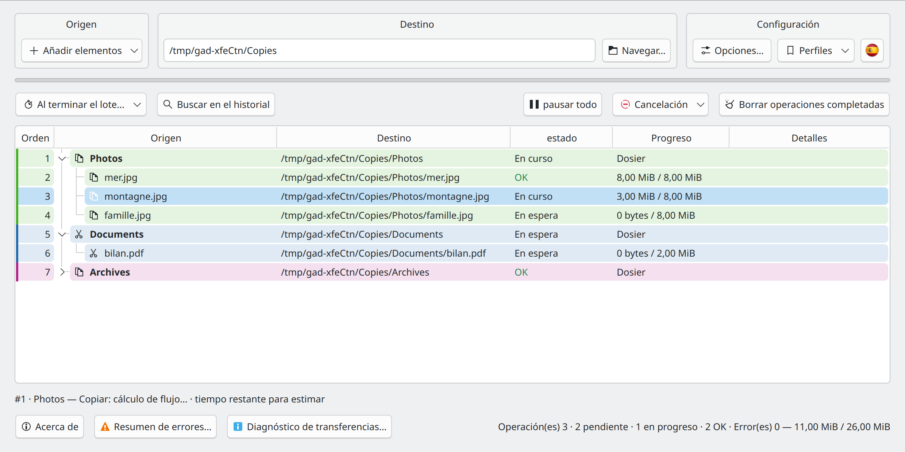

*La lista muestra archivos directamente, con carpetas reales formando el árbol. Los colores de las solicitudes mantienen los envíos separados reconocibles.*

| Área | Objetivo |
|---|---|
| **Origen** | Agregue archivos, agregue una carpeta o péguelos en el destino seleccionado. |
| **Destino** | Ingrese una ruta local o una URL remota compatible, o busque una carpeta. |
| **Configuración → Opciones…** | Verificación, exclusiones, duplicaciones, historial, inicio, límites de velocidad y atajos. |
| Barra de progreso | Progreso combinado para los trabajos de transferencia enumerados. |
| Filtro y controles | Filtre filas, pausar la cola, cancelar, deshacer o borrar el historial finalizado. |
| Lista de archivos | Origen, destino, estado, progreso y mensajes detallados. |
| Debajo de la lista | Decisiones de conflictos e información de velocidad/tiempo restante por solicitud. |
| Pie de página | **Acerca de**, **Resumen de errores...** y el resumen combinado. |

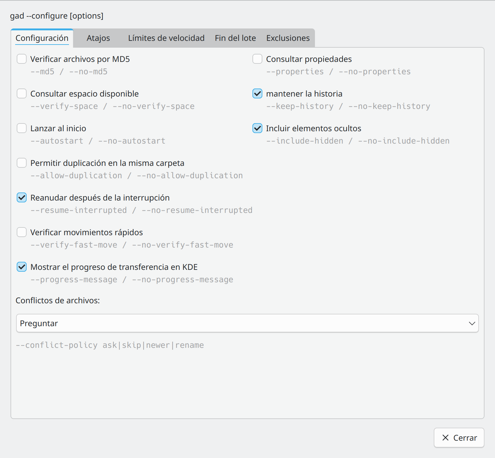

*El diálogo de opciones se abre desde el bloque Configuración.*

**Ajustes → Opciones…** abre una ventana modal que bloquea la ventana principal mientras las transferencias continúan. Los cambios se aplican inmediatamente; **Cerrar** o Esc no los deshace. Los parámetros de línea de órdenes aparecen en gris. Tamaño mínimo: **800 × 740**; ventana principal, informe de errores y diagnóstico: **1100 × 600**.

Los cuatro apartados son **Ajustes**, **Atajos**, **Límites de velocidad** y **Fin del lote**. Los límites incluyen el global y el predeterminado para nuevas solicitudes. Para modificar una existente, seleccione sus filas y utilice **clic derecho → Limitar la velocidad de la solicitud…**. El límite aparece en **Detalle**, también en carpetas; sin límite no se añade texto.

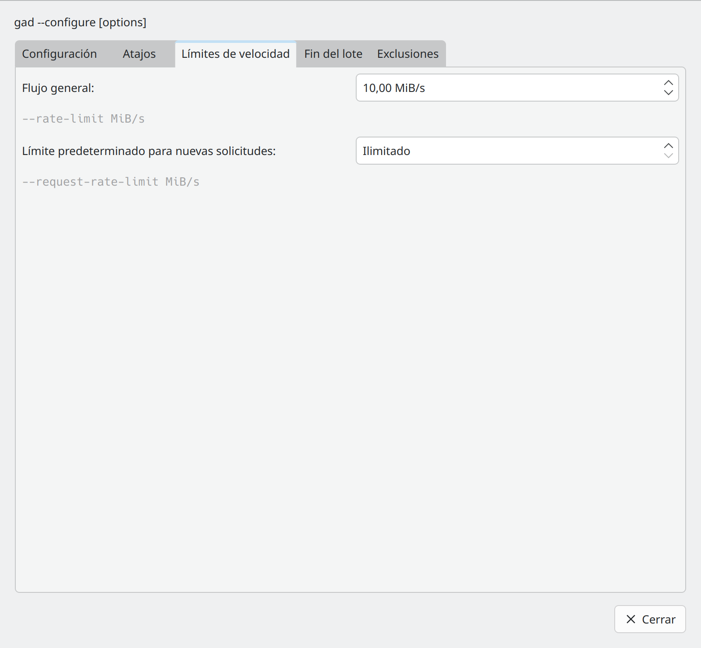

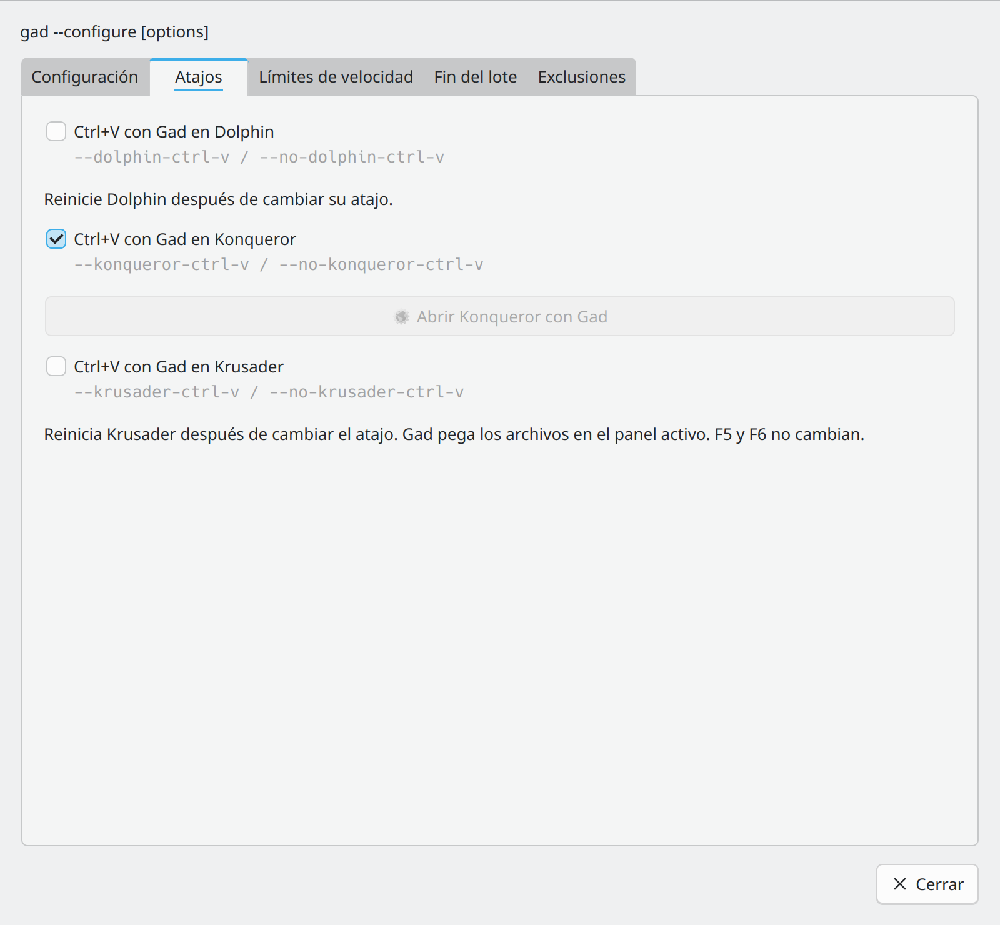

*La pestaña Atajos controla la integración de los gestores de archivos.*

**Atajos** habilita o deshabilita Ctrl+V con Gad para Dolphin y Konqueror. Los cambios de Dolphin utilizan el asistente de acceso directo reversible de Gad y requieren reiniciar Dolphin; un cambio rechazado restaura la casilla de verificación y muestra un error. Konqueror recoge los cambios en la siguiente pulsación de tecla en **Konqueror con Gad**. Su botón de inicio está disponible cuando tanto el navegador como el iniciador están instalados. Los pegados de texto siguen siendo nativos.

**Acerca de** muestra el nombre de la aplicación, acrónimo, lema, icono, versión y fecha de construcción. El icono del software es la imagen de documento de pelo rizado utilizada por la ventana, lanzador, Acerca del diálogo y la bandeja.

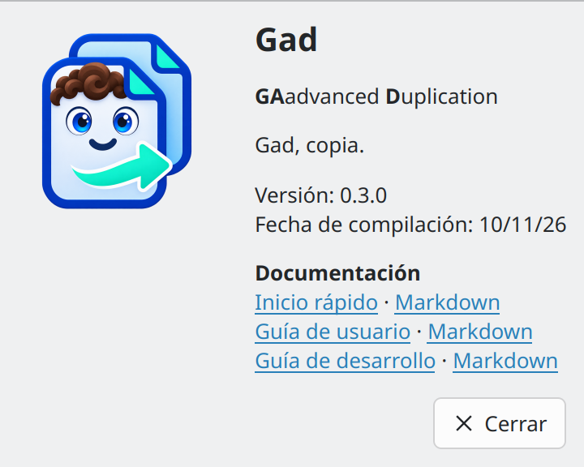

*Acerca de identifica la compilación que se está ejecutando actualmente.*

## Usar Ctrl+V en Dolphin {#using-ctrlv-in-dolphin}

La acción de hacer clic con el botón derecho en **Pegado con Gad** funciona sin reemplazar el acceso directo de pegado nativo de Dolphin. Recibe el contexto de destino en el que hizo clic.

Para asociar Ctrl+V con Gad en Dolphin:

```bash
gad --configure --dolphin-ctrl-v
```

Cierre y vuelva a abrir Dolphin. Ctrl+V luego apunta a la carpeta Dolphin actualmente abierta. La integración resuelve esa carpeta a través de la información de sesión de Dolphin; no requiere una ruta completa en el título de la ventana. En un campo de texto, Ctrl+V sigue siendo un pegado de texto.

**Mayús+Insertar** sigue siendo la alternativa de pasta estándar KDE/Dolphin KIO. No es un nuevo atajo Gad. Para restaurar la configuración anterior del acceso directo Dolphin:

```bash
gad --configure --no-dolphin-ctrl-v
```

El cambio se aplica a Dolphin, no a todas las aplicaciones en Plasma. Los accesos directos y acciones existentes se restauran a través de la configuración guardada de la integración en lugar de restablecer preferencias de usuario no relacionadas.

## Usar Gad con otros gestores de archivos {#using-gad-with-other-file-managers}

Gad puede recibir archivos de otro administrador, como Nautilus, Nemo o Thunar. La integración del menú contextual y los accesos directos depende del administrador: Gad no intercepta automáticamente su **Ctrl+V** ni infiere su carpeta activa.

### Copie o corte, luego pegue en Gad {#copy-or-cut-then-paste-in-gad}

1. Seleccione archivos en su administrador y use **Ctrl+C** o **Ctrl+X** para solicitar un movimiento.
2. Abra Gad y configure la carpeta de destino en **Destino**.
3. Haga clic en **Archivos del portapapeles** o presione **Ctrl+V dentro de Gad**.
4. Verifique el destino y el tipo de operación que se muestran en la lista.

El administrador debe publicar una lista de archivos en un formato de portapapeles comprendido por Gad. Copiar una ruta como texto sin formato no es suficiente. Para moverse se requiere un marcador de corte reconocido; si no está disponible, utilice el comando explícito `--move` a continuación.

### Arrastre archivos a Gad {#drag-files-into-gad}

Primero configure **Destino**, luego arrastre archivos o carpetas desde su administrador a la lista de Gad. **Arrastrar y soltar siempre crea una copia**, incluso si previamente cortó esos archivos. Para mover archivos, péguelos con un marcador de corte reconocido o use `--move`.

### Crear una acción o botón personalizado {#create-a-custom-action-or-button}

Si su administrador puede ejecutar un comando, una acción de menú o un botón de la barra de herramientas, utilice los siguientes comandos. Reemplace estas rutas de ejemplo; el destino debe ser una carpeta existente.

Para pegar el portapapeles en un destino explícito en segundo plano:

```sh
gad --paste "/home/demo/Documents/Copies"
```

Para copiar fuentes sin usar el portapapeles:

```sh
gad --copy "/home/demo/Images/photo.jpg" "/home/demo/Images/album" --to "/home/demo/Documents/Copies"
```

Para mover fuentes explícitamente:

```sh
gad --move "/home/demo/Images/photo.jpg" --to "/home/demo/Documents/Copies"
```

Una acción personalizada debe pasar de **la carpeta de destino** a `--paste`. Para `--copy` y `--move`, pase **los archivos fuente seleccionados** antes de `--to`, seguido de la carpeta de destino. Las variables de sustitución y las citas dependen del administrador: no asuma que un argumento de selección identifica la carpeta abierta ni reutilice los marcadores de posición de otro administrador. Si no se encuentra `gad`, utilice la ruta completa `~/.local/bin/gad` con su directorio de inicio expandido.

Otros administradores que admiten menús de servicio KIO también pueden ofrecer **Pegado con Gad**. Su disponibilidad no está garantizada en todos los gestores. Las opciones Dolphin y Konqueror bajo **Configuración → Opciones…** controlan solo esas integraciones; `--paste-current` no descubre las carpetas activas de otras aplicaciones.

## Iniciar una copia o un movimiento {#starting-a-copy-or-move}


Elija destino y opciones y añada los archivos en Gad. Si no hay trabajo activo, revise la lista y pulse **Iniciar**. El pegado externo desde el gestor de archivos arranca automáticamente; los nuevos elementos durante una transferencia se añaden a la cola. **Ctrl+C** copia y **Ctrl+X** mueve. Arrastrar y soltar siempre prepara una copia.

### Desde Dolphin {#from-dolphin}

1. Utilice **Ctrl+C** para copiar o **Ctrl+X** para mover.
2. Abra o haga clic derecho en la carpeta de destino deseada.
3. Elija **Pegado con Gad** o use Ctrl+V si su integración Gad está habilitada.
4. Repita para agregar más trabajo a la misma cola.

Un pegado externo comienza en segundo plano y no fuerza la apertura de la ventana principal. Si está oculto, Plasma muestra la vista de progreso nativa. Un pegado externo válido puede borrar una pausa global existente para iniciar la transferencia. Una pausa solicitada explícitamente después del envío tiene prioridad, incluso durante la preparación en segundo plano. Un pegado completamente duplicado no borra una pausa.

### Desde Gad {#from-gad}

El menú **Añadir elementos** incluye **Añadir archivos…** (Ctrl+Mayús+O), **Añadir carpeta…** (Ctrl+O) y **Archivos del portapapeles** (Ctrl+V). Conserva el modo Copiar o Cortar. Si Gad está inactivo, los elementos añadidos dentro de Gad esperan a **Iniciar**; si hay transferencias iniciadas, se incorporan a la cola. Solo el pegado externo desde el gestor de archivos inicia automáticamente.

Al colocar archivos en Gad siempre se crea un **Copiar: **. Una lista de archivos pegada mientras el campo Destino está enfocado aún ingresa a la cola de transferencia. El texto normal mantiene el comportamiento normal de pegado del campo de texto.

### Solicitudes duplicadas {#duplicate-requests}

Gad ignora una operación que ya está cubierta por una solicitud activa, incluida una en pausa: el mismo origen, destino y tipo de operación. La verificación cubre pegados repetidos, adiciones simultáneas, selecciones repetidas y archivos ya incluidos en otra carpeta enviada.

Los archivos nuevos se conservan, junto con las carpetas que necesiten. Un breve mensaje informativo informa cuántas entradas no se agregaron. No ofrece una opción de sobrescritura. La primera solicitud mantiene sus opciones de verificación.

Un destino diferente o un cambio de copiar versus mover sigue siendo una solicitud separada. Diferentes archivos fuente que comparten un nombre todavía utilizan el manejo de conflictos. Puede copiar intencionalmente un archivo nuevamente después de que finalice la solicitud anterior.

### Preparación {#preparation}

Gad valida todas las raíces y escanea la solicitud antes de copiar cualquiera de sus archivos. La preparación puede llevar tiempo en un teléfono o en una red compartida. Se informa una falla en lugar de iniciar silenciosamente solo la parte que se escaneó exitosamente.

Se rechazan los archivos y rutas especiales fuera del contrato UTF-8 admitido. Un enlace simbólico de origen se copia como enlace, incluido un enlace roto; Gad no lo recorre como carpeta de origen.

## Excluir elementos de las transferencias {#excluding-items-from-transfers}

En **Configuración → Opciones… → Exclusiones**, introduzca un patrón por línea para carpetas o archivos y enlaces simbólicos. Cada campo se guarda al perder el foco, sin botón Aplicar ni diálogo adicional. Si una regla es inválida, se indica el error, las reglas anteriores siguen activas y el texto permanece para corregirlo. Se aplica a nuevas transferencias. La opción de incluir elementos ocultos permanece en la pestaña de configuración.

| Tipo | Ejemplo | Efecto |
| --- | --- | --- |
| Carpetas | `__*` | Omite carpetas cuyos nombres comienzan con dos guiones bajos, incluido `__pycache__`. |
| Archivos | `*.tmp` | Omite archivos con esta extensión. |
| Archivos | `*.swp` o `*~` | Omite algunos archivos temporales y de respaldo del editor. Ingrese cada patrón en su propia línea. |

`*` coincide con cero o más caracteres y `?` coincide con un carácter. La coincidencia distingue entre mayúsculas y minúsculas y se aplica a nombres base en cada profundidad, incluidos los elementos seleccionados explícitamente. Las carpetas excluidas nunca se recorren. Los enlaces simbólicos utilizan patrones de archivos y no se siguen. Al desmarcar la opción de elementos ocultos se excluyen los nombres que comienzan con un punto, tanto para archivos como para carpetas.

Las líneas vacías se ignoran; Los espacios siguen siendo parte de patrones. Las rutas completas, las expresiones regulares y las clases de caracteres entre corchetes no se interpretan. Los límites son 128 patrones por tipo y 256 bytes UTF-8 por patrón, sin barras ni saltos de línea.

La configuración se guarda y captura para cada nueva solicitud antes de la preparación del acceso remoto. Los lotes, currículums y reintentos existentes mantienen sus reglas originales. Durante los movimientos, los elementos excluidos permanecen en el origen, por lo que las carpetas de origen pueden permanecer. Los cambios rápidos de nombre de carpetas completas están deshabilitados cuando el filtrado está activo, pero los archivos individuales elegibles aún pueden moverse rápidamente.

## Movimientos locales rápidos {#fast-local-moves}

Para una mudanza local elegible, Gad utiliza un cambio de nombre en lugar de copiar el contenido y eliminar la fuente. Esto preserva el inodo del archivo y evita la transferencia de sus datos. Puede ejecutarse junto con una copia usando el mismo disco si sus rutas son independientes.

Diferentes rutas de montaje de enlace aún pueden hacer referencia a un sistema de archivos subyacente. Por ejemplo:

```text
/media/library/Music  → /home/you/Music
/media/library/Other  → /home/you/Other
```

Gad puede cambiar el nombre entre esas vistas cuando demuestra una ruta común segura e identidades coincidentes. El mismo disco físico por sí solo no es suficiente: diferentes particiones, subvolúmenes, asignaciones de solo lectura o restricciones de cambio de nombre del kernel pueden requerir copiar y eliminar. Un cambio de nombre rechazado se reprograma con reservas de copia ordinarias.

Para obtener un árbol de carpetas completo y sin cambios, sin conflictos ni entradas pausadas/excluidas, Gad puede cambiar el nombre de todo el árbol a la vez. El detalle informa **expediente renombrado en bloque**. De lo contrario, procesa las entradas individualmente. Los archivos externos agregados a un árbol movido están protegidos durante la deshacer en lugar de moverse o eliminarse silenciosamente.

Al habilitar MD5 se utiliza la ruta de copia normal en lugar del acceso directo de cambio rápido de nombre. El límite de concurrencia sigue siendo de dos operaciones.

## Interpretar los estados y el progreso {#reading-states-and-progress}

La información sobre herramientas explicativa larga utiliza un salto de línea entre oraciones. Los nombres de archivos y las rutas conservan su puntuación y espaciado originales.

Las filas de origen utilizan íconos de Copiar para copias y íconos de Cortar para movimientos, incluidas carpetas y solicitudes en preparación. Las carpetas permanecen en negrita y conservan a sus descendientes.

La columna **Orden** se muestra primero y automáticamente se ajusta al ancho mínimo necesario para su título, flecha de clasificación y números. Sigue la cola del motor, incluidas las carpetas, las solicitudes de escaneo y el historial retenido. La clasificación y el filtrado de la pantalla nunca vuelven a numerar las filas restantes, por lo que los espacios en blanco en una vista filtrada son normales. Los cambios de prioridad de la cola actualizan las posiciones. Coloque el cursor sobre un número para **Lote #…**. Las transferencias paralelas pueden finalizar en un orden diferente.

| Columna | Significado |
|---|---|
| **Orden** | Posición de la cola del motor, independiente de la clasificación de la pantalla; coloque el cursor sobre el número de lote. |
| **Origen** | Nombre del archivo o carpeta; el icono Copiar/Cortar indica la operación y la información sobre herramientas proporciona la ruta completa y la configuración opcional de velocidad/MD5; Los números de lote permanecen en la información sobre herramientas del pedido. |
| **Destino** | Ruta de destino o la URL remota original reconstruida para su visualización. |
| **estado** | Estado actual, incluida pausa, conflictos, comprobaciones y dispositivo en espera. |
| **Progreso** | Bytes copiados y tamaño del archivo, o MD5/progreso de verificación de recuperación. |
| **Detalles** | Errores, resultados de MD5, información de movimiento rápido y advertencias de verificación. |

| Estado | Significado |
|---|---|
| **Analizar…** | Validando raíces y escaneando la solicitud. |
| **En espera** | Esperando su turno, recursos o una acción de reanudación. |
| **En curso** | Transferir datos o procesar la entrada. |
| **En pausa** | Se aplica una pausa global, de solicitud o de entrada. |
| **Esperando dispositivo** | Una montura conocida no está disponible; Se conservan datos parciales. |
| **Control de recuperación…** | Verificando la fuente y guardando el prefijo parcial antes de volver a escribir. |
| **Verificación MD5…** | Releyendo independientemente el origen y el destino temporal. |
| **para decidir** | Un conflicto de archivos necesita su decisión. |
| **DE ACUERDO** | Finalizado; se muestra en verde. |
| **Error** | Un paso falló; lea los detalles o abra el informe de errores. |
| **ignorado** | Saltado; la fuente permanece. |
| **Cancelado** | Cancelado sin deshacer automáticamente los resultados completados. |
| **Restauración…** | Deshacer se está ejecutando. |
| **Renovar** | Los efectos seleccionados se deshicieron. |
| **Restauración incompleta** | Deshacer no pudo finalizar de forma segura. |

Una carpeta se vuelve correcta solo después de que finalizan sus elementos secundarios relevantes. Se derrumba en esa transición. Reabrirlo manualmente lo mantiene abierto hasta actualizaciones de progreso posteriores. La selección, el desplazamiento y la información sobre herramientas se conservan mientras los contadores cambian.

### Filtros {#filters}

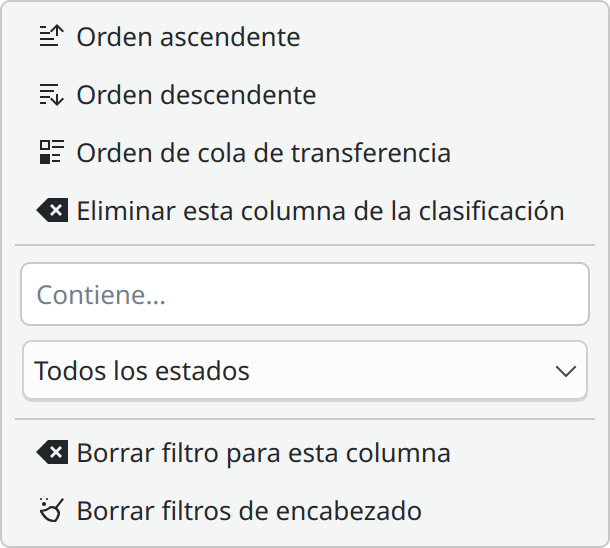

*El filtrado cambia la visibilidad, no el comportamiento de transferencia.*

Los filtros están disponibles haciendo clic derecho en los encabezados de las columnas. Se ha eliminado la antigua combinación de filtros globales situada encima de la tabla. Las carpetas de antepasados ​​permanecen visibles cuando es necesario mostrar un hijo coincidente. Al seleccionar un filtro se abren ramas relevantes; Las actualizaciones de progreso ordinarias no vuelven a abrir las ramas que colapsaste.

### Ordenar y filtrar desde encabezados {#sorting-and-filtering-from-headers}

Haga clic en el título de una columna para alternar el orden de visualización ascendente y descendente. **Ctrl+clic** agrega una columna al orden existente; repetir Ctrl+clic invierte la dirección de esa columna sin cambiar su prioridad. Los encabezados muestran prioridades como **(1)**, **(2)**, etc., con la flecha de clasificación habitual a la derecha de cada columna ordenada. Un clic sin Ctrl restaura la clasificación en una sola columna. Los nombres utilizan clasificación natural (`file2` antes de `file10`). El progreso se ordena por porcentaje numérico, independientemente del tamaño del archivo y las unidades mostradas. La clasificación es entre hermanos: las carpetas conservan a sus descendientes.

Haga clic derecho en un encabezado para abrir su menú. Proporciona clasificación ascendente/descendente, **Orden de cola de transferencia**, y un filtro **Contiene…** que no distingue entre mayúsculas y minúsculas para esa columna. Las búsquedas de fuentes también incluyen rutas completas. Estado agrega un selector de estado exacto; El progreso suma porcentajes mínimos y máximos. **Eliminar esta columna de la clasificación** elimina una clave de clasificación y conserva las demás. Las acciones claras eliminan un filtro de columna o todos los filtros de encabezado.

Los filtros de columna se combinan entre sí. Los hijos coincidentes conservan las carpetas ancestrales visibles; Los filtros activos permanecen disponibles en los menús de columnas. Los contadores globales siguen cubriendo todas las transferencias. Al localizar un archivo de un informe de conflicto o error se borran los filtros que podrían ocultarlo.

La clasificación solo cambia la visualización, nunca la prioridad de ejecución. Restaure **Orden de cola de transferencia** antes de arrastrar filas para reordenar el trabajo. La configuración de pantalla sobrevive a las actualizaciones de progreso y a los cambios de idioma.

### Contadores y estimaciones {#counters-and-estimates}

El resumen combinado cuenta el trabajo de transferencia. Un cambio de nombre avanza bytes lógicos sin representar el tráfico del disco copiado. Un archivo completamente escrito aún puede estar pasando por la verificación MD5. Las filas ocultas/eliminadas se excluyen del resumen visible. Los directorios no aportan bytes de contenido de archivos.

Debajo de la lista, cada solicitud activa tiene su propio nombre de fuente, velocidad y tiempo restante estimado. Las mediciones utilizan los últimos cinco segundos de actividad. Un breve calentamiento muestra **cálculo del débito…** hasta que haya transcurrido el tiempo suficiente.

La copia y las relecturas de MD5 tienen medidas separadas. Si aún se desconoce la velocidad de MD5, la estimación cubre explícitamente solo la copia y dice **MD5 à estimer**. Cuando ambas mediciones están disponibles, la estimación incluye el trabajo de copia restante y las lecturas de verificación. Es aproximado y no predice el tiempo de espera en la cola.

Una pausa suspende las estimaciones; un conflicto muestra **para decidir**. Los archivos pausados ​​individualmente hacen que se desconozca el tiempo total restante de la solicitud incluso mientras otros archivos avanzan. Los cambios de nombre no muestran velocidades de copia de disco artificiales y un prefijo reanudado reconocido no crea un pico de velocidad. Sin progreso, la velocidad anterior cae a cero y la estimación deja de estar disponible.

## Organizar la cola {#organizing-the-queue}

Arrastre una o más filas **espera** antes o después de otra fila. El marcador de inserción muestra la posición deseada; Al pasar el cursor cerca del borde, se desplaza la lista. Las raíces de archivos de nivel superior se pueden intercalar entre solicitudes.

Una carpeta se mueve con su rama. Los archivos dentro de una carpeta se reordenan entre hermanos; mantienen su padre real y su destino. Mueva la carpeta principal para reposicionar toda la rama. Arrastrar nunca cambia el destino.

El menú contextual proporciona **Proceso siguiente** (Proceso siguiente) y **Muévete en línea** (Mover a la cola). Ctrl y Shift admiten selección múltiple. **Seleccionar todo el lote** selecciona las otras raíces que pertenecen al mismo envío.

Las prioridades se guardan. El procesamiento siguiente no interrumpe el archivo actual ni elimina una pausa. La compatibilidad del disco y las dependencias para deshacer aún se aplican. El entrelazado inseguro de solicitudes que reemplazan las mismas salidas se rechaza con un motivo. Por lo tanto, una solicitud parcialmente publicada puede hacer que el trabajo dependiente permanezca en espera durante una pausa.


## Pausar y reanudar {#pausing-and-resuming}

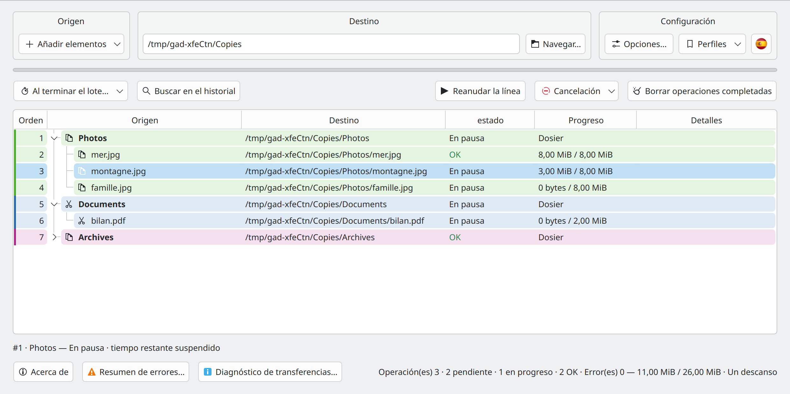

*Las filas inacabadas muestran su pausa; los resultados completos siguen siendo correctos.*

**pausar todo** pausa la cola y cambia a **Reanudar la línea** (Reanudar cola). Los archivos completados mantienen su estado. El menú contextual puede pausar o reanudar solicitudes o entradas seleccionadas. Pausar una solicitud permite avanzar a otras solicitudes admisibles.

Una pausa tiene efecto en un punto de control en lugar de interrumpir por la fuerza una llamada al sistema activa. Un currículum seleccionado elimina la pausa global para que la selección pueda continuar; las pausas pertenecientes a otras solicitudes siguen vigentes.

La cancelación está disponible durante una pausa. También se puede ejecutar una operación de deshacer solicitada explícitamente mientras la copia normal está en pausa global. El control de pausa en Plasma y el menú de la bandeja permanecen sincronizados con la ventana principal.

## Limitar la velocidad {#limiting-bandwidth}

**Flujo general:** en **Configuración → Opciones…** limita el tráfico de copia simultáneo del **suma**. La interfaz utiliza ** MiB/s**, equivalente a ** MiB/s**: 1 MiB = 1.048.576 bytes. Esto no son megabits por segundo. Cero, mostrado como **Ilimitado**, elimina el límite. La configuración se recuerda y se puede cambiar durante las transferencias.

Haga clic derecho en una fila y elija **Limitar el rendimiento de las solicitudes** en el menú contextual o **Configuración → Opciones…** para limitar toda su solicitud. Al seleccionar filas de varias solicitudes se aplica el límite elegido a cada una de ellas. Su presupuesto global sigue siendo compartido. Zero elimina solo los límites individuales de las solicitudes seleccionadas. La información sobre herramientas muestra un límite individual cuando se establece uno.

Se aplican ambas restricciones: una solicitud limitada a 10 MiB/s permanece limitada a 10 incluso si el límite global es 50. Dos solicitudes sin límites individuales pueden usar como máximo 50 MiB/s combinados. No se garantiza el reparto equitativo.

El límite se aplica a los bytes copiados, incluidos los puntos finales remotos montados. El almacenamiento en búfer del sistema operativo y de la red puede producir variaciones breves. Las relecturas, comprobaciones de propiedad y deshacer de MD5 están fuera de este límite. Los cambios de nombre rápidos siguen siendo inmediatos. Pausa y cancelación de estadía disponibles a tarifas bajas.

## Resolver conflictos {#resolving-conflicts}

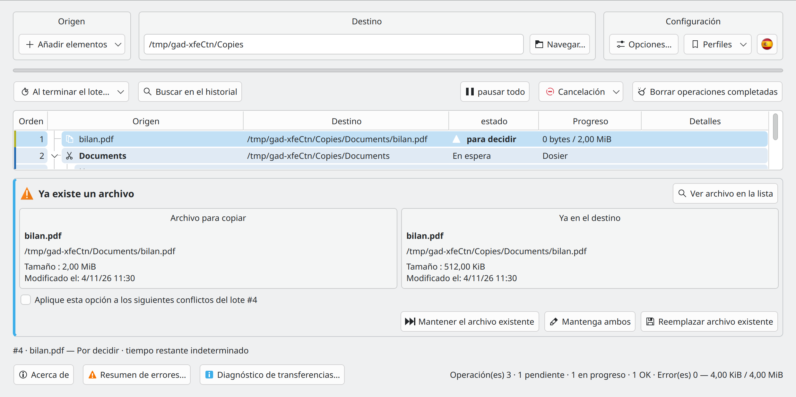

*El origen y el destino existente se muestran uno al lado del otro debajo de la lista de archivos.*

Un panel de conflictos muestra el nombre del archivo, la ruta seleccionable, el tamaño y la hora de modificación para ambos lados.

| Botón | Resultado |
|---|---|
| **Mantener el archivo existente** | Mantenga el destino existente y omita esta fuente. Un movimiento no elimina una fuente omitida. |
| **Mantenga ambos** | Conserve el archivo existente y elija un nombre de copia disponible para el nuevo resultado. |
| **Reemplazar archivo existente** | Reemplácelo y conserve el destino anterior de forma privada para deshacerlo. |

La casilla de verificación aplica la decisión a conflictos posteriores **en esa solicitud**. Se reinicia cuando cambia el conflicto mostrado. Si hay varios conflictos, utilice el selector para elegir cuál inspeccionar. Un nuevo conflicto no cambia silenciosamente el tema sobre el que estás decidiendo.

**Ver archivo en la lista** localiza la fila bloqueada, incluso cuando un filtro la oculta. Un archivo que ocupa una ruta de carpeta requerida, o un enlace simbólico no seguro en esa ruta, puede producir un error en lugar de un reemplazo automático de carpeta.

## Cancelar o restaurar transferencias {#canceling-or-undoing-transfers}

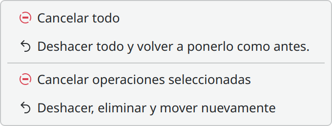

*Las acciones globales siguen estando disponibles sin selección.*

### Parar sin deshacer {#stop-without-undo}

**Cancelar todo** (Cancelar todo) detiene el trabajo activo y en cola, incluida la preparación pendiente. Deja las transferencias completadas en su lugar. **Cancelar operaciones seleccionadas** límites que paran a la selección. Las selecciones de carpetas incluyen descendientes.

### Deshacer efectos completados {#undo-completed-effects}

**Deshacer todo y volver a ponerlo como antes.** cancela el trabajo y deshace el historial recuperable, primero la ejecución más reciente. **Deshacer, eliminar y mover nuevamente** aplica deshacer a las entradas o ramas seleccionadas.

| Operación original | Deshacer comportamiento |
|---|---|
| Copiar a un archivo nuevo | Elimine la copia creada por Gad. |
| Reemplazar un archivo existente | Elimine el nuevo resultado y restaure el destino guardado. |
| Mover | Devuelva el archivo a su origen y elimine el resultado de destino. |
| Crear una carpeta | Elimínelo sólo cuando pueda hacerlo sin perder otros archivos. |

Deshacer espera a que se liberen las reservas de transferencias activas. Para devolver un movimiento entre sistemas de archivos puede ser necesario volver a copiar el contenido. Una transacción de deshacer que ya esté en curso debe finalizar sus pasos de restauración segura.

Gad comprueba identidades, metadatos y contenido grabado antes de modificar los resultados. Un origen recreado, un destino modificado, una copia de seguridad faltante o un volumen ausente pueden provocar un rechazo o una deshacer incompleta. El detalle explica lo que se retuvo. Una copia completa no es una copia de seguridad independiente y borrar el historial elimina su capacidad de deshacer.

### Eliminar y retroceder {#delete-and-backspace}

| Fila seleccionada | Borrar | Retroceso |
|---|---|---|
| Finalizado | Eliminar la referencia de fila/historial; conservar el archivo resultante. | Deshaga ese archivo o rama cuando su diario lo permita. |
| Activo | Solicitar cancelación. | Solicitar cancelación. |
| Pendiente | Sácalo de la cola. | Sácalo de la cola. |

Una selección de carpeta se extiende a su contenido. La selección de archivos individuales no deshace automáticamente sus vecinos. Mantenga el historial que pueda necesitar antes de borrarlo.

## Usar el menú contextual {#using-the-context-menu}

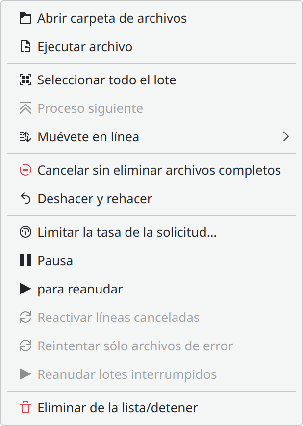

*Las acciones se adaptan a la selección y sus estados actuales.*

| Medida | Objetivo |
|---|---|
| **Abrir carpeta de archivos** | Abra la carpeta principal de un archivo o abra la carpeta seleccionada. |
| **Ejecutar archivo** | Abra un archivo con su aplicación asociada al escritorio. |
| **Seleccionar todo el lote** | Seleccione las otras entradas del mismo envío. |
| **Traiter ensuite / Déplacer dans la file** | Priorizar entradas o sucursales en espera. |
| **Cancelar sin eliminar archivos completos** | Detenga el trabajo seleccionado y conserve los resultados completados. |
| **Deshacer y rehacer** | Deshace la selección cuando su diario lo permita. |
| **Limitar el rendimiento de las solicitudes** | Aplicar un límite de ancho de banda a las solicitudes de propiedad. |
| **Mettre en pausa / Reprendre** | Pausar o reanudar el trabajo seleccionado. |
| **Reintentar sólo archivos de error** | Vuelva a intentar fallas elegibles sin volver a copiar los archivos OK. |
| **Reanudar lotes interrumpidos** | Validar y retomar el trabajo recuperable tras una interrupción. |
| **Reactivar líneas canceladas** | Prepare las entradas canceladas para un nuevo intento después de la limpieza controlada. |
| **Eliminar de la lista/detener** | Aplicar la semántica de eliminación. |

Al abrir una fila Aceptar se dirige al destino. Para filas pendientes, activas, omitidas, canceladas o deshechas, se dirige a la fuente. El estado actual se comprueba cuando se ejecuta la acción. Las carpetas duplicadas en una selección múltiple se abren solo una vez. El inicio se limita a un solo archivo, no a una solicitud o carpeta completa.

La reactivación espera a que se detenga la solicitud y conserva los vecinos completados. Si el tipo de fuente cambió, agréguelo como una nueva solicitud en lugar de reutilizar la fila anterior.

## Informe de errores y reintentos selectivos {#error-reporting-and-targeted-retries}

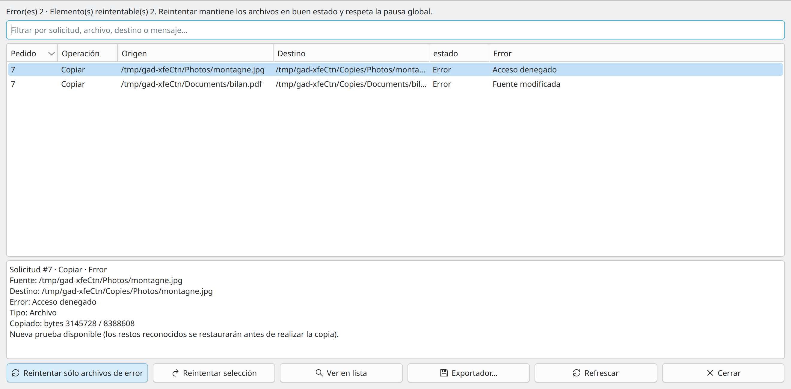

*Los seis botones tienen iconos: reintentar los errores mostrados, reintentar la selección, localizar, exportar, actualizar y cerrar.*

Abra **Resumen de errores...** junto a Acerca de. Agrupa los fallos retenidos por solicitud, operación, origen, destino, estado y mensaje. Una carpeta que simplemente refleja el error de un niño no agrega un registro duplicado; El fallo de una carpeta todavía se muestra.

Filtros de búsqueda por solicitud, ruta o mensaje de error. Al seleccionar una fila, se muestran todos los detalles debajo: progreso, ubicación del archivo parcial, bytes recuperables e información de propiedad o MD5 disponible. **Ver en lista** localiza la entrada en la ventana principal. **Refrescar** actualiza la instantánea explícitamente; el informe no se reorganiza continuamente mientras lo inspecciona.

**Reintentar sólo archivos de error** reintenta los errores elegibles que se muestran actualmente. **Reintentar selección** apunta solo a filas seleccionadas. En este informe, la selección de un error de directorio no incluye de forma silenciosa los elementos secundarios filtrados. La acción de contexto de carpeta de la lista principal conserva su comportamiento normal de selección de descendientes.

La solicitud debe ser detenida. Gad valida cualquier efecto parcial o publicado, restaura solo los restos reconocidos y vuelve a poner en cola los elementos fallidos. El archivo fallido se copia desde el principio después de esa limpieza. Los archivos correctos no se copian; las entradas canceladas, omitidas o eliminadas no se reactivan. Otras entradas que simplemente estaban esperando en una solicitud detenida permanecen en pausa si estaban fuera del reintento. Se respeta la pausa global.

Se puede volver a intentar un error de preparación sin archivos en la lista mediante una validación raíz completa y un nuevo análisis. Si falla la preparación del reintento, repare la causa y actualice el informe para volver a intentarlo. Un deshacer incompleto por separado sigue siendo una tarea de deshacer/recuperación. Un resultado publicado modificado se conserva y puede hacer que un reintento falle de forma segura.

**Exportador…** (Exportar…) está deshabilitado cuando el informe cargado está vacío. Filtrar todas las filas no deshabilita la exportación porque aún cubre la instantánea completa. Escribe todo el informe cargado, incluidas las filas ocultas por su filtro de búsqueda, como **Texto UTF-8** o **JSON**. El texto está destinado a ser leído y compartido; JSON conserva referencias de archivos/solicitudes estables y metadatos de diagnóstico. La exportación no realiza ninguna transferencia. Los errores eliminados deliberadamente del historial no se reintroducen.

## Verificar el contenido con MD5 {#checking-file-contents-with-md5}

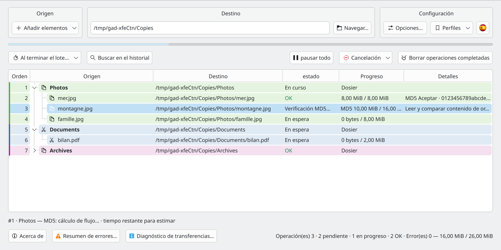

Habilite **Verificar archivos por MD5** para nuevos envíos. Cada archivo normal se copia y sincroniza, luego se vuelven a leer y comparar su origen y destino temporal. Gad publica el mismo archivo temporal verificado con su nombre final solo después de realizar comprobaciones exitosas.

La fila muestra **Verificación MD5…** durante la relectura y luego puede mostrar **MD5 OK** y el resumen. Para un archivo de N bytes, la verificación agrega dos lecturas de N bytes. Los directorios y enlaces simbólicos no se verifican como contenidos de archivos.

Los errores de lectura, la cancelación durante la verificación, los cambios de fuente o una discrepancia en el resumen impiden la publicación y preservan la fuente y cualquier destino anterior. Un movimiento elimina su fuente sólo después de una publicación exitosa y las comprobaciones requeridas. La configuración se recuerda para futuras solicitudes; Las solicitudes existentes mantienen su elección capturada.

MD5 verifica la coherencia de esta ruta de transferencia. No es una garantía criptográfica contra colisiones construidas deliberadamente.

## Verificar las propiedades de los archivos {#checking-file-properties}

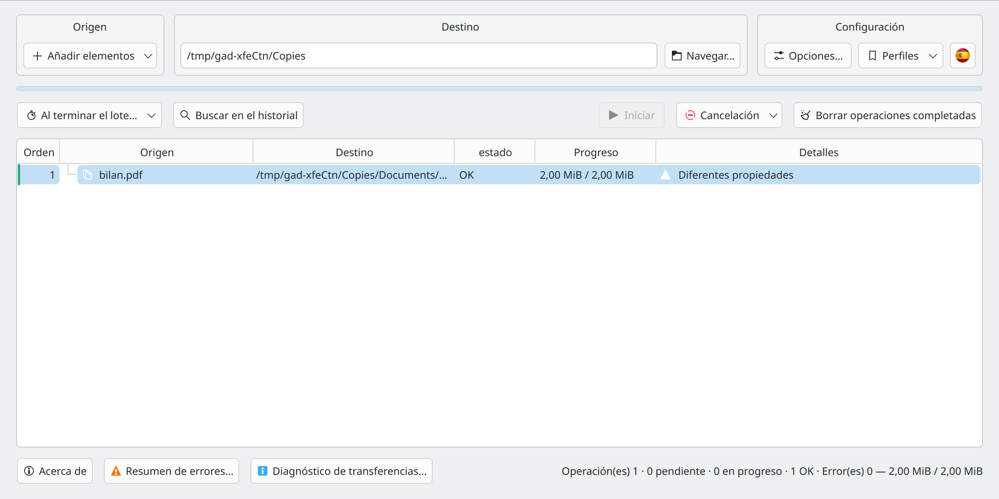

**Consultar propiedades** compara el propietario expuesto, el grupo, los bits de permiso, las ACL POSIX y los atributos extendidos. Distingue las diferencias conocidas de los controles no disponibles. Los valores de los atributos no se incluyen en los informes guardados; el informe enumera las diferencias y los cheques no disponibles. Las fechas de modificación quedan fuera de esta comparación.

Las copias ordinarias conservan los permisos básicos y el tiempo de modificación cuando sean compatibles; no obtienen propietario de nivel de respaldo, ACL o preservación xattr simplemente porque esta casilla está habilitada.

Para una copia, una propiedad que no coincide puede dejar el resultado copiado correctamente con una advertencia. Para un movimiento de copiar y eliminar, una verificación fallida antes de la publicación conserva el destino original y anterior; una verificación posterior a la publicación fallida conserva el original y un diario del resultado creado. Un cambio rápido de nombre ya movió el objeto, por lo que una advertencia posterior no afirma que la fuente todavía existe.

La opción se recuerda y se captura con cada nueva solicitud. Los informes están disponibles en los resúmenes de advertencias de carpetas y detalles. Los servicios remotos pueden exponer sólo una parte de estas propiedades.

## Verificar el espacio disponible {#checking-available-space}

**Consultar espacio disponible** estima el almacenamiento restante requerido por las solicitudes analizadas, incluidas las copias en cola y en pausa que comparten un volumen. Los volúmenes separados se calculan de forma independiente.

Los destinos antiguos y las copias de seguridad para deshacer ya ocupan espacio y no se tratan como capacidad libre durante el reemplazo. Los currículums temporales asignados y reconocidos no se cuentan dos veces. Se considera el redondeo de asignación de bloques. Un cambio de nombre rápido comprobado no requiere una segunda copia completa de los datos.

Se sabe que el espacio insuficiente impide que se inicie esa solicitud. **Si la capacidad no puede ser estimada, Gad advierte y continúa** en lugar de bloquear indefinidamente. La advertencia puede permanecer visible después del éxito. Se trata de una estimación, no de una reserva de espacio en disco: otro programa puede consumir espacio posteriormente y las adiciones posteriores deben considerarse por separado.

La opción se recuerda para nuevas solicitudes; los existentes conservan su elección capturada.

## Esperar la reconexión de un dispositivo {#waiting-for-a-device-to-reconnect}

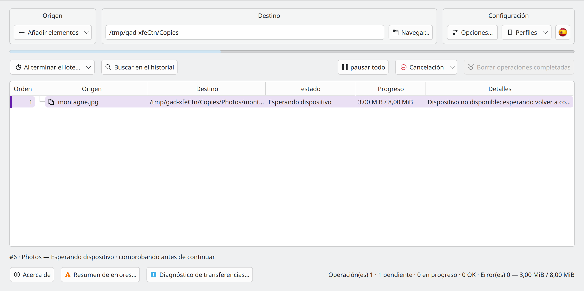

Si un disco o montaje conocido desaparece durante una transferencia, Gad muestra **Esperando dispositivo**, conserva su archivo parcial y libera al trabajador para que puedan continuar las solicitudes independientes. Plasma también describe la espera.

Vuelva a conectar y montar el dispositivo **en el mismo lugar**. Gad comprueba el montaje esperado, la identidad/versión de origen y el prefijo guardado antes de continuar desde el último punto duradero válido. Los bytes más allá de ese punto se pueden volver a copiar. Una carpeta vacía dejada en el punto de montaje u otro volumen montado allí no es prueba suficiente. Un UUID del sistema de archivos puede reconocer el mismo volumen después de que Linux asigna un número de dispositivo diferente.

Siguen vigentes pausas globales y específicas; la reconexión no los anula. Una solicitud cancelada no se reinicia. Un archivo de origen, destino o parcial reemplazado puede hacer que la recuperación falle en lugar de sobrescribir datos no relacionados. Una publicación interrumpida requiere recuperación en lugar de una segunda copia automática.

Para KDE Connect, FTP, SFTP y SMB, Gad vuelve a intentar la resolución KIO en segundo plano sin abrir su ventana ni agregar otro lote. KDE todavía maneja la autenticación. La ruta montada y las identidades deben seguir siendo reconocibles. Si KIO Fuse se reinicia con una ruta diferente, Gad lo informa y conserva el diario original; restaure el montaje original o inspeccione y vuelva a enviar los archivos interrumpidos.

Para destinos KIO Fuse sin recuperación parcial duradera, Gad puede reiniciar **sólo el archivo actual desde el principio**, después de validar su fuente y eliminar su archivo temporal no publicado reconocido. Los vecinos terminados permanecen intactos. Los puntos de control de reconexión local se crean durante la sesión incluso si la recuperación automática de fallas no está marcada; esa preferencia aún rige el reinicio después de un bloqueo.

La detección se produce en los puntos de control de transferencia y errores de conexión. Una llamada al sistema bloqueada en el kernel o en un servicio remoto puede retrasar la detección. Un archivo eliminado en un volumen que de otro modo estaría disponible, espacio insuficiente o denegación de permiso sigue siendo un error común.

## Reanudar tras un fallo {#resuming-after-a-crash}

**Reanudar después de la interrupción** está habilitado de forma predeterminada para nuevas solicitudes. Los destinos locales compatibles utilizan un punto de control duradero cada 64 MiB o después de dos segundos de progreso. Después de una parada abrupta, Gad puede verificar el origen, el destino y el contenido parcial y luego reanudarlo en el mismo archivo temporal.

Los archivos completos permanecen completos. Se mantienen las pausas globales y de entrada. Una solicitud cancelada explícitamente nunca se reanuda automáticamente. Si la preferencia global está deshabilitada al reiniciar, las solicitudes interrumpidas elegibles esperan a **Reanudar lotes interrumpidos** en el menú contextual. Esa acción se refiere a la solicitud de propiedad, incluso si selecciona un archivo.

La versión fuente guardada y la propiedad temporal se verifican antes del truncamiento o escritura. Gad compara ambos prefijos y el resumen registrado y luego descarta solo los bytes más allá del punto confirmado. Una fuente modificada o un archivo parcial provoca un rechazo. La fila muestra **Control de recuperación…** y luego el recuento de bytes reanudado. La verificación final MD5 aún se ejecuta si está habilitada.

Esta recuperación no está disponible para todos los estados intermedios: las etapas ambiguas de publicación, cambio de nombre o deshacer requieren una recuperación basada en diario. La recuperación duradera ante fallos está deshabilitada para los destinos KIO Fuse. Los diarios y las copias de seguridad conservados para la recuperación no se eliminan al desinstalar Gad.

## Historial y limpieza {#history-and-cleanup}

**mantener la historia** conserva solicitudes, resultados de verificación e información de deshacer entre sesiones normales. Sin él, los registros de la sesión actual permanecen visibles, pero el apagado normal libera su historial y sus copias de seguridad. La información de recuperación requerida después de una interrupción puede permanecer disponible incluso cuando la retención ordinaria del historial está desactivada.

**Borrar operaciones completadas** elimina el historial finalizado y los destinos reemplazados guardados. **no** elimina las copias finales exitosas, pero elimina su capacidad de deshacer. Deshacer se basa en los volúmenes originales y la información retenida; No es una copia de seguridad independiente.

El diario normalmente reside en `$XDG_DATA_HOME/gad/state.json`, de forma predeterminada es `~/.local/share/gad/state.json`. Los archivos reemplazados se conservan en directorios privados `.gad-undo-*` en su volumen de destino. Estos utilizan espacio en disco hasta que se borre el historial de recuperación asociado.

No elimine manualmente esos directorios privados mientras aún necesite deshacerlos. Un diario no válido o un resultado no reconocido se conserva con un error en lugar de descartarse de manera optimista.

## Área de notificación e inicio de sesión {#system-tray-and-session-startup}

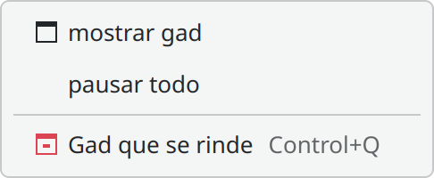

Haga clic en el icono para ocultar una ventana visible o restaurar una oculta/minimizada. Su insignia cuenta las solicitudes inconclusas, incluido el análisis y el trabajo en espera. Por encima de 99, muestra `99+`; la información sobre herramientas mantiene el recuento exacto.

La insignia es verde durante la actividad, naranja para pausa o dispositivo en espera sin una transferencia activa y roja cuando un conflicto requiere una decisión. La información sobre herramientas resume el trabajo de ejecución, espera y escaneo. El menú de la bandeja proporciona acciones para mostrar, pausar/reanudar y salir.

Cuando la ventana está oculta o minimizada, una vista de trabajo Plasma combinada muestra solicitudes, archivos, bytes, progreso, pausa y velocidad. **mostrar gad** abre la ventana principal. Cada notificación de transferencia mantiene el enlace **mostrar gad**, incluidos los mensajes de finalización, cancelación y error. Nuevas solicitudes se unen a la misma vista; no existe una segunda notificación ordinaria para la misma transferencia. El área nativa de Detalles incluye velocidad. La representación externa exacta depende de la versión y el tema de Plasma instalados.

Habilite **Lanzar al inicio** para iniciar Gad en la bandeja cuando comience la sesión de escritorio. Este es un inicio automático por usuario, no un servicio del sistema. Al desactivarlo se elimina la propia entrada de inicio de Gad.

## Teléfonos, FTP, SFTP y SMB {#phones-ftp-sftp-and-smb}

Se admiten directamente rutas locales y carpetas ya montadas. Las direcciones remotas sin procesar utilizan el fusible KIO tanto en el lado de origen como en el de destino.

| Servicio | Ejemplo |
|---|---|
| KDE Conectar | `kdeconnect://device-id/android/DCIM/Camera/photo.jpg` |
| ftp | `ftp://files.example/folder/file.txt` |
| SFTP | `sftp://user@files.example/folder/file.txt` |
| PYME | `smb://server/share/folder/file.txt` |

KDE posee autenticación y manejo de sesiones. Gad no proporciona un administrador de contraseñas FTP/SSH/SMB independiente. Se rechazan los esquemas no admitidos, las URL con formato incorrecto y los componentes de consulta/fragmento ambiguos.

Ambas partes se resuelven antes de que la solicitud ingrese al motor de copia. Los siguientes envíos mantienen su orden. Un error de conexión no envía silenciosamente solo una parte del grupo de origen. La dirección original se utiliza para su visualización; la ruta montada es un detalle de implementación que se utiliza para acceder a archivos y abrir el escritorio.

Los permisos, la propiedad, las fechas y las operaciones del servidor varían según el servicio. KIO Los destinos de Fuse utilizan metadatos definidos por el servicio donde chmod/utime no están disponibles. La pausa sigue estando disponible, pero la recuperación duradera de fallos a mitad de archivo está deshabilitada para estos destinos. Deshacer requiere las rutas e identidades montadas esperadas; las asignaciones modificadas no se adoptan silenciosamente.

## Atajos de teclado {#keyboard-reference}

| Llave | Comportamiento Gad |
|---|---|
| **Ctrl+C / Ctrl+X** en el administrador de archivos | Marcar archivos para copiarlos o moverlos. |
| **Ctrl+V** en Gad | Pegue en el destino mostrado. |
| **Ctrl+V** en Dolphin con integración habilitada | Envíe un pegado de fondo a la carpeta activa. |
| **Ctrl / Mayús + selección** | Seleccione varias filas. |
| **Borrar** | Elimine filas terminadas, detenga entradas activas o elimine las pendientes. |
| **Retroceso** | Deshacer resultados completados; de lo contrario, detenga/elimine la selección. |
| **Mayús+Insertar** en Dolphin | La alternativa de pasta nativa estándar KIO. |

Estas claves no implican que Gad reemplace el pegado en todo KDE.

## Solución de problemas {#troubleshooting}

| Síntoma | Que comprobar |
|---|---|
| Los archivos del portapapeles aparecen en el administrador del portapapeles pero Gad no puede leerlos | En Wayland, consulte la disponibilidad de `wl-paste`; asegúrese de que el portapapeles contenga una lista de archivos en lugar de solo texto de ruta. |
| Un movimiento se convierte en una copia. | Compruebe si MD5 está habilitado, si los puntos finales realmente comparten un sistema de archivos local compatible y si el kernel permite un cambio de nombre seguro. |
| Otra solicitud espera a pesar de dos trabajadores | Verifique los discos compartidos, la topología de los discos desconocidos, los conflictos, las pausas y las dependencias de los resultados publicados parcialmente. |
| Un pegado repetido no aporta nada | Es posible que una solicitud activa ya cubra el mismo origen/destino/tipo; lea el breve mensaje duplicado. |
| El espacio libre no se puede medir | Gad advierte y continúa; verificar la capacidad a través del servicio subyacente si es necesario. |
| La espera de un dispositivo no termina | Restaure el mismo montaje/ruta e inspeccione la identidad o las advertencias de mapeo KIO. Un archivo modificado no se acepta automáticamente. |
| El reintento no está disponible | Espere a que se detenga la solicitud, seleccione una falla real o use la acción de recuperación dedicada para una deshacer incompleta. |
| Ctrl+V utiliza un antiguo método de destino | Actualizar la integración instalada, cerrar y reabrir Dolphin, y reiniciar una instancia Gad idle. |
| Undo es rechazado | Lea el detalle para archivos cambiados, copias de seguridad desaparecidas, fuentes recreadas o volúmenes ausentes. Mantenga los datos retenidos hasta que se resuelvan. |
| El icono de bandeja/ comportamiento de ventana difiere | Compruebe la disponibilidad de bandejas y la versión del proceso Gad ya en ejecución. |

Para el diagnóstico, grabe la versión About, copy versus move, texto completo de error, y si los endpoints son locales, montados o remotos. La exportación de error-report es útil para compartir esa información; revise los caminos personales antes de compartirla.

## Límites y buenas prácticas {#limits-and-good-practices}

Gad gestiona transferencias y deshacer basado en revistas; no proporciona una propiedad completa del sistema de copia de seguridad, ACL, xattr, hard-link, o garantías de escaso archivo. Las copias ordinarias no preservan relaciones de enlace duro o asignación escasa. Un nombre probado conserva el objeto existente en su lugar.

MD5 añade cheques de contenido independientes pero no es protección contra colisiones deliberadamente construidas. Un grupo de copias de archivos no es una transacción atómica. Modificaciones simultáneas por otros programas y comportamiento de sincronización de sistemas de archivos todavía importan.

Mantenga suficiente espacio para copias temporales y archivos retenidos reemplazados. Terminar la recuperación antes de eliminar revistas o copias de seguridad privadas. Pruebe primero un servicio remoto desconocido con datos de muestra no críticos.

Para detalles de implementación y comportamiento de protocolo, vea el [guía para desarrolladores](DEVELOPER_GUIDE.es-ES.md). Para validación reproducible, vea [Prueba Gad](../TESTING.es-ES.md).

## Añadir un idioma {#adding-a-language}

Los idiomas se descubren al inicio a partir de catálogos `gad_<locale>.qm` válidos, como `gad_de_DE.qm`. Qt proporciona el nombre para mostrar nativo de cada idioma. El inglés estadounidense sigue estando disponible como idioma de origen. Las configuraciones regionales exactas tienen prioridad, seguidas de una variante disponible del mismo idioma, luego francés o inglés.

Para agregar un idioma sin reconstruir, coloque su `.qm` en `~/.local/share/gad/translations/` y su indicador `<locale>.png` al lado, por ejemplo, `de_DE.png`, luego reinicie Gad. Este directorio sigue a `$XDG_DATA_HOME` cuando se establece. Las banderas también pueden estar en un subdirectorio `flags/` o en `~/.local/share/gad/flags/`. Las banderas que faltan utilizan un icono genérico. Los catálogos no válidos se ignoran. Los catálogos de usuario anulan el sistema y los catálogos integrados.

Para distribución con Gad, coloque el `.qm` en `translations/` y su PNG en `assets/flags/`. `scripts/resources.py` genera el manifiesto Qt para Cargo, pruebas Qt y capturas de documentación. No se necesita ninguna lista de C++ ni edición del manifiesto de origen. Un `.qm` compilado por sí solo es suficiente; cuando se suministra un `.ts`, `python3 scripts/translations.py` lo descubre, valida y compila automáticamente.

## Duplicar en la carpeta de origen {#duplicating-in-the-original-folder}

Habilite **Permitir duplicación en la misma carpeta**, luego copie y pegue en la carpeta que contiene el elemento. `photo.jpg` se convierte en `photo_copied1.jpg`; una carpeta `Documents` se convierte en `Documents_copied1`. Gad elige el primer número disponible, teniendo en cuenta las duplicaciones pendientes. Los enlaces simbólicos se copian sin seguir sus objetivos.

Esta opción está deshabilitada de forma predeterminada, guardada y capturada para nuevas solicitudes. Se trasladan a sí mismos y las copias de carpetas a sus propios descendientes siguen siendo rechazadas. Aún se aplican exclusiones. Deshacer elimina la copia creada y conserva el original.

## Usar Gad con Konqueror {#using-gad-with-konqueror}

**Pegado con Gad** es un menú de servicio KIO compartido con Dolphin. Reinicie Konqueror después de instalar Gad para cargar el menú. Las operaciones de copiar y cortar utilizan el mismo motor de transferencia y cola.

Para **Ctrl+V**, inicie **Konqueror con Gad** desde el menú de la aplicación o ejecute `gad-konqueror`. Este iniciador carga un complemento solo en Konqueror. Los archivos pegados van a Gad usando la carpeta de la vista activa; pegar texto en la barra de direcciones y los campos de entrada sigue siendo nativo. **Mayús+Insertar** mantiene la pasta habitual de KIO. Los destinos remotos admitidos siguen estando disponibles.

El complemento también expone la carpeta activa a **Pegue en la carpeta abierta con Gad**, sin depender de títulos de ventanas o selecciones obsoletas. Se conserva el lanzador estándar Konqueror. La integración Ctrl+V está validada con Konqueror 26.08 (Qt 6). Si Konqueror se instala después de Gad, vuelva a ejecutar `python3 scripts/install.py` para compilar su complemento.

### Documentación desde Acerca de {#about-documentation}

**Acerca de Gad** incluye enlaces a **Inicio rápido**, **Guía de usuario** y **Guía de desarrollo**, en HTML y Markdown. Los enlaces siguen el idioma elegido, incluso si cambia mientras el diálogo está abierto. Los documentos se instalan localmente y funcionan sin la carpeta del proyecto. Si falta una edición, Gad ofrece la edición inglesa disponible; los documentos ausentes no generan enlaces rotos.

## Configuración y páginas de manual {#command-settings}

`gad --configure` guarda las preferencias y actualiza los controles de la instancia abierta. Si no hay ninguna, inicia Gad en segundo plano y devuelve el control al terminal. Las formas `--no-…` desactivan las casillas. Las listas de exclusión no indicadas se conservan; repetir `--exclude-folder` o `--exclude-file` sustituye la lista correspondiente. `--clear-exclusions` vacía ambas listas. El límite global se expresa en MiB/s; 0 significa sin límite. `--md5` y `--properties` con una copia o movimiento afectan solo a ese traslado. Los atajos de Dolphin usan `gad --configure --dolphin-ctrl-v` o `--no-dolphin-ctrl-v`.

```bash
gad --configure --md5 --verify-space --no-include-hidden
gad --configure --exclude-folder "__*" --exclude-file "*.tmp" --language fr_FR --rate-limit 25
```

`man gad` · `make manpages`

## Vigilancia del atajo de Dolphin {#dolphin-watchdog}

Gad puede proteger el lanzador habitual de Dolphin. Un módulo cargado al inicio comprueba los atajos reales cada segundo y repara su pérdida tras actualizar los menús. El pegado se envía directamente a Gad; los campos de texto conservan el comportamiento nativo. Desactivar Ctrl+V con Gad restaura el pegado nativo y detiene las correcciones. Las ventanas existentes deben volver a abrirse una vez para cargar el módulo.


Para proteger el lanzador habitual de Dolphin frente a la pérdida del atajo, instale el módulo con el comando siguiente y cierre y vuelva a abrir las ventanas existentes una vez.

```sh
python3 scripts/dolphin_integration.py --install --protect-launcher "$HOME/.local/bin/gad"
```

```sh
gad --dolphin --new-window
```

## Archivos de origen modificados y restauración prudente {#file-integrity}

Estas protecciones son automáticas, incluso sin MD5. Gad compara la identidad, el tipo, el tamaño y las fechas mtime/ctime del archivo abierto y de su ruta. Un cambio detectado durante la copia impide publicarla; un cambio tardío durante un movimiento conserva el original y muestra un error. Un archivo editado mientras espera puede copiarse en su nueva versión.

Antes de restaurar, Gad comprueba los archivos seleccionados, las copias de seguridad, las rutas padre y los volúmenes necesarios. Una copia de seguridad alterada, permisos o propietario modificados, un resultado movido ausente o un origen restaurado y editado después pueden bloquear la restauración. Las comprobaciones se repiten antes de eliminar el resultado. Los archivos afectados se conservan; consulte el detalle del error antes de reintentar.

La comprobación de fechas depende de la precisión del sistema de archivos y del servicio remoto. No crea una instantánea de un archivo abierto por otra aplicación. MD5 añade una comparación del contenido antes de publicar; los diarios antiguos utilizan la información disponible.

## Perfiles de transferencia {#transfer-profiles}

El botón **Perfiles**, en **Ajustes**, guarda y aplica **todas las opciones del diálogo**, pero **nunca el destino**: verificaciones MD5/propiedades/espacio, exclusiones y elementos ocultos, duplicación, historial, recuperación tras interrupciones, límites global y predeterminado, idioma, inicio automático y atajos de Dolphin/Konqueror.

1. Configure las opciones en **Opciones…**.
2. Elija **Perfiles → Guardar ajustes actuales…** e introduzca un nombre único.
3. Seleccione el nombre para aplicar todas las opciones. El destino no cambia, aunque esté vacío. No se inicia ninguna transferencia.

**Gestionar perfiles…** permite aplicar, renombrar, eliminar o **actualizar con los ajustes actuales**. El resumen muestra todos los valores. Eliminar la definición no deshace los ajustes aplicados. Se conservan hasta 64 perfiles entre sesiones.

El idioma, el límite global y otros ajustes globales tienen su efecto habitual inmediato. Las verificaciones, exclusiones y límites predeterminados se capturan para nuevas solicitudes; los lotes existentes conservan sus opciones. El atajo de Dolphin se aplica de forma asíncrona. Si falla una etapa, Gad intenta restaurar los valores anteriores y avisa si la restauración es incompleta.

Los perfiles antiguos migran automáticamente: se elimina el destino y las opciones que faltaban se inicializan una sola vez con los ajustes actuales. Puede modificarlas con **Actualizar con los ajustes actuales**. No se guardan rutas de origen, destinos ni contraseñas.

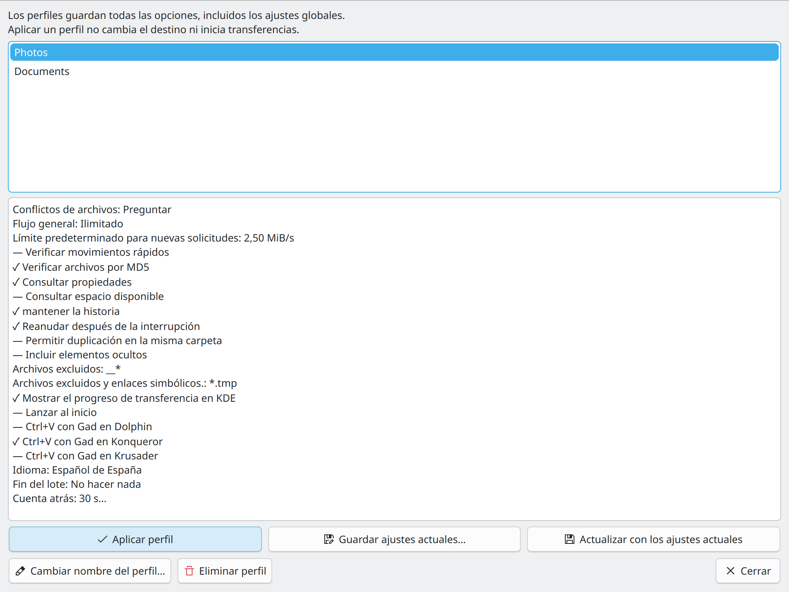

En la línea de órdenes, `gad --profile "Mi perfil"` aplica los ajustes sin iniciar una transferencia. Para copiar: `gad --profile "Mi perfil" --copy /ruta/origen --to /ruta/destino`; también funciona con `--move` / `--paste`. Gad espera a que se aplique el perfil. El destino procede de la orden y las opciones explícitas, como `--md5`, prevalecen. Un nombre desconocido devuelve un error sin encolar archivos. `--configure --profile "Mi perfil"` admite ajustes adicionales, aplicados después del perfil.

## Políticas de conflictos en perfiles

En **Opciones → Conflictos de archivos**, elija **Preguntar**, **Omitir archivos existentes**, **Reemplazar solo archivos más antiguos** o **Conservar ambos archivos**. Guarde o actualice el perfil. Las solicitudes existentes conservan su política.

Solo se reemplazan destinos cuya fecha de modificación sea estrictamente anterior a la del origen; se omiten los de fecha igual o posterior. Fechas ilegibles y enlaces simbólicos provocan un error sin reemplazo: cambie la política y reintente. La fiabilidad de las fechas depende del sistema de archivos o servicio remoto. Se combinan las carpetas existentes y se aplica la política a los conflictos interiores. Conservar ambos añade un sufijo numerado. Los archivos omitidos permanecen en el origen al mover; los reemplazos permiten restauración.

Orden: `gad --configure --conflict-policy newer`. Los perfiles de los formatos 1 y 2 se migran a **Preguntar**, sin destino.

## Buscar en el historial conservado {#history-search}

Pulse **Buscar en el historial** o **Ctrl+F**. Escriba un nombre o parte de una ruta de origen/destino, incluidas URL remotas. Las palabras se combinan con Y, sin distinguir mayúsculas y sin expresiones regulares. Elija un estado del lote y active **Añadido entre** para filtrar la fecha de incorporación, con fechas locales inclusivas.

**Solo historial** muestra lotes terminados, cancelados, restaurados o fallidos; desmárquelo para incluir solicitudes activas. Los filtros de columnas se combinan con la búsqueda. Se conservan los padres de los resultados. **Restablecer búsqueda** borra sus criterios sin cambiar los filtros de columnas; cerrar la barra o pulsar **Escape** desactiva solo esta búsqueda. La cola y sus prioridades no cambian.

La ayuda de la columna de orden muestra la fecha de incorporación. Las operaciones antiguas sin fecha aparecen como desconocidas y siguen disponibles sin filtro de fecha. El historial debe conservarse: las operaciones borradas no se pueden recuperar mediante búsqueda.

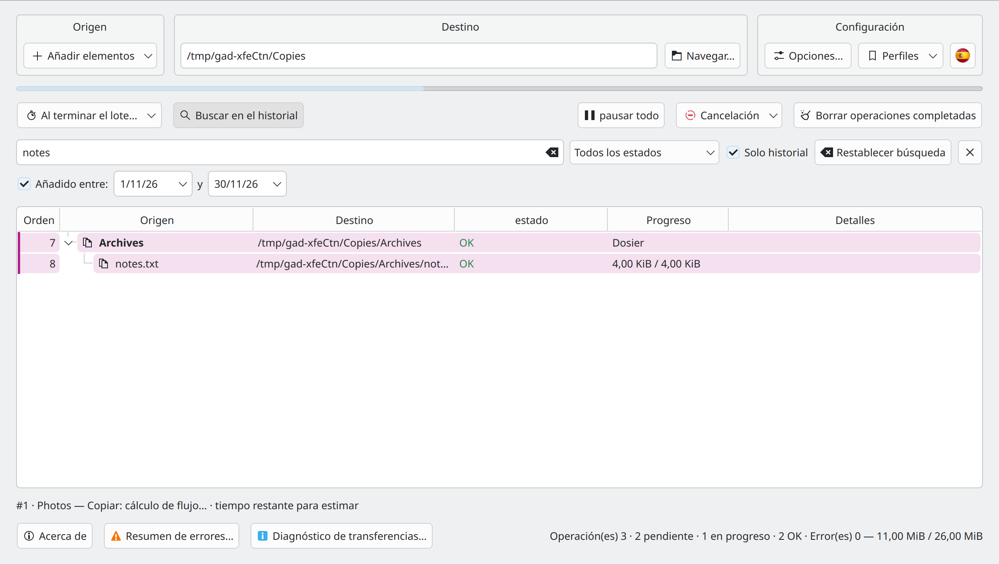

## Diagnóstico de transferencias {#transfer-diagnostics}

El botón **Diagnóstico de transferencias…**, en la parte inferior, abre una vista no modal de solicitudes activas y pendientes. Muestra el estado, la actividad o espera observada, los límites globales y por solicitud, la velocidad y el tiempo restante. Los números de los lotes bloqueantes corresponden a la lista principal.

Las causas distinguen pausas, análisis del origen, conflictos pendientes, dispositivos o montajes remotos no disponibles, verificación MD5, comprobación del prefijo de reanudación, cambio de nombre local, restauración exclusiva, dos trabajadores ocupados, prioridad de filas, discos compartidos o rutas superpuestas y ejecución en serie cuando se desconocen los recursos.

Una espera de presupuesto de velocidad solo se indica si el limitador la observó en el último segundo. Un límite configurado no demuestra una ralentización. Tras cinco segundos sin progreso de bytes durante una copia o MD5, fuera de esperas del limitador, Gad informa de esta falta de progreso: las operaciones de archivos o su finalización pueden esperar, pero no permiten identificar un cuello de botella concreto del disco o la red. No son pruebas de rendimiento ni se guardan en el historial. Cerrar la ventana no cambia las transferencias.

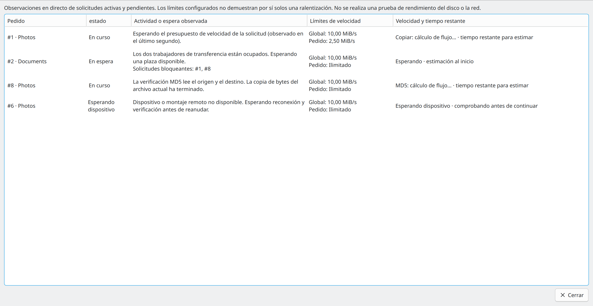

Los límites de velocidad se aplican a los bytes copiados; las lecturas MD5 y los cambios de nombre locales son fases distintas.

## Verificar movimientos rápidos {#verify-fast-moves}

En **Opciones**, marque **Verificar movimientos rápidos**. Está desactivado por defecto, se guarda en los perfiles y se captura por solicitud nueva. Tras un cambio de nombre local, Gad comprueba identidad (dispositivo/inodo), tipo, tamaño, fecha de modificación, permisos, propietario/grupo, destinos de enlaces y árbol exacto, además de la desaparición de la ruta original. Se aceptan cambios legítimos de ctime de la raíz renombrada; los descendientes deben conservarlo.

El detalle indica **Movimiento rápido verificado** al terminar. El diagnóstico distingue esta fase de MD5. Diferencias, elementos añadidos o ausentes, una ruta original recreada o errores de lectura hacen fallar el lote e identifican la ruta comprobada. Se conservan el resultado movido y el diario, sin restauración automática que sobrescriba archivos modificados. Pausar o cancelar no elimina el resultado ya movido.

Se verifican metadatos, no el contenido; no sustituye una comparación criptográfica. MD5 sigue siendo independiente y exige copiar/verificar/eliminar. Las copias ordinarias no reciben un falso resultado de verificación rápida. Los perfiles antiguos migran con la opción desactivada. Orden: `gad --configure --verify-fast-move`; desactivar: `--no-verify-fast-move`.

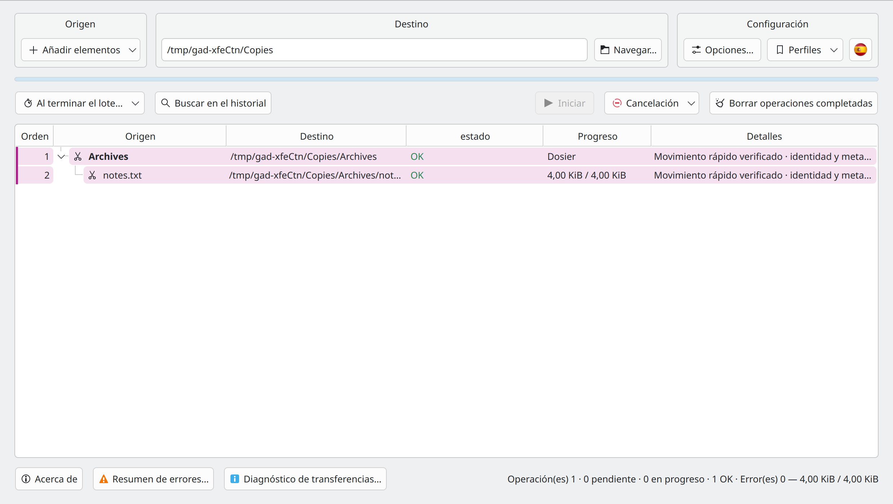

## Acciones de fin del lote {#queue-completion}

En **Opciones → Fin del lote**, elija notificar, cerrar Gad, suspender o apagar el equipo. Configure entre **5 y 3600 segundos** para cancelar (30 de forma predeterminada) y pulse **Activar para este lote**. El estado indica si la acción está activa. Seleccionar una acción o cargar un perfil solo guarda los ajustes. Cambiar los ajustes de finalización desactiva una activación anterior.

La cuenta atrás empieza cuando todas las transferencias seguidas terminan correctamente, incluida la preparación remota y el guardado final. Aún puede cancelar. Añadir transferencias aplaza la acción y reinicia después la cuenta completa. Un error, una cancelación, una restauración o eliminar una solicitud desactiva la acción. La pausa impide ejecutarla.

Desactivar la acción o cerrar la cuenta atrás no cancela transferencias. Solo se ejecuta una vez y no se reactiva al reiniciar Gad. El menú de fin del lote ofrece las mismas acciones y abre la pestaña correspondiente. Aquí «lote» comprende todas las transferencias seguidas, no una sola fila seleccionada.

Suspender y apagar utilizan logind y respetan sus permisos e inhibidores. Una notificación permite abrir Gad si está oculto. `gad --configure --completion-action suspend --completion-delay 60` solo guarda las preferencias; actívelas después en Gad.

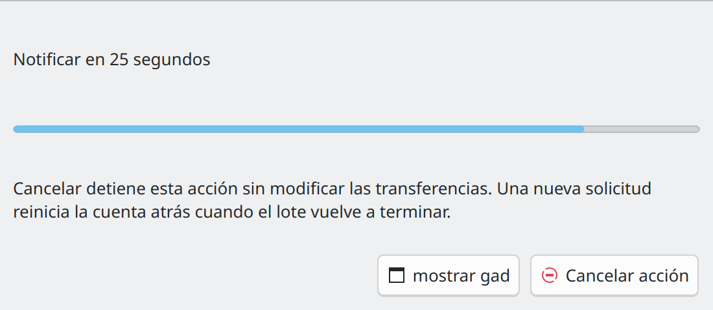

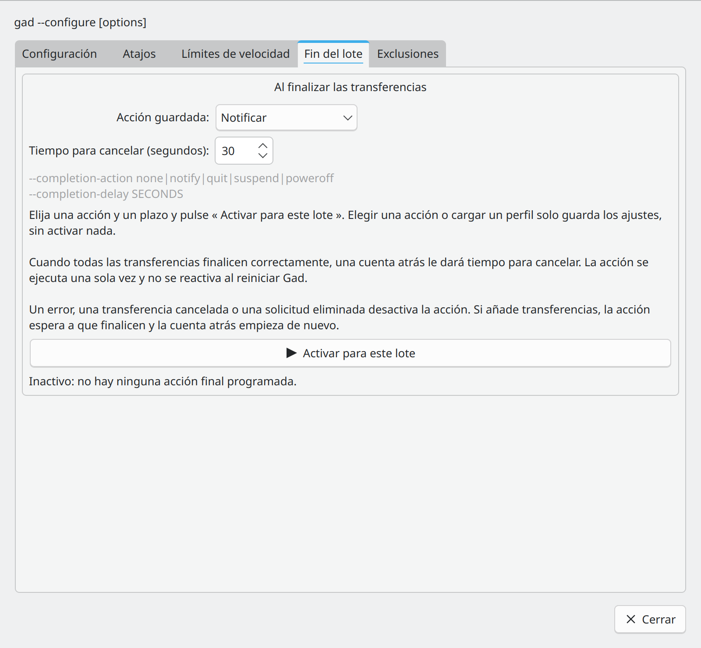


## Preparar transferencias en la lista principal {#preparing-transfers}

Si no hay trabajo en curso, los archivos añadidos desde la ventana (**Añadir archivos…**, **Añadir carpeta…** o arrastrar y soltar) se analizan y muestran sin iniciar la transferencia. Elija antes el destino y las opciones, revise el árbol y pulse **Iniciar**. Ya no hay una ventana de simulación independiente.

El mismo botón pasa a pausar todo y después a reanudar la cola. Si ya hay transferencias autorizadas, los nuevos elementos se incorporan automáticamente. El pegado externo desde el gestor de archivos y las órdenes externas arrancan sin abrir la ventana principal; una solicitud externa rechazada no inicia el trabajo preparado. Los duplicados pendientes se ignoran con un aviso.

Durante la copia, el archivo parcial aparece como `archivo.ext.part` y recibe su nombre final al terminar. Gad elige un sufijo único si el nombre está ocupado. Una transferencia interrumpida puede continuar sobre el mismo archivo parcial tras verificarlo. Borrar el historial elimina la posibilidad de restaurar transferencias terminadas.

El informe de errores y el diagnóstico también bloquean la ventana principal. **Mostrar en la lista** cierra el informe y desactiva búsquedas que oculten la fila. El filtro del informe sigue el idioma seleccionado.

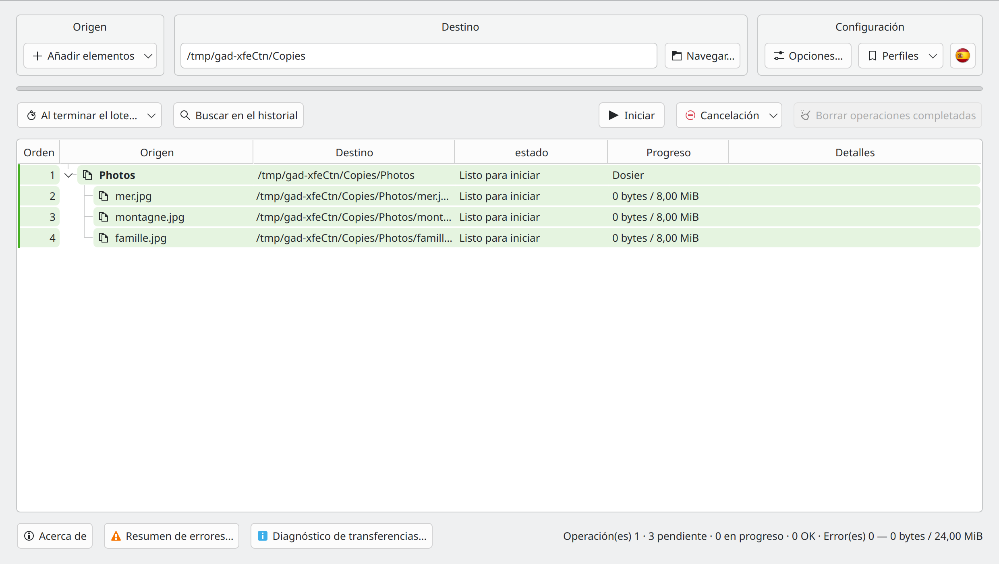


## Idioma y progreso de la sesión

El botón a la derecha de **Perfiles** muestra solo la bandera del idioma actual. Haga clic para elegir un idioma. Este menú sustituye al selector de los ajustes. La barra global empieza en cero al abrir Gad y muestra los bytes procesados desde entonces. Las filas mantienen su progreso real, incluso al reanudar transferencias interrumpidas.

## Añadir elementos, atajos y exclusiones

**Ctrl+F** abre la búsqueda. **Ctrl+Q** solicita salir y lo impide si hay transferencias activas. **Ctrl+Alt+W** oculta la ventana sin detenerlas. El botón de bandera junto a Perfiles cambia el idioma inmediatamente. Los botones principales muestran información emergente.

Hay cinco pestañas: configuración, atajos, límites de velocidad, fin del lote y exclusiones. Los parámetros de línea de comandos aparecen en gris. El límite de un lote existente se cambia en el menú contextual de sus filas y aparece en la columna de detalle.

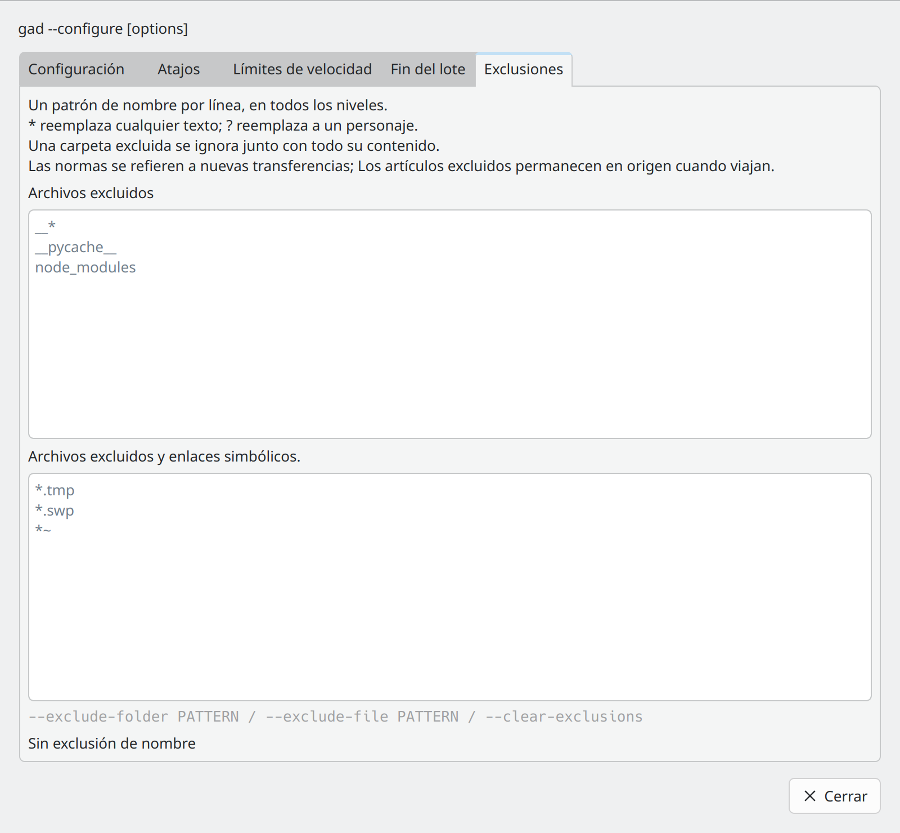
