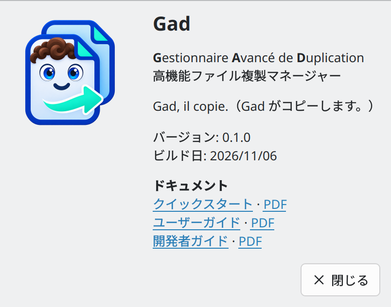
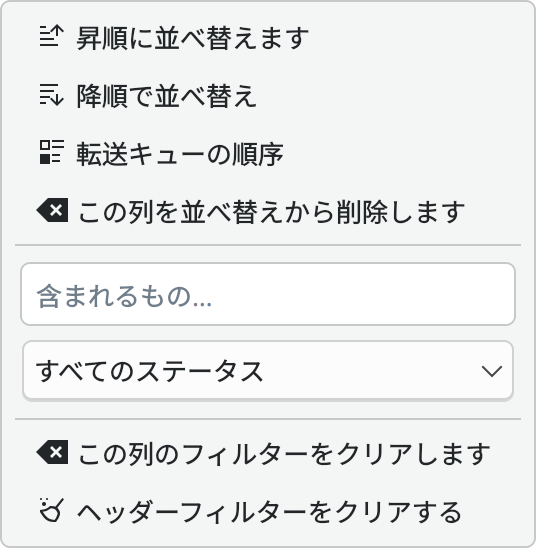
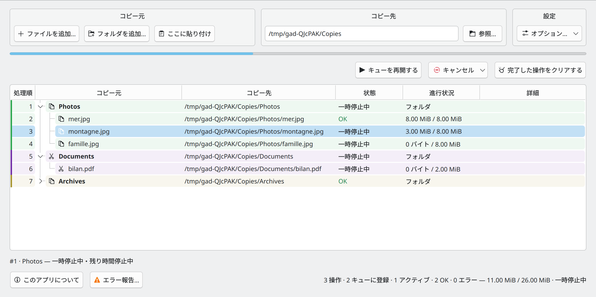
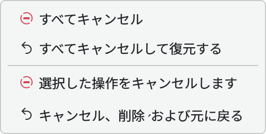
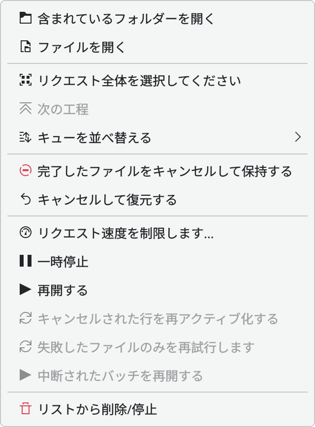
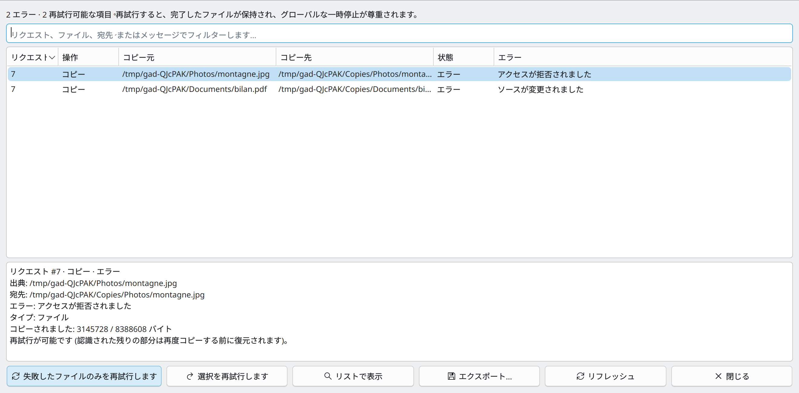
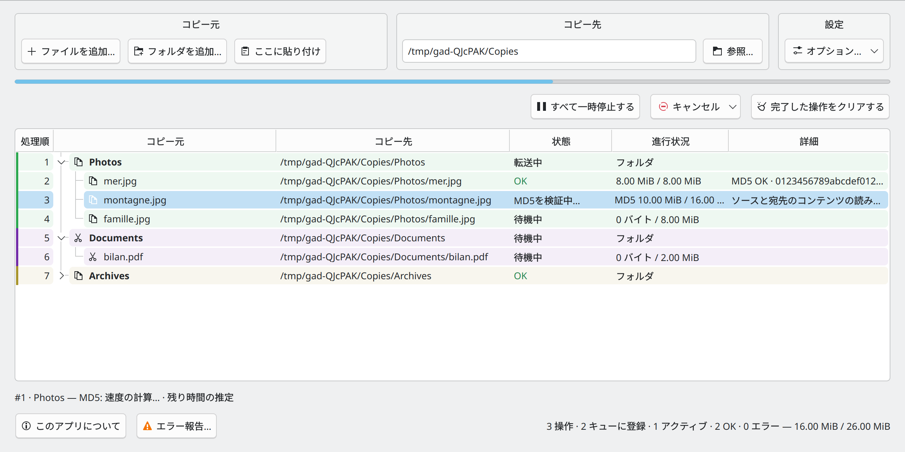
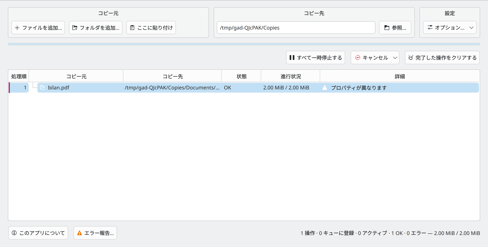
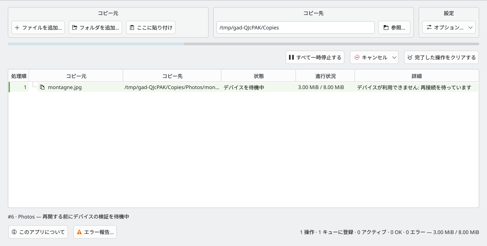
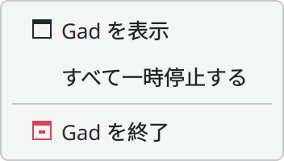

# Gad — ユーザーガイド {#gad-user-guide}

**Gestionnaire Avancé de Duplication・バージョン0.1.0**  
**Gad, il copie.**  
日本語版、2026年11月6日更新。

[クイックスタート](QUICK_START.ja-JP.md) · [フランセ](GUIDE_UTILISATEUR.md) · [すべてのエディション](README.ja-JP.md)

## 目次 {#contents}

[他のファイルマネージャーとGadの連携](#using-gad-with-other-file-managers)

[転送する項目の除外](#excluding-items-from-transfers)

1. [Gadの機能](#what-gad-does)
2. [インストールと起動](#installation-and-startup)
3. [ウィンドウの見方](#understanding-the-window)
4. [DolphinでのCtrl+Vの使用](#using-ctrlv-in-dolphin)
5. [コピーや移動の開始](#starting-a-copy-or-move)
6. [高速なローカル移動](#fast-local-moves)
7. [状態と進行状況の見方](#reading-states-and-progress)
8. [キューの整理](#organizing-the-queue)
9. [一時停止と再開](#pausing-and-resuming)
10. [転送速度の制限](#limiting-bandwidth)
11. [競合の解決](#resolving-conflicts)
12. [転送のキャンセルと復元](#canceling-or-undoing-transfers)
13. [コンテキストメニューの使用](#using-the-context-menu)
14. [エラーレポートと対象を絞った再試行](#error-reporting-and-targeted-retries)
15. [MD5によるファイル内容の検証](#checking-file-contents-with-md5)
16. [ファイルのプロパティの検証](#checking-file-properties)
17. [空き容量の確認](#checking-available-space)
18. [デバイスの再接続の待機](#waiting-for-a-device-to-reconnect)
19. [クラッシュ後の再開](#resuming-after-a-crash)
20. [履歴と整理](#history-and-cleanup)
21. [システムトレイとセッション起動](#system-tray-and-session-startup)
22. [電話、FTP、SFTP、SMB](#phones-ftp-sftp-and-smb)
23. [キーボードショートカット](#keyboard-reference)
24. [トラブルシューティング](#troubleshooting)
25. [制限と推奨される使い方](#limits-and-good-practices)


## Gadの機能 {#what-gad-does}

Gad ファイルのコピーを管理し KDE Plasma window.newリクエスト毎に作業がキューに追加される。リストにはフォルダとその子、ファイル待ち、アクティブな転送、完了した結果、障害などが表示される。同じリクエストに属する行は、微妙な背景色とアクセントマーカーを共有する。

A **リクエスト**3つのファイルをペーストすると、これらのファイルを含む1つのリクエストが作成される。フォルダを選択すると、サブフォルダとファイルも含まれ、ファイル行の上にバッチヘッダーがないにもかかわらず、グループ化は、宛先設定、進捗状況、および削除に有用である。

ソースディスクとデスティネーションディスクが独立している場合、最大2つの転送を同時に実行できる。パスが重複しない場合、共有ディスク上のコピーと一緒に、証明済みのローカルリネームを実行することも可能だ。未知ディスクの関係により、通常のコピーを単独で実行することができる。

Dolphinでは、**Gadで貼り付け**と任意で有効にできるCtrl+V設定を利用できます。Konquerorでは、**Gadと連携するKonqueror**を起動します。他のファイルマネージャーからはGadのウィンドウや独自のコマンドでファイルを渡せますが、通常のCtrl+Vを自動で置き換えることはありません。


### 画面の見方 {#reading-the-screenshots}

13枚の画像は、実際のGadのウィジェット、サンプルファイル、模擬的な転送状態を表示しています。この版の言語とライトテーマを使用しています。個人のファイルや実際のデスクトップは撮影していません。外部のPlasma通知画面は、これらの画像には再現していません。

Gadはフランス語、米国英語、スペイン語、ポルトガル語、ドイツ語、日本語に対応しています。**設定 → オプション…**で言語を選ぶと、Gadの再起動や転送の中断なしに反映されます。開いているダイアログや転送中の通知も更新され、選択状態と入力値は保持されます。**システム設定**では、デスクトップの言語に対応する利用可能な言語を選び、見つからない場合はフランス語または英語を使用します。未登録の技術的な診断や外部サービスのメッセージは、元の言語のまま表示されることがあります。

## インストールと起動 {#installation-and-startup}

プロジェクトディレクトリから、[開発者ガイド](DEVELOPER_GUIDE.ja-JP.md#building) と [テストガイド](../TESTING.ja-JP.md#requirements) に記載されている Linux ビルド依存関係をインストールします。

```bash
python3 scripts/install.py
gad
```

インストーラはリリース実行ファイルを作成し、ランチャー、アイコン、およびDolphinアクションをアカウントにインストールします。管理者権限は必要ありません。インストールまたはアクションの変更後にDolphinを閉じて再オープンします。

アプリケーションランチャーからGadを起動するか、`gad`で起動できる。`gad --background`はシステムトレイから起動する。2回目の起動では、別のキューを開く代わりに既存のインスタンスに連絡する。

トレーが利用可能であれば、メインウィンドウを閉じて移動を終了し、実行している。終了するには、トレイメニューで**Gad を終了**を使用し、転送または準備タスクがアクティブである間、Gadは終了することを拒否する。一時停止だけでは終了しない。トレイがなければ、ウィンドウは終了前に同じチェックを実行する。

更新のために、アクティブな作業を終了またはキャンセルし、通常、Gadを終了してから再オープンします。すでに実行されている実行ファイルは、新しいバイナリがインストールされた後に、古いコードを使い続けます。

## ウィンドウの見方 {#understanding-the-window}


*リストは、ツリーを形成する実際のフォルダと、ファイルを直接表示し、リクエストの色は、個別のサブミットを認識します。*

| 面積 | 目的 |
|---|---|
| **コピー元** | ファイルの追加、フォルダの追加、または選択した宛先へのペースト。 |
| **コピー先** | ローカルパスまたはサポートされているリモートURLを入力するか、フォルダを閲覧します。 |
| **設定 → オプション。** | 検証、除外、重複、履歴、起動、言語、制限速度、ショートカット。 |
| プログレスバー | リストアップされた転送作業の進捗状況をまとめました。 |
| フィルターとコントロール | 行をフィルターしたり、キューを一時停止したり、キャンセルしたり、削除したり、終了した履歴をクリアします。 |
| ファイル一覧 | ソース、宛先、状態、進捗状況、および詳細なメッセージ。 |
| 以下は | 決定と要求毎の速度/残時間情報を矛盾させる。 |
| 足 | **このアプリについて**、**エラー報告…**、および組み合わせたサマリー。 |


*設定] ブロックから [宛先] の右側にオプションが開きます。*

メニューグループには、検証、隠された項目、複製、履歴、起動、中断された転送、除外、言語、およびグローバル速度制限がある。変更が直ちに適用され、チェックボックスはメニューを開いたままにする。**リクエスト速度を制限する**は選択された行に適用され、選択なしで無効になる。メニューは小さい画面でスクロールする。

**ショートカット** Ctrl+V を有効または無効にします。 Gad です Dolphin そして Konqueror. Dolphin 変更は Gadリバーシブルなショートカットヘルパーで再起動が必要です。 Dolphin; 拒否された変更はチェックボックスを復元し、エラーを表示します。 Konqueror 次のキープレスで 変化を拾い上げ **Konqueror 一緒に Gad**. ブラウザとランチャーの両方がインストールされている場合、その起動ボタンが使用可能で、テキストペーストはネイティブのままである。

**このアプリについて** は、アプリケーション名、頭字語、スローガン、アイコン、バージョン、ビルド日を表示します。



*実行中のビルドの特定。*

## DolphinでのCtrl+Vの使用 {#using-ctrlv-in-dolphin}

右クリックの**Gadで貼り付けます。**アクションは、Dolphinのネイティブペーストショートカットを置き換えることなく動作し、クリックした宛先コンテキストを受け取ります。

Ctrl+V を Dolphin の Gad に関連付けるには:

```bash
gad-dolphin-paste --enable
```

閉館・再開 DolphinCtrl+V は、現在開いているオブジェクトをターゲットします。 Dolphin folder.integration がそのフォルダを解決します。 Dolphinウィンドウタイトルの全パスは不要で、テキストフィールドでは、Ctrl+Vはテキストペーストのままです。

**Shift + Insert** 標準のままです KDE/Dolphin KIO 代わりにペーストします Gad 前回を復元するには Dolphin ショートカット設定:

```bash
gad-dolphin-paste --disable
```

この変更は、Plasmaのすべてのアプリケーションに適用されるのではなく、Dolphinに適用される。既存のショートカットとアクションは、非関連ユーザの設定をリセットするのではなく、統合の保存された設定によって復元される。

## 他のファイルマネージャーとGadの連携 {#using-gad-with-other-file-managers}

Gad 他のマネージャーからファイルを受信することができます。 Nautilus, Nemoまたは Thunarコンテキストメニューとショートカットの統合はマネージャに依存します。 Gad 自動的に **Ctrl+V** アクティブなフォルダを推測します

### コピーまたはカットし、Gadに貼り付けます。 {#copy-or-cut-then-paste-in-gad}

1. マネージャーでファイルを選択し、**Ctrl+C**、または**Ctrl+X**を使用して移動を要求します。
2. 開館 Gad 対象フォルダを 設定します。 **コピー先**.
3. 「**ここに貼り付け**」をクリックするか、「**Ctrl+V 内部 Gad**」を押します。
4. リストに表示されている宛先と操作タイプを確認します。

マネージャは、Gad によって理解されたクリップボード形式でファイルリストを公開する必要があります。パスをプレーンテキストとしてコピーするのは不十分です。移動には認識されたカットマーカーが必要です。使用できない場合は、以下の明示的な `--move` コマンドを使用します。

### ファイルをGadにドラッグします。 {#drag-files-into-gad}

設定 **コピー先** まずはマネージャからファイルやフォルダをドラッグします。 Gadリストです。 **ドラッグ・アンド・ドロップは常にコピーを作成します。**以前にファイルを切断した場合でも、ファイルを移動するには、認識されたカットマーカーで貼り付けるか、使用する。 `--move`.

### カスタムアクションまたはボタンを作成します。 {#create-a-custom-action-or-button}

マネージャーがコマンド、メニューアクション、またはツールバーボタンを起動できる場合は、以下のコマンドを使用して、以下のサンプルパスを置き換えます。

クリップボードを背景の明示的な宛先に貼り付けます。

```sh
gad --paste "/home/demo/Documents/Copies"
```

クリップボードを使用せずにソースをコピーします。

```sh
gad --copy "/home/demo/Images/photo.jpg" "/home/demo/Images/album" --to "/home/demo/Documents/Copies"
```

ソースを明示的に移動します。

```sh
gad --move "/home/demo/Images/photo.jpg" --to "/home/demo/Documents/Copies"
```

カスタムアクションは、パスする必要があります。 **ターゲットフォルダ** です `--paste`へえ `--copy` そして `--move`パス **選択したソースファイル** 前に `--to`置換変数と引用はmanagerに依存します: 選択引数が開いているフォルダを識別したり、他のマネージャのプレースホルダを再利用したりしないこと。 `gad` 見つからないなら 全行程を使い `~/.local/bin/gad` ホームディレクトリを拡張。

サポートする他のマネージャ KIO サービスメニューもあります。 **Gadで貼り付けます。**. すべてのマネージャで利用可能かどうかは保証されていない。 Dolphin そして Konqueror 以下のオプション **設定 → オプション。** これらの統合のみを制御します。 `--paste-current` 他のアプリケーションのアクティブなフォルダは見つかりません。

## コピーや移動の開始 {#starting-a-copy-or-move}


ファイルを追加または貼り付ける目的の**前に**を選択します. ファイルを追加するとすぐにリクエストが送信されます。

### 由来 Dolphin {#from-dolphin}

1. 利用 **Ctrl+C** コピーしたり **Ctrl+X** 動くんだ
2. 目的の宛先フォルダを開くか、右クリックします。
3. 選択する **Gadで貼り付けます。**または Ctrl+V を使用します。 Gad 統合が可能。
4. 同じキューにさらに作業を追加します。

外部ペーストがバックグラウンドで起動し、メインウィンドウを強制的に開くことはない。非表示にすると、Plasmaはネイティブプログレスビューが表示される。有効な外部ペーストは、転送を開始するために既存のグローバルポーズをクリアできる。バックグラウンド準備中を含む送信後に明示的に要求されたポーズ。完全に重複したペーストは一時停止をクリアしない。

### 由来 Gad {#from-gad}

利用 **ファイルを追加…** (ファイルを追加) **フォルダを追加…** (フォルダを追加) **ここに貼り付け** Ctrl+V を中へ Gad Cut でマークされたクリップボードのコンテンツが移動し、通常のコピーされたコンテンツがコピーします。

ファイルをGadにドロップすると、常に**コピー: **が作成される。

### 複製要求 {#duplicate-requests}

Gadは、停止中のソース、宛先、操作タイプなど、アクティブなリクエストでカバーされている操作を無視します。チェックは、繰り返しペースト、同時追加、繰り返し選択、および別の送信フォルダにすでに含まれているファイルをカバーします。

新しいファイルは、必要なフォルダと共に保存される。簡単な情報メッセージでは、何エントリが追加されていないかを報告する。上書きオプションは提供されない。最初のリクエストは検証オプションを保持する。

別の宛先やコピー対移動の変更は、別個のリクエストのままである。名前を共有する別のソースファイルは、依然として競合処理を使用する。以前のリクエストが終了した後、意図的にファイルをコピーしてもよい。

### 準備 {#preparation}

Gadは、すべてのルートを検証し、ファイルのコピーの前にリクエストをスキャンします。準備には、電話やネットワーク共有に時間がかかります。スキャンに成功した部分だけを静かに開始するのではなく、障害が報告されます。

サポートされているUTF-8契約外の特別なファイルとパスは拒否される。ソースシンボリックリンクはリンクとしてコピーされ、壊れたリンクを含む。Gadはソースフォルダとして渡さない。

## 転送する項目の除外 {#excluding-items-from-transfers}

利用 **除外設定…** フォルダやファイル、シンボリックリンクなど、行ごとに1つのパターンを入力します。 **隠しファイルとフォルダーを含める** で入手することもできます。 **設定 → オプション。**デフォルトでチェックされ、名前の除外は最初に設定されない。

| タイプ | 例 | 効果 |
| --- | --- | --- |
| フォルダ | `__*` | 名前が `__pycache__` を含む2つのアンダースコアで始まるフォルダをスキップします。 |
| ファイル | `*.tmp` | この拡張子でファイルをスキップします。 |
| ファイル | `*.swp` または `*~` | 編集用の一時およびバックアップファイルをスキップし、それぞれのパターンを行ごとに入力します。 |

`*`は0文字以上、`?`は1文字以下である。マッチングはケースセンシティブであり、明示的に選択された項目を含むあらゆる深さのベース名に適用できる。除外されたフォルダは決してトラバースされない。シンボリックリンクはファイルパターンを使用し、その後は行わない。非表示項目オプションのチェックを解除すると、ドットから始まる名前が含まれなくなる。

空行は無視される。スペースはパターンの一部である。フルパス、正規表現、ブラケット文字クラスは解釈されない。リミットは、スラッシュや改行なしで、1パターンあたり128パターンと256 UTF-8バイトである。

リモートアクセスの準備の前に、設定は新しいリクエストごとに保存され、キャプチャされる。既存のバッチ、再開データ、再試行は元のルールを維持し、移動中に、除外されたアイテムがソースに残されるため、ソースフォルダが残る可能性がある。フィルタリングが有効になっている場合、フォルダ全体の高速リネームは無効になるが、適格な個々のファイルはすぐに移動できる。

## 高速なローカル移動 {#fast-local-moves}

適格なローカル移動のために、Gadは、内容をコピーしてソースを削除する代わりにリネームを使う。これにより、ファイルのinodeを保存し、データを転送することを避ける。パスが独立している場合、同じディスクを使用してコピーと一緒に実行できる。

異なるbind-mountパスは、基礎となるファイルシステムを参照することができる。

```text
/media/library/Music  → /home/you/Music
/media/library/Other  → /home/you/Other
```

Gadは、安全な共通パスと一致するIDを証明したビュー間でリネームできる。同じ物理ディスクだけでは不十分である。異なるパーティション、サブボリューム、読み取り専用マッピング、カーネルリネーム制限は、代わりにコピーと削除を必要とする可能性がある。拒否されたリネームは、通常のコピー予約で再スケジュールされる。

コンフリクトや一時停止/除外されたエントリのない、変更されていない完全なフォルダツリーの場合、Gadはツリー全体を一度にリネームできる。詳細は**ドシエ・ルノメとブロック**を報告する。そうでなければ、エントリを個別に処理する。移動したツリーに追加された外部ファイルは、静かに移動または削除するのではなく、undo中に保護される。

MD5 を有効にするには、高速なリネームショートカットではなく通常のコピーパスを使用しますが、並行処理の制限は2つの操作のままです。

## 状態と進行状況の見方 {#reading-states-and-progress}

長い説明ツールチップは、文間の行分割を使用し、ファイル名とパスは元の句読点と間隔を保持する。

ソース行はコピーアイコンと移動用のカットアイコンを使い、フォルダやリクエストは準備されている。

あれは **処理順** 列は最初に表示され、そのタイトル、ソート矢印、および数値によって必要とされる最小幅に自動的に適合する。 フォルダ、スキャン要求、および保存された履歴を含むエンジンキューに従っている。 ソートとフィルタリングは、残りの行を決してリナンバーしないため、フィルターされたビューのギャップは正常である。キューの優先順位は、位置を更新します。 **バッチ #...**並列転送は別の順序で終了する可能性がある。

| コラム | 意味 |
|---|---|
| **処理順** | エンジンキューの位置、表示ソートに依存しない。 |
| **コピー元** | ファイルまたはフォルダ名;コピー/カットアイコンは操作を示し、ツールチップはフルパスとオプションのMD5/レート設定を提供します。 |
| **コピー先** | ターゲットパス、またはディスプレイ用に再構築された元のリモートURL。 |
| **状態** | 一時停止、コンフリクト、チェック、デバイス待機などの現在の状態。 |
| **進行状況** | コピーされたバイトとファイルサイズ、またはMD5 /リカバリ - 進捗を確認します。 |
| **詳細** | エラー、MD5結果、速い移動情報、および検証警告。 |

| 現状 | 意味 |
|---|---|
| **ファイルを確認中…** | ルートの検証とリクエストのスキャン。 |
| **待機中** | そのターン、リソース、または再開データアクションを待つ。 |
| **転送中** | データの転送またはエントリの処理。 |
| **一時停止中** | グローバル、リクエスト、またはエントリの一時停止が適用されます。 |
| **デバイスを待機中** | 既知のマウントは使用不可能であり、部分的なデータは保持される。 |
| **再開データを確認中…** | ソースを確認し、再度書く前に部分的なプレフィックスを保存します。 |
| **MD5を検証中…** | 独立したソースと一時的な宛先を読み直す。 |
| **決定が必要です** | ファイル競合は、あなたの決定を必要とします。 |
| **吉田** | グリーンで表示されます。 |
| **エラー** | ステップは失敗しました。詳細を読むか、エラーレポートを開きます。 |
| **スキップ済み** | ソースは残ります。 |
| **キャンセル済み** | 完了した結果を自動的に取り消すことなくキャンセルします。 |
| **復元中…** | Undoが実行中です。 |
| **復元されました** | 選択された効果は取り消された。 |
| **修復が未完了** | Undoは無事に終了できなかった。 |

フォルダは、関連する子供たちが終わった後にのみ、OKになる。その遷移で崩壊する。再開は、後で進行する更新を通じて手動で開く。選択、ホバリング、ツールチップは、カウンタが変更されている間保存される。

### フィルター {#filters}



*フィルタリングは、転送動作ではなく、可視性を変える。*

フィルタは、列ヘッダーを右クリックすることで利用できる。テーブル上の以前のグローバルフィルタコンボは、削除されている。マッチする子を表示する必要がある場合、アンセスタフォルダは、引き続き表示される。フィルタを選択すると、関連するブランチが開かれる。通常の進捗状況の更新では、折りたたんだブランチが再開されない。

### ヘッダからのソートとフィルタリング {#sorting-and-filtering-from-headers}

列のタイトルをクリックして、昇順と降順を切り替えます。 **Ctrl+クリック** Ctrl+click を繰り返すと、優先順位を変更せずにそのカラムの方向が反転します。 **(1)**, **(2)**など、各ソートされた列の右側に通常のソート矢印を付けると、Ctrlなしでクリックすると、単一のカラムソートが復元される。`file2` 前に `file10`) ファイルサイズや表示ユニットによらずプログレスソート数パーセント . ソートは兄弟姉妹: フォルダは子孫を保持します。

ヘッダーを右クリックしてメニューを開きます。これは、昇降ソート、**転送キューの順序**、および、そのカラムに対して大文字小文字小文字を区別しない**含まれるもの…**フィルタを提供します。ソース検索には、フルパスも含まれます。ステータスは、正確な状態セレクタを追加します。プログレスは、最小および最大パーセンテージを追加します。**この列を並べ替えから削除します**は、1つのソートキーを削除し、他は削除します。クリアアクションは、1つのカラムフィルターまたはすべてのヘッダーフィルターを削除します。

列フィルターは互いに結合する。マッチする子が目に見える祖先のフォルダを保持する。アクティブなフィルタは列メニューに残されている。グローバルカウンタは、すべての転送をカバーし続ける。競合やエラーレポートからファイルを見つけると、それを隠す可能性のあるフィルターがクリアされる。

並べ替えは表示のみ、決して実行優先度を変更し、**転送キューの順序** を復元して行をドラッグして作業の並べ替えを行い、表示設定は進捗状況や言語変更に耐えます。

### カウンターと見積もり {#counters-and-estimates}

合計サマリーは転送作業をカウントする。リネームは、コピーされたディスクトラフィックを表すことなく論理バイトを前進させる。完全に書かれたファイルは、MD5検証を受けることができる。非表示行/削除行は、目に見えるサマリーから除外される。ディレクトリは、ファイルコンテンツバイトを寄与しない。

リストの下には、各アクティブリクエストには、ソース名、速度、推定時間がある。測定は、最後の5秒の活動を使用する。短いウォームアップでは、十分な時間が経過するまで、**デビットの計算...**が表示される。

コピーとMD5の再読み込みには、別々の測定値がある。もしMD5速度がまだ不明であれば、見積もりは明示的にコピーのみをカバーし、**MD5 アラカルト エスチマー。**と言う。両方の測定が利用可能であれば、見積もりは残りのコピー作業と検証読み取りを含んでいる。近似であり、キュー待ち時間を予測しない。

一時停止は見積もりを中断する。コンフリクトは**決定が必要です**を表示する。個々の一時停止ファイルは他のファイルが進行している間でもリクエストの合計残時間を未知にする。リネームは人工的なディスクコピー速度を示しず、認識された再開プレフィックスは速度スパイクを発生させない。進捗がなければ、古い速度はゼロに下がり、見積もりは利用できなくなる。

## キューの整理 {#organizing-the-queue}

別の行の前または後に1つ以上の**待って**行をドラッグします。挿入マーカーは意図した位置を示しています。エッジ付近でホバリングするとリストをスクロールします。トップレベルのファイルのルートはリクエスト間でインターリーブされることがあります。

フォルダはブランチと共に移動します 兄弟姉妹間でフォルダのリオーダー内にあるファイルです 実際の親と宛先を保持します 親フォルダを移動してブランチ全体を配置します ドラッグで宛先が変わることはありません

コンテキストメニューは **次の工程** (次のプロセス) **キューを並べ替える** CtrlとShiftは複数の選択をサポートする。 **リクエスト全体を選択してください** 同じ投稿に属する他のルートを選択します。

優先度は保存される。次に処理すると、現在のファイルを中断したり、一時停止を削除したりすることはない。ディスクの互換性とアンドの依存関係は現在も適用されている。同じ出力を置き換えるリクエストの安全でないインターリーブは、理由によって拒否される。したがって、部分的に公開されたリクエストは、一時停止中に依存作業を待たせることができる。


## 一時停止と再開 {#pausing-and-resuming}



*未終了行は一時停止を表示します。*

**すべて一時停止する** はキューを一時停止し、**キューを再開する** (Resume queue) に変更する。完了したファイルはステータスを保持する。コンテキストメニューは選択したリクエストやエントリを一時停止または再開できる。あるリクエストを一時停止すると、他の許容リクエストを事前に進めることができる。

アクティブシステムコールを強制的に中断するのではなく、チェックポイントで一時停止が有効になる。選択された再開データは、グローバル一時停止を削除して、選択を続行することができる。他の要求に属する一時停止は、有効のままである。

一時停止中はキャンセルが可能で、通常のコピーがグローバルに一時停止している間は、明示的に要求されたアンドも実行できる。Plasmaの一時停止制御とトレイメニューは、メインウィンドウと同期されている。

## 転送速度の制限 {#limiting-bandwidth}

**全体の転送速度制限:** で **設定 → オプション。** 制限します **概要** 同時並行したトラフィックを ** MiB/s**相当します ** MiB/s**:1MiB = 1,048,576バイト。これは1秒あたりのメガビットではありません。 **無制限**, 制限を削除. 設定が記憶され、転送中に変更することができます。

行を右クリックして選択します。 **リクエスト速度を制限する** コンテクストメニューや **設定 → オプション。** 複数のリクエストから行を選択すると、それぞれに選択された制限が適用される。グローバル予算は共有される。Zeroは、選択したリクエストの個々の制限のみを削除する。ツールチップは、設定されたときの個々の制限を示す。

10MiB/sに制限されたリクエストは、グローバルリミットが50であっても10に制限されている。個々のリミットのない2つのリクエストは、最大50MiB/sで使用でき、等分共有は保証されない。

キャップは、マウントされたリモートエンドポイントを含む、コピーされたバイトに適用できる。OSとネットワークバッファリングは、短いバリエーションを生成することができる。MD5の再読み込み、プロパティチェック、およびアンドはこのキャップの外にある。速いリネームは、すぐに残る。一時停止とキャンセルは、低いレートで利用できる。

## 競合の解決 {#resolving-conflicts}


*ソースと既存の宛先は、ファイルリストの下に並んで表示されます。*

コンフリクトパネルは、ファイル名、選択可能なパス、サイズ、および両側の変更時間を示しています。

| ボタン | 結果 |
|---|---|
| **既存のファイルを保持する** | 既存の宛先を保持して、このソースをスキップ. 移動はスキップされたソースを削除しません。 |
| **両方を保持** | 既存のファイルを保持し、新しい結果の利用可能なコピー名を選択します。 |
| **既存のファイルを置き換える** | 元の宛先をプライベートに保ち、元に戻す。 |

チェックボックスは 後に行われる**その要請で** のコンフリクトに決定を適用します 表示されたコンフリクトを変更するとリセットします 複数のコンフリクトでは セレクタを使って どのコンフリクトを検査するかを選択します 新しいコンフリクトは 意図する項目を 黙って切り換えるわけではありません

**ファイルをリストに表示** は、フィルタが隠したタイミングを含む、ブロックされた行を見つけます. 必要なフォルダパス、またはそのパス内の安全でないシンボリックリンクを占有するファイルは、自動フォルダ置換の代わりにエラーを発生することができます。

## 転送のキャンセルと復元 {#canceling-or-undoing-transfers}



*グローバルアクションは選択なしで利用可能です。*

### 解凍せずに止まる {#stop-without-undo}

**すべてキャンセル** (全てキャンセル) 準備完了を含め 活動と待ち行列の仕事を停止します 完了した転送は残されます **選択した操作をキャンセルします** 選択に停止する制限. フォルダの選択は子孫を含みます。

### 完了したエフェクトを解除します。 {#undo-completed-effects}

**すべてキャンセルして復元する** 作業を取り消し、回復可能な履歴を解除します。 **キャンセル、削除、および元に戻る** 選択したエントリまたはブランチにundoを適用します。

| 原型 | 解毒行動 |
|---|---|
| 新しいファイルにコピーします。 | Gadで作成したコピーを削除します。 |
| 既存のファイルを置き換えます。 | 新しい結果を削除し、保存した宛先を復元します。 |
| 移動 | ファイルをソースに返して、目的の結果を削除します。 |
| フォルダを作成します。 | 他のファイルを失うことなく、それができる場合にのみ削除します。 |

Undoは、アクティブな転送の予約がリリースされるのを待つ。ファイルシステム全体の移動を返すには、コンテンツをコピーバックする必要がある。現在進行中のundoトランザクションは、安全な復旧手順を完了しなければならない。

Gadは、結果を変更する前に、ID、メタデータ、および記録されたコンテンツをチェックする。再作成されたソース、変更された宛先、バックアップの欠如、またはボリュームの欠如は、拒否または不完全なアンドを引き起こす可能性がある。詳細は、保持されているものを説明する。完成したコピーは独立したバックアップではなく、クリア履歴は、そのundo機能を除去している。

### 削除とバックスペース {#delete-and-backspace}

| 選択行 | 削除 | バックスペース |
|---|---|---|
| 終了 | 行/履歴参照を削除します。 | ジャーナルが許可した場合、そのファイルまたはブランチを解凍します。 |
| 活動 | キャンセルをリクエストします。 | キャンセルをリクエストします。 |
| 保留 | キューから削除します。 | キューから削除します。 |

フォルダ選択は、その内容に拡張します. 個々のファイルを選択すると、自動的にその隣人を解凍することはありません. クリアする前に、履歴を保持する必要があります。

## コンテキストメニューの使用 {#using-the-context-menu}



*アクションは選択とその現在の状態に適応します。*

| 行動 | 目的 |
|---|---|
| **含まれているフォルダーを開く** | ファイルの親フォルダを開くか、選択したフォルダ自体を開きます。 |
| **ファイルを開く** | デスクトップ関連のアプリケーションで1つのファイルを開きます。 |
| **リクエスト全体を選択してください** | 同じ投稿から他のエントリを選択します。 |
| **Traiter ensuite / Deplacer dans la file** | 待機中のエントリまたは枝を優先します。 |
| **完了したファイルをキャンセルして保持する** | 選択した作業を停止し、完了した出力を保持します。 |
| **キャンセルして復元する** | ジャーナルが許可した場合、選択を解除します。 |
| **リクエスト速度を制限する** | 所有権要求に帯域幅制限を適用します。 |
| **一時停止/リプリデンド** | 選択した作業を一時停止または再開します。 |
| **失敗したファイルのみを再試行します** | OK ファイルをコピーせずに適格な障害を再試行します。 |
| **中断されたバッチを再開する** | 中断後に回復可能な作業の検証と再開。 |
| **キャンセルされた行を再アクティブ化する** | コントロールされたクリーンアップの後、新しい試みのためにエントリをキャンセルします。 |
| **リストから削除/停止** | 削除セマンティクスを適用します。 |

OK行を開くと宛先が対象になる。保留中、アクティブ、スキップ、キャンセル、または削除行の場合、ソースが対象になる。アクションが実行されると現在の状態がチェックされる。複数選択で重複するフォルダは1回だけ開く。起動は1つのファイルに限られ、リクエスト全体やフォルダに限られる。

リアクティベーションは、リクエストが停止し、完了した隣人を保持するのを待つ。ソースタイプが変更された場合、古い行を再利用するのではなく、新しいリクエストとして追加する。

## エラーレポートと対象を絞った再試行 {#error-reporting-and-targeted-retries}



*6つのボタンにはアイコンがあります:エラーの再試行、選択の再試行、検索、エクスポート、リフレッシュ、および閉じます。*

開館 **エラー報告…** リクエスト、操作、ソース、宛先、状態、メッセージごとに障害をグループ化します。子供のエラーを反映するだけのフォルダでは、重複したレコードは追加されません。

リクエスト、パス、エラーメッセージによってフィルタを検索する。行を選択すると、その詳細の全文が表示される。進捗、部分的なファイルの場所、回復可能なバイト、利用可能なMD5またはプロパティ情報だ。**リストで表示**はエントリをメインウィンドウに配置する。**リフレッシュ**はスナップショットを明示的にリフレッシュする。レポートは検査中に継続的にリシャッフルしない。

**失敗したファイルのみを再試行します**は現在表示される適当なエラーをリトライする。**選択を再試行します**は選択された行のみをターゲットとしている。このレポートでは、ディレクトリエラーを選択すると、無言でフィルターアウトした子が含まれていない。メインリストのフォルダコンテキストアクションは、通常の子孫選択動作を保持する。

リクエストは停止しなければならない。Gadは、部分的または公開されているエフェクトを検証し、認識された残基のみを復元し、失敗した要素を再度キュー化する。失敗したファイルは、そのクリーンアップの後、最初から再コピーされる。OKファイルは再コピーされない。キャンセル、スキップ、または削除されたエントリは、再アクティベートされない。停止したリクエストで単に待っていた他のエントリは、再試行の外にいれば、一時停止される。グローバル一時停止は尊重される。

リストされたファイルがない準備障害は、完全なルート検証と新しいスキャンを通じて再試行できる。再試行準備が失敗した場合、原因を修復して、再び試行するようにレポートを更新しよう。別の不完全なアンドは、undo/recoveryタスクのままである。修正された公開結果が保持され、安全に再試行が失敗する可能性がある。

**エクスポート…** (Export...) は、ロードされたレポートが空の場合、無効になる。すべての行をフィルタリングしても、スナップショット全体をカバーしているため、エクスポートを無効にしない。検索フィルターで隠されている行を含む、ロードされたレポート全体を書き込みます。 **UTF-8** それとも **JSON**テキストは、読み書きと共有を目的としています。 JSON リクエスト/ファイル参照と診断メタデータを安定して保持する。エクスポートでは転送は行われない。履歴から意図的に削除されたエラーは再導入されない。

## MD5によるファイル内容の検証 {#checking-file-contents-with-md5}



有効化 **MD5 を使用してファイルを検証する** 正規ファイルはコピーして同期し、ソースと一時的な宛先が再読み込みされ、比較される。 Gad 同じ検証済み一時ファイルを最終名称で公開します。

行には再読み込み中に**MD5を検証中…**が表示され、後で**MD5 吉田**とダイジェストが表示される可能性がある。Nバイトファイルの場合、検証には2つのNバイト読み込みが追加される。ディレクトリとシンボリックリンクはファイルコンテンツとしてチェックされない。

読み取りの失敗、検証中のキャンセル、ソースの変更、またはダイジェストミスマッチによって、ソースと事前の宛先をパブリッシュできなくし、保存します。移動は、正常に公開され、必要なチェックの後だけ、ソースを削除します。設定は、将来の要求のために記憶されます。既存のリクエストは、キャプチャされた選択を保っています。

MD5はこの転送パスの一貫性を検証し、意図的に構築された衝突に対する暗号化保証ではありません。

## ファイルのプロパティの検証 {#checking-file-properties}



**プロパティの検証**は、公開されている所有者、グループ、パーミッションビット、POSIX ACL、拡張属性を比較します。これは、既知の差分と使用できないチェックを区別します。属性値は保存されたレポートには含まれません。レポートには差分と使用できないチェックがリストされています。変更日はこの比較の外にあります。

通常のコピーでは、サポートされている基本的な権限と変更時間を保持します。このボックスが有効になっているため、バックアップグレードの所有者、ACL、またはxattr保存を取得できません。

コピーの場合、プロパティの不一致は、正常にコピーされた結果を警告で残すことができる。コピーと削除の移動では、発行前のエラーチェックが元と前のコピー先を保存し、障害後のチェックが元と作成した結果のジャーナルを保持する。迅速なリネームがオブジェクトを移動しているため、後の警告ではソースがまだ存在すると主張しない。

オプションは、新しいリクエストごとに記憶され、キャプチャされる。レポートは、詳細およびフォルダ警告要約で利用可能である。リモートサービスは、これらのプロパティの一部だけを公開できる。

## 空き容量の確認 {#checking-available-space}

**空きスペースを確認する**は、ボリュームを共有するキューと一時停止のコピーなど、分析された要求が必要とする残りのストレージを推定します。

古いデスティネーションとアンドバックアップは、すでにスペースを占有しており、交換中にフリーキャパシティとして扱われていない。認識された割り当てられた再開データテンポラリは、2回カウントされない。ブロック割り当ての丸めが考慮される。証明された迅速なリネームでは、データの2番目のコピーを必要としない。

既知のスペース不足は、そのリクエストの開始を妨げている。**キャパシティが見積もれない場合、Gadは警告し、継続します。**は、無期限にブロックするのではなく、ブロックする。警告は、成功した後に表示され続けることができる。これは見積もりであり、ディスクスペースの予約ではない:別のプログラムは、後でスペースを消費することができ、後で追加は別々に考慮しなければならない。

オプションは新しいリクエスト用に記憶される。既存のリクエストはキャプチャされた選択を保持する。

## デバイスの再接続の待機 {#waiting-for-a-device-to-reconnect}



転送中に既知のディスクまたはマウントが消えた場合。 Gad 展示 **デバイスを待機中**は、その部分的なファイルを保持し、独立した要求が進行できるようにワーカーを解放します。 Plasma 待ち時間も説明します

デバイスを再接続してマウントする**同じ場所で**.Gadは、最後の有効な永続化ポイントから継続する前に、期待されるマウント、ソースID/バージョン、および保存されたプレフィックスをチェックする。その点を超えるバイトは再コピーできる。マウントポイントに残された空のフォルダ、またはマウントされた別のボリュームは、十分な証明ではない。ファイルシステムUUIDは、Linuxが異なるデバイス番号を割り当てた後、同じボリュームを認識することができる。

グローバルおよびターゲットの一時停止は有効のままだ。再接続はそれらを上書きしない。キャンセルされた要求は再起動しない。置き換えられたソース、宛先、または部分的なファイルは、無関係なデータを上書きするのではなく、回復に失敗する可能性がある。中断された公開には、自動的な2番目のコピーではなく、回復が必要である。

訳語 KDE 接続、FTP、SFTP、SMB。 Gad 再試行 KIO ウィンドウを開くことなく、または別のバッチを追加せずに、バックグラウンドで解像度。 KDE 認証は引き続き処理します。マウントされたパスとIDは認識可能でなければなりません。 KIO ヒューズは別の経路から Gad 元のジャーナルを報告し、保持します。元のマウントを復元するか、中断したファイルを検査して再送信します。

訳語 KIO 耐久性のある部分的な回復のない融合先 Gad 再開できるのです **現在のファイルだけ**自動クラッシュリカバリがチェックされていない場合でも、ローカル再接続チェックポイントはセッション中に作成される。

検出は転送チェックポイントと接続エラーで行われる。カーネルまたはリモートサービスでブロックされたシステムコールは、検出を遅延させる可能性がある。他の方法で利用可能なボリューム、スペース不足、または許可拒否の削除されたファイルは、通常のエラーのままである。

## クラッシュ後の再開 {#resuming-after-a-crash}

**中断後の再開**は、新しいリクエストに対してデフォルトで有効になっている。互換性のあるローカルデスティネーションは、64MiBごとに、または2秒経過後に耐久性のあるチェックポイントを使用する。突然停止した後、Gadは、ソース、宛先、および部分的な内容を確認して、同じ一時ファイルで再開できる。

完了したファイルは終了し、グローバルおよびエントリの一時停止は保持される。明示的にキャンセルされたリクエストは自動的に再開されない。再起動時にグローバル環境設定を無効にした場合、適格な中断されたリクエストは、コンテキストメニューで**中断されたバッチを再開する**を待つ。このアクションは、1つのファイルを選択しても、所有要求に関するものである。

保存されたソースのバージョンと一時的な所有権は、切り捨てや書き込みの前にチェックされる。Gadは、プレフィックスと記録されたダイジェストの両方を比較し、確認されたポイントを超えてのみバイトを破棄する。変更されたソースまたは部分的なファイルは、拒否を引き起こす。行に**再開データを確認中…**と再開されたバイト数が表示される。最終のMD5検証が有効になっている場合、実行されている。

このリカバリは、すべての中間状態に対して使用できない: 曖昧な発行、リネーム、またはアンドステージは、ジャーナルベースのリカバリを必要とする。KIO Fuseデスティネーションでは、永続的なクラッシュリカバリは無効になる。リカバリのために保持されているジャーナルとバックアップは、Gadをアンインストールすることで削除されない。

## 履歴と整理 {#history-and-cleanup}

**履歴を保存**はリクエスト、検証結果、通常のセッション間でのアンド情報を保持する。それなしでは、現在のセッションレコードは見えるが、通常のセッションレコードは履歴とバックアップを解放する。中断後に必要なリカバリ情報は、通常の履歴保持がオフの場合でも利用可能である。

**完了した操作をクリアする**は、終了した履歴を削除し、交換先の保存を行います。**違う**は、成功した最終コピーを削除しますが、アンド機能を削除します。Undoは元のボリュームと保持情報に依存します。独立したバックアップではありません。

日記は通常 `$XDG_DATA_HOME/gad/state.json`のデフォルト `~/.local/share/gad/state.json`置換されたファイルはプライベートに保持される `.gad-undo-*` リカバリ履歴がクリアされるまで、ディスクスペースを使用します。

無効なジャーナルや未認識の結果は、楽観的に破棄されるのではなく、エラーで保存されます。

## システムトレイとセッション起動 {#system-tray-and-session-startup}



アイコンをクリックすると、見えないウィンドウを非表示にしたり、非表示/最小化されたウィンドウを復元したりできます。バッジには、解析や待機作業など未完了のリクエストがカウントされます。 99以上では、`99+`が表示されます。ツールチップは正確な数を保持します。

バッジはアクティビティ中に緑色になり、アクティブ転送なしで一時停止またはデバイス待機がオレンジ色になり、コンフリクトが決定を必要とする場合は赤色になる。ツールチップは実行中、待機中、およびスキャン作業を要約する。トレイメニューはショー、一時停止/再開、および終了アクションを提供する。

ウィンドウが非表示または最小化されると、Plasmaジョブビューにリクエスト、ファイル、進捗状況、一時停止、速度が表示される。**Gad を表示**はメインウィンドウを開く。すべての転送通知は、完了、キャンセル、エラーメッセージを含む**Gad を表示**リンクを保持する。新しいリクエストは同じビューに参加する。同じ転送に対して2番目の通常の通知はない。ネイティブ詳細エリアには、速度が含まれている。インストールされているPlasmaバージョンとテーマによって、正確な外部レンダリングは異なる。

有効化 **起動時に起動する** 始めましょう Gad デスクトップセッション開始時のトレイに表示します。これはシステムサービスではなく、ユーザー毎の自動起動です。電源をオフにすると削除されます。 Gad自身のスタートアップのエントリーです

## 電話、FTP、SFTP、SMB {#phones-ftp-sftp-and-smb}

ローカルパスとすでにマウントされているフォルダが直接サポートされており、生のリモートアドレスはソース側とデスティネーション側の両方でKIO Fuseを使用します。

| サービス | 例 |
|---|---|
| KDE 接続 | `kdeconnect://device-id/android/DCIM/Camera/photo.jpg` |
| FTP | `ftp://files.example/folder/file.txt` |
| SFTP | `sftp://user@files.example/folder/file.txt` |
| SMB | `smb://server/share/folder/file.txt` |

KDEは認証とセッション処理を所有する。GadはFTP/SSH/SMBのパスワードマネージャを分離していない。サポートされていないスキーム、不正なURL、曖昧なクエリ/フラグメントコンポーネントは拒否される。

リクエストがコピーエンジンに入る前に、双方が解決する。送信に続いて命令が保たれる。接続エラーは、ソースグループの一部だけを静かに送信するわけではない。元のアドレスは表示に、マウントされたパスはファイルアクセスとデスクトップの開口部に使用される実装の詳細である。

パーミッション、所有権、日付、サーバー操作はサービスによって異なる。KIO Fuseデスティネーションは、chmod/utimeが使用できないサービス定義メタデータを使用する。一時停止は継続されるが、これらのデスティネーションでは耐久性のある中間ファイルのクラッシュリカバリは無効になる。Undoは、マウントされるパスとIDを必要とする。変更されたマッピングは、黙って採用されない。

## キーボードショートカット {#keyboard-reference}

| キー | Gad 行動 |
|---|---|
| ファイルマネージャの**Ctrl+C/Ctrl+X** | コピーまたは移動用のファイルをマークします。 |
| **Ctrl+V** で Gad | 表示先へ貼り付けます。 |
| Dolphinで**Ctrl+V**の統合が可能。 | アクティブフォルダに背景ペーストを送信。 |
| **Ctrl / Shift + 選択** | 複数の行を選択します。 |
| **削除** | 終了した行を削除したり、アクティブなエントリを停止したり、保留中の行を削除します。 |
| **バックスペース** | 完了した結果の削除、または選択の停止/削除。 |
| **Shift + Insert** で Dolphin | 標準ネイティブKIOペーストの代替品。 |

これらのキーは、GadがKDE全体のペーストを置き換えることを意味するものではありません。

## トラブルシューティング {#troubleshooting}

| 症状 | 確認したいもの |
|---|---|
| クリップボード ファイルはクリップボード マネージャーに表示されますが、Gad は読み込めません。 | Waylandでは、`wl-paste`の可用性をチェックしてください。クリップボードにパステキストのみではなくファイルリストが含まれていることを確認してください。 |
| 移動はコピーになります | チェックします。 MD5 .is が有効になると、エンドポイントは本当にサポートされているローカルファイルシステムを共有し、カーネルは安全なリネームを可能にする。 |
| 2人の労働者にもかかわらず別のリクエストが待っています | 共有ディスク、未知のディスクトポロジ、競合、一時停止、および部分的に公開された結果への依存関係を確認します。 |
| 繰り返しペーストは何も追加しません | アクティブなリクエストは、すでに同じソース/宛先/タイプをカバーすることができます。 |
| 空きスペースは測定できません。 | Gadは警告し、継続します。必要に応じて、基礎サービスを通じて容量を確認します。 |
| デバイス待ちは終了しません | 同じマウント/パスを復元し、IDまたはKIOマッピング警告を検査します。 |
| 再試行はできません。 | リクエストが停止するのを待ち、実際の障害を選択し、または不完全なアンドのために専用の回復アクションを使用します。 |
| Ctrl+V は古いデスティネーションメソッドを使用します。 | インストールされている統合を更新し、Dolphinを閉じて再オープンし、アイドルGadインスタンスを再起動します。 |
| 解答は拒否される | ファイルの変更、バックアップの欠落、ソースの再作成、ボリュームの欠落など、データを解決まで保存します。 |
| トレイアイコン/ウィンドウの動作が異なります。 | トレイの可用性とすでに実行中のGadプロセスのバージョンを確認してください。 |

診断には、Aboutバージョン、コピー対移動、完全なエラーテキスト、エンドポイントがローカル、マウント、リモートかどうかを記録します。エラーレポートエクスポートは、その情報を共有するために有用です。

## 制限と推奨される使い方 {#limits-and-good-practices}

Gadは転送とジャーナルベースのアンドを管理している。バックアップシステムの完全所有権、ACL、xattr、ハードリンク、スパースファイル保証を提供していない。通常のコピーはハードリンクの関係やスパースアロケーションを保存していない。実績のあるリネームは既存のオブジェクトを保持する。

MD5は、独立したコンテンツチェックを追加しますが、意図的に構築された衝突に対して保護されていません。ファイルコピーのグループはアトミックトランザクションではありません。他のプログラムやファイルシステムの同期動作による同時修正は依然として重要です。

一時的なコピーと交換したファイルに十分なスペースを確保し、ジャーナルやプライベートバックアップを削除する前に回復を終え、非クリティカルなサンプルデータで不慣れなリモートサービスをテストしてください。

実装の詳細とプロトコルの動作については、以下を参照してください。 [開発者ガイド](DEVELOPER_GUIDE.ja-JP.md)再現可能な検証については、参照 [テスト Gad](../TESTING.ja-JP.md).

## 言語の追加 {#adding-a-language}

`gad_de_DE.qm`のような有効な`gad_<locale>.qm`カタログから言語が起動すると、Qtは、各言語のネイティブ表示名を提供する。米国の英語は、ソース言語として引き続き利用可能である。正確なロケールが優先され、同じ言語の利用可能な変種が続いており、フランス語または英語である。

言語を再構築せずに追加するには、言語を追加します。 `.qm` で `~/.local/share/gad/translations/` それと `<locale>.png` 例えばその隣に旗を掲げ `de_DE.png`再起動して Gadこのディレクトリは以下の通り `$XDG_DATA_HOME` フラグがセットされると `flags/` サブディレクトリか `~/.local/share/gad/flags/`.. 欠落フラグはジェネリックアイコンを使用する。無効なカタログは無視される。ユーザカタログはシステムと埋め込みカタログを上書きする。

配布のため Gad置いて `.qm` で `translations/` PNGを `assets/flags/`. `scripts/resources.py` 生成します Qt カーゴに現れ Qt テストとドキュメントのキャプチャ。C++リストやソースマニフェスト編集は必要ない。コンパイル済み `.qm` 一人で十分です。 `.ts` 供給され `python3 scripts/translations.py` 自動的に発見し、検証し、コンパイルします。

## 元のフォルダー内での複製 {#duplicating-in-the-original-folder}

有効化 **同じフォルダー内での複製を許可**次に、アイテムを含むフォルダにコピーして貼り付けます。 `photo.jpg` です `photo_copied1.jpg`; a `Documents` フォルダは `Documents_copied1`. Gad シンボルリンクは、対象に従わずにコピーされます。

このオプションは、デフォルトで無効になり、保存され、新しいリクエストに対してキャプチャされる。自身とフォルダのコピーを自身の子孫に移動しても拒否される。例外が適用される。Undoは作成したコピーを削除し、元のコピーを保存する。

## KonquerorとGadの連携 {#using-gad-with-konqueror}

**Gadで貼り付けます。** ということです KIO サービスメニューを共有。 Dolphin再起動 Konqueror 設置後は Gad コピーとカット操作は同じ転送エンジンとキューを使用します。

訳語 **Ctrl+V**打ち上げ **Konqueror 一緒に Gad** アプリケーションメニューまたは実行から `gad-konqueror`. このランチャーはプラグインをロードします。 Konquerorファイルペーストが行きます Gad アドレスバーにテキストを貼り付け、入力フィールドはネイティブのままです。 **Shift + Insert** いつもどおりに KIO サポートされているリモートデスティネーションは引き続き利用可能である。

このプラグインは、ウィンドウタイトルや古い選択に頼らずに、アクティブなフォルダを**Gad で開いているフォルダに貼り付けます。**に公開する。標準のKonquerorランチャーは保存されている。Ctrl+Vの統合は、Konqueror 26.08 (Qt 6)で検証される。Gadの後、Konquerorがインストールされた場合、`python3 scripts/install.py`を再起動してプラグインを構築する。

### 「Gadについて」からドキュメントを開く {#about-documentation}

**Gadについて**には、**クイックスタート**、**ユーザーガイド**、**開発者ガイド**のHTML版とPDF版へのリンクがあります。ダイアログを開いたまま言語を変更した場合も、リンクがその言語に切り替わります。ドキュメントはローカルにインストールされるため、プロジェクトフォルダーがなくても利用できます。該当する言語の版がない場合は、利用可能な英語版を表示します。存在しないファイルへのリンクは表示しません。
