# Gad — Guia do utilizador {#gad-user-guide}

**Gestionnaire Avancé de Duplication · Versão 0.3.0**

**Gad, il copie.**

Edição em português, atualizada a 8 de novembro de 2026.

[Início rápido](QUICK_START.pt-PT.md) · [Francês](GUIDE_UTILISATEUR.md) · [Todas as edições](README.pt-PT.md)

## Conteúdo {#contents}

[Utilizar o Gad com outros gestores de ficheiros](#using-gad-with-other-file-managers)

[Excluir itens das transferências](#excluding-items-from-transfers)

1. [O que faz o Gad](#what-gad-does)
2. [Instalação e arranque](#installation-and-startup)
3. [Compreender a janela](#understanding-the-window)
4. [Utilizar Ctrl+V no Dolphin](#using-ctrlv-in-dolphin)
5. [Iniciar uma cópia ou uma movimentação](#starting-a-copy-or-move)
6. [Movimentos locais rápidos](#fast-local-moves)
7. [Interpretar os estados e o progresso](#reading-states-and-progress)
8. [Organizar a fila](#organizing-the-queue)
9. [Pausar e retomar](#pausing-and-resuming)
10. [Limitar a velocidade](#limiting-bandwidth)
11. [Resolver conflitos](#resolving-conflicts)
12. [Cancelar ou restaurar transferências](#canceling-or-undoing-transfers)
13. [Utilizar o menu de contexto](#using-the-context-menu)
14. [Relatório de erros e novas tentativas seletivas](#error-reporting-and-targeted-retries)
15. [Verificar o conteúdo com MD5](#checking-file-contents-with-md5)
16. [Verificar as propriedades dos ficheiros](#checking-file-properties)
17. [Verificar o espaço disponível](#checking-available-space)
18. [Aguardar a reconexão de um dispositivo](#waiting-for-a-device-to-reconnect)
19. [Retomar após uma falha](#resuming-after-a-crash)
20. [Histórico e limpeza](#history-and-cleanup)
21. [Área de notificação e arranque da sessão](#system-tray-and-session-startup)
22. [Telefones, FTP, SFTP e SMB](#phones-ftp-sftp-and-smb)
23. [Atalhos de teclado](#keyboard-reference)
24. [Solução de problemas](#troubleshooting)
25. [Limites e boas práticas](#limits-and-good-practices)


## O que faz o Gad {#what-gad-does}

Gad gere cópias e movimentações de ficheiros numa janela KDE Plasma. Cada novo pedido adiciona trabalho à fila. A lista mostra pastas e os seus filhos, ficheiros em espera, transferências ativas, resultados concluídos e falhas. As linhas pertencentes ao mesmo pedido partilham uma cor de fundo subtil e um marcador de destaque.

Um **Pedido**, também chamado de batch, corresponde a um envio: a colagem de três ficheiros cria um pedido contendo esses ficheiros. A seleção de uma pasta inclui também as suas subpastas e ficheiros. O agrupamento continua a ser útil para as definições de destino, progresso e anulação, mesmo que não existam cabeçalhos de lote acima das linhas do ficheiro.

Podem ser executadas até duas transferências em simultâneo quando os discos de origem e de destino são independentes. Uma renomeação local comprovada também pode ser executada juntamente com uma cópia num disco partilhado quando os seus caminhos não se sobrepõem. As relações de disco desconhecidas fazem com que as cópias comuns sejam executadas sozinhas.

O Gad integra-se com o Dolphin através de **Colar com Gad** e da opção Ctrl+V. A integração com o Konqueror utiliza **Konqueror com Gad**. Outros gestores podem enviar ficheiros através da janela do Gad ou de uma ação personalizada; o seu Ctrl+V nativo não é intercetado automaticamente.


### Interpretar as capturas {#reading-the-screenshots}

As 23 capturas mostram os widgets reais do Gad, ficheiros de exemplo e estados de transferência simulados. Utilizam o tema claro e o idioma desta edição. Não são fotografados ficheiros pessoais nem o ambiente de trabalho real. As notificações externas do Plasma não são reproduzidas nestas capturas.

O Gad disponibiliza francês, inglês americano, espanhol, português, alemão e japonês. Escolha um idioma no menu da bandeira à direita de **Perfis**: a alteração é imediata, sem reiniciar o Gad nem interromper as transferências. Os diálogos e as notificações ativas são atualizados, preservando a seleção e os valores introduzidos. **Sistema** escolhe uma variante disponível do idioma do ambiente de trabalho; caso não exista, utiliza francês ou inglês. Os diagnósticos técnicos não catalogados e as mensagens de serviços externos podem manter o idioma original.

## Instalação e arranque {#installation-and-startup}

### PPA Ubuntu

O [PPA do Gad](https://launchpad.net/~hizo/+archive/ubuntu/gad) permite instalar o Gad e receber atualizações através do APT:

```sh
sudo add-apt-repository ppa:hizo/gad
sudo apt update
sudo apt install gad
```

Verifique na página do PPA se existe um pacote publicado para a sua versão do Ubuntu. Se faltar `add-apt-repository`, instale `software-properties-common`.

### Transferências pré-compiladas

As [versões do GitHub](https://github.com/Hizoka76/gad/releases/latest) disponibilizam vários formatos. Substitua os nomes de exemplo pelos nomes dos ficheiros transferidos.

#### Pacote Debian `.deb`

Transfira o pacote para a sua arquitetura e instale-o com o APT para resolver as dependências disponíveis nos seus repositórios:

```sh
sudo apt install ./gad_VERSION_amd64.deb
```

#### Arquivo `.tar.gz`: fontes e binário compilado

O arquivo `gad-VERSION-linux-amd64.tar.gz` contém o código-fonte, as dependências Rust incluídas, a documentação e o programa compilado em `prebuilt/`. Não é necessário compilar para o executar:

```sh
tar -xzf gad-VERSION-linux-amd64.tar.gz
cd gad-VERSION
./prebuilt/usr/bin/gad
```

#### Executável direto

O ficheiro `gad-linux-amd64` também é um binário já compilado:

```sh
chmod +x gad-linux-amd64
./gad-linux-amd64
```

As transferências Linux amd64 destinam-se a processadores x86-64. O binário direto não instala um lançador nem o módulo Dolphin; o `.deb` e o arquivo incluem os ficheiros de integração dessa versão. Estes binários requerem Qt/KF6 nas versões indicadas nas notas de lançamento. Uma versão publicada corresponde à sua etiqueta e pode ser anterior ao código atual do repositório.

### A partir das fontes

Instale as dependências de compilação do Linux descritas em [guia do desenvolvedor](DEVELOPER_GUIDE.pt-PT.md#building) e [guia de teste](../TESTING.pt-PT.md#requirements). No diretório do projeto:

```bash
python3 scripts/install.py
gad
```

O instalador cria o executável de lançamento e instala o inicializador, os ícones e as ações Dolphin na sua conta. Não requer privilégios de administrador. Feche e volte a abrir o Dolphin após a instalação ou alterações nas suas ações.

Pode iniciar o Gad a partir do iniciador de aplicações ou com o `gad`. `gad --background` arranca na bandeja do sistema. Uma segunda inicialização contacta a instância existente em vez de abrir uma fila separada.

Se a bandeja estiver disponível, fechar a janela principal oculta-a e deixa as transferências em execução. Para sair, utilize **Sair do Gad** no menu da bandeja. Gad recusa-se a sair enquanto as transferências ou tarefas de preparação estão ativas; uma pausa por si só não os encerra. Sem bandeja, a janela realiza a mesma verificação antes de sair.

Para uma atualização, termine ou cancele o trabalho ativo e saia do Gad normalmente antes de o reabrir. Um executável já em execução continua a utilizar o seu código antigo após a instalação de um novo binário.

## Compreender a janela {#understanding-the-window}

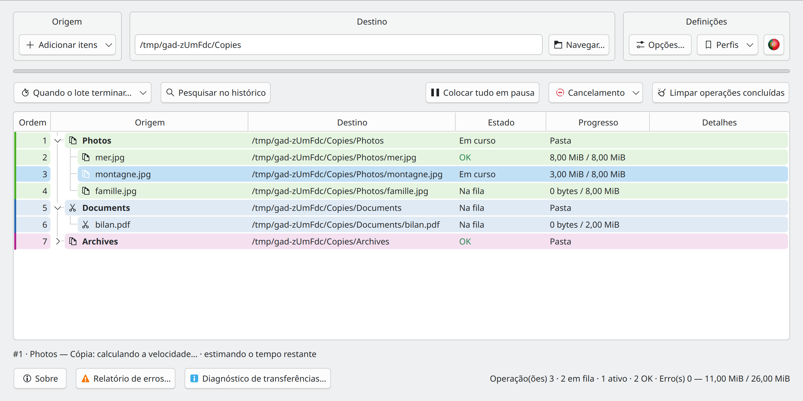

*A lista mostra os ficheiros diretamente, com pastas reais a formar a árvore. As cores do pedido mantêm os envios separados reconhecíveis.*

| Área | Finalidade |
|---|---|
| **Origem** | Adicione ficheiros, adicione uma pasta ou cole no destino selecionado. |
| **Destino** | Introduza um caminho local ou um URL remoto compatível ou procure uma pasta. |
| **Definições → Opções…** | Verificação, eliminações, duplicação, histórico, arranque, limites de velocidade e atalhos. |
| Barra de progresso | Progresso combinado para os trabalhos de transferência listados. |
| Filtro e comandos | Filtre linhas, pause a fila, cancele, desfaça ou limpe o histórico concluído. |
| Lista de ficheiros | Origem, destino, estado, progresso e mensagens detalhadas. |
| Abaixo da lista | Decisões de conflitos e informação sobre velocidade/tempo restante por pedido. |
| Rodapé | **Sobre**, **Relatório de erros…** e o resumo combinado. |

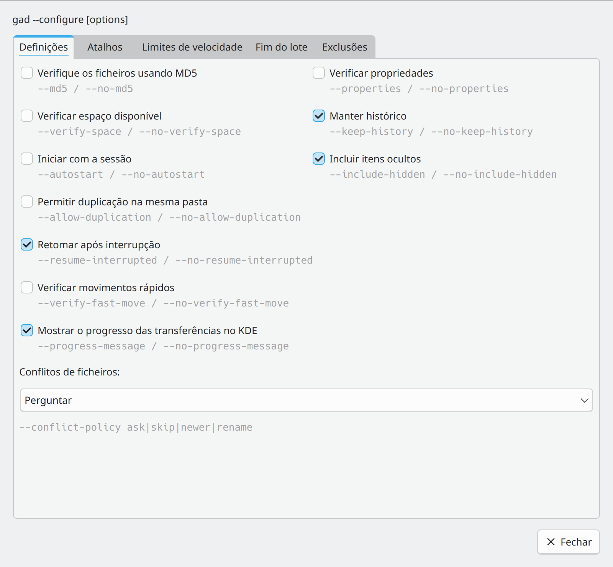

*O diálogo de opções abre-se a partir do bloco Definições.*

**Definições → Opções…** abre uma janela modal que bloqueia a janela principal enquanto as transferências continuam. As alterações aplicam-se imediatamente; **Fechar** ou Esc não as anula. Os parâmetros de comando aparecem a cinzento. Tamanho mínimo: **800 × 740**; janela principal, relatório de erros e diagnóstico: **1100 × 600**.

As cinco abas são configurações, atalhos, limites de velocidade, conclusão do lote e exclusões. Os parâmetros de linha de comando aparecem em cinza. O limite de um lote existente é alterado pelo menu de contexto das linhas e aparece na coluna de detalhes.

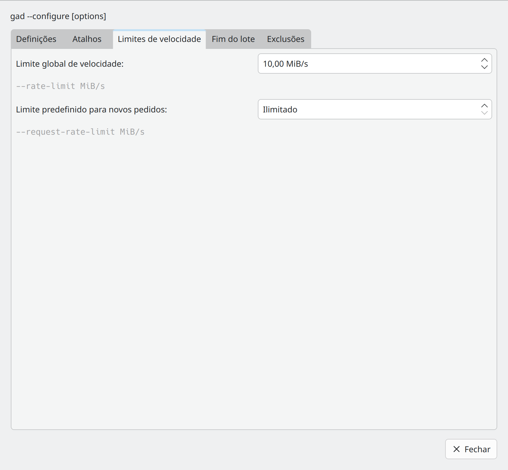

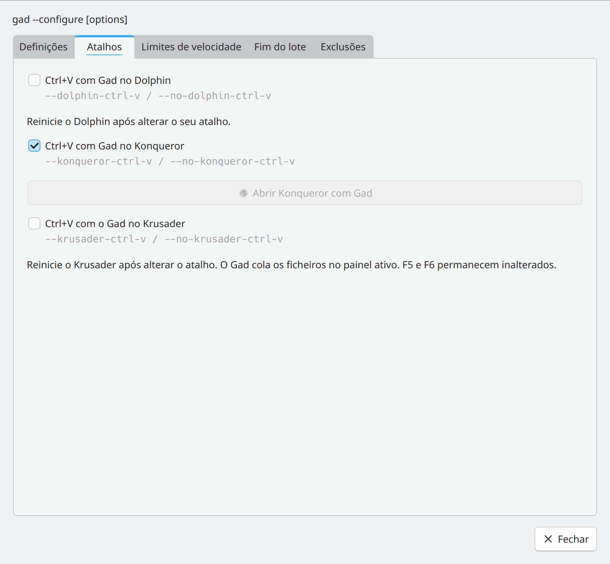

*O separador Atalhos controla a integração dos gestores de ficheiros.*

**Atalhos** ativa ou desativa Ctrl+V com Gad para Dolphin e Konqueror. As alterações no Dolphin utilizam o auxiliar de atalho reversível do Gad e requerem o reinício do Dolphin; uma alteração rejeitada restaura a caixa de selecção e apresenta um erro. Konqueror capta as alterações no próximo toque de tecla em **Konqueror com Gad**. O seu botão de arranque está disponível quando o navegador e o iniciador estão instalados. As pastas de texto permanecem nativas.

O **Sobre** mostra o nome, acrónimo, slogan, ícone, versão e data de compilação da aplicação. O ícone do software é a imagem de documento com cabelos encaracolados usada pela janela, lançador, Sobre a janela e bandeja.

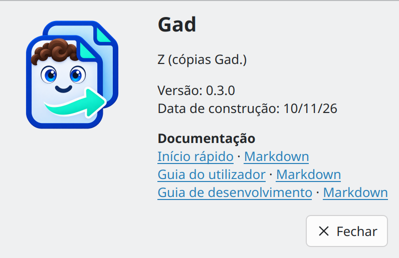

*About identifica a compilação que está a ser executada no momento.*

## Utilizar Ctrl+V no Dolphin {#using-ctrlv-in-dolphin}

A ação de clicar com o botão direito do rato em **Colar com Gad** funciona sem substituir o atalho de colagem nativo de Dolphin. Recebe o contexto de destino em que clicou.

Para associar Ctrl+V a Gad em Dolphin:

```bash
gad --configure --dolphin-ctrl-v
```

Feche e volte a abrir Dolphin. Ctrl+V direciona então a pasta Dolphin atualmente aberta. A integração resolve esta pasta através da informação da sessão do Dolphin; não requer um caminho completo no título da janela. Num campo de texto, Ctrl+V permanece como uma pasta de texto.

**Shift + Inserir** continua a ser a alternativa de pasta padrão KDE/Dolphin KIO. Não é um novo atalho Gad. Para restaurar a configuração anterior do atalho Dolphin:

```bash
gad --configure --no-dolphin-ctrl-v
```

A alteração aplica-se ao Dolphin, e não a todas as aplicações no Plasma. Os atalhos e ações existentes são restaurados através da configuração guardada da integração, em vez de repor as preferências do utilizador não relacionadas.

## Utilizar o Gad com outros gestores de ficheiros {#using-gad-with-other-file-managers}

Gad pode receber ficheiros de outro gestor, como Nautilus, Nemo ou Thunar. A integração do menu de contexto e dos atalhos depende do gestor: Gad não interceta automaticamente o seu **Ctrl+V** nem infere a sua pasta ativa.

### Copie ou recorte e cole em Gad {#copy-or-cut-then-paste-in-gad}

1. Selecione os ficheiros no seu gestor e utilize **Ctrl+C** ou **Ctrl+X** para solicitar uma movimentação.
2. Abra Gad e defina a pasta de destino em **Destino**.
3. Clique em **Arquivos da área de transferência** ou prima **Ctrl+V dentro Gad**.
4. Verifique o destino e o tipo de operação apresentados na lista.

O gestor deve publicar uma lista de ficheiros em formato de área de transferência compreendido por Gad. Copiar um caminho como texto simples é insuficiente. A movimentação requer um marcador de corte reconhecido; se não estiver disponível, utilize o comando `--move` explícito abaixo.

### Arraste ficheiros para Gad {#drag-files-into-gad}

Defina primeiro **Destino** e depois arraste os ficheiros ou pastas do seu gestor para a lista do Gad. **Arrastar e largar cria sempre uma cópia**, mesmo que tenha cortado estes ficheiros anteriormente. Para mover ficheiros, cole com um marcador de corte reconhecido ou utilize `--move`.

### Crie uma ação ou botão personalizado {#create-a-custom-action-or-button}

Se o seu gestor puder iniciar um comando, uma ação de menu ou um botão da barra de ferramentas, utilize os comandos abaixo. Substitua estes caminhos de exemplo; o destino deve ser uma pasta já existente.

Para colar a área de transferência num destino explícito em segundo plano:

```sh
gad --paste "/home/demo/Documents/Copies"
```

Para copiar tipos de letra sem utilizar a área de transferência:

```sh
gad --copy "/home/demo/Images/photo.jpg" "/home/demo/Images/album" --to "/home/demo/Documents/Copies"
```

Para mover as fontes explicitamente:

```sh
gad --move "/home/demo/Images/photo.jpg" --to "/home/demo/Documents/Copies"
```

Uma ação personalizada deve passar **a pasta de destino** para `--paste`. Para `--copy` e `--move`, passe **os ficheiros de origem selecionados** antes de `--to`, seguido da pasta de destino. As variáveis ​​de substituição e as cotações dependem do gestor: não assuma que um argumento de seleção identifica a pasta aberta nem reutilize os espaços reservados de outro gestor. Se `gad` não for encontrado, utilize o caminho completo `~/.local/bin/gad` com o seu directório pessoal expandido.

Outros gestores que suportam os menus de serviço KIO também podem oferecer o **Colar com Gad**. A sua disponibilidade não está garantida em todos os gestores. As opções Dolphin e Konqueror em **Definições → Opções…** apenas controlam estas integrações; `--paste-current` não descobre pastas ativas de outras aplicações.

## Iniciar uma cópia ou uma movimentação {#starting-a-copy-or-move}


Escolha destino e opções e adicione os ficheiros no Gad. Sem trabalho ativo, reveja a lista e clique em **Iniciar**. A colagem externa pelo gerenciador de arquivos inicia automaticamente; novos elementos durante uma transferência entram na fila. **Ctrl+C** copia e **Ctrl+X** move. Arrastar e largar prepara sempre uma cópia.

### De Dolphin {#from-dolphin}

1. Utilize **Ctrl+C** para copiar ou **Ctrl+X** para mover.
2. Abra ou clique com o botão direito do rato na pasta de destino pretendida.
3. Escolha **Colar com Gad** ou utilize Ctrl+V se a sua integração Gad estiver ativada.
4. Repita para adicionar mais trabalho à mesma fila.

Uma colagem exterior começa em segundo plano e não força a abertura da janela principal. Se estiver oculto, Plasma apresenta a visualização nativa do progresso. Uma colagem externa válida pode limpar uma pausa global existente para iniciar a transferência. Uma pausa explicitamente solicitada após o envio tem precedência, incluindo durante a preparação em segundo plano. Uma colagem completamente duplicada não elimina uma pausa.

### De Gad {#from-gad}

O menu **Adicionar itens** reúne **Adicionar arquivos…** (Ctrl+Shift+O), **Adicionar pasta…** (Ctrl+O) e **Arquivos da área de transferência** (Ctrl+V). Mantém o modo Copiar ou Recortar. Quando Gad está inativo, todos os itens adicionados dentro do aplicativo aguardam **Iniciar**; durante transferências já iniciadas, entram na fila. Apenas a colagem externa pelo gerenciador de arquivos inicia automaticamente.

Soltar ficheiros em Gad cria sempre um **Cópia: **. Uma lista de ficheiros colada enquanto o campo Destino está em foco ainda entra na fila de transferência. O texto comum mantém o comportamento normal de colagem do campo de texto.

### Solicitações duplicadas {#duplicate-requests}

Gad ignora uma operação já abrangida por um pedido ativo, incluindo um em pausa: mesma origem, destino e tipo de operação. A verificação abrange colagens repetidas, adições simultâneas, seleções repetidas e ficheiros já incluídos noutra pasta enviada.

Os novos ficheiros são retidos, juntamente com quaisquer pastas necessárias. Uma breve mensagem informativa informa quantas entradas não foram adicionadas. Não oferece uma opção de substituição. A primeira solicitação mantém as suas opções de verificação.

Um destino diferente ou uma alteração de cópia versus movimentação permanece um pedido separado. Diferentes ficheiros de origem que partilham um nome ainda utilizam o tratamento de conflitos. Pode copiar intencionalmente um ficheiro novamente após a conclusão do pedido anterior.

### Preparação {#preparation}

Gad valida todas as raízes e verifica o pedido antes de copiar qualquer um dos seus ficheiros. A preparação pode levar algum tempo numa partilha de telefone ou de rede. Uma falha é reportada em vez de iniciar silenciosamente apenas a parte que foi verificada com êxito.

Os ficheiros e caminhos especiais fora do contrato UTF-8 compatível são rejeitados. Um link simbólico de origem é copiado como um link, incluindo um link quebrado; Gad não o percorre como uma pasta de origem.

## Excluir itens das transferências {#excluding-items-from-transfers}

Em **Configurações → Opções… → Exclusões**, insira um padrão por linha para pastas ou arquivos e links simbólicos. Cada campo é salvo ao perder o foco, sem botão Aplicar nem diálogo adicional. Uma regra inválida gera um aviso; as regras anteriores continuam ativas e o texto permanece para correção. As regras valem para novas transferências. A opção de incluir itens ocultos permanece na aba de configurações.

| Tipo | Exemplo | Efeito |
| --- | --- | --- |
| Pastas | `__*` | Ignora pastas cujos nomes começam por dois sublinhados, incluindo `__pycache__`. |
| ficheiros | `*.tmp` | Ignora ficheiros com esta extensão. |
| ficheiros | `*.swp` ou `*~` | Ignora alguns ficheiros temporários e de cópia de segurança do editor. Insira cada padrão na sua própria linha. |

`*` corresponde a zero ou mais caracteres e `?` corresponde a um caractere. A correspondência é sensível a maiúsculas e minúsculas e aplica-se a nomes de base em todas as profundidades, incluindo itens explicitamente selecionados. As pastas eliminadas nunca são percorridas. Os links simbólicos usam padrões de ficheiros e não são seguidos. Desmarcar a opção de itens ocultos elimina os nomes que começam com um ponto final, tanto para ficheiros como para pastas.

As linhas vazias são ignoradas; os espaços continuam a fazer parte dos padrões. Os caminhos completos, as expressões regulares e as classes de caracteres entre parênteses rectos não são interpretados. Os limites são de 128 padrões por tipo e 256 bytes UTF-8 por defeito, sem barras ou quebras de linha.

As definições são guardadas e capturadas para cada novo pedido antes da preparação para o acesso remoto. Os lotes, os currículos e as novas tentativas existentes mantêm as suas regras originais. Durante os movimentos, os artigos eliminados permanecem na origem, pelo que as pastas de origem podem permanecer. As renomeações rápidas de pastas inteiras são desativadas quando a filtragem está ativa, mas os ficheiros individuais qualificados ainda podem ser movidos rapidamente.

## Movimentos locais rápidos {#fast-local-moves}

Para uma movimentação local elegível, o Gad utiliza uma renomeação em vez de copiar o conteúdo e eliminar a fonte. Isto preserva o inode do ficheiro e evita a transferência dos seus dados. Pode ser executado juntamente com uma cópia utilizando o mesmo disco se os seus caminhos forem independentes.

Diferentes caminhos de montagem de ligação podem ainda referir-se a um sistema de ficheiros subjacente. Por exemplo:

```text
/media/library/Music  → /home/you/Music
/media/library/Other  → /home/you/Other
```

Gad pode renomear estas visualizações quando provar um caminho comum seguro e identidades correspondentes. O mesmo disco físico por si só é insuficiente: diferentes partições, subvolumes, mapeamentos de leitura apenas ou restrições de renomeação do kernel podem exigir cópia e eliminação. Uma renomeação rejeitada é reprogramada com reservas de cópia normais.

Para uma árvore de pastas completa e inalterada, sem conflitos ou entradas pausadas/eliminadas, o Gad pode renomear a árvore inteira de uma só vez. Os relatórios detalhados **dossiê renomeado em bloco**. Caso contrário, processa as entradas individualmente. Os ficheiros externos adicionados a uma árvore movida são protegidos durante o desfazer, em vez de serem movidos ou eliminados silenciosamente.

A ativação do MD5 utiliza o caminho de cópia comum em vez do atalho de renomeação rápida. O limite de simultaneidade permanece duas operações.

## Interpretar os estados e o progresso {#reading-states-and-progress}

As dicas explicativas longas utilizam uma quebra de linha entre as frases. Os nomes dos ficheiros e os caminhos mantêm a pontuação e o espaçamento originais.

As linhas de origem utilizam ícones Copiar para cópias e ícones Cortar para movimentações, incluindo pastas e pedidos em preparação. As pastas permanecem a negrito e mantêm os seus descendentes.

A coluna **Ordem** é apresentada em primeiro lugar e ajusta-se automaticamente à largura mínima necessária para o seu título, seta de classificação e números. Segue a fila do motor, incluindo pastas, pedidos de verificação e histórico retido. A ordenação e a filtragem de visualização nunca renumeram as linhas restantes, pelo que as lacunas numa visualização filtrada são normais. As alterações de prioridade da fila atualizam as posições. Passe o rato sobre um número para **Lote #…**. As transferências paralelas podem terminar numa ordem diferente.

| Coluna | Significado |
|---|---|
| **Ordem** | Posição na fila do motor, independentemente da classificação do display; passe o rato para o número de lote. |
| **Origem** | Nome do ficheiro ou pasta; o ícone Copiar/Cortar indica a operação e a dica de ferramenta fornece o percurso completo e as definições opcionais de MD5/taxa; os números dos lotes permanecem nas dicas de encomenda. |
| **Destino** | Localização do alvo, ou o URL remoto original reconstruído para exibição. |
| **Estado** | Estado atual, incluindo pausa, conflitos, verificações e espera do dispositivo. |
| **Progresso** | Copiados bytes e tamanho do ficheiro, ou o progresso MD5/recuperação-check. |
| **Detalhes** | Erros, resultados MD5, informações de movimento rápido e avisos de verificação. |

| Estado | Significado |
|---|---|
| **A analisar…** | Validando raízes e digitalizando o pedido. |
| **Na fila** | Esperando sua vez, recursos, ou uma ação retomar. |
| **Em curso** | Transferindo dados ou processando a entrada. |
| **Em pausa** | Aplica-se uma pausa global, requisição ou entrada. |
| **Aguarda dispositivo** | Uma montagem conhecida não está disponível; os dados parciais são retidos. |
| **A verificar os dados de retoma…** | Verificando a fonte e salvando prefixo parcial antes de escrever novamente. |
| **A verificar MD5…** | Releitura independente de origem e destino temporário. |
| **Decisão necessária** | Um conflito de ficheiros precisa da sua decisão. |
| **OK** | Terminado; mostrado em verde. |
| **Erro** | Um passo falhou; leia o detalhe ou abra o relatório de erro. |
| **Ignorado** | Saltado; a fonte permanece. |
| **Cancelado** | Cancelado sem desfazer automaticamente os resultados concluídos. |
| **A restaurar…** | O Desfazer está a correr. |
| **Restaurado** | Os efeitos selecionados foram desfeitos. |
| **Restauração incompleta** | Desfazer não pôde ser concluído em segurança. |

Uma pasta só se torna OK depois de seus filhos relevantes terminarem. Ela colapsa nessa transição. Reabrindo- a manualmente, a mantém aberta através de atualizações posteriores de progresso. A seleção, o hover e as dicas são preservadas enquanto os contadores mudam.

### Filtros {#filters}

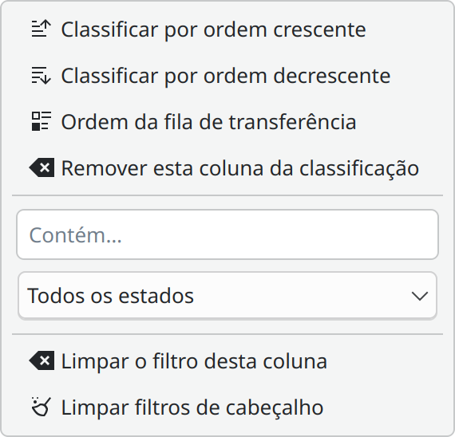

*Filtrar muda a visibilidade, não o comportamento de transferência.*

Os filtros estão disponíveis com os cabeçalhos das colunas com o botão direito do mouse. A antiga combinação global de filtros acima da tabela foi removida. As pastas ancestral permanecem visíveis quando necessário para mostrar um filho correspondente. Se seleccionar um filtro abre ramos relevantes; as actualizações normais de progresso não reabriram as ramificações que você desabou.

### Ordenação e filtragem dos cabeçalhos {#sorting-and-filtering-from-headers}

Clique num título da coluna para alternar a ordem de visualização ascendente e descendente. **Ctrl+clique** adiciona uma coluna à ordem existente; repetindo Ctrl+clique inverte a direção dessa coluna sem alterar a sua prioridade. Cabeçalhos mostram prioridades como **(1)**, **(2)**, e assim por diante, com a seta de ordenação usual à direita de cada coluna ordenada. Um clique sem Ctrl restaura a ordenação de uma coluna única. Nomes usam ordenação natural (`file2` antes de `file10`). Tipos de progresso por porcentagem numérica, independentemente do tamanho do ficheiro e unidades exibidas. A classificação está entre irmãos: pastas mantêm seus descendentes.

Carregue com o botão direito do rato num cabeçalho para abrir o seu menu. Ele fornece uma ordenação ascendente/ descendente, **Ordem da fila de transferência**, e um filtro **Contém…** sensível a maiúsculas para essa coluna. As pesquisas de código- fonte também incluem caminhos completos. O estado adiciona um seletor de estado exato; o progresso adiciona percentagens mínimas e máximas. O **Remover esta coluna da classificação** remove uma chave de ordenação, mantendo as outras. As acções claras removem um filtro de coluna ou todos os filtros de cabeçalho.

Os filtros de colunas combinam entre si. As crianças correspondentes mantêm pastas de antepassados visíveis; os filtros activos permanecem disponíveis nos menus de colunas. Os contadores globais continuam a cobrir todas as transferências. Localizar um ficheiro a partir de um conflito ou relatório de erro limpa os filtros que o possam esconder.

A ordenação muda apenas a exibição, nunca a prioridade de execução. Restaure **Ordem da fila de transferência** antes de arrastar as linhas para o trabalho de reordenação. Exibir as configurações sobrevivem às atualizações de progresso e às mudanças de idioma.

### Contadores e estimativas {#counters-and-estimates}

O trabalho de transferência de contagens de resumo combinadas. Um renomear avança os bytes lógicos sem representar o tráfego de disco copiado. Um ficheiro totalmente escrito ainda pode estar sendo submetido à verificação MD5. As linhas ocultas/removidas estão excluídas do resumo visível. As pastas não contribuem com os bytes de conteúdo de ficheiros.

Abaixo da lista, cada solicitação ativa tem seu próprio nome de origem, velocidade e tempo estimado restante. As medições usam os últimos cinco segundos de atividade. Um curto aquecimento exibe **cálculo da débit...** até que o tempo tenha decorrido.

A cópia e as releituras MD5 têm medições separadas. Se a velocidade MD5 ainda é desconhecida, a estimativa cobre explicitamente apenas a cópia e diz **MD5 à estimativa**. Quando ambas as medições estão disponíveis, a estimativa inclui o trabalho de cópia restante e as leituras de verificação. É aproximada e não prevê o tempo de espera da fila.

Uma pausa suspende as estimativas; um conflito mostra o **Decisão necessária**. Os ficheiros individualmente pausados tornam desconhecido o tempo restante da requisição, mesmo que os outros ficheiros avancem. Os renomes não mostram velocidades artificiais de cópia de disco, e um prefixo reconhecido retomado não cria um pico de velocidade. Sem progresso, a velocidade antiga cai para zero e a estimativa fica indisponível.

## Organizar a fila {#organizing-the-queue}

Arraste uma ou mais linhas **espera** antes ou depois de outra linha. O marcador de inserção mostra a posição pretendida; pairando perto da borda rola a lista. As raizes de ficheiro de nível superior podem ser entrelaçadas entre as solicitações.

Uma pasta move- se com a sua ramificação. Os ficheiros dentro de uma pasta reordenam entre irmãos; eles mantêm o seu pai e destino. Mova a pasta pai para reposicionar a ramificação inteira. Arrastar nunca muda o destino.

O menu de contexto oferece **Tratar a seguir** (Processo seguinte) e **Reordenar fila** (Move-se na fila). Ctrl e Shift suportam seleção múltipla. **Selecionar todo o lote** seleciona as outras raízes pertencentes à mesma submissão.

As prioridades são salvas. O processamento seguinte não interrompe o ficheiro atual ou remove uma pausa. A compatibilidade com o disco e as dependências de desfazer ainda se aplicam. O interleading insegura de solicitações que substituem as mesmas saídas é recusado por uma razão. Uma solicitação parcialmente publicada pode, portanto, manter o trabalho dependente esperando durante uma pausa.


## Pausar e retomar {#pausing-and-resuming}

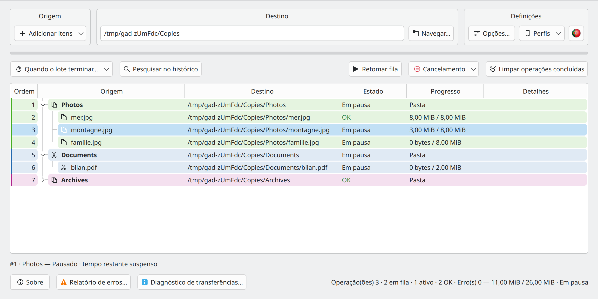

*As linhas não terminadas mostram a sua pausa; os resultados completos permanecem OK.*

O **Colocar tudo em pausa** pausa a fila e muda para o **Retomar fila** (Resuma a fila). Os ficheiros completados mantêm o seu estado. O menu de contexto pode pausar ou retomar os pedidos ou itens seleccionados. A pausa de um pedido permite que outros pedidos admissíveis avancem.

Uma pausa faz efeito num ponto de controlo em vez de interromper forçadamente uma chamada activa do sistema. Um currículo seleccionado remove a pausa global para que a selecção possa prosseguir; as pausas pertencentes a outras requisições permanecem em vigor.

O cancelamento está disponível durante uma pausa. Um desfazer explicitamente solicitado também pode ser executado enquanto a cópia normal é globalmente pausada. O controle de pausa no Plasma e no menu da bandeja permanece sincronizado com a janela principal.

## Limitar a velocidade {#limiting-bandwidth}

O **limite global de velocidade** em **Definições → Opções…** limita o débito total das transferências que copiam dados. Aplica-se imediatamente. 0 significa sem limite; os movimentos rápidos por mudança de nome não são limitados.

Selecione linhas e clique em **Limitar a velocidade da solicitação…** à esquerda da barra de ações principal, ou utilize o menu de contexto. O limite aplica-se a cada pedido selecionado; todos continuam a partilhar o limite global. 0 remove apenas os limites individuais.

Ambas as restrições aplicam-se: uma solicitação limitada a 10 MiB/s permanece limitada a 10, mesmo que o limite global seja 50. Dois pedidos sem limites individuais podem ser usados no máximo 50 MiB/s combinados.

A tampa aplica-se a bytes copiados, incluindo terminais remotos montados. OS e buffering de rede podem produzir variações curtas. MD5 releituras, verificações de propriedades e desfazer estão fora desta tampa. Renomeamentos rápidos permanecem imediatos. Pausa e cancelamento permanecem disponíveis em taxas baixas.

## Resolver conflitos {#resolving-conflicts}

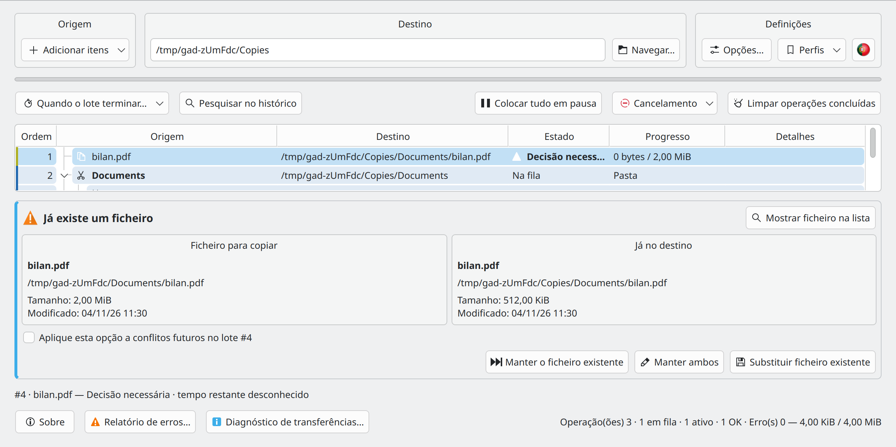

*A origem e o destino existente são mostrados lado a lado abaixo da lista de ficheiros.*

Um painel de conflito mostra o nome do ficheiro, o caminho selecionável, o tamanho e o tempo de modificação para ambos os lados.

| Botão | Resultado |
|---|---|
| **Manter o ficheiro existente** | Mantenha o destino existente e ignore esta fonte. Uma jogada não apaga uma fonte ignorada. |
| **Manter ambos** | Mantenha o ficheiro existente e escolha um nome de cópia disponível para o novo resultado. |
| **Substituir ficheiro existente** | Substitua-o, retendo o antigo destino em privado para desfazer. |

A caixa de seleção aplica a decisão a conflitos posteriores **nesse pedido**. Ele reinicia quando você muda o conflito exibido. Com vários conflitos, use o seletor para escolher qual inspecionar. Um novo conflito não muda silenciosamente o item que você está decidindo.

O **Mostrar ficheiro na lista** localiza a linha bloqueada, incluindo quando um filtro a escondeu. Um ficheiro que ocupa um caminho de pasta necessário, ou um link simbólico inseguro nesse caminho, pode produzir um erro em vez de uma substituição automática de pastas.

## Cancelar ou restaurar transferências {#canceling-or-undoing-transfers}

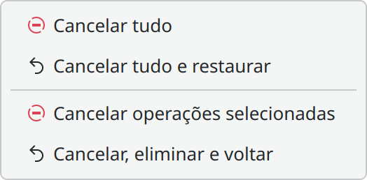

*As ações globais permanecem disponíveis sem uma seleção.*

### Parar sem desfazer {#stop-without-undo}

O **Cancelar tudo** (Cancelar todos) pára o trabalho activo e em fila de espera, incluindo uma preparação excelente. Deixa as transferências completas no lugar. Os limites do **Cancelar operações selecionadas** que param para a selecção. As selecções de pastas incluem descendentes.

### Desfazer os efeitos completados {#undo-completed-effects}

**Cancelar tudo e restaurar** cancela o trabalho e desfaz o histórico recuperável, a execução mais nova primeiro. **Cancelar, eliminar e voltar** aplica desfazer às entradas ou branches selecionados.

| Operação original | Desfazer o comportamento |
|---|---|
| Copiar para um ficheiro novo | Remova a cópia criada por Gad. |
| Substituir um ficheiro existente | Remova o novo resultado e restaure o destino salvo. |
| Mover | Devolve o ficheiro à sua fonte e remove o seu resultado de destino. |
| Criar uma pasta | Remova-o apenas quando isso pode ser feito sem perder outros ficheiros. |

Desfazer espera para que as reservas de transferência ativa sejam liberadas. Devolver um movimento através de sistemas de ficheiros pode exigir copiar o conteúdo de volta. Uma transação de desfazer já em andamento deve terminar suas etapas de restauração seguras.

O Gad verifica identidades, metadados e conteúdo gravado antes de alterar os resultados. Uma fonte recriada, destino modificado, cópia de segurança em falta ou volume ausente podem causar uma recusa ou uma desfazer incompleta. O detalhe explica o que foi retido. Uma cópia completa não é uma cópia de segurança independente, e o histórico de limpeza remove a sua capacidade de desfazer.

### Apagar e Backspace {#delete-and-backspace}

| Linha seleccionada | Apagar | Backspace |
|---|---|---|
| Terminado | Remova a referência linha/história; mantenha o ficheiro resultante. | Desfaça esse ficheiro ou branch quando o seu diário o permitir. |
| Activo | Peço cancelamento. | Peço cancelamento. |
| Pendente | Remova-o da fila. | Remova-o da fila. |

Uma selecção de pastas estende- se ao seu conteúdo. A selecção de ficheiros individuais não desfaz automaticamente os seus vizinhos. Mantenha o histórico que poderá necessitar antes de o limpar.

## Utilizar o menu de contexto {#using-the-context-menu}

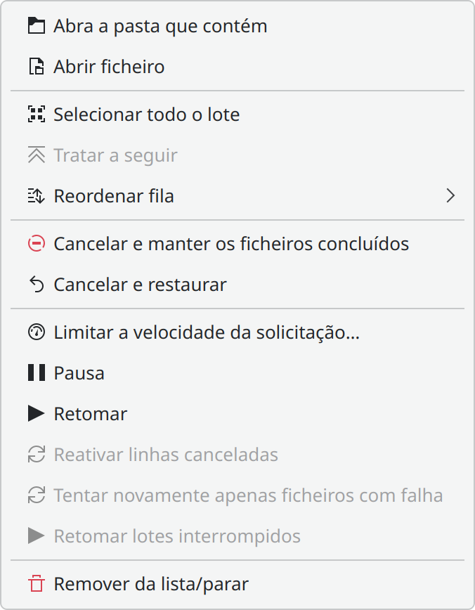

*As ações se adaptam à seleção e aos seus estados atuais.*

| Acção | Finalidade |
|---|---|
| **Abra a pasta que contém** | Abra a pasta pai de um ficheiro ou abra a pasta selecionada em si. |
| **Abrir ficheiro** | Abra um ficheiro com sua aplicação associada ao desktop. |
| **Selecionar todo o lote** | Selecione os outros itens da mesma submissão. |
| **Traiter ensuite / Déplacer dans la file** | Priorizar entradas de espera ou branches. |
| **Cancelar e manter os ficheiros concluídos** | Parar o trabalho selecionado e reter saídas completas. |
| **Cancelar e restaurar** | Desfaça a seleção quando o seu diário o permitir. |
| **Limitar a velocidade da solicitação** | Aplique um limite de largura de banda às solicitações próprias. |
| **Mettre en pausa / Reprendre** | Pausar ou retomar o trabalho seleccionado. |
| **Tentar novamente apenas ficheiros com falha** | Tente falhas elegíveis sem copiar ficheiros OK. |
| **Retomar lotes interrompidos** | Validar e retomar o trabalho recuperável após uma interrupção. |
| **Reativar linhas canceladas** | Preparar entradas canceladas para uma nova tentativa após a limpeza controlada. |
| **Remover da lista/parar** | Aplicar Apagar semântica. |

A abertura de uma linha OK tem como alvo o destino. Para as linhas pendentes, ativas, ignoradas, canceladas ou desfeitas, ela tem como alvo o código. O estado atual é verificado quando a ação é executada. Duplicar pastas em uma seleção múltipla aberta apenas uma vez. O lançamento é limitado a um único ficheiro, não a uma solicitação inteira ou a uma pasta.

A reativação espera que a requisição pare e conserve os vizinhos completados. Se o tipo de fonte mudou, adicione- o como uma nova requisição em vez de reutilizar a linha antiga.

## Relatório de erros e novas tentativas seletivas {#error-reporting-and-targeted-retries}

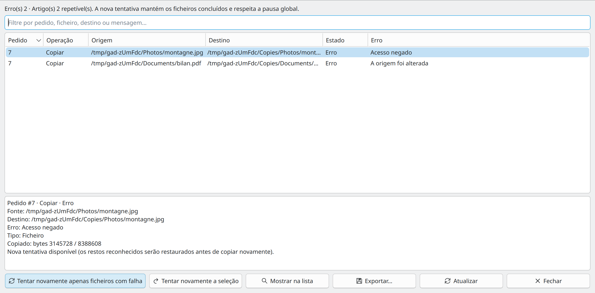

*Todos os seis botões têm ícones: tente novamente os erros exibidos, tente novamente a seleção, localize, exporte, refresque e feche.*

Abra o **Relatório de erros…** ao lado do About. Ele agrupa falhas retidas por requisição, operação, origem, destino, estado e mensagem. Uma pasta que apenas reflete o erro de uma criança não adiciona um registro duplicado; a própria falha de uma pasta ainda é mostrada.

Os filtros de pesquisa por requisição, localização ou mensagem de erro. A selecção de uma linha mostra o detalhe completo abaixo: progresso, localização do ficheiro parcial, bytes recuperáveis e informações de propriedade disponíveis do MD5 ou. O **Mostrar na lista** localiza a entrada na janela principal. O **Atualizar** atualiza explicitamente o instantâneo; o relatório não embaralha continuamente enquanto o inspecciona.

O **Tentar novamente apenas ficheiros com falha** repete os erros elegíveis atualmente exibidos. O **Tentar novamente a seleção** segmenta apenas as linhas selecionadas. Neste relatório, selecionar um erro de diretório não inclui silenciosamente crianças filtradas. A ação de contexto de pastas da lista principal mantém seu comportamento normal de seleção descendente.

A requisição deverá ser interrompida. O Gad valida quaisquer efeitos parciais ou publicados, restaura apenas os restos reconhecidos e faz filas nos elementos falhados de novo. O ficheiro falhado é copiado do início após essa limpeza. Os ficheiros OK não são copiados; os itens cancelados, ignorados ou removidos não são reactivados. Outros itens que estavam apenas à espera numa requisição parada permanecem em pausa se estiverem fora do retry. A pausa global é respeitada.

Uma falha de preparação sem ficheiros listados pode ser novamente tentada através da validação de raiz completa e uma nova verificação. Se a preparação de repetição falhar, reparar a causa e atualizar o relatório para tentar novamente. Uma desfazer incompleta separada permanece uma tarefa de desfazer/ recuperar. Um resultado publicado modificado é retido e pode fazer com que uma repetição falhe com segurança.

O **Exportar…** (Export...) está desactivado quando o relatório carregado está vazio. Filtrar todas as linhas para fora não desactiva a exportação porque ainda cobre o instantâneo completo. Ele escreve todo o relatório carregado, incluindo linhas escondidas pelo seu filtro de pesquisa, uma vez que o **Texto UTF- 8** ou o **JSON**. O texto destina- se a ler e partilhar; o JSON mantém referências estáveis de pedidos/ ficheiros e metadados de diagnóstico. A exportação não realiza nenhuma transferência. Os erros deliberadamente removidos do histórico não são reintroduzidos.

## Verificar o conteúdo com MD5 {#checking-file-contents-with-md5}

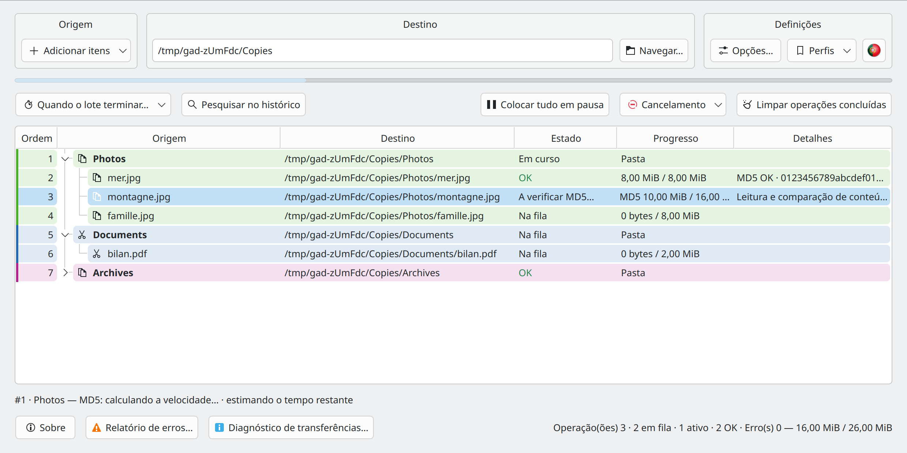

Activar o **Verifique os ficheiros usando MD5** para novas submissões. Cada ficheiro regular é copiado e sincronizado, sendo então reler e comparar o seu destino de origem e temporário. O Gad publica o mesmo ficheiro temporário verificado sob o seu nome final apenas após verificações bem sucedidas.

A linha exibe **A verificar MD5…** durante a releitura e pode mostrar mais tarde **MD5 OK** e o digest. Para um ficheiro N-byte, a verificação adiciona duas leituras N-byte. Diretórios e links simbólicos não são verificados como conteúdo de ficheiro.

Falhas de leitura, cancelamento durante a verificação, alterações de origem ou um descompasso de digest impedem a publicação e preservam a fonte e qualquer destino anterior. Um movimento apaga a sua fonte apenas após a publicação bem- sucedida e as verificações necessárias. A configuração é lembrada para futuras solicitações; as solicitações existentes mantêm a sua escolha capturada.

MD5 verifica a consistência deste caminho de transferência. Não é uma garantia criptográfica contra colisões deliberadamente construídas.

## Verificar as propriedades dos ficheiros {#checking-file-properties}

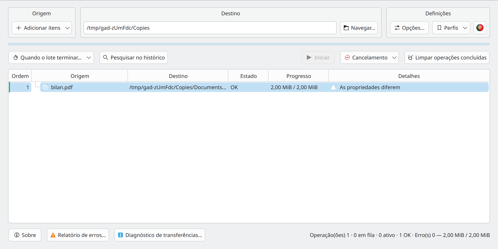

O **Verificar propriedades** compara o proprietário, grupo, bits de permissão, ACLs POSIX e atributos estendidos expostos. Ele distingue as diferenças conhecidas das verificações não disponíveis. Os valores dos atributos não estão incluídos em relatórios salvos; o relatório lista diferenças e verificações não disponíveis. As datas de modificação estão fora desta comparação.

Cópias comuns preservam permissões básicas e tempo de modificação onde suportadas; elas não ganham a preservação do proprietário, ACL ou xattr de nível de backup simplesmente porque esta caixa está habilitada.

Para uma cópia, um descompasso de propriedade poderá deixar o resultado copiado com sucesso com um aviso. Para uma jogada de cópia e remoção, uma verificação falhada antes da publicação preservar o destino original e anterior; uma verificação falhada após a publicação mantém o original e um diário para o resultado criado. Uma mudança rápida de nome já moveu o objeto, de modo que um aviso posterior não reivindica que o código-fonte ainda exista.

A opção é lembrada e capturada por nova solicitação. Os relatórios estão disponíveis nos resumos de alerta de detalhes e pastas. Os serviços remotos podem expor apenas parte dessas propriedades.

## Verificar o espaço disponível {#checking-available-space}

O **Verificar espaço disponível** estima o armazenamento restante exigido pelas solicitações analisadas, incluindo cópias em fila e pausa que compartilham um volume. Os volumes separados são calculados independentemente.

Destinos antigos e backups de desfazer já ocupam espaço e não são tratados como capacidade livre durante a substituição. Os temporários de currículos alocados reconhecidos não são contados duas vezes. Arredondamento de alocação em bloco é considerado. Uma mudança de nome rápida comprovada não requer uma segunda cópia completa dos dados.

O espaço insuficiente conhecido impede que essa solicitação seja iniciada. **Se a capacidade não puder ser estimada, Gad avisa e continua** em vez de bloquear indefinidamente. O aviso pode permanecer visível após o sucesso. Esta é uma estimativa, não uma reserva de espaço em disco: outro programa pode consumir espaço depois, e as adições posteriores devem ser consideradas separadamente.

A opção é lembrada para novas solicitações; as existentes mantêm sua escolha capturada.

## Aguardar a reconexão de um dispositivo {#waiting-for-a-device-to-reconnect}

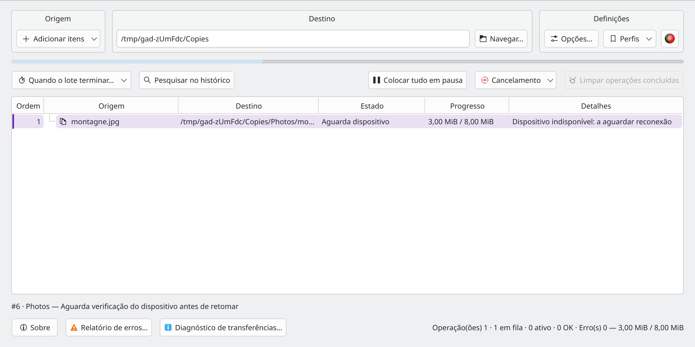

Se um disco conhecido ou montagem desaparece durante uma transferência, Gad exibe **Aguarda dispositivo**, mantém seu ficheiro parcial, e libera o trabalhador para que as solicitações independentes possam prosseguir. Plasma também descreve a espera.

Reconectar e montar o dispositivo **no mesmo local**. O Gad verifica a montagem esperada, a identidade/versão da fonte e o prefixo salvo antes de continuar do último ponto durável válido. Os bytes para além desse ponto poderão ser copiados. Uma pasta vazia deixada no ponto de montagem, ou outro volume montado ali, não é suficiente para provar. Um UUID do sistema de ficheiros pode reconhecer o mesmo volume depois de o Linux atribuir um número de dispositivo diferente.

As pausas globais e direcionadas permanecem em vigor; a reconexão não as substitui. Uma solicitação cancelada não reinicia. Uma fonte substituída, destino ou ficheiro parcial podem fazer com que a recuperação falhe ao invés de substituir dados não relacionados. Uma publicação interrompida requer recuperação em vez de uma segunda cópia automática.

Para a resolução KDE Connect, FTP, SFTP e SMB, Gad retries KIO no fundo sem abrir a sua janela ou adicionar outro lote. KDE ainda lida com autenticação. O caminho e as identidades montadas devem permanecer reconhecíveis. Se o KIO Fuse reiniciar com um caminho diferente, o Gad informa- o e retém o diário original; restaure a montagem original ou inspeccione e resubmeta os ficheiros interrompidos.

Para KIO Fuse destinos sem recuperação parcial durável, Gad pode reiniciar **somente o ficheiro atual desde o início**, depois de validar a sua fonte e remover o seu reconhecido ficheiro temporário não publicado. Os vizinhos completados permanecem intactos. Os pontos de verificação de reconexão local são criados durante a sessão, mesmo se a recuperação automática de crash é desmarcada; essa preferência ainda governa o reinício após um crash.

A detecção ocorre nos pontos de verificação de transferência e erros de conexão. Uma chamada de sistema bloqueada no kernel ou no serviço remoto pode atrasar a detecção. Um ficheiro excluído em um volume de outra forma disponível, espaço insuficiente ou negação de permissão permanece um erro comum.

## Retomar após uma falha {#resuming-after-a-crash}

O **Retomar após interrupção** está habilitado por padrão para novas solicitações. Destinos locais compatíveis usam um checkpoint durável a cada 64 MiB ou após dois segundos de progresso. Após uma parada abrupta, o Gad pode verificar o código-fonte, destino e conteúdo parcial, e então retomar no mesmo ficheiro temporário.

Os ficheiros concluídos permanecem terminados. As pausas globais e de entrada são mantidas. Uma requisição explicitamente cancelada nunca retoma automaticamente. Se a preferência global estiver desactivada ao reiniciar, as requisições elegíveis interrompidas aguardam o **Retomar lotes interrompidos** no menu de contexto. Esta acção diz respeito à requisição própria, mesmo que seleccione um ficheiro.

A versão de origem salva e a propriedade temporária são verificadas antes da truncação ou escrita. O Gad compara ambos os prefixos e a digest gravada, então descarta apenas bytes além do ponto confirmado. Uma fonte ou ficheiro parcial alterado causa uma recusa. A linha mostra o **A verificar os dados de retoma…** e então a contagem de byte retomada. A verificação final do MD5 ainda é executada se estiver habilitada.

Esta recuperação não está disponível para cada estado intermediário: publicação ambígua, renomear, ou desfazer estágios requerem recuperação baseada em diário. Recuperação de crash durável é desabilitada para KIO Fuse destinos. Diários e backups retidos para recuperação não são removidos desinstalando Gad.

## Histórico e limpeza {#history-and-cleanup}

**Manter histórico** retém pedidos, resultados de verificação e desfazer informações entre as sessões normais. Sem isso, os registros de sessão atual permanecem visíveis, mas o desligamento normal libera seu histórico e backups. A informação de recuperação necessária após uma interrupção pode permanecer disponível mesmo quando a retenção de histórico comum está desligada.

**Limpar operações concluídas** remove o histórico final e salva destinos substituídos. Ele faz **não** remover as cópias finais bem- sucedidas, mas remove sua capacidade de desfazer. Desfazer depende dos volumes originais e informações retidas; não é um backup independente.

A revista normalmente reside em `$XDG_DATA_HOME/gad/state.json`, padrão para `~/.local/share/gad/state.json`. Os ficheiros substituídos são retidos em diretórios privados `.gad-undo-*` em seu volume de destino. Estes usam espaço em disco até que o histórico de recuperação associado seja limpo.

Não exclua manualmente essas pastas privadas enquanto ainda precisa de desfazer. Um diário inválido ou um resultado não reconhecido é retido com um erro em vez de ser descartado optimicamente.

## Área de notificação e arranque da sessão {#system-tray-and-session-startup}

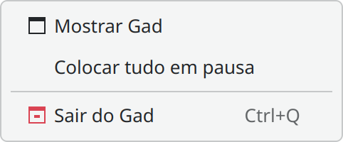

Carregue no ícone para esconder uma janela visível ou restaurar uma janela oculta/minimizada. O seu crachá conta os pedidos inacabados, incluindo a análise e o trabalho de espera. Acima de 99, mostra o `99+`; a dica mantém a contagem exacta.

O emblema é verde durante a atividade, laranja para pausa ou dispositivo à espera sem uma transferência ativa, e vermelho quando um conflito requer uma decisão. A dica resume o trabalho de execução, espera e digitalização. O menu da bandeja fornece ações de apresentação, pausa/ retoma e de saída.

Quando a janela é ocultada ou minimizada, uma visão combinada do trabalho Plasma exibe solicitações, ficheiros, bytes, progresso, pausa e velocidade. **Mostrar Gad** abre a janela principal. Cada notificação de transferência mantém o link **Mostrar Gad**, incluindo a conclusão, cancelamento e mensagens de erro. Novas solicitações se juntam à mesma visão; não existe uma segunda notificação comum para a mesma transferência. A área de detalhes nativos inclui a velocidade. A renderização externa exata depende da versão e tema Plasma instalada.

Activar **Iniciar com a sessão** para iniciar Gad na bandeja, quando a sessão do ecrã começa. Isto é por utilizador, arranque automático, não é um serviço do sistema. Desligar isto remove GadO próprio item de inicialização.

## Telefones, FTP, SFTP e SMB {#phones-ftp-sftp-and-smb}

Caminhos locais e pastas já montadas são suportados diretamente. Endereços remotos brutos usam o KIO Fuse nos lados de origem e destino.

| Serviço | Exemplo |
|---|---|
| KDE Connect | `kdeconnect://device-id/android/DCIM/Camera/photo.jpg` |
| FTP | `ftp://files.example/folder/file.txt` |
| SFTP | `sftp://user@files.example/folder/file.txt` |
| SMB | `smb://server/share/folder/file.txt` |

KDE possui autenticação e manipulação de sessão. Gad não fornece um gerenciador de senha separado FTP/SSH/SMB. Esquemas não suportados, URLs mal-formadas e componentes de consulta/fragmento ambíguos são rejeitados.

Ambos os lados são resolvidos antes de o pedido entrar no motor de cópia. Após as submissões manter a sua ordem. Um erro de conexão não envia silenciosamente apenas parte do grupo de origem. O endereço original é usado para exibição; o caminho montado é um detalhe de implementação usado para acesso ao ficheiro e abertura do desktop.

Permissões, propriedade, datas e operações do servidor variam de acordo com o serviço. Os destinos KIO Fuse usam metadados definidos pelo serviço onde o chmod/utime não está disponível. A pausa permanece disponível, mas a recuperação de falhas duradouras no meio do ficheiro está desativada para estes destinos. O Desfazer requer os caminhos e identidades montados esperados; os mapeamentos alterados não são adotados silenciosamente.

## Atalhos de teclado {#keyboard-reference}

| Chave | Comportamento Gad |
|---|---|
| **Ctrl+C / Ctrl+X** no gerenciador de ficheiros | Marque os ficheiros para copiar ou mover. |
| **Ctrl+V** em Gad | Colar no destino exibido. |
| **Ctrl+V** em Dolphin com integração ativada | Enviar uma pasta de fundo para a pasta ativa. |
| **Ctrl / Shift + seleção** | Selecione várias linhas. |
| **Apagar** | Remover as linhas terminadas, parar os itens ativos ou remover as pendentes. |
| **Backspace** | Desfazer os resultados completos; caso contrário, parar/remover a selecção. |
| **Shift + Inserir** em Dolphin | A alternativa padrão de pasta KIO nativa. |

Estas chaves não implicam que Gad substitui a pasta em KDE.

## Solução de problemas {#troubleshooting}

| Sintoma | O que verificar |
|---|---|
| Os ficheiros da área de transferência aparecem no gestor da área de transferência, mas o Gad não os consegue ler | No Wayland, verifique a disponibilidade do `wl-paste`; garanta que a área de transferência contém uma lista de ficheiros em vez de apenas texto de localização. |
| Um movimento torna-se uma cópia | Verifique se o MD5 está habilitado, os endpoints realmente compartilham um sistema de ficheiros local suportado, e o kernel permite uma renomeação segura. |
| Outro pedido aguarda apesar de dois trabalhadores | Verifique discos compartilhados, topologia de disco desconhecida, conflitos, pausas e dependências de resultados parcialmente publicados. |
| Uma pasta repetida não adiciona nada | Uma solicitação ativa já pode cobrir a mesma fonte/destino/tipo; leia a breve mensagem duplicada. |
| O espaço livre não pode ser medido | Gad avisa e continua; verifique a capacidade através do serviço subjacente, se necessário. |
| Um dispositivo de espera não termina | Restaurar o mesmo monte/caminho e inspecionar identidade ou avisos de mapeamento KIO. Um ficheiro alterado não é automaticamente aceito. |
| Retentar está indisponível | Aguarde que a solicitação pare, selecione uma falha real ou use a ação de recuperação dedicada para uma desfazer incompleta. |
| Ctrl+V usa um método de destino antigo | Atualizar a integração instalada, fechar e reabrir Dolphin, e reiniciar uma instância Gad ociosa. |
| O Desfazer é recusado | Leia o detalhe para ficheiros alterados, backups ausentes, fontes recriadas ou volumes ausentes. Mantenha os dados retidos até serem resolvidos. |
| O comportamento do ícone/janela da bandeja difere | Verifique a disponibilidade da bandeja e a versão do processo Gad já em execução. |

Para diagnósticos, registre a versão Sobre, cópia versus movimento, texto de erro completo, e se os endpoints são locais, montados ou remotos. A exportação de relatório de erro é útil para compartilhar essa informação; reveja os caminhos pessoais antes de compartilhá- la.

## Limites e boas práticas {#limits-and-good-practices}

Gad gerencia transferências e desfazer baseado em diário; ele não fornece a propriedade completa de um sistema de backup, ACL, xattr, hard-link, ou garantias de ficheiro esparso. Cópias comuns não preservam relações de link rígido ou alocação esparsa. Um renome comprovado retém o objeto existente em vez disso.

O MD5 adiciona verificações de conteúdo independentes, mas não é proteção contra colisões deliberadamente construídas. Um grupo de cópias de ficheiros não é uma transação atômica. As modificações simultâneas por outros programas e o comportamento de sincronização de sistemas de ficheiros ainda importam.

Mantenha espaço suficiente para cópias temporárias e ficheiros substituídos retidos. Terminar a recuperação antes de excluir periódicos ou backups privados. Teste um serviço remoto desconhecido com dados de amostra não crítica primeiro.

Para detalhes de implementação e comportamento do protocolo, consulte o [guia do desenvolvedor](DEVELOPER_GUIDE.pt-PT.md). Para validação reprodutível, consulte [Testando Gad](../TESTING.pt-PT.md).

## Adicionar um idioma {#adding-a-language}

Línguas são descobertas na inicialização de catálogos válidos `gad_<locale>.qm`, como `gad_de_DE.qm`. Qt fornece o nome de exibição nativo de cada idioma. Inglês americano permanece disponível como o idioma de origem. Locais exatos têm prioridade, seguido por uma variante disponível do mesmo idioma, então francês ou inglês.

Para adicionar uma linguagem sem reconstruir, coloque o seu `.qm` no `~/.local/share/gad/translations/` e a sua bandeira `<locale>.png` ao lado dele, por exemplo `de_DE.png`, e reinicie o Gad. Este diretório segue o `$XDG_DATA_HOME` quando definido. As bandeiras também podem estar em um subdiretório `flags/` ou em `~/.local/share/gad/flags/`. As bandeiras que faltam usam um ícone genérico. Catálogos inválidos são ignorados. Os catálogos do utilizador sobrepõem-se ao sistema e catálogos incorporados.

Para distribuição com Gad, coloque o `.qm` em `translations/` e seu PNG em `assets/flags/`. `scripts/resources.py` gera o manifesto Qt para os testes de Carga, Qt e captura de documentação. Não é necessária nenhuma lista C++ ou edição de manual de código-fonte. Só um `.qm` compilado é suficiente; quando um `.ts` é fornecido, `python3 scripts/translations.py` automaticamente descobre, valida e compila-o.

## Duplicar na pasta de origem {#duplicating-in-the-original-folder}

Activar **Permitir duplicação na mesma pasta**, em seguida, copie e cole na pasta contendo o item. `photo.jpg` torna- se `photo_copied1.jpg`; a `Documents` pasta torna-se `Documents_copied1`. Gad escolhe o primeiro número disponível, contabilizando duplicações pendentes. Os links simbólicos são copiados sem seguir seus alvos.

Esta opção está desactivada por omissão, salva e capturada para novas solicitações. Move- se para si própria e as cópias das pastas para os seus próprios descendentes permanecem rejeitadas. As exclusões ainda se aplicam. Desfazer remove a cópia criada e preserva o original.

## Utilizar o Gad com o Konqueror {#using-gad-with-konqueror}

**Colar com Gad** é um KIO menu de serviço compartilhado com Dolphin. Reinicie Konqueror após instalar Gad para carregar o menu. Copiar e cortar operações usar o mesmo motor de transferência e fila.

Para **Ctrl+V**, inicie **Konqueror com Gad** do menu de aplicação ou execute `gad-konqueror`. Este lançador carrega um plugin apenas em Konqueror. Pastas de ficheiros vão para Gad usando a pasta de visualização ativa; colar texto na barra de endereço e campos de entrada permanece nativo. **Shift + Inserir** mantém a pasta KIO habitual. Destinos remotos suportados permanecem disponíveis.

O plugin também expõe a pasta ativa ao **Colar na pasta aberta com Gad**, sem depender de títulos de janelas ou seleções antigas. O lançador padrão Konqueror é preservado. A integração Ctrl+V é validada com Konqueror 26.08 (Qt 6). Se o Konqueror for instalado após o Gad, reexecute o `python3 scripts/install.py` para construir o seu plugin.

### Documentação na caixa Sobre {#about-documentation}

A caixa **Sobre o Gad** inclui ligações para **Início rápido**, **Guia do utilizador** e **Guia de desenvolvimento**, em HTML e Markdown. As ligações acompanham o idioma escolhido, mesmo quando muda com a caixa aberta. Os documentos são instalados localmente e funcionam sem a pasta do projeto. Se uma edição não estiver disponível, o Gad apresenta a edição inglesa disponível; os documentos ausentes não geram ligações inválidas.

## Configuração e páginas de manual {#command-settings}

`gad --configure` guarda as preferências e atualiza os controlos da instância aberta. Se não existir nenhuma, inicia o Gad em segundo plano e devolve o controlo ao terminal. As formas `--no-…` desativam as caixas. As listas de exclusão não indicadas são conservadas; repetir `--exclude-folder` ou `--exclude-file` substitui a lista correspondente. `--clear-exclusions` limpa ambas. O limite global utiliza MiB/s; 0 significa sem limite. `--md5` e `--properties` numa cópia ou movimento afetam apenas essa transferência. Os atalhos do Dolphin utilizam `gad --configure --dolphin-ctrl-v` ou `--no-dolphin-ctrl-v`.

```bash
gad --configure --md5 --verify-space --no-include-hidden
gad --configure --exclude-folder "__*" --exclude-file "*.tmp" --language fr_FR --rate-limit 25
```

`man gad` · `make manpages`

## Vigilância do atalho do Dolphin {#dolphin-watchdog}

O Gad pode proteger o lançador habitual do Dolphin. Um módulo carregado no arranque verifica os atalhos reais a cada segundo e repara perdas após atualizar os menus. A colagem é enviada diretamente ao Gad; os campos de texto mantêm o comportamento nativo. Desativar Ctrl+V com o Gad restaura a colagem nativa e interrompe as correções. As janelas existentes têm de ser reabertas uma vez para carregar o módulo.


Para proteger o lançador habitual do Dolphin contra a perda do atalho, instale o módulo com o comando seguinte e feche e volte a abrir as janelas existentes uma vez.

```sh
python3 scripts/dolphin_integration.py --install --protect-launcher "$HOME/.local/bin/gad"
```

```sh
gad --dolphin --new-window
```

## Origens alteradas e restauro prudente {#file-integrity}

Estas proteções são automáticas, mesmo sem MD5. O Gad compara identidade, tipo, tamanho e datas mtime/ctime do ficheiro aberto e do caminho de origem. Uma alteração detetada durante a cópia impede a publicação; uma alteração tardia durante um movimento preserva o original e apresenta um erro. Uma origem editada enquanto aguarda pode ser copiada na sua nova versão.

Antes de restaurar, o Gad verifica os ficheiros selecionados, as cópias de segurança, os caminhos ascendentes e os volumes necessários. Cópias de segurança alteradas, permissões ou proprietário modificados, resultados movidos ausentes ou origens restauradas e depois editadas podem bloquear o restauro. As verificações repetem-se antes de eliminar o resultado. Os ficheiros em conflito são preservados; consulte os detalhes do erro antes de tentar novamente.

A verificação das datas depende da precisão do sistema de ficheiros e do serviço remoto. Não cria um instantâneo de um ficheiro aberto noutra aplicação. O MD5 acrescenta uma comparação do conteúdo antes da publicação; os registos antigos usam a informação disponível.

## Perfis de transferência {#transfer-profiles}

O botão **Perfis**, em **Definições**, guarda e aplica **todas as opções do diálogo**, mas **nunca o destino**: verificações MD5/propriedades/espaço, exclusões e elementos ocultos, duplicação, histórico, recuperação após interrupções, limites global e predefinido, idioma, arranque automático e atalhos Dolphin/Konqueror.

1. Configure as opções em **Opções…**.
2. Escolha **Perfis → Guardar definições atuais…** e introduza um nome único.
3. Selecione o nome para aplicar todas as opções. O destino mantém-se, mesmo vazio. Não é iniciada qualquer transferência.

**Gerir perfis…** permite aplicar, mudar o nome, eliminar ou **atualizar com as definições atuais**. O resumo mostra todos os valores guardados. Eliminar a definição não anula as definições aplicadas. São conservados até 64 perfis entre sessões.

O idioma, o limite global e outras definições globais têm o seu efeito habitual imediato. As verificações, exclusões e limites predefinidos são capturados para novos pedidos; os lotes existentes mantêm as suas opções. O atalho Dolphin é aplicado de forma assíncrona. Em caso de falha, o Gad tenta repor os valores anteriores e informa se essa reposição ficar incompleta.

Os perfis antigos são migrados automaticamente: o destino é removido e as opções em falta são inicializadas uma única vez com as definições atuais. Ajuste cada perfil com **Atualizar com as definições atuais**. Não são guardados caminhos de origem, destinos nem palavras-passe.

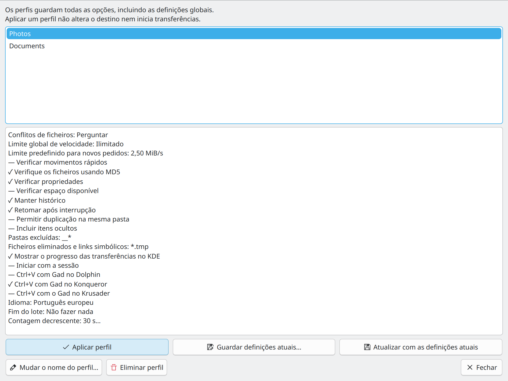

Na linha de comandos, `gad --profile "Meu perfil"` aplica as definições sem iniciar uma transferência. Para copiar: `gad --profile "Meu perfil" --copy /caminho/origem --to /caminho/destino`; também funciona com `--move` / `--paste`. Gad aguarda a aplicação do perfil. O destino vem do comando e as opções explícitas, como `--md5`, têm prioridade. Um nome desconhecido devolve um erro sem colocar ficheiros em fila. `--configure --profile "Meu perfil"` aceita definições adicionais, aplicadas após o perfil.

## Políticas de conflitos nos perfis

Em **Opções → Conflitos de ficheiros**, escolha **Perguntar**, **Ignorar ficheiros existentes**, **Substituir apenas ficheiros mais antigos** ou **Manter ambos os ficheiros**. Guarde ou atualize o perfil. Os pedidos existentes mantêm a sua política.

Só são substituídos destinos com data de modificação estritamente anterior à da origem; datas iguais ou posteriores são ignoradas. Datas ilegíveis e ligações simbólicas causam um erro sem substituição: altere a política e tente novamente. A fiabilidade das datas depende do sistema de ficheiros ou serviço remoto. As pastas existentes são unidas e a política aplica-se aos conflitos interiores. Manter ambos acrescenta um sufixo numerado. Os ficheiros ignorados ficam na origem ao mover; as substituições permitem restauração.

Comando: `gad --configure --conflict-policy newer`. Os perfis dos formatos 1 e 2 são migrados para **Perguntar**, sem destino.

## Pesquisar no histórico guardado {#history-search}

Clique em **Pesquisar no histórico** ou prima **Ctrl+F**. Introduza um nome ou parte do caminho de origem/destino, incluindo URL remotos. As palavras combinam-se com E, sem distinguir maiúsculas e sem expressões regulares. Escolha um estado do lote e ative **Adicionado entre** para filtrar a data de adição, com datas locais inclusivas.

**Apenas histórico** mostra lotes concluídos, cancelados, restaurados ou com erro; desmarque para incluir pedidos ativos. Os filtros de colunas combinam-se com a pesquisa. As pastas ascendentes dos resultados continuam visíveis. **Repor pesquisa** limpa os seus critérios sem alterar os filtros de colunas; fechar a barra ou premir **Escape** desativa apenas esta pesquisa. A fila e as prioridades não mudam.

A dica da coluna de ordem mostra a data de adição. Operações antigas sem data são identificadas e continuam pesquisáveis sem filtro de data. É necessário manter o histórico: operações apagadas já não podem ser encontradas.

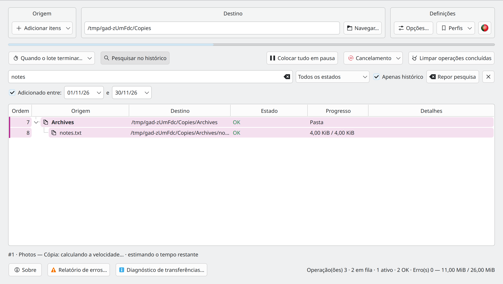

## Diagnóstico de transferências {#transfer-diagnostics}

O botão **Diagnóstico de transferências…**, no rodapé, abre uma vista não modal dos pedidos ativos e em espera. Mostra o estado, a atividade ou espera observada, os limites globais e por pedido, a velocidade e o tempo restante. Os números dos lotes bloqueadores correspondem à lista principal.

As causas distinguem pausas, análise da origem, conflitos pendentes, dispositivos ou montagens remotas indisponíveis, verificação MD5, verificação do prefixo de retoma, mudança de nome local, restauração exclusiva, dois trabalhadores ocupados, prioridade de linhas, discos partilhados ou caminhos sobrepostos e execução em série quando os recursos são desconhecidos.

Uma espera de orçamento de velocidade só é indicada se o limitador a observou no último segundo. Um limite configurado não prova uma lentidão. Após cinco segundos sem progresso de bytes durante uma cópia ou MD5, fora das esperas pelo limite, o Gad informa dessa ausência de progresso: as operações de ficheiros ou a finalização podem estar em espera, mas não permitem identificar um limite concreto do disco ou da rede. Não são testes de desempenho e não são guardados no histórico. Fechar a janela não altera as transferências.

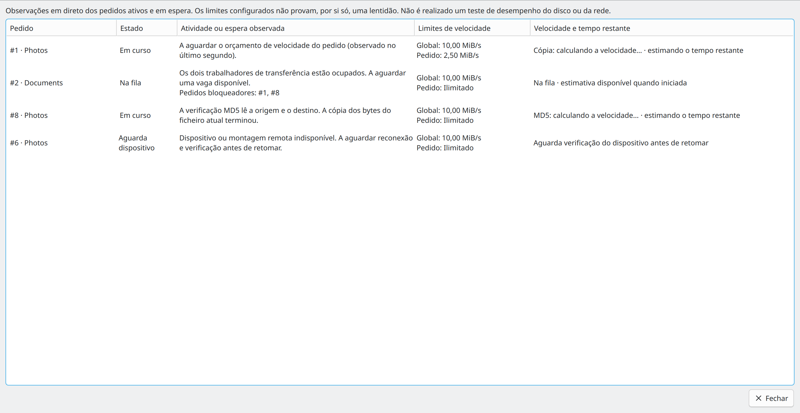

Os limites de velocidade aplicam-se aos bytes copiados; as leituras MD5 e as mudanças de nome locais são fases distintas.

## Verificar movimentos rápidos {#verify-fast-moves}

Em **Opções**, marque **Verificar movimentos rápidos**. Está desativado por predefinição, é guardado nos perfis e capturado por novo pedido. Após uma mudança de nome local, o Gad verifica identidade (dispositivo/inode), tipo, tamanho, data de modificação, permissões, proprietário/grupo, destinos de ligações e árvore exata, além do desaparecimento do caminho original. Aceita alterações legítimas de ctime da raiz renomeada; os descendentes devem conservá-lo.

O detalhe indica **Movimento rápido verificado** no fim. O diagnóstico distingue esta fase de MD5. Diferenças, elementos adicionados ou em falta, um caminho original recriado ou erros de leitura fazem falhar o lote e identificam o caminho verificado. O resultado movido e o diário são mantidos, sem restauração automática que substitua ficheiros modificados. Pausar ou cancelar não elimina o resultado já movido.

Verifica metadados, não o conteúdo; não substitui uma comparação criptográfica. MD5 continua separado e obriga a copiar/verificar/eliminar. Cópias normais não recebem um falso resultado de verificação rápida. Perfis antigos migram com a opção desativada. Comando: `gad --configure --verify-fast-move`; desativar: `--no-verify-fast-move`.

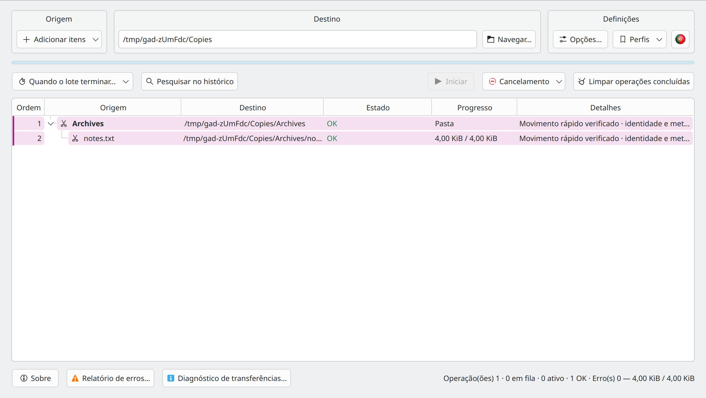

## Ações de fim do lote {#queue-completion}

Em **Opções → Fim do lote**, escolha notificar, fechar o Gad, suspender ou desligar o computador. Defina entre **5 e 3600 segundos** para cancelar (30 por predefinição) e clique em **Ativar para este lote**. O estado indica se a ação está ativa. Escolher uma ação ou carregar um perfil apenas guarda as definições. Alterar as definições de conclusão desativa uma ativação anterior.

A contagem começa quando todas as transferências acompanhadas terminam sem erros, incluindo a preparação remota e a gravação final. Ainda pode cancelar. Adicionar transferências adia a ação e reinicia depois a contagem completa. Um erro, cancelamento, restauro ou pedido removido desativa a ação. A pausa impede a execução.

Desativar a ação ou fechar a contagem não cancela transferências. A ativação vale uma vez e não é restaurada ao reiniciar o Gad. O menu de fim do lote oferece as mesmas ações e abre o separador correspondente. Aqui «lote» abrange todas as transferências acompanhadas, não apenas uma linha selecionada.

Suspender e desligar utilizam logind e respeitam as suas permissões e inibidores. Uma notificação permite abrir o Gad oculto. `gad --configure --completion-action suspend --completion-delay 60` apenas guarda preferências; ative depois a ação no Gad.

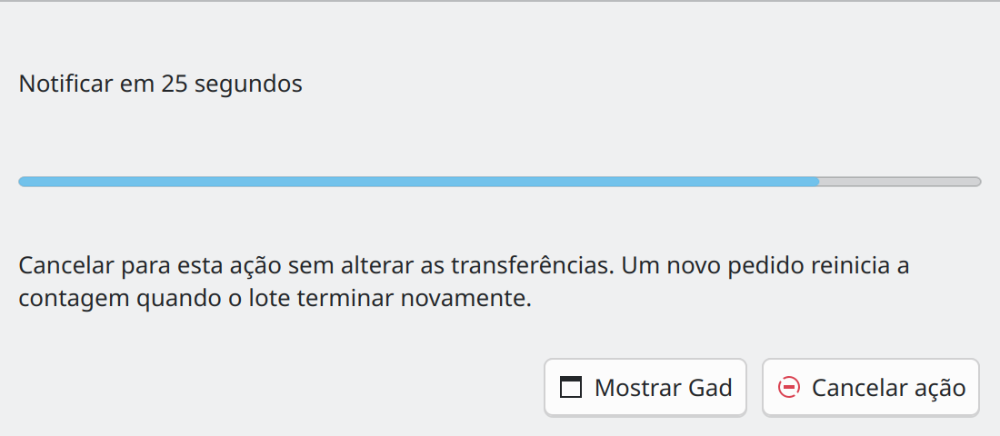

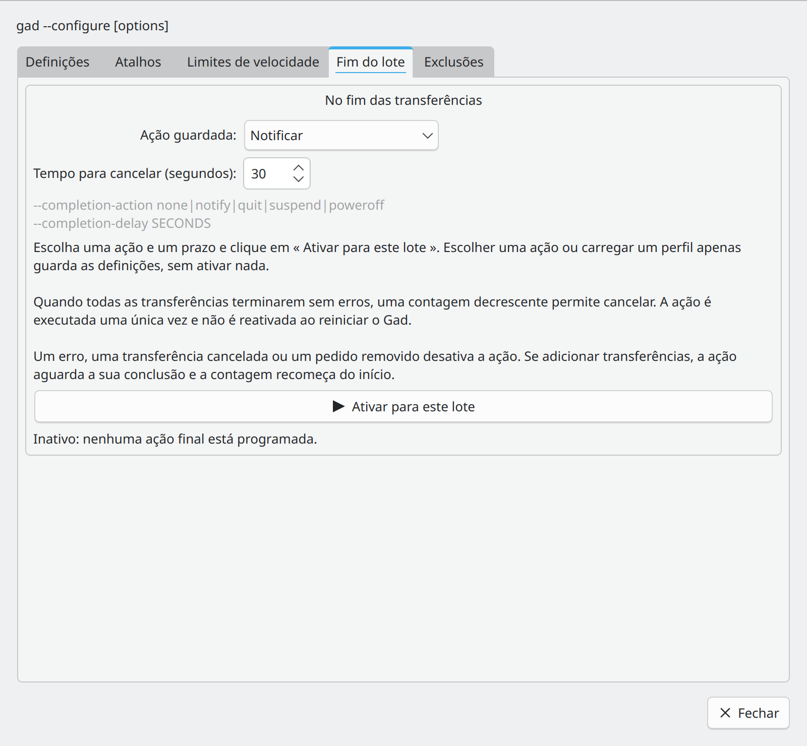


## Preparar transferências na lista principal {#preparing-transfers}

Sem trabalho em curso, os ficheiros adicionados pela janela (**Adicionar ficheiros…**, **Adicionar pasta…** ou arrastar e largar) são analisados e mostrados sem iniciar a transferência. Escolha primeiro o destino e as opções, reveja a árvore e clique em **Iniciar**. Já não existe uma janela de simulação separada.

O mesmo botão passa a pausar tudo e depois a retomar a fila. Se já houver transferências autorizadas, os novos elementos entram automaticamente na fila. A colagem externa pelo gerenciador de arquivos e os comandos externos iniciam sem abrir a janela principal; um pedido externo recusado não inicia o trabalho preparado. Os duplicados pendentes são ignorados com um aviso.

Durante a cópia, o ficheiro parcial aparece como `ficheiro.ext.part` e recebe o nome final após sucesso. Se o nome estiver ocupado, o Gad escolhe um sufixo único. Uma interrupção pode retomar o mesmo parcial após verificação. Limpar o histórico elimina a possibilidade de restaurar transferências concluídas.

O relatório de erros e o diagnóstico também bloqueiam a janela principal. **Mostrar na lista** fecha o relatório e desativa pesquisas que ocultem a linha. O filtro do relatório acompanha o idioma selecionado.

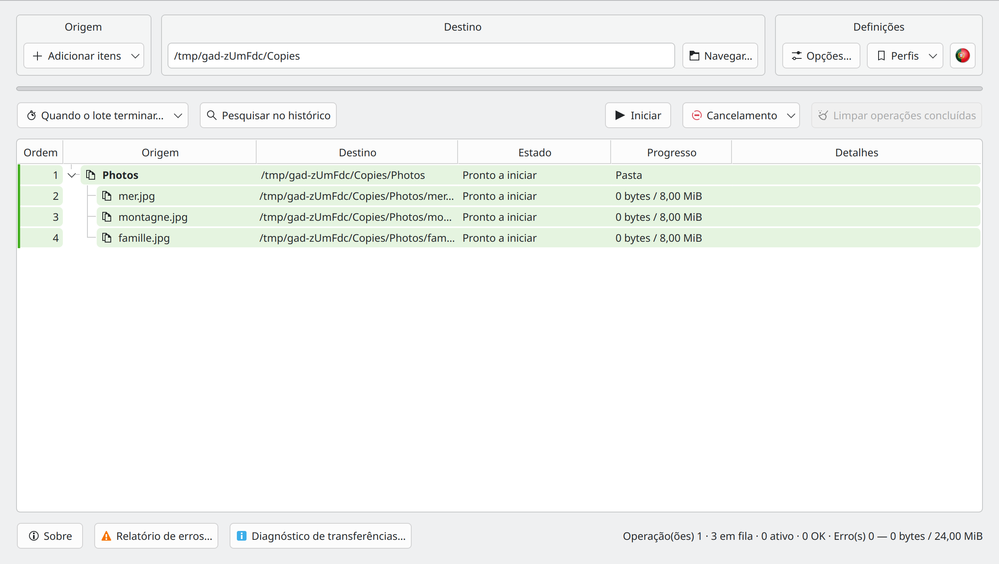


## Idioma e progresso da sessão

O botão à direita de **Perfis** mostra apenas a bandeira do idioma atual. Clique para escolher um idioma. Este menu substitui a caixa nas opções. A barra global começa em zero ao abrir o Gad e acompanha os bytes processados desde esse momento. As linhas mantêm o progresso real, incluindo transferências interrompidas.

## Adicionar itens, atalhos e exclusões

**Ctrl+F** abre a pesquisa. **Ctrl+Q** solicita sair e impede a saída com transferências ativas. **Ctrl+Alt+W** oculta a janela sem interrompê-las. O botão com a bandeira junto a Perfis altera o idioma imediatamente. Os botões principais têm dicas de ferramenta.

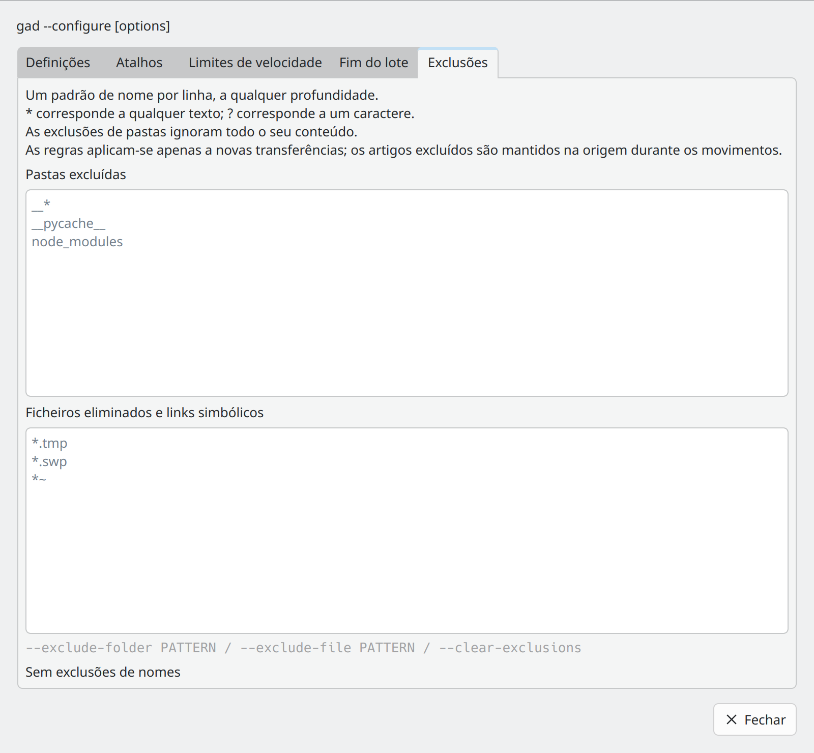
